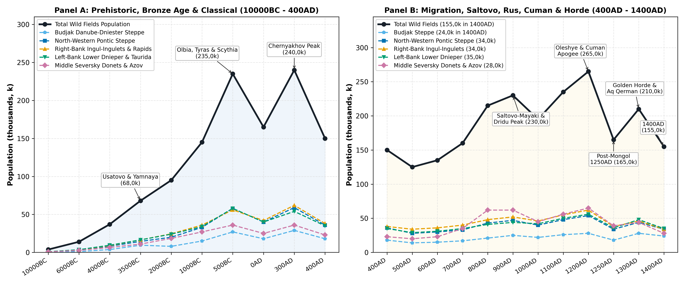
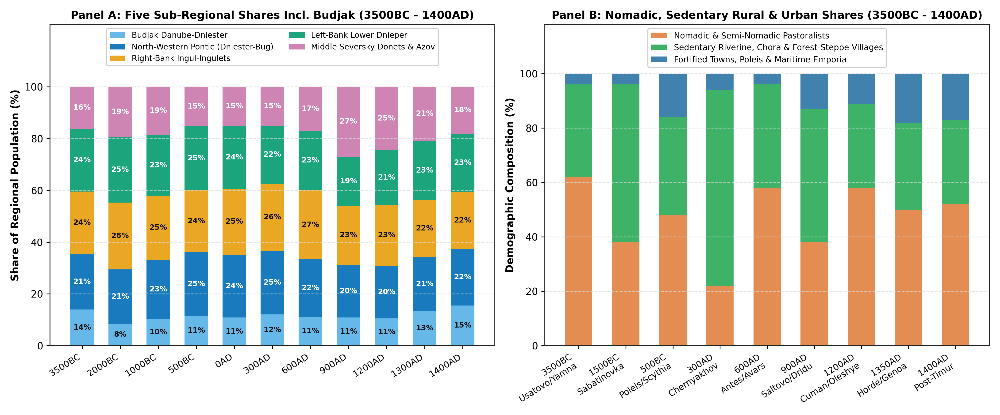
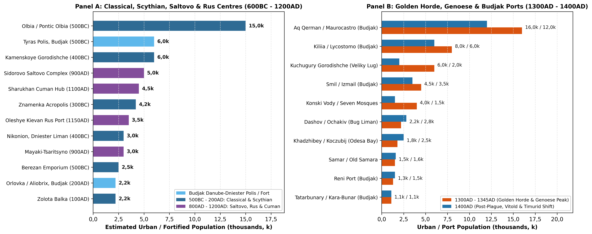

# Abstract

The Wild Fields (Polish *Dzikie Pola*, Latin *Loca Deserta*, Ukrainian
*Dyke Pole* and the western wing of *Desht-i Kipchak*) cover the
southern Ukrainian steppe between the Lower Danube and the Seversky
Donets, an area of ~238k km² north of the Perekop Isthmus and south of
the forest-steppe line
[\[1\]](#ref-ivanova2010)[\[2\]](#ref-kabuzan1976). From small Ice Age
and Mesolithic hunting camps along the river valleys (3,8k in 10000BC),
farming and herding spread across the steppe in the Copper and Bronze
Ages to support 145k people by 1000BC. Greek trading towns on the Black
Sea estuaries and Royal Scythian settlements on the Lower Dnieper lifted
the population to 235k in 500BC, and the dense farming villages of the
Chernyakhov culture reached a Classical peak of 240k in 300AD. After the
Huns drove numbers down to 125k by 500AD, Bulgarian *Dridu* villages in
Budjak and the Khazar-era Saltovo-Mayaki forts on the Seversky Donets
carried the total back to 230k in 900AD, while trade between Kievan Rus
and the Cumans produced a medieval peak of 265k in 1200AD. Although
Golden Horde rule revived town life at Aq Qerman, Kiliia and Velyki
Kuchugury by 1300AD (210k), the Black Death, Horde civil wars and
Timur’s 1395AD campaign emptied much of the inland steppe, leaving 155k
people in 1400AD, mostly around the Moldavian, Genoese and Lithuanian
ports of Budjak and the north-western coast.

# Background

## Steppe and River Valleys

From 10000BC to 1400AD, settlement in the Wild Fields was shaped by the
sharp contrast between the dry upland plains and the river valleys. The
open feather-grass steppe (*plakor*) between the major rivers consisted
of gently rolling loess plateaus with black-earth and chestnut soils
receiving 350 to 480 mm of rain a year; before modern deep wells, these
dry watersheds had little surface water in summer and served mainly as
seasonal grazing land for nomadic herders
[\[1\]](#ref-ivanova2010)[\[3\]](#ref-kulkova2023). By contrast, the
deep river valleys, rapids, wooded floodplains (*plavni*), freshwater
lakes and coastal estuaries (*limany*) offered shelter and water
year-round. Here the Lower Danube (Chilia/Kiliia arm) and its Budjak
lakes (Yalpug, Kugurlui, Katlabukh, Kitai and Kagul), the Dniester
(*Tyras*), Tiligul, Southern Bug (*Hypanis*), Ingul, Ingulets, Lower
Dnieper (*Borysthenes*) with its nine granite rapids (*Porohy*) and the
*Veliky Lug* (“Great Meadow”) floodplain woods, Samara, Orel, Konka,
Molochnaya, Kalmius, Mius and Middle Seversky Donets provided timber,
fresh water, rich sturgeon and carp fisheries, winter reed-bed grazing
and steep bluffs for defence
[\[4\]](#ref-olenkovskiy2010)[\[5\]](#ref-bylkova2010)[\[6\]](#ref-kravchenko2020)[\[7\]](#ref-skalkovsky1846).

## Regional Divisions

Following its river basins and natural borders (Figure and Table ), the
238k km² territory divides into five parts.

Region I covers Budjak (~13,1k km²), bounded by the Lower Danube and
Chilia Delta on the south, the Prut confluence and Moldovan border on
the west, the Black Sea coast (with the Sasyk, Shagany, Alibey and
Burnas lagoons) on the south-east and the Dniester River and Dniester
Liman on the north-east. Unlike the inland steppe, Budjak combines an
open dry plain (drained by the Kogilnik, Chaga, Sarata and Khadzhider
rivers) with two fertile coastal and river zones: the Danube floodplain
lakes (Kagul, Yalpug, Katlabukh and Kitai) and the western bank of the
Dniester Liman. Because of this position, Budjak long served as the main
bridge between the Balkan-Danubian world (Gumelnita farmers, Getae,
Roman Lower Moesia, First and Second Bulgarian *Dridu* villages,
Byzantium, Genoese *Lycostomo* and Moldavia) and the Pontic steppe
(Yamnaya herders, Scythians, Sarmatians, Pechenegs, Cumans and Golden
Horde *Aq Qerman*)
[\[8\]](#ref-bruyako1993)[\[9\]](#ref-subbotin2000)[\[10\]](#ref-rabinovich1999)[\[11\]](#ref-boguslavskiy2014).

Region II spans the north-western Pontic steppe (~45,4k km²) between the
Dniester River and Liman on the south-west, the Kodyma River and
forest-steppe line on the north, the Southern Bug (*Hypanis*) and Bug
Liman on the north-east and the Black Sea on the south. It contained the
Copper Age Usatovo settlements (Usatovo and Mayaki), the Milesian Greek
towns and farm villages of Olbia, Berezan, Nikonion and Koshary,
Chernyakhov coastal villages (Koblevo and Kamenka-Anchekrak), Tivertsi
and Ulichi border settlements and the late fourteenth-century ports of
Khadzhibey (*Koczubij*) and Dashov (*Ochakiv*)
[\[12\]](#ref-kryzhitsky1999)[\[13\]](#ref-kryzhitsky1989)[\[14\]](#ref-dyachenko2010)[\[15\]](#ref-dobrolyubskiy1999).

Region III covers the right-bank Bug-Dnieper country, the Ingul-Ingulets
uplands and the right bank of the Dnieper Rapids (~56k km²), bounded by
the Southern Bug on the west, the forest-steppe border along the Dnieper
Upland on the north and the Dnieper (*Borysthenes*) and Dnieper-Bug
Estuary on the east and south-east. Taking in the Syniukha, Ingul,
Ingulets, Visun, Saksahan and Bazavluk valleys, this region held the
Dereivka Copper Age settlement, the Sabatinovka and Ingul Catacomb
Bronze Age heartland, the great Royal Scythian burial mounds
(Chertomlyk, Tovsta Mohyla and Alexandropol) and the chain of Late
Scythian stone forts along the right bank of the Dnieper (Zolota Balka,
Gavrilovka, Krasny Mayak, Konsulovskoye and Nikolaevka-Kazatskoye)
[\[5\]](#ref-bylkova2010)[\[16\]](#ref-chernienko2014)[\[17\]](#ref-daragan2021).

Region IV comprises the left-bank Lower Dnieper, Veliky Lug, the
Samara-Orel basin and the northern Taurida steppe (~61,5k km²), bounded
on the west by the Dnieper, on the north by the Orel (*Oril*) River and
forest-steppe border, on the east by the Azov Upland watershed (the
Berda divide) and on the south by the Black Sea, Perekop-Sivash and the
Sea of Azov. It contained the Vasylivka Mesolithic cemeteries, the
Kamyana Mohyla rock sanctuary, the Mikhailovka Yamnaya fort, the 1,2k ha
Scythian town of Kamenskoye Gorodishche, the Voznesenka princely camp,
the Kievan Rus ports of Oleshye, Protolche (Khortytsia) and Igren-Samar
and the Golden Horde towns of Velyki Kuchugury, Mamai-Surka and Konski
Vody
[\[18\]](#ref-grakov1954)[\[19\]](#ref-dovzhenok1961)[\[20\]](#ref-bocharov2015)[\[21\]](#ref-vorotyntsev2018).

Region V takes in the Middle Seversky Donets, the Donets Ridge and the
Kalmius-Mius Azov basin (~62k km²), bounded on the west by the
Dnieper-Donets and Azov Upland watershed, on the north-west by the
forest-steppe border, on the east by the Aidar-Derkul-Donets-Mius basin
divide and on the south by the Sea of Azov. Across the chalk bluffs of
the Middle Seversky Donets and Oskol valleys, the Donets Ridge
(*Donetskiy Kryazh*) and the Kalmius-Mius coast, this eastern region
held the Amvrosievka Palaeolithic hunting camp, the Mariupol Neolithic
cemetery, the Bronze Age copper mines of Kartamysh, the eighth- to
tenth-century Saltovo-Mayaki forts and towns (Sidorovo,
Mayaki-Tsaritsyno, Sukhaya Gomolsha and Mokhnach), the Polovtsian winter
towns of Sharukhan, Sugrov and Balin and the Golden Horde and Italian
port at Belosaraiskaya (*Porto Pisano*)
[\[6\]](#ref-kravchenko2020)[\[22\]](#ref-inkov2007)[\[23\]](#ref-koloda2015).

| Region | Area (% Share) | Boundaries | Main Settlements & Sites |
|:---|:---|:---|:---|
| I. Budjak (Danube-Prut-Dniester Steppe & Liman) | 13,1k km² (5,5%) | Danube R. & Delta (S), Prut/Moldova (W), Black Sea (SE), Dniester R. & Liman (NE) | Mirnoe, Nerushai, Orlovka (Aliobrix), Tyras/Aq Qerman (Maurocastro), Kiliia (Lycostomo), Smil (Izmail), Reni |
| II\. NW Pontic Steppe (Dniester-Bug & Liman) | 45,4k km² (19,1%) | Dniester R. (SW), Kodyma & Forest-Steppe (N), Southern Bug R. & Liman (NE) | Usatovo, Mayaki, Nikonion, Berezan, Olbia, Koshary, Sabatinovka, Anetovka II, Khadzhibey, Dashov (Ochakiv) |
| III\. Right-Bank Bug-Dnieper, Ingul-Ingulets & Rapids | 56k km² (23,5%) | Southern Bug R. (W), Forest-Steppe Line (N), Dnieper R. & Estuary (E/SE) | Dereivka, Chertomlyk, Tovsta Mohyla, Zolota Balka, Gavrilovka, Krasny Mayak, Bashmachka, Voznesensk |
| IV\. Left-Bank Lower Dnieper, Veliky Lug & N. Taurida | 61,5k km² (25,8%) | Dnieper R. (W), Orel R. & Forest-Steppe (N), Azov Upland Divide (E), Perekop/Azov (S) | Vasylivka, Mikhailovka, Kamyana Mohyla, Kamenskoye, Voznesenka, Khortytsia (Protolche), Oleshye, Kuchugury |
| V. Middle Seversky Donets, Donets Ridge & Azov Basin | 62k km² (26,1%) | Dnieper-Donets Divide (W), Forest-Steppe (NW), Aidar-Mius Frontier (E), Azov Sea (S) | Amvrosievka, Mariupol Neolithic, Kartamysh, Sidorovo, Mayaki-Tsaritsyno, Sukhaya Gomolsha, Sharukhan, Sugrov |
| Total Wild Fields | 238k km² (100%) | Lower Danube to Seversky Donets & Sea of Azov | 191 recorded settlements and sites |

The five geographical divisions of the Wild Fields and Budjak (~238k
km²), showing each region’s share of the steppe, its river boundaries
and its principal prehistoric, Classical and medieval settlements.

# Results

## Prehistory and the Bronze Age

### Ice Age, Mesolithic and Neolithic River Camps

At the end of the Ice Age (10000BC), as cold steppe gave way to warmer
grasslands and rising seas flooded the north-western Black Sea shelf
into brackish *liman* estuaries, Upper Palaeolithic and Early Mesolithic
hunting bands gathered along limestone river gorges, the Budjak streams
and the granite rapids of the Bug and Dnieper
[\[4\]](#ref-olenkovskiy2010)[\[14\]](#ref-dyachenko2010). Excavations
along the Southern Bug (Anetovka II in Region II), the Krynka-Mius basin
(the Amvrosievka bison kill site in Region V) and the Lower Dnieper show
large group hunts of steppe bison, wild horse and saiga antelope
[\[4\]](#ref-olenkovskiy2010). By the Mesolithic (8000BC), large base
camps such as Mirnoe in Budjak (Region I), the sandstone rock sanctuary
of Kamyana Mohyla on the Molochnaya River (Region IV) and the cemeteries
at the Dnieper Rapids (Vasylivka I-III, Voloske and Igren VIII, with 30
to 50 graves apiece) point to settled fishing communities around the
rapids. In 10000BC the regional population stood at about 3,8k (0,3k in
Budjak \[I\], 0,8k in NW Pontic \[II\], 0,95k in Right-Bank \[III\],
0,95k in Left-Bank \[IV\] and 0,8k in Middle Donets \[V\]), rising to
6,8k by 8000BC.

During the warmer, wetter Neolithic period (6000BC - 5000BC),
pottery-making villagers settled along the rivers and estuaries of all
five regions. Around Lakes Yalpug, Kagul and Katlabukh in Budjak (Region
I, 6000-4500BC), early farmers and fishers in contact with Balkan
Starcevo-Cris and Linearbandkeramik groups raised Budjak’s population
from 1,1k in 6000BC to 1,9k in 5000BC
[\[9\]](#ref-subbotin2000)[\[14\]](#ref-dyachenko2010). In Regions II
and III (6200-5000BC), settlements of the Bug-Dniester Culture clustered
along the Southern Bug rapids between Savran, Migeya and Bazkov Ostrov,
using flint sickles and keeping early livestock
[\[14\]](#ref-dyachenko2010). Across Regions III and IV (6000-4500BC),
Sursko-Dnieper and Dnieper-Donets II communities lived on the islands
and banks of the Dnieper Rapids (Surskoy Island, Nikolskoye and Vovnigi,
with over 130 graves) and around the Samara-Orel confluence
[\[24\]](#ref-telegin1986). In Region V (5500-4500BC), the 122 red-ochre
graves at Mariupol at the mouth of the Kalmius River mark a similar
fishing and herding community on the Azov coast. Total population across
the Wild Fields doubled from 14k in 6000BC to 24k in 5000BC.

### Copper Age and Early Bronze Age Herders and Farmers

Between 4500BC and 3000BC, Balkan copper working and steppe horse
herding transformed the region, with Budjak (Region I) and the
Dniester-Bug coast (Region II) growing fastest
[\[9\]](#ref-subbotin2000)[\[25\]](#ref-rassamakin2000)[\[26\]](#ref-anthony2007).
Around Lakes Yalpug, Kagul, Katlabukh and Kitai in Budjak (Bolhrad,
Ozernoye, Etulia VI, Plavni, Nagornoye, Suvorovo, Chervonyi Yar and
Orlovka/Kartal), farmers of the Bolgrad-Aldeni branch of the Gumelnita
Culture built villages of 20 to 40 wattle-and-daub houses (4200-3800BC,
supporting 3,8k people in Region I by 4000BC)
[\[9\]](#ref-subbotin2000)[\[27\]](#ref-govedarica2010). By 3500-3000BC,
mingling between late Trypillia farmers and steppe kurgan herders of the
Budjak Culture (known from Yamnaya and Usatovo burial mounds at
Nerushai, Semenovka, Mayaki, Trapovka, Borisovka, Sarata and Tarutyne)
lifted Budjak’s population to 9,5k in 3500BC and 8,5k in 3000BC
[\[1\]](#ref-ivanova2010)[\[9\]](#ref-subbotin2000).

East of the Dniester Liman in Region II (3500-3000BC), stone-walled
settlements of the Usatovo culture at Usatovo and Mayaki near the
Khadjibey and Kuialnyk estuaries presided over 14,5k inhabitants in
3500BC [\[14\]](#ref-dyachenko2010). Together with Budjak (9,5k), the
western coastal steppes (Regions I and II) held 24k people, or more than
a third of the regional total. Further east in Regions III, IV and V
(4000-3000BC), Sredny Stog horse-keepers at Dereivka (Region III) and
the stone-walled Yamnaya fort at Mikhailovka (Region IV) anchored
wagon-dwelling herders along the Ingulets, Molochnaya and Seversky
Donets, raising the total population of the Wild Fields from 37k in
4000BC to 68k in 3500BC and 75k in 3000BC
[\[24\]](#ref-telegin1986)[\[26\]](#ref-anthony2007).

### Middle and Late Bronze Age Villages

During the Middle Bronze Age Catacomb (2800-2000BC) and Babino
(2200-1800BC) periods, herding populations grew steadily to 95k in
2000BC (8k in Budjak \[I\], 20k in NW Pontic \[II\], 24,5k in Right-Bank
\[III\], 24k in Left-Bank \[IV\] and 18,5k in Middle Donets \[V\])
[\[1\]](#ref-ivanova2010)[\[9\]](#ref-subbotin2000).

Prehistoric settlement reached its height in the Late Bronze Age under
the Sabatinovka-Noua (1600-1200BC, Regions I-IV), Srubnaya (1600-1100BC,
Regions IV-V) and Belozerka (1200-950BC) cultures
[\[16\]](#ref-chernienko2014)[\[28\]](#ref-chernienko2000)[\[29\]](#ref-sekerskaya1999).
In Budjak (Region I), more than 200 Sabatinovka-Coslogeni-Noua and
Belozerka farming villages lined the Kogilnik, Sarata, Alkaliya and
Danube lake shores (Zhovtneve/Karakurt, Ogorodnoye, Suvorovo,
Tatarbunary, Diviziya, Tuzly, Shabo and Tudora), supporting 15k people
in 1000BC [\[9\]](#ref-subbotin2000)[\[29\]](#ref-sekerskaya1999). In
Region II (33k in 1000BC), stone-founded villages such as Sabatinovka,
Voronovka II and Tashlyk combined cattle raising with millet farming
[\[16\]](#ref-chernienko2014). Across the Right-Bank Ingul-Ingulets
(Region III, 36k), Left-Bank Lower Dnieper (Region IV, 34k) and
Donets-Azov basin (Region V, 27k), hundreds of stone-built villages
(Zmiivka, Novokievka and Staryi Krym Ingul) flourished alongside the
Srubnaya copper mines and bronze foundries of the Bakhmut basin
(Kartamysh, Usovo Ozero and Kapitanovo in Region V), carrying the Wild
Fields to 145k in 1000BC
[\[3\]](#ref-kulkova2023)[\[28\]](#ref-chernienko2000).

## Classical Antiquity and the Chernyakhov Villages

### Greek Ports in Budjak and on the Dniester-Bug Liman

From the mid-seventh century BC (~647BC), colonists from Miletus founded
trading towns and farming villages across both Budjak (Region I) and the
Dniester-Bug coast (Region II)
[\[8\]](#ref-bruyako1993)[\[12\]](#ref-kryzhitsky1999)[\[30\]](#ref-bruyako2025).
In Budjak (27k in 500BC, 18k in 0AD and 29k in 300AD), Milesian settlers
on the rocky western headland of the Dniester Liman (modern
Bilhorod-Dnistrovskyi) founded Tyras (~600BC), which grew into a walled
town of 6k inhabitants in 500-300BC surrounded by farming villages along
the western shore of the estuary (Shabo, Zatoka, Mologa II, Pivdenne I
and Belenkoye) [\[8\]](#ref-bruyako1993)[\[31\]](#ref-turovskiy2014). At
the south-western tip of Budjak overlooking the Danube crossing at the
Kartal narrows near Reni, the fortified Geto-Scythian and later Roman
river port of Orlovka/Kartal (ancient Aliobrix, with nearby Novoselskoye
and Reni) guarded river traffic between the Danube Delta, the Prut and
the Budjak steppe (1,5k - 2,2k inhabitants)
[\[8\]](#ref-bruyako1993)[\[32\]](#ref-gudkova1999).

In Region II (58k in 500BC, 40k in 0AD and 59k in 300AD), Berezan
(~647BC, 2,5k) and Pontic Olbia (~600BC, a 50-55 ha walled town of 12k -
15k people) on the Bug-Dnieper Liman stood at the centre of more than
150 farming villages (*Shirokaya Balka*, *Kozyrka*, *Chertovatoe VII*,
*Viktorovka I*, *Staraya Bogdanovka II* and *Didova Khata*) housing 20k
to 25k Greco-Scythian grain growers
[\[12\]](#ref-kryzhitsky1999)[\[13\]](#ref-kryzhitsky1989)[\[33\]](#ref-marchenko1999).
On the eastern bank of the Dniester Liman opposite Tyras, Nikonion
(Roksolany, 3k in 500-400BC) and its villages (Nadlimanskoye) linked
Dniester trade to Koshary (Odessos, 1,4k at the Tiligul mouth) and the
settlements around Odessa Bay (Zhevakhova Gora and Luzanovka)
[\[15\]](#ref-dobrolyubskiy1999)[\[34\]](#ref-lisetskiy2011).

### Royal Scythia, Late Scythian Forts and the Chernyakhov Peak

In the inland steppes of Regions III, IV and V, fifth- and
fourth-century BC Royal Scythia centred on the Lower Dnieper Rapids and
*Veliky Lug* (*Gerrhus*)
[\[17\]](#ref-daragan2021)[\[18\]](#ref-grakov1954). At Kamenskoye
Gorodishche (Region IV, enclosing 1,2k ha with its 32 ha Znamenka
citadel and the 800-grave Mamai-Hora cemetery), a resident population of
6k ironworkers and traders (plus 3,5k - 4,2k at Znamenka) lived opposite
the great royal burial mounds of Region III (Chertomlyk, Tovsta Mohyla
and Alexandropol) and Region IV (Solokha, Melitopol and Gaimanova
Mohyla) [\[17\]](#ref-daragan2021)[\[18\]](#ref-grakov1954). In Region V
(36k in 500BC), Scythian hillforts along the forest-steppe fringe
(Velikaya Gomolsha and Koropovye Khutora) and camps on the Azov coast
linked the Donets valley to the Dnieper heartland. Total population
across the Wild Fields reached a Classical peak of 235k in 500BC (27k in
Budjak \[I\], 58k in NW Pontic \[II\], 56k in Right-Bank \[III\], 58k in
Left-Bank \[IV\] and 36k in Middle Donets \[V\]).

After the third-century BC Sarmatian advance pushed the total down to
165k at 0AD, settled farming recovered between 250BC and 200AD along
both banks of the Lower Dnieper (Regions III and IV) around 16 stone
forts (Zolota Balka, Krasny Mayak, Gavrilovka, Konsulovskoye,
Nikolaevka-Kazatskoye, Lvove, Sabinka and Hannivka in Region III;
Lyubimovka, Znamenskoye, Gornostaevka and Kairy in Region IV)
[\[5\]](#ref-bylkova2010)[\[35\]](#ref-popova2011)[\[36\]](#ref-movsesyan2010)[\[37\]](#ref-lysenko2026).
At the same time, Roman garrisons at Tyras and Orlovka/Aliobrix (Region
I) and Olbia (Region II) protected the coastal ports, lifting the total
to 205k in 200AD [\[38\]](#ref-polin2017).

Under the Chernyakhov Culture (250-375AD), hundreds of stone and timber
farming villages spread across Budjak (29k in Region I at
Bolhrad-Yalpug, Etulia, Chervonyi Yar, Kubei, Nagornoye, Belenkoye and
Mologa II), the Dniester-Bug Liman (59k in Region II at Koblevo,
Kamenka-Anchekrak and Ranconia), the Right-Bank Ingul-Ingulets and
Rapids (62k in Region III at Bashmachka and Snihurivka), the Left-Bank
Lower Dnieper (54k in Region IV) and the Donets valley (36k in Region
V). Regional population reached an ancient peak of 240k in 300AD before
the Hunnic invasion of 375AD cut the total to 150k in 400AD (18k in I,
36k in II, 38k in III, 35k in IV and 23k in V; Figure )
[\[32\]](#ref-gudkova1999)[\[39\]](#ref-shchukin1999)[\[40\]](#ref-prikhodnyuk2000).

## Early and High Middle Ages

### Steppe Nomads and Dnieper River Refuges

Between 400AD and 700AD, as Kutrigur and Utigur Bulgars, Avars and Khan
Kubrat’s Old Great Bulgaria crossed the open steppes, the population
fell to 125k in 500AD (14k in Budjak \[I\], 28k in II, 34k in III, 29k
in IV and 20k in V) before recovering to 135k in 600AD and 160k in 700AD
[\[40\]](#ref-prikhodnyuk2000)[\[41\]](#ref-pleshivenko2000). Settled
villages held on at the Lower Danube and Dniester crossings of Budjak
(Orlovka/Kartal and Novoselskoye) and on the granite islands of the
Dnieper Rapids (Voloshskoye, Igren-Samar, Balka Kantsyrka and the
c. 700AD princely camp at Voznesenka in Region IV)
[\[41\]](#ref-pleshivenko2000).

### Bulgarian Villages in Budjak and the Saltovo-Mayaki Forts

From the eighth to the tenth century (750-965AD), the two opposite ends
of the Wild Fields - Budjak (Region I) in the south-west and the Middle
Seversky Donets (Region V) in the north-east - saw a strong revival of
settled village life. After Asparukh crossed the *Onglos* in southern
Budjak (680AD) and the First Bulgarian Empire established its northern
frontier beyond the Danube, more than 70 eighth- to tenth-century
Balkan-Danubian (*Dridu* or *Pliska-Preslav*) villages grew up around
Lakes Yalpug, Kugurlui, Katlabukh, Kitai and Kagul (Suvorovo I-VI,
Bogatoye, Ogorodnoye, Kholmskoye, Chervonyi Yar, Plavni, Etulia,
Nagornoye, Safyany/Izmail and Orlovka/Kartal), guarded on the north by
the earthen Lower Trajan’s Wall (126 km from the Prut at Vadul-lui-Isac
to Lake Sasyk)
[\[9\]](#ref-subbotin2000)[\[10\]](#ref-rabinovich1999)[\[42\]](#ref-titova2008).
Settled by Bulgar, Slavic and Vlach farmers and fishermen, Budjak
supported 21k people in 800AD and 25k in 900AD (~1,91 persons/km², the
highest density in the Wild Fields).

Along the Lower Dniester, Southern Bug and Dnieper Rapids in Regions II,
III and IV (47k, 52k and 44k in 900AD), East Slavic Tivertsi and Ulichi
settlements (Belenkoye, Palanca, Peresechen Steppe, Chern, Voznesensk
and Igren-Samar) traded down the rivers to the Black Sea
[\[19\]](#ref-dovzhenok1961)[\[42\]](#ref-titova2008). At the same time,
in Region V (62k in 800-900AD) under Khazar rule, Alanic and
Proto-Bulgar settlers built more than 250 forts and open villages of the
Saltovo-Mayaki culture along the Seversky Donets and Oskol valleys, led
by the 120 ha Sidorovo complex (5k inhabitants), Mayaki-Tsaritsyno (3k),
Sukhaya Gomolsha (2,6k), Mokhnach (2,5k), Netailovka (2,2k), Teplinskoye
(2k), Zlivki (1,4k) and Krivaya Luka (1,3k)
[\[6\]](#ref-kravchenko2020)[\[23\]](#ref-koloda2015)[\[43\]](#ref-pletneva1967)[\[44\]](#ref-kravchenko2018)[\[45\]](#ref-kravchenko2022).
Across all five regions, the population of the Wild Fields rose to 215k
in 800AD and 230k in 900AD.

### Pechenegs, Kievan Rus Ports and the Cumans

Pecheneg raids and Prince Sviatoslav’s 965AD campaign against Khazaria
burned the Donets Saltovo forts and drove villagers from the open
*Dridu* settlements in Budjak, cutting the regional total to 195k in
1000AD (22k in Budjak \[I\], 40k in II, 46k in III, 42k in IV and 45k in
V) [\[6\]](#ref-kravchenko2020)[\[46\]](#ref-pletneva1990). In the
eleventh and twelfth centuries (1055-1223AD), however, trade between
Kievan Rus, Byzantium and the Cuman (Polovtsian) tribes lifted the
population to 235k in 1100AD and a pre-modern peak of 265k in 1200AD
(28k in Budjak \[I\], 54k in NW Pontic \[II\], 62k in Right-Bank
\[III\], 56k in Left-Bank \[IV\] and 65k in Middle Donets \[V\])
[\[19\]](#ref-dovzhenok1961)[\[46\]](#ref-pletneva1990)[\[47\]](#ref-bubenok2021).

At the Danube and Dniester mouths in Region I (28k in 1200AD),
Byzantine, Galician-Rus (*Berladniki*), Vlach and Cuman trade revived
Maurocastro/Belgorod (ancient Tyras, 3k - 3,5k), Kiliia (2,5k),
Smil/Izmail (1,8k), Reni (1k) and Orlovka/Kartal (1,2k)
[\[10\]](#ref-rabinovich1999)[\[11\]](#ref-boguslavskiy2014). At the
head of the Dnieper estuary in Region IV, the Kievan Rus port of Oleshye
(3,5k in 1200AD) served as Kiev’s sea outlet to Constantinople, paired
upstream with the Khortytsia ferry and *Brodnik* settlement of Protolche
(2,2k) and the 25 ha town of Igren-Samar at the Samara mouth (2,8k)
[\[19\]](#ref-dovzhenok1961)[\[48\]](#ref-astaykin2024). Along the
Middle Seversky Donets in Region V, Cuman-Alanic winter towns grew up at
Sharukhan (4,5k), Sugrov (3,2k) and Balin (2,8k), while more than 2,5k
Polovtsian stone statues (*kamennye baby*) and rich burial mounds (such
as the Chingul Kurgan on the Molochnaya in Region IV) marked twelfth-
and early thirteenth-century clan pastures (Figure )
[\[22\]](#ref-inkov2007)[\[46\]](#ref-pletneva1990).

## The Golden Horde and Late Medieval Ports

### Mongol Conquest and Town Revival

The Mongol campaigns of 1223AD (Battle of the Kalka River in Region V)
and 1238-1240AD cut the population of the Wild Fields from 245k in
1240AD to 165k in 1250AD (18k in Budjak \[I\], 34k in II, 38k in III,
36k in IV and 39k in V)
[\[47\]](#ref-bubenok2021)[\[48\]](#ref-astaykin2024). Under the western
Golden Horde (Prince Nogai, d. 1299AD; Khan Toqta, 1291-1312AD; and Khan
Uzbek, 1313-1341AD), however, trade and town life revived, carrying the
total back to 210k by 1300AD
[\[20\]](#ref-bocharov2015)[\[21\]](#ref-vorotyntsev2018)[\[49\]](#ref-shaposhnik2017).

Under Nogai and Toqta, Budjak (Region I, 28k in 1300AD) became the main
western port district of the Golden Horde. At the Dniester mouth, Aq
Qerman (Maurocastro or Cetatea Alba) minted its own coins, housed
Genoese, Armenian, Greek, Jewish, Moldavian and Tatar merchant quarters
and reached 15k - 16k inhabitants at its height in 1300-1345AD
[\[10\]](#ref-rabinovich1999)[\[11\]](#ref-boguslavskiy2014). On the
Chilia arm of the Danube Delta, the port of Kiliia/Lycostomo (where
Antonio di Ponzò’s 1360-1361AD notary registers record shipments of
grain, wax, salt and wine to Pera and Genoa) held 6,5k - 8k people,
flanked by Smil/Izmail (3,5k - 4,5k), Reni (1,3k) and the inland Golden
Horde town of Kara-Bunar/Tatarbunary (1,1k)
[\[11\]](#ref-boguslavskiy2014). In the *Veliky Lug* floodplain of the
Left-Bank Lower Dnieper (Region IV, 48k in 1300AD), Uzbek and Jani Beg
built the 300 ha open town of Velyki Kuchugury (with a mosque, minaret,
bathhouse, water pipes and 5,5k - 6k inhabitants), alongside
Mamai-Surka, Konski Vody/Mechetna Mohyla (4k) and Oleshye (2k), while
Italian sea charts marked Porto Pisano (Belosaraiskaya, 1,5k) on the
Azov coast of Region V
[\[20\]](#ref-bocharov2015)[\[21\]](#ref-vorotyntsev2018).

### The Black Death, Timur’s Campaign and the 1400AD Benchmark

Between 1346AD and 1400AD, the inland steppes of Regions II, III, IV and
V lost much of their population to the Black Death (1346-1348AD), the
civil wars of the Golden Horde (1359-1380AD), Grand Duke Algirdas’s
campaign at the Battle of Blue Waters (1362AD, on the Syniukha River in
Region III), Timur’s 1395AD campaign (which destroyed Kuchugury,
Mamai-Surka, Konski Vody and the Donets towns) and the Battle of the
Vorskla River (1399AD)
[\[21\]](#ref-vorotyntsev2018)[\[49\]](#ref-shaposhnik2017). Budjak
(Region I) and the ports of Region II held up much better as the
Principality of Moldavia (under Petru I Musat and Alexander the Good in
the 1390s - 1400AD) fortified Cetatea Alba/Aq Qerman (12k in 1400AD),
Kiliia/Chilia (6k) and Smil/Izmail (3,5k), while Grand Duke Vytautas of
Lithuania built fortified customs ports at Dashov/Kara-Kerman (Ochakiv,
2,8k in 1400AD), Khadzhibey/Koczubij (Odessa Bay, 2,5k), Sokolets,
Balyklei and Tyagin [\[11\]](#ref-boguslavskiy2014).

By 1400AD the population of the Wild Fields stood at 155k: 24k in Budjak
(15,5% of the total on 5,5% of the land area), 34k in Region II, 34k in
Region III, 35k in Region IV and 28k in Region V (Figure ).

## Regional Population Summary

Table sets out the complete benchmark population series for the Wild
Fields and Budjak from 10000BC to 1400AD.

| Date | I: Budjak | II: NW Pontic | III: R-Bank | IV: L-Bank | V: Donets | Total | Historical & Archaeological Context |
|:---|:---|:---|:---|:---|:---|:---|:---|
| 10000BC | 0,3k | 0,8k | 0,95k | 0,95k | 0,8k | 3,8k | Epigravettian bison & horse hunters (Anetovka II, Amvrosievka) |
| 8000BC | 0,55k | 1,45k | 1,7k | 1,7k | 1,4k | 6,8k | Kukrek & Grebeniki Mesolithic camps & rapids cemeteries (Mirnoe \[Budjak\], Vasylivka) |
| 6000BC | 1,1k | 3,1k | 3,5k | 3,6k | 2,7k | 14k | Bug-Dniester, Sursko-Dnieper & Danube-Lakes Early Neolithic villages |
| 5000BC | 1,9k | 5,3k | 6k | 6,2k | 4,6k | 24k | Dnieper-Donets II & Mariupol Neolithic collective cemeteries (Vovnigi, Mariupol) |
| 4000BC | 3,8k | 8,2k | 9k | 9,5k | 6,5k | 37k | Bolgrad-Aldeni (Gumelnita) in Budjak; Sredny Stog & Dereivka horse-keepers |
| 3500BC | 9,5k | 14,5k | 16,5k | 16,5k | 11k | 68k | Budjak Kurgan & Usatovo coastal settlements; Early Mikhailovka Copper Age peak |
| 3000BC | 8,5k | 14,5k | 19k | 19k | 14k | 75k | Yamnaya (Pit-Grave) wagon pastoralism (Nerushai, Mikhailovka stone fort) |
| 2000BC | 8k | 20k | 24,5k | 24k | 18,5k | 95k | Catacomb (Ingul/Donets) & Babino Middle Bronze Age pastoralism |
| 1000BC | 15k | 33k | 36k | 34k | 27k | 145k | Sabatinovka-Coslogeni (Budjak), Srubnaya & Belozerka Late Bronze village expansion |
| 500BC | 27k | 58k | 56k | 58k | 36k | 235k | Classical Greek Poleis (Tyras \[Budjak\], Olbia, Nikonion) & Royal Scythia (Kamenskoye) |
| 0AD | 18k | 40k | 42k | 40k | 25k | 165k | Sarmatian migrations & early Late Scythian Lower Dnieper stone forts |
| 200AD | 24k | 50k | 52k | 48k | 31k | 205k | Roman-allied Tyras, Aliobrix \[Budjak\] & Olbia; 16 Late Scythian forts |
| 300AD | 29k | 59k | 62k | 54k | 36k | 240k | Chernyakhov farming & herding peak across Budjak, Liman & Dnieper valleys |
| 400AD | 18k | 36k | 38k | 35k | 23k | 150k | Post-375AD Hunnic destruction of Chernyakhov villages & coastal towns |
| 500AD | 14k | 28k | 34k | 29k | 20k | 125k | Early Medieval Kutrigur/Utigur nomadism; Antae/Penkovka at Dnieper Rapids |
| 600AD | 15k | 30k | 36k | 31k | 23k | 135k | Avar & Old Great Bulgaria steppe transit; Danubian & Rapids settlements |
| 700AD | 17k | 33k | 40k | 35k | 35k | 160k | Asparukh’s Onglos in Budjak; Voznesenka princely camp; early Khazar rule |
| 800AD | 21k | 43k | 48k | 41k | 62k | 215k | Dridu (First Bulgarian Empire) villages in Budjak; Saltovo-Mayaki growth on Donets |
| 900AD | 25k | 47k | 52k | 44k | 62k | 230k | Saltovo-Mayaki (Sidorovo 5k) & Budjak Dridu peak; Ulichi & Tivertsi towns |
| 1000AD | 22k | 40k | 46k | 42k | 45k | 195k | Post-965AD Saltovo collapse; Pecheneg steppe dominance; Kievan Rus Oleshye |
| 1100AD | 26k | 48k | 55k | 50k | 56k | 235k | Polovtsian winter towns (Sharukhan) & Rus Oleshye, Protolche & Berladniki |
| 1200AD | 28k | 54k | 62k | 56k | 65k | 265k | High Medieval Cuman-Rus trade & settlement peak (Maurocastro, Oleshye) |
| 1240AD | 26k | 50k | 57k | 52k | 60k | 245k | Pre-Mongol eve (after 1223AD Battle of Kalka River) |
| 1250AD | 18k | 34k | 38k | 36k | 39k | 165k | Post-1240AD Mongol conquest drop across inland steppes |
| 1300AD | 28k | 44k | 46k | 48k | 44k | 210k | Golden Horde & Genoese town revival (Aq Qerman 16k & Kiliia 8k in Budjak; Kuchugury 6k) |
| 1400AD | 24k | 34k | 34k | 35k | 28k | 155k | Post-Plague & 1395AD Timurid steppe drop; Moldavian-Genoese Budjak & Lithuanian ports |

Complete population series across the five regions of the Wild Fields
and Budjak at 26 benchmark dates, paired with the main archaeological
cultures, nomadic migrations and trading states from the Epigravettian
to 1400AD.

# Sources

1.
Ivanova, Svetlana Vladimirovna.
“Prirodnye Resursy i Ekonomika Drevnikh Obshchestv \[Natural Resources
and Economy of Ancient Steppe Societies\].” *Stratum Plus*, no. 2, 2010,
pp. 49-97,
<https://cyberleninka.ru/article/n/prirodnye-resursy-i-ekonomika-drevnih-obschestv>.

2.
Kabuzan, Vladimir Maksimovich.
*Zaselenie Novorossii (Yekaterinoslavskoy i Khersonskoy Guberniy) v
XVIII - Pervoy Polovine XIX Veka (1719-1858 Gg.) \[the Settlement of New
Russia (Ekaterinoslav and Kherson Governorates) in the 18th and First
Half of the 19th Century, 1719-1858\]*. Nauka, 1976,
<https://search.worldcat.org/search?q=Settlement+New+Russia+Ekaterinoslav+Kherson+Governorates+18th+First+Kabuzan+1976>.

3.
Kulkova, Marianna Alekseevna.
“Prirodnye i Kulturnye Transformatsii Na Rubezhe Epokhi Bronzy - Rannego
Zheleznogo Vekov v Stepnom Poyase Evrazii \[Environmental and Cultural
Transformations at the Bronze-Early Iron Age Transition in the Eurasian
Steppe\].” *Povolzhskaya Arkheologiya*, vol. 45, no. 3, 2023, pp. 80-94,
<https://doi.org/10.24852/pa2023.3.45.95.108>.

4.
Olenkovskiy, Nikolay Petrovich.
“Rol v. N. Stanko i Ego Uchenikov v Raskopochnykh Issledovaniyakh
Pozdnego Paleolita Yuzhnoy Ukrainy \[the Role of v. N. Stanko and His
Students in Excavations of the Upper Palaeolithic of Southern
Ukraine\].” *Stratum Plus*, no. 1, 2010, pp. 120-32,
<https://cyberleninka.ru/article/n/rol-v-n-stanko-i-ego-uchenikov-v-raskopochnyh-issledovaniyah-pozdnego-paleolita-yuzhnoy-ukrainy>.

5.
Bylkova, Valeriya Pavlovna. “K
Probleme Vozniknoveniya Pozdneskifskoy Kultury Na Nizhnem Dnepre \[on
the Emergence of the Late Scythian Culture on the Lower Dnieper\].”
*Bosporskie Issledovaniya*, vol. 23, 2010, pp. 76-96,
<https://cyberleninka.ru/article/n/k-probleme-vozniknoveniya-pozdneskifskoy-kultury-na-nizhnem-dnepre>.

6.
Kravchenko, Eduard Evgenevich.
“Sidorovskiy Arkheologicheskiy Kompleks Na r. Severskiy Donets \[the
Sidorovo Archaeological Complex on the Seversky Donets River\].”
*Arkheologiya Evraziyskikh Stepey*, no. 6, 2020, pp. 182-254,
<https://doi.org/10.24411/2587-6112-2020-1-0031>.

7.
Skalkovsky, Apollon
Aleksandrovich. *Istoriya Novoy Sechi Ili Poslednego Kosha Zaporozhskogo
\[History of the New Sich or the Last Zaporozhian Kosh\]*. Tipografiya
A. Braun, 1846,
<https://search.worldcat.org/search?q=History+New+Sich+or+Last+Zaporozhian+Kosh+Skalkovsky+1846>.

8.
Bruyako, Igor Viktorovich.
“Severo-Zapadnoe Prichernomore v VII-v Vv. Do n. E.: Nachalo
Kolonizatsii Nizhnego Podnestrovya \[the North-Western Black Sea Region
in the 7th-5th Centuries BC: Colonisation of the Lower Dniester\].”
*Antichnyy Mir i Arkheologiya*, vol. 9, 1993, pp. 60-79,
<https://cyberleninka.ru/article/n/severo-zapadnoe-prichernomore-v-vii-v-vv-do-n-e-nachalo-kolonizatsii-nizhnego-podnestrovya>.

9.
Subbotin, Leonid Vasilevich.
“Severo-Zapadnoe Prichernomore v Epokhu Ranney i Sredney Bronzy \[the
North-Western Black Sea Region in the Early and Middle Bronze Age\].”
*Stratum Plus*, no. 2, 2000, pp. 350-87,
<https://cyberleninka.ru/article/n/severo-zapadnoe-prichernomore-v-epohu-ranney-i-sredney-bronzy>.

10.
Rabinovich, Roman Aronovich.
“Prizrachnaya Berlad. O Dostovernosti Odnoy Falsifikatsii \[Elusive
Berlad: Steppe Frontier Towns of the Lower Danube and Dniester\].”
*Stratum Plus*, no. 5, 1999, pp. 357-78,
<https://cyberleninka.ru/article/n/prizrachnaya-berlad-o-dostovernosti-odnoy-falsifikatsii>.

11.
Boguslavskiy, Georgiy Sergeevich,
and Dmitriy Mikhaylovich Yanov. “Serebryanye i Billonnye Monety
Krymskogo Khanstva Iz Noveyshikh Nakhodok v Belgorode (Akkermane)
\[Silver and Billon Coins of the Crimean Khanate from Belgorod /
Akkerman\].” *Materialy Po Arkheologii, Istorii i Etnografii Tavrii*,
vol. 19, 2014, pp. 387-404,
<https://cyberleninka.ru/article/n/serebryanye-i-billonnye-monety-krymskogo-hanstva-iz-noveyshih-nahodok-v-belgorode-akkermane>.

12.
Kryzhitsky, Sergey Dmitrievich, et
al. *Olviya: Antichnoe Gosudarstvo v Severnom Prichernomore \[Olbia: An
Ancient State in the Northern Black Sea Region\]*. Institut Arkheologii
NAN Ukrainy, 1999,
<https://search.worldcat.org/search?q=Olbia+Ancient+State+Northern+Black+Sea+Region+Kryzhitsky+1999>.

13.
Kryzhitsky, Sergey Dmitrievich, et
al. *Selskaya Okruga Olvii \[the Rural Chora of Olbia\]*. Naukova Dumka,
1989,
<https://search.worldcat.org/search?q=Rural+Chora+Olbia+Kryzhitsky+1989>.

14.
Dyachenko, Aleksandr Viktorovich.
“Evstaticheskie Kolebaniya Urovnya Chernogo Morya i Dinamika Razvitiya
Naseleniya Kukuten-Tripolskoy Obshchnosti \[Eustatic Black Sea Level
Fluctuations and Population Dynamics of the Cucuteni-Trypillia
Community\].” *Stratum Plus*, no. 2, 2010, pp. 199-210,
<https://cyberleninka.ru/article/n/evstaticheskie-kolebaniya-urovnya-chernogo-morya-i-dinamika-razvitiya-naseleniya-kukuten-tripolskoy-obschnosti>.

15.
Dobrolyubskiy, Andrey Olegovich.
“V Poiskakh Antichnoy Odessy \[in Search of Ancient Odessa: Greek
Settlements of the Odessa Bay\].” *Stratum Plus*, no. 3, 1999, pp.
241-59,
<https://cyberleninka.ru/article/n/v-poiskah-antichnoy-odessy>.

16.
Chernienko, Yuriy Andreevich.
“Sabatinovskaya Kultura v Sisteme Drevnostey Bronzovogo Veka Yuga
Vostochnoy Evropy \[the Sabatinovka Culture in the Bronze Age System of
Southern Eastern Europe\].” *Stratum Plus*, no. 2, 2014, pp. 149-82,
<https://cyberleninka.ru/article/n/sabatinovskaya-kultura-v-sisteme-drevnostey-bronzovogo-veka-yuga-vostochnoy-evropy>.

17.
Daragan, Marina Nikolaevna, and
Sergey Vasilevich Polin. “Nechaeva Mogila - Posledniy Skifskiy Tsarskiy
Kurgan-Gigant v Prichernomorskoy Skifii \[Nechaeva Mogila: The Last
Royal Scythian Giant Kurgan in Pontic Scythia\].” *Arkheologiya
Evraziyskikh Stepey*, no. 6, 2021, pp. 96-122,
<https://doi.org/10.24852/2587-6112.2021.5.75.107>.

18.
Grakov, Boris Nikolaevich.
*Kamenskoe Gorodishche Na Dnepre \[the Kamenskoye Fortified Settlement
on the Dnieper\]*. vol. 36, Izdatelstvo AN SSSR, 1954,
<https://search.worldcat.org/search?q=Kamenskoye+Fortified+Settlement+Dnieper+Grakov+1954>.

19.
Dovzhenok, Vasiliy Iosifovich.
*Zemlerobstvo Drevnoyi Rusi Do Seredyny XIII St. \[Agriculture of
Ancient Rus to the Mid-13th Century, Including the Oleshye Steppe
Corridor\]*. Vydavnytstvo AN URSR, 1961,
<https://search.worldcat.org/search?q=Agriculture+Ancient+Rus+Mid+13th+Century+Including+Oleshye+Dovzhenok+1961>.

20.
Bocharov, Sergey Gennadevich, and
Andrey Nikolaevich Maslovskiy. “Keramika Khorezma v Zapadnykh Regionakh
Zolotoy Ordy \[Urban Material Culture in the Western Regions of the
Golden Horde\].” *Vestnik Kazanskogo Gosudarstvennogo Universiteta
Kultury i Iskusstv*, no. 4, 2015, pp. 118-26,
<https://cyberleninka.ru/article/n/keramika-horezma-v-zapadnyh-regionah-zolotoy-ordy>.

21.
Vorotyntsev, Leonid
Vyacheslavovich. “Orda Na Kume Zemlyu Pakhala: K Voprosu o
Rasprostranennosti Zemledelcheskikh Praktik v Srede Kochevogo Naseleniya
Ulusa Dzhuchi \[Agricultural Practices Among the Nomadic Population of
the Ulus of Jochi in the 13th-15th Centuries\].” *Tyurkologicheskie
Issledovaniya*, vol. 1, no. 4, 2018, pp. 35-48,
<https://cyberleninka.ru/article/n/orda-na-kume-zemlyu-pahala-k-voprosu-o-rasprostranennosti-zemledelcheskih-praktik-v-srede-kochevogo-naseleniya-ulusa-dzhuchi>.

22.
Inkov, Aleksandr Aleksandrovich.
“Nashestvie Sharukana Na Rus v 1068 Godu: Mify i Realnost \[Sharukan’s
Campaign Against Rus in 1068 and Polovtsian Steppe Camps\].”
*Istoricheskoe Obozrenie*, vol. 8, 2007, pp. 14-24,
<https://cyberleninka.ru/article/n/nashestvie-sharukana-na-rus-v-1068-godu-mify-i-realnost>.

23.
Koloda, Vladimir Vasilevich.
“Kontakty Slavyanskogo Mira i Khazarskogo Kaganata Na Severskom Dontse:
Etnokulturnyy Aspekt \[Contacts of the Slavic World and the Khazar
Khaganate on the Seversky Donets\].” *Povolzhskaya Arkheologiya*, no. 4,
2015, pp. 35-59,
<https://cyberleninka.ru/article/n/kontakty-slavyanskogo-mira-i-hazarskogo-kaganata-na-severskom-dontse-etnokulturnyy-aspekt>.

24.
Telegin, Dmitriy Yakovlevich.
*Dereivka: A Settlement and Cemetery of Copper Age Horse Keepers on the
Middle Dnieper*. BAR International Series 287, 1986,
<https://search.worldcat.org/search?q=Dereivka+Settlement+Cemetery+Copper+Age+Horse+Keepers+Middle+Telegin+1986>.

25.
Rassamakin, Yuriy Yakovlevich.
“Kvityanskaya Kultura: Istoriya i Sovremennoe Sostoyanie Problemy \[the
Kvityana Culture: History and Current State of Research\].” *Stratum
Plus*, no. 2, 2000, pp. 117-77,
<https://cyberleninka.ru/article/n/kvityanskaya-kultura-istoriya-i-sovremennoe-sostoyanie-problemy>.

26.
Anthony, David W. *The Horse, the
Wheel, and Language: How Bronze-Age Riders from the Eurasian Steppes
Shaped the Modern World*. Princeton University Press, 2007,
<https://doi.org/10.1515/9780691292601>.

27.
Govedarica, Blagoje, and Igor
Vasilevich Manzura. “Novye Materialy Rannego Bronzovogo Veka Na
Tiligulskom Limane \[New Early Bronze Age Materials on the Tiligul
Liman\].” *Stratum Plus*, no. 2, 2010, pp. 245-60,
<https://cyberleninka.ru/article/n/novye-materialy-rannego-bronzovogo-veka-na-tiligulskom-limane>.

28.
Chernienko, Yuriy Andreevich.
“Nekotorye Itogi i Problemy Izucheniya Stroitelnogo Dela Na
Sabatinovskikh Poseleniyakh Severo-Zapadnogo Prichernomorya \[Stone
Building Practices at Sabatinovka Settlements of the North-Western Black
Sea Region\].” *Stratum Plus*, no. 2, 2000, pp. 446-74,
<https://cyberleninka.ru/article/n/nekotorye-itogi-i-problemy-izucheniya-stroitelnogo-dela-na-sabatinovskih-poseleniyah-severo-zapadnogo-prichernomorya>.

29.
Sekerskaya, Elena Petrovna.
“Skotovodchesko-Okhotnichya Deyatelnost Naseleniya Epokhi Pozdney Bronzy
Na Territorii Yuga Ukrainy \[Pastoral and Hunting Economy of the Late
Bronze Age Population of Southern Ukraine\].” *Stratum Plus*, no. 2,
1999, pp. 313-22,
<https://cyberleninka.ru/article/n/skotovodchesko-ohotnichya-deyatelnost-naseleniya-epohi-pozdney-bronzy-na-territorii-yuga-ukrainy>.

30.
Bruyako, Igor Viktorovich.
“Antichnyy Import VII v. Do r. Kh. V Severnom Prichernomore \[7th
Century BC Greek Imports in the Northern Black Sea Region\].” *Antichnyy
Mir i Arkheologiya*, vol. 22, 2025, pp. 112-38,
<https://doi.org/10.18500/0320-961X-2025-22-117-138>.

31.
Turovskiy, Evgeniy Yakovlevich,
and Evgeniy Aleksandrovich Kolesnichenko. “Khronologiya Monet
Nezavisimoy (Avtonomnoy) Tiry \[Chronology of the Coinage of Autonomous
Tyras\].” *Stratum Plus*, no. 6, 2014, pp. 67-80,
<https://cyberleninka.ru/article/n/hronologiya-monet-nezavisimoy-avtonomnoy-tiry>.

32.
Gudkova, Aleksandra Vasilevna.
“I-IV Vv. V Severo-Zapadnom Prichernomore (Kultura Osedlogo Naseleniya)
\[the 1st-4th Centuries AD in the North-Western Black Sea Region:
Culture of the Sedentary Population\].” *Stratum Plus*, no. 4, 1999, pp.
235-404,
<https://cyberleninka.ru/article/n/i-iv-vv-v-severo-zapadnom-prichernomore-kultura-osedlogo-naseleniya>.

33.
Marchenko, Konstantin
Konstantinovich. “Osnovnye Aspekty i Rezultaty Izucheniya
Greko-Varvarskikh Kontaktov i Vzaimodeystviy v Severnom Prichernomore
Skifskoy Epokhi \[Main Aspects and Results of Studying Greek-Barbarian
Contacts in the Northern Black Sea Region in the Scythian Era\].”
*Stratum Plus*, no. 3, 1999, pp. 145-72,
<https://cyberleninka.ru/article/n/osnovnye-aspekty-i-rezultaty-izucheniya-greko-varvarskih-kontaktov-i-vzaimodeystviy-v-severnom-prichernomore-skifskoy-epohi>.

34.
Lisetskiy, Fedor Nikolaevich, et
al. “Identifikatsiya Elementov Prostranstvennoy Organizatsii Antichnykh
Agrolandshaftov s Pomoshchyu GIS-Tekhnologiy \[Identification of Ancient
Greek Chora Agrolandscapes Using GIS and Remote Sensing\].” *Uchenye
Zapiski Krymskogo Federalnogo Universiteta*, vol. 24, no. 2, 2011, pp.
155-66,
<https://cyberleninka.ru/article/n/identifikatsiya-elementov-prostranstvennoy-organizatsii-antichnyh-agrolandshaftov-s-pomoschyu-gis-tehnologiy>.

35.
Popova, Elena Aleksandrovna.
“Pozdneskifskaya Kultura: Istoriya Izucheniya, Problemy, Gipotezy \[the
Late Scythian Culture: Research History, Problems and Hypotheses\].”
*Vestnik Moskovskogo Universiteta. Seriya 8: Istoriya*, no. 1, 2011, pp.
94-108,
<https://cyberleninka.ru/article/n/pozdneskifskaya-kultura-istoriya-izucheniya-problemy-gipotezy>.

36.
Movsesyan, Alla Armenovna.
“Pozdnie Skify i Sarmaty v Svete Dannykh Paleofenetiki \[Late Scythians
and Sarmatians in the Light of Cranial Palaeophenetics\].” *Vestnik
Moskovskogo Universiteta. Seriya 23: Antropologiya*, no. 3, 2010, pp.
41-52,
<https://cyberleninka.ru/article/n/pozdnie-skify-i-sarmaty-v-svete-dannyh-paleofenetiki>.

37.
Lysenko, Vladimir Aleksandrovich.
“Pogrebalnyy Obryad Mogilnika Krasnyy Mayak \[Burial Rite and Demography
of the Krasny Mayak Late Scythian Cemetery on the Lower Dnieper\].”
*Problemy Istorii, Filologii, Kultury*, no. 1, 2026, pp. 115-42,
<https://doi.org/10.18503/1992-0431-2026-2-92-148>.

38.
Polin, Sergey Vasilevich.
“Sarmatskoe Zavoevanie Severnogo Prichernomorya (Sovremennoe Sostoyanie
Problemy) \[the Sarmatian Conquest of the Northern Black Sea Region\].”
*Arkheologiya Evraziyskikh Stepey*, no. 3, 2017, pp. 224-43,
<https://cyberleninka.ru/article/n/sarmatskoe-zavoevanie-severnogo-prichernomorya-sovremennoe-sostoyanie-problemy>.

39.
Shchukin, Mark Borisovich.
“Fenomen Chernyakhovskoy Kultury Epokhi Konstantina-Konstantsiya \[the
Phenomenon of the Chernyakhov Culture of the Era of Constantine and
Constantius\].” *Stratum Plus*, no. 4, 1999, pp. 66-101,
<https://cyberleninka.ru/article/n/fenomen-chernyahovskoy-kultury-epohi-konstantina-konstantsiya-ili-chto-takoe-chernyahovskaya-kultura>.

40.
Prikhodnyuk, Oleg Mikhaylovich. “O
Kulturno-Istoricheskom Soderzhanii Arkheologicheskikh Obshchnostey (k
Probleme Interpretatsii Chernyakhovskoy Kultury) \[on the
Cultural-Historical Content of Archaeological Communities: Chernyakhov
and Penkovka\].” *Stratum Plus*, no. 4, 2000, pp. 359-66,
<https://cyberleninka.ru/article/n/o-kulturno-istoricheskom-soderzhanii-arheologicheskih-obschnostey-k-probleme-interpretatsii-chernyahovskoy-kultury>.

41.
Pleshivenko, Alla Grigorevna, and
Aleksandr Leonidovich Antonov. “Kurgan Voznesenskiy \[the Voznesensky
Fortified Camp Complex at Zaporizhzhia\].” *Stratum Plus*, no. 5, 2000,
pp. 47-64,
<https://cyberleninka.ru/article/n/kurgan-voznesenskiy>.

42.
Titova, Ekaterina. “A Ulichi i
Tivertsy Sedyakhu Po Dnestru: Etnicheskiy Sostav Naseleniya
Karpato-Dnestrovskikh Zemel v VI-XIII Vv. \[Ulichi and Tivertsy Along
the Dniester and Southern Bug in the 6th-13th Centuries\].” *Rusin*, no.
1–2, 2008, pp. 16-32,
<https://cyberleninka.ru/article/n/a-ulichi-i-tivertsy-sedyahu-po-dnestru-etnicheskiy-sostav-naseleniya-karpato-dnestrovskih-zemel-v-vi-xiii-vv>.

43.
Pletneva, Svetlana Aleksandrovna.
*Ot Kocheviy k Gorodam: Saltovo-Mayatskaya Kultura \[from Nomad Camps to
Cities: The Saltovo-Mayaki Culture\]*. vol. 142, Nauka, 1967,
<https://search.worldcat.org/search?q=Nomad+Camps+Cities+Saltovo+Mayaki+Culture+Pletneva+1967>.

44.
Kravchenko, Eduard Evgenevich.
“Oboronitelnye Sooruzheniya Arkheologicheskogo Kompleksa u s. Sidorovo
(Srednee Techenie Severskogo Dontsa) \[Fortifications of the Sidorovo
Archaeological Complex on the Middle Seversky Donets\].” *Povolzhskaya
Arkheologiya*, no. 2, 2018, pp. 215-33,
<https://doi.org/10.24852/pa2018.2.24.10.32>.

45.
Kravchenko, Eduard Evgenevich.
“Musulmane Khazarskogo Vremeni Na Severskom Dontse: Arkheologicheskie
Svidetelstva i Voprosy Ikh Interpretatsii \[Khazar-Era Muslims on the
Seversky Donets: Archaeological Evidence and Interpretation\].”
*Arkheologiya Evraziyskikh Stepey*, no. 5, 2022, pp. 120-42,
<https://doi.org/10.24852/2587-6112.2022.6.59.75>.

46.
Pletneva, Svetlana Aleksandrovna.
*Polovtsy \[the Polovtsians / Cumans\]*. Nauka, 1990,
<https://search.worldcat.org/search?q=Polovtsians+Cumans+Pletneva+1990>.

47.
Bubenok, Oleg Borisovich, and
Aleksandr Borisovich Golovko. “Naselenie Porosya v Predmongolskiy i
Zolotoordynskiy Periody \[Steppe Borderland Populations in the
Pre-Mongol and Golden Horde Periods\].” *Zolotoordynskoe Obozrenie*,
vol. 9, no. 4, 2021, pp. 729-51,
<https://doi.org/10.22378/2313-6197.2021-9-3.478-505>.

48.
Astaykin, Andrey Anatolevich.
“Devyat Geograficheskikh Zametok o Pokhode i Bitve Na Reke Kalke 1223
Goda \[Nine Geographical Notes on the 1223 Kalka Campaign, Oleshye and
Protolche\].” *Zolotoordynskoe Obozrenie*, vol. 12, no. 1, 2024, pp.
52-88, <https://doi.org/10.22378/2313-6197.2024-12-2.292-306>.

49.
Shaposhnik, Vladimir Gavrilovich,
and Yuriy Valentinovich Zayonchkovskiy. “K Istorii Kharkovskogo Poudya v
Zolotoordynskoe Vremya \[on the History of the Upper Donets Basin in the
Golden Horde Period\].” *Povolzhskaya Arkheologiya*, no. 2, 2017, pp.
166-79, <https://doi.org/10.24852/pa2017.4.22.147.164>.

