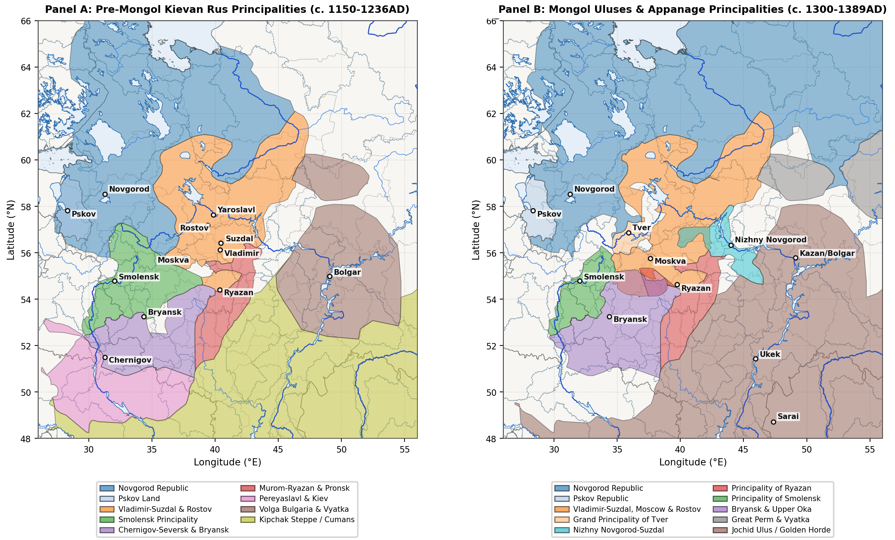
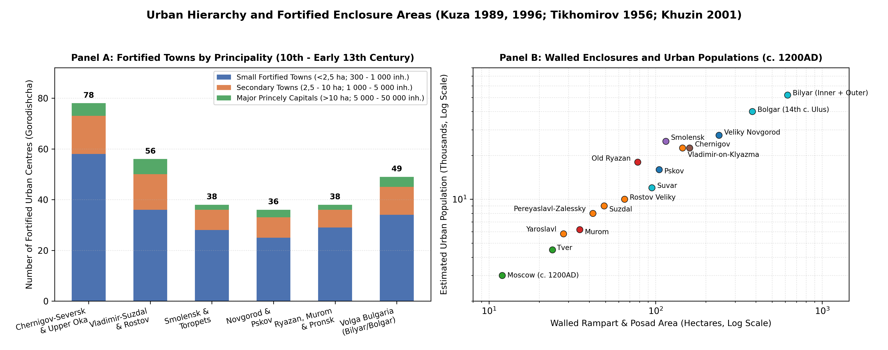
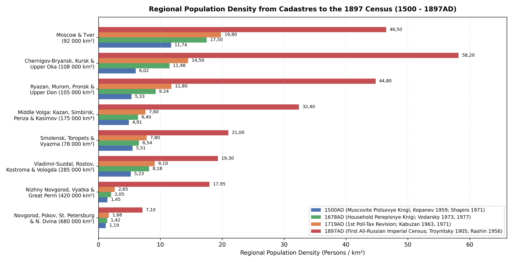
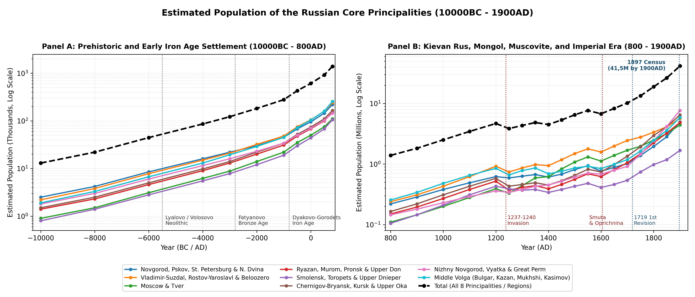

# Abstract

This review reconstructs the long-run population and settlement history of the Russian Core and the Middle Volga-Ural basin (~1.943.000 km²) from 10000BC to 1900AD across eight historical regional divisions: Novgorod and Pskov, Vladimir-Suzdal and Rostov-Yaroslavl, Moscow and Tver, Ryazan and the Upper Don, Smolensk and the Upper Dnieper, Chernigov-Bryansk and the Upper Oka, Nizhny Novgorod, Vyatka, and Great Perm, and the Middle Volga (Volga Bulgaria and Kazan). Estimates combine excavated dwelling floor areas and hillfort networks for the prehistoric and Early Iron Age periods, urban homestead (*usadba*) and rural *selishche* surveys for Kievan Rus and Volga Bulgaria, the 1257-1259 Mongol census (*chislo*), sixteenth- and seventeenth-century Muscovite cadastral and household books (*pistsovye* and *perepisnye knigi*), the ten Imperial Poll-Tax Revisions (1719-1858), and the First All-Russian Imperial Census of 1897. Total regional population grew from 13k foragers at 10000BC to 182k in the Bronze Age (2000BC), 610k at 1AD, and 4,67M on the eve of the Mongol invasion (1200AD), before falling to 3,85M in 1250AD. Subsequent upland watershed colonisation, southward expansion into the forest-steppe, and nineteenth-century agrarian and industrial growth raised the population to 6,49M in 1500AD, 10,19M in 1700AD, and 41,5M by 1900AD.

# Background

To maintain consistent geographic boundaries across the prehistoric, Kievan Rus (882 - 1240AD), Mongol and Appanage (1240 - 1500AD), Muscovite (1500 - 1700AD), and Imperial (1700 - 1900AD) periods, the historical principalities are grouped into eight regional divisions defined by river basins and historical provincial boundaries (Table \ref{tab:polity_catalogue} and Figure \ref{fig:principalities-map}). Because several large polities span multiple modern republics or oblasts - notably the Golden Horde, the Novgorod Republic, and the Chernigov-Seversk principalities - the estimates in this study cover the territory of the Russian Core and the Middle Volga-Ural basin (~1.943.000 km²), excluding the Lower Volga steppe south of Ukek (51,5°N), the Ukrainian Dnieper-Desna left bank south of the Seym-Bryansk watershed (52°N), and Belarusian Polotsk-Turov-Vitebsk west of the Smolensk Dnieper gate (31°E).

# Methodology

Reconstructing the population history of the East European forest, forest-steppe, and Middle Volga-Ural zones from 10000BC to 1900AD requires combining archaeological settlement evidence for prehistoric and medieval periods with fiscal and census records for the early modern and imperial eras [@Vodarsky1973; @Kuza1989; @Avdeev2025]. Rather than relying on global macro-estimates or treating raw counts of excavated sites and radiocarbon dates as direct measures of population change, this study derives regional estimates from five primary classes of historical and archaeological evidence.

For prehistoric and Early Iron Age settlements between 10000BC and 850AD, population densities across the Mesolithic, Neolithic, Bronze Age, and Early Iron Age are estimated from excavated dwelling floors, hearth counts, cemetery populations, and riverine settlement spacing. These include Mesolithic peat-bog camps of the Butovo, Kunda, and Veretye traditions [@Oshibkina2006; @Zhilin2019; @Zhilin2022], multi-hearth timber longhouses (60 - 200 m², housing 15 - 40 occupants) of the Middle Holocene Lyalovo and Volosovo cultures [@Kostyleva2014; @Kostyleva2022], Bronze Age Fatyanovo, Abashevo, and Pozdnyakovo agro-pastoralist communities [@Nordqvist2020; @Saag2021; @Engovatova2021], and Early Iron Age hillfort networks (*gorodishcha*, typically 0,15 - 0,5 ha spaced every 3 - 7 km along river bluffs, supporting 50 - 150 inhabitants per fortified site) of the Dyakovo, Gorodets, Dnieper-Dvina, and Yukhnovo cultures [@Krenke2011; @Krenke2019; @Lopatina2023].

For the urban network of Kievan Rus and Volga Bulgaria between 850 and 1450AD, population estimates follow the fortified-area and homestead (*usadba*/*dvor*) methods developed by M. N. Tikhomirov [@Tikhomirov1956], A. V. Kuza [@Kuza1989; @Kuza1996], V. P. Darkevich [@Darkevich1995], V. L. Yanin [@Yanin1982], and F. Sh. Khuzin [@Khuzin2001]. Across dendrochronologically dated quarters in Veliky Novgorod (Nerevsky, Lyudin, and Slavensky ends), Pskov, Staraya Russa, Smolensk, Old Ryazan, Vladimir, and Suzdal, an urban *usadba* occupied 400 - 1.200 m² (averaging 600 - 800 m² inside timber ramparts and 900 - 1.400 m² in outer *posad* suburbs), resulting in 10 - 16 homesteads per net residential hectare. Applying a mean household multiplier of 5,5 - 6,5 persons per homestead (or 8 - 10 persons on large boyar compounds with dependent artisans) yields a density of 80 - 150 inhabitants per walled hectare [@Kuza1989; @Darkevich1995].

Rural population estimates between 900 and 1500AD are grounded in total-coverage field walking and geophysical surveys of unfortified villages (*selishcha*) in the Suzdal Opolye [@Modin2020; @Shpolyanskiy2021; @Lapshin2011], the Lake Ilmen and Volkhov basin [@Nosov1990], the Moskva-Radonezh upland watersheds [@Chernov1991; @Boytsov2020], the Upper Don valley [@Vorotyntsev2016], and the Western Trans-Kama (*Zakamye*) agricultural core of Volga Bulgaria [@Rudenko2012; @Rudenko2018]. Whereas a typical northern forest hamlet (*derevnya* of 1 - 3 homesteads) covered 0,3 - 1,2 ha (15 - 30 inhabitants), large Opolye and Bulgar chernozem villages (*sela*) covered 5 - 19 ha and housed 100 - 350 inhabitants [@Shpolyanskiy2021; @Khuzin2001].

For the Mongol and early modern periods between 1257 and 1700AD, estimates are cross-checked against the Empire-wide Mongol census (*chislo*) conducted under Grand Qan Möngke and Berke in 1257 - 1259 [@Allsen1987; @Vernadsky1953; @Gorsky2014], the late fifteenth- and sixteenth-century Novgorodian and Muscovite *pistsovye knigi* (land cadastres recording peasant *dvory* and *obzha*/*sokha* tax units) [@Shapiro1971; @Kopanev1959; @Mustafina2008], and the 1646 and 1678 Empire-wide household census books (*perepisnye knigi*) analysed by Ya. E. Vodarsky [@Vodarsky1973; @Vodarsky1977; @Avdeev2025]. From the reign of Peter I to the end of the nineteenth century (1719 - 1900AD), provincial population totals are anchored to the ten Imperial Poll-Tax Revisions (*revizskie skazki*, 1719 - 1858) compiled by V. M. Kabuzan [@Kabuzan1963; @Kabuzan1971; @Ulyanova2016; @Troitskaya2017], nineteenth-century administrative statistics synthesised by A. G. Rashin and B. N. Mironov [@Rashin1956; @Mironov2000; @Myakisheva2016; @Myakisheva2018], and the First All-Russian Imperial Census of 28 January 1897 (*Pervaya vseobshchaya perepis naseleniya Rossiyskoy Imperii*) edited by N. A. Troynitsky [@Troynitsky1905; @Akhtyamova2016], carried forward to 1900AD.

Table: Regional principality divisions, constituent medieval polities, historical date spans, and corresponding imperial provinces of the Russian Core.

|Regional Division                              |Constituent Medieval Polities                             |Kievan Span   |Mongol / Appanage  |Corresponding Imperial Provinces & Area                             |
|:----------------------------------------------|:---------------------------------------------------------|:-------------|:------------------|:-------------------------------------------------------------------|
|Novgorod, Pskov, St. Petersburg & N. Dvina     |Novgorod Republic, Pskov Republic, Zavolochye             |882 - 1240AD  |1240 - 1478/1510AD |St. Petersburg, Novgorod, Pskov, Olonets, Arkhangelsk (680.000 km²) |
|Vladimir-Suzdal, Rostov-Yaroslavl & Beloozero  |Vladimir-Suzdal, Rostov, Yaroslavl, Beloozero             |988 - 1238AD  |1238 - 1474AD      |Vladimir, Yaroslavl, Kostroma, Vologda (285.000 km²)                |
|Moscow & Tver                                  |Grand Principalities of Moscow and Tver                   |1147 - 1238AD |1247 - 1485AD      |Moscow, Tver (92.000 km²)                                           |
|Ryazan, Murom, Pronsk & Upper Don              |Murom-Ryazan, Pronsk, Yelets, Lipetsk                     |1097 - 1237AD |1237 - 1521AD      |Ryazan, N. Tambov, N. Voronezh / Upper Don (105.000 km²)            |
|Smolensk, Toropets & Upper Dnieper             |Smolensk, Toropets, Vyazma, Dorogobuzh, Mstislavl         |1054 - 1239AD |1239 - 1404/1514AD |Smolensk, E. Toropets / Bely (78.000 km²)                           |
|Chernigov-Bryansk, Kursk & Upper Oka           |Chernigov-Kursk, Bryansk, Upper Oka Principalities        |1024 - 1239AD |1239 - 1503AD      |Kursk, Orel, Tula, Kaluga, Bryansk (108.000 km²)                    |
|Nizhny Novgorod, Vyatka & Great Perm           |Nizhny Novgorod-Gorodets, Vyatka Land, Great Perm         |1152 - 1239AD |1239 - 1489/1505AD |Nizhny Novgorod, Vyatka, Perm (420.000 km²)                         |
|Middle Volga (Bulgar, Kazan, Mukhshi, Kasimov) |Volga Bulgaria, Bulgar and Mukhshi Uluses, Kazan, Kasimov |922 - 1236AD  |1236 - 1552AD      |Kazan, Simbirsk, Penza, Kasimov/Temnikov (175.000 km²)              |

plot of chunk fig-principalities-map

# Results

## Prehistoric and Early Iron Age Settlement (10000BC - 850AD)

### Mesolithic and Pit-Comb Neolithic Foragers and Fishers

Human recolonisation of the East European forest zone began during the Younger Dryas-Preboreal transition (10000 - 8000BC) as mobile reindeer- and elk-hunting bands followed periglacial river valleys northward [@Zhilin2019; @Oshibkina2006]. Across the Volga-Oka interfluve and the Upper Dnieper-Desna basin, the Butovo and Resseta tanged-point cultures (8000 - 5500BC) established seasonal base camps on sandy lacustrine terraces and peat bogs such as Stanovoye 4, Ivanovskoye 7, and Zamostje 2 [@Zhilin2019; @Zhilin2022]. In the north-western lake basins (Lakes Ilmen, Lacha, Vozhe, Kubenskoye, and the Sukhona basin), Kunda and Veretye forager-fishers occupied log-built shoreline settlements such as Nizhneye Veretye I (6800 - 6000BC), where waterlogged organic preservation reveals specialised bone harpoons, weir traps, and birch-bark floats [@Oshibkina2006]. Because Mesolithic subsistence depended on seasonal ungulate migrations and lacustrine fish runs, regional population densities remained low (0,006 - 0,025 persons/km²), with the entire Russian Core and Middle Volga-Ural territory increasing from roughly 13k inhabitants in 10000BC to 44,5k by 6000BC [@Zhilin2022].

During the Atlantic climatic optimum (5500 - 2800BC), the spread of Upper Volga early ceramic traditions (5500 - 4200BC), the Lyalovo pit-comb ware culture (4200 - 3000BC), and the Eneolithic Volosovo culture (3200 - 2000BC) supported a much denser network of semi-sedentary fishing and hunting villages along lake outlets across the Volga-Oka, Klyazma, and Kama basins [@Kostyleva2014; @Kostyleva2022]. At the Sakhtysh I-VIII peat-bog complex near Ivanovo and multi-layer sites on lakes Nero and Pleshcheyevo, Volosovo communities constructed rectangular semi-subterranean timber longhouses measuring 60 - 200 m² with 3 - 6 axial hearths, each accommodating an extended household of 15 - 40 persons, alongside structured cemeteries exceeding 100 burials [@Kostyleva2014; @Kostyleva2022; @Saag2021]. Across all eight regional divisions, the total population rose from 86k in 4000BC to 122k by 3000BC.

### Bronze Age Agro-Pastoralists and Iron Age Hillfort Networks

Around 2800 - 2000BC, the arrival of Corded Ware groups of the Fatyanovo-Balanovo culture introduced domesticated cattle, sheep, goats, pigs, and wheeled vehicles into the Upper and Middle Volga forest zone [@Nordqvist2020; @Saag2021]. Ancient DNA analyses from Fatyanovo cemeteries in Yaroslavl, Ivanovo, Moscow, and Chuvashia (including Volosovo-Danilovsky, featuring over 100 graves) confirm that Fatyanovo pastoralists carried steppe-derived ancestry mixed with Central European Early Farmers and coexisted for several centuries with indigenous Volosovo hunter-fishers before genetic and cultural integration [@Saag2021; @Nordqvist2020]. Subsequent Middle and Late Bronze Age societies - the Abashevo (2200 - 1700BC), Seima-Turbino (2100 - 1800BC), Pozdnyakovo (1800 - 1200BC), and Prikazan (1600 - 900BC) cultures - expanded copper-tin metallurgy along the Oka, Klyazma, Kostroma, and Kama rivers, as documented at the Starshe-Nikitinsky cemetery and the Govyadinovo settlement [@Engovatova2021; @Novikov2019]. Total regional population reached 182k in 2000BC and 278k by 1000BC.

The transition to the Early Iron Age (800BC - 500AD) brought local bog-iron smelting, stockbreeding (dominated by horses, cattle, and pigs), and forest swidden millet-barley cultivation [@Krenke2011; @Krenke2019; @Lopatina2023]. Across the Upper Volga, Moskva, and Oka basins, the Finno-Ugric Dyakovo culture (700BC - 500AD) constructed hundreds of promontory hillforts (*gorodishcha*) protected by concentric ditches and log palisades, while the related Gorodets culture occupied the Middle Oka and Moksha-Sura forest-steppe, the Dnieper-Dvina and Yukhnovo cultures occupied the Smolensk and Bryansk-Desna basins, and the Ananyino (800 - 300BC), Pyanobor (200BC - 300AD), and Glyadenovo cultures flourished along the Kama and Vyatka valleys [@Krenke2011; @Belavin2023]. N. A. Krenke's excavations at Dyakovo Gorodishche, Kuntsevo, and Borsheva in the Moskva basin show that Iron Age hillforts averaged 0,15 - 0,5 ha of enclosed habitation, spaced at 3 - 7 km intervals along main rivers and housing 50 - 150 inhabitants (8 - 20 timber dwellings), surrounded by small satellite hamlets (*selishcha*) [@Krenke2011; @Krenke2019; @Sevostyanov2022]. By 1AD, the total population of the eight regions reached 610k, expanding to 920k in 500AD and 1,39M by 800AD as Early Slavic groups (Ilmen Slovenes, Krivichi, Vyatichi, and Severians) and Early Bulgars entered the forest and forest-steppe zones [@Medovichev2014; @Mayorov2015].

## Kievan Rus Principalities (850 - 1240AD)

### Novgorod and Pskov

Between the ninth and eleventh centuries, the north-western lake basin developed around the Baltic-Volga and "Varangians to the Greeks" river trade corridors [@Nosov1990; @Medovichev2014]. Early proto-urban trading and craft centres at Staraya Ladoga (c. 753AD), Rurikovo Gorodishche at the source of the Volkhov (ninth to tenth centuries, covering 4 - 7 ha), and the *sopki* high-mound cemetery network around the Lake Ilmen Poozerye gave rise by the mid-tenth century to the three initial urban nuclei (*kontsy*: Nerevsky, Slavensky, and Lyudin) of Veliky Novgorod [@Nosov1990; @Yanin1982]. By 1200AD, the outer ramparts (*Okolny Gorod*) of Veliky Novgorod enclosed roughly 240 ha, containing 4.000 - 5.000 fenced courtyard homesteads (*usadby* of 600 - 1.200 m² excavated at the Troitsky and Nerevsky trenches) and supporting an urban population of 25k - 30k [@Tikhomirov1956; @Kuza1989; @Yanin1982].

In the western Lake Peipus-Velikaya basin, Pskov expanded from its 3 ha Krom promontory fortress (eighth to tenth centuries) across the Dovmontov Gorod and Middle and Outer Town ramparts (~105 ha by the fourteenth century) to 12k - 16k inhabitants, complemented by Izborsk, Ostrov, Opochka, and Gdov [@Kolosova2007; @Postnikov2021]. Other major eleventh- and twelfth-century Novgorodian towns included Staraya Russa (8k - 10k, a major salt-boiling centre south of Lake Ilmen), Torzhok (5k - 7k on the Tvertsa portage), Ladoga (3k - 4k), Velikiye Luki, and Koporye [@Kuza1989]. Across the agricultural core of the Five Pyatinas (Vodskaya, Obonezhskaya, Bezhetskaya, Derevskaya, and Shelonskaya) and the Northern Dvina *Zavolochye* fur-trapping colonies, the total population of the Novgorod-Pskov region rose from 285k in 900AD to 380k in 1000AD and 620k on the eve of the Mongol invasion (1200AD) [@Shapiro1971].

### Vladimir-Suzdal, Rostov-Yaroslavl, and Beloozero

In North-Eastern Rus, Slavic agricultural colonisation by Krivichi and Ilmen Slovene settlers merged with the indigenous Finno-Ugric Merya and Ves populations between the tenth and twelfth centuries [@Karpov2014; @Kuchkin1984; @Lapshin2011]. The demographic heartland of the principality was the Suzdal Opolye (~4.500 km² of fertile, well-drained dark carbonate loess-like soils between Suzdal, Vladimir, Yuriev-Polsky, and Pereyaslavl-Zalessky). Over twenty years of systematic field surveys and geophysical magnetometry led by N. A. Makarov, I. N. Modin, and S. V. Shpolyanskiy have documented nearly 400 medieval rural settlements (*selishcha*) in the Opolye alone [@Modin2020; @Shpolyanskiy2021]. Roughly 25 - 30% of twelfth- and early thirteenth-century Opolye villages (such as Shekshovo-2/9, Gnezdilovo, Kideksha, and Ves) were large multi-homestead settlements covering 5 - 19 ha (100 - 350 inhabitants each), yielding local rural densities of 18 - 28 persons/km² within the Opolye loess islands [@Shpolyanskiy2021; @Modin2020].

Under Princes Yuri Dolgoruky (1125 - 1157), Andrey Bogolyubsky (1157 - 1174), and Vsevolod the Big Nest (1176 - 1212), a dense urban hierarchy took shape across the Klyazma-Upper Volga basin [@Kuchkin1984; @Zhilina2023]. By 1200 - 1236AD, the fortified capital of Vladimir-on-Klyazma enclosed 145 ha across its Pecherny Gorod, Novy Gorod, and Vetchany Gorod ramparts, housing 20k - 25k inhabitants; Rostov Veliky (65 ha), Suzdal (49 ha), and Pereyaslavl-Zalessky (42 ha) each supported 8k - 12k residents; and Yaroslavl, Yuriev-Polsky, Kostroma, Galich-Mersky, Starodub-on-Klyazma, Gorodets-Radilov (60 ha), Uglich, and Dmitrov housed 3k - 7k each [@Kuza1989; @Kuza1996; @Kuchkin1996]. Further north along Lake Beloye and the Sheksna River, the town of Beloozero (Kema/Krokhino and the fourteenth-century Belozersk ramparts) anchored a network of Finno-Slavic settlements documented by A. V. Kudryashov [@Kudryashov2012]. In total, the Vladimir-Suzdal, Rostov-Yaroslavl, and Beloozero region expanded from 310k in 900AD and 430k in 1000AD to 920k by 1200AD [@Kuchkin1996].

### Smolensk, Chernigov-Bryansk, the Upper Oka, and Murom-Ryazan

Along the Upper Dnieper and Western Dvina portages, tenth-century urbanism centred on the Gnezdovo archaeological complex (12 km west of Smolensk), comprising two fortified settlements (17 - 20 ha of habitation) and over 4.500 barrows (*kurgany*), with an estimated population of 1,5k - 2,5k permanent Scandinavian, Slavic, and Baltic residents [@Eniosova2012; @Dobrova2017]. In the eleventh and twelfth centuries, princely administration shifted to Smolensk, whose 115 ha fortified enclosure and dense *posad* artisan quarters along the Dnieper supported 20k - 30k inhabitants on the eve of the 1230 famine and pestilence chronicle entry, supplemented by Toropets, Roslavl, Mstislavl, Dorogobuzh, Vyazma, and Yelnya [@Alekseev1980; @Tikhomirov1956; @Kuza1989]. Across its 56 tributary *pogosty* recorded in the 1136 Statutory Charter of Prince Rostislav Mstislavich, the Smolensk principality grew from 210k in 1000AD to 430k in 1200AD [@Alekseev1980].

South and east of Smolensk, the Russian sector of the Chernigov-Seversk and Upper Oka lands encompassed the Vyatichi tribal territory along the Upper Oka, Zhizdra, Upa, and Zusha rivers together with the Desna-Bryansk and Posemye (Kursk-Rylsk) basins [@Mayorov2015; @Tsybakov2022]. As shown in Figure \ref{fig:urban_hierarchy}, A. V. Kuza's survey of tenth- to thirteenth-century fortified settlements (*gorodishcha*) demonstrates that the Chernigov-Seversk and Upper Oka region possessed one of the densest networks of small fortified administrative and refuge towns (<2,5 ha) in Rus, including Kozelsk, Karachev, Bryansk (*Debryansk*), Mtsensk, Novosil, Tarusa, Vorotynsk, Odoev, Belyov, Mezetsk, Mosalsk, Serensk (famous for its twelfth-century jewellery moulds), Dedoslavl, Spash-Gorodok, and Kursk [@Kuza1989; @Kuza1996; @Tsybakov2022]. Combined with the major urban centres of the Desna-Seym basin, the Russian sector of the Chernigov-Bryansk and Upper Oka region rose from 310k in 1000AD to 580k in 1200AD.

In the Middle Oka and Upper Don forest-steppe, the Murom-Ryazan and Pronsk principalities expanded rapidly during the twelfth century [@Darkevich1995]. Excavations by V. P. Darkevich and G. V. Borisevich at Old Ryazan (*Staraya Ryazan*, near Spassk-Ryazansky) show that its Northern (8 ha), Southern (60 ha), and suburban *posad* enclosures (~78 ha total) contained 1.500 - 2.500 timber homesteads and craft workshops, supporting 15k - 20k inhabitants before its destruction by Batu Khan in December 1237 [@Darkevich1995; @Kuza1989]. Along with Murom (35 ha, 6k - 8k), Pronsk (4k - 6k), Pereyaslavl-Ryazansky, Kolomna, Rostislavl, and Belgorod-Ryazansky, and over 250 twelfth- to fourteenth-century rural *selishcha* surveyed along the Upper Don and Nepryadva rivers [@Vorotyntsev2016], the Ryazan, Murom, and Upper Don region reached 520k inhabitants by 1200AD (Table \ref{tab:urban_centres}).

plot of chunk fig-urban-hierarchy

Table: Fortified enclosure areas, estimated homestead counts, and populations of principal medieval cities (1200 - 1450AD).

|Urban Centre                |Region                     |Walled & Posad Area (ha)   |Estimated Homesteads |Estimated Population   |
|:---------------------------|:--------------------------|:--------------------------|:--------------------|:----------------------|
|Bilyar (Volga Bulgaria)     |Middle Volga               |620 (800 w/ suburbs)       |7.500 - 9.500        |45k - 60k (c. 1200)    |
|Bolgar (Golden Horde Ulus)  |Middle Volga               |380 (14th c. rampart)      |5.500 - 7.000        |35k - 45k (c. 1340)    |
|Veliky Novgorod             |Novgorod and Pskov         |240 (Okolny Gorod)         |4.200 - 5.000        |25k - 30k (c. 1200)    |
|Smolensk                    |Smolensk and Upper Dnieper |115 (Detinets + Posad)     |3.500 - 4.500        |22k - 28k (c. 1200)    |
|Vladimir-on-Klyazma         |Vladimir-Suzdal            |145 (3 rampart rings)      |3.200 - 4.000        |20k - 25k (c. 1200)    |
|Chernigov (Desna Core)      |Chernigov-Bryansk          |160 (Detinets + Okolny)    |3.200 - 4.000        |20k - 25k (c. 1200)    |
|Old Ryazan (Staraya Ryazan) |Ryazan and Upper Don       |78 (North + South + Posad) |2.200 - 3.000        |15k - 20k (c. 1236)    |
|Pskov                       |Novgorod and Pskov         |105 (Krom + Outer Wall)    |2.200 - 2.800        |14k - 18k (c. 1350)    |
|Suvar (Volga Bulgaria)      |Middle Volga               |95 (Walled Shahristan)     |1.800 - 2.200        |10k - 14k (c. 1200)    |
|Rostov Veliky               |Rostov-Yaroslavl           |65 (Rampart enclosure)     |1.500 - 1.900        |9k - 12k (c. 1200)     |
|Suzdal                      |Vladimir-Suzdal            |49 (Kremlin + Okolny)      |1.300 - 1.600        |8k - 10k (c. 1200)     |
|Pereyaslavl-Zalessky        |Vladimir-Suzdal            |42 (1152 Earth Rampart)    |1.100 - 1.400        |7k - 9k (c. 1200)      |
|Staraya Russa               |Novgorod and Pskov         |38 (Saline Posad)          |1.200 - 1.500        |8k - 10k (c. 1200)     |
|Murom                       |Ryazan and Murom           |35 (Kremlin + Posad)       |950 - 1.200          |6k - 7,5k (c. 1200)    |
|Yaroslavl                   |Rostov-Yaroslavl           |28 (13th c. Ramparts)      |850 - 1.100          |5k - 7k (c. 1200)      |
|Tver                        |Moscow and Tver            |24 (1200)/85 (1400)        |750/2.200            |4,5k (1200)/14k (1400) |
|Moscow (1200/1450AD)        |Moscow and Tver            |12 (1200)/190 (1450)       |450/6.500            |3k (1200)/40k (1450)   |

## Mongol Census, Appanages, and Volga Khanates (1240 - 1500AD)

### The 1237-1240 Invasion, the 1257-1259 Census, and Appanage Settlement

Batu Khan's winter campaign of 1237 - 1238 against Ryazan, Kolomna, Moscow, Vladimir, Suzdal, Rostov, Yaroslavl, Tver, Torzhok, and Kozelsk - preceded by Subutai's 1236 conquest of Volga Bulgaria and followed by the 1239 campaigns against Murom, Gorodets, and Chernigov - inflicted severe demographic losses on the fortified urban centres and exposed forest-steppe valleys [@Fennell1983; @Mayorov2021; @Gorsky2014]. Out of 74 Russian towns known from twelfth- and early thirteenth-century archaeological layers, 49 were burned during 1237 - 1240, and 14 (including Old Ryazan and Izheslavl) never recovered their prior urban status [@Kuza1989; @Darkevich1995]. Between 1200 and 1250AD, total population across the eight regional divisions fell by roughly 18%, from 4,67M to 3,85M, with the steepest declines occurring in Ryazan (-28,8%), Chernigov-Upper Oka (-25,9%), Volga Bulgaria (-22,4%), and Vladimir-Suzdal (-19,6%), whereas uninvaded Novgorod and Pskov experienced only minor border losses (-4,8%) [@Kuchkin1996; @Fennell1983].

To organise systematic taxation (*vykhod*/*dan'*) and military conscription across the Jochid Ulus, Grand Qan Möngke and Berke dispatched imperial census officials (*chislenniki*) in 1257 - 1259 to register households in Suzdalia, Ryazan, Murom, and (with Alexander Nevsky's military enforcement in 1259) Veliky Novgorod [@Allsen1987; @Gorsky2014; @Avdeev2025]. As analysed by G. Vernadsky [@Vernadsky1953] and T. T. Allsen [@Allsen1987], the Mongol administrative system grouped registered tax-paying peasant households into decimal units of ten, hundred, thousand (*tysyacha*), and ten thousand (*tumen*/*t'ma*). The 27 to 43 *t'my* cited in fourteenth-century princely treaties and chronicle entries across North-Eastern Rus and Novgorod - where a fiscal *t'ma* in wooded agricultural zones corresponded to 10.000 - 15.000 tax-paying households (60k - 90k inhabitants) rather than a full steppe cavalry corps - align closely with an aggregate post-invasion population of 3,85M in 1250AD, recovering to 4,33M in 1300AD and 4,84M on the eve of the Black Death (1350AD) [@Vernadsky1953; @Allsen1987; @Kuchkin1984].

Between the late thirteenth and fifteenth centuries, archaeological surveys document a profound reorganisation of rural settlement across the Moscow, Tver, and Vladimir-Suzdal principalities known in Russian historiography as the "ascent to the hills" (*vzlet na kholmy*) or internal watershed colonisation [@Chernov1991; @Shpolyanskiy2021; @Boytsov2020]. Rather than remaining concentrated along major river floodplains vulnerable to Golden Horde punitive raids (*rati* such as Dyuden's campaign of 1293 or Tokhtamysh's sack of 1382), peasant settlers cleared upland morainic loams using iron-shod *sokha* ploughs and three-field crop rotation (winter rye, spring oats, and fallow). S. Z. Chernov's total archaeological surveys of the Radonezh, Zvenigorod, Vorya, and Pereyaslavl *volosti* demonstrate that between 1280 and 1450AD hundreds of small 1 - 3 household clearing hamlets (*pochinki* and *derevni*, 0,2 - 0,8 ha) multiplied across interfluvial hills under the patronage of the Grand Princes of Moscow and monastic estates such as the Trinity-Sergius Lavra [@Chernov1991; @Boytsov2020]. Simultaneously, the Grand Principality of Tver (including Kashin, Mikulin, Zubtsov, Kholm, and Staritsa) and the Principality of Nizhny Novgorod-Suzdal (founded 1341 at the Volga-Oka confluence) emerged as major demographic and commercial rivals to Moscow [@Kuchkin1984; @Bogdanov2025]. Although the second wave of the Black Death (1352 - 1353, which killed Grand Prince Simeon the Proud and Metropolitan Theognostus, followed by recurrent plague outbreaks in 1364 - 1366, 1389, and 1417 - 1427) temporarily reduced total population from 4,84M in 1350AD to 4,49M in 1400AD, rapid upland colonisation raised the Moscow-Tver region from 330k in 1250AD to 830k in 1450AD and 1,08M by 1500AD [@Martin2007; @Kopanev1959].

### Volga Bulgaria, the Golden Horde Uluses, and the Kazan, Kasimov, and Temnikov Polities

In the Middle Volga-Kama basin, pre-Mongol Volga Bulgaria (922 - 1236AD) was one of the most urbanised states in Eastern Europe [@Khuzin2001; @Rudenko2012]. F. Sh. Khuzin's and K. A. Rudenko's syntheses of over 170 Bulgar fortified towns (*gorodishcha*) and more than 700 unfortified villages (*selishcha*) show that the twelfth-century capital of Bilyar (*Velikiy Gorod* in Russian chronicles) encompassed 620 ha inside its triple earthen ramparts (800 ha including outer suburbs), with brick-heated residences, glass and metallurgical workshops, and a peak population of 45k - 60k [@Khuzin2001; @Rudenko2012]. Other major Bulgar towns included Suvar (95 ha, 10k - 14k), Bolgar (25 - 30 ha in the twelfth century), Oshel, Juketau (*Zhukotin*), Kashan, Muromsky Gorodok (150 ha on the Samara Bend), and Kazan (founded c. 1005AD) [@Khuzin2001]. Across the fertile chernozem plains of Western Trans-Kama (*Zakamye*: the Cheremshan, Sheshma, Aktay, and Maly Cheremshan valleys), pre-Mongol Volga Bulgaria supported 850k inhabitants by 1200AD [@Rudenko2012].

After the 1236 Mongol conquest destroyed Bilyar, Oshel, and Suvar, the region was reorganised as the Bulgar Ulus and the southern Ulus of Mukhshi (Narovchat) within the Golden Horde [@Rudenko2018; @Belorybkin2022; @Inaldiev2024]. Under Mengu-Timur and Uzbeg Khan (1313 - 1341), Bolgar expanded into a 380 ha walled metropolis (35k - 45k inhabitants) serving as the northern summer residence and mint of the Jochid khans [@Rudenko2018], while in the Moksha-Sura forest-steppe (modern Penza Oblast and Mordovia) the city of Mukhshi (Narovchat, exceeding 150 ha, with brick mosques, mausoleums, baths, and a silver mint established in 1313) anchored a dense network of Mordvin, Burtas, and Tatar settlements [@Belorybkin2022; @Inaldiev2024]. East of the Kama in the Ik-Belaya interfluve, Tatar-Muslim agricultural and pastoral communities also expanded during the thirteenth and fourteenth centuries [@Izmailov2024].

However, the Golden Horde's "Great Troubles" (*Velikaya Zamknutnya*, 1359 - 1380), Bulat-Timur's 1361 seizure of Bolgar, Muscovite river raids (1376, 1399), Timur's (Tamerlane's) 1395 campaign, and nomadic Nogai incursions triggered a decisive northward migration from the exposed Southern Zakamye steppe borderland into the forested Predkamye (north of the Kama: the Kazanka, Mesha, Ashit, Ilet, and Sviyaga basins) [@Rudenko2012; @Mustafina2008]. This demographic shift laid the foundation of the Khanate of Kazan (1438 - 1552AD), administered through five territorial *darugas* (Alat, Arsk, Galich, Zyuri, and Nogai) and populated by Kazan Tatars, Chuvash, Mari (Cheremis), Udmurts (Votyaks), and Mordvins (860k across the Middle Volga region in 1500AD) [@Mustafina2008; @Abdullin2013]. On the Oka-Moksha frontier between Ryazan and Kazan, the Kasimov Khanate (founded c. 1452 at Gorodets-Meshchersky) and the Temnikov Principality (ruled by Tatar princes of the Bekhanid line over Mordvin *belyaki* tribute districts) formed a densely settled military buffer zone documented in sixteenth- and seventeenth-century service registers [@Belyakov2013; @Belyakov2014]. Meanwhile, along the Vyatka and Upper Kama rivers, Russian colonists from Novgorod, Ustyug, and Galich established the autonomous Vyatka Land (centred on Khlynov, Kotelnich, and Orlov, together with the Arsk and Karino Tatar princes settled along the Cheptsa River; annexed by Ivan III in 1489) and the Principality of Great Perm (centred on Cherdyn, Pokcha, and Iskor on the Kolva-Vishera-Kama confluence, arising from the medieval Komi-Permyak Lomovatovo and Rodanovo cultures; subordinated in 1472 - 1505) [@Kryazhevskikh2011; @Egorov2014; @Belavin2023; @Krylasova2017; @Danich2025].

## Muscovite Cadastral Registers and the 1678 Household Census (1500 - 1700AD)

Following the unification of the northern principalities under Ivan III (1462 - 1505) and Vasily III (1505 - 1533), the Muscovite state compiled land cadastres (*pistsovye knigi*) that provide household-by-household inventories of towns and rural *pogosty* [@Shapiro1971; @Kopanev1959; @Avdeev2025]. In the Novgorod Five Pyatinas (1495 - 1505), A. L. Shapiro and A. I. Kopanev's analysis of surviving cadastral books documents approximately 65.000 - 70.000 peasant homesteads (*dvory*) assessed in *obzha* plough-units (1 *obzha* = 1 man with 1 horse ploughing ~15 *desyatiny* across three fields), corresponding to 500k - 550k inhabitants in the Five Pyatinas proper and 810k across the entire Novgorod-Pskov-Northern Dvina region in 1500AD, rising to 940k by 1550AD [@Shapiro1971; @Kopanev1959]. Across the Zamoskovny Krai (Moscow, Tver, Vladimir, Suzdal, Pereyaslavl, Rostov, Yaroslavl, Kostroma, and Beloozero), early sixteenth-century cadastres indicate 2,57M inhabitants in 1500AD (1,49M in Vladimir-Suzdal and Rostov-Yaroslavl, and 1,08M in Moscow-Tver), expanding to 3,09M by mid-century (1550AD) as three-field arable farming reached its highest pre-industrial extent in the non-chernozem forest zone [@Kopanev1959; @Vodarsky1973]. In the newly annexed Kazan *uezd*, the 1565 - 1568 *pistsovye knigi* of Nikita Borisov and Dmitry Kikin register over 700 Russian, Tatar, and Chuvash settlements across the Kazanka, Sviyaga, and Kama *darugas* [@Mustafina2008; @Abdullin2013].

During the late sixteenth and early seventeenth centuries, the northern and western regions suffered two severe demographic crises: first, the Livonian War (1558 - 1583), the Oprichnina (1565 - 1572, including Ivan IV's 1570 sack of Novgorod), and the 1569 - 1571 famine and plague, which left 60 - 85% of registered *obzhi* in the Novgorod Pyatinas and Moscow *uezd* recorded as abandoned waste (*pustoshi*) in the 1580s cadastres [@Shapiro1971; @Selin2020]; and second, the Time of Troubles (*Smuta*, 1598 - 1613), triggered by the 1601 - 1603 volcanic-winter famine and Polish-Lithuanian and Swedish military intervention [@Vodarsky1973; @Martin2007]. Across all eight regional divisions, total population declined from 7,65M in 1550AD to 6,75M in 1600AD.

Recovery during the seventeenth century was accompanied by a decisive geographical redistribution of population southward across the Belgorod and Simbirsk Fortified Lines (*Zasechnaya cherta*, constructed 1635 - 1654), documented in the 1646 and 1678 Empire-wide household census books (*perepisnye knigi*) analysed by Ya. E. Vodarsky [@Vodarsky1977; @Vodarsky1973; @Avdeev2025]. Because seventeenth-century peasant families frequently combined married brothers or adult sons inside a single fenced courtyard to reduce household (*dvor*) taxation, Vodarsky established that the average rural household size in 1678 had risen to 6,5 - 8,5 persons (3,5 - 4,2 males per *dvor*). As illustrated in Figure \ref{fig:cadastre_densities}, between 1500 and 1678/1700AD population in the old north-western forest core barely surpassed its mid-sixteenth-century level (1,01M in 1700AD), whereas the forest-steppe provinces along the Upper Oka, Kursk, Orel, and Tula (doubling from 650k in 1500AD to 1,35M in 1700AD), the Ryazan and Upper Don black-earth frontier (rising from 560k to 1,05M), the Middle Volga (rising from 860k to 1,18M), and the Vyatka-Kama-Perm lands (rising from 610k to 915k) expanded rapidly, bringing the aggregate population of the eight regions to 10,19M (10,19M) by 1700AD [@Vodarsky1977].

plot of chunk fig-cadastre-densities

## Imperial Tax Revisions and the 1897 Census (1700 - 1900AD)

The transition from household taxation to the individual male soul tax (*podushnaya podat'*) under Peter I (1718 - 1724) inaugurated a regular series of ten Imperial Poll-Tax Revisions (*revizii*/*revizskie skazki*) between 1719 and 1858, compiled and cross-checked with parish vital registers by V. M. Kabuzan [@Kabuzan1963; @Kabuzan1971; @Ulyanova2016; @Troitskaya2017], followed by late nineteenth-century zemstvo statistics and the First All-Russian Imperial Census of 28 January 1897 [@Troynitsky1905; @Rashin1956; @Mironov2000]. Across the two centuries between 1700 and 1900AD, the total population of the eight historical regions quadrupled from 10,19M (10,19M) to 41,5M (41,5M), driven by three major regional processes (Figure \ref{fig:population_estimates}).

In the north-western provinces, Peter I's foundation of Saint Petersburg in the Neva delta in 1703 (within the historical Ingrian and Vodskaya Pyatina territory of Novgorod) created a rapidly growing imperial capital and maritime port that reached ~95k inhabitants by 1750, 220k in 1800, 490k in 1850, and 1,26M in the 1897 Census (2,11M across Saint Petersburg Guberniya) [@Rashin1956; @Troynitsky1905]. Combined with Novgorod (1,37M in 1897), Pskov (1,12M), Olonets (364,2k), and the Northern Dvina and Arkhangelsk districts, the north-western region rose from 1,01M in 1700AD to 1,95M in 1800AD and 4,95M by 1900AD [@Kabuzan1971; @Troynitsky1905].

Throughout the eighteenth and first half of the nineteenth centuries (First through Tenth Revisions, 1719 - 1858), the fertile Central Black Earth (*Chernozem*) forest-steppe provinces south of the Oka River experienced the highest rural natural increase and peasant settlement densities in the Russian core [@Kabuzan1971; @Myakisheva2016; @Myakisheva2018]. Across Kursk Guberniya (2,37M in 1897), Orel Guberniya with Bryansk and Karachev (2,03M), Tula Guberniya (1,42M), and Kaluga Guberniya (1,13M), the regional population climbed from 1,35M in 1700AD to 2,95M in 1800AD and 6,45M in 1900AD (58,2 persons/km² in 1897) [@Troynitsky1905; @Rashin1956]. Similarly, in Ryazan Guberniya (1,8M in 1897) and the northern Upper Don *uezds* of Tambov and Voronezh Guberniyas (Lipetsk, Yelets, Lebedyan, Dankov, Usman, Shatsk, and Morshansk), population rose from 1,05M in 1700AD to 2,25M in 1800AD and 4,85M by 1900AD [@Myakisheva2018; @Troynitsky1905].

In the old Zamoskovny core, thin podzolic soils encouraged seasonal craft migration (*otkhodnichestvo*), proto-industrial linen and cotton manufacturing (centred on Moscow, Ivanovo-Voznesensk, Shuya, Orekhovo-Zuyevo, Yaroslavl, and Kostroma), and post-1861 railway urbanisation [@Mironov2000; @Troitskaya2017]. By the 1897 Census, Moscow Guberniya reached 2,43M (with Moscow city at 1,04M) and Tver Guberniya reached 1,77M, bringing the Moscow-Tver division to 4,42M in 1900AD; simultaneously, the Vladimir-Suzdal and Rostov-Yaroslavl division - spanning Vladimir (1,52M), Kostroma (1,39M), Vologda (1,34M), and Yaroslavl (1,07M) together with the Belozersk and Cherepovets districts - reached 5,65M by 1900AD [@Troynitsky1905; @Rashin1956]. Even faster growth occurred across Nizhny Novgorod (1,52M), Vyatka (3,03M), and Perm (2,99M), where state peasant land colonisation in Vyatka and the eighteenth- and nineteenth-century expansion of Ural iron and copper metallurgy multiplied the regional population more than eightfold from 915k in 1700AD to 2,42M in 1800AD and 7,65M in 1900AD [@Kabuzan1971; @Troynitsky1905]. In the Middle Volga (Kazan Guberniya at 2,17M in 1897, Simbirsk at 1,53M, Penza at 1,47M, and the Kasimov, Elatma, and Temnikov *uezds* at ~680k), multi-ethnic Russian, Tatar, Chuvash, Mordvin, and Mari agricultural growth raised the population from 1,18M in 1700AD to 2,47M in 1800AD and 5,85M in 1900AD [@Troynitsky1905; @Akhtyamova2016].

plot of chunk fig-population-estimates

# Limitations

Three main sources of uncertainty affect pre-census population estimates across the Russian Core and Middle Volga-Ural regions. First, in the northern forest zone, shifting swidden cultivation (*podseka*) and periodic village relocation prior to the introduction of three-field rotation in the fourteenth and fifteenth centuries mean that unfortified rural *selishcha* were often occupied for only two to four generations, requiring contemporaneity adjustments when scaling from archaeological survey counts [@Chernov1991; @Modin2020]. Second, sixteenth- and seventeenth-century Muscovite land cadastres (*pistsovye* and *perepisnye knigi*) assessed taxable peasant homesteads (*dvory*) and plough-units (*obzhi* and *sokhi*), providing incentives for extended families to cohabit within larger courtyard compounds and conceal untaxed dependents (*bobyli* and *zakhrebetniki*) prior to the introduction of the individual male soul tax in 1718-1724 [@Shapiro1971; @Vodarsky1977]. Third, along the Middle Volga and Kama-Ural borderlands, non-Slavic tribute payers (*yasachnye lyudi*) were only partially incorporated into the early eighteenth-century revisions until the Third through Fifth Revisions (1762-1795) standardised enumeration across all fiscal estates [@Kabuzan1971; @Mustafina2008].

# Conclusion

Across the eleven millennia from the Younger Dryas to 1900AD, the population of the Russian Core and Middle Volga-Ural basin expanded from roughly 13k post-glacial foragers to 41,5M inhabitants on the eve of the twentieth century. Pre-Mongol growth was anchored by the urban trading network of Novgorod, Smolensk, Vladimir-Suzdal, Ryazan, and Volga Bulgaria, reaching 4,67M by 1200AD before the 1236-1240 Mongol campaigns reduced the regional total to 3,85M. Thereafter, internal colonisation of the Moscow-Tver and Upper Volga morainic uplands during the fourteenth and fifteenth centuries (6,49M by 1500AD), seventeenth-century peasant settlement south of the Oka abatis lines (10,19M by 1700AD), and eighteenth- and nineteenth-century black-earth agriculture and industrial urbanisation transformed the demographic balance between the old northern forest principalities and the southern and eastern provinces.

# Appendix

## Population Estimates by Principality (10000BC - 1900AD)

Table \ref{tab:holocene_bins} presents the population estimates (in thousands k and millions M) across all eight regional divisions from 10000BC to 1900AD.

Table: Regional population estimates across the eight historical divisions of the Russian Core and Middle Volga-Ural basin from 10000BC to 1900AD.

|Year    |Novg/SPb |Vlad-Suzd |Mosc-Tver |Ryaz-Don |Smol. |Oka-Kursk |N.Nov-Perm |Mid-Volga |Total  |
|:-------|:--------|:---------|:---------|:--------|:-----|:---------|:----------|:---------|:------|
|10000BC |2,5k     |2,2k      |0,9k      |1,4k     |0,8k  |1,5k      |1,8k       |1,9k      |13k    |
|8000BC  |4,2k     |3,8k      |1,5k      |2,3k     |1,4k  |2,5k      |3k         |3,3k      |22k    |
|6000BC  |8,5k     |7,8k      |3,1k      |4,6k     |2,8k  |5k        |6k         |6,7k      |44,5k  |
|4000BC  |16k      |15k       |6,2k      |9k       |5,5k  |9,8k      |11,5k      |13k       |86k    |
|3000BC  |22k      |21k       |8,8k      |13k      |7,8k  |14k       |16k        |19,4k     |122k   |
|2000BC  |30k      |32k       |14k       |20k      |12k   |22k       |23k        |29k       |182k   |
|1000BC  |45k      |48k       |22k       |31k      |19k   |34k       |34k        |45k       |278k   |
|500BC   |68k      |75k       |35k       |48k      |30k   |52k       |50k        |72k       |430k   |
|1AD     |95k      |105k      |50k       |68k      |44k   |74k       |70k        |104k      |610k   |
|500AD   |145k     |160k      |75k       |100k     |68k   |110k      |102k       |160k      |920k   |
|800AD   |220k     |240k      |110k      |150k     |105k  |165k      |145k       |255k      |1,39M  |
|900AD   |285k     |310k      |145k      |195k     |145k  |220k      |180k       |340k      |1,82M  |
|1000AD  |380k     |430k      |200k      |270k     |210k  |310k      |230k       |480k      |2,51M  |
|1100AD  |490k     |620k      |280k      |380k     |310k  |430k      |290k       |650k      |3,45M  |
|1200AD  |620k     |920k      |390k      |520k     |430k  |580k      |360k       |850k      |4,67M  |
|1250AD  |590k     |740k      |330k      |370k     |390k  |430k      |340k       |660k      |3,85M  |
|1300AD  |630k     |860k      |440k      |410k     |370k  |460k      |380k       |780k      |4,33M  |
|1350AD  |670k     |980k      |590k      |440k     |380k  |490k      |430k       |860k      |4,84M  |
|1400AD  |610k     |940k      |620k      |390k     |340k  |450k      |450k       |690k      |4,49M  |
|1450AD  |680k     |1,18M     |830k      |460k     |380k  |530k      |520k       |760k      |5,34M  |
|1500AD  |810k     |1,49M     |1,08M     |560k     |430k  |650k      |610k       |860k      |6,49M  |
|1550AD  |940k     |1,78M     |1,31M     |690k     |480k  |820k      |710k       |920k      |7,65M  |
|1600AD  |760k     |1,58M     |1,12M     |620k     |410k  |740k      |680k       |840k      |6,75M  |
|1650AD  |880k     |1,98M     |1,39M     |810k     |460k  |980k      |790k       |990k      |8,28M  |
|1700AD  |1,01M    |2,45M     |1,69M     |1,05M    |540k  |1,35M     |915k       |1,18M     |10,19M |
|1750AD  |1,38M    |2,78M     |1,96M     |1,48M    |740k  |1,92M     |1,45M      |1,64M     |13,35M |
|1800AD  |1,95M    |3,35M     |2,48M     |2,25M    |980k  |2,95M     |2,42M      |2,47M     |18,85M |
|1850AD  |2,82M    |4,12M     |3,18M     |3,24M    |1,18M |4,15M     |4,18M      |3,58M     |26,45M |
|1900AD  |4,95M    |5,65M     |4,42M     |4,85M    |1,68M |6,45M     |7,65M      |5,85M     |41,5M  |

## Appanage Population Estimates (1200 - 1450AD)

To map the eight regional divisions onto the individual fourteenth- and fifteenth-century appanage principalities (*udelnye knyazhestva*) and Golden Horde *uluses*, Table \ref{tab:appanage_1200_1450} provides population and density estimates at four medieval benchmarks (1200, 1300, 1380, and 1450AD).

Table: Population and core settlement density estimates for medieval Russian appanage principalities and Golden Horde uluses (1200 - 1450AD).

|Appanage Principality or Ulus                                            |1200AD |1300AD |1380AD |1450AD |Core Density (inh./km², 1380) |
|:------------------------------------------------------------------------|:------|:------|:------|:------|:-----------------------------|
|Novgorod Republic                                                        |510k   |505k   |525k   |530k   |8,2 (Ilmen-Volkhov)           |
|Pskov Republic                                                           |110k   |125k   |140k   |150k   |6,4 (Velikaya basin)          |
|Vladimir, Pereyaslavl, Yuriev & Starodub                                 |480k   |410k   |450k   |540k   |21,5 (Suzdal Opolye)          |
|Rostov, Yaroslavl, Uglich, Mologa & Kostroma                             |330k   |325k   |375k   |460k   |9,8 (Rostov-Nero)             |
|Beloozero & Vologda-Sheksna Appanages                                    |110k   |125k   |145k   |180k   |2,4 (Sheksna-Beloye)          |
|Grand Principality of Moscow, Mozhaysk, Vereya & Serpukhov               |210k   |240k   |360k   |545k   |14,2 (Moskva-Radonezh)        |
|Grand Principality of Tver, Kashin, Mikulin & Rzhev                      |180k   |200k   |245k   |285k   |11 (Upper Volga-Tvertsa)      |
|Grand Principality of Ryazan, Pronsk & Yelets                            |410k   |320k   |335k   |365k   |7,8 (Middle Oka-Pronya)       |
|Principality of Murom & Meshchera                                        |110k   |90k    |90k    |95k    |4,5 (Lower Oka)               |
|Principality of Smolensk, Vyazma & Toropets                              |430k   |370k   |365k   |380k   |5,2 (Upper Dnieper)           |
|Principality of Bryansk, Karachev & Kursk-Posemye                        |340k   |250k   |255k   |280k   |5,8 (Desna-Sudost)            |
|Upper Oka Appanages (Novosil, Odoev, Vorotynsk, Belyov, Tarusa, Mezetsk) |240k   |210k   |225k   |250k   |7,5 (Upper Oka-Upa-Zusha)     |
|Nizhny Novgorod-Suzdal & Gorodets Principality                           |190k   |205k   |235k   |270k   |8,4 (Volga-Oka confluence)    |
|Vyatka Land (Khlynov, Kotelnich, Orlov, Karino)                          |95k    |100k   |120k   |155k   |2,8 (Middle Vyatka)           |
|Great Perm Principality (Cherdyn, Pokcha, Upper Kama)                    |75k    |75k    |85k    |95k    |1,1 (Upper Kama-Vishera)      |
|Volga Bulgaria/Bulgar Ulus/Kazan Khanate                                 |680k   |560k   |570k   |580k   |14,5 (Bolgar-Kazan core)      |
|Ulus of Mukhshi (Narovchat), Kasimov & Temnikov Principality             |170k   |220k   |220k   |180k   |6,2 (Moksha-Tsna-Oka)         |

## Regional Density Estimates

Table \ref{tab:areal-masks} summarises the localised agro-ecological and urban settlement zones across the Russian Core and Middle Volga-Ural region from 10000BC to 1900AD, together with their population densities and primary sources.

Table: Population densities and inhabited areas across ecological and settlement zones of the Russian Core from 10000BC to 1900AD.

|Ecological and Settlement Zone       |Date Range     |Density (inh./km²) |Area (km²) |Ecological Zone & Historical/Archaeological Basis                                                                                                                    |
|:------------------------------------|:--------------|:------------------|:----------|:--------------------------------------------------------------------------------------------------------------------------------------------------------------------|
|Butovo and Veretye Mesolithic        |10000 - 5500BC |0,012              |180k       |Lacha-Vozhe-Sukhona & Volga-Oka peat-bog lacustrine necks (Nizhneye Veretye I, Stanovoye 4; Oshibkina 2006; Zhilin 2019, 2022)                                       |
|Lyalovo and Volosovo Neolithic       |5500 - 2500BC  |0,065              |240k       |Upper/Middle Volga, Oka, Klyazma & Kama multi-hearth longhouse villages (60-200 m², 15-40 persons/house; Sakhtysh I-VIII; Kostyleva et al. 2014, 2022)               |
|Fatyanovo and Abashevo Bronze Age    |2800 - 1500BC  |0,18               |310k       |Upper Volga-Moskva-Oka-Sura-Sviyaga pastoralist clan territories (>300 cemeteries led by Volosovo-Danilovsky; Nordqvist & Heyd 2020; Saag et al. 2021)               |
|Dyakovo and Gorodets Iron Age        |800BC - 750AD  |0,55               |420k       |Moskva, Upper Volga, Oka, Desna & Kama bluff hillfort corridors (0,15-0,5 ha gorodishcha every 3-7 km, 50-150 persons/fort; Krenke 2011; Lopatina 2023)              |
|Ilmen-Volkhov Poozerye Core          |800 - 1900AD   |14                 |6,5k       |Lake Ilmen Poozerye, upper Volkhov (Rurikovo Gorodishche, Veliky Novgorod) & lower Shelona/Msta/Lovat pogost core (Nosov 1990; Shapiro et al. 1971)                  |
|Suzdal Opolye Loess Core             |1050 - 1900AD  |23                 |4,5k       |Suzdal-Yuriev-Pereyaslavl-Vladimir dark-soil Opolye loess islands (~400 medieval selishcha, 25-30% covering 5-19 ha; Modin et al. 2020; Shpolyanskiy 2021)           |
|Moscow-Tver Watershed Hills          |1280 - 1900AD  |18,5               |18k        |Moscow-Radonezh-Zvenigorod-Dmitrov-Tver morainic watershed hills (three-field hamlet colonisation & Zamoskovny cadastres; Chernov 1991; Boytsov et al. 2020)         |
|Upper Don Forest-Steppe              |1150 - 1900AD  |44,8               |105k       |Ryazan, Pronsk & Upper Don forest-steppe (medieval selishcha followed by 1719-1897 Tambov/Voronezh/Ryazan agrarian boom; Vorotyntsev 2016; Myakisheva 2018)          |
|Bilyar-Bolgar Cheremshan Core        |950 - 1400AD   |18                 |16,5k      |Western Zakamye (Bilyar 800 ha, Bolgar 380 ha, Suvar 95 ha, Cheremshan-Aktay chernozem agricultural heartland; Khuzin 2001; Rudenko 2012, 2018)                      |
|Kazan Predkamye Core                 |1380 - 1900AD  |32,4               |175k       |Middle Volga (Kazan, Simbirsk, Penza & Kasimov/Temnikov from 1565-1568 cadastres to 1897 Census; Mustafina 2008; Abdullin et al. 2013; Troynitsky 1905)              |
|Central Black Earth Belt             |1719 - 1900AD  |58,2               |108k       |Kursk, Orel, Tula & Kaluga forest-steppe and chernozem guberniyas from the 1st-10th Revisions to the 1897 Census (Kabuzan 1971; Rashin 1956; Troynitsky 1905)        |
|Moscow and St. Petersburg Industrial |1861 - 1900AD  |68,5               |65k        |Moscow & Saint Petersburg metropolitan industrial districts in the 1897 First All-Russian Imperial Census (Troitskaya & Ulyanova 2017; Rashin 1956; Troynitsky 1905) |

# Sources

::: {#refs}
:::

