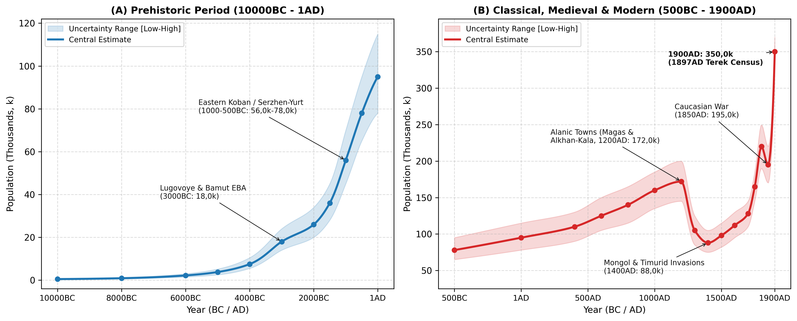
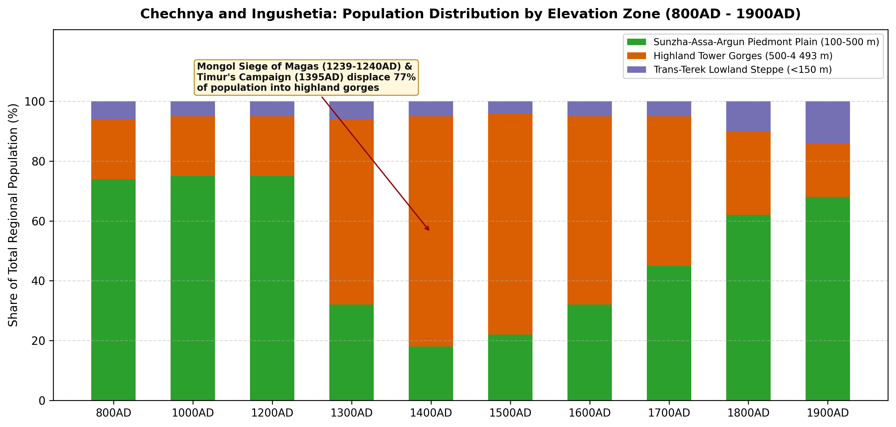
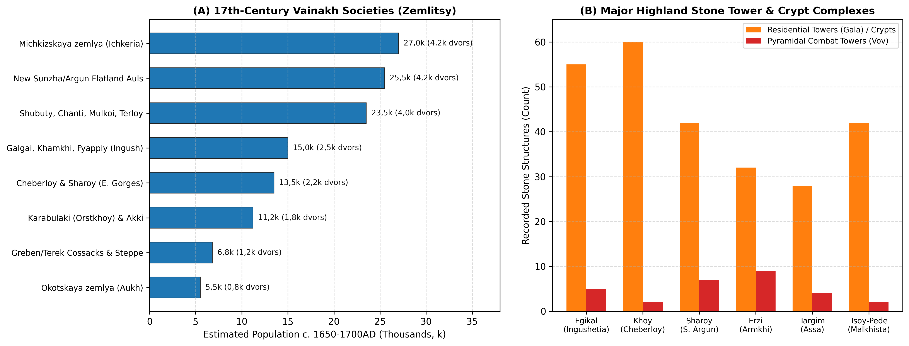

# Abstract

Chechnya and Ingushetia occupy 20,8k km² on the northern flank of the
Greater Caucasus (17,2k km² in the Chechen Republic and 3,6k km² in the
Republic of Ingushetia). Across the last twelve millennia, settlement in
the region has shifted repeatedly between the fertile piedmont plains of
the Sunzha, Assa and Argun rivers and the defensive limestone gorges of
the high mountains. Early Holocene canyon camps and Early Bronze Age
villages at Lugovoye, Bamut and Serzhen-Yurt I, where the Kura-Araxes
and Maykop traditions met, raised the regional population to around 18k
by 3000BC
[\[1\]](#ref-munchaev1961lugovoye)[\[2\]](#ref-munchaev1975caucasus)[\[3\]](#ref-bagaev2008ancient).
During the Late Bronze and Early Iron Ages (1200-400BC), fortified
hillforts and bronze-working centres of the Eastern Koban culture at
Serzhen-Yurt, Zandak and Nesterovskiy supported 56k inhabitants by
1000BC and 78k by 500BC
[\[4\]](#ref-kozenkova1977koban)[\[5\]](#ref-kozenkova1992serzhen)[\[6\]](#ref-kozenkova2013koban)[\[7\]](#ref-burkov2015).
Population reached a medieval peak of 172k (145k-200k) around 1200AD
under the Alanic kingdom, when three-quarters of the inhabitants lived
on the piedmont plain around the walled urban centres of Alkhan-Kala (60
ha), Germenchuk and the Magas settlement cluster around Nazran and
Ekazhevo
[\[8\]](#ref-vinogradov1972central)[\[9\]](#ref-chakhkiev2006magas)[\[10\]](#ref-dolgieva2013ingushetia)[\[11\]](#ref-malashev2016alania)[\[12\]](#ref-mamaev2009).
The Mongol siege of Magas in 1239-1240 and Timur’s campaign against
Simsir in 1395 destroyed the lowland towns, halving the regional
population to 88k (75k-105k) by 1400AD and driving 77% of the survivors
into the fortified stone tower villages of the Armkhi, Assa and Argun
gorges, including Egikal, Erzi, Targim, Vovnushki, Tsoy-Pede and Khoy
[\[13\]](#ref-markovin1965monuments)[\[14\]](#ref-shavkhelishvili1963history)[\[15\]](#ref-akhmadov2002chechnya)[\[16\]](#ref-frizen2020).
From the 16th to the 18th century, Vainakh communities descended once
more onto the Sunzha-Argun plains, lifting numbers to 128k by 1700AD and
220k by 1800AD
[\[17\]](#ref-kusheva1963peoples)[\[18\]](#ref-volkova1973ethnonyms)[\[19\]](#ref-akhmadov2019chechnya)[\[20\]](#ref-kabuzan1996).
Although the Caucasian War (1818-1859) reduced the population to 195k in
1850AD and was followed in 1865 by the *muhajir* emigration of some 22k
Chechens and Orstkhoy to the Ottoman Empire, agrarian recovery, Cossack
colonisation and the Grozny oil boom of the 1890s carried the population
to 350k (330k-370k) by 1900AD
[\[20\]](#ref-kabuzan1996)[\[21\]](#ref-ibragimova2006)[\[22\]](#ref-troynitskiy1905terek)[\[23\]](#ref-golovlev2017census).

# Background

Occupying the north-central and north-eastern slopes of the Greater
Caucasus between the upper Terek-Assa watershed and the Andi ridge, the
historical Vainakh territory (20,8k km²) divides naturally into three
parallel east-west belts (Figure 1 and Table 1).

At the foot of the mountains lies the Sunzha-Assa-Argun piedmont plain
and its adjoining foothill valleys (Zone 1, 8,6k km², 100-500 m).
Watered by the Sunzha and its right-bank tributaries - the Assa,
Fortanga, Gehi, Martan, Argun, Dzhalka, Gums and Aksay - this fertile
belt served as the primary agricultural heartland of the region during
the Early Bronze Age (Lugovoye, Serzhen-Yurt I), the Eastern Koban
period (Serzhen-Yurt, Alkhaste, Bamut), the Alanic kingdom (Alkhan-Kala,
Nazran-Ekazhevo/Magas) and the 16th-19th-century Vainakh resettlement of
the plains (Chechen-Aul, Aldy, Shali, Germenchuk, Gekhi, Urus-Martan,
Nazran and Grozny)
[\[1\]](#ref-munchaev1961lugovoye)[\[5\]](#ref-kozenkova1992serzhen)[\[9\]](#ref-chakhkiev2006magas)[\[15\]](#ref-akhmadov2002chechnya).

South of the piedmont rise the limestone and slate tower gorges of the
high mountains (Zone 2, 6,7k km², 500-4.493 m). Culminating in Mount
Tebulosmta (4.493 m) and Mount Shan (4.451 m), the deep canyons of the
Armkhi (Dzheirakh), upper Assa (Targim basin), Fortanga (Orstkhoy/Akki),
upper Argun (Malkhista, Maysta, Terloy, Chanti, Shubuty and Mulkoi),
Sharo-Argun (Sharoy and Cheberloy) and wooded Ichkeria (Nokhch-Mokhk)
formed natural mountain refuges
[\[13\]](#ref-markovin1965monuments)[\[24\]](#ref-chakhkiev2007weapons)[\[25\]](#ref-nalgiev2026).
Following the 13th- and 14th-century Mongol and Timurid campaigns across
the Sunzha plain, these gorges saw extensive construction of
mortar-bound residential stone towers (*gala*), pyramidal combat towers
(*vov*) and above-ground collective vaulted crypts (*maigash* or *kash*)
[\[10\]](#ref-dolgieva2013ingushetia)[\[13\]](#ref-markovin1965monuments)[\[26\]](#ref-karieva2024).

North of the Terek river extends the Trans-Terek lowland steppe (Zone 3,
5,5k km², -10 to 150 m). Across the Naurskaya, Shelkovskaya and
Kargalinskaya steppes, mobile pastoralists - Scythians, Sarmatians,
Savirs, Khazars, Kipchaks, Golden Horde Tatars and Nogais - alternated
with fortified river settlements along the Terek bluff and, from the
16th to the 19th century, the Greben and Terek Cossack *stanitsas*
[\[8\]](#ref-vinogradov1972central)[\[17\]](#ref-kusheva1963peoples)[\[20\]](#ref-kabuzan1996).

# Methodology

## Regional Subdivisions

To track population movements between the fertile Sunzha-Assa-Argun
piedmont and the mountain gorges, we divide Chechnya and Ingushetia
(20,8k km²) into three elevation zones (Table 1).

| Zone | Elevation | Area (km²) | River Basins | Key Centres |
|:---|:---|:---|:---|:---|
| Sunzha-Assa-Argun Piedmont Plain | 100 to 500 m | 8,6k | Sunzha, lower Assa, Fortanga, Martan, lower Argun, Aksay and Terek valley | Lugovoye, Serzhen-Yurt, Alkhan-Kala, Magas (Nazran-Ekazhevo), Shali, Grozny |
| Highland Tower Gorges and Wooded Ichkeria | 500 to 4.493 m | 6,7k | Dzheirakh (Armkhi), Targim (upper Assa), Argun, Sharo-Argun and Hulhulau | Egikal, Erzi, Targim, Vovnushki, Tsoy-Pede, Khoy, Nikaroy, Sharoy, Vedeno |
| Trans-Terek Lowland Steppe | -10 to 150 m | 5,5k | Left-bank Terek valley and Shelkovskaya-Naurskaya semi-arid steppe | Trans-Terek kurgans, Golden Horde river crossings, Greben/Terek Cossack stanitsas |
| Total Chechnya and Ingushetia | -10 to 4.493 m | 20,8k | Terek-Sunzha-Argun drainage basin | Major prehistoric, Alanic and Vainakh tower complexes |

The three elevation zones of Chechnya and Ingushetia, showing land area,
river drainage and the principal settlements of each belt.

## Estimation Methods

Our population estimates combine archaeological settlement and cemetery
surveys for the prehistoric and medieval eras with Russian diplomatic,
military and census records from the 16th century onwards.

For the Eastern Koban period (1200-400BC), V. I. Kozenkova’s excavations
at Serzhen-Yurt I-II - an 8-10 ha craft settlement with cobbled streets,
more than 60 timber-and-wattle dwellings and bronze-foundry workshops,
paired with an adjacent cemetery of over 120 flat graves - together with
surveys at Zandak, Bamut, Nesterovskiy and Lugovoye indicate densities
of 40-65 persons per hectare, or 400-650 residents per major hillfort
[\[4\]](#ref-kozenkova1977koban)[\[5\]](#ref-kozenkova1992serzhen)[\[6\]](#ref-kozenkova2013koban)[\[7\]](#ref-burkov2015).

For the Alanic period (400-1238AD), mapped by V. B. Vinogradov, Kh. M.
Mamaev, D. Yu. Chakhkiev and V. Yu. Malashev
[\[12\]](#ref-mamaev2009)[\[27\]](#ref-burkov2007), urban and rural
populations are derived from walled fort areas (80-120 persons/ha) and
open farming suburbs (*posady*, 25-40 persons/ha). The largest
concentrations stood at Alkhan-Kala, where a 60 ha fortified core and
over 150 ha of suburbs housed 8k-15k inhabitants, and in the
Nazran-Ekazhevo and Ali-Yurt (Magas) cluster, where more than 30
fortified towns across 100 km² supported 15k-25k inhabitants
[\[9\]](#ref-chakhkiev2006magas)[\[10\]](#ref-dolgieva2013ingushetia)[\[11\]](#ref-malashev2016alania)[\[28\]](#ref-mamaev2022early).

During the late medieval highland refuge phase (1300-1700AD) in Zone 2,
over 300 fortified stone tower villages (*aul-kreposti*) containing more
than 2k residential towers (*gala*, two to three storeys housing a
family of 5,5-6,5 persons) and over 250 pyramidal combat towers (*vov*,
four to six storeys, 22-31 m high) provide a direct house count. These
figures are checked against skeleton counts inside multi-tiered
collective stone crypts at Tsoy-Pede (42 crypts), Egikal, Erzi, Khoy and
Vaserkel, where each family crypt accumulated 60-150 burials across six
to eight generations
[\[10\]](#ref-dolgieva2013ingushetia)[\[13\]](#ref-markovin1965monuments)[\[16\]](#ref-frizen2020)[\[24\]](#ref-chakhkiev2007weapons)[\[25\]](#ref-nalgiev2026).

From 1550 to 1800AD, Russian ambassadorial (*Posolskiy Prikaz*) and
fortress registers compiled by E. N. Kusheva
[\[17\]](#ref-kusheva1963peoples), N. G. Volkova
[\[18\]](#ref-volkova1973ethnonyms)[\[29\]](#ref-volkova1974ethnic) and
Ya. Z. and Sh. B. Akhmadov
[\[30\]](#ref-akhmadov2004)[\[31\]](#ref-akhmadov2016)[\[32\]](#ref-tovsultanov2017)
record village counts (*kabaki* or *auly*), household totals (*dvory*)
and military levies across *Okotskaya zemlya* (Aukh), *Michkizskaya
zemlya* (Ichkeria), *Shubutskaya zemlya* (Shatoy/Argun), *Kalkanskaya*
and *Erokanskaya zemlya* (the Ingush gorges) and the resettled
Sunzha-Argun plains
[\[15\]](#ref-akhmadov2002chechnya)[\[19\]](#ref-akhmadov2019chechnya)[\[33\]](#ref-akhmadov2020taip).
Late 19th-century figures (1860-1900AD) are anchored to A. P. Berger’s
1859 village enumerations [\[34\]](#ref-berger1859chechnya), the
1867-1890 statistical tables of Terek Oblast analysed by Z. Kh.
Ibragimova [\[21\]](#ref-ibragimova2006) and V. M. Kabuzan
[\[20\]](#ref-kabuzan1996), the 1886 family lists (*posemeynye spiski*)
and the 1897 imperial census returns for the Grozny, Vedeno,
Nazran/Sunzha and left-bank Terek Cossack districts
[\[22\]](#ref-troynitskiy1905terek)[\[23\]](#ref-golovlev2017census).

# Results

## Mesolithic to Early and Middle Bronze Ages: Kezenoy-Am, Lugovoye and Bamut

During the Early Holocene (10000-5000BC), Mesolithic and Neolithic
hunter-gatherers occupied high-mountain lake basins such as Kezenoy-Am
(1.870 m) and limestone cave overhangs in the Argun, Sharoy and Assa
gorges, with numbers rising gradually from 0,5k in 10000BC to 3,8k in
5000BC
[\[2\]](#ref-munchaev1975caucasus)[\[3\]](#ref-bagaev2008ancient). In
the 4th and 3rd millennia BC (4000-2000BC), the Sunzha-Assa-Argun
piedmont became an active contact zone between the North-Eastern
Caucasian Kura-Araxes culture and the Maykop-Novosvobodnaya kurgan
tradition
[\[1\]](#ref-munchaev1961lugovoye)[\[2\]](#ref-munchaev1975caucasus).

Excavations by R. M. Munchaev (1952-1957) at Lugovoye (Muzhichi) in the
Assa gorge of Ingushetia, which included 157 burials, and in the lower
layer of Serzhen-Yurt I in the Shali district of Chechnya uncovered
wattle-and-daub houses with sunken circular hearths, horn-lugged
Kura-Araxes burnished pottery, stone shaft-hole axes and arsenical
bronze daggers and spiral temple rings
[\[1\]](#ref-munchaev1961lugovoye)[\[2\]](#ref-munchaev1975caucasus). On
the Fortanga-Assa piedmont exit at Bamut, Munchaev excavated over 50
Early and Middle Bronze Age kurgans combining Maykop-Novosvobodnaya
metalwork with Kura-Araxes domestic pottery
[\[2\]](#ref-munchaev1975caucasus). By 3000BC, piedmont farming villages
and transhumant herders numbered 18k (14k-24k), growing under the Middle
Bronze Age North Caucasian (Ginchi and Pre-Koban) cultures at Galaity,
Achkhoy-Martan and Harachoy to 26k in 2000BC and 36k in 1500BC
[\[3\]](#ref-bagaev2008ancient).

## Late Bronze and Early Iron Ages: The Eastern Koban Hillforts

Between the 12th and 5th centuries BC, Chechnya and Ingushetia formed
the core territory of the Eastern Koban culture, investigated in detail
by V. I. Kozenkova and M. Kh. Bagaev
[\[3\]](#ref-bagaev2008ancient)[\[4\]](#ref-kozenkova1977koban)[\[5\]](#ref-kozenkova1992serzhen)[\[6\]](#ref-kozenkova2013koban)[\[7\]](#ref-burkov2015)[\[35\]](#ref-spasskaya2024).

Situated on two naturally defended river terraces above the Bass river
in the Shali district, Serzhen-Yurt I-II functioned from the 11th to the
6th century BC as a major craft and farming centre of 8-10 ha.
Excavations revealed cobble-paved streets 4 m wide, rows of
timber-framed clay dwellings (20-45 m²), bronze-smelting furnaces with
clay tuyères and stone casting moulds for Koban shaft-hole axes,
zoomorphic terracotta figurines and grain storage pits
[\[5\]](#ref-kozenkova1992serzhen)[\[6\]](#ref-kozenkova2013koban)[\[36\]](#ref-kozenkova2001).

More than 80 Eastern Koban settlements and cemeteries line the
Sunzha-Assa-Argun foothills and mountain gorges, including the Zandak
stone-cist cemetery in Nozhay-Yurt (over 60 graves) as well as
Nesterovskiy, Alkhaste, Lugovoye and Sharoy, which yielded bimetallic
iron-and-bronze daggers and early Scythian *akinakes* weapons from the
7th to 5th centuries BC
[\[3\]](#ref-bagaev2008ancient)[\[4\]](#ref-kozenkova1977koban).
Supported by mixed millet and barley cultivation and mountain sheep and
cattle husbandry, with terraced fields covering 5,9% of mountainous
Ingushetia [\[37\]](#ref-shaev2024terraces), the regional population
rose from 56k (45k-70k) in 1000BC to 78k (65k-95k) in 500BC.

## Sarmatian and Alanic Towns: *Magas* and *Alkhan-Kala*

During the Sarmatian period (300BC - 300AD, reaching 95k at 1AD) and the
Early Alanic period (400-800AD, rising from 110k in 400AD to 140k in
800AD), a dense network of earthen-rampart and moated fortified towns
(*gorodishcha*) grew up along the Sunzha, Assa, Argun and Terek rivers
[\[8\]](#ref-vinogradov1972central)[\[11\]](#ref-malashev2016alania)[\[12\]](#ref-mamaev2009)[\[27\]](#ref-burkov2007)[\[38\]](#ref-vinogradov1970)[\[39\]](#ref-malashev2016).

Protected by triple concentric horseshoe ramparts and deep moats backing
onto a steep cliff above the Sunzha 18 km west of Grozny, Alkhan-Kala
enclosed a 60 ha urban core surrounded by more than 150 ha of craft
suburbs and a vast catacomb cemetery of over 2,5k kurgan and flat
burials spanning the 2nd to 12th centuries AD
[\[8\]](#ref-vinogradov1972central)[\[12\]](#ref-mamaev2009)[\[38\]](#ref-vinogradov1970)[\[39\]](#ref-malashev2016).
As the main administrative and trading centre of the central Sunzha
basin, Alkhan-Kala housed 8k-15k inhabitants before its destruction in
1238-1240.

In the upper Sunzha, Assa and Kambileyevka plains of lowland Ingushetia,
surveys by D. Yu. Chakhkiev, N. D. Kodzoev and U. B. Gadiev mapped the
Nazran-Ekazhevo-Yandare cluster of over 30 fortified *gorodishcha* and
more than 60 satellite villages spaced 0,5-2 km apart within a 100 km²
core, including Hatrig-Yurt, Ekazhevo I-IV, Nazran, Ali-Yurt, Surkhakhi,
Yandare and Gazi-Yurt
[\[9\]](#ref-chakhkiev2006magas)[\[10\]](#ref-dolgieva2013ingushetia)[\[40\]](#ref-chakhkiev2003)[\[41\]](#ref-kodzoev2002)[\[42\]](#ref-gadiev2015).
Identified by regional archaeologists with the Alanic capital Magas
(*Ma’as*, described by al-Mas’udi in 943AD and besieged by the Mongol
princes Möngke, Güyük, Kadan and Büri from winter 1239 to early 1240
according to Juwayni and Rashid al-Din), this urban cluster housed
15k-25k inhabitants
[\[9\]](#ref-chakhkiev2006magas)[\[10\]](#ref-dolgieva2013ingushetia).

Further east along the Sunzha and Argun, fortified towns at Germenchuk,
Shali, Aldy and Goryacheistochnenskoye (15-45 ha each) controlled the
Argun-Sunzha confluence and the Terek crossings
[\[12\]](#ref-mamaev2009)[\[43\]](#ref-mamaev1979). At its pre-Mongol
peak around 1200AD, Chechnya and Ingushetia supported 172k (145k-200k)
inhabitants (8,27 persons/km²), with 75% (129k) living on the
Sunzha-Assa-Argun piedmont plain (Zone 1).

## Mongol and Timurid Invasions and the Highland Stone Tower Villages

Between 1238 and 1395AD, two waves of invasion destroyed the lowland
towns and villages of Chechnya and Ingushetia (Figure 2B and Figure 3).

Following the storming of Magas (1239-1240), Alkhan-Kala and Dedyakov
(besieged by a joint Mongol and Rus’ force in 1277-1278), the fertile
Sunzha and Terek plains were turned into winter pastures (*kochev’ya*)
of the Golden Horde khans Batu, Berke and Uzbek; Ibn Battuta visited
Uzbek Khan’s camp at *Bish-Dag* in 1334
[\[10\]](#ref-dolgieva2013ingushetia)[\[15\]](#ref-akhmadov2002chechnya).
Total regional population fell by nearly 40% to 105k (85k-125k) by
1300AD.

After defeating Tokhtamysh on the Terek in April 1395, Timur invaded the
Vainakh principality of Simsir, ruled by Gayur Khan across Ichkeria and
the Sunzha-Argun foothills, and marched into the highland gorges
(*Aukhar*, *Buri-Burd*, *Kuli* and *Taus*). As recorded by Sharaf al-Din
Yazdi and Nizam al-Din Shami, Timur’s troops demolished stone
fortresses, burned terraced fields and slaughtered defenders across the
mountains
[\[14\]](#ref-shavkhelishvili1963history)[\[15\]](#ref-akhmadov2002chechnya).
By 1400AD, the regional population dropped to a late medieval low of 88k
(75k-105k) and shifted sharply into the uplands: 77% (67,8k) of all
inhabitants were now concentrated in the mountain gorges of Zone 2,
leaving only 18% (15,8k) on the Sunzha plain (Zone 1).

Refugee movement into the limestone canyons of the Armkhi (Dzheirakh),
upper Assa (Targim basin), Fortanga and upper Argun (Malkhista, Maysta,
Terloy, Chanti and Cheberloy) spurred the construction of Vainakh stone
tower complexes from the 14th to the 17th century, documented by V. I.
Markovin and D. Yu. Chakhkiev (Figure 4B)
[\[10\]](#ref-dolgieva2013ingushetia)[\[13\]](#ref-markovin1965monuments)[\[24\]](#ref-chakhkiev2007weapons)[\[25\]](#ref-nalgiev2026).

Among the Ingush gorges of the Targim basin and Armkhi valley (Egikal,
Erzi, Targim, Khamkhi, Vovnushki and Puy), Egikal alone contained over
50 mortar-bound residential stone towers (*gala*), five intact pyramidal
combat towers (*vov*, up to 27 m high with machicolations and slate-slab
roofs), six subterranean and 106 above-ground collective stone crypts
(*kash*) and three sanctuary shrines, including Tkhaba-Yerdy and
Albi-Yerdy
[\[10\]](#ref-dolgieva2013ingushetia)[\[13\]](#ref-markovin1965monuments)[\[26\]](#ref-karieva2024).
At the confluence of the Chanty-Argun and Meshi-Khi rivers in Malkhista,
the Chechen necropolis of Tsoy-Pede preserved 42 gabled stone collective
crypts guarded by two defensive barrier walls and combat towers,
accumulating more than 3k burials between the 14th and 17th centuries
[\[13\]](#ref-markovin1965monuments)[\[16\]](#ref-frizen2020). In
Cheberloy (Kezenoy-Am basin), the cliff settlement of Khoy and the
seven-tower complex of Sharoy anchored dense terraced mountain
communities alongside Nikaroy, Vaserkel and Pakoch
[\[24\]](#ref-chakhkiev2007weapons)[\[44\]](#ref-ilyasov2004).

## Return to the Plains: Sixteenth- and Seventeenth-Century Vainakh Societies

Following the breakup of the Golden Horde and the founding of the
Russian fortress of Terki (1567/1588) on the lower Terek, land scarcity
on the mountain terraces of Zone 2 prompted a gradual Vainakh return to
the forested foothills (*Chernye gory*) and the Sunzha-Argun-Aksay
plains between 1550 and 1700AD
[\[17\]](#ref-kusheva1963peoples)[\[18\]](#ref-volkova1973ethnonyms)[\[19\]](#ref-akhmadov2019chechnya)[\[33\]](#ref-akhmadov2020taip)[\[45\]](#ref-albogachiev2025).

Russian *Posolskiy Prikaz* ambassadorial journals (Semen Zvenigorodskiy
in 1589, Fedor Takmakov in 1604, Khodotetskiy in 1638 and the Terki
Voivode Books of 1614-1690) analysed by E. N. Kusheva
[\[17\]](#ref-kusheva1963peoples), N. G. Volkova
[\[18\]](#ref-volkova1973ethnonyms)[\[29\]](#ref-volkova1974ethnic) and
Ya. Z. Akhmadov
[\[15\]](#ref-akhmadov2002chechnya)[\[19\]](#ref-akhmadov2019chechnya)[\[32\]](#ref-tovsultanov2017)[\[33\]](#ref-akhmadov2020taip)
indicate that the total population of Chechnya and Ingushetia grew from
98k in 1500AD to 112k in 1600AD and 128k (110k-145k) by 1700AD (Figure
4A and Table 2).

In the eastern foothills, *Okotskaya zemlya* (Aukh) along the Aksay,
Yamansu and Aktash rivers (Staryy Okokh and Shovkhal-Berd) was ruled by
the mirzas Shikh-Murza (killed in 1596) and Batay-Murza, who fielded
500-1k horsemen and footmen in Russian service, corresponding to roughly
850 households or 5,5k inhabitants alongside the *Okotskaya sloboda* at
Terki
[\[17\]](#ref-kusheva1963peoples)[\[19\]](#ref-akhmadov2019chechnya)[\[45\]](#ref-albogachiev2025).
*Michkizskaya zemlya* (wooded Ichkeria or Nokhch-Mokhk) comprised 36
large villages along the Michik, Gums, Hulhulau and Aksay rivers (Benoy,
Tsontaroy, Gordali, Alleroy, Zandak and Vedeno), where *Posolskiy
Prikaz* reports of 1619-1647 credit the *Michkizy* with 3k-5k fighting
men, or 3,8k-4,6k households and 24k-30k inhabitants
[\[17\]](#ref-kusheva1963peoples)[\[19\]](#ref-akhmadov2019chechnya).

In the upper and middle Argun societies (Shubuty/Shatoy, Chanti, Mulkoi,
Terloy, Malkhista, Maysta and Peshkhoy) controlling the gorge route to
Tusheti and Khevsureti, the population reached 3,6k-4,4k households
(21k-26k inhabitants)
[\[19\]](#ref-akhmadov2019chechnya)[\[30\]](#ref-akhmadov2004)[\[33\]](#ref-akhmadov2020taip),
while Cheberloy and Sharoy supported 2k-2,5k households (12k-15k
inhabitants) [\[19\]](#ref-akhmadov2019chechnya).

To the west, the Ingush mountain societies (Kalkanskaya/Galgai,
Erokanskaya/Dzheirakh, Khamkhi and Fyappiy/Metskhal) and early plains
settlements in the Angusht and Tarskaya valley numbered 2,2k-2,8k
households (13k-17k inhabitants)
[\[10\]](#ref-dolgieva2013ingushetia)[\[29\]](#ref-volkova1974ethnic),
while the Karabulaki (Orstkhoy on the Fortanga-Assa) and Akki
(Akkintsy/Galashki) numbered 1,6k-2,1k households (9,5k-13k inhabitants)
[\[19\]](#ref-akhmadov2019chechnya)[\[29\]](#ref-volkova1974ethnic)[\[45\]](#ref-albogachiev2025).
Over the second half of the 17th century, new flatland Chechen *auls* on
the Sunzha and lower Argun (Chechen-Aul, Staraya Sunzha, Shali,
Germenchuk, Aldy, Gekhi and Atterki) expanded rapidly to 3,8k-4,6k
households (22k-29k inhabitants), lifting the piedmont share (Zone 1)
back to 45% by 1700AD
[\[15\]](#ref-akhmadov2002chechnya)[\[33\]](#ref-akhmadov2020taip).

| Territorial Society (Zemlitsa) | Elevation Zone | Households (Dvors) | Militia (Fighting Men) | Estimated Population |
|:---|:---|:---|:---|:---|
| Michkizskaya zemlya (Ichkeria / Nokhch-Mokhk: 36 villages) | Zone 2 / Zone 1 margin | 3,8k - 4,6k | 3,5k - 5k | 24k - 30k |
| New Sunzha and Lower Argun Flatland Auls (Chechen-Aul, Shali, Germenchuk, Aldy) | Zone 1 (Sunzha-Argun Plain) | 3,8k - 4,6k | 3,5k - 4,8k | 22k - 29k |
| Upper and Middle Argun Societies (Shubuty/Shatoy, Chanti, Mulkoi, Terloy, Malkhista) | Zone 2 (Argun Gorges) | 3,6k - 4,4k | 3,2k - 4,2k | 21k - 26k |
| Ingush Societies (Galgai/Kalkany, Khamkhi, Fyappiy, Dzheirakh and Tarskaya Valley) | Zone 2 and Zone 1 (Assa-Armkhi-Terek) | 2,2k - 2,8k | 2k - 2,8k | 13k - 17k |
| Cheberloy and Sharoy (Sharo-Argun and Kezenoy-Am Basin) | Zone 2 (Eastern Gorges) | 2k - 2,5k | 1,8k - 2,5k | 12k - 15k |
| Karabulaki (Orstkhoy on Fortanga-Assa) and Highland Akki (Lam-Akki) | Zone 2 / Zone 1 (Fortanga-Assa) | 1,6k - 2,1k | 1,5k - 2k | 9,5k - 13k |
| Greben and Terek Cossack Gorodki + Trans-Terek Nogai Winter Camps | Zone 3 (Terek Bluff and Steppe) | 1k - 1,4k | 1k - 1,5k | 5,5k - 8k |
| Okotskaya zemlya (Aukh Foothills: Aktash, Yamansu, Yaryksu) | Zone 1 (Eastern Foothills) | 0,75k - 0,95k | 0,6k - 1k | 4,5k - 6,5k |
| Total Chechnya and Ingushetia (20,8k km²) | All 3 Elevation Zones | 18,75k - 23,35k | 17,1k - 23,8k | 128k (110k - 145k) |

Household, militia and population estimates across the eight territorial
societies of Chechnya and Ingushetia in the late 17th century, derived
from Russian ambassadorial and Terki fortress registers.

## The Eighteenth and Nineteenth Centuries

The 18th and 19th centuries brought the completion of Vainakh lowland
settlement across the Sunzha-Grozny plains, the construction of the
Russian Terek-Sunzha fortified line, heavy wartime losses during the
Caucasian War (1818-1859) and rapid demographic growth after 1865
[\[10\]](#ref-dolgieva2013ingushetia)[\[20\]](#ref-kabuzan1996)[\[21\]](#ref-ibragimova2006)[\[46\]](#ref-akhmadov2002history19c).

Throughout the 18th century, Chechen and Ingush settlers founded large
agricultural villages of 1k-3,5k inhabitants across Greater and Lesser
Chechnya (Shali, Germenchuk, Urus-Martan, Goyty, Gekhi, Achkhoy,
Gudermes, Avtury and Mayrtup) and the Nazran-Kambileyevka plain
(Angusht, Sholkhi and Nazran, where Ingush elders swore allegiance to
Russia in 1770 and 1810)
[\[10\]](#ref-dolgieva2013ingushetia)[\[31\]](#ref-akhmadov2016)[\[46\]](#ref-akhmadov2002history19c)[\[47\]](#ref-zhurtova2014).
Over the same period, the Russian Empire built the Terek-Mozdok Cordon
Line along the left bank of the Terek (Kizlyar in 1735, Mozdok in 1763
and Vladikavkaz in 1784), settling Greben, Terek-Semeynye and Volga
Cossacks across the Naurskaya and Shelkovskaya steppes (Zone 3)
[\[20\]](#ref-kabuzan1996). The combined Vainakh and Cossack population
rose from 128k in 1700AD to 165k (145k-185k) in 1750AD and 220k
(190k-250k) in 1800AD, with 62% (136,5k) living on the Sunzha-Argun
piedmont plains
[\[20\]](#ref-kabuzan1996)[\[46\]](#ref-akhmadov2002history19c).

General A. P. Yermolov’s construction of the Sunzha Fortified Line,
anchored by the fortress of Groznaya (founded in 1818), and the eviction
of Chechen villages between the Terek and Sunzha rivers ignited the
1818-1859 war, during which Chechnya served as the main agricultural and
military base of Imam Shamil’s Caucasian Imamate (with capitals at Dargo
in 1840-1845 and Vedeno in 1845-1859)
[\[20\]](#ref-kabuzan1996)[\[21\]](#ref-ibragimova2006). Repeated
military campaigns, forest-clearing (*proseki*), winter blockades of
lowland pastures and the replacement of Orstkhoy (Karabulak) and western
Chechen foothill villages with the Sunzha Cossack Line (the *stanitsas*
of Sleptsovskaya, Troitskaya, Karabulakskaya, Assinskaya, Samashkinskaya
and Mikhailovskaya in 1845-1860) inflicted severe population losses.
Russian military-statistical estimates summarised by A. P. Berger
[\[34\]](#ref-berger1859chechnya), V. M. Kabuzan
[\[20\]](#ref-kabuzan1996) and Z. Kh. Ibragimova
[\[21\]](#ref-ibragimova2006) indicate that ethnic Chechen numbers
dropped from 250k-300k in the 1830s to 130k-150k by 1859-1860, giving a
regional midpoint of 195k (170k-220k) across Chechnya and Ingushetia
including Cossack settlements in 1850AD. In the summer of 1865, imperial
authorities organised the *muhajir* emigration of 22k-23k Chechens and
nearly the entire Orstkhoy population (around 5k families) to the
Ottoman Empire
[\[10\]](#ref-dolgieva2013ingushetia)[\[20\]](#ref-kabuzan1996)[\[21\]](#ref-ibragimova2006).

Between 1866 and 1900, agrarian recovery on the Sunzha-Argun maize and
wheat plains, the 1886 family lists (recording roughly 195k ethnic
Chechens and 38k Ingush) and the discovery of the Grozny oilfield in
1893 alongside the Vladikavkaz Railway drove rapid expansion
[\[20\]](#ref-kabuzan1996)[\[21\]](#ref-ibragimova2006). In the First
General Census of the Russian Empire (28 January 1897) for Terek Oblast
[\[22\]](#ref-troynitskiy1905terek)[\[23\]](#ref-golovlev2017census),
native Vainakh speakers across the oblast numbered 274k (226,5k Chechens
and 47,5k Ingush). Within the districts corresponding to modern Chechnya
and Ingushetia - the Grozny Okrug (226k inhabitants, including 15,6k in
Grozny city), the Sunzha (Nazran) Otdel (around 47,4k Ingush and 36k
Sunzha Cossacks), the Chechen sector of the Khasavyurt Okrug (around
18,1k Aukh Chechens) and the left-bank Kizlyar and Mozdok Terek Cossack
*stanitsas* (Naurskaya, Shelkovskaya, Chervlennaya and Kalinovskaya,
totalling around 40k inhabitants) - the population reached 350k
(330k-370k, or 16,83 persons/km²) by 1900AD. Of these inhabitants, 68%
(238k) lived on the Sunzha-Assa-Argun plains and in the Grozny urban
district (Zone 1), 18% (63k) in the mountain gorges (Zone 2) and 14%
(49k) across the Trans-Terek Cossack steppe (Zone 3)
[\[20\]](#ref-kabuzan1996)[\[21\]](#ref-ibragimova2006)[\[22\]](#ref-troynitskiy1905terek).

# Limitations

Two main problems affect historical population estimates for Chechnya
and Ingushetia. First, because family crypts (*kash* or *maigash*) at
Tsoy-Pede, Egikal and Erzi stayed in continuous use from the 14th to the
18th century, until Islamisation replaced crypt burial with underground
*keschnash* cemeteries, skeleton counts have to be divided by six to
eight generations (180-240 years) to estimate the living population in
any single century
[\[10\]](#ref-dolgieva2013ingushetia)[\[13\]](#ref-markovin1965monuments)[\[16\]](#ref-frizen2020).
Second, during the Caucasian War and the repeated boundary changes in
Terek Oblast between 1860 and 1905 (which merged and split the Grozny,
Vedeno, Ichkeria, Argun and Sunzha/Nazran districts), military estimates
of unpacified mountain villages carried wider margins of error (15-20%)
prior to the 1886 family lists and the 1897 census
[\[20\]](#ref-kabuzan1996)[\[21\]](#ref-ibragimova2006).

# Conclusion

The population history of Chechnya and Ingushetia from 10000BC to 1900AD
was shaped by a recurring movement between the fertile Sunzha-Argun
plains and the stone gorges of the Greater Caucasus. After reaching two
early lowland peaks during the Eastern Koban period (78k in 500BC) and
the Alanic urban era around Magas and Alkhan-Kala (172k in 1200AD), the
population retreated into the mountain gorges following the Mongol and
Timurid invasions, which reduced regional numbers to 88k in 1400AD and
concentrated 77% of the survivors in the uplands. Subsequent Vainakh
resettlement of the plains lifted the population to 128k by 1700AD and
220k by 1800AD. Despite heavy losses during the Caucasian War and the
1865 *muhajir* deportations, agrarian recovery, Cossack settlement and
the Grozny oil boom carried the regional population to 350k (16,83
persons/km²) by 1900AD.

# Appendix

## Population Estimates

| Benchmark | Zone 1: Piedmont Plain (8,6k km²) | Zone 2: Highland Gorges (6,7k km²) | Zone 3: Trans-Terek Steppe (5,5k km²) | Total | Range | Density (p/km²) |
|:---|:---|:---|:---|:---|:---|:---|
| 10000BC | 0,2k | 0,25k | 0,05k | 0,5k | 0,3k - 0,8k | 0,02 |
| 8000BC | 0,4k | 0,4k | 0,1k | 0,9k | 0,6k - 1,3k | 0,04 |
| 6000BC | 1k | 1k | 0,2k | 2,2k | 1,5k - 3k | 0,11 |
| 5000BC | 1,8k | 1,6k | 0,4k | 3,8k | 2,5k - 5,2k | 0,18 |
| 4000BC | 4k | 2,8k | 0,7k | 7,5k | 5,5k - 10,5k | 0,36 |
| 3000BC | 10,8k | 5,4k | 1,8k | 18k | 14k - 24k | 0,87 |
| 2000BC | 15,5k | 8k | 2,5k | 26k | 20k - 34k | 1,25 |
| 1500BC | 21,5k | 11,5k | 3k | 36k | 28k - 45k | 1,73 |
| 1000BC | 34k | 17,5k | 4,5k | 56k | 45k - 70k | 2,69 |
| 500BC | 48k | 23k | 7k | 78k | 65k - 95k | 3,75 |
| 1AD | 62k | 24k | 9k | 95k | 78k - 115k | 4,57 |
| 400AD | 77k | 24k | 9k | 110k | 90k - 130k | 5,29 |
| 600AD | 90k | 26k | 9k | 125k | 105k - 150k | 6,01 |
| 800AD | 103,5k | 28k | 8,5k | 140k | 115k - 165k | 6,73 |
| 1000AD | 120k | 32k | 8k | 160k | 135k - 185k | 7,69 |
| 1200AD | 129k | 34,4k | 8,6k | 172k | 145k - 200k | 8,27 |
| 1300AD | 33,6k | 65,1k | 6,3k | 105k | 85k - 125k | 5,05 |
| 1400AD | 15,8k | 67,8k | 4,4k | 88k | 75k - 105k | 4,23 |
| 1500AD | 21,6k | 72,5k | 3,9k | 98k | 82k - 115k | 4,71 |
| 1600AD | 35,8k | 70,6k | 5,6k | 112k | 95k - 130k | 5,38 |
| 1700AD | 57,6k | 64k | 6,4k | 128k | 110k - 145k | 6,15 |
| 1750AD | 92k | 61k | 12k | 165k | 145k - 185k | 7,93 |
| 1800AD | 136,5k | 61,5k | 22k | 220k | 190k - 250k | 10,58 |
| 1850AD | 105k | 62k | 28k | 195k | 170k - 220k | 9,38 |
| 1900AD | 238k | 63k | 49k | 350k | 330k - 370k | 16,83 |

Population estimates for Chechnya and Ingushetia across 25 benchmark
dates from 10000BC to 1900AD, broken down by elevation zone alongside
total midpoint, uncertainty range and overall density.

# Sources

1.
Munchaev, R. M. *Drevneyshaya
Kul’tura Severo-Vostochnogo Kavkaza (Lugovskoye Poseleniye i
Mogil’nik)*. Izdatel’stvo AN SSSR, 1961,
<https://search.worldcat.org/search?q=Drevneyshaya+kul+tura+Severo+Vostochnogo+Kavkaza+Lugovskoye+poseleniye+Munchaev+1961>.

2.
Munchaev, R. M. *Kavkaz Na Zare
Bronzovogo Veka: Neolit, Eneolit, Rannyaya Bronza*. Nauka, 1975,
<https://search.worldcat.org/search?q=Kavkaz+zare+bronzovogo+veka+Neolit+eneolit+rannyaya+bronza+Munchaev+1975>.

3.
Bagaev, M. Kh. *Kul’tura Gornoy
Chechni i Dagestana v Drevnosti i Srednevekov’ye (VI v. Do n.e. - XII v.
N.e.)*. Nauka, 2008,
<https://search.worldcat.org/search?q=Kul+tura+gornoy+Chechni+Dagestana+drevnosti+srednevekov+ye+Bagaev+2008>.

4.
Kozenkova, V. I. *Kobanskaya
Kul’tura. Vostochnyy Variant. Tom i: Poseleniya, Zhilishcha,
Khozyaystvo, Obryad Pogrebeniya*. Nauka, 1977,
<https://search.worldcat.org/search?q=Kobanskaya+kul+tura+Vostochnyy+variant+Tom+Poseleniya+zhilishcha+Kozenkova+1977>.

5.
Kozenkova, V. I. *Serzhen’-Yurt:
Ein Friedhof Der Späten Bronze- Und Frühen Eisenzeit Im Nordkaukasus*.
Philipp von Zabern, 1992,
<https://search.worldcat.org/search?q=Serzhen+Yurt+Ein+Friedhof+der+sp+aten+Bronze+Kozenkova+1992>.

6.
Kozenkova, V. I. *Kobanskaya
Kul’tura i Okruzhayushchiy Mir (Vzaimosvyazi, Problemy Sud’by i Sledov
Kul’tury)*. Taus, 2013,
<https://search.worldcat.org/search?q=Kobanskaya+kul+tura+okruzhayushchiy+mir+vzaimosvyazi+problemy+sud+Kozenkova+2013>.

7.
Burkov, S. B. “K Voprosu o t. N.
Protogorodakh i Ikh Sozdatelyakh Na Tsentral’nom i Severo-Vostochnom
Kavkaze \[on so-Called Proto-Cities and Their Creators in the Central
and Northeastern Caucasus\].” *Teoriya i Praktika Arkheologicheskikh
Issledovaniy*, no. 1, 2015, pp. 42-62,
<https://cyberleninka.ru/article/n/k-voprosu-o-t-n-protogorodah-i-ih-sozdatelyah-na-tsentralnom-i-severo-vostochnom-kavkaze>.

8.
Vinogradov, V. B. *Tsentral’nyy i
Severo-Vostochnyy Kavkaz v Skifskoye Vremya (VII-IV Vv. Do n.e.) i
Alkhan-Kalinskoye Gorodishche*. Checheno-Ingushskoye Knizhnoye
Izdatel’stvo, 1972,
<https://search.worldcat.org/search?q=Tsentral+nyy+Severo+Vostochnyy+Kavkaz+skifskoye+vremya+VII+Vinogradov+1972>.

9.
Chakhkiev, D. Yu. *Drevnosti
Gornoy i Ravninnoy Ingushetii i Lokalizatsiya Alanskoy Stolitsy Magas
\[Antiquities of Mountainous and Lowland Ingushetia and Magas\]*. Min-vo
Kul’tury RI, 2003,
<https://search.worldcat.org/search?q=Antiquities+Mountainous+Lowland+Ingushetia+Magas+Chakhkiev+2003>.

10.
Dolgieva, M. B., et al. *Istoriya
Ingushetii \[History of Ingushetia, 4th Ed.\]*. Yuzhnyy Izdatel’skiy
Dom, 2013,
<https://search.worldcat.org/search?q=History+Ingushetia+4th+ed+Dolgieva+2013>.

11.
Malashev, V. Yu., and U. B.
Gadiev. “Rannesrednevekovyye Pamyatniki Ingushetii i Sistema Alanskikh
Gorodishch Sunzhensko-Assinskogo Mezhdurech’ya.” *Kratkiye Soobshcheniya
Instituta Arkheologii (KSIA)*, vol. 244, 2016, pp. 165-82,
<https://scholar.google.com/scholar?q=Rannesrednevekovyye+pamyatniki+Ingushetii+sistema+alanskikh+gorodishch+Sunzhensko+Assinskogo+Malashev+2016>.

12.
Mamaev, Kh. M. “Srednevekovyye
Bytovyye Pamyatniki Ravninno-Predgornoy Zony Srednego Priterech’ya
\[Medieval Domestic Settlements of the Lowland-Piedmont Zone of the
Middle Terek\].” *Izvestiya Vuzov. Severo-Kavkazskiy Region.
Obshchestvennyye Nauki*, no. 3A, 2009, pp. 19-23,
<https://cyberleninka.ru/article/n/srednevekovyye-bytovyye-pamyatniki-ravninno-predgornoy-zony-srednego-priterechya>.

13.
Markovin, V. I. “Pamyatniki
Zodchestva v Gornoy Chechne (Po Materialam Issledovaniy 1957-1965 Gg.).”
*Severnyy Kavkaz v Drevnosti i v Sredniye Veka*, Nauka, 1980, pp.
184-270,
<https://scholar.google.com/scholar?q=Pamyatniki+zodchestva+gornoy+Chechne+materialam+issledovaniy+1957+1965+Markovin+1980>.

14.
Shavkhelishvili, A. I. *Iz Istorii
Vzaimootnosheniy Mezhdu Gruzinskim i Checheno-Ingushskim Narodami*.
Checheno-Ingushskoye Knizhnoye Izdatel’stvo, 1963,
<https://search.worldcat.org/search?q=istorii+vzaimootnosheniy+mezhdu+gruzinskim+checheno+ingushskim+narodami+Shavkhelishvili+1963>.

15.
Akhmadov, Ya. Z. *Ocherk
Istoricheskoy Geografii i Etnopoliticheskogo Razvitiya Chechni v
XVI-XVIII Vekakh*. Blagotvoritel’nyy Fond Podderzhki Chechenskoy
Literatury, 2002,
<https://search.worldcat.org/search?q=Ocherk+istoricheskoy+geografii+etnopoliticheskogo+razvitiya+Chechni+XVI+XVIII+Akhmadov+2002>.

16.
Frizen, S. Yu., et al.
“Kraniologicheskiye Materialy Iz Sklepov Tsoy-Pede (Gornaya Chechnya)
\[Craniological Materials from the Crypts of Tsoy-Pede, Mountainous
Chechnya\].” *Camera Praehistorica*, no. 1, 2020, pp. 122-35,
<https://doi.org/10.31250/2658-3828-2020-1-122-135>.

17.
Kusheva, E. N. *Narody Severnogo
Kavkaza i Ikh Svyazi s Rossiyey (Vtoraya Polovina XVI - 30-e Gody XVII
v.)*. Izdatel’stvo AN SSSR, 1963,
<https://search.worldcat.org/search?q=Narody+Severnogo+Kavkaza+ikh+svyazi+Rossiyey+vtoraya+polovina+Kusheva+1963>.

18.
Volkova, N. G. *Etnonimy i
Plemennyye Nazvaniya Severnogo Kavkaza \[Ethnonyms and Tribal Names of
the North Caucasus\]*. Nauka, 1973,
<https://search.worldcat.org/search?q=Ethnonyms+Tribal+Names+North+Caucasus+Volkova+1973>.

19.
Akhmadov, Ya. Z. “Istoricheskaya
Geografiya i Naseleniye Chechni v XVI-XVII Vv. Po Dannym Russkikh
Posol’skikh Dokumentov.” *Vestnik Akademii Nauk Chechenskoy Respubliki*,
no. 2, 2019, pp. 18-29,
<https://cyberleninka.ru/article/n/istoricheskaya-geografiya-i-naseleniye-chechni-v-xvi-xvii-vv-po-dannym-russkih-posolskih-dokumentov>.

20.
Kabuzan, V. M. *Naseleniye
Severnogo Kavkaza v XIX-XX Vekakh: Etnostatisticheskoye Issledovaniye
\[the Population of the North Caucasus in the 19th-20th Centuries: An
Ethnostatistical Study\]*. Russko-Baltiyskiy Informatsionnyy Tsentr
BLITs, 1996,
<https://search.worldcat.org/search?q=Population+North+Caucasus+19th+20th+Centuries+Ethnostatistical+Study+Kabuzan+1996>.

21.
Ibragimova, Z. Kh. *Chechentsy v
Zerkale Tsarskoy Statistiki (1860-1900) \[the Chechens in the Mirror of
Tsarist Statistics, 1860-1900\]*. Probel-2000, 2006,
<https://search.worldcat.org/search?q=Chechens+Mirror+Tsarist+Statistics+1860+1900+Ibragimova+2006>.

22.
Troynitskiy, N. A. *Pervaya
Vseobshchaya Perepis’ Naseleniya Rossiyskoy Imperii, 1897 g. Tom LXVIII:
Terskaya Oblast’ \[First General Census of the Population of the Russian
Empire, 1897. Vol. 68: Terek Oblast\]*. Tsentral’nyy Statisticheskiy
Komitet MVD, 1905,
<https://www.demoscope.ru/weekly/ssp/rus1897_01.php>.

23.
Golovlev, A. A. “Materialy Pervoy
Vseobshchey Perepisi Naseleniya Rossiyskoy Imperii 1897 g. Kak Istochnik
Po Istoricheskoy Geografii Severnogo Kavkaza \[Materials of the First
General Census of the Russian Empire of 1897 as a Source on the
Historical Geography of the North Caucasus\].” *Samarskaya Luka:
Problemy Regional’noy i Global’noy Ekologii*, vol. 26, no. 2, 2017, pp.
178-94,
<https://cyberleninka.ru/article/n/materialy-pervoy-vseobschey-perepisi-naseleniya-rossiyskoy-imperii-1897-g-kak-istochnik-po-istoricheskoy-geografii-i-etnogeografii>.

24.
Chakhkiev, D. Yu. *Oruzhiye i
Oboronitel’noye Zodchestvo Vaynakhov v Pozdnem Srednevekov’ye (XIII-XVII
Vv.)*. Nauka, 2007,
<https://search.worldcat.org/search?q=Oruzhiye+oboronitel+noye+zodchestvo+vaynakhov+pozdnem+srednevekov+ye+Chakhkiev+2007>.

25.
Nalgiev, R. T. “Vaynakhskiye
Bashni Kak Unikal’nyy Vid Srednevekovoy Zamkovoy Arkhitektury \[Vainakh
Towers as a Unique Type of Medieval Castle Architecture\].”
*Sovremennoye Stroitel’stvo i Arkhitektura*, vol. 70, no. 3, 2026, pp.
1-8, <https://doi.org/10.60797/mca.2026.70.3>.

26.
Karieva, F. A., and M. B.
Dolgieva. “Istoriko-Kul’turnoye Naslediye Ingushskogo Naroda i
Istoricheskaya Pamyat’ (Po Materialam Gornoy Ingushetii) \[Historical
and Cultural Heritage of the Ingush People\].” *Sovremennaya Nauchnaya
Mysl’*, no. 2, 2024, pp. 242-47,
<https://cyberleninka.ru/article/n/istoriko-kulturnoye-naslediye-ingushskogo-naroda-i-istoricheskaya-pamyat-po-materialam-gornoy-ingushetii>.

27.
Burkov, S. B. “Uchet i
Kartografirovaniye Pamyatnikov Material’noy Kul’tury Ingushetii
\[Inventory and Mapping of Monuments of Material Culture of
Ingushetia\].” *Izvestiya Vuzov. Severo-Kavkazskiy Region.
Obshchestvennyye Nauki*, no. 6, 2007, pp. 56-61,
<https://cyberleninka.ru/article/n/uchet-i-kartografirovaniye-pamyatnikov-materialnoy-kultury-ingushetii>.

28.
Mamaev, Kh. M. “Srednevekovyye
Gorodishcha i Poseleniya Ravninno-Predgornoy Chechni (Alkhan-Kala i
Sredneye Priterech’ye).” *Izvestiya Vuzov. Severo-Kavkazskiy Region*,
no. 3A, 2009, pp. 19-23,
<https://cyberleninka.ru/article/n/srednevekovyye-gorodischa-i-poseleniya-ravninno-predgornoy-chechni-alhan-kala-i-sredneye-priterechye>.

29.
Volkova, N. G. *Etnicheskiy Sostav
Naseleniya Severnogo Kavkaza v XVIII - Nachale XX Veka*. Nauka, 1974,
<https://search.worldcat.org/search?q=Etnicheskiy+sostav+naseleniya+Severnogo+Kavkaza+XVIII+nachale+XX+Volkova+1974>.

30.
Akhmadov, Sh. B. “Iz Istorii
Razvitiya Vol’nykh (Sel’skikh) Obshchestv v Gornoy Chechne i Ingushetii
v XVIII - Nachale XIX v. \[Development of Free Rural Societies in
Mountainous Chechnya and Ingushetia\].” *Izvestiya Vuzov.
Severo-Kavkazskiy Region. Obshchestvennyye Nauki*, no. 2, 2004, pp.
22-26,
<https://cyberleninka.ru/article/n/iz-istorii-razvitiya-volnyh-selskih-obschestv-v-gornoy-chechne-i-ingushetii-v-xviii-nachale-xix-v>.

31.
Akhmadov, Sh. B. “Iz Istorii
Material’noy Kul’tury Chechentsev v XVIII v.: Pamyatniki Arkhitektury
\[Material Culture of the Chechens in the 18th Century: Architectural
Monuments\].” *Vestnik KIGI RAN*, vol. 24, no. 2, 2016, pp. 74-80,
<https://doi.org/10.22162/2075-7794-2016-24-2-74-80>.

32.
Tovsultanov, R. A., et al.
“Rossiysko-Chechenskiye Vzaimootnosheniya v XVI-XVII Vekakh
\[Russo-Chechen Relations in the 16th-17th Centuries\].” *Samarskiy
Nauchnyy Vestnik*, vol. 6, no. 1, 2017, pp. 101-05,
<https://doi.org/10.17816/snv201761203>.

33.
Akhmadov, Ya. Z. “Taypovyye i
Obshchinnyye Struktury Chechni v XVI-XVIII Vv.” *Vestnik Akademii Nauk
Chechenskoy Respubliki*, no. 1, 2020, pp. 24-35,
<https://cyberleninka.ru/article/n/taypovyye-i-obschinnyye-struktury-chechni-v-xvi-xviii-vv>.

34.
Berger, A. P. *Chechnya i
Chechentsy \[Chechnya and the Chechens\]*. Tipografiya Glavnogo
Upravleniya Namestnika Kavkazskogo, 1859,
<https://search.worldcat.org/search?q=Chechnya+Chechens+Berger+1859>.

35.
Spasskaya, N. N., and A. P.
Moshinskiy. “Kharakteristika Loshadey Iz Beskurgannogo Mogil’nika
Kobanskoy Kul’tury Gaston Uota (VII-IV Vv. Do n.e.).” *Istoriya,
Arkheologiya i Etnografiya Kavkaza*, vol. 20, no. 1, 2024, pp. 76-89,
<https://doi.org/10.32653/CH20176-89>.

36.
Kozenkova, V. I.
*Poselok-Ubezhishche Kobanskoy Kul’tury u Aula Serzhen’-Yurt v Chechne
Kak Istoricheskiy Istochnik \[the Koban Culture Refuge-Settlement Near
Serzhen-Yurt in Chechnya\]*. Nauka, 2001,
<https://search.worldcat.org/search?q=Koban+Culture+Refuge+Settlement+near+Serzhen+Yurt+Chechnya+Kozenkova+2001>.

37.
Shaev, I. A., et al.
“Zemledel’cheskiye Terrasy v Srednegornoy Zone Bol’shogo Kavkaza.”
*Regional’nyye Geosistemy*, vol. 48, no. 4, 2024, pp. 503-14,
<https://doi.org/10.52575/2712-7443-2024-48-4-503-514>.

38.
Vinogradov, V. B. *Alaniya v i-IX
Vv. I Alkhan-Kalinskoye Gorodishche \[Alania in the 1st-9th Centuries
and the Alkhan-Kala Gorodishche\]*. Checheno-Ingushskoye Knizhnoye
Izdatel’stvo, 1970,
<https://search.worldcat.org/search?q=Alania+1st+9th+Centuries+Alkhan+Kala+Gorodishche+Vinogradov+1970>.

39.
Malashev, V. Yu., et al. “Elitnyye
Katakombnyye Pogrebeniya Alkhan-Kalinskogo Mogil’nika (Chechenskaya
Respublika) \[Elite Catacomb Burials of the Alkhan-Kala Cemetery\].”
*Kratkiye Soobshcheniya Instituta Arkheologii (KSIA)*, vol. 244, 2016,
pp. 165-82,
<https://doi.org/10.25681/IARAS.0130-2620.244.165-182>.

40.
Chakhkiev, D. Yu. *Drevnosti
Gornoy Ingushetii \[Antiquities of Mountainous Ingushetia, Vols. 1-2\]*.
Min-vo Kul’tury RI, 2003,
<https://search.worldcat.org/search?q=Antiquities+Mountainous+Ingushetia+Vols+Chakhkiev+2003>.

41.
Kodzoev, N. D. *Istoriya
Ingushskogo Naroda (Glava: Lokalizatsiya Alanskoy Stolitsy Magas)
\[History of the Ingush People: Localisation of the Alanic Capital
Magas\]*. Serdalo, 2002,
<https://search.worldcat.org/search?q=History+Ingush+People+Localisation+Alanic+Capital+Magas+Kodzoev+2002>.

42.
Gadiev, U. B. “Arkheologicheskiye
Pamyatniki Alanskoy Epokhi Na Territorii Ravninnoy Ingushetii
\[Archaeological Monuments of the Alanic Epoch in Lowland Ingushetia\].”
*Arkheologiya i Etnografiya Kavkaza*, 2015, pp. 45-58,
<https://cyberleninka.ru/article/n/arheologicheskiye-pamyatniki-alanskoy-epohi-na-territorii-ravninnoy-ingushetii>.

43.
Mamaev, Kh. M. “O Gorodishchakh
Alanskogo Vremeni v Srednem Priterech’ye i Po r. Sunzhe \[on the
Fortified Towns of the Alanic Period in the Middle Terek and Along the
Sunzha River\].” *Arkheologiya i Voprosy Etnicheskoy Istorii Severnogo
Kavkaza*, 1979, pp. 88-104,
<https://cyberleninka.ru/article/n/o-gorodischah-alanskogo-vremeni-v-srednem-priterechye-i-po-r-sunzhe>.

44.
Ilyasov, L. M. *Teni Vechnosti:
Chechentsy: Arkhitektura, Istoriya, Dukhovnyye Traditsii \[Shadows of
Eternity: The Chechens: Architecture, History, Spiritual Traditions\]*.
Pantori, 2004,
<https://search.worldcat.org/search?q=Shadows+Eternity+Chechens+Architecture+History+Spiritual+Traditions+Ilyasov+2004>.

45.
Albogachiev, M. M. “Akhokhiya i
Akkinskiye Migratsii v XV-XVII Vv. \[Akhokhiya and Akkin Migrations in
the 15th-17th Centuries\].” *Istoricheskiy Zhurnal: Nauchnyye
Issledovaniya*, no. 2, 2025, pp. 1-27,
<https://doi.org/10.7256/2454-0609.2025.2.70633>.

46.
Akhmadov, Sh. B. *Chechnya i
Ingushetiya v XVIII - Nachale XIX Veka (Ocherki
Sotsial’no-Ekonomicheskogo Razvitiya i Politicheskoy Istorii) \[Chechnya
and Ingushetia in the 18th - Early 19th Century\]*. Dzhangar, 2002,
<https://search.worldcat.org/search?q=Chechnya+Ingushetia+18th+Early+19th+Century+Akhmadov+2002>.

47.
Zhurtova, A. A. “Sovremennaya
Otechestvennaya Istoriografiya Vkhozhdeniya Chechni i Ingushetii v
Sostav Rossii.” *Izvestiya KBNTs RAN*, no. 2, 2014, pp. 136-42,
<https://cyberleninka.ru/article/n/sovremennaya-otechestvennaya-istoriografiya-vhozhdeniya-chechni-i-ingushetii-v-sostav-rossii>.

