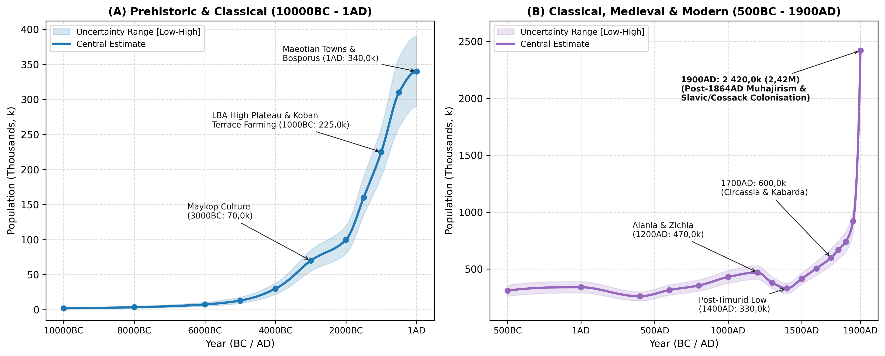
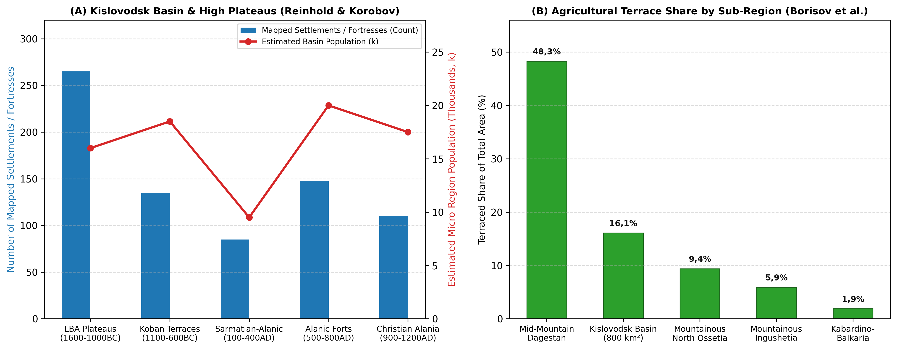
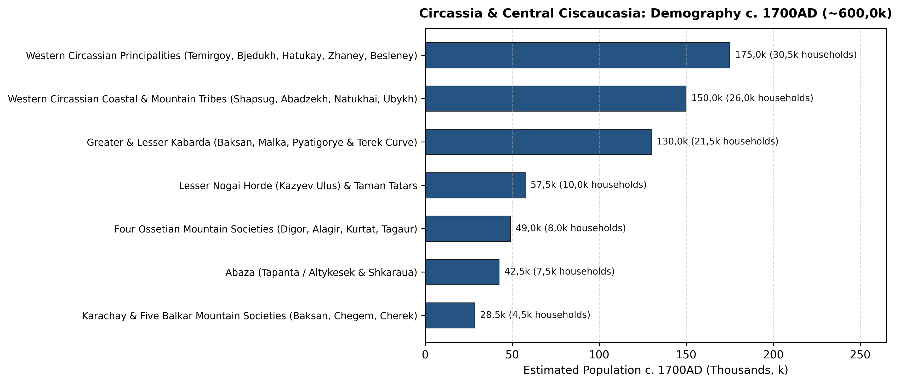

# Abstract

Stretching across 122,9k km² from the Kerch Strait and the Black Sea
coast to the Darial Gorge, historical Circassia and Central Ciscaucasia
encompass modern Krasnodar Krai, Adygea, Karachay-Cherkessia,
Kabardino-Balkaria, North Ossetia-Alania and the Kislovodsk basin of
southern Stavropol Krai. Across the last twelve millennia this western
and central sector of the North Caucasus has consistently supported the
largest population north of the main range. Early Holocene rock-shelter
foragers at Satanay and Sosruko (rising from 2k in 10000BC to 13k in
5000BC)
[\[1\]](#ref-formozov1965stone)[\[2\]](#ref-leonova2013gubs)[\[3\]](#ref-golovanova2020sosruko)
gave way in the 5th and 4th millennia BC to fortified Eneolithic
villages at Meshoko and Svobodnoe and to the Early and Middle Bronze Age
Maykop-Novosvobodnaya and Western Caucasian dolmen cultures, which
raised the regional population from 70k in 3000BC to 100k in 2000BC
[\[4\]](#ref-korenevskiy2004ancient)[\[5\]](#ref-korenevskiy2008a)[\[6\]](#ref-trifonov2001dolmens)[\[7\]](#ref-markovin1978dolmens).
Symmetrical stone-built villages on the sub-alpine plateaus around Mount
Elbrus and extensive Koban agricultural terracing in the mid-mountain
valleys carried numbers from 160k in 1500BC to 225k in 1000BC
[\[8\]](#ref-reinhold2017lba)[\[9\]](#ref-korobov2017system)[\[10\]](#ref-kozenkova1989western).
In classical antiquity, the Greek cities of the Asiatic Bosporus
(Phanagoria, Gorgippia and Hermonassa) and more than 200 fortified
Maeotian towns along the Kuban supported 310k inhabitants in 500BC and
340k at 1AD
[\[11\]](#ref-marchenko1996maeotians)[\[12\]](#ref-kuznetsov2017phanagoria)[\[13\]](#ref-alekseeva1997anapa).
After reaching a medieval peak of 470k around 1200AD across the
Christian kingdom of Alania (Nizhniy Arkhyz, Khumara, the Kislovodsk
fortresses and the two Dzhulats) and coastal Zichia
[\[9\]](#ref-korobov2017system)[\[14\]](#ref-kuznetsov1993arkhyz)[\[15\]](#ref-bidzhiev1983khumara)[\[16\]](#ref-afanasyev2014alans),
the region lost nearly a third of its population during the Mongol and
Timurid invasions, falling to 330k in 1400AD. Subsequent growth across
Western Circassia, Greater and Lesser Kabarda, Abaza, Karachay-Balkaria,
Ossetia and the Lesser Nogai Horde restored the population to 600k
(530k-680k) by 1700AD and 740k by 1800AD
[\[17\]](#ref-gardanov1967social)[\[18\]](#ref-khotko2008circassians)[\[19\]](#ref-khotko2015zichia)[\[20\]](#ref-trepalov2016nogai).
In the 19th century, the Caucasian War (1817-1864) and the 1860-1864
*muhajir* expulsion of some 450k-600k Western Circassians and Abaza to
the Ottoman Empire were followed by massive Kuban Cossack and Slavic
peasant colonisation, which quadrupled the regional population to 2,42M
(2,3M-2,55M) by 1900AD
[\[21\]](#ref-kabuzan1996)[\[22\]](#ref-kumykov1994)[\[23\]](#ref-berger1860expulsion)[\[24\]](#ref-troynitskiy1905kuban)[\[25\]](#ref-bgeu2007demography).

# Background

Stretching 650 km from the Taman Peninsula and the Kerch Strait (the
Cimmerian Bosporus) across the chernozem plains of the Kuban
(*Prikuban’ye*) and the Sub-Elbrus volcanic plateaus to the Darial Gorge
on the upper Terek, North-Western and Central Ciscaucasia (122,9k km²)
comprises five linked geographical regions (Figure 1 and Table 1).

In the north-west, Krasnodar Krai (75,5k km²) takes in the Taman
Peninsula, the Black Sea littoral (*Zichia* from Anapa to Sochi), the
Azov reed-flats and the lower and middle Kuban chernozem plains. This
lowland and coastal corridor hosted the richest Early Bronze Age royal
kurgans at Maykop and Staromyshastovskaya, over 200 classical Maeotian
fortified towns (Elizavetinskoye, Starokorsunskoye and Semibratneye),
the Greek polis cities of Phanagoria (65 ha) and Gorgippia (40 ha) and
39 Genoese-Zichian trading ports, including Matrega, Copa, Mapa and
Maurocastro. In the early modern period it formed the core territory of
the Western Circassian tribes and principalities (Zhaney, Temirgoy,
Bjedukh, Hatukay, Shapsug, Natukhai, Abadzekh and Ubykh), before
becoming after 1792-1864 the administrative heartland of Kuban Oblast
around Yekaterinodar and Black Sea Governorate around Novorossiysk
[\[11\]](#ref-marchenko1996maeotians)[\[12\]](#ref-kuznetsov2017phanagoria)[\[17\]](#ref-gardanov1967social)[\[19\]](#ref-khotko2015zichia)[\[24\]](#ref-troynitskiy1905kuban).

Bounded by the Belaya, Laba, Fars and Pshish rivers in the Trans-Kuban
foothills, the Republic of Adygea (7,8k km²) contains the stratified
Eneolithic stone fortresses of Meshoko and Yasenova Polyana, the
eponymous Oshad kurgan of Maykop, the Klady (Novosvobodnaya) megalithic
tombs, dense clusters of Bronze Age slab and trough dolmens at Kizinka,
Deguako and Bogatyrskaya Polyana, the Maeotian sanctuary kurgans of
Ulyap and the core lands of the Temirgoy (*Kemirgoy*) and Hatukay
principalities (the 19th-century Maykop Otdel)
[\[1\]](#ref-formozov1965stone)[\[4\]](#ref-korenevskiy2004ancient)[\[6\]](#ref-trifonov2001dolmens).

Further south-east, Karachay-Cherkessia (14,3k km²) spans the upper
Kuban, Zelenchuk and Teberda gorges commanding the Klukhor and Marukh
passes into Abkhazia. Here stood the 8th-10th-century fortress of
Khumara (25 ha) and the 10th-12th-century metropolitan see of Alania at
Nizhniy Arkhyz (65 ha, preserving three standing Byzantine stone
churches), succeeded in the early modern era by the territories of the
Besleney Circassians, the Abaza (Tapanta/Altykesek and Shkaraua) and the
Karachay in the Batalpashinsk Otdel
[\[14\]](#ref-kuznetsov1993arkhyz)[\[15\]](#ref-bidzhiev1983khumara)[\[26\]](#ref-volkova1974ethnic)[\[27\]](#ref-titorenko2017).

East of Elbrus, Kabardino-Balkaria (12,5k km²) and the adjacent
Pyatigorye or Kislovodsk basin (4,8k km², making 17,3k km² combined)
occupy the Baksan, Malka and Cherek gorges together with the
Podkumok-Eshkakon limestone basin. Surveys by Sabine Reinhold and D. S.
Korobov between 2004 and 2020 mapped over 260 Late Bronze Age stone
plateau settlements at 1.400-2.400 m (such as Kabardinka 2),
agricultural terraces covering 16,1% of the Kislovodsk basin during the
Koban and Alanic periods and more than 140 early medieval Alanic
promontory fortresses
[\[8\]](#ref-reinhold2017lba)[\[9\]](#ref-korobov2017system)[\[28\]](#ref-shaev2024terraces).
In later centuries this region supported the Golden Horde city of
Nizhniy Dzhulat, the princely federation of Greater and Lesser Kabarda
alongside the five Balkar mountain societies, and the 19th-century
Nalchik Okrug and Pyatigorsk-Kislovodsk spa towns
[\[17\]](#ref-gardanov1967social)[\[29\]](#ref-kusheva1963peoples)[\[30\]](#ref-azikova2021).

Finally, the upper Terek and Darial corridor in North Ossetia-Alania (8k
km²) is anchored by the eponymous Koban cemetery in the Gizeldon gorge,
the Alanic and Golden Horde city of Verkhniy Dzhulat (Tatartup or
Dedyakov) at the Elkhotovo Gates, the Zmeyskaya catacomb necropolis, the
four post-Timurid Ossetian mountain societies (Digor, Alagir, Kurtat and
Tagaur) and the Russian fortress and administrative capital of
Vladikavkaz, founded in 1784
[\[31\]](#ref-kuznetsov1984alania)[\[32\]](#ref-bliev2000ossetia).

# Methodology

## Regional Subdivisions

To trace population shifts between the Azov-Kuban steppe, the Black Sea
coast and the central mountain gorges, we divide the 122,9k km²
territory into five regions (Table 1).

| Region | Elevation | Area (km²) | River Basins | Main Towns and Sites |
|:---|:---|:---|:---|:---|
| Krasnodar Krai (Taman, Black Sea Coast and Kuban Plain) | 0 to 3.256 m | 75,5k | Lower/Middle Kuban, Taman delta, Eya-Chelbas Azov steppe and Pontic rivers | Phanagoria, Gorgippia, Semibratneye, Elizavetinskoye, Yekaterinodar, Novorossiysk |
| Republic of Adygea (Belaya-Laba Foothills and Dolmen Belt) | 50 to 3.238 m | 7,8k | Belaya, Laba, Fars, Kurdzhips and Gubs river valleys | Meshoko, Maykop (Oshad), Klady (Novosvobodnaya), Satanay, Kizinka, Ulyap |
| Karachay-Cherkessia (Upper Kuban, Zelenchuk and Teberda) | 400 to 5.642 m | 14,3k | Upper Kuban, Bolshoy and Malyy Zelenchuk, Urup and Teberda | Nizhniy Arkhyz (65 ha), Khumara Fortress (25 ha), Batalpashinsk |
| Kabardino-Balkaria and Pyatigorye / Kislovodsk Basin | 150 to 5.642 m | 17,3k | Podkumok-Kuma (Kislovodsk), Malka, Baksan, Chegem and Cherek | Sosruko, Kabardinka 2, Kislovodsk forts (\>140), Nizhniy Dzhulat, Nalchik, Pyatigorsk |
| North Ossetia-Alania (Upper Terek, Ardon and Darial Gorge) | 130 to 5.033 m | 8k | Upper Terek, Urukh, Ardon, Fiagdon, Gizeldon and Kambileyevka | Koban, Zmeyskaya, Verkhniy Dzhulat (Tatartup), Dargavs, Vladikavkaz |
| Total Circassia and Central Ciscaucasia | 0 to 5.642 m | 122,9k | Azov-Black Sea (Kuban) and Caspian (Kuma-Terek) drainage basins | Over 5k mapped prehistoric, classical and medieval sites |

The five geographical divisions of Circassia and Central Ciscaucasia,
showing elevation ranges, land area, river drainage and principal towns
and sites.

## Estimation Methods

Our regional population series combines archaeological settlement and
land-use surveys for the prehistoric, classical and medieval eras with
diplomatic, military and census records from the 16th century onwards.

For the Late Bronze Age high-plateau settlements and Koban terraces
(1600-500BC), we draw on Sabine Reinhold’s inventory of more than 260
stone plateau villages at 1.400-2.400 m (each with 10-36 double-row
stone courtyard houses, or 80-200 inhabitants)
[\[8\]](#ref-reinhold2017lba)[\[33\]](#ref-korobov2012) alongside D. S.
Korobov and A. V. Borisov’s land-use study of the 800 km² Kislovodsk
basin, where 16,1% terraced surface coverage could sustain 15k-25k
inhabitants in that single basin alone
[\[9\]](#ref-korobov2017system)[\[28\]](#ref-shaev2024terraces)[\[34\]](#ref-borisov2013)[\[35\]](#ref-korobov2023).

In the classical period (500BC-300AD), estimates for the Asiatic
Bosporus combine the walled areas of Phanagoria (65 ha), Gorgippia (40
ha), Hermonassa (25 ha), Semibratneye/Labrys (14 ha), Patraeus and Kepoi
at 100-130 persons/ha
[\[12\]](#ref-kuznetsov2017phanagoria)[\[13\]](#ref-alekseeva1997anapa)[\[36\]](#ref-voroshilov2023phanagoria)
with I. I. Marchenko and N. V. Anfimov’s surveys of over 200 fortified
Maeotian *gorodishcha* and open *selishcha* along the Kuban terrace
bluffs (2-15 ha each, together with the 200 ha Elizavetinskoye delta
trading town)
[\[11\]](#ref-marchenko1996maeotians)[\[37\]](#ref-anfimov1958)[\[38\]](#ref-limberis2019)[\[39\]](#ref-limberis2020).

For the Alanic period (400-1238AD), we use Korobov’s survey of more than
140 early medieval Alanic stone fortresses and over 700 sites in the
Kislovodsk basin (spaced 1,5-2,5 km apart and supporting 12k-22k
inhabitants)
[\[9\]](#ref-korobov2017system)[\[16\]](#ref-afanasyev2014alans)[\[40\]](#ref-belinskiy2018)
alongside urban estimates for the Christian Alanic capital at Nizhniy
Arkhyz (65 ha, 6k-10k inhabitants)
[\[14\]](#ref-kuznetsov1993arkhyz)[\[41\]](#ref-dzidzoev2017), Khumara
(25 ha) [\[15\]](#ref-bidzhiev1983khumara), Nizhniy Dzhulat and Verkhniy
Dzhulat (Tatartup) [\[31\]](#ref-kuznetsov1984alania).

Early modern figures (1500-1800AD) cross-check the accounts of Giorgio
Interiano (1502), Giovanni da Lucca (1625), Evliya Çelebi (1666-1667),
Xavier Glavani (1724), Johann Anton Güldenstädt (1770-1773) and P. S.
Pallas (1793) against Russian *Posolskiy Prikaz* registers (1552-1700)
analysed by V. K. Gardanov [\[17\]](#ref-gardanov1967social), E. N.
Kusheva [\[29\]](#ref-kusheva1963peoples), S. Kh. Khotko
[\[18\]](#ref-khotko2008circassians)[\[19\]](#ref-khotko2015zichia)[\[30\]](#ref-azikova2021)[\[42\]](#ref-khotko2016princedoms)[\[43\]](#ref-fomenko2019)
and V. V. Trepalov [\[20\]](#ref-trepalov2016nogai). Nineteenth-century
totals (1800-1900AD) combine General A. P. Berger’s and T. Kh. Kumykov’s
records of the 1858-1865 Circassian and Abaza *muhajir* deportations
[\[22\]](#ref-kumykov1994)[\[23\]](#ref-berger1860expulsion), V. M.
Kabuzan’s population tables for Ciscaucasia in 1795-1897
[\[21\]](#ref-kabuzan1996) and the 1897 imperial census returns for
Kuban Oblast (1,92M inhabitants), Black Sea Governorate (57,5k
inhabitants) and the western *okrugs* of Terek Oblast (Nalchik,
Vladikavkaz, Pyatigorsk and Mozdok)
[\[24\]](#ref-troynitskiy1905kuban)[\[25\]](#ref-bgeu2007demography)[\[44\]](#ref-golovlev2017census).

# Results

## Mesolithic, Neolithic and Eneolithic Villages: Satanay, Sosruko and Meshoko

During the Terminal Pleistocene and Early Holocene (10000-5000BC),
hunter-gatherer bands occupied karst rock-shelters across both the
north-western foothills (Satanay or Gubskiy Naves No. 7, Chygai,
Dvoinaya and Kasozhskaya caves in the Gubs gorge of Adygea and
Krasnodar) and the central volcanic canyons (Sosruko and Badynoko
rock-shelters in the Baksan gorge of Kabardino-Balkaria)
[\[1\]](#ref-formozov1965stone)[\[2\]](#ref-leonova2013gubs)[\[3\]](#ref-golovanova2020sosruko)[\[45\]](#ref-golovanova2014).
Stratified hearths at Sosruko (Layers 7-4) and Satanay preserve
geometric obsidian and flint microliths, bone harpoons, edible land
snails (*Helix*) and bones of Caucasian tur, wild boar and red deer,
pointing to a gradual rise from 2k in 10000BC to 7,5k in 6000BC and 13k
in 5000BC.

In the mid-5th millennium BC (4500-3700BC), settled farmers established
the Meshoko-Svobodnoe (Darkveti-Meshoko) culture in the Belaya and Kuban
foothills
[\[1\]](#ref-formozov1965stone)[\[4\]](#ref-korenevskiy2004ancient)[\[5\]](#ref-korenevskiy2008a).
Excavated by A. A. Formozov and A. D. Rezepkin among the fortified
promontory villages of Meshoko, Yasenova Polyana, Skala and Myskhako and
the steppe settlement of Svobodnoe, Meshoko occupied a cliff-lined
limestone plateau in Adygea protected by a dry-stone defensive wall 150
m long and 4 m thick, while Svobodnoe on the Kuban plain was enclosed by
a circular ditch-and-palisade system of 2,5 ha containing 25-40
rectangular wattle-and-daub houses
[\[1\]](#ref-formozov1965stone)[\[4\]](#ref-korenevskiy2004ancient)[\[5\]](#ref-korenevskiy2008a).
Subsisting on domesticated cattle, pigs (30-40% of the animal bones at
Meshoko) and emmer and barley cultivation, and trading in copper and
obsidian - as seen in the Nalchik Eneolithic cemetery of 121
ochre-stained burials in Kabardino-Balkaria - the regional population
reached 30k (22k-38k) by 4000BC.

## Early and Middle Bronze Ages: The Maykop Culture and Western Caucasian Dolmens

Between 3700 and 2900BC, North-Western and Central Ciscaucasia formed
the core of the Maykop-Novosvobodnaya culture, documented in the
monographs and radiocarbon chronologies of S. N. Korenevskiy, R. M.
Munchaev and V. A. Trifonov
[\[4\]](#ref-korenevskiy2004ancient)[\[46\]](#ref-korenevskiy2008b)[\[47\]](#ref-korenevskiy2017origin)[\[48\]](#ref-korenevskiy2016dolmens)[\[49\]](#ref-munchaev1975caucasus).

Excavations of open river-terrace Maykop settlements along the Kuban and
Terek (Galyugay I-III, Sereginskoye, Chekon and Bolshoy Tegink, with
Galyugay I spanning 6-8 ha of large circular sunken-floor
wattle-and-daub dwellings of 50-80 m²) demonstrate that the great royal
kurgans - such as the 11 m high Maykop (Oshad) kurgan excavated in 1897,
Kishpek, Marinskaya and the Klady (Novosvobodnaya) megalithic
two-chamber stone tombs - rested on a broad network of farming villages
producing wheel-made pottery
[\[4\]](#ref-korenevskiy2004ancient)[\[46\]](#ref-korenevskiy2008b)[\[47\]](#ref-korenevskiy2017origin).
Ancient DNA and skull studies confirm strong continuity among Caucasian
Hunter-Gatherer and Anatolian-Iranian Neolithic farming populations
alongside steppe exchange
[\[50\]](#ref-kazarnitsky2024ba)[\[51\]](#ref-berezina2023trepanation).
By 3000BC, the regional population reached 70k (55k-85k).

During the subsequent Western Caucasian Dolmen culture (2900-1400BC)
across the wooded mountain valleys from the Taman-Anapa coast (Pshekh,
Pshada and Dzhubga) to the Belaya and Laba headwaters (Kizinka, Deguako
and Bogatyrskaya Polyana), V. I. Markovin and V. A. Trifonov catalogued
between 2,3k and 3k megalithic stone dolmens. Built as slab, composite,
trough-shaped and monolithic tombs weighing 15-50 tonnes, these
monuments cluster in cemeteries of up to 564 dolmens at Kizinka and more
than 300 at Bogatyrskaya Polyana
[\[6\]](#ref-trifonov2001dolmens)[\[7\]](#ref-markovin1978dolmens)[\[52\]](#ref-trifonov2014)[\[53\]](#ref-bondarev2020)[\[54\]](#ref-kudin2021).
Excavations at the fortified settlement of Deguako-Dakhovskoye and
collective chamber burials holding 15-70 individuals per dolmen attest
to settled mountain-forest communities which, together with the North
Caucasian and Piedmont Catacomb cultures of Central Ciscaucasia,
supported 100k (80k-120k) inhabitants by 2000BC.

## Late Bronze and Early Iron Ages: High-Plateau Stone Villages and Koban Terraces

In the mid-2nd millennium BC (1600-1000BC), Russian-German surveys led
by Sabine Reinhold, D. S. Korobov and A. B. Belinskiy (2004-2017)
identified a major Late Bronze Age settlement phase at 1.400-2.400 m
elevation stretching 140 km across the sub-alpine limestone plateaus
north of Mount Elbrus in Kislovodsk/Pyatigorye, Karachay-Cherkessia and
Kabardino-Balkaria
[\[8\]](#ref-reinhold2017lba)[\[9\]](#ref-korobov2017system)[\[55\]](#ref-reinhold2007).

Using aerial photography, magnetic surveys and excavations at Kabardinka
2, Pravoberezhnaya Berezovaya and Tambukan, Reinhold and her colleagues
mapped over 260 permanent stone-built villages laid out in symmetrical
linear or oval plans around central livestock enclosures. With 10-36
double-row stone houses (80-200 inhabitants) per village, the high
plateaus alone supported 20k-35k inhabitants between 1500 and 1100BC
(Figure 3A) [\[8\]](#ref-reinhold2017lba)[\[56\]](#ref-peters2014).

Following climatic cooling around 1000-900BC, communities of the Western
and Central Koban culture (1100-400BC) moved 400-600 m down into the
mid-mountain valleys (800-1.300 m), establishing classic Koban
settlements and cemeteries at Koban, Tli, Verkhnyaya Rutkha and Kumbulta
in Ossetia, Bylym and Zayukovo in Kabardino-Balkaria, the Kislovodsk
basin, Tereze and Kyzyl-Kala in Karachay-Cherkessia, and Proto-Maeotian
sites on the Kuban plain
[\[9\]](#ref-korobov2017system)[\[10\]](#ref-kozenkova1989western). In
the 800 km² Kislovodsk basin alone, more than 130 Koban settlements
built agricultural lynchet terraces across 16,1% of the landscape
(Figure 3B)
[\[9\]](#ref-korobov2017system)[\[28\]](#ref-shaev2024terraces)[\[34\]](#ref-borisov2013),
raising the total regional population from 160k in 1500BC to 225k
(190k-260k) by 1000BC.

## Classical Antiquity: The Asiatic Bosporus and Maeotian Fortified Towns

Between the 6th century BC and the 3rd century AD, North-Western
Ciscaucasia supported a dense population through trade between the Greek
cities of the Asiatic Bosporus and the settled Maeotian farming tribes
of the Kuban basin
[\[11\]](#ref-marchenko1996maeotians)[\[12\]](#ref-kuznetsov2017phanagoria)[\[13\]](#ref-alekseeva1997anapa)[\[36\]](#ref-voroshilov2023phanagoria)[\[38\]](#ref-limberis2019)[\[39\]](#ref-limberis2020)[\[57\]](#ref-strokov2022bosporus).

On the Taman Peninsula and at Anapa, Phanagoria - founded by Teian
colonists around 543BC - became the eastern capital of the Bosporan
Kingdom, with a 65 ha walled upper and lower city, more than 22 ha
submerged in Taman Bay and over 600 kurgans, housing 10k-15k urban
residents
[\[12\]](#ref-kuznetsov2017phanagoria)[\[36\]](#ref-voroshilov2023phanagoria).
Gorgippia (Anapa, 40 ha, 6k-9k residents), Hermonassa (Taman, 25 ha),
Kepoi, Patraeus and the Sindian capital Labrys (Semibratneye, 14 ha)
were surrounded by more than 250 rural farmsteads (*chora*) exporting
grain and salted fish to Athens and Pontus, giving a total population of
55k-75k in the Asiatic Bosporus
[\[13\]](#ref-alekseeva1997anapa)[\[57\]](#ref-strokov2022bosporus).

Along the high right-bank terrace of the Kuban from Ust-Labinsk to
Krasnodar and across the Laba-Belaya and Ponura-Kirpili rivers, N. V.
Anfimov and I. I. Marchenko mapped over 200 fortified Maeotian
*gorodishcha* - including Elizavetinskoye (200 ha outer enclosure and 12
ha inner citadel), Starokorsunskoye No. 2, Pashkovskoye, Voronezhskoye
and Ust-Labinskoye - each surrounded by three to eight open agricultural
villages (*selishcha*) and flat cemeteries containing 500-3k graves
[\[11\]](#ref-marchenko1996maeotians)[\[37\]](#ref-anfimov1958)[\[38\]](#ref-limberis2019)[\[58\]](#ref-anfimov1987).
Strabo (*Geography* 11,5.8) recorded that the neighbouring Siraces and
Aorsi of the Kuban-Kuma steppes could field 20k and 200k horsemen
respectively. Combined with the Sarmatian-Koban population of Central
Ciscaucasia, the regional population reached 310k in 500BC and 340k
(290k-390k) at 1AD, before declining to 260k in 400AD during the Gothic
and Hunnic wars (c. 370-375AD).

## Early and High Middle Ages: Western Alania, *Zichia* and the Mongol and Timurid Invasions

Between the 5th and early 13th centuries AD, population grew across both
the Christian kingdom of Alania in Central Ciscaucasia and the coastal
and foothill confederation of Zichia and Kasogia in the north-west. As
mapped by D. S. Korobov and G. E. Afanasyev, over 140 single-layer stone
promontory castles (Rim-Gora, Klin-Yar and Khasaut) and more than 700
sites occupied the 800 km² Kislovodsk basin during the 5th to 8th
centuries AD, supporting 15k-22k inhabitants in that basin alone
[\[9\]](#ref-korobov2017system)[\[16\]](#ref-afanasyev2014alans)[\[33\]](#ref-korobov2012)[\[35\]](#ref-korobov2023)[\[40\]](#ref-belinskiy2018).

From the 9th to the 13th century, Christian Alanic cathedral towns
anchored the upper Kuban and Terek valleys. Extending 3,5 km along the
Bolshoy Zelenchuk valley at 1.150 m behind three stone defensive walls
(65 ha inside the walls), Nizhniy Arkhyz served as the seat of the
Byzantine Metropolitan of Alania, established in 914-916AD under
Patriarch Nicholas Mystikos. Excavations by V. A. Kuznetsov uncovered
three standing cross-domed stone cathedrals (the North, Middle and South
Zelenchuk churches), 11 smaller chapels, paved stone streets,
residential quarters and over 1k stone-cist and catacomb burials,
supporting 6k-10k urban inhabitants
[\[14\]](#ref-kuznetsov1993arkhyz)[\[27\]](#ref-titorenko2017)[\[31\]](#ref-kuznetsov1984alania)[\[41\]](#ref-dzidzoev2017).
Nearby Khumara on the upper Kuban (25 ha) was protected by a 5-7 m thick
ashlar stone wall with 19 towers and Turkic runic inscriptions, housing
3k-5k inhabitants [\[15\]](#ref-bidzhiev1983khumara), while
Illichevskoye in the Otradnaya district (45 ha with six stone churches),
Nizhniy Dzhulat (Mayskiy, Kabardino-Balkaria) and Verkhniy Dzhulat
(Tatartup or Dedyakov in North Ossetia, over 35 ha with Christian
churches, two Golden Horde minarets and a brick mosque) controlled the
main piedmont corridors
[\[31\]](#ref-kuznetsov1984alania)[\[32\]](#ref-bliev2000ossetia)[\[59\]](#ref-kuznetsov1992).

In Krasnodar and Adygea (Zichia, Kasogia and Taman), cremation and
inhumation kurgan fields at Borisovskiy, Dyurso, Moldavanovskiy and
Kazazovo (over 800 burials) together with the Taman port of Tmutarakan
(Matrega) supported a dense Zichian-Kasogian farming population (195k in
Krasnodar and 28k in Adygea by 1200AD), lifting the regional total to
470k (410k-530k) around 1200AD
[\[19\]](#ref-khotko2015zichia)[\[60\]](#ref-dmitriev1982)[\[61\]](#ref-pyankov2001).

Although Batu and Möngke devastated central Alania in 1238-1240 and
Mengu-Timur stormed Dedyakov (Verkhniy Dzhulat) in 1278, several large
towns survived under Golden Horde rule at Verkhniy Dzhulat, Nizhniy
Dzhulat and Madzhar (380k in 1300AD) until Timur’s 1395 campaign burned
the Circassian Kuban forests, stormed the Elbrus gorges (*Buriberd*,
*Kula* and *Taus*) and destroyed both Dzhulats
[\[31\]](#ref-kuznetsov1984alania)[\[42\]](#ref-khotko2016princedoms)[\[43\]](#ref-fomenko2019)[\[62\]](#ref-fomenko2018).
The regional population fell to 330k (285k-375k) in 1400AD. While Alanic
communities survived in the Digor, Alagir, Kurtat, Tagaur and
Balkar-Karachay gorges, the 15th century saw the eastward expansion of
the Kabardian Circassians across Pyatigorye, the Baksan basin and the
Terek bend
[\[17\]](#ref-gardanov1967social)[\[42\]](#ref-khotko2016princedoms)[\[63\]](#ref-khotko2017).

## Early Modern Circassia, Kabarda, Abaza, Karachay-Balkaria, Ossetia and the Lesser Nogais

Between 1450 and 1700AD, the revival of Black Sea, Crimean, Ottoman and
Russian Terki-Astrakhan trade routes carried the total regional
population from 415k in 1500AD to 505k in 1600AD and 600k (530k-680k) by
1700AD (Figure 4 and Table 2).

Drawing on the Italian, Ottoman, French and Russian accounts analysed by
V. K. Gardanov [\[17\]](#ref-gardanov1967social), E. N. Kusheva
[\[29\]](#ref-kusheva1963peoples), N. G. Volkova
[\[26\]](#ref-volkova1974ethnic), S. Kh. Khotko
[\[18\]](#ref-khotko2008circassians)[\[19\]](#ref-khotko2015zichia)[\[64\]](#ref-khotko2001)[\[65\]](#ref-khotko2015natukhai)[\[66\]](#ref-achmiz2023)
and V. V. Trepalov [\[20\]](#ref-trepalov2016nogai), six principal
regional groups can be reconstructed. In Western Circassia (Krasnodar
Krai and Adygea, 300k-350k), Giorgio Interiano noted in 1502 that the
Circassians could muster over 20k noble heavy cavalry (*uzden* and
*pshi*) alongside peasant infantry. In 1666-1667, the Ottoman traveller
Evliya Çelebi (*Seyahatnâme*, Vol. VII) journeyed across the Circassian
lands from Taman and Anapa through Shegak, Zhaney, Hatukay, Temirgoy
(*Kemirgoy* or Bolotoko), Bjedukh, Abadzekh and Kabarda, recording 3k to
10k armed warriors per principality, or 70k-85k fighting men across all
Circassian tribes
[\[17\]](#ref-gardanov1967social)[\[18\]](#ref-khotko2008circassians).
In 1724, the French consul in Crimea Xavier Glavani (*Description de la
Circassie*) compiled a district-by-district household (*maison*) count
across 14 Western and Central Circassian provinces (crediting Temirgoy
with over 5k households in 40 large villages and Besleney with 1,5k
households, alongside Bjedukh, Hatukay, Zhaney, Shapsug, Natukhai and
Abadzekh), confirming 52k-62k Western Circassian households, or
300k-350k inhabitants
[\[17\]](#ref-gardanov1967social)[\[18\]](#ref-khotko2008circassians)[\[65\]](#ref-khotko2015natukhai).

In Greater and Lesser Kabarda (115k-145k), following the 1557 diplomatic
alliance with Ivan IV under Temryuk Idarovich, Russian *Posolskiy
Prikaz* embassies between 1589 and 1700 documented the four princely
houses of Greater Kabarda (Kaytukino, Atazhukino/Hatokshoko, Misostovo
and Bekmurzino along the Malka, Baksan, Cherek and Pyatigorye) and
Lesser Kabarda (Talostanovo and Dzholyakhstanovo/Mudarovo along the
Terek bend), which fielded 10k-15k noble cavalry and 20k infantry from
19k-24k households across more than 150 princely and *uzden* villages
(*kabaki*)
[\[17\]](#ref-gardanov1967social)[\[29\]](#ref-kusheva1963peoples)[\[30\]](#ref-azikova2021)[\[67\]](#ref-kazharov1994).
The Lesser Nogai Horde (Kazyev Ulus), founded by Ghazi Mirza in the
1550s across the Kuban-Azov steppes and Pyatigorye, together with
Ottoman garrisons at Azov, Temryuk, Taman and Anapa, comprised 9k-11k
*kibitkas* or households and 50k-65k inhabitants
[\[20\]](#ref-trepalov2016nogai).

In the mountain gorges, the Abaza (Tapanta/Altykesek and Shkaraua)
inhabited the upper Kuban, Zelenchuk, Urup and Laba valleys (the Bibard,
Loov, Dudaruq, Klych, Kech and Tram *kabaki*, with 6,5k-8,5k households
and 38k-47k inhabitants)
[\[26\]](#ref-volkova1974ethnic)[\[29\]](#ref-kusheva1963peoples). The
four Ossetian mountain societies (Tagaur, Kurtat, Alagir and Digor)
occupied the fortified stone tower villages of Dargavs, Tsmiti, Nuzal
and Zadalesk in North Ossetia (7k-9k households, 44k-54k inhabitants)
[\[26\]](#ref-volkova1974ethnic)[\[32\]](#ref-bliev2000ossetia), while
Karachay and the five Balkar mountain societies (Baksan/Urusbiev,
Chegem, Khulam, Bezengi and Balkar/Malkar) comprised 4k-5,2k mountain
stone homesteads (25k-32k inhabitants) around Mount Elbrus
[\[26\]](#ref-volkova1974ethnic)[\[29\]](#ref-kusheva1963peoples).

| Principality or Group | Region | Households (Dvors/Kibitkas) | Militia (Cavalry and Foot) | Estimated Population |
|:---|:---|:---|:---|:---|
| Western Circassian Principalities (Temirgoy, Bjedukh, Hatukay, Zhaney, Besleney, Mamkhegh) | Krasnodar, Adygea and W. Karachay-Cherkessia | 28k - 33k | 25k - 32k | 160k - 190k |
| Western Circassian Coastal and Mountain Tribes (Shapsug, Abadzekh, Natukhai, Ubykh) | Black Sea Littoral (Anapa-Sochi) and Western Slopes | 24k - 28k | 22k - 28k | 135k - 165k |
| Greater and Lesser Kabarda (Atazhukino, Kaytukino, Misostovo, Bekmurzino, Talostanovo, Dzholyakhstanovo) | Kabardino-Balkaria, Pyatigorye and Terek Curve | 19k - 24k | 20k - 28k | 115k - 145k |
| Lesser Nogai Horde (Kazyev Ulus) and Ottoman Taman-Temryuk-Anapa Ports | Azov-Kuban Steppe (Krasnodar) and Taman | 9k - 11k | 10k - 14k | 50k - 65k |
| Four Ossetian Mountain Societies (Digor, Alagir, Kurtat, Tagaur) | North Ossetia-Alania (Upper Terek and Ardon) | 7k - 9k | 7k - 9,5k | 44k - 54k |
| Abaza (Tapanta / Altykesek Six-Clan Federation and Shkaraua Mountain Clans) | Karachay-Cherkessia and E. Adygea Gorges | 6,5k - 8,5k | 6k - 8k | 38k - 47k |
| Karachay (Upper Kuban) and Five Balkar Societies (Baksan, Chegem, Khulam, Bezengi, Malkar) | High-Mountain Karachay-Cherkessia and Kabardino-Balkaria | 4k - 5,2k | 4k - 5,5k | 25k - 32k |
| Total Circassia and Central Ciscaucasia (122,9k km²) | All 5 Regions (122,9k km²) | 97,5k - 118,7k | 94k - 125k | 600k (530k - 680k) |

Household, militia and population estimates for the seven principalities
and tribal groupings of Circassia and Central Ciscaucasia around 1700AD,
compiled from Ottoman, French and Russian embassy accounts.

## The Eighteenth and Nineteenth Centuries

Between 1700 and 1900AD, North-Western and Central Ciscaucasia underwent
the most dramatic population and ethnic shift in its history
[\[21\]](#ref-kabuzan1996)[\[22\]](#ref-kumykov1994)[\[23\]](#ref-berger1860expulsion)[\[25\]](#ref-bgeu2007demography)[\[26\]](#ref-volkova1974ethnic).

During the first three quarters of the 18th century, Circassian,
Kabardian, Abaza, Karachay-Balkar and Ossetian numbers grew steadily
from 600k in 1700AD to 670k (590k-750k) in 1750AD
[\[17\]](#ref-gardanov1967social)[\[21\]](#ref-kabuzan1996). Following
the Russo-Turkish War of 1768-1774 (Treaty of Küçük Kaynarca) and the
annexation of the Crimean Khanate in 1783, the Russian Empire
constructed the Azov-Mozdok Fortified Line (1777-1780, founding
Stavropol, Georgievsk, Konstantinogorsk/Pyatigorsk and, in 1784,
Vladikavkaz), crushed the Kuban Nogai Horde under Suvorov in 1783 and in
1792-1793 resettled around 25k former Zaporozhian Cossacks (the Black
Sea Cossack Host) onto the right-bank Kuban plain between the Taman
Peninsula and Ust-Labinsk, founding Yekaterinodar (Krasnodar) in 1793
and stationing the Old Line Cossack regiments along the middle and upper
Kuban in 1794-1804
[\[21\]](#ref-kabuzan1996)[\[25\]](#ref-bgeu2007demography). Total
population across the five regions reached 740k (650k-830k) in 1800AD.

In the early 19th century, Greater and Lesser Kabarda suffered a severe
population collapse caused by the 1804-1812 plague epidemics, Russian
military campaigns in 1804, 1810 and 1822 (when General Yermolov founded
Nalchik) and the departure of “fugitive Kabardians” (*beglyye
kabardintsy*) across the Kuban to join the Western Adyghe; the Kabardian
population fell from 150k-200k in the 1780s to 35k-40k in the 1830s
[\[21\]](#ref-kabuzan1996)[\[26\]](#ref-volkova1974ethnic)[\[67\]](#ref-kazharov1994).
In Western Circassia, the construction of the Black Sea coastline forts
(1837-1839), the Laba and Belaya fortified lines (with the founding of
Maykop in 1857) and the final Russian offensive of 1859-1864 (ending at
Kbaada/Krasnaya Polyana on 21 May 1864) culminated in the mass expulsion
(*muhajirism*) of the Western Circassian and Abaza populations to the
Ottoman Empire
[\[22\]](#ref-kumykov1994)[\[23\]](#ref-berger1860expulsion)[\[66\]](#ref-achmiz2023).
Official Russian embarkation logs compiled by A. P. Berger in 1882
recorded 493,2k mountaineers deported through Black Sea ports (Anapa,
Novorossiysk, Tuapse, Sochi and Adler) between 1858 and 1865 - including
virtually the entire Ubykh, Natukhai and coastal Shapsug populations,
the majority of the Abadzekh, Temirgoy, Bjedukh, Hatukay, Besleney and
Shkaraua/Tapanta Abaza, and the Kuban Nogais - while T. Kh. Kumykov and
S. Kh. Khotko estimate total Circassian and Abaza war losses and
emigration in 1858-1865 at 450k-600k
[\[22\]](#ref-kumykov1994)[\[23\]](#ref-berger1860expulsion)[\[66\]](#ref-achmiz2023).
Only 50k-65k Western Circassians (settled in lowland villages of the
Yekaterinodar and Maykop *otdels*) and 9k-12k Abaza remained on the
north-western slopes by 1865
[\[21\]](#ref-kabuzan1996)[\[26\]](#ref-volkova1974ethnic). Because
Slavic and Cossack military colonisation of the right-bank Kuban plain
and Pyatigorye was already well underway by mid-century, the total
population across the five regions stood at 920k (820k-1,02M) in 1850AD
[\[21\]](#ref-kabuzan1996)[\[25\]](#ref-bgeu2007demography).

Following the 1860 formation of Kuban Oblast (uniting the Black Sea and
Caucasus Line Cossack hosts into the Kuban Cossack Host), the 1861
emancipation of the serfs, the 1862 law on the settlement of the Western
Caucasus foothills and the construction of the Rostov-Vladikavkaz
Railway (1875) and the Tikhoretsk-Novorossiysk line (1888), over one
million Russian and Ukrainian peasants (*inogorodniye*) and Cossacks
settled on the fertile Kuban plains and foothill valleys
[\[21\]](#ref-kabuzan1996)[\[25\]](#ref-bgeu2007demography). In the
First General Census of the Russian Empire (28 January 1897)
[\[24\]](#ref-troynitskiy1905kuban)[\[44\]](#ref-golovlev2017census),
Kuban Oblast (94,3k km², encompassing modern Krasnodar Krai, Adygea and
Karachay-Cherkessia/Batalpashinsk Otdel) recorded 1,92M inhabitants
(908,8k Ukrainians or Little Russians \[47,4%\], 816,7k Great Russians
\[42,6%\], 38,5k Western Circassians and Adyghe, 26,9k Karachays, 20,1k
Germans, 14,3k Greeks, 13,9k Armenians and 12,4k Abaza and Nogais), with
Yekaterinodar reaching 65,6k residents, Maykop 34,3k and Yeysk 35,4k
[\[24\]](#ref-troynitskiy1905kuban)[\[25\]](#ref-bgeu2007demography).
Black Sea Governorate (from Anapa and Novorossiysk to Sochi) recorded
57,5k inhabitants, including 16,9k in the port of Novorossiysk
[\[24\]](#ref-troynitskiy1905kuban).

In Central Ciscaucasia (western Terek Oblast), the Nalchik Okrug
(Kabarda and Balkaria) recorded 102,9k inhabitants (with 84,1k
Kabardians and 23,2k Balkars across the oblast), the Pyatigorsk Otdel
recorded around 125k inhabitants (centred on Pyatigorsk with 18,4k
residents and Kislovodsk) and North Ossetia (the Vladikavkaz Okrug plus
Ossetian villages along the Mozdok and Sunzha border) recorded roughly
215k inhabitants, including 43,7k in Vladikavkaz city and 96,6k ethnic
Ossetians across Terek Oblast
[\[21\]](#ref-kabuzan1996)[\[24\]](#ref-troynitskiy1905kuban)[\[44\]](#ref-golovlev2017census).
Summing all five regions within their modern boundaries yields a total
1900AD population of 2,42M (2,3M-2,55M, or 19,69 persons/km²): 1,65M in
Krasnodar Krai, 215k in Adygea, 165k in Karachay-Cherkessia, 235k in
Kabardino-Balkaria and Pyatigorye, and 155k in North Ossetia-Alania
(excluding the Ingush Nazran sector counted in Chechnya and Ingushetia)
[\[21\]](#ref-kabuzan1996)[\[24\]](#ref-troynitskiy1905kuban).

# Limitations

Three main constraints affect population estimates for Circassia and
Central Ciscaucasia. First, unlike the permanent stone *auls* of the
mountain gorges, the Azov-Kuban and Kuma steppes hosted mobile pastoral
groups (Scythians, Siraces, Kipchaks and Lesser Nogais) whose winter
camps (*kochev’ya*) along the Kuban and Kuma shifted seasonally across
the Don-Manych watershed
[\[11\]](#ref-marchenko1996maeotians)[\[20\]](#ref-trepalov2016nogai).
Second, because relative Black Sea and Azov sea levels have risen by
3,5-4 m since the 1st millennium BC (the Phanagorian Transgression),
roughly one-third of ancient Phanagoria, Patraeus and Korokondame now
lies beneath Taman Bay and must be included when estimating classical
town populations
[\[12\]](#ref-kuznetsov2017phanagoria)[\[57\]](#ref-strokov2022bosporus).
Third, while Russian port commissions registered 493,2k *muhajirs*
embarking at designated Black Sea ports
[\[23\]](#ref-berger1860expulsion), unrecorded departures on Ottoman
feluccas along the Abkhaz-Ubykh-Shapsug coast and typhus deaths in
coastal camps mean that pre-1860 Western Circassian population totals
carry an uncertainty margin of around 15%
[\[22\]](#ref-kumykov1994)[\[66\]](#ref-achmiz2023).

# Conclusion

Spanning 122,9k km² from the Kerch Strait to the Darial Gorge,
historical Circassia and Central Ciscaucasia supported the largest
population in the North Caucasus throughout the last twelve millennia.
From 70k inhabitants under the Early Bronze Age Maykop culture in
3000BC, regional numbers rose to 225k during the Late Bronze and Koban
terrace expansion in 1000BC, 340k in the classical Bosporan and Maeotian
era at 1AD and 470k at the medieval Alanic and Zichian peak around
1200AD. Following the Mongol and Timurid losses, recovery across Western
Circassia, Kabarda and the mountain societies carried the population to
600k by 1700AD and 740k by 1800AD. In the 19th century, the expulsion of
most of the Western Circassian and Abaza population in 1860-1864 and the
arrival of more than 1,7M Kuban Cossacks and Slavic peasant settlers
remade the population of the region, lifting its total to 2,42M by
1900AD. Taken together, the three North Caucasian regions - Dagestan
(690k), Chechnya-Ingushetia (350k) and Circassia and Central Ciscaucasia
(2,42M) - contained 1,19M inhabitants in 1700AD and 3,46M in 1900AD
across 194k km².

# Appendix

## Population Estimates

| Benchmark | Krasnodar (75,5k km²) | Adygea (7,8k km²) | Karachay-Cherkessia (14,3k km²) | Kabardino-Balkaria and KMV (17,3k km²) | North Ossetia (8k km²) | Total | Range | Density (p/km²) |
|:---|:---|:---|:---|:---|:---|:---|:---|:---|
| 10000BC | 0,9k | 0,3k | 0,25k | 0,35k | 0,2k | 2k | 1,2k - 3k | 0,02 |
| 8000BC | 1,6k | 0,5k | 0,45k | 0,6k | 0,35k | 3,5k | 2,2k - 5k | 0,03 |
| 6000BC | 3,5k | 1,1k | 0,95k | 1,25k | 0,7k | 7,5k | 5k - 10,5k | 0,06 |
| 5000BC | 6k | 2k | 1,6k | 2,2k | 1,2k | 13k | 9k - 18k | 0,11 |
| 4000BC | 14k | 4,8k | 3,5k | 5k | 2,7k | 30k | 22k - 38k | 0,24 |
| 3000BC | 34k | 11k | 8k | 11,5k | 5,5k | 70k | 55k - 85k | 0,57 |
| 2000BC | 46k | 15k | 12k | 18k | 9k | 100k | 80k - 120k | 0,81 |
| 1500BC | 64k | 19k | 24k | 35k | 18k | 160k | 135k - 190k | 1,3 |
| 1000BC | 92k | 24k | 32k | 48k | 29k | 225k | 190k - 260k | 1,83 |
| 500BC | 155k | 32k | 35k | 55k | 33k | 310k | 260k - 360k | 2,52 |
| 1AD | 175k | 35k | 38k | 58k | 34k | 340k | 290k - 390k | 2,77 |
| 400AD | 110k | 22k | 38k | 56k | 34k | 260k | 220k - 300k | 2,12 |
| 600AD | 130k | 24k | 48k | 72k | 41k | 315k | 270k - 360k | 2,56 |
| 800AD | 148k | 26k | 55k | 80k | 46k | 355k | 305k - 405k | 2,89 |
| 1000AD | 178k | 27k | 68k | 98k | 59k | 430k | 375k - 485k | 3,5 |
| 1200AD | 195k | 28k | 72k | 108k | 67k | 470k | 410k - 530k | 3,82 |
| 1300AD | 165k | 25k | 56k | 82k | 52k | 380k | 330k - 430k | 3,09 |
| 1400AD | 150k | 24k | 46k | 66k | 44k | 330k | 285k - 375k | 2,69 |
| 1500AD | 190k | 32k | 54k | 92k | 47k | 415k | 365k - 465k | 3,38 |
| 1600AD | 232k | 40k | 63k | 122k | 48k | 505k | 445k - 565k | 4,11 |
| 1700AD | 275k | 48k | 72k | 156k | 49k | 600k | 530k - 680k | 4,88 |
| 1750AD | 310k | 54k | 78k | 172k | 56k | 670k | 590k - 750k | 5,45 |
| 1800AD | 365k | 62k | 85k | 160k | 68k | 740k | 650k - 830k | 6,02 |
| 1850AD | 520k | 75k | 95k | 140k | 90k | 920k | 820k - 1,02M | 7,49 |
| 1900AD | 1,65M | 215k | 165k | 235k | 155k | 2,42M | 2,3M - 2,55M | 19,69 |

Population estimates across 25 benchmark dates from 10000BC to 1900AD
for each of the five regions of Circassia and Central Ciscaucasia,
together with regional totals, uncertainty ranges and overall density.

# Sources

1.
Formozov, A. A. *Kamennyy Vek i
Eneolit Prikuban’ya \[the Stone Age and Eneolithic of the Kuban
Region\]*. Nauka, 1965,
<https://search.worldcat.org/search?q=Stone+Age+Eneolithic+Kuban+Region+Formozov+1965>.

2.
Leonova, E. V. “Chronology and
Periodization of the Late Upper Paleolithic and Mesolithic of the
Northwestern Caucasus.” *Quaternary International*, vol. 587, 2021, pp.
112-26,
<https://scholar.google.com/scholar?q=Chronology+Periodization+Late+Upper+Paleolithic+Mesolithic+Northwestern+Caucasus+Leonova+2021>.

3.
Golovanova, L. V., et al.
“Epipaleolit i Mezolit Tsentral’nogo Kavkaza: Novyye Dannyye Po Groty
Sosruko (Priehl’brus’ye).” *Rossiyskaya Arkheologiya*, no. 2, 2020, pp.
7-23,
<https://cyberleninka.ru/article/n/epipaleolit-i-mezolit-tsentralnogo-kavkaza-novyye-dannyye-po-groty-sosruko-priehlbrusye>.

4.
Korenevskiy, S. N. *Drevneyshiye
Zemledel’tsy i Skotovody Predkavkaz’ya: Maykopsko-Novosvobodnenskaya
Obshchnost’*. Nauka, 1995,
<https://search.worldcat.org/search?q=Drevneyshiye+zemledel+tsy+skotovody+Predkavkaz+ya+Maykopsko+novosvobodnenskaya+Korenevskiy+1995>.

5.
Korenevskiy, S. N. “Poseleniye
Eneoliticheskoy Epokhi Predkavkaz’ya, Yasenova Polyana i Kul’tura
Nakol’chatoy Zhemchuzhnoy Keramiki Predkavkaz’ya \[the Eneolithic
Settlement of Yasenova Polyana\].” *Problemy Istorii, Filologii,
Kul’tury*, no. 21, 2008, pp. 3-39,
<https://cyberleninka.ru/article/n/poseleniye-eneoliticheskoy-epohi-predkavkazya-yasenova-polyana-i-kultura-nakolchatoy-zhemchuzhnoy-keramiki-predkavkazya>.

6.
Trifonov, V. A. “Sumarnyye Otsenki
Trudozatrat i Demograficheskogo Potentsiala Stroiteley Dol’menov
Zapadnogo Kavkaza.” *Arkheologicheskiye Vesti*, vol. 8, 2001, pp. 87-98,
<https://cyberleninka.ru/article/n/sumarnyye-otsenki-trudozatrat-i-demograficheskogo-potentsiala-stroiteley-dolmenov-zapadnogo-kavkaza>.

7.
Markovin, V. I. *Dol’meny
Zapadnogo Kavkaza \[Dolmens of the Western Caucasus\]*. Nauka, 1978,
<https://search.worldcat.org/search?q=Dolmens+Western+Caucasus+Markovin+1978>.

8.
Reinhold, S., et al.
*Landschaftsarchäologie Im Nordkaukasus: Studien Zu Einer Neu Entdeckten
Bronzezeitlichen Kulturlandschaft Im Hochgebirge Des Nordkaukasus*.
Habelt-Verlag, 2017,
<https://search.worldcat.org/search?q=Landschaftsarch+aologie+im+Nordkaukasus+Studien+zu+einer+neu+Reinhold+2017>.

9.
Korobov, D. S. *Sistema
Rasseleniya Alan Tsentral’nogo Predkavkaz’ya v i Tys. N.e.
(Landshaftnaya Arkheologiya Kislovodskoy Kotloviny)*. Nestor-Istoriya,
2017,
<https://search.worldcat.org/search?q=Sistema+rasseleniya+alan+Tsentral+nogo+Predkavkaz+ya+tys+Korobov+2017>.

10.
Kozenkova, V. I. *Kobanskaya
Kul’tura. Zapadnyy Variant \[the Koban Culture: Western Variant\]*.
Nauka, 1989,
<https://search.worldcat.org/search?q=Koban+Culture+Western+Variant+Kozenkova+1989>.

11.
Marchenko, I. I. *Siraki Kubani
(Po Materialam Kurgannykh Pogrebeniy Nizhney Kubani) \[the Siraces of
the Kuban\]*. Kubanskiy Gosudarstvennyy Universitet, 1996,
<https://search.worldcat.org/search?q=Siraces+Kuban+Marchenko+1996>.

12.
Kuznetsov, V. D., and V. P.
Tolstikov. *Fanagoriya: Rezul’taty Arkheologicheskikh Issledovaniy
\[Phanagoria: Results of Archaeological Investigations\]*. Institut
Arkheologii RAN, 2017,
<https://search.worldcat.org/search?q=Phanagoria+Results+Archaeological+Investigations+Kuznetsov+2017>.

13.
Alekseeva, E. M. *Antichnyy Gorod
Gorgippiya \[the Ancient City of Gorgippia\]*. Editorial URSS, 1997,
<https://search.worldcat.org/search?q=Ancient+City+Gorgippia+Alekseeva+1997>.

14.
Kuznetsov, V. A. *Nizhniy Arkhyz v
x-XII Vekakh: K Istorii Srednevekovykh Gorodov Severnogo Kavkaza*.
Kavkazskaya Biblioteka, 1993,
<https://search.worldcat.org/search?q=Nizhniy+Arkhyz+XII+vekakh+istorii+srednevekovykh+gorodov+Severnogo+Kuznetsov+1993>.

15.
Bidzhiev, Kh. Kh. *Khumarinskoye
Gorodishche \[the Khumara Fortified Settlement\]*. Stavropol’skoye
Knizhnoye Izdatel’stvo, 1983,
<https://search.worldcat.org/search?q=Khumara+Fortified+Settlement+Bidzhiev+1983>.

16.
Afanasyev, G. E., et al.
*Drevnosti Kislovodskoy Kotloviny \[Antiquities of the Kislovodsk
Basin\]*. Nauchnyy Mir, 2004,
<https://search.worldcat.org/search?q=Antiquities+Kislovodsk+Basin+Afanasyev+2004>.

17.
Gardanov, V. K. *Obshchestvennyy
Stroy Adygskikh Narodov (XVIII - Pervaya Polovina XIX v.) \[the Social
Order of the Adyghe Peoples\]*. Nauka, 1967,
<https://search.worldcat.org/search?q=Social+Order+Adyghe+Peoples+Gardanov+1967>.

18.
Khotko, S. Kh. *Tsivilizatsiya
Kabardy \[the Civilisation of Kabarda\]*. Izdatel’stvo SPbGU, 2008,
<https://search.worldcat.org/search?q=Civilisation+Kabarda+Khotko+2008>.

19.
Khotko, S. Kh. *Otkrytiye
Cherkesii: Kartograficheskiye Istochniki XIV-XIX Vv.* Poligraf-Yug,
2015,
<https://search.worldcat.org/search?q=Otkrytiye+Cherkesii+Kartograficheskiye+istochniki+XIV+XIX+vv+Khotko+2015>.

20.
Trepalov, V. V. *Istoriya
Nogayskoy Ordy \[History of the Nogai Horde\]*. Kazanskaya
Nedvizhimost’, 2016,
<https://archive.org/details/istoriya-nogayskoy-ordy>.

21.
Kabuzan, V. M. *Naseleniye
Severnogo Kavkaza v XIX-XX Vekakh: Etnostatisticheskoye Issledovaniye
\[the Population of the North Caucasus in the 19th-20th Centuries: An
Ethnostatistical Study\]*. Russko-Baltiyskiy Informatsionnyy Tsentr
BLITs, 1996,
<https://search.worldcat.org/search?q=Population+North+Caucasus+19th+20th+Centuries+Ethnostatistical+Study+Kabuzan+1996>.

22.
Kumykov, T. Kh. *Vyseleniye Adygov
v Turtsiyu - Posledstviye Kavkazskoy Voyny \[the Expulsion of the Adyghe
to Turkey - Consequence of the Caucasian War\]*. El’brus, 1994,
<https://search.worldcat.org/search?q=Expulsion+Adyghe+Turkey+Consequence+Caucasian+War+Kumykov+1994>.

23.
Berger, A. P. “Vyseleniye Gortsev
s Kavkaza \[the Expulsion of the Mountaineers from the Caucasus\].”
*Russkaya Starina*, vol. 33, 1882, pp. 1-32, 337-63,
<https://cyberleninka.ru/article/n/vyseleniye-gortsev-s-kavkaza>.

24.
Troynitskiy, N. A. *Pervaya
Vseobshchaya Perepis’ Naseleniya Rossiyskoy Imperii, 1897 g. Tom LXV:
Kubanskaya Oblast’; Tom LXX: Chernomorskaya Guberniya \[First General
Census of the Russian Empire, 1897. Vol. 65: Kuban Oblast; Vol. 70:
Black Sea Governorate\]*. Tsentral’nyy Statisticheskiy Komitet MVD,
1905, <https://www.demoscope.ru/weekly/ssp/rus1897_01.php>.

25.
Rakacheva, Ya. V., and V. N.
Rakachev. *Narodonaseleniye Kubani v XX Veke: Istoriko-Demograficheskoye
Issledovaniye (Tom 1: Konets XVIII - Nachalo XX v.) \[Population of the
Kuban: Historical-Demographic Study, Late 18th - Early 20th Century\]*.
KubGU, 2005,
<https://search.worldcat.org/search?q=Population+Kuban+Historical+Demographic+Study+Late+18th+Early+Rakacheva+2005>.

26.
Volkova, N. G. *Etnicheskiy Sostav
Naseleniya Severnogo Kavkaza v XVIII - Nachale XX Veka*. Nauka, 1974,
<https://search.worldcat.org/search?q=Etnicheskiy+sostav+naseleniya+Severnogo+Kavkaza+XVIII+nachale+XX+Volkova+1974>.

27.
Titorenko, M. F. “Iz Istorii
Pravoslavnykh Khramov Verkhnego Prikuban’ya \[Some Glimpses on Orthodox
Monuments of the Upper Kuban Region\].” *Istoricheskaya i
Sotsial’no-Obrazovatel’naya Mysl’*, vol. 9, no. 3/1, 2017, pp. 79-84,
<https://doi.org/10.17748/2075-9908-2017-9-3/1-79-84>.

28.
Shaev, I. A., et al.
“Zemledel’cheskiye Terrasy v Srednegornoy Zone Bol’shogo Kavkaza.”
*Regional’nyye Geosistemy*, vol. 48, no. 4, 2024, pp. 503-14,
<https://doi.org/10.52575/2712-7443-2024-48-4-503-514>.

29.
Kusheva, E. N. *Narody Severnogo
Kavkaza i Ikh Svyazi s Rossiyey (Vtoraya Polovina XVI - 30-e Gody XVII
v.)*. Izdatel’stvo AN SSSR, 1963,
<https://search.worldcat.org/search?q=Narody+Severnogo+Kavkaza+ikh+svyazi+Rossiyey+vtoraya+polovina+Kusheva+1963>.

30.
Azikova, Yu. M. “Kinship and
Territorial Ties Within the Power System of the Traditional Kabardian
Society.” *Social Evolution & History*, vol. 20, no. 1, 2021, pp.
114-45, <https://doi.org/10.30884/seh/2021.01.05>.

31.
Kuznetsov, V. A. *Ocherki Istorii
Alan \[Essays on the History of the Alans\]*. Ir, 1984,
<https://search.worldcat.org/search?q=Essays+History+Alans+Kuznetsov+1984>.

32.
Bliev, M. M., and R. S. Bzarov.
*Istoriya Osetii s Drevneyshikh Vremen Do Kontsa XIX v. \[History of
Ossetia from Ancient Times to the Late 19th Century\]*. Ir, 2000,
<https://search.worldcat.org/search?q=History+Ossetia+Ancient+Times+Late+19th+Century+Bliev+2000>.

33.
Korobov, D. S. “Early Medieval
Settlement in Southern Russia: Changing Directions.” *Medieval
Archaeology*, vol. 56, no. 1, 2012, pp. 34-59,
<https://doi.org/10.1179/0076609712Z.0000000002>.

34.
Borisov, A. V., et al. *Drevneye i
Srednevekovoye Zemledeliye v Kislovodskoy Kotlovine: Itogi
Pochvenno-Arkheologicheskikh Issledovaniy \[Ancient and Medieval
Agriculture in the Kislovodsk Basin\]*. Taus, 2013,
<https://search.worldcat.org/search?q=Ancient+Medieval+Agriculture+Kislovodsk+Basin+Borisov+2013>.

35.
Korobov, D. S. “Severokavkazskiye
Alany - 1000 Let Na Puti k Gosudarstvennosti Cherez Prizmu
Poselencheskoy Arkheologii \[North Caucasian Alans - 1000 Years on the
Road to Statehood\].” *Izvestiya SOIGSI*, vol. 48, no. 87, 2023, pp.
15-32, <https://doi.org/10.46698/VNC.2023.87.48.014>.

36.
Voroshilov, A. N., and O. M.
Voroshilova. “Nekropol’ Fanagorii: Topografiya i Demograficheskiye
Aspekty Issledovaniya \[the Necropolis of Phanagoria\].” *Kratkiye
Soobshcheniya Instituta Arkheologii (KSIA)*, vol. 270, 2023, pp. 145-60,
<https://doi.org/10.55086/sp226119135>.

37.
Anfimov, N. V. *Iz Proshlogo
Kubani \[from the Past of the Kuban\]*. Krasnodarskoye Knizhnoye
Izdatel’stvo, 1958,
<https://search.worldcat.org/search?q=Past+Kuban+Anfimov+1958>.

38.
Limberis, N. Yu., and I. I.
Marchenko. “Pogrebeniya s Rodosskimi Amforami Iz Meotskikh Mogil’nikov
Krasnodarskoy Gruppy \[Burials with Rhodian Amphorae from Maeotian
Cemeteries of the Krasnodar Group\].” *Antichnyy Mir i Arkheologiya*,
vol. 19, 2019, pp. 265-88,
<https://doi.org/10.18500/0320-961x-2019-19-318-341>.

39.
Limberis, N. Yu., and I. I.
Marchenko. “Khronologiya Mechey s Serpovidnym Navershiyem Iz Meotskikh
Mogil’nikov \[Chronology of Swords with a Crescent-Shaped Top from
Maeotian Burial Grounds\].” *Vestnik VolgGU. Seriya 4*, vol. 25, no. 4,
2020, pp. 136-50, <https://doi.org/10.15688/jvolsu4.2020.4.9>.

40.
Belinskiy, A. B., and H. Härke.
*Ritual, Society and Population at Klin-Yar (North Caucasus):
Excavations 1994-1996 in the Iron Age and Early Medieval Cemetery*.
Habelt-Verlag, 2018,
<https://search.worldcat.org/search?q=Ritual+Society+Population+Klin+Yar+North+Caucasus+Excavations+Belinskiy+2018>.

41.
Dzidzoev, V. D., et al. “Vesomyy
Vklad v Otechestvennuyu i Mirovuyu Nauku (k 90-Letiyu Doktora
Istoricheskikh Nauk, Professora v. A. Kuznetsova).” *Izvestiya Vuzov.
Severo-Kavkazskiy Region. Obshchestvennyye Nauki*, no. 3, 2017, pp.
100-02, <https://doi.org/10.23683/0321-3056-2017-3-100-102>.

42.
Khotko, S. Kh. “Cherkesskiye
Knyazhestva v XIV-XV Vekakh: Problemy Formirovaniya i Sotsial’noy
Organizatsii.” *Istoricheskiy Vestnik*, vol. 16, 2016, pp. 112-43,
<https://cyberleninka.ru/article/n/cherkesskiye-knyazhestva-v-xiv-xv-vekah-problemy-formirovaniya-i-sotsialnoy-organizatsii>.

43.
Fomenko, V. A. “Feodal’naya Elita
Adygov XIV-XV Vv. Po Arkheologicheskim Dannym \[the Feudal Elite of the
Adyghe in the 14th-15th Centuries\].” *Obshchestvo: Filosofiya,
Istoriya, Kul’tura*, no. 4, 2019, pp. 31-35,
<https://doi.org/10.24158/fik.2019.4.5>.

44.
Golovlev, A. A. “Materialy Pervoy
Vseobshchey Perepisi Naseleniya Rossiyskoy Imperii 1897 g. Kak Istochnik
Po Istoricheskoy Geografii Severnogo Kavkaza \[Materials of the First
General Census of the Russian Empire of 1897 as a Source on the
Historical Geography of the North Caucasus\].” *Samarskaya Luka:
Problemy Regional’noy i Global’noy Ekologii*, vol. 26, no. 2, 2017, pp.
178-94,
<https://cyberleninka.ru/article/n/materialy-pervoy-vseobschey-perepisi-naseleniya-rossiyskoy-imperii-1897-g-kak-istochnik-po-istoricheskoy-geografii-i-etnogeografii>.

45.
Golovanova, L. V., et al. “The
Epipalaeolithic of the Caucasus After the Last Glacial Maximum.”
*Quaternary International*, vol. 337, 2014, pp. 189-224,
<https://doi.org/10.1016/j.quaint.2012.12.034>.

46.
Korenevskiy, S. N., and A. D.
Rezepkin. “Radiokarbonnaya Khronologiya Pamyatnikov Kruga Maykopskogo
Kurgana i Novosvobodnenskikh Grobnits \[Radiocarbon Chronology of the
Maykop Kurgan and Novosvobodnaya Tombs\].” *Problemy Istorii, Filologii,
Kul’tury*, no. 22, 2008, pp. 109-27,
<https://cyberleninka.ru/article/n/radiokarbonnaya-hronologiya-pamyatnikov-kruga-maykopskogo-kurgana-i-novosvobodnenskih-grobnits>.

47.
Korenevskiy, S. N. “Poseleniye
Eneoliticheskoy Epokhi Predkavkaz’ya, Yasenova Polyana i Kul’tura
Nakol’chatoy Zhemchuzhnoy Keramiki.” *Problemy Istorii, Filologii,
Kul’tury*, no. 21, 2008, pp. 3-39,
<https://cyberleninka.ru/article/n/poseleniye-eneoliticheskoy-epohi-predkavkazya-yasenova-polyana-i-kultura-nakolchatoy-zhemchuzhnoy-keramiki>.

48.
Korenevskiy, S. N., and A. D.
Rezepkin. “Radiokarbonnaya Khronologiya Pamyatnikov Kruga Maykopskogo
Kurgana i Novosvobodnenskikh Grobnits.” *Problemy Istorii, Filologii,
Kul’tury*, no. 22, 2008, pp. 109-27,
<https://cyberleninka.ru/article/n/radiokarbonnaya-hronologiya-pamyatnikov-kruga-maykopskogo-kurgana-i-novosvobodnenskih-grobnits>.

49.
Munchaev, R. M. *Kavkaz Na Zare
Bronzovogo Veka: Neolit, Eneolit, Rannyaya Bronza*. Nauka, 1975,
<https://search.worldcat.org/search?q=Kavkaz+zare+bronzovogo+veka+Neolit+eneolit+rannyaya+bronza+Munchaev+1975>.

50.
Kazarnitskiy, A. A., et al.
“Cranial Variation and Genetic Continuity in Bronze Age Populations of
Ciscaucasia.” *Archaeology, Ethnology and Anthropology of Eurasia*, vol.
52, no. 1, 2024, pp. 128-38,
<https://doi.org/10.17746/1563-0110.2024.52.1.143-152>.

51.
Berezina, N. Ya., et al.
“Bioarchaeological and Paleopathological Study of Bronze Age Populations
of the North Caucasus.” *International Journal of Osteoarchaeology*,
vol. 33, 2023, pp. 85-98,
<https://scholar.google.com/scholar?q=Bioarchaeological+Paleopathological+Study+Bronze+Age+Populations+North+Caucasus+Berezina+2023>.

52.
Trifonov, V. A., et al.
“Radiocarbon Chronology of the Megalithic Dolmens at the Zhane River,
Western Caucasus.” *Radiocarbon*, vol. 56, no. 2, 2014, pp. 521-32,
<https://doi.org/10.2458/56.17452>.

53.
Bondarev, N. I., and T. A.
Bondareva. “Naznacheniye Dol’menov Zapadnogo Kavkaza \[Intention of the
Western Caucasus Dolmens\].” *Via in Tempore. Istoriya. Politologiya*,
vol. 47, no. 1, 2020, pp. 107-12,
<https://doi.org/10.18413/2687-0967-2020-47-1-107-112>.

54.
Kudin, M. I. “Astronomicheskoye i
Kalendarnoye Znacheniye Petroglifov Dol’mena Dudugush-1 \[Astronomical
and Calendar Meaning of the Petroglyphs of the Dolmen Dudugush-1\].”
*Archaeoastronomy and Ancient Technologies*, vol. 9, no. 1, 2021, pp.
1-39,
<https://cyberleninka.ru/article/n/astronomicheskoye-i-kalendarnoye-znacheniye-petroglifov-dolmena-dudugush-1>.

55.
Reinhold, S., and D. S. Korobov.
“The Kislovodsk Basin in the North Caucasian Foothills - Archaeology and
GIS Studies in a Mountain Cultural Landscape.” *Preistoria Alpina*, vol.
42, 2007, pp. 183-207,
<https://scholar.google.com/scholar?q=Kislovodsk+Basin+North+Caucasian+Foothills+Archaeology+GIS+Studies+Reinhold+2007>.

56.
Peters, S., et al. “Microbial
Characteristics of Soils Depending on the Human Impact on Archaeological
Sites in the Northern Caucasus.” *Quaternary International*, vol. 324,
2014, pp. 162-71, <https://doi.org/10.1016/j.quaint.2013.11.020>.

57.
Garbuzov, G. P., et al. “Sel’skaya
Territoriya Aziatskogo Bospora v Antichnuyu Epokhu: Osvoyeniye i
Demografiya \[Rural Territory of the Asiatic Bosporus\].” *Drevnosti
Bospora*, vol. 27, 2022, pp. 78-104,
<https://cyberleninka.ru/article/n/selskaya-territoriya-aziatskogo-bospora-v-antichnuyu-epohu-osvoyeniye-i-demografiya>.

58.
Anfimov, N. V. *Drevneye Zoloto
Kubani \[Ancient Gold of the Kuban\]*. Knizhnoye Izdatel’stvo, 1987,
<https://search.worldcat.org/search?q=Ancient+Gold+Kuban+Anfimov+1987>.

59.
Kuznetsov, V. A. *Ocherki Istorii
Alan \[Essays on the History of the Alans, 2nd Ed.\]*. Ir, 1992,
<https://search.worldcat.org/search?q=Essays+History+Alans+2nd+ed+Kuznetsov+1992>.

60.
Dmitriev, A. V.
“Rannesrednevekovyye Fibuly Iz Mogil’nika Na r. Dyurso \[Early Medieval
Fibulae from the Cemetery on the Dyurso River\].” *Drevnosti Epokhi
Velikogo Pereseleniya Narodov v-VIII Vekov*, Nauka, 1982, pp. 69-107,
<https://scholar.google.com/scholar?q=Early+Medieval+Fibulae+Cemetery+Dyurso+River+Dmitriev+1982>.

61.
Pyankov, A. V. “Kasogi / Kasakhi /
Kashaki Pis’mennykh Istochnikov i Arkheologicheskiye Realii
Severo-Zapadnogo Kavkaza.” *Severnyy Kavkaz: Istoriko-Arkheologicheskiye
Ocherki i Zametki*, Institut Arkheologii RAN, 2001, pp. 135-47,
<https://scholar.google.com/scholar?q=Kasogi+Kasakhi+Kashaki+pis+mennykh+istochnikov+arkheologicheskiye+realii+Pyankov+2001>.

62.
Fomenko, V. A. “O Roli
Belorechenskoy Arkheologicheskoy Kul’tury v Etnogeneze Naseleniya
Tsentral’nogo Kavkaza \[on the Role of the Belorechensk Archaeological
Culture\].” *Obshchestvo: Filosofiya, Istoriya, Kul’tura*, no. 3, 2018,
pp. 42-46, <https://doi.org/10.24158/fik.2018.3.8>.

63.
Khotko, S. Kh. “Belorechenskiye
Kurgany i Knyazhestvo Kremukh: Demografiya i Sotsial’naya Struktura
\[the Belorechensk Kurgans and the Principality of Kremukh\].” *Vestnik
Maykopskogo Gosudarstvennogo Tekhnologicheskogo Universiteta*, no. 2,
2017, pp. 15-26,
<https://cyberleninka.ru/article/n/belorechenskiye-kurgany-i-knyazhestvo-kremuh-demografiya-i-sotsialnaya-struktura>.

64.
Khotko, S. Kh. *Istoriya Cherkesii
v Sredniye Veka i Novoye Vremya \[History of Circassia in the Middle
Ages and Modern Period\]*. Izdatel’stvo SPbGU, 2001,
<https://search.worldcat.org/search?q=History+Circassia+Middle+Ages+Modern+Period+Khotko+2001>.

65.
Khotko, S. Kh. “Zhaneyevtsy i
Natukhaytsy: Istoricheskaya Geografiya i Demografiya Zapadnoy
Cherkesii.” *Vestnik Adygeyskogo Gosudarstvennogo Universiteta*, no. 3,
2015, pp. 45-56,
<https://cyberleninka.ru/article/n/zhaneyevtsy-i-natuhaytsy-istoricheskaya-geografiya-i-demografiya-zapadnoy-cherkesii>.

66.
Achmiz, K. G. “Nekotoryye
Aktual’nyye Problemy Istorii Adygov (Cherkesov) \[Some Topical Problems
of the History of the Adyghe (Circassians)\].” *Vestnik Adygeyskogo
Gosudarstvennogo Universiteta. Seriya 1*, no. 4, 2023, pp. 25-34,
<https://cyberleninka.ru/article/n/nekotoryye-aktualnyye-problemy-istorii-adygov-cherkesov>.

67.
Kazharov, V. Kh. *Traditsionnyye
Obshchestvennyye Instituty Kabardintsev i Ikh Krizis v Kontse XVIII -
Pervoy Polovine XIX Veka \[Traditional Social Institutions of the
Kabardians\]*. El’-Fa, 1994,
<https://search.worldcat.org/search?q=Traditional+Social+Institutions+Kabardians+Kazharov+1994>.

