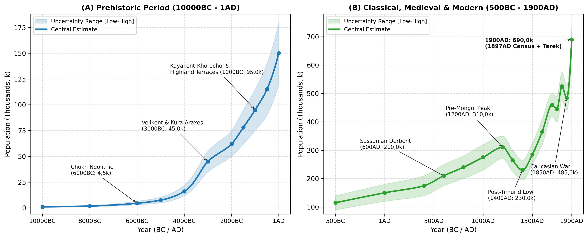
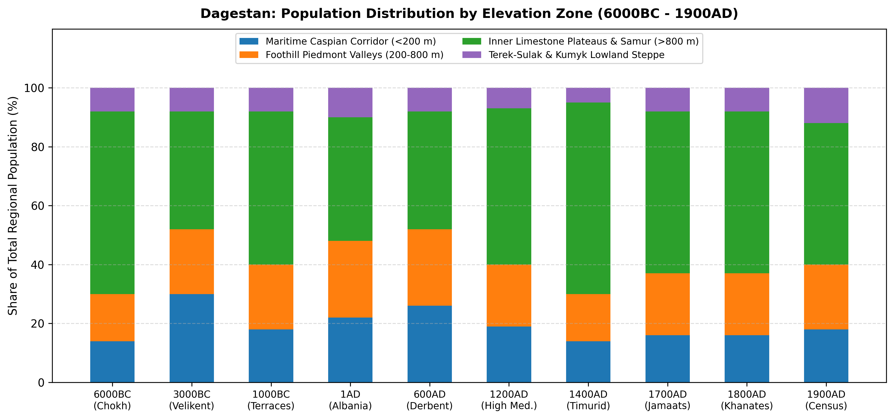
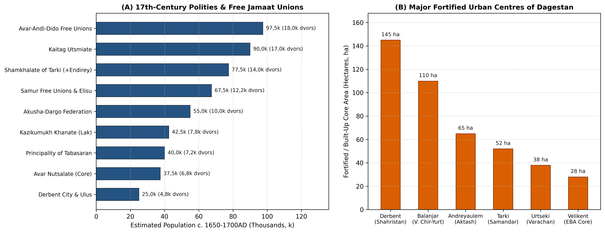

# Abstract

Dagestan covers 50,3k km² on the north-eastern flank of the Greater
Caucasus between the Caspian Sea and the high mountain crest. Its
population history centres on two main areas: the narrow coastal
corridor around Derbent and the terraced limestone plateaus of the
interior. Farming and herding began early in the mountains at Chokh
around 6000BC, supporting roughly 4,5k people
[\[1\]](#ref-amirkhanov1987chokh)[\[2\]](#ref-amirkhanov2022chokh)[\[3\]](#ref-davudov2009).
During the Eneolithic and Early Bronze Age, Kura-Araxes stone villages
in the highlands (Ginchi and Chinna) and large coastal mounds at
Velikent raised the population to 45k by 3000BC
[\[4\]](#ref-gadzhiev1991early)[\[5\]](#ref-gadzhiev1997velikent)[\[6\]](#ref-magomedov2000kura)[\[7\]](#ref-magomedov2005).
In the Middle and Late Bronze Ages, farmers terraced nearly half the
land surface of mid-mountain Dagestan (100k-150k ha of stepped fields),
allowing numbers to reach 95k by 1000BC
[\[8\]](#ref-borisov2013terraces)[\[9\]](#ref-korobov2020terraces)[\[10\]](#ref-shaev2024terraces)[\[11\]](#ref-aglarov1986terraces).
Along the Caspian coast, Sassanian, Khazar and early Islamic walled
towns at Derbent, Urtseki, Tarki, Balanjar and Endirey grew alongside
the highland clan and village unions (*jamaats*)
[\[12\]](#ref-abakarov1993atlas)[\[13\]](#ref-kudryavtsev1982derbent)[\[14\]](#ref-gadjiev2017derbent)[\[15\]](#ref-gmyrya1995huns).
Population reached a medieval peak of 310k (270k-350k) around 1200AD
before the Mongol and Timurid invasions reduced it by a quarter to 230k
in 1400AD
[\[16\]](#ref-ikhilov1960narody)[\[17\]](#ref-aliev2017tabasaran)[\[18\]](#ref-gasanov2024).
Recovery across the lowland principalities and highland free societies
carried numbers to 460k (420k-500k) by 1700AD
[\[19\]](#ref-aliev1975feudal)[\[20\]](#ref-umakhanov1973mutual)[\[21\]](#ref-aglarov1988jamaat).
Despite heavy losses during Nadir Shah’s campaigns of 1741-1743 (445k in
1750AD) and the Caucasian War of 1829-1859 (485k in 1850AD), peace after
1860 and the arrival of the railway lifted the population within modern
Dagestan to 690k (650k-730k) by 1900AD
[\[22\]](#ref-kabuzan1996)[\[23\]](#ref-kozubsky1901)[\[24\]](#ref-troynitskiy1905dagestan)[\[25\]](#ref-nagieva2005).

# Background

Lying between the Caspian Sea (-28 m) and Mount Bazardüzü (4.466 m),
Dagestan (50,3k km²) divides into lowlands along the coast and river
deltas, and steep plateaus and gorges in the interior.

Along the coast runs the Maritime Caspian Corridor (the Derbent Gate), a
narrow plain 3-35 km wide between the eastern spurs of the Caucasus and
the sea (Zone 1, 6,8k km²), which opens northward into the semi-arid
Terek-Sulak and Kumyk steppes (Zone 4, 13,5k km²). As the main land
route between the Eurasian steppe and Iran, this lowland belt held Early
Bronze Age mound settlements at Velikent and Kabaz-Kutan, Sassanian
border walls and garrisons at Derbent (*Bab al-Abwab*) and Palasa-Syrt,
early Khazar towns at Balanjar (Verkhniy Chir-Yurt), Samandar (Tarki),
Varachan (Urtseki) and Endirey (Andreyaulem), and the early modern Kumyk
and Kaitag principalities
[\[5\]](#ref-gadzhiev1997velikent)[\[13\]](#ref-kudryavtsev1982derbent)[\[26\]](#ref-gadjiev2008palasa)[\[27\]](#ref-magomedov1983khazar)[\[28\]](#ref-fedchenko2023).

Inland rise the foothills, the Inner Limestone Plateaus and the high
Samur gorges (Zones 2 and 3, 30k km²). Cut by the four branches of the
Koysu (Andi, Avar, Kara and Kazikumukh, which join to form the Sulak)
and by the Samur river, interior Dagestan was one of the earliest
centres of mountain grain farming at Chokh (6000BC) and hillside
terracing (2000-1000BC)
[\[1\]](#ref-amirkhanov1987chokh)[\[8\]](#ref-borisov2013terraces)[\[29\]](#ref-idrisov2018).
Protected by narrow limestone gorges around Gunib, Khunzakh, Kumukh,
Akusha and Kubachi, the mountain villages survived the Mongol and
Timurid invasions that repeatedly emptied the coastal plain
[\[12\]](#ref-abakarov1993atlas)[\[21\]](#ref-aglarov1988jamaat).

# Methodology

## Regional Subdivisions

Following the archaeological survey of Abakarov and Davudov (which
mapped 2,1k sites across 38 districts)
[\[12\]](#ref-abakarov1993atlas)[\[30\]](#ref-budaychiev2014) and the
geographical divisions of Gadzhiev [\[4\]](#ref-gadzhiev1991early), we
divide Dagestan (50,3k km²) into four elevation zones (Table 1).

| Zone | Elevation | Area (km²) | River Basins | Key Centres |
|:---|:---|:---|:---|:---|
| Maritime Caspian Corridor | -28 to 200 m | 6,8k | Coastal streams (Ulluchay, Rubas, Darvagchay) and lower Samur delta | Velikent, Derbent, Palasa-Syrt, Urtseki, Tarki, Petrovsk |
| Foothill Piedmont (Predgorye) | 200 to 800 m | 8,5k | Buynaksk, Kaitag, Tabasaran, Sergokala and lower Sulak foothills | Balanjar (V. Chir-Yurt), Andreyaulem, Kala-Koreysh, Khuchni, Temir-Khan-Shura |
| Inner Limestone Plateaus and Alpine Samur | 800 to 4.466 m | 21,5k | Four Koysu basins (Andi, Avar, Kara, Kazikumukh), Gunib-Chokh, Akusha and upper Samur | Chokh, Ginchi, Khunzakh, Kumukh, Akusha, Kubachi, Akhty |
| Terek-Sulak and Kumyk Lowland Steppe | -28 to 100 m | 13,5k | Lower Terek-Sulak delta, Agrakhan peninsula and Nogai-Kumyk plain | Terek-Sulak kurgans, Terki (Terskiy Gorod), Kizlyar, Khasavyurt |
| Total Dagestan | -28 to 4.466 m | 50,3k | All Caspian-draining watersheds of eastern North Caucasus | 2,1k catalogued prehistoric and medieval monuments |

The four elevation zones of Dagestan, showing elevation range, land
area, river drainage and the main archaeological and historical centres
in each belt.

## Estimation Methods

Our population estimates rely on five main sources of evidence across
successive periods.

For Neolithic and Eneolithic stone villages (Chokh, Ginchi, Chinna and
Mekegi) and Early Bronze Age mounds (Velikent) between 6000 and 1000BC,
household numbers are estimated from excavated round and rectangular
stone houses (12-38 m² floor area, or one family of 4,5-5,5 persons per
hearth) and checked against skeleton counts in collective catacomb
tombs, which held 100-350 burials per vault over 150-250 years
[\[5\]](#ref-gadzhiev1997velikent)[\[31\]](#ref-mednikova2020velikent)[\[32\]](#ref-kohl2007making)[\[33\]](#ref-davudov2014).

For the mountain terrace farming period (1500BC-1200AD), satellite
mapping and soil dating show that 48,3% of mid-mountain Dagestan
(100k-150k ha) was terraced
[\[8\]](#ref-borisov2013terraces)[\[9\]](#ref-korobov2020terraces)[\[10\]](#ref-shaev2024terraces)[\[29\]](#ref-idrisov2018).
The population that these terraces could feed,
$`K_{\text{terrace}}(t)`$, is given by:
``` math
K_{\text{terrace}}(t) = \frac{A_{\text{terrace}}(t) \cdot \theta_{\text{active}}(t) \cdot Y_{\text{grain}}}{C_{\text{cap}}}
```
where $`A_{\text{terrace}}(t)`$ is the total terraced area,
$`\theta_{\text{active}}(t) \in [0{,}45,\{,}65]`$ is the share under
crops in any given year,
$`Y_{\text{grain}} \approx 850\text{-}1{,}1\text{k kg/ha}`$ is the yield
of manured mountain barley and wheat [\[11\]](#ref-aglarov1986terraces)
and $`C_{\text{cap}} \approx 250\text{ kg/person/yr}`$ is annual grain
consumption, supplemented by sheep herding.

For the Sassanian, Khazar and early Islamic walled towns (Derbent,
Urtseki, Tarki, Balanjar and Endirey) between 400BC and 1220AD, urban
populations are estimated from walled area: 100-140 persons/ha in the
30-35 ha residential quarter (*shahristan*) of Derbent, 40-60 persons/ha
in the craft suburbs and 10-20 persons/ha in the garrison forts
[\[13\]](#ref-kudryavtsev1982derbent)[\[14\]](#ref-gadjiev2017derbent)[\[34\]](#ref-gadjiev2013).
Border settlements on the Rubas river are checked against the 1,5k-2k
catacomb mounds of the Palasa-Syrt cemetery from the 4th and 5th
centuries AD
[\[26\]](#ref-gadjiev2008palasa)[\[35\]](#ref-gmyrya2012)[\[36\]](#ref-saipudi2020palasa).

For the 16th to 18th centuries (1500-1800AD), Russian embassy reports
(*Posolskiy Prikaz*), Terki and Kizlyar fortress registers and local
Arabic chronicles and law codes (*Tarikh Dagestan*, *Darband-nama*, the
*Codex of Rustam Khan* and the 1635 decrees of Maisum Ali-Bek) record
household (*dvor* or *dym*) and militia totals across the principalities
and free village unions
[\[17\]](#ref-aliev2017tabasaran)[\[19\]](#ref-aliev1975feudal)[\[20\]](#ref-umakhanov1973mutual)[\[37\]](#ref-dadaev2014).
Taking 5-5,5 persons per mountain household and 4,5 inhabitants per
fighting man gives a total of 460k (420k-500k) in 1700AD and 525k
(475k-575k) in 1800AD [\[22\]](#ref-kabuzan1996).

Finally, late 19th-century estimates (1860-1900AD) come from the
1866-1867 military surveys of Dagestan Oblast, the 1886 family lists
(*posemeynye spiski*) and the 1897 Russian imperial census, combining
the nine districts (*okrugs*) of Dagestan Oblast with the Khasavyurt and
Kizlyar lowland districts of Terek Oblast that lie within modern
Dagestan
[\[22\]](#ref-kabuzan1996)[\[23\]](#ref-kozubsky1901)[\[24\]](#ref-troynitskiy1905dagestan)[\[25\]](#ref-nagieva2005)[\[38\]](#ref-kozubsky1895).

# Results



## Mesolithic and Neolithic Foundations: Chokh and the Inner Plateaus

Between 10000 and 6000BC, hunter-gatherers lived in two main areas: the
limestone rock-shelters of the interior plateaus (1.100-1.800 m) and the
old sea terraces along the Caspian coast at Tarki, Manas and Ulluchay.
Excavations by V. G. Kotovich (1955-1957) and Hizri Amirkhanov
(1980-1985 and 2020-2022) at Chokh in the Gunib district (1.675 m)
uncovered six occupation layers (Layers F-A) spanning the transition
from foraging to farming in the north-eastern Caucasus
[\[1\]](#ref-amirkhanov1987chokh)[\[2\]](#ref-amirkhanov2022chokh)[\[3\]](#ref-davudov2009)[\[39\]](#ref-kotovich1964stone).

The Mesolithic layers (Layers E-C, c. 9000-6500BC) contain small flint
tools and bones of East Caucasian tur, wild goat, mouflon and red deer.
Seasonal camps in the Chokh and Rugudja gorges (Rugudja, Kozma-Noho and
Mekegi) held bands of 25-50 people, giving a total population of 1k-1,8k
across Dagestan between 10000 and 8000BC.

Around 6000BC (Layers B-A, c. 6000-5000BC), Chokh provides the earliest
evidence for local farming and herding in the North Caucasus
[\[1\]](#ref-amirkhanov1987chokh)[\[33\]](#ref-davudov2014). Grain
impressions identified by N. R. Yanushevich and G. N. Lisitsyna show
that the inhabitants grew six-row naked and hulled barley alongside
bread wheat and emmer. Domestic sheep and goats made up more than 60% of
the animal bones, and the camp was rebuilt with permanent dry-stone
houses, clay floors and stone hearths
[\[1\]](#ref-amirkhanov1987chokh)[\[2\]](#ref-amirkhanov2022chokh).
Farming raised the regional population from 4,5k (3k-6,5k) in 6000BC to
7,5k (5k-10,5k) by 5000BC, with over 60% living on the interior plateaus
(Zone 3).

## Eneolithic and Early Bronze Age: Ginchi, Velikent and the Kura-Araxes Culture

During the 5th millennium BC (5000-3600BC), permanent stone-walled
farming villages spread across the mountain basins of interior Dagestan.
Excavations by M. G. Gadzhiev at Ginchi (1.650 m in the Gidatl valley)
and Chinna uncovered closely packed round stone houses (4-5,5 m across),
defensive walls, obsidian blades brought from Transcaucasia and copper
awls
[\[4\]](#ref-gadzhiev1991early)[\[40\]](#ref-gadzhiev1995metallurgy).
Each village held 15-30 families (75-150 people), bringing the regional
population to 16k (12k-22k) by 4000BC.

Between 3600 and 2000BC, settlement expanded under the North-Eastern
Caucasian branch of the Kura-Araxes culture
[\[4\]](#ref-gadzhiev1991early)[\[6\]](#ref-magomedov2000kura)[\[7\]](#ref-magomedov2005).
On the coastal plain (at Velikent, Kabaz-Kutan, Torpakh-Kala and
Dzhemikentskiy), joint Dagestani-American excavations (1994-1998) led by
M. G. Gadzhiev, Philip L. Kohl and Rabadan G. Magomedov at Velikent - 25
km north-west of Derbent on the old Ulluchay river fan - showed that
five clay mounds (Mounds I-V) covering 280 ha were occupied from c. 3600
to 1900BC
[\[5\]](#ref-gadzhiev1997velikent)[\[32\]](#ref-kohl2007making)[\[41\]](#ref-gadzhiev2000).
Multi-room mudbrick buildings, wheel-made storage jars and over 1,5k
bronze weapons, ornaments and casting moulds point to a coastal craft
and farming town of 1,2k-2,5k inhabitants
[\[5\]](#ref-gadzhiev1997velikent)[\[40\]](#ref-gadzhiev1995metallurgy).

Excavations of 13 underground collective catacomb tombs on Mounds III-V
at Velikent uncovered 100 to 350 skeletons per tomb; Tomb 1 on Mound III
alone held around 300 bodies and more than 1,5k bronze and carnelian
grave goods [\[5\]](#ref-gadzhiev1997velikent). Skeletal studies by M.
B. Mednikova and V. Y. Bakholdina show a farming population that
practised skull trepanation with high survival rates and buried family
members in the same vaults over 150-250 years
[\[31\]](#ref-mednikova2020velikent)[\[42\]](#ref-bakholdina2008velikent)[\[43\]](#ref-davudov2006).
Across all four zones, Kura-Araxes settlement raised Dagestan’s
population to 45k (35k-55k) by 3000BC and 62k (50k-75k) by 2000BC.

## Middle and Late Bronze and Early Iron Ages: Kayakent-Khorochoi and Highland Terracing

During the Middle Bronze Age (Gemetyube I-II, Velikent and Irganay) and
the Late Bronze and Early Iron Age Kayakent-Khorochoi culture
(1300-600BC), settlement thickened in both the foothills (Kayakent,
Tarki, Karabudakhkent and Zandak) and the interior plateaus (Khorochoi,
Gagatli, Kuli and Chirkei)
[\[12\]](#ref-abakarov1993atlas)[\[44\]](#ref-kruglov1958ne)[\[45\]](#ref-kotovich1982problems).
Stone-cist cemeteries of 50 to 400 graves stood beside fortified ridge
villages (2-8 ha) built in tiered stone masonry.

Soil dating and field surveys led by A. V. Borisov, D. S. Korobov and I.
A. Idrisov between 2012 and 2024 settled the debate begun by M. A.
Aglarov [\[11\]](#ref-aglarov1986terraces) over the age of Dagestan’s
mountain terraces
[\[8\]](#ref-borisov2013terraces)[\[9\]](#ref-korobov2020terraces)[\[10\]](#ref-shaev2024terraces)[\[29\]](#ref-idrisov2018)[\[46\]](#ref-peters2014).
Radiocarbon dates from buried soils beneath stone terrace walls in the
Gunib, Lak and Akusha basins show that hillside terracing began in the
Middle to Late Bronze Age (c. 1700-1300BC) and filled the valleys during
the Early Iron Age and classical Albanian period
[\[8\]](#ref-borisov2013terraces)[\[9\]](#ref-korobov2020terraces).
Satellite mapping by Shaev, Borisov, Idrisov and Korobov (2024) shows
that man-made terraces cover 48,3% of mid-mountain Dagestan (ranging
from 29,4% to 64,8% across individual valleys), far ahead of any other
part of the Greater Caucasus (16,1% in the Kislovodsk basin, 9,4% in
North Ossetia and 5,9% in Ingushetia; Figure 2)
[\[10\]](#ref-shaev2024terraces). This 100k-150k ha network of terraced
fields raised the regional population to 78k (62k-95k) by 1500BC and 95k
(75k-115k) by 1000BC.



## Caucasian Albania, Sassanian *Bab al-Abwab* and the Palasa-Syrt Cemetery

Between the 4th century BC and the 4th century AD, the Caspian coastal
corridor and foothill valleys formed the northern borderlands of
Caucasian Albania and the Sarmatian-Maskut tribes
[\[26\]](#ref-gadjiev2008palasa)[\[45\]](#ref-kotovich1982problems)[\[47\]](#ref-gadjiev2002).
Dozens of mudbrick and cobble-walled towns (*gorodishcha* of 5-25 ha)
grew up along the coastal plain at Tarki, Urtseki, Karabudakhkent,
Torpakh-Kala and on Derbent hill, lifting the regional population from
115k (90k-140k) in 500BC to 150k (120k-180k) at 1AD and 175k (140k-210k)
in 400AD.

In the 5th and 6th centuries AD, the Sassanian shahs Yazdegerd II
(438-457), Peroz (459-484) and Khosrow I Anushirvan (531-579) turned the
Derbent pass into the great stone fortress of Derbent (*Bab al-Abwab*)
[\[13\]](#ref-kudryavtsev1982derbent)[\[14\]](#ref-gadjiev2017derbent)[\[34\]](#ref-gadjiev2013)[\[48\]](#ref-gadjiev2008)[\[49\]](#ref-gadjiev2016dagbary).
Replacing Yazdegerd II’s mudbrick wall (*Gil-Bary*) of the 440s AD,
Khosrow I built around 567-569AD (as recorded in 29 Middle Persian
inscriptions studied by M. S. Gadjiev) the twin stone walls 3,6 km long
and 350-450 m apart, enclosing 145 ha between the 15 ha *Naryn-Kala*
citadel and the sea moles, together with the 42 km *Dag-Bary* mountain
wall of 31 stone forts and towers running up into Tabasaran
[\[13\]](#ref-kudryavtsev1982derbent)[\[14\]](#ref-gadjiev2017derbent)[\[49\]](#ref-gadjiev2016dagbary).
Based on Kudryavtsev’s study of the 30-35 ha residential town and
garrison quarters, Sassanian and early Islamic Derbent held 15k-25k
inhabitants (20k in 600AD), rising to 35k-50k at its 10th-century peak
under the Hashimid emirs, when al-Istakhri described it as larger than
Ardabil
[\[13\]](#ref-kudryavtsev1982derbent)[\[50\]](#ref-kudryavtsev1993).

Twenty-five kilometres south of Derbent on the Rubas river ridge, the
Palasa-Syrt cemetery (4,5 km long, excavated by V. G. Kotovich, L. B.
Gmyrya and M. S. Gadjiev) contains 1,5k to 2k earthen mounds over
catacomb graves from the late 4th and 5th centuries AD
[\[15\]](#ref-gmyrya1995huns)[\[26\]](#ref-gadjiev2008palasa)[\[35\]](#ref-gmyrya2012)[\[36\]](#ref-saipudi2020palasa).
Grave goods and skull shaping point to a mixed Alanic, Maskut and Hunnic
border garrison of 3,5k-5k people guarding the Derbent pass over four or
five generations
[\[15\]](#ref-gmyrya1995huns)[\[26\]](#ref-gadjiev2008palasa).

## Early and High Middle Ages: Khazar Cities, *Sarir*, Islamisation and the Mongol and Timurid Invasions

Between 650 and 965AD, northern and coastal Dagestan formed the early
urban heartland of the Khazar Khaganate and the Caspian Huns (*Savirs*),
while the interior plateaus were united under the Christian and pagan
Avar kingdom of Sarir (with its capital at Khunzakh) and the early
principalities of Lakz, Tabasaran, Zirikhgeran (Kubachi), Kaitag and
Gumik (Kumukh)
[\[27\]](#ref-magomedov1983khazar)[\[28\]](#ref-fedchenko2023)[\[51\]](#ref-gadzhiev1971varachan)[\[52\]](#ref-minorsky1958bab).
Excavations in the northern foothills and coastal corridor have
uncovered four large walled towns (Figure 3B). Balanjar (Verkhniy
Chir-Yurt where the Sulak leaves the foothills) enclosed 110 ha behind a
2,5 km stone and mudbrick wall, with three large cemeteries (over 2k
burials) and two early Christian churches; it held 12k-18k people before
the Arab general al-Jarrah ibn Abdallah captured it in 722/723AD
[\[27\]](#ref-magomedov1983khazar)[\[28\]](#ref-fedchenko2023). Samandar
(on the Tarki and Makhachkala plain) covered more than 50 ha of stone
terraces and vineyards (al-Mas’udi and Ibn Hawqal reported 40k vineyards
before Svyatoslav’s attack in 965-969AD) and housed 10k-15k people
[\[12\]](#ref-abakarov1993atlas)[\[27\]](#ref-magomedov1983khazar).
Varachan (Urtseki), capital of the Caspian Huns, had a 38-40 ha
three-tiered stone citadel and farming suburb of 6k-10k inhabitants
[\[15\]](#ref-gmyrya1995huns)[\[51\]](#ref-gadzhiev1971varachan), while
Andreyaulem (Endirey on the Aktash river) was a 65 ha walled town of
8k-12k people guarding the Terek-Sulak crossroads
[\[12\]](#ref-abakarov1993atlas)[\[27\]](#ref-magomedov1983khazar)[\[53\]](#ref-khapizov2019).

During the High Middle Ages (1000-1220AD), the spread of Sunni Islam (at
Kala-Koreysh, Kumukh, Richa and Tsakhur, where a madrasa opened in
1075AD) and the growth of mountain craft towns (Kubachi armourers,
Sulevkent potters and the market towns of Khunzakh and Kumukh) lifted
Dagestan’s population to 310k (270k-350k) around 1200AD
[\[12\]](#ref-abakarov1993atlas)[\[17\]](#ref-aliev2017tabasaran)[\[52\]](#ref-minorsky1958bab).

Two waves of invasion broke this medieval growth
[\[18\]](#ref-gasanov2024)[\[37\]](#ref-dadaev2014). During the Mongol
campaigns of 1220-1222 and 1239-1240, Subutai and Jebe bypassed Derbent
in 1221, and Bukdai sacked Derbent, Richa (where a 1239 Arabic
inscription records the slaughter), Kumukh (1240) and the coastal plain
[\[17\]](#ref-aliev2017tabasaran)[\[52\]](#ref-minorsky1958bab). The
lowland towns shrank sharply - William of Rubruck noted Derbent’s
reduced walls in 1254 - pulling the regional population down to 265k
(225k-300k) by 1300AD. After defeating Tokhtamysh on the Terek in April
1395, Timur ravaged the Kumyk plain, Kaitag, Akusha, Nerges and the
foothill forts during his 1395-1396 campaigns
[\[17\]](#ref-aliev2017tabasaran)[\[18\]](#ref-gasanov2024)[\[19\]](#ref-aliev1975feudal).
The population fell to a late medieval low of 230k (195k-265k) in
1400AD, with 65% of the survivors living on the interior plateaus and in
the Samur gorges (Zone 3).

## Early Modern Principalities and Free *Jamaat* Unions

Between 1450 and 1700AD, Dagestan’s population recovered steadily,
rising from 285k in 1500AD to 365k in 1600AD and 460k (420k-500k) in
1700AD. Archival studies by B. G. Aliev and M.-S. K. Umakhanov and
ethnographic work by M. A. Aglarov
[\[19\]](#ref-aliev1975feudal)[\[20\]](#ref-umakhanov1973mutual)[\[21\]](#ref-aglarov1988jamaat)[\[54\]](#ref-aliev2019unions)[\[55\]](#ref-aliev2019jamaat)[\[56\]](#ref-guseynova2008)[\[57\]](#ref-isaev2011)
show that 17th-century Dagestan was split between lowland and foothill
principalities (about 45% of the population) and self-governing mountain
village unions (about 55%) (Figure 3A and Table 2).

Among the principalities, the Shamkhalate of Tarki and the Endirey Kumyk
lands were centred on Tarki (1,5k-2k households or 8k-10k people when
visited by Adam Olearius in 1638, Evliya Çelebi in 1666 and Jan Struys
in 1670), Kafir-Kumukh, Buynak and Endirey (around 1,5k households).
Russian *Posolskiy Prikaz* records from 1614-1650 credit the Shamkhal
and the Endirey rulers with 12k-15k horsemen and foot soldiers,
representing 12k-16k households or 65k-85k people
[\[19\]](#ref-aliev1975feudal)[\[20\]](#ref-umakhanov1973mutual). The
Kaitag Utsmiate, covering Lower Kaitag (Madzhalis and Bashly, with 1,5k
households) and Upper Kaitag/Dargwa (Urkarakh and Kubachi) under the
early 17th-century *Codex of Rustam Khan*, fielded 15k-20k warriors from
15k-19k households (80k-100k people)
[\[19\]](#ref-aliev1975feudal)[\[20\]](#ref-umakhanov1973mutual). The
Kazikumukh Khanate in the Lak basin, centred on Kumukh (1,2k-1,5k stone
houses), had 7k-8,5k households (38k-46k people)
[\[20\]](#ref-umakhanov1973mutual), while the Avar Nutsalate on the
Khunzakh plateau (700-1k households in Khunzakh and the Tobot villages)
had 6k-7,5k core households (32k-42k people)
[\[19\]](#ref-aliev1975feudal)[\[21\]](#ref-aglarov1988jamaat)[\[58\]](#ref-saidov1980).
In the south, the Principality of Tabasaran, recorded in the 1635
decrees of Maisum Ali-Bek [\[37\]](#ref-dadaev2014), had 6,5k-8k
households (35k-45k people) [\[17\]](#ref-aliev2017tabasaran), and the
Safavid governorate of Derbent (after Shah Abbas I retook the city in
1606 and settled Bayat and Qurchi garrisons there) contained Derbent
city (2k-2,5k houses, or 10k-14k townspeople) and its coastal villages,
totalling 4k-5,5k households or 20k-30k inhabitants
[\[13\]](#ref-kudryavtsev1982derbent)[\[16\]](#ref-ikhilov1960narody).

In the mountains, over 60 free village unions (*vol’nye obshchestva* or
*jamaats*), ruled by elected elders and customary law (*adat*), held the
Dargwa plateaus and the Avar, Andi, Dido and Samur gorges
[\[21\]](#ref-aglarov1988jamaat)[\[54\]](#ref-aliev2019unions)[\[55\]](#ref-aliev2019jamaat)[\[56\]](#ref-guseynova2008)[\[57\]](#ref-isaev2011).
The Akusha-Dargo Upper Dargwa union (Akusha, Tsudakhar, Usisha, Mugi and
Mekegi) numbered 9k-11k households (48k-60k people); the Avar, Andi and
Dido free unions (Gidatl, Andalal around Chokh and Sogratl, Karata,
Bagulal, Chamalyal, Tindi, Dido, Antsukh, Dzhurmut, Koysubulu and
Antl-Ratl) totalled 16k-20k households (85k-110k people)
[\[21\]](#ref-aglarov1988jamaat)[\[54\]](#ref-aliev2019unions)[\[56\]](#ref-guseynova2008);
and the Samur valley unions and Elisu Sultanate (Akhty-para, Dokuz-para,
Altı-para, Rutul and Tsakhur/Elisu) had 11k-13,5k households (60k-75k
people) [\[16\]](#ref-ikhilov1960narody)[\[54\]](#ref-aliev2019unions).



| Polity / Free Union | Main Centres | Households (Dvors) | Militia (Sabres) | Estimated Population |
|:---|:---|:---|:---|:---|
| Avar, Andi and Dido Free Unions (Andalal, Gidatl, Antsukh, Dido, Andi) | Chokh, Sogratl, Khidi, Andi, Botlikh, Bezhta | 16k - 20k | 18k - 22k | 85k - 110k |
| Kaitag Utsmiate (Lower Kaitag and Upper Kaitag/Dargwa) | Madzhalis, Bashly, Urkarakh, Kubachi | 15k - 19k | 15k - 20k | 80k - 100k |
| Shamkhalate of Tarki and Endirey / Zasulak Kumyk Domains | Tarki, Endirey, Kafir-Kumukh, Buynak | 12k - 16k | 12k - 15k | 65k - 85k |
| Samur Free Unions (Akhty-para, Dokuz-para, Rutul) and Tsakhur/Elisu | Akhty, Mikrakh, Rutul, Tsakhur | 11k - 13,5k | 10k - 13k | 60k - 75k |
| Akusha-Dargo Upper Dargwa Federation (Akusha, Tsudakhar, Usisha, Mekegi) | Akusha, Tsudakhar, Usisha, Mugi | 9k - 11k | 10k - 12k | 48k - 60k |
| Kazikumukh Khanate (Kumukh and Lak Basin) | Kumukh, Tovuz, Khosrekh | 7k - 8,5k | 7k - 9k | 38k - 46k |
| Principality of Tabasaran (Maisumate and Qadiate of Tabasaran) | Khuchni, Dzhalgan, Rukel | 6,5k - 8k | 6k - 8k | 35k - 45k |
| Avar Nutsalate (Khunzakh Plateau Core) | Khunzakh, Arani, Untsukul | 6k - 7,5k | 6k - 8k | 32k - 42k |
| Safavid Governorate of Derbent (Derbent City and Coastal Ulus) | Derbent (Naryn-Kala and Shahristan) | 4k - 5,5k | 3,5k - 5k | 20k - 30k |
| Unadjusted Sum of Polities | All 9 polity groupings | 86,5k - 109k | 87,5k - 112k | 463k - 593k |
| Adopted Regional Total (Adjusted for Overlap) | Republic of Dagestan (50,3k km²) | 82k - 95k | 80k - 95k | 460k (420k - 500k) |

Household, militia and population estimates across the nine
principalities and free village confederations of Dagestan in the late
17th century, adjusted for overlapping border claims.

## The Eighteenth and Nineteenth Centuries

In the 18th and 19th centuries, Dagestan suffered two sharp wartime
drops before growing rapidly under Russian rule after 1860
[\[22\]](#ref-kabuzan1996)[\[25\]](#ref-nagieva2005)[\[59\]](#ref-aliev1999)[\[60\]](#ref-aliev2001).

In the 1720s, uprisings against Safavid rule in southern Dagestan and
Peter I’s Persian campaign of 1722-1723 (which built the fortress of
Svyatoy Krest on the Sulak and placed Russian garrisons at Derbent and
Tarki before Kizlyar was founded on the Terek in 1735) disrupted farming
along the coast. Worse damage followed during the three campaigns of the
Iranian ruler Nadir Shah in 1734, 1735 and 1741-1743
[\[59\]](#ref-aliev1999)[\[60\]](#ref-aliev2001). Before the combined
Avar, Lak and Dargwa militia defeated him at Andalal (Sogratl and Chokh)
and Aymaki in September 1741, Nadir Shah burned dozens of villages
across Kaitag, Tabasaran, Mehtuli and Kazikumukh, reducing Dagestan’s
population from 460k in 1700AD to 445k (400k-490k) in 1750AD. Half a
century of recovery and growing trade through Kizlyar, Derbent and Tarki
then raised the population to 525k (475k-575k) by 1800AD
[\[22\]](#ref-kabuzan1996)[\[59\]](#ref-aliev1999).

Russia’s annexation of the Derbent, Baku and Quba khanates (confirmed by
the 1813 Treaty of Gulistan) and General A. P. Yermolov’s campaigns of
1818-1826 (building the forts of Vnezapnaya at Endirey in 1819 and
Burnaya above Tarki in 1821) sparked the rise of the Caucasian Imamate
under the three Imams Ghazi Muhammad (1829-1832), Hamzat Bek (1832-1834)
and Shamil (1834-1859)
[\[22\]](#ref-kabuzan1996)[\[61\]](#ref-magomeddadaev2006). Thirty years
of sieges (at Gimry in 1832, Akhulgo in 1839, Dargo in 1845, Gergebil
and Salta in 1847, Chokh in 1849 and Gunib in 1859), cholera outbreaks,
crop burning and the emigration of 15k-20k Dagestani *muhajirs* to the
Ottoman Empire after 1859 reduced the population to 485k (440k-530k)
around 1850AD
[\[22\]](#ref-kabuzan1996)[\[25\]](#ref-nagieva2005)[\[61\]](#ref-magomeddadaev2006).

After Shamil’s surrender at Gunib on 25 August 1859, the Russian
government created Dagestan Oblast in 1860, with its capital at
Temir-Khan-Shura (modern Buynaksk) and nine districts (*okrugs*): Avar,
Andi, Gunib, Dargwa, Kazikumukh, Kaitag-Tabasaran, Kyurin, Samur and
Temir-Khan-Shura. The northern Kumyk and Nogai plains beyond the Sulak
(the Khasavyurt and Kizlyar districts) were placed in Terek Oblast
[\[38\]](#ref-kozubsky1895)[\[62\]](#ref-adzhiev2018kumyks)[\[63\]](#ref-khapizov2015andotsez).
Military counts in the 1860s recorded 450k-480k people in Dagestan
Oblast proper, rising in the 1886 family lists to 592,8k
[\[22\]](#ref-kabuzan1996)[\[25\]](#ref-nagieva2005)[\[38\]](#ref-kozubsky1895).
In the First General Census of the Russian Empire on 28 January 1897
[\[23\]](#ref-kozubsky1901)[\[24\]](#ref-troynitskiy1905dagestan),
Dagestan Oblast had 571,2k present inhabitants - lower than the
permanent population because 50k-80k mountain men (*otkhodniki*) were
away for the winter working in the Baku oilfields, Tiflis and the Terek
towns. By language, the oblast included 158,6k Avars and Ando-Tsez
peoples (27,8%), 121,4k Dargwas and Kubachis (21,3%), 94,6k Lezgins
(16,6%), 76,4k Laks (13,4%), 32,6k Kumyks in Temir-Khan-Shura and Kaitag
(5,7%), 32,1k Azerbaijanis and Tats around Derbent (5,6%) and 22k
Tabasarans, Aguls, Rutuls and Tsakhurs
[\[23\]](#ref-kozubsky1901)[\[24\]](#ref-troynitskiy1905dagestan)[\[63\]](#ref-khapizov2015andotsez).
Adding the Khasavyurt district (70,8k inhabitants in 1897, including
26,6k Kumyks and 18,1k Aukh Chechens) and the Dagestani part of the
Kizlyar district (Kizlyar town, the Terek Cossack *stanitsas* and the
Karanogai steppe camps, with 45k-50k people) gives a total population
within modern Dagestan of 690k (650k-730k, or 13,72 persons/km²) by
1900AD
[\[22\]](#ref-kabuzan1996)[\[25\]](#ref-nagieva2005)[\[62\]](#ref-adzhiev2018kumyks).
The opening of the Vladikavkaz Railway through Petrovsk-Port
(Makhachkala, 9,8k inhabitants in 1897) to Derbent (14,6k inhabitants)
and Baku between 1893 and 1900 started rapid urban growth along the
coast, bringing Zone 1 to 124k and Zone 4 to 83k by 1900AD
[\[25\]](#ref-nagieva2005).

# Limitations

Three main problems affect population estimates for Dagestan. First,
rises and falls in the level of the Caspian Sea between -34 m in the
6th-10th centuries AD and -22 m in the 14th-17th centuries flooded the
sea walls of Derbent and several coastal Bronze Age sites while shifting
the channels of the lower Terek and Sulak delta
[\[5\]](#ref-gadzhiev1997velikent)[\[13\]](#ref-kudryavtsev1982derbent).
Second, although terraces cover 48,3% of mid-mountain Dagestan
[\[10\]](#ref-shaev2024terraces), fallow rotation and the abandonment of
smaller villages after Timur’s invasion mean that only 45-65% of the
terraced land was farmed at any one time
[\[8\]](#ref-borisov2013terraces)[\[9\]](#ref-korobov2020terraces).
Third, in the 17th century the Shamkhal of Tarki, the Utsmi of Kaitag
and the Khan of Kazikumukh often claimed the same border village unions
when dealing with Russian envoys, so raw militia totals have to be
reduced by 10-15% to avoid double counting
[\[19\]](#ref-aliev1975feudal)[\[20\]](#ref-umakhanov1973mutual).
Conversely, in the January 1897 census the winter absence of 50k-80k
migrant workers in Baku and Terek Oblast lowered the count in the
mountain districts compared with the 1886 family lists
[\[23\]](#ref-kozubsky1901)[\[25\]](#ref-nagieva2005).

# Conclusion

Between 10000BC and 1900AD, Dagestan grew from an early mountain farming
centre at Chokh (4,5k in 6000BC) into the most heavily terraced and
urbanised part of the eastern Caucasus, with 690k people (13,72
persons/km²) by 1900AD. The pairing of walled trading towns along the
Caspian coast (Velikent, Derbent, Urtseki, Tarki, Balanjar and
Petrovsk-Port) with terraced stone villages on the interior plateaus
(Chokh, Khunzakh, Kumukh, Akusha and Kubachi) allowed Dagestan to
weather the Mongol and Timurid invasions, Nadir Shah’s campaigns and the
Caucasian War with much smaller long-term population losses than the
open plains of central and north-western Ciscaucasia.

# Appendix

## Population Estimates

| Benchmark | Zone 1: Littoral (6,8k km²) | Zone 2: Piedmont (8,5k km²) | Zone 3: Highlands (21,5k km²) | Zone 4: Steppe (13,5k km²) | Total | Range | Density (p/km²) |
|:---|:---|:---|:---|:---|:---|:---|:---|
| 10000BC | 0,15k | 0,2k | 0,55k | 0,1k | 1k | 0,6k - 1,5k | 0,02 |
| 8000BC | 0,25k | 0,35k | 1,05k | 0,15k | 1,8k | 1,2k - 2,5k | 0,04 |
| 6000BC | 0,65k | 0,7k | 2,8k | 0,35k | 4,5k | 3k - 6,5k | 0,09 |
| 5000BC | 1,1k | 1,2k | 4,6k | 0,6k | 7,5k | 5k - 10,5k | 0,15 |
| 4000BC | 3,2k | 3,2k | 8,3k | 1,3k | 16k | 12k - 22k | 0,32 |
| 3000BC | 13,5k | 9,9k | 18k | 3,6k | 45k | 35k - 55k | 0,89 |
| 2000BC | 14,5k | 13,5k | 29k | 5k | 62k | 50k - 75k | 1,23 |
| 1500BC | 15,5k | 17k | 39,5k | 6k | 78k | 62k - 95k | 1,55 |
| 1000BC | 17k | 21k | 49,5k | 7,5k | 95k | 75k - 115k | 1,89 |
| 500BC | 23k | 27,5k | 53,5k | 11k | 115k | 90k - 140k | 2,29 |
| 1AD | 33k | 39k | 63k | 15k | 150k | 120k - 180k | 2,98 |
| 400AD | 42k | 45,5k | 73,5k | 14k | 175k | 140k - 210k | 3,48 |
| 600AD | 54,5k | 54,5k | 84k | 17k | 210k | 175k - 250k | 4,17 |
| 800AD | 57,5k | 62,5k | 101k | 19k | 240k | 200k - 280k | 4,77 |
| 1000AD | 55k | 60,5k | 140k | 19,5k | 275k | 230k - 320k | 5,47 |
| 1200AD | 59k | 65k | 164k | 22k | 310k | 270k - 350k | 6,16 |
| 1300AD | 42k | 48k | 159k | 16k | 265k | 225k - 300k | 5,27 |
| 1400AD | 32k | 37k | 149,5k | 11,5k | 230k | 195k - 265k | 4,57 |
| 1500AD | 43k | 51k | 174k | 17k | 285k | 250k - 325k | 5,67 |
| 1600AD | 58k | 73k | 208k | 26k | 365k | 320k - 410k | 7,26 |
| 1700AD | 73,5k | 96,5k | 253k | 37k | 460k | 420k - 500k | 9,15 |
| 1750AD | 68k | 92k | 250k | 35k | 445k | 400k - 490k | 8,85 |
| 1800AD | 84k | 110k | 289k | 42k | 525k | 475k - 575k | 10,44 |
| 1850AD | 78k | 102k | 262k | 43k | 485k | 440k - 530k | 9,64 |
| 1900AD | 124k | 152k | 331k | 83k | 690k | 650k - 730k | 13,72 |

Population estimates across 25 benchmark dates from 10000BC to 1900AD
for each of the four elevation zones of Dagestan, alongside total
midpoint, uncertainty range and overall density.

# Sources

<div id="refs" class="references csl-bib-body" data-entry-spacing="0">

<div id="ref-amirkhanov1987chokh" class="csl-entry">

<span class="csl-left-margin">1.
</span><span class="csl-right-inline">Amirkhanov, H. A. *Chokhskoye
Poseleniye: Chelovek i Yego Kul’tura v Mezolite i Neolite Gornogo
Dagestana \[the Chokh Settlement: Man and His Culture in the Mesolithic
and Neolithic of Mountainous Dagestan\]*. Nauka, 1987,
<https://search.worldcat.org/search?q=Chokh+Settlement+Man+His+Culture+Mesolithic+Neolithic+Mountainous+Amirkhanov+1987>.</span>

</div>

<div id="ref-amirkhanov2022chokh" class="csl-entry">

<span class="csl-left-margin">2.
</span><span class="csl-right-inline">Amirkhanov, H. A. “Chokhskaya
Neoliticheskaya Kul’tura: Opredeleniye i Khronologiya \[the Chokh
Neolithic Culture: Definition and Chronology\].” *Istoriya, Arkheologiya
i Etnografiya Kavkaza*, vol. 18, no. 4, 2022, pp. 1030-47,
<https://doi.org/10.32653/CH1841030-1047>.</span>

</div>

<div id="ref-davudov2009" class="csl-entry">

<span class="csl-left-margin">3.
</span><span class="csl-right-inline">Davudov, O. M. “Hizri
Amirkhanovich Amirkhanov (k 60-Letiyu so Dnya Rozhdeniya) \[Hizri
Amirkhanovich Amirkhanov: On His 60th Birthday and Investigations of
Chokh\].” *Istoriya, Arkheologiya i Etnografiya Kavkaza*, no. 4, 2009,
pp. 176-92,
<https://cyberleninka.ru/article/n/hizri-amirhanovich-amirhanov-k-60-letiyu-so-dnya-rozhdeniya>.</span>

</div>

<div id="ref-gadzhiev1991early" class="csl-entry">

<span class="csl-left-margin">4.
</span><span class="csl-right-inline">Gadzhiev, M. G.
*Rannezemledel’cheskaya Kul’tura Severo-Vostochnogo Kavkaza: Epokha
Eneolita i Ranney Bronzy*. Nauka, 1991,
<https://search.worldcat.org/search?q=Rannezemledel+cheskaya+kul+tura+Severo+Vostochnogo+Kavkaza+Epokha+Gadzhiev+1991>.</span>

</div>

<div id="ref-gadzhiev1997velikent" class="csl-entry">

<span class="csl-left-margin">5.
</span><span class="csl-right-inline">Gadzhiev, M. G., et al. “The 1995
Daghestan-American Velikent Expedition: Excavations in Daghestan,
Russia.” *Eurasia Antiqua*, vol. 3, 1997, pp. 181-222,
<https://scholar.google.com/scholar?q=1995+Daghestan+American+Velikent+Expedition+Excavations+Daghestan+Russia+Gadzhiev+1997>.</span>

</div>

<div id="ref-magomedov2000kura" class="csl-entry">

<span class="csl-left-margin">6.
</span><span class="csl-right-inline">Magomedov, R. G. *Materialy k
Izucheniyu Kul’tur Epokhi Bronzy v Primorskom Dagestane*. IIAE DNTs RAN,
2000,
<https://search.worldcat.org/search?q=Materialy+izucheniyu+kul+tur+epokhi+bronzy+Primorskom+Dagestane+Magomedov+2000>.</span>

</div>

<div id="ref-magomedov2005" class="csl-entry">

<span class="csl-left-margin">7.
</span><span class="csl-right-inline">Magomedov, R. G.
“Severo-Vostochnyy Kavkaz i Kuro-Arakskaya Kul’turno-Istoricheskaya
Obshchnost’: Novyye Perspektivy Staroy Problemy \[the Northeastern
Caucasus and the Kura-Araxes Community\].” *Vestnik Instituta Istorii,
Arkheologii i Etnografii*, no. 4, 2005, pp. 60-65,
<https://cyberleninka.ru/article/n/severo-vostochnyy-kavkaz-i-kuro-arakskaya-kulturno-istoricheskaya-obschnost-novyye-perspektivy-staroy-problemy>.</span>

</div>

<div id="ref-borisov2013terraces" class="csl-entry">

<span class="csl-left-margin">8.
</span><span class="csl-right-inline">Borisov, A. V., et al. “Opyt
Kompleksnogo Izucheniya Drevnego Zemledeliya v Gornom Dagestane (Na
Primere Gunibskogo Plato).” *Rossiyskaya Arkheologiya*, no. 4, 2012, pp.
24-36,
<https://cyberleninka.ru/article/n/opyt-kompleksnogo-izucheniya-drevnego-zemledeliya-v-gornom-dagestane>.</span>

</div>

<div id="ref-korobov2020terraces" class="csl-entry">

<span class="csl-left-margin">9.
</span><span class="csl-right-inline">Korobov, D. S., and A. V. Borisov.
“Zemledel’cheskiye Terrasy Vo Vnutrennem Dagestane: Proiskhozhdeniye i
Khronologiya \[Agricultural Terraces in Inner Dagestan: Origin and
Chronology\].” *Rossiyskaya Arkheologiya*, no. 3, 2020, pp. 68-83,
<https://cyberleninka.ru/article/n/zemledelcheskiye-terrasy-vo-vnutrennem-dagestane-proishozhdeniye-i-hronologiya>.</span>

</div>

<div id="ref-shaev2024terraces" class="csl-entry">

<span class="csl-left-margin">10.
</span><span class="csl-right-inline">Shaev, I. A., et al.
“Zemledel’cheskiye Terrasy v Srednegornoy Zone Bol’shogo Kavkaza
\[Agricultural Terraces in the Mid-Mountain Zone of the Greater
Caucasus\].” *Regional’nyye Geosistemy*, vol. 48, no. 4, 2024, pp.
503-14, <https://doi.org/10.52575/2712-7443-2024-48-4-503-514>.</span>

</div>

<div id="ref-aglarov1986terraces" class="csl-entry">

<span class="csl-left-margin">11.
</span><span class="csl-right-inline">Aglarov, M. A. “Tekhnika
Sooruzheniya Terrasnykh Poley i Voprosy Evolyutsii Form Sobstvennosti v
Dagestane (Do XX v.).” *Studia Pontocaucasica*, vol. 1, 1986, pp. 74-92,
<https://www.saunje.ge/index.php?id=1495>.</span>

</div>

<div id="ref-abakarov1993atlas" class="csl-entry">

<span class="csl-left-margin">12.
</span><span class="csl-right-inline">Abakarov, A. I., and O. M.
Davudov. *Arkheologicheskaya Karta Dagestana \[Archaeological Map of
Dagestan\]*. Nauka, 1993,
<https://search.worldcat.org/search?q=Archaeological+Map+Dagestan+Abakarov+1993>.</span>

</div>

<div id="ref-kudryavtsev1982derbent" class="csl-entry">

<span class="csl-left-margin">13.
</span><span class="csl-right-inline">Kudryavtsev, A. A. *Drevniy
Derbent \[Ancient Derbent\]*. Nauka, 1982,
<https://search.worldcat.org/search?q=Ancient+Derbent+Kudryavtsev+1982>.</span>

</div>

<div id="ref-gadjiev2017derbent" class="csl-entry">

<span class="csl-left-margin">14.
</span><span class="csl-right-inline">Gadjiev, M. S. “Construction
Activities of Kavadh i and Khusraw i Anushirvan in the Caucasus and the
Fortifications of Derbent.” *Iran and the Caucasus*, vol. 21, no. 2,
2017, pp. 121-47,
<https://scholar.google.com/scholar?q=Construction+Activities+Kavadh+Khusraw+Anushirvan+Caucasus+Fortifications+Derbent+Gadjiev+2017>.</span>

</div>

<div id="ref-gmyrya1995huns" class="csl-entry">

<span class="csl-left-margin">15.
</span><span class="csl-right-inline">Gmyrya, L. B. *Strana Gunnov u
Kaspiyskikh Vorot: Prikaspiyskiy Dagestan v Epokhu Velikogo Pereseleniya
Narodov*. Dagestanskoye Knizhnoye Izdatel’stvo, 1995,
<https://search.worldcat.org/search?q=Strana+gunnov+Kaspiyskikh+vorot+Prikaspiyskiy+Dagestan+epokhu+Velikogo+Gmyrya+1995>.</span>

</div>

<div id="ref-ikhilov1960narody" class="csl-entry">

<span class="csl-left-margin">16.
</span><span class="csl-right-inline">Ikhilov, M. M. *Narody Lezginskoy
Gruppy: Etnograficheskoye Issledovaniye Proshlogo i Nastoyashchego
Lezgin, Tabasarantsev, Rutul’tsev, Tsakhurov, Agulov*. Dagestanskiy
Filial AN SSSR, 1967,
<https://search.worldcat.org/search?q=Narody+lezginskoy+gruppy+etnograficheskoye+issledovaniye+proshlogo+nastoyashchego+lezgin+Ikhilov+1967>.</span>

</div>

<div id="ref-aliev2017tabasaran" class="csl-entry">

<span class="csl-left-margin">17.
</span><span class="csl-right-inline">Aliev, B. G., and M.-S. K.
Umakhanov. *Istoricheskaya Geografiya Dagestana XVII - Nach. XIX v.
(Yuzhnyy Dagestan i Tabasaran)*. IIAE DNTs RAN, 2001,
<https://search.worldcat.org/search?q=Istoricheskaya+geografiya+Dagestana+XVII+nach+XIX+Yuzhnyy+Dagestan+Aliev+2001>.</span>

</div>

<div id="ref-gasanov2024" class="csl-entry">

<span class="csl-left-margin">18.
</span><span class="csl-right-inline">Gasanov, M. R., and E. M.
Magomedova. “Iz Istorii Srednevekovogo Dagestana: Tabasaran v XIV-XV Vv.
\[From the History of Medieval Dagestan: Tabasaran in the 14th-15th
Centuries\].” *Izvestiya DGPU. Obshchestvennyye i Gumanitarnyye Nauki*,
vol. 18, no. 4, 2024, pp. 12-17,
<https://doi.org/10.31161/1995-0667-2024-18-4-12-17>.</span>

</div>

<div id="ref-aliev1975feudal" class="csl-entry">

<span class="csl-left-margin">19.
</span><span class="csl-right-inline">Aliev, B. G., et al. *Iz Istorii
Srednevekovogo Dagestana \[from the History of Medieval Dagestan\]*.
IIAE DNTs AN SSSR, 1975,
<https://search.worldcat.org/search?q=History+Medieval+Dagestan+Aliev+1975>.</span>

</div>

<div id="ref-umakhanov1973mutual" class="csl-entry">

<span class="csl-left-margin">20.
</span><span class="csl-right-inline">Umakhanov, M.-S. K.
*Vzaimootnosheniya Feodal’nykh Vladeniy i Osvoboditel’naya Bor’ba
Narodov Dagestana v XVII Veke \[Mutual Relations of Feudal
Principalities and the Peoples of Dagestan in the 17th Century\]*.
Dagestanskiy Filial AN SSSR, 1973,
<https://search.worldcat.org/search?q=Mutual+Relations+Feudal+Principalities+Peoples+Dagestan+17th+Century+Umakhanov+1973>.</span>

</div>

<div id="ref-aglarov1988jamaat" class="csl-entry">

<span class="csl-left-margin">21.
</span><span class="csl-right-inline">Aglarov, M. A. *Sel’skaya
Obshchina v Nagornom Dagestane v XVII - Nachale XIX v. \[The Rural
Community in Mountainous Dagestan in the 17th - Early 19th Century\]*.
Nauka, 1988,
<https://instituteofhistory.ru/media/library/publication/files/Aglarov_1988.pdf>.</span>

</div>

<div id="ref-kabuzan1996" class="csl-entry">

<span class="csl-left-margin">22.
</span><span class="csl-right-inline">Kabuzan, V. M. *Naseleniye
Severnogo Kavkaza v XIX-XX Vekakh: Etnostatisticheskoye Issledovaniye
\[the Population of the North Caucasus in the 19th-20th Centuries: An
Ethnostatistical Study\]*. Russko-Baltiyskiy Informatsionnyy Tsentr
BLITs, 1996,
<https://search.worldcat.org/search?q=Population+North+Caucasus+19th+20th+Centuries+Ethnostatistical+Study+Kabuzan+1996>.</span>

</div>

<div id="ref-kozubsky1901" class="csl-entry">

<span class="csl-left-margin">23.
</span><span class="csl-right-inline">Kozubskiy, E. I. *Dagestanskiy
Sbornik. Vypusk i \[Dagestan Collection, Issue i: Statistical Summary
and the 1897 Census\]*. Russkaya Tipografiya V. M. Sorokina, 1902,
<https://search.worldcat.org/search?q=Dagestan+Collection+Issue+Statistical+Summary+1897+Census+Kozubskiy+1902>.</span>

</div>

<div id="ref-troynitskiy1905dagestan" class="csl-entry">

<span class="csl-left-margin">24.
</span><span class="csl-right-inline">Troynitskiy, N. A. *Pervaya
Vseobshchaya Perepis’ Naseleniya Rossiyskoy Imperii, 1897 g. Tom LXII:
Dagestanskaya Oblast’ \[First General Census of the Population of the
Russian Empire, 1897. Vol. 62: Dagestan Oblast\]*. Tsentral’nyy
Statisticheskiy Komitet MVD, 1905,
<https://www.demoscope.ru/weekly/ssp/rus1897_01.php>.</span>

</div>

<div id="ref-nagieva2005" class="csl-entry">

<span class="csl-left-margin">25.
</span><span class="csl-right-inline">Nagieva, M. K. “Rasseleniye
Naseleniya i Migratsionnyye Protsessy v Dagestane Vo Vtoroy Polovine
XIX - Nachale XX Vv. \[Settlement of Population and Migration Processes
in Dagestan in the Second Half of the 19th - Early 20th Century\].”
*Istoriya, Arkheologiya i Etnografiya Kavkaza*, vol. 1, no. 4, 2005, pp.
54-63,
<https://cyberleninka.ru/article/n/rasselenie-naseleniya-i-migratsionnye-protsessy-v-dagestane-vo-vtoroy-polovine-xix-nachale-xx-vv>.</span>

</div>

<div id="ref-gadjiev2008palasa" class="csl-entry">

<span class="csl-left-margin">26.
</span><span class="csl-right-inline">Gadjiev, M. S. “On the
Construction Date of the Derbent Fortification Complex.” *Iran and the
Caucasus*, vol. 12, no. 1, 2008, pp. 1-15,
<https://doi.org/10.1163/157338408X326163>.</span>

</div>

<div id="ref-magomedov1983khazar" class="csl-entry">

<span class="csl-left-margin">27.
</span><span class="csl-right-inline">Magomedov, M. G. *Obrazovaniye
Khazarskogo Kaganata: Po Materialam Arkheologicheskikh Issledovaniy i
Pis’mennym Dannym*. Nauka, 1983,
<https://search.worldcat.org/search?q=Obrazovaniye+Khazarskogo+kaganata+materialam+arkheologicheskikh+issledovaniy+pis+mennym+Magomedov+1983>.</span>

</div>

<div id="ref-fedchenko2023" class="csl-entry">

<span class="csl-left-margin">28.
</span><span class="csl-right-inline">Fedchenko, O. D. “Lokalizatsiya
Khazarskikh Gorodov: Ot Sarkela Do Samandara \[Localisation of Khazar
Cities: From Sarkel to Samandar and Balanjar\].” *Kochevaya
Tsivilizatsiya: Istoricheskiye Issledovaniya*, vol. 3, no. 2, 2023, pp.
47-62, <https://doi.org/10.53315/2782-3377-2023-3-2-47-62>.</span>

</div>

<div id="ref-idrisov2018" class="csl-entry">

<span class="csl-left-margin">29.
</span><span class="csl-right-inline">Idrisov, I. A., et al. “Pochvy
Zemledel’cheskikh Terras Gunibskogo Plato \[Soils of the Agricultural
Terraces of the Gunib Plateau\].” *Izvestiya DGPU. Yestestvennyye i
Tochnyye Nauki*, vol. 12, no. 2, 2018, pp. 41-50,
<https://doi.org/10.31161/1995-0675-2018-12-2-41-50>.</span>

</div>

<div id="ref-budaychiev2014" class="csl-entry">

<span class="csl-left-margin">30.
</span><span class="csl-right-inline">Budaychiev, A. L.
“Arkheologicheskiye Razvedki Na Territorii Suleyman-Stal’skogo Rayona v
2013 Godu \[Archaeological Surveys in Suleyman-Stalskiy District in
2013\].” *Vestnik Instituta Istorii, Arkheologii i Etnografii*, no. 1,
2014, pp. 150-54,
<https://cyberleninka.ru/article/n/arheologicheskie-razvedki-na-territorii-suleyman-stalskogo-rayona-v-2013-godu>.</span>

</div>

<div id="ref-mednikova2020velikent" class="csl-entry">

<span class="csl-left-margin">31.
</span><span class="csl-right-inline">Mednikova, M. B., et al.
“Bioarchaeology of the Collective Catacomb Burials of Velikent (Early
and Middle Bronze Age, Dagestan).” *Kratkiye Soobshcheniya Instituta
Arkheologii (KSIA)*, vol. 259, 2020, pp. 210-26,
<https://doi.org/10.25681/IARAS.0130-2620.259.210-226>.</span>

</div>

<div id="ref-kohl2007making" class="csl-entry">

<span class="csl-left-margin">32.
</span><span class="csl-right-inline">Kohl, Philip L. *The Making of
Bronze Age Eurasia*. Cambridge University Press, 2007,
<https://doi.org/10.1017/cbo9780511618468>.</span>

</div>

<div id="ref-davudov2014" class="csl-entry">

<span class="csl-left-margin">33.
</span><span class="csl-right-inline">Davudov, O. M. “Vydayushchiysya
Uchenyy, Talantlivyy Organizator (k 65-Letiyu Akademika h. A.
Amirkhanova) \[on the 65th Birthday of Academician h. A. Amirkhanov\].”
*Vestnik Instituta Istorii, Arkheologii i Etnografii*, no. 4, 2014, pp.
182-96,
<https://cyberleninka.ru/article/n/vydayuschiysya-uchenyy-talantlivyy-organizator-k-65-letiyu-akademika-h-a-amirhanova>.</span>

</div>

<div id="ref-gadjiev2013" class="csl-entry">

<span class="csl-left-margin">34.
</span><span class="csl-right-inline">Gadjiev, M. S., et al. “Raskopki v
Tsitadeli Derbenta v 2011 g. \[Excavations in the Citadel of Derbent in
2011\].” *Vestnik Instituta Istorii, Arkheologii i Etnografii*, no. 1,
2013, pp. 56-81,
<https://cyberleninka.ru/article/n/raskopki-v-tsitadeli-derbenta-v-2011-g>.</span>

</div>

<div id="ref-gmyrya2012" class="csl-entry">

<span class="csl-left-margin">35.
</span><span class="csl-right-inline">Gmyrya, L. B., and A. K. Abiev.
“Arkheologicheskiye Raskopki Na Palasa-Syrtskom Kurgannom Mogil’nike
IV-v Vv. V 2009-2011 Gg. \[Archaeological Excavations at the 4th-5th
Century Palasa-Syrt Kurgan Cemetery\].” *Izvestiya DGPU.
Obshchestvennyye i Gumanitarnyye Nauki*, no. 3, 2012, pp. 16-20,
<https://cyberleninka.ru/article/n/arheologicheskiye-raskopki-na-palasa-syrtskom-kurgannom-mogilnike-iv-v-vv-v-2009-2011-gg>.</span>

</div>

<div id="ref-saipudi2020palasa" class="csl-entry">

<span class="csl-left-margin">36.
</span><span class="csl-right-inline">Gmyrya, L. B., and M. Saipudi.
“Katakombnyye Pogrebeniya Palasa-Syrtskogo Kurgannogo Mogil’nika IV-v
Vv. \[Catacomb Burials of the 4th-5th Century Palasa-Syrt Kurgan
Cemetery\].” *Istoriya, Arkheologiya i Etnografiya Kavkaza*, vol. 16,
no. 1, 2020, pp. 115-36,
<https://cyberleninka.ru/article/n/katakombnyye-pogrebeniya-palasa-syrtskogo-kurgannogo-mogilnika-iv-v-vv>.</span>

</div>

<div id="ref-dadaev2014" class="csl-entry">

<span class="csl-left-margin">37.
</span><span class="csl-right-inline">Dadaev, Yu. U. “Sistema Organov
Vlasti i Upravleniya Feodal’nykh Vladeniy Dagestana \[the System of
Government and Administration of the Feudal Principalities of
Dagestan\].” *Vestnik Instituta Istorii, Arkheologii i Etnografii*, no.
1, 2014, pp. 25-39,
<https://cyberleninka.ru/article/n/sistema-organov-vlasti-i-upravleniya-feodalnyh-vladeniy-dagestana>.</span>

</div>

<div id="ref-kozubsky1895" class="csl-entry">

<span class="csl-left-margin">38.
</span><span class="csl-right-inline">Kozubskiy, E. I. *Pamyatnaya
Knizhka Dagestanskoy Oblasti \[Memorial Book of Dagestan Oblast\]*.
Russkaya Tipografiya V. M. Sorokina, 1895,
<https://www.prlib.ru/collections>.</span>

</div>

<div id="ref-kotovich1964stone" class="csl-entry">

<span class="csl-left-margin">39.
</span><span class="csl-right-inline">Kotovich, V. G. *Kamennyy Vek
Dagestana \[the Stone Age of Dagestan\]*. Dagestanskiy Filial AN SSSR,
1964,
<https://search.worldcat.org/search?q=Stone+Age+Dagestan+Kotovich+1964>.</span>

</div>

<div id="ref-gadzhiev1995metallurgy" class="csl-entry">

<span class="csl-left-margin">40.
</span><span class="csl-right-inline">Gadzhiev, M. G., and S. N.
Korenevskiy. “Metall Velikentskoy Katakomby \[Metalwork of the Velikent
Catacomb\].” *Drevniye Remesla, Torgovlya i Khozyaystvo Dagestana*,
1984, pp. 7-27,
<https://cyberleninka.ru/article/n/metall-velikentskoy-katakomby>.</span>

</div>

<div id="ref-gadzhiev2000" class="csl-entry">

<span class="csl-left-margin">41.
</span><span class="csl-right-inline">Gadzhiev, M. G., et al.
“Daghestan-American Archaeological Investigations in Daghestan, Russia
1997-99.” *Eurasia Antiqua*, vol. 6, 2000, pp. 47-123,
<https://scholar.google.com/scholar?q=Daghestan+American+Archaeological+Investigations+Daghestan+Russia+1997+99+Gadzhiev+2000>.</span>

</div>

<div id="ref-bakholdina2008velikent" class="csl-entry">

<span class="csl-left-margin">42.
</span><span class="csl-right-inline">Bakholdina, V. Yu., and M. B.
Mednikova. “Kraniologiya Naseleniya Epokhi Ranney Bronzy Primorskogo
Dagestana (Po Materialam Mogil’nika Velikent).” *Rossiyskaya
Arkheologiya*, no. 1, 2008, pp. 105-14,
<https://cyberleninka.ru/article/n/kraniologiya-naseleniya-epohi-ranney-bronzy-primorskogo-dagestana-po-materialam-mogilnika-velikent>.</span>

</div>

<div id="ref-davudov2006" class="csl-entry">

<span class="csl-left-margin">43.
</span><span class="csl-right-inline">Davudov, O. M. “Gadzhiev Murtuzali
Serazhutdinovich (k 50-Letiyu so Dnya Rozhdeniya) \[Murtuzali
Serazhutdinovich Gadjiev: On His 50th Birthday\].” *Vestnik Instituta
Istorii, Arkheologii i Etnografii*, no. 1, 2006, pp. 168-79,
<https://cyberleninka.ru/article/n/gadzhiev-murtuzali-serazhutdinovich-k-50-letiyu-so-dnya-rozhdeniya>.</span>

</div>

<div id="ref-kruglov1958ne" class="csl-entry">

<span class="csl-left-margin">44.
</span><span class="csl-right-inline">Kruglov, A. P. *Severo-Vostochnyy
Kavkaz Vo II-i Tysyacheletiyakh Do n.e. \[The Northeastern Caucasus in
the 2nd-1st Millennia BC\]*. Izdatel’stvo AN SSSR, 1958,
<https://search.worldcat.org/search?q=Northeastern+Caucasus+2nd+1st+Millennia+BC+Kruglov+1958>.</span>

</div>

<div id="ref-kotovich1982problems" class="csl-entry">

<span class="csl-left-margin">45.
</span><span class="csl-right-inline">Kotovich, V. G. *Problemy
Kul’turno-Istoricheskogo i Khozyaystvennogo Razvitiya Naseleniya
Drevnego Dagestana*. Nauka, 1982,
<https://search.worldcat.org/search?q=Problemy+kul+turno+istoricheskogo+khozyaystvennogo+razvitiya+naseleniya+drevnego+Kotovich+1982>.</span>

</div>

<div id="ref-peters2014" class="csl-entry">

<span class="csl-left-margin">46.
</span><span class="csl-right-inline">Peters, S., et al. “Microbial
Characteristics of Soils Depending on the Human Impact on Archaeological
Sites in the Northern Caucasus.” *Quaternary International*, vol. 324,
2014, pp. 162-71, <https://doi.org/10.1016/j.quaint.2013.11.020>.</span>

</div>

<div id="ref-gadjiev2002" class="csl-entry">

<span class="csl-left-margin">47.
</span><span class="csl-right-inline">Gadjiev, M. S. *Drevniy Gorod
Dagestana: Opyt Istoriko-Topograficheskogo i Sotsial’no-Ekonomicheskogo
Analiza \[the Ancient City of Dagestan\]*. Vostochnaya Literatura, 2002,
<https://search.worldcat.org/search?q=Ancient+City+Dagestan+Gadjiev+2002>.</span>

</div>

<div id="ref-gadjiev2008" class="csl-entry">

<span class="csl-left-margin">48.
</span><span class="csl-right-inline">Gadjiev, M. S. “On the
Construction Date of the Derbent Fortification Complex.” *Iran and the
Caucasus*, vol. 12, no. 1, 2008, pp. 1-15,
<https://doi.org/10.1163/157338408X326163>.</span>

</div>

<div id="ref-gadjiev2016dagbary" class="csl-entry">

<span class="csl-left-margin">49.
</span><span class="csl-right-inline">Gadjiev, M. S. “Gornaya Stena
Dag-Bary: Arkhitektura i Khronologiya \[the Dag-Bary Mountain Wall:
Architecture and Chronology\].” *Rossiyskaya Arkheologiya*, no. 2, 2016,
pp. 82-96,
<https://cyberleninka.ru/article/n/gornaya-stena-dag-bary-arhitektura-i-hronologiya>.</span>

</div>

<div id="ref-kudryavtsev1993" class="csl-entry">

<span class="csl-left-margin">50.
</span><span class="csl-right-inline">Kudryavtsev, A. A. *Feodal’nyy
Derbent: Puti i Zakonomernosti Razvitiya Goroda v VI - Seredine XIII v.
\[Feudal Derbent: Urban Development from the 6th to Mid-13th Century\]*.
Nauka, 1993,
<https://search.worldcat.org/search?q=Feudal+Derbent+Urban+Development+6th+Mid+13th+Century+Kudryavtsev+1993>.</span>

</div>

<div id="ref-gadzhiev1971varachan" class="csl-entry">

<span class="csl-left-margin">51.
</span><span class="csl-right-inline">Kotovich, V. G. “O Mestopolozhenii
Rannesrednevekovykh Gorodov Varachana, Belendzhera i Targu \[on the
Location of the Early Medieval Cities of Varachan, Balanjar, and
Tarki\].” *Drevnosti Dagestana*, 1974, pp. 180-218,
<https://cyberleninka.ru/article/n/o-mestopolozhenii-rannesrednevekovyh-gorodov-varachana-belendzhera-i-targu>.</span>

</div>

<div id="ref-minorsky1958bab" class="csl-entry">

<span class="csl-left-margin">52.
</span><span class="csl-right-inline">Minorsky, Vladimir. *A History of
Sharvan and Darband in the 10th-11th Centuries*. W. Heffer & Sons, 1958,
<https://search.worldcat.org/search?q=History+Sharvan+Darband+10th+11th+Centuries+Minorsky+1958>.</span>

</div>

<div id="ref-khapizov2019" class="csl-entry">

<span class="csl-left-margin">53.
</span><span class="csl-right-inline">Khapizov, Sh. M. “K Izucheniyu
Etnokul’turnoy Situatsii v Severnom Dagestane v i-II Tys. N.e. (Na
Primere Mezhdurech’ya Aksaya i Aktasha) \[Ethnocultural Situation in
Northern Dagestan in the 1st-2nd Millennia AD\].” *Istoriya,
Arkheologiya i Etnografiya Kavkaza*, vol. 15, no. 3, 2019, pp. 390-411,
<https://doi.org/10.32653/CH153390-411>.</span>

</div>

<div id="ref-aliev2019unions" class="csl-entry">

<span class="csl-left-margin">54.
</span><span class="csl-right-inline">Aliev, B. G. “Svobodno-Soslovnyye
Obshchestva (Vol’nyye Obshchestva) Dagestana v XVII-XVIII Vv.” *Vestnik
Instituta Istorii, Arkheologii i Etnografii*, vol. 15, no. 1, 2019, pp.
28-44,
<https://cyberleninka.ru/article/n/svobodno-soslovnyye-obschestva-volnyye-obschestva-dagestana-v-xvii-xviii-vv>.</span>

</div>

<div id="ref-aliev2019jamaat" class="csl-entry">

<span class="csl-left-margin">55.
</span><span class="csl-right-inline">Aliev, B. G. “Sel’skaya Obshchina
(Dzhamaat) i Soyuzy Sel’skikh Obshchin Dagestana v XVII-XVIII Vv.”
*Istoriya, Arkheologiya i Etnografiya Kavkaza*, vol. 15, no. 2, 2019,
pp. 165-82,
<https://cyberleninka.ru/article/n/selskaya-obschina-dzhamaat-i-soyuzy-selskih-obschin-dagestana-v-xvii-xviii-vv>.</span>

</div>

<div id="ref-guseynova2008" class="csl-entry">

<span class="csl-left-margin">56.
</span><span class="csl-right-inline">Guseynova, B. M. “Soyuz Sel’skikh
Obshchestv Antl’-Ratl’ \[the Antl-Ratl Union of Rural Communities\].”
*Izvestiya RGPU Im. A. I. Gertsena*, no. 67, 2008, pp. 74-76,
<https://cyberleninka.ru/article/n/soyuz-selskih-obschestv-antl-ratl>.</span>

</div>

<div id="ref-isaev2011" class="csl-entry">

<span class="csl-left-margin">57.
</span><span class="csl-right-inline">Isaev, Sh. M. “Obshcheye Ponyatiye
i Vidy Istochnikov Obychnogo Prava Yuzhno-Avarskogo Regiona XV-XVIII Vv.
\[Sources of Customary Law of the South-Avar Region in the 15th-18th
Centuries\].” *Severo-Kavkazskiy Yuridicheskiy Vestnik*, no. 3, 2011,
pp. 25-29,
<https://cyberleninka.ru/article/n/obscheye-ponyatiye-i-vidy-istochnikov-obychnogo-prava-yuzhno-avarskogo-regiona-xv-xviii-vv>.</span>

</div>

<div id="ref-saidov1980" class="csl-entry">

<span class="csl-left-margin">58.
</span><span class="csl-right-inline">Saidov, M.-S., and A. R.
Shikhsaidov. “Zaveshchaniye Andunika (k Voprosu Ob Izuchenii Pamyatnikov
Delovoy Pis’mennosti Dagestana XV v.) \[the Testament of Andunik\].”
*Dagestanskiy Filial AN SSSR*, 1980, pp. 100-40,
<https://cyberleninka.ru/article/n/zaveschaniye-andunika-k-voprosu-ob-izuchenii-pamyatnikov-delovoy-pismennosti-dagestana-xv-v>.</span>

</div>

<div id="ref-aliev1999" class="csl-entry">

<span class="csl-left-margin">59.
</span><span class="csl-right-inline">Aliev, B. G., and M.-S. K.
Umakhanov. *Istoricheskaya Geografiya Dagestana XVII - Nach. XIX v.
(Kniga i) \[Historical Geography of Dagestan, 17th - Early 19th Century,
Book i\]*. IIAE DNTs RAN, 1999,
<https://search.worldcat.org/search?q=Historical+Geography+Dagestan+17th+Early+19th+Century+Book+Aliev+1999>.</span>

</div>

<div id="ref-aliev2001" class="csl-entry">

<span class="csl-left-margin">60.
</span><span class="csl-right-inline">Aliev, B. G., and M.-S. K.
Umakhanov. *Istoricheskaya Geografiya Dagestana XVII - Nach. XIX v.
(Kniga II: Istoricheskaya Geografiya Yuzhnogo Dagestana) \[Historical
Geography of Dagestan, Book II: Southern Dagestan\]*. IIAE DNTs RAN,
2001,
<https://cheloveknauka.com/istoricheskaya-geografiya-yuzhnogo-dagestana-xvii-nach-xix-v>.</span>

</div>

<div id="ref-magomeddadaev2006" class="csl-entry">

<span class="csl-left-margin">61.
</span><span class="csl-right-inline">Magomeddadaev, A. M., and Z. M.
Alieva. “Nekotoryye Aspekty Soslovno-Etnicheskoy Struktury Naseleniya
Dagestana v 60-70 Gg. XIX v. \[Some Aspects of the Estate and Ethnic
Structure of the Population of Dagestan in the 1860s-1870s\].”
*Istoriya, Arkheologiya i Etnografiya Kavkaza*, vol. 2, no. 2, 2006, pp.
48-57,
<https://cyberleninka.ru/article/n/nekotorye-aspekty-soslovno-etnicheskoy-struktury-naseleniya-dagestana-v-60-70-gg-xix-v>.</span>

</div>

<div id="ref-adzhiev2018kumyks" class="csl-entry">

<span class="csl-left-margin">62.
</span><span class="csl-right-inline">Adzhiev, A. M., and D. Sh.
Ramazanova. “Etnicheskaya Demografiya Dagestana: Kumyki Vo Vtoroy
Polovine XIX - Nachale XX v. \[Ethnic Demography of Dagestan: The Kumyks
in the Second Half of the 19th - Early 20th Century\].” *Istoriya,
Arkheologiya i Etnografiya Kavkaza*, vol. 14, no. 2, 2018, pp. 102-14,
<https://doi.org/10.32653/CH142102-114>.</span>

</div>

<div id="ref-khapizov2015andotsez" class="csl-entry">

<span class="csl-left-margin">63.
</span><span class="csl-right-inline">Khapizov, Sh. M. “Dinamika
Etnicheskogo Statusa Ando-Tsezov i Archintsev (Vtoraya Polovina XIX - XX
v.) \[Dynamics of the Ethnic Status and Census Enumeration of the
Ando-Tsez and Archi Peoples, Second Half of the 19th-20th Century\].”
*Vestnik Instituta Istorii, Arkheologii i Etnografii*, no. 1, 2015, pp.
112-28,
<https://cyberleninka.ru/article/n/dinamika-etnicheskogo-statusa-ando-tsezov-i-archintsev-vtoraya-polovina-xix-xx-v>.</span>

</div>

</div>
