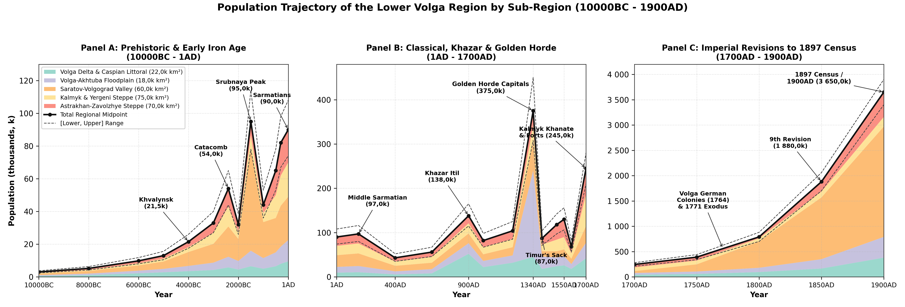
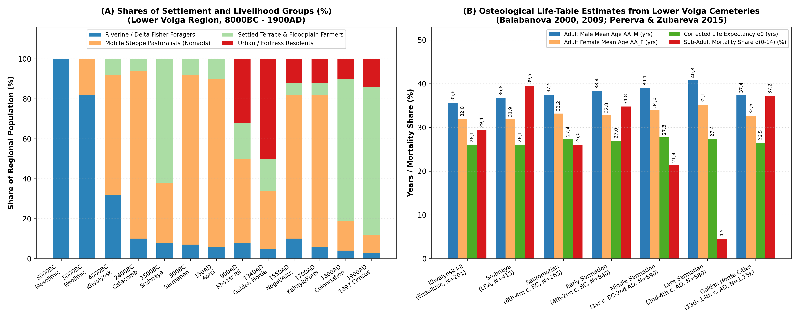
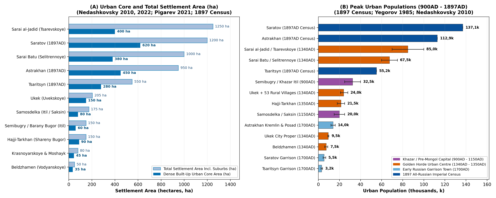

# Abstract

This paper reviews the archaeological, bioarchaeological and archival literature on the demographic and settlement history of the Lower Volga region (~ 245k km², encompassing the Volga Delta, the Volga-Akhtuba Floodplain, the Saratov-Volgograd river corridor, the Kalmyk-Yergeni steppes and the Astrakhan-Volgograd Trans-Volga semi-deserts) from the Early Mesolithic (10000BC) to the First All-Russian Imperial Census (1897/1900AD). Estimates are derived from regional field studies and archival records: radiocarbon chronologies and excavated pit-house floors at Varfolomeyevka, Kairshak, Tenteksor and Dzhangar [@yudin2004varfolomeyevka; @baratskov2015itogi; @smagin2018mikrolitov; @vybornov2022khronologiya], Copper Age cemeteries at Khvalynsk I-II and Maksimovka I [@agapov1990khvalynskiy; @tsibin2019maksimovka], Bronze Age buried-soil and pastoral mobility studies [@shishlina2008reconstruction; @borisov2019palaeosols], Late Bronze Age Srubnaya village inventories in the Saratov-Volgograd valleys (>850 villages) [@malov2008nizhneye; @lopatin2014nachalo], Sauromatian-Sarmatian skeletal life tables (N > 2,3k skeletons) and Kalmyk pasture comparisons [@balabanova2009khronologicheskiye; @skripkin2012chislennosti; @pererva2015istorii; @krivosheev2021chelovek], excavations at Khazar Itil (Semibugry/Barany Bugor) and Pre-Mongol Saksin (Samosdelka) [@vasilyev2015saksin; @vasilyev2020samosdelka; @solovyev2022semibugry], Golden Horde urban and rural surveys (Ukek, Bagaevskoye, Beldzhamen, Sarai al-Jadid/Tsarevskoye, Sarai Batu/Selitrennoye and Hajji-Tarkhan) [@yegorov1985geografiya; @nedashkovsky2010goroda; @zeleneev2018selitrennom; @pigarev2021topografii; @nedashkovsky2022predmety; @shigapov2022selishch], 15th-17th century Astrakhan, Nogai and Kalmyk registers [@moiseev2015stepnyye; @trepavlov2016nogayskoy; @tepkeev2025dzhungarskiye; @muzraev2025uchastiye] and 18th-19th century Imperial *revizii*, Volga German colony records, Kalmyk and Inner Bukey Kazakh Horde returns and the 1897 Imperial Census [@kabuzan1963narodonaseleniye; @pleve1998nemetskiye; @doenninghaus2011nemetskikh; @solovyov2013saratovskoy; @brylyov2018volgogradskoy; @ochirov2008tyurkoyazychnyye; @okonova2012migratsii; @kyshpanakov2026kalmyki; @belousov2019bukeyevskoy; @pirova2020tatarakh; @troynitsky1904saratov; @troynitsky1904astrakhan]. Regional population grew from 3k (10000BC) to 95k during the Late Bronze Age Srubnaya expansion (1500BC), 97k in the Middle Sarmatian (Aorsi) period (150AD), 138k under the Khazar Khaganate (900AD) and 375k (308k--450k) in the Golden Horde heartland (1340AD). After Timur's 1395-1396 devastation of the floodplain cities (87k in 1400AD) and the 1557-1558 Nogai famine and plague (68k in 1600AD), Oirat-Kalmyk migration and Russian garrison founding lifted the population to 245k by 1700AD, before 18th- and 19th-century agricultural colonisation, Volga German settlement and railway industrialisation raised the total to 3,65M (3,65M) by 1900AD.

# Background

The Lower Volga region (~ 245k km²) is defined by the sharp ecological contrast between Europe's largest alluvial oasis - the 400 km-long Volga-Akhtuba Floodplain and fan-shaped Volga Delta - and the surrounding dry steppes and semi-deserts of the Caspian Depression (Figure \ref{fig:hero}). For regional demographic analysis, the territory is divided into five ecological sub-regions.

The first sub-region comprises the Volga Delta and north-western Caspian littoral (22k km²), encompassing the branching channels of the Volga Delta (Bolda, Buzan, Bakhtemir), Baer knolls (*Berovskiye bugry*), and coastal lagoons (Seroglazovka, Kairshak, Tenteksor, Khazar Itil at Semibugry/Barany Bugor, Samosdelka [Saksin/Summerkent], Golden Horde Hajji-Tarkhan [Shareny Bugor], Krasnoyarskoye, and Russian Astrakhan and Krasny Yar) [@vasilyev2020samosdelka; @solovyev2022semibugry]. The second sub-region is the Volga-Akhtuba Floodplain (18k km²), a 15-45 km-wide alluvial gallery-forest and meadow corridor between the Volgograd (Tsaritsyn) bend and the upper delta apex, which hosted the imperial capitals of the Golden Horde (Sarai al-Jadid/Sarai Berke at Tsarevskoye Gorodishche, Sarai Batu/Sarai al-Mahrusa at Selitrennoye Gorodishche, the Ak-Sarai royal mausoleums at Lapas, and Russian Tsaritsyn, Chyorny Yar, Yenotayevsk, and Tsarev) [@yegorov1985geografiya; @nedashkovsky2010goroda; @pigarev2021topografii].

The third sub-region covers the Saratov-Volgograd right bank and northern Trans-Volga (Zavolzhye) valley corridor (60k km²), marking the forest-steppe to dry-steppe transition along the main Volga channel, Medveditsa, Ilovlya, Bolshoy Irgiz, and Yeruslan rivers (Varfolomeyevka, Khvalynsk I-II, Khlopkov Bugor, Pokrovsk, Golden Horde Ukek [Uvekskoye Gorodishche] with its 53-site agricultural district including Bagaevskoye Selishche, Beldzhamen [Vodyanskoye Gorodishche], Russian Saratov, Kamyshin, Volsk, and Khvalynsk, and the 18th-19th century Volga German *Bergseite* and *Wiesenseite* colonies) [@yudin2004varfolomeyevka; @nedashkovsky2022predmety; @shigapov2022selishch; @pleve1998nemetskiye]. The fourth sub-region encompasses the Kalmyk Steppe, Yergeni Hills, and Sarpa Lakes (75k km²), the right-bank arid steppes stretching south of the Volga-Don portage along the Yergeni ridge, Sarpa lacustrine chain, and Black Lands (*Chyornye Zemli*, including Neolithic Dzhangar, Bronze Age Manych Catacomb and Lola kurgan fields, 17th-19th century Kalmyk *uluses*, the Herrnhuter colony of Sarepta, and Elista) [@koltsov2005mezolit; @shishlina2008reconstruction; @tepkeev2012kalmyki; @okonova2012migratsii]. Finally, the fifth sub-region consists of the Astrakhan-Volgograd Trans-Volga (Zavolzhye) and Ryn-Caspian Steppe (70k km²), the left-bank semi-desert steppes between the Akhtuba valley and the Volga-Ural (Yaik) watershed (Elton, Baskunchak, Bolshoy and Maly Uzen rivers, 16th-century Nogai and 17th-18th century Torghut-Kalmyk winter pastures, and the 19th-century Inner/Bukey Kazakh Horde and Novouzensk steppes) [@trepavlov2016nogayskoy; @belousov2019bukeyevskoy].

# Methodology

Population estimates across the Lower Volga combine five lines of historical and archaeological evidence. For the Mesolithic, Neolithic, and Eneolithic (10000-3500BC), A. V. Baratskov [@baratskov2015itogi], V. A. Smagin [@smagin2018mikrolitov], A. A. Vybornov et al. [@vybornov2022khronologiya], P. M. Koltsov [@koltsov2005mezolit], and A. I. Yudin [@yudin2004varfolomeyevka] provide excavated pit-house floor areas (30-60 m² at Varfolomeyevka) and AMS radiocarbon series (89 14C dates by 2015, >200 by 2022), while S. A. Agapov et al. [@agapov1990khvalynskiy] and V. A. Tsibin and A. A. Shalapinin [@tsibin2019maksimovka] establish Copper Age cemetery populations (201 skeletons at Khvalynsk I-II). For the Yamnaya, Poltavka, Catacomb, Pokrovsk, Srubnaya, Sauromatian, and Sarmatian periods (3500BC--400AD), northern valley settlement inventories (>850 Srubnaya villages) [@malov2008nizhneye; @lopatin2014nachalo] and buried-soil studies [@borisov2019palaeosols; @krivosheev2021chelovek] are combined with M. A. Balabanova's [@balabanova2000antropologiya; @balabanova2009khronologicheskiye; @balabanova2013detskaya; @balabanova2015skripkin] and E. V. Pererva and E. G. Zubareva's [@pererva2015istorii] skeletal life tables (e0, AA_M, AA_F, d0-14, sex ratios) and A. S. Skripkin's [@skripkin2012chislennosti] comparison of Sarmatian pastures with historical Kalmyk herd capacities.

For the medieval delta and floodplain cities (740-1460AD), D. V. Vasilyev [@vasilyev2015saksin; @vasilyev2020samosdelka], E. D. Zilivinskaya [@zilivinskaya2014ocherki], and D. S. Solovyev et al. [@solovyev2022semibugry] estimate Khazar (Itil at Semibugry/Barany Bugor and Samosdelka) and Pre-Mongol (Saksin) urban populations. For the Golden Horde heartland, V. L. Yegorov [@yegorov1985geografiya], G. A. Fyodorov-Davydov [@fyodorovdavydov1994goroda], Yu. A. Zeleneev and E. M. Pigarev [@zeleneev2018selitrennom; @pigarev2021topografii], L. F. Nedashkovsky [@nedashkovsky2000ukek; @nedashkovsky2010goroda; @nedashkovsky2022predmety; @nedashkovsky2022izdeliya], and M. B. Shigapov [@shigapov2022selishch] document built-up urban areas (Ukek >205 ha, Beldzhamen 50 ha, Tsarevskoye >400 ha core / >1k ha with suburbs, Selitrennoye ~ 380 ha core / ~ 1k ha with suburbs) and surrounding agricultural villages (53 *selishcha* around Ukek, 17 around Tsarevskoye).

For the post-Jochid and early modern era (1460-1700AD), archival studies by M. V. Moiseev [@moiseev2015stepnyye], I. V. Zaitsev [@zaitsev2006astrakhanskoye], A. V. Syzranov [@syzranov2014astrakhani], V. V. Trepavlov [@trepavlov2016nogayskoy], V. T. Tepkeev [@tepkeev2012kalmyki; @tepkeev2025dzhungarskiye], and N. L. Muzraev [@muzraev2025uchastiye] establish Great Horde, Astrakhan Tatar, Nogai *san*, and Kalmyk *kibitka* (35k--45k tents = 160k--210k people) numbers alongside Russian *Razryadny Prikaz* fortress censuses. For the 18th and 19th centuries (1700-1900AD), V. M. Kabuzan [@kabuzan1963narodonaseleniye], I. R. Pleve [@pleve1998nemetskiye], V. Dönninghaus [@doenninghaus2011nemetskikh], V. Yu. Solovyov [@solovyov2013saratovskoy], V. A. Brylyov [@brylyov2018volgogradskoy], U. B. Ochirov [@ochirov2008tyurkoyazychnyye], L. V. Okonova [@okonova2012migratsii], V. A. Kyshpanakov [@kyshpanakov2026kalmyki], S. S. Belousov [@belousov2019bukeyevskoy], R. N. Pirova [@pirova2020tatarakh], and N. A. Troynitsky [@troynitsky1904saratov; @troynitsky1904astrakhan] provide exact counts from the 1st--10th *revizii* (1719-1858), the 1764-1767 Volga German colony registers, the 1771 Kalmyk exodus records, the Inner (Bukey) Kazakh Horde censuses, and the 1897 Imperial Census across Saratov and Astrakhan Governorates.^[All archived full-text academic PDFs cited in this review are stored locally in histmap/1.data_raw/population_regional/POLARIS/pontic_steppe_and_lower_volga/papers/.]

plot of chunk fig-volga-holocene

# Results

## Prehistoric Foragers to Sarmatian Nomads (10000BC - 400AD)

### Mesolithic, Neolithic and Eneolithic (10000-3500BC)

Investigated by P. M. Koltsov [@koltsov2005mezolit] and V. A. Smagin [@smagin2018mikrolitov], the Mesolithic of the Northern Caspian lowlands and Volga-Ural sands (10000-6800 cal BC) is represented by the Seroglazovka and Istay cultures (Seroglazovka, Zhe-Kalgan, Kairshak V), characterised by geometric flint microliths (segments, trapezes and parallelograms traced across the Lower Volga by Smagin [@smagin2018mikrolitov]). Small mobile bands (15-35 persons per camp) hunted saiga, kulan and onager and fished along delta channels, with regional population growing gradually from 3k (10000BC, density 0,012 persons/km²) to 5,2k (8000BC).

As documented by A. V. Baratskov [@baratskov2015itogi] and A. A. Vybornov et al. [@vybornov2022khronologiya], the radiocarbon dataset for the Steppe Volga Neolithic expanded from 12 dates prior to 2007 to 89 dates by 2015 and more than 200 AMS dates by 2022, establishing the Northern Caspian and Lower Volga as one of the earliest pottery-making regions in Western Eurasia. At the Kairshak sites (6800-5800 cal BC, including Kairshak I-III, Baibek, and Kugat IV), flat-bottomed incised pottery and geometric microliths yielded AMS dates of 7950-7930 BP (6800-6500 cal BC) alongside light surface dwellings (15-28 m²) [@baratskov2015itogi]. At Varfolomeyevka (Orlovka Culture, 6000-5000 cal BC), excavated by A. I. Yudin [@yudin2004varfolomeyevka] in the Saratov Trans-Volga, a 3,5 m cultural deposit across Layer 3 (6200-5800 cal BC), Layer 2B (5600-5300 cal BC), and Layer 2A (5200-4900 cal BC) [@baratskov2015itogi] preserved permanent multi-room semi-subterranean pit-houses (*poluzemlyanki* of 30-60 m²) that housed 60-100 residents per phase. At Tenteksor I and Dzhangar (5600-4800 cal BC in Kalmykia, upper layer dated to 6564 +/- 44 BP/c. 5500 cal BC [@koltsov2005mezolit; @baratskov2015itogi]), communities settled around freshwater limans in sub-rectangular pit-dwellings (35-50 m²), raising regional population to 9,8k (6000BC) and 13k (5000BC).

During the Eneolithic (4800-3500 cal BC), the cemeteries of Khvalynsk I (158 skeletons) and Khvalynsk II (43 skeletons) [@agapov1990khvalynskiy], Khlopkov Bugor and collective flat-grave burials such as Maksimovka I on the Samara-Volga steppe margin [@tsibin2019maksimovka] document early Copper Age herding (cattle, sheep, goats and horses) and Balkan-Carpathian copper exchange. Terrestrial-herbivore AMS dates place Khvalynsk I-II between 4508-4340 cal BC and 4346-4171 cal BC (2-sigma) [@vybornov2022khronologiya], with regional population reaching 21,5k by 4000BC.

### Bronze Age and Sauromatian-Sarmatian Nomadic Confederacies (3500BC - 400AD)

During the Yamnaya (3300-2600 cal BC) and Middle Bronze Age Poltavka (2700-2100 cal BC) and Catacomb periods, mobile pastoralists using wheeled wagons expanded across the Saratov-Volgograd valleys, Yergeni Hills and Sarpa lakes [@shishlina2008reconstruction; @borisov2019palaeosols], lifting regional population from 33k (3000BC) to 54k around 2400BC before the 2200-2000 cal BC dry phase (when settlement contracted during the Lola period to 32k at 2000BC).

The transition from the Potapovka/Pokrovsk (1900-1700 cal BC) chariot-warrior burials to the Srubnaya (Timber-Grave) Culture (1700-1100 cal BC) [@malov2008nizhneye; @lopatin2014nachalo] produced a clear north-south contrast: the northern Saratov-Volgograd river valleys (60k km²) supported more than 850 permanent Srubnaya villages (*poseleniya*) with large timber-framed semi-subterranean houses (80-180 m², housing 62k mixed farmers and herders), whereas the southern Kalmyk and Astrakhan semi-deserts (185k km²) were used for seasonal dune camps (*stoyanki*, 33k mobile herders), giving a Late Bronze Age regional peak of 95k (78k--114k) at 1500BC (0,388 persons/km²).

plot of chunk fig-volga-subsistence

In the Early Iron Age (600BC--400AD), studied by A. S. Skripkin [@skripkin2012chislennosti; @balabanova2015skripkin], V. M. Klepikov [@klepikov2002sarmaty] and M. V. Krivosheev, E. V. Pererva and M. V. Eltsov [@krivosheev2021chelovek], the Lower Volga passed from the Sauromatian (6th--4th c. BC, 65k) and Early Sarmatian (Prokhorovka, 4th--2nd c. BC, 82k at 300BC, followed by a mid-3rd-century BC dry-steppe pullback to 66k [@klepikov2002sarmaty]) periods to the Middle Sarmatian (Susly/Aorsi Confederacy, 1st c. BC--mid-2nd c. AD) expansion (Kosika, Verkhnoye Pogromnoye). In a dedicated demographic study, A. S. Skripkin [@skripkin2012chislennosti] compared Lower Volga Sarmatian burial densities against 18th- and 19th-century Kalmyk nomadic censuses (30k--45k *kibitkas*), showing that the Lower Volga pastures supported 65k--110k Sarmatian nomads (90k--97k midpoint in 1-150AD). Across more than 2,3k Lower Volga skeletons, M. A. Balabanova [@balabanova2000antropologiya; @balabanova2009khronologicheskiye; @balabanova2013detskaya] and E. V. Pererva and E. G. Zubareva [@pererva2015istorii] recorded high child mortality in Srubnaya (39,5%) and Early Sarmatian (34,8%) cemeteries, contrasted with the customary exclusion of infants (d0-14 = 4,5%) and a strong excess of adult males (M/F = 2,15) in Late Sarmatian kurgans (Figure \ref{fig:volga-subsistence}B; Table \ref{tab:volga-bioarch}).

## Khazar Heartland (Itil), Pre-Mongol Saksin, Golden Horde Imperial Capitals and the Kalmyk Khanate (400 - 1700AD)

### Khazar Imperial Capital Itil (Semibugry and Samosdelka) and Pre-Mongol Saksin (740-1236AD)

Following the post-Hunnic population low (43k at 400AD) and the Arab-Khazar war of 737AD, the Khazar Khagan transferred his court permanently to the Lower Volga Delta (Itil/Atil). At Semibugry and Barany Bugor (Семибугоринский археологический комплекс), excavated since 2020 by D. S. Solovyev, D. V. Vasilyev, and E. E. Kravchenko [@solovyev2022semibugry] along the Bolda delta channel in Kamyzyaksky District, Astrakhan Oblast, a large 8th--10th century Khazar urban and suburban complex covers ~ 150 ha, yielding Saltovo-Mayaki amphorae, Khazar royal *tamga* bricks, an 8th-century Abbasid silver dirham, and large brick foundations (estimated urban population 25k-40k).

Summarising 20 years of excavations (2000-2020) at Samosdelka (Самосдельское городище), D. V. Vasilyev [@vasilyev2015saksin; @vasilyev2020samosdelka] showed that the site (~ 150-200 ha across three delta islands) preserves a lower Khazar layer (9th--10th c. AD) with a triangular burnt-brick fortress and *yurt*-shaped dwellings (10k--18k inhabitants), sealed by a fire-and-flood layer from Sviatoslav's 965/969AD campaign. Together with Kalmyk-steppe outposts (Bashanta I-II [@ochirgoryaeva2020bashanta]) and floodplain herders, the Khazar Lower Volga reached 138k (115k--165k) at 900AD. In the 11th--early 13th centuries, the middle layer of Samosdelka flourished as the trading port of Saksin, where Abu Hamid al-Gharnati (1131-1153AD) described Oghuz, Bolgar, Suvar, and Khazar quarters (matched directly to Samosdelka's four pottery traditions by Vasilyev [@vasilyev2015saksin]), supporting 15k--25k urban residents within a regional population of 104k at 1200AD.

plot of chunk fig-volga-cities

### Golden Horde Imperial Core on the Lower Volga (1240-1502AD)

During the 1250s--1360s AD, the Lower Volga and Volga-Akhtuba Floodplain served as the personal domain of the Jochid Khans and the most heavily urbanised river corridor in Eastern Europe [@yegorov1985geografiya; @fyodorovdavydov1994goroda; @nedashkovsky2010goroda; @sitdikov2022volgoural] (Figure \ref{fig:volga-cities}). In the northern Saratov right-bank sector, Ukek (Uvekskoye Gorodishche, modern Saratov) stretched more than 3,5 km along the Volga across >205 ha with brick palaces, mosques, bathhouses (*hammams*), and Christian and Muslim quarters, housing 9k--10k urban residents [@nedashkovsky2000ukek; @nedashkovsky2010goroda]. Across its 420 km² rural district (*okruga*), L. F. Nedashkovsky and M. B. Shigapov [@nedashkovsky2010goroda; @nedashkovsky2022predmety; @nedashkovsky2022izdeliya; @shigapov2022selishch] mapped 53 rural settlements (3 satellite towns and 50 farming villages), exemplified by Bagaevskoye Selishche (5,1 ha, >90 cm cultural layer, excavated 2002-2021, yielding iron sickles, scythes, saws, and fishhooks), which supported 12k--18k rural inhabitants. Further south at Dubovka, Beldzhamen/Bezdezh (Vodyanskoye Gorodishche) covered 50 ha (6k--9k inhabitants), with distinct Russian Christian, Volga Bolgar (stone mosque and baths), and Kipchak-Mongol quarters [@yegorov1985geografiya; @nedashkovsky2010goroda].

In the Volga-Akhtuba Floodplain, the 14th-century imperial capital of Sarai al-Jadid/Sarai Berke (Tsarevskoye Gorodishche, Leninsk) encompassed a compact urban core of >400 ha (~1,55k aristocratic house mounds) and a suburban estate belt of >1k--1,5k ha, surrounded by 17 satellite villages [@nedashkovsky2010goroda], supporting a 1340s population of 70k--100k inhabitants [@yegorov1985geografiya; @fyodorovdavydov1994goroda; @sitdikov2022volgoural]. Downstream at Kharabali, Sarai Batu/Sarai al-Mahrusa (Selitrennoye Gorodishche) and the royal necropolis of Ak-Sarai (Lapas) stretched 7-12 km along the Akhtuba across ~ 380-400 ha of dense urban quarters and ~ 1k ha of suburban estates and workshops (mapped in 2000-2020 by Yu. A. Zeleneev and E. M. Pigarev [@zeleneev2018selitrennom; @pigarev2021topografii]), housing 60k--75k inhabitants. In the Volga Delta, the Golden Horde port cities included Hajji-Tarkhan (Shareny Bugor, 150 ha, 18k--25k), Summerkent (Samosdelka upper layer, 80-100 ha, 6k--10k [@vasilyev2020samosdelka]), and Krasnoyarskoye/Moshayk (5k--10k).

At the height of the Golden Horde in 1340AD, Lower Volga towns housed 170k--230k inhabitants, supported by 50k--70k settled floodplain farmers and fishermen and 100k--140k steppe pastoralists - giving a regional total of 375k (308k--450k, 1,53 persons/km²). Between the Black Death (1346), the civil wars of the *Velikaya Zamyatnya* (1359-1380) and Timur's winter campaign of 1395-1396AD, the floodplain cities lost roughly four-fifths of their inhabitants, reducing the regional population to 87k in 1400AD.

### Astrakhan Khanate, Nogai Horde, Kalmyk Khanate and Russian Fortress Network (1460-1700AD)

As shown by M. V. Moiseev [@moiseev2015stepnyye], I. V. Zaitsev [@zaitsev2006astrakhanskoye] and A. V. Syzranov [@syzranov2014astrakhani], the post-Jochid Astrakhan Khanate (1459-1556AD) centred at Hajji-Tarkhan supported an urban and semi-settled *Yurt* Tatar population of 15k--25k (fielding 3k cavalrymen), while V. V. Trepavlov [@trepavlov2016nogayskoy] established from Manghit *san* lists that the Western *uluses* of the Nogai Horde wintering along the Lower Volga numbered 80k--120k nomads in 1500-1550AD (regional total 130k at 1550AD). Immediately after Ivan IV's annexation of Astrakhan (1554-1556), civil war and the severe winter freeze (*dzhut*), famine and plague of 1557-1558 (witnessed at Astrakhan by Anthony Jenkinson in 1558) devastated the Nogai *uluses*, reducing the regional population to 68k by 1600AD [@trepavlov2016nogayskoy].

Between 1558 and 1700AD, two demographic movements reshaped the Lower Volga. First, the Russian garrison and *posad* network expanded along the river: Astrakhan (moved to Hare Island in 1558, stone Kremlin built 1582-1589) grew to 12k--16k permanent residents by 1700AD (including *streltsy*, Russian townspeople, Bukharan, Persian, Armenian, and Indian merchant *dvory*, and *Yurt* Tatar Muslim suburbs [@syzranov2014astrakhani]), alongside Saratov (1590, 4,5k--7k urban plus 6k rural settlers), Tsaritsyn (1589, 2,5k--4k), Chyorny Yar (1627), Krasny Yar (1667), and Dmitriyevsk (Kamyshin, 1668) (~34k total Russian and settled inhabitants). Second, beginning in 1628-1632, Western Mongol (Oirat - Torghut, Derbet, and Khoshut) tribes under Tayishi Kho Orluk migrated into the Lower Volga steppes [@tepkeev2012kalmyki]. Under Ayuka Khan (r. 1669-1724, granted the title of Khan in 1690), reinforced by new Derbet and Dzungar arrivals studied by V. T. Tepkeev [@tepkeev2025dzhungarskiye] and N. L. Muzraev [@muzraev2025uchastiye], the Kalmyk Khanate numbered 35k--45k *kibitkas* (160k--210k Kalmyks, fielding 20k--40k horsemen) plus 20k subordinate Nogai and *Yurt* Tatars, lifting the Lower Volga region to 245k (210k--280k, 1 persons/km²) in 1700AD.

## Imperial Russian Colonisation, the Volga Germans, the 1771 Kalmyk Exodus and the 1897 Census (1700 - 1900AD)

Between 1700 and 1900AD, the Lower Volga was transformed from a pastoral frontier into one of Imperial Russia's major grain-exporting, fishing, and river-shipping regions, expanding more than fourteen-fold from 245k (1700AD) to 3,65M (3,65M) by 1900AD (Figure \ref{fig:volga-holocene}B). Following the completion of the 60 km Tsaritsyn Defensive Line (*Tsaritsynskaya storozhevaya liniya*, 1718-1720) between the Volga and the Don and the establishment of the Dubovka Cossack Host (1734), Russian and Ukrainian state and landlord peasants settled the right-bank river valleys of Saratov and Kamyshin [@kabuzan1963narodonaseleniye; @solovyov2013saratovskoy; @brylyov2018volgogradskoy], lifting regional population to 390k by 1750AD. Under Catherine II's Manifestos of 1762 and 1763, analysed by I. R. Pleve [@pleve1998nemetskiye] and V. Dönninghaus [@doenninghaus2011nemetskikh], 25,6k--27k German colonists settled 104 mother colonies between 1764 and 1767 along the Saratov-Kamyshin right bank (*Bergseite*) and northern Trans-Volga left bank (*Wiesenseite*), while Moravian Brethren (Herrnhuter) founded Sarepta near Tsaritsyn in 1765.

In January 1771, Ubashi Khan led roughly 30k--33k left-bank Torghut and Khoshut *kibitkas* (~150k--170k people) eastwards out of the Lower Volga back towards Dzungaria, leaving only ~11k--13k right-bank Derbet and Torghut tents (~50k--60k Kalmyks) trapped west of the un-iced Volga [@ochirov2008tyurkoyazychnyye; @okonova2012migratsii; @kyshpanakov2026kalmyki]. This sudden depopulation of the Astrakhan Trans-Volga (Zavolzhye fell from 67k in 1750 to 28k in 1800AD, even as Saratov agricultural growth lifted the overall Lower Volga to 790k in 1800AD) prompted Paul I's decree of 11 March 1801 permitting Sultan Bukei Nuraliev to lead Junior Zhuz Kazakhs across the Ural into the Ryn Sands [@belousov2019bukeyevskoy]. By 1850AD, the Inner (Bukey) Kazakh Horde (~100k--120k Kazakhs centred at Khanskaya Stavka), state-peasant salt-carters (*chumaki*) at Lakes Elton and Baskunchak, and rapid natural increase among the Volga Germans (reaching 165k by 1850) and Saratov peasantry raised the regional total to 1,88M (7,67 persons/km²) [@kabuzan1963narodonaseleniye; @doenninghaus2011nemetskikh; @belousov2019bukeyevskoy].

After the Emancipation of 1861, the opening of the Gryazi-Tsaritsyn (1871), Ryazan-Ural (1871-1894, linking Saratov and Pokrovskaya Sloboda), and Baskunchak (1882) railways, and the rise of Nobel Brothers' oil-tanker fleets at Astrakhan and Tsaritsyn, the First All-Russian Census of 28 January 1897 [@troynitsky1904saratov; @troynitsky1904astrakhan] provides an exact baseline across the five Lower Volga sub-regions. In the Saratov-Volgograd Valley Corridor (60k km²), Saratov Governorate recorded 2,41M inhabitants in 1897 [@troynitsky1904saratov; @solovyov2013saratovskoy]; within the Lower Volga river and northern Trans-Volga districts (Saratov, Kamyshin, Tsaritsyn uplands, Volsk, Khvalynsk, Atkarsk, and the Volga German canton of Novouzensk and Nikolayevsk uyezds [@brylyov2018volgogradskoy; @doenninghaus2011nemetskikh]), population reached 2,18M by 1900AD, including ~390k--405k Volga Germans across mother and daughter colonies and the cities of Saratov (137,1k in 1897), Kamyshin (16,3k), Volsk (27,1k), Khvalynsk (15,1k), and Dubovka (16,3k). In the Volga-Akhtuba Floodplain (18k km²), anchored by the booming railway-and-timber hub of Tsaritsyn (55,2k in 1897, up from 6,7k in 1861 [@brylyov2018volgogradskoy]), Tsarev (6,9k), Chyorny Yar (4,2k), Yenotayevsk (2,8k), Vladimirovka, and dense Russian, Ukrainian, and Mordvinian orchard-and-fishery villages along the Akhtuba, population reached 410k in 1900AD.

In the Volga Delta and north-western Caspian littoral (22k km²), Astrakhan Governorate recorded 1M inhabitants in 1897 [@troynitsky1904astrakhan], and the delta proper (Astrakhan uyezd 219,8k and Krasny Yar uyezd 66k, plus seasonal fishery workers and delta Tatar villages [@pirova2020tatarakh]) reached 380k by 1900AD, led by Astrakhan city (112,9k permanent residents in 1897, swelling by >100k seasonal fishermen and dockers each spring). In the Kalmyk Steppe and Yergeni Hills (75k km²), analysed in detail by L. V. Okonova [@okonova2012migratsii], U. B. Ochirov [@ochirov2008tyurkoyazychnyye], and V. A. Kyshpanakov [@kyshpanakov2026kalmyki], the Kalmyk Steppe (*Kalmytskaya step*) of Astrakhan Governorate counted 128,6k nomadic Kalmyks plus ~10k Russian and Ukrainian settlers (total 138,6k in the steppe proper), alongside peasant road-villages (*traktovye syola*) along the Yergeni ridge (Elista, Remontnoye, Kresty) and Sarepta, giving 190k across the 75k km² sub-region in 1900AD. Finally, in the Astrakhan-Volgograd Trans-Volga and Ryn Steppe (70k km²), the Inner (Bukey) Kazakh Horde counted 214,8k inhabitants in 1897 (96,5% Kazakhs, plus sedentary trading settlements at Khanskaya Stavka, Talovka, and Novaia Kazanka studied by S. S. Belousov [@belousov2019bukeyevskoy]), which together with the Baskunchak and Elton salt-mining towns and the southern Trans-Volga *volosts* of Tsarev and Novouzensk uyezds totalled 490k in 1900AD (regional aggregate 3,65M, density 14,9 persons/km²).

Table: Core and total settlement areas and population estimates for major urban centres of the Lower Volga (6000BC - 1900AD).

|Settlement / Site                 |Sub-Region                     |Chronology       |Core / Total Area (ha)    |Estimated Population        |Primary Literature                     |
|:---------------------------------|:------------------------------|:----------------|:-------------------------|:---------------------------|:--------------------------------------|
|Varfolomeyevka (Neolithic)        |Saratov Trans-Volga            |6000-5000 cal BC |0,8 / 1,5                 |60-100                      |Yudin 2004; Baratskov 2015             |
|Semibugry / Barany Bugor (Itil)   |Volga Delta (Bolda arm)        |750-969AD        |60 / ~150                 |25k-40k (900AD)             |Solovyev, Vasilyev et al. 2022         |
|Samosdelka (Itil / Saksin)        |Volga Delta (Kamyzyak)         |9th-14th c. AD   |80 / 150-200              |15k-25k (Saksin, 12th c.)   |Vasilyev 2015, 2020; Zilivinskaya 2014 |
|Ukek (Uvekskoye) & 53 Selishcha   |Saratov Right Bank             |1250s-1395AD     |150 / >205 (+53 sites)    |9k-10k (city) / 24k (dist.) |Nedashkovsky 2010, 2022; Shigapov 2022 |
|Beldzhamen (Vodyanskoye)          |Volgograd Right Bank (Dubovka) |1260s-1370s AD   |35 / 50                   |6k-9k (1340AD)              |Yegorov 1985; Nedashkovsky 2010        |
|Sarai al-Jadid (Tsarevskoye)      |Volga-Akhtuba (Leninsk)        |1320s-1395AD     |400 / 1k-1,5k (+17 sites) |70k-100k (1340s AD)         |Yegorov 1985; Nedashkovsky 2010        |
|Sarai Batu (Selitrennoye)         |Volga-Akhtuba (Kharabali)      |1254-1480/1502AD |380 / ~1k (7-12 km strip) |60k-75k (1330s-1350s AD)    |Zeleneev & Pigarev 2018; Pigarev 2021  |
|Hajji-Tarkhan (Shareny Bugor)     |Volga Delta Apex               |1280s-1556AD     |90 / 150                  |18k-25k (1350) / 10k (1500) |Nedashkovsky 2010; Zaitsev 2006        |
|Krasnoyarskoye & Moshayk          |Volga Delta                    |1260s-1395AD     |45 / 80                   |5k-10k (14th c. AD)         |Zilivinskaya 2014; Pigarev 2021        |
|Astrakhan (Kremlin, Posad & Port) |Volga Delta (Hare Isl.)        |1558-1900AD      |450 / 950                 |14k (1700) / 112,9k (1897)  |Syzranov 2014; Troynitsky 1904         |
|Saratov                           |Saratov Right Bank             |1590-1900AD      |620 / 1,2k                |5,5k (1700) / 137,1k (1897) |Solovyov 2013; Troynitsky 1904         |
|Tsaritsyn (Volgograd)             |Volga-Don Bend                 |1589-1900AD      |280 / 550                 |3,2k (1700) / 55,2k (1897)  |Brylyov 2018; Troynitsky 1904          |
|Kamyshin, Volsk & Dubovka         |Saratov-Volgograd Volga        |1668-1900AD      |210 / 420                 |2,5k (1700) / 59,7k (1897)  |Brylyov 2018; Troynitsky 1904          |

# Limitations

Three practical constraints affect Lower Volga demographic estimates. First, multi-metre Holocene rises and falls of the Caspian Sea (the Mangyshlak lowstand around 8000BC, the Novocaspian highstands, and the 10th- and 14th-century transgressions) submerged or eroded delta sites (such as the Samosdelka fire-and-flood layer [@vasilyev2020samosdelka]), while lateral shifting of the Volga and Akhtuba channels has destroyed parts of Ukek, Beldzhamen, and Selitrennoye [@nedashkovsky2010goroda; @pigarev2021topografii]. Second, scholars continue to debate how much the twin Golden Horde capitals of Sarai Batu (Selitrennoye) and Sarai al-Jadid (Tsarevskoye) overlapped in population during the 1330s--1360s AD [@yegorov1985geografiya; @zeleneev2018selitrennom; @sitdikov2022volgoural]; our 1340AD floodplain estimate (195k) accounts for partial transfer of residents between the two capitals rather than adding both at their maximum sizes. Third, both the Nogai Horde (15th--16th c.), the Kalmyk Khanate (17th--18th c.), and the Inner Bukey Kazakh Horde (19th c.) shifted camps seasonally across the Ural, Lower Volga, and Kuma-Manych steppes [@trepavlov2016nogayskoy; @tepkeev2025dzhungarskiye; @belousov2019bukeyevskoy], while late 19th-century Astrakhan and Tsaritsyn attracted more than 150k seasonal spring and summer fishery and dock labourers outside the January 1897 census date [@troynitsky1904astrakhan]. Sub-regional figures reflect resident populations within the 245k km² Lower Volga polygon.

# Conclusion

The Lower Volga region experienced repeated shifts between pastoral nomadism and dense riverine urbanisation across the Holocene. After early farming and nomadic growth during the Late Bronze Age Srubnaya village expansion (95k at 1500BC) and the Middle Sarmatian Aorsi confederacy (97k at 150AD), the Volga Delta and Volga-Akhtuba Floodplain twice served as the metropolitan heartland of Western Eurasian steppe empires: first under the Khazar Khaganate (Itil at Semibugry and Samosdelka, 138k in 900AD, followed by Pre-Mongol Saksin at 104k in 1200AD) and second under the Golden Horde (375k in 1340AD across Sarai al-Jadid, Sarai Batu, Ukek, Beldzhamen and Hajji-Tarkhan). Following Timur's 1395AD destruction of the floodplain cities and the 1557-1558 Nogai famine and plague (68k in 1600AD), 17th-century Oirat-Kalmyk migration (35k--45k *kibitkas* under Ayuka Khan) and Russian fortress founding (Astrakhan, Saratov, Tsaritsyn) restored regional population to 245k by 1700AD. Despite the 1771 departure of ~150k--170k left-bank Kalmyks, peasant and Volga German colonisation of the Saratov-Kamyshin valleys, the creation of the Inner (Bukey) Kazakh Horde (1801) and late 19th-century railway and shipping growth expanded the Lower Volga population to 3,65M (14,9 persons/km²) by 1900AD.

# Appendix

## Osteological Life-Table Estimates

Table: Osteological life-table estimates across seven skeletal series from the Lower Volga region.

|Archaeological Period                          |Sample (N) |Sub-Adult d(0-14)    |Male AA (yrs) |Female AA (yrs) |Adult Sex Ratio (M/F) |Corrected e0 (yrs) |Sources                                |
|:----------------------------------------------|:----------|:--------------------|:-------------|:---------------|:---------------------|:------------------|:--------------------------------------|
|Khvalynsk I-II (Eneolithic)                    |201        |29,4%                |35,6          |32              |1,35                  |25-27,2            |Agapov et al. 1990                     |
|Srubnaya (LBA, Lower Volga)                    |415        |39,5%                |36,8          |31,9            |1,08                  |24,8-27,4          |Balabanova 2000, 2009                  |
|Sauromatian (6th-4th c. BC)                    |265        |26%                  |37,5          |33,2            |1,32                  |26,2-28,5          |Balabanova 2009; Pererva 2015          |
|Early Sarmatian (Prokhorovka, 4th-2nd c. BC)   |840        |34,8%                |38,4          |32,8            |1,18                  |25,8-28,2          |Balabanova 2009, 2013; Krivosheev 2021 |
|Middle Sarmatian (1st c. BC-mid-2nd c. AD)     |690        |21,4% (kurgan bias)  |39,1          |34              |1,12                  |26,5-29            |Balabanova 2009; Krivosheev 2021       |
|Late Sarmatian (mid-2nd-4th c. AD)             |580        |4,5% (ritual filter) |40,8          |35,1            |2,15 (male skew)      |26-28,8            |Balabanova 2009; Pererva 2015          |
|Golden Horde (Ukek, Tsarevskoye, Selitrennoye) |1,15k      |37,2%                |37,4          |32,6            |1,15                  |25,2-27,8          |Pererva 2015                           |

## Population Estimates

Table: Estimated population of the Lower Volga across its five ecological sub-regions (10000BC - 1900AD; total area 245k km²).

|Year    |Volga Delta (22k km²) |Volga-Akhtuba (18k km²) |Saratov-Volgograd (60k km²) |Kalmyk Steppe (75k km²) |Zavolzhye (70k km²) |Total Population [Range] |Density (p/km²) |
|:-------|:---------------------|:-----------------------|:---------------------------|:-----------------------|:-------------------|:------------------------|:---------------|
|10000BC |0,6k                  |0,5k                    |0,9k                        |0,5k                    |0,5k                |3k [2,4k-3,7k]           |0,012           |
|8000BC  |1,1k                  |0,9k                    |1,6k                        |0,8k                    |0,8k                |5,2k [4,2k-6,3k]         |0,021           |
|6000BC  |2,2k                  |1,6k                    |3,2k                        |1,4k                    |1,4k                |9,8k [8k-11,8k]          |0,04            |
|5000BC  |2,8k                  |2,1k                    |4,5k                        |1,8k                    |1,8k                |13k [10,5k-15,6k]        |0,053           |
|4000BC  |3,5k                  |3,2k                    |8,5k                        |3k                      |3,3k                |21,5k [17,5k-26k]        |0,088           |
|3000BC  |4,2k                  |4,5k                    |11,5k                       |6,8k                    |6k                  |33k [27k-40k]            |0,135           |
|2400BC  |5,8k                  |6,5k                    |18,5k                       |12,2k                   |11k                 |54k [44k-65k]            |0,22            |
|2000BC  |4,5k                  |5,2k                    |13,5k                       |4,5k                    |4,3k                |32k [26k-38,5k]          |0,131           |
|1500BC  |6,5k                  |9,5k                    |62k                         |8,5k                    |8,5k                |95k [78k-114k]           |0,388           |
|1000BC  |5k                    |6,5k                    |22k                         |5,5k                    |5k                  |44k [36k-53k]            |0,18            |
|500BC   |6,5k                  |8,5k                    |21k                         |14k                     |15k                 |65k [53k-78k]            |0,265           |
|300BC   |8k                    |10,5k                   |25k                         |18,5k                   |20k                 |82k [67k-98k]            |0,335           |
|1AD     |9,5k                  |13k                     |26,5k                       |21k                     |20k                 |90k [74k-108k]           |0,367           |
|150AD   |10,5k                 |14k                     |28,5k                       |22,5k                   |21,5k               |97k [80k-116k]           |0,396           |
|400AD   |5,5k                  |7k                      |12,5k                       |9,5k                    |8,5k                |43k [35k-52k]            |0,176           |
|650AD   |8k                    |9,5k                    |14,5k                       |13k                     |11k                 |56k [46k-67k]            |0,229           |
|900AD   |52k                   |24k                     |22k                         |23k                     |17k                 |138k [115k-165k]         |0,563           |
|1000AD  |22k                   |14k                     |15k                         |16k                     |15k                 |82k [67k-98k]            |0,335           |
|1200AD  |32k                   |16,5k                   |18,5k                       |19k                     |18k                 |104k [85k-125k]          |0,424           |
|1340AD  |45k                   |195k                    |65k                         |38k                     |32k                 |375k [308k-450k]         |1,53            |
|1400AD  |18k                   |28k                     |12k                         |15k                     |14k                 |87k [71k-104k]           |0,355           |
|1500AD  |24k                   |20k                     |14k                         |26k                     |34k                 |118k [97k-142k]          |0,482           |
|1550AD  |26k                   |21k                     |15k                         |28k                     |40k                 |130k [106k-156k]         |0,531           |
|1600AD  |18k                   |11k                     |12k                         |12k                     |15k                 |68k [56k-82k]            |0,278           |
|1700AD  |42k                   |35k                     |38k                         |72k                     |58k                 |245k [210k-280k]         |1               |
|1750AD  |58k                   |48k                     |142k                        |75k                     |67k                 |390k [340k-440k]         |1,59            |
|1800AD  |95k                   |85k                     |520k                        |62k                     |28k                 |790k [700k-880k]         |3,22            |
|1850AD  |165k                  |185k                    |1,22M                       |115k                    |195k                |1,88M [1,7M-2,06M]       |7,67            |
|1900AD  |380k                  |410k                    |2,18M                       |190k                    |490k                |3,65M [3,4M-3,9M]        |14,9            |

# Sources

::: {#refs}
:::

