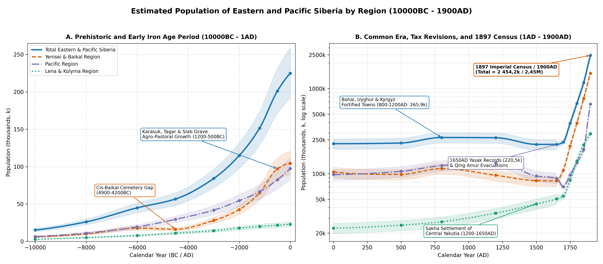
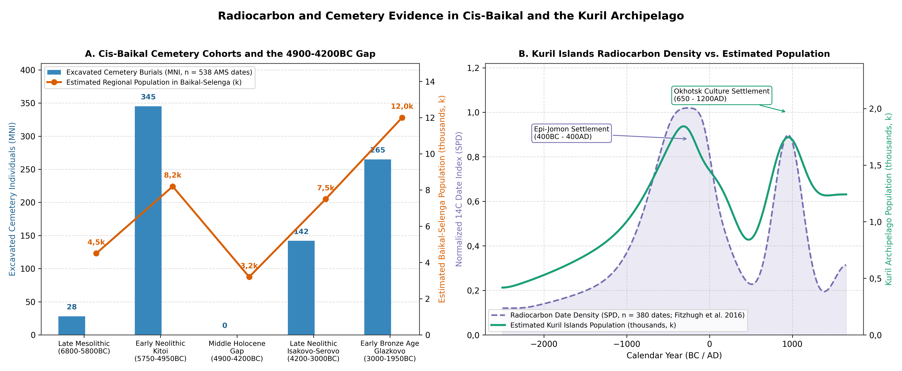
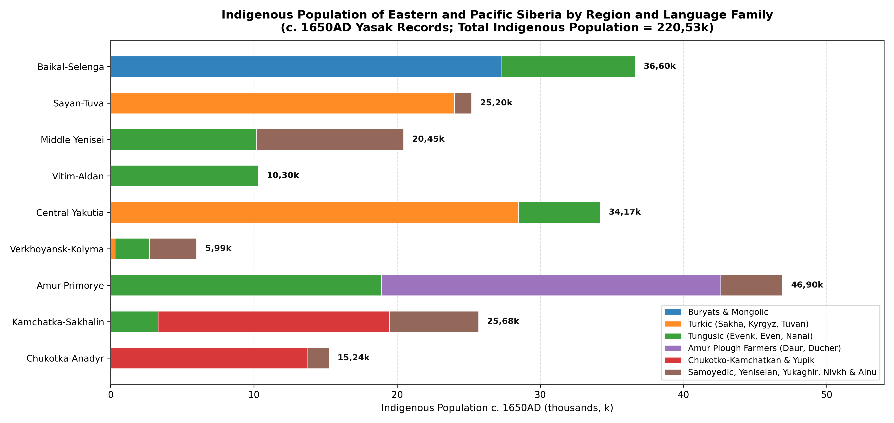

# Abstract

This paper reviews the archaeological, radiocarbon, stable-isotope, and historical demographic literature to estimate the population of Eastern and Pacific Siberia (~ 10,11M km²) from 10000BC to 1900AD. Following the regional drainage divisions established by Chernykh et al. [@Chernykh2022], the study covers three major drainage systems and nine constituent regions (Figure \ref{fig:hero}): the Yenisei and Baikal Region (Baikal-Selenga, Sayan-Tuva, and Middle and Lower Yenisei), the Lena and Kolyma Region (Vitim-Aldan, Central Yakutia and Middle Lena, and Yana-Indigirka-Kolyma), and the Pacific Region (Amur-Primorye, Kamchatka-Sakhalin-Kurils, and Chukotka-Anadyr). Rather than relying on global historical databases or treating raw radiocarbon date counts as direct measures of short-term population change, the estimates are derived from excavated house counts, cemetery burial cohorts, fortified settlement areas (*gorodishcha*), 17th-century Russian fur-tribute (*yasak*) registers [@Dolgikh1960], 18th- and 19th-century imperial poll-tax revisions (*revizskie skazki*), and the First All-Russian Imperial Census of 1897 [@Troinitskiy1905; @Patkanov1912; @Kabuzan1985]. Across all nine regions, the combined population grew from ~ 15,2k during the Younger Dryas (10000BC) to ~ 56,7k in the Middle Holocene (4500BC), ~ 201,3k during the Early Iron Age Tagar and Slab Grave period (500BC), and ~ 265,9k during the medieval Bohai, Uyghur, and Yenisei Kyrgyz period (800AD). In the mid-17th century (1650AD), Russian *yasak* records document 220,53k indigenous inhabitants (234,8k total population by 1700AD). Over the 18th and 19th centuries, natural growth among the Buryat and Sakha pastoralists and large-scale Russian peasant, Cossack, and mining settlement raised the total population to 390,8k in 1750AD, 669k in 1800AD, 1,17M in 1850AD, and 2,45M by 1900AD.

# Background

Eastern and Pacific Siberia span a wide range of environments, from the sheltered steppes of the Minusinsk Hollow, Tuva, and the Selenga basin and the temperate monsoon forests of the Amur, Ussuri, and Primorye plains to the thermokarst meadow-steppe depressions (*alaas*) of Central Yakutia, the continental permafrost larch taiga of the Tunguska, Vitim, Aldan, and Kolyma basins, and the salmon rivers and sea-mammal coasts of Kamchatka, Sakhalin, the Kurils, and the Bering Strait [@Chernykh2022]. Prior to the 17th century, crop cultivation was confined to the southern steppe valleys and the Middle Amur, Ussuri, and Primorye lowlands. Across the remaining 8,5M km² of boreal forest and Arctic tundra, population density depended on freshwater and anadromous fish runs, coastal sea-mammal hunting, wild ungulate hunting, and - from the medieval period onward - horse, cattle, and reindeer herding.

Four bodies of historical and archaeological research provide the historical basis for the estimates presented here. In the Lake Baikal basin, the Baikal Hunter-Gatherer Project (BHGP) obtained over 538 accelerator mass spectrometry (AMS) radiocarbon dates paired with d13C and d15N stable-isotope measurements from individual burials at Shamanka II, Lokomotiv, Ust'-Ida I, Kurma XI, and Khuzhir-Nuge XIV. Correcting for old carbon offsets of 300-700 14C years in fish and seal consumers confirmed a 700-year gap in formal cemetery burials (4900-4200 cal BC) between the Early Neolithic Kitoi culture and the Late Neolithic Isakovo-Serovo culture [@Schulting2014; @Weber2016a; @Weber2016b; @Weber2021]. In the Minusinsk Hollow and Tuva, AMS dating and stable-isotope analyses of 354 individuals show that broomcorn millet (*Panicum miliaceum*) became a staple crop during the Karasuk (~ 1400-900 cal BC) and Tagar (~ 800-100 cal BC) periods, supporting a three- to fourfold increase in population reflected in tens of thousands of stone-walled burial mounds (*kurgans*) and permanent winter villages [@Legrand2006; @Bokovenko2006; @Svyatko2009; @Svyatko2013; @Caspari2018; @Caspari2019].

In the Amur-Primorye basin and the Northwest Pacific islands and coasts, excavations of Terminal Pleistocene pottery sites (Osipovka, Gromatukha), large Neolithic pit-house villages (Suchu Island with 142 house depressions; Boisman-2 shell midden), Bohai and Jurchen walled towns (Krasnoyarovskoye covering 180 ha; Shayginskoye with over 310 excavated heated dwellings), Kuril Island radiocarbon series (n=380 dates), and Bering Strait whalebone villages (Ekven and Uelen with over 530 graves) provide direct house and burial counts [@Kuzmin1998; @Kuzmin2006; @Popov2010; @Filatova2018; @Gelman2018; @Artemyeva2013; @Artemyeva2025; @Fitzhugh2016; @Mason1998; @Dneprovskiy2017]. B. O. Dolgikh's clan-by-clan archival study of 17th-century *yasak* tax books [@Dolgikh1960], supplemented by regional archival studies of Khongorai, Yakutsk *uyezd*, Priamurye, and Kamchatka-Chukotka [@Chertykov2009; @Ushnitskiy2017a; @Ushnitskiy2017b; @Turaev2013; @Turaev2020; @Tolkacheva2015], establishes the mid-17th-century indigenous population. For the 18th and 19th centuries, the ten imperial poll-tax revisions (*revizii* of 1719-1858), the records of the 1763 *Yasak* Commission and post-1822 Steppe Dumas, guberniya statistical reviews, and the First All-Russian Imperial Census of 28 January 1897 document both indigenous demographic trends and the Russian agricultural and urban settlement of Eastern Siberia and the Far East [@Kabuzan1985; @Troinitskiy1905; @Patkanov1912; @Mansheev2010; @Kurchatova2015; @Kyshpanakov2022a; @Kolomiets2022].

# Methodology

## Regional Subdivisions

All population estimates are organised according to the nine drainage regions defined by Chernykh et al. [@Chernykh2022] and mapped in Figure \ref{fig:hero}. The Yenisei and Baikal Region (~ 3,28M km²) comprises the Baikal and Selenga Basin (~ 650k km²: Lake Baikal, Upper Angara, Barguzin, Selenga, Uda, Khilok, Chikoy, and Onon-Ingoda headwaters), the Sayan, Minusinsk, and Tuva Basin (~ 380k km²: Minusinsk Hollow, Abakan, Chulym, Kan, and Upper Yenisei/Ulug-Khem/Khemchik basins in Tuva), and the Middle and Lower Yenisei (~ 2,25M km²: Middle and Lower Yenisei, Lower Angara, Stony and Lower Tunguska, Pyasina, Khatanga, and Taimyr Peninsula).

The Lena and Kolyma Region (~ 4,05M km²) encompasses the Vitim and Aldan Basins (~ 1,12M km²: Vitim, Olekma, Aldan, Amga, Uchur, and Maya basins), Central Yakutia and the Middle Lena (~ 1,38M km²: Middle and Lower Lena, Central Yakutian *alaas* lowland, and Vilyuy basin), and the Yana, Indigirka, and Kolyma Basins (~ 1,55M km²: Yana, Indigirka, Alazeya, Kolyma, and Omolon basins, plus the New Siberian Islands). The Pacific Region (~ 2,78M km²) comprises the Amur, Ussuri, and Primorye Basin (~ 980k km²: Shilka-Argun, Upper/Middle/Lower Amur, Zeya, Bureya, Ussuri, Lake Khanka, and Primorye coast), Kamchatka, Sakhalin, and the Kuril Islands (~ 650k km²: Okhotsk coast, Kamchatka Peninsula, Sakhalin Island, and Kuril Archipelago), and Chukotka, Anadyr, and the Bering Strait (~ 1,15M km²: Anadyr basin, Chukotka Peninsula, Bering Strait coast, and Koryak Highlands/Penzhina-Gizhiga bays).

## Estimation Methods

Four standard archaeological and historical conversion methods are used to translate field and archival records into regional population totals across nineteen benchmark dates from 10000BC to 1900AD. Using standard floor-area ratios (~ 6-10 m² per person) and North Asian ethnographic observations [@Dneprovskiy2017; @Kiryanov2019], single-hearth pit-houses of 20-45 m² (Boisman, Yankovsky, and Shayga *kan*-heated houses) are estimated at 5-7 occupants; medium multi-hearth houses of 60-120 m² (Suchu Island, Okhotsk Culture, and Ekven whalebone *nynglu*) at 12-20 occupants; and large communal winter houses (Karasuk timber houses at Torgazhak of 100-200 m²; Itelmen winter *zimniki* of 150-300 m²) at 25-80 occupants. For walled towns (*gorodishcha*) of the Xiongnu (Ivolga, Bayangol), Uyghur Khaganate (Por-Bajin, Shagonar), Bohai Kingdom (Kraskinskoye, Koksharovka-1), and Jurchen Jin/Eastern Xia (Krasnoyarovskoye, Shayginskoye), excavated dwelling counts (54 houses in 25% of the 7,2 ha interior at Ivolga; over 310 houses across 47,6 ha at Shayginskoye) indicate 30-55 dwellings/ha in residential wards, corresponding to 150-300 persons/ha in densely built towns and 40-80 persons/ha in large mountain refuge enclosures [@Vasyutin2022; @Artemyeva2013; @Artemyeva2025].

Living community size P is estimated from the minimum number of individuals (M_MNI) buried over a calibrated cemetery duration T (in years) at an annual crude mortality rate m ~ 0,03-0,035 yr^-1 via $P = (M_{\text{MNI}} \cdot c_{\text{exc}})/(m \cdot T)$, where c_exc accounts for unexcavated cemetery area and subadult burial under-representation [@Weber2016b]. In the historical period, adult male tribute-payers (*yasachnye lyudi*, aged 18-50) in 17th-century Russian *yasak* registers are converted to total population using B. O. Dolgikh's household multipliers [@Dolgikh1960]: x 3,5-4 for taiga and tundra hunter-herders (Evenks, Evens, Yukaghirs, Kets, Samoyeds), x 4-4,5 for pastoralists (Sakha, Buryats, Yenisei Kyrgyz, Tuvans), and x 4,5-5 for sedentary plough farmers and multi-family river fishers (Daurs, Duchers, Itelmens). For 1750, 1800, 1850, and 1900AD, district (*uyezd* / *okrug*) returns from the 2nd (1744), 5th (1795), and 9th-10th (1850-1858) revisions, Steppe Duma registers, and the 1897 Imperial Census (adjusted to 1900AD via guberniya statistical yearbooks) are allocated to the nine drainage regions [@Kabuzan1985; @Troinitskiy1905; @Patkanov1912; @Rygalova2024].

# Results

## Yenisei and Baikal Region

### Baikal and Selenga Basin

#### Mesolithic, Early Neolithic Kitoi, and the Middle Holocene Gap (8000-1800 cal BC)

Following Terminal Pleistocene and Mesolithic hunting and fishing along the Angara rapids and Selenga river terraces (Ust'-Belaya, Studenoe-1/2, ~ 8000-5800 cal BC; regional population rising from ~ 2,2k at 10000BC to ~ 3,8k at 8000BC), the Early Neolithic Kitoi culture (*Kitoyskaya kultura*, reservoir-corrected to ~ 5750-4950 cal BC) established large formal cemeteries at productive fishing and sealing locations [@Weber2016a; @Weber2016b; @Schulting2014]. At Shamanka II on the Kultuk peninsula at the southwestern tip of Lake Baikal, excavations uncovered 112 graves containing 155 individuals (116 AMS dates), with over 85% of burials belonging to the Kitoi phase (~ 5650-4950 cal BC) and a smaller Early Bronze Age Glazkovo component (13 individuals, ~ 2600-1950 cal BC) [@Weber2016b]. At Lokomotiv at the Irkut-Angara confluence in Irkutsk, excavations of 91 graves yielded an MNI of 149 individuals (~ 5750-5000 cal BC), whose elevated d15N values (+13,5‰ to +16,8‰) reflect heavy reliance on Angara grayling, sturgeon, and Baikal seal (*Pusa sibirica*) [@Schulting2014; @Weber2016a].

Across all 538 reservoir-corrected AMS dates from Cis-Baikal cemeteries (Figure \ref{fig:spd}, Panel A), no formal cemetery burials date between 4900 and 4200 cal BC [@Weber2016a; @Weber2021]. Large Kitoi fishing communities dispersed into smaller mobile hunting bands (regional population falling from ~ 8,2k at 6000BC to ~ 3,2k at 4500BC), before genetically distinct Late Neolithic Isakovo-Serovo (~ 4200-3000 cal BC; Ust'-Ida I with MNI = 67) and Early Bronze Age Glazkovo (~ 3000-1950 cal BC; Khuzhir-Nuge XIV with 79 graves and MNI = 89, Kurma XI, and Sagan-Zaba II sealing camps) communities raised the regional population to ~ 7,5k at 3000BC and ~ 12k at 2000BC [@Losey2008; @Weber2016a].

#### Slab Grave, Khirigsuur, and the Xiongnu Northern Frontier (1300BC-100AD)

The spread of horse, sheep, goat, and cattle pastoralism during the Late Bronze and Early Iron Ages reshaped settlement across the Selenga, Uda, Khilok, Dzhida, and Onon-Ingoda steppes. More than 3 stone-slab burial enclosures of the Slab Grave culture (*Kultura plitochnykh mogil*, ~ 1300-300BC) and large *khirigsuur* stone mounds are recorded across Buryatia and western Transbaikalia, supporting an estimated regional population of ~ 18,5k by 1200BC and ~ 27k by 500BC.

From the late 2nd century BC to the 1st century AD, the Xiongnu Empire (*Khunnu*) incorporated the Selenga-Dzhida basin as a northern agricultural, ironworking, and garrison frontier [@Vasyutin2022; @Miyagashev2020]. At Ivolga Fortress (*Ivolginskoye gorodishche*, 14 km southwest of Ulan-Ude), enclosed by four concentric ramparts and ditches (348 x 216 m, ~ 7,2 ha preserved), A. V. Davydova's excavations of roughly a quarter of the interior exposed 54 semi-subterranean dwellings heated by L-shaped stone and clay flues (*kan*), iron-smelting furnaces, grain storage pits containing millet, barley, and wheat, and the adjacent 216-grave Ivolga cemetery; scaling across the unexcavated quarters indicates ~ 300-380 contemporary houses, or a garrison and craft town of ~ 2,5k-3k residents [@Vasyutin2022]. Beyond Bayangol (~ 10 ha), Dyrestui, and Ilmovaya Pad (over 320 Xiongnu graves including aristocratic terraced tombs), open agricultural and craft villages such as Nizhnemangirtuyskoe (1,8 ha) and Dureny I-II (extending along 12 km² of the Chikoy valley) supplied grain and iron tools to nomadic camps, supporting a regional population of ~ 36k around 1AD [@Miyagashev2020].

#### Medieval Kurykans, Buryat Steppe Dumas, and Russian Settlement (500-1900AD)

Between the 6th and 11th centuries AD, the Kurykan (*Kurumchinskaya*) confederation (the *Gulifan* of Tang Chinese chronicles, recorded as fielding up to 5 horsemen) built more than 40 stone-walled hillforts (*shibe* on Olkhon Island and in the Barguzin, Kuda, and Angara valleys), bloomery iron furnaces, and hay-meadow irrigation ditches, sustaining ~ 34k-35,5k people across the Baikal and Selenga basin between 800 and 1200AD. In the mid-17th century, B. O. Dolgikh [@Dolgikh1960, pp. 292-325] and V. N. Davydov et al. [@Davydov2016] reconstructed 27,3k Buryats (~ 13,5k western Bulagat, Ekhirit, and Khongodor Buryats along the Angara, Oka, and Olkhon, and ~ 13,8k eastern Khori, Selenga, and Tabunut Buryats) together with 9,3k Baikal and Daurian Evenks, giving an indigenous population of 36,6k in 1650AD (0,0563 persons/km²), rising to 49k by 1700AD after the founding of Irkutsk (1661), Selenginsk (1665), and Verkhneudinsk (1666).

During the 18th and 19th centuries, the Baikal-Selenga basin became the demographic core of Eastern Siberia [@Mansheev2010; @Khankharaev2010]. Following the 1727 Treaty of Kyakhta (which fixed the Russo-Qing border and organised six Buryat border-guard regiments) and M. M. Speransky's 1822 *Statute on Indigenous Administration* (*Ustav ob upravlenii inorodtsev*, which created the Kudinskaya, Balaganskaya, Idinskaya, Verkholenskaya, Olkhonskaya, Tunkinskaya, and Alarskaya Steppe Dumas in Irkutsk Guberniya and the Khorinskaya, Selenginskaya, Barguzinskaya, and Aginskaya Steppe Dumas in Transbaikalia), Buryat households increasingly combined semi-sedentary livestock raising with haymaking and rye/wheat cultivation [@Mansheev2010]. Archival returns compiled by P. I. Keppen, Yu. A. Gagemeister, and S. K. Patkanov show the Buryat population growing from ~ 27,3k in 1650 to ~ 73k at the 3rd Revision (1763), ~ 115k in 1800, ~ 195k at the 9th Revision (1850), and 288,6k in the 1897 Imperial Census (108,9k in Irkutsk Guberniya and 179,7k in Transbaikal Oblast) [@Khankharaev2010; @Patkanov1912].

From the 1760s, tens of thousands of exiled Old Believer peasants (*Semeiskie*) settled in the fertile Chikoy, Khilok, and Uda valleys of western Transbaikalia, while Russian peasant villages multiplied along the Moscow Highway (*Moskovskiy trakt*) toward Irkutsk (which grew to 51,5k inhabitants in 1897), Verkhneudinsk, Chita, and the tea-trade entrepôt of Kyakhta-Troitskosavsk [@Troinitskiy1905; @Rygalova2024]. Combined total population in the Baikal and Selenga basin rose from 105k in 1750AD to 210k in 1800AD, 415k in 1850AD, and 850k by 1900AD (~ 430k in the Upper Angara, Irkutsk, Balagansk, and Verkholensk districts of Cis-Baikal and ~ 420k in the Selenga, Barguzin, Verkhneudinsk, Troitskosavsk, Chita, and Aksha districts of western Transbaikalia).

### Sayan, Minusinsk, and Tuva

#### Eneolithic to Late Bronze Age (Afanasievo, Okunev, Andronovo, Karasuk; 3100-800 cal BC)

After Upper Palaeolithic and Neolithic foraging along the Yenisei terraces (Afontova Gora, Kokorevo, Toora-Dash; regional population growing from ~ 2,5k at 10000BC to ~ 8,2k at 4500BC), the sheltered steppes of the Minusinsk Hollow and Tuva (~ 380k km²) supported dense Bronze Age pastoral and farming populations [@Svyatko2009; @Svyatko2013]. Across the Afanasievo (~ 3100-2500 cal BC), Okunev (~ 2500-1800 cal BC), and Andronovo/Fedorovo (~ 1800-1400 cal BC) periods, radiocarbon modelling of 88 new and over 300 previously published human-bone 14C dates [@Svyatko2009] tracks the shift from early C3-diet herders (d13C = -18,9 +/- 0,6‰) to bronze-working pastoral communities (~ 14k at 3000BC and ~ 22k at 2000BC). During the Karasuk culture (*Karasukskaya kultura*, ~ 1400-900 cal BC), human bone carbon isotope values shift sharply to d13C = -14,8 +/- 2,1‰, demonstrating widespread cultivation of C4 broomcorn millet alongside sheep and cattle transhumance [@Svyatko2013]. More than 10 stone-slab burial enclosures (over 2,5 excavated across more than 100 cemeteries; Sukhaya Erba alone contains over 600 enclosures) and permanent winter villages such as Torgazhak on the Askiz River (6 excavated timber-and-sod pit-houses of 100-200 m² each, housing ~ 120-180 villagers) indicate a Late Bronze Age population of ~ 36k around 1200BC [@Legrand2006].

#### Early Iron Age Kurgans (Tagar, Aldy-Bel, Uyuk-Sagly) and Tashtyk Crypts (800BC-500AD)

During the Tagar culture (*Tagarskaya kultura*, ~ 800-100 cal BC), the Minusinsk basin contained the largest concentration of Early Iron Age burial mounds in Siberia, with 25k-30k recorded kurgans across the Podgornovo, Saragash, and Tes stages, including the royal mound of Salbyk (70 x 70 m megalithic stone enclosure with slabs weighing 30-50 tonnes) and clan-marked enclosures below Mount Tepsei [@Bokovenko2006; @Sovetova2015]; collective timber burial vaults of the Saragash and Tes phases hold 30-150+ individuals per kurgan. In Tuva during the Aldy-Bel and Uyuk-Sagly cultures, satellite and geomagnetic surveys in the Uyuk River valley ("Siberian Valley of the Kings") have mapped thousands of stone and timber kurgans [@Caspari2018; @Caspari2019]. At Tunnug-1 (Arzhan-0, 9th century BC) and Arzhan-1 (~ 800 cal BC, 120 m diameter, 70 radial larch chambers containing over 160 sacrificed riding horses) [@Khorvat2020], construction required an estimated 1k-1,5k workers, and combined Minusinsk (~ 36k) and Tuva (~ 22k) populations reached ~ 58k around 500BC. In the subsequent Tashtyk (*Tashtykskaya kultura*, 1st-7th centuries AD) and Kokel periods, known for the permafrost burials at Oglakhty (painted plaster funerary masks and leather effigies) and collective burial crypts (*sklepy*) containing 20-120+ individuals [@Gromov2021], the region sustained ~ 55k at 1AD and ~ 52k at 500AD.

#### Yenisei Kyrgyz, Uyghur Fortresses, Khongorai, and Imperial Settlement (600-1900AD)

Along the Khemchik and Ulug-Khem valleys of Tuva between 745 and 840AD, the Uyghur Khaganate built 17 rectangular stamped-clay (*pakhs*) fortresses connected by earthen ramparts (*Dlinnaya Stena*), including Shagonar I-V (Shagonar III covers 22 ha), Bazhyn-Alaak (18 ha), and the island complex of Por-Bajin (215 x 162 m, 3,5 ha in Lake Tere-Khol) [@Tulush2011; @Tulush2016]. Using the 774-775AD radiocarbon spike, Kuitems et al. [@Kuitems2020] dated the felling of Por-Bajin's foundation larch timbers to the summer of 777AD under Tengri Bögü Khagan. North of the Sayan Range from the 6th to 13th centuries AD, the Yenisei Kyrgyz state  -  supported by plough agriculture, irrigation canals (*aryks*) along the Abakan, Uybat, and Erba rivers, and elite *chaatas* cemeteries (Uybatsky, Kopensky)  -  overthrew the Uyghur Khaganate in 840AD [@Mitko2009]. Around 800-900AD, the Sayan-Tuva region supported ~ 64k inhabitants (~ 40k in Minusinsk and ~ 24k in Tuva), before 13th-century Mongol campaigns (1207-1293AD) and deportations reduced the population to ~ 42k in 1200AD and ~ 28k in 1500AD.

In 1650AD, the four Yenisei Kyrgyz princely *uluses* (Altysar, Altyr, Isar, Tubin) of Khongorai and their tributary *kyshtym* clans (Kachin, Sagai, Beltir, Kyzyl, Shor, Kamasin) numbered ~ 12,8k, while Tuvans and Todzhins numbered ~ 11,2k and Sayan Samoyeds (Mator, Karagas, Koibal) ~ 1,2k, giving an indigenous population of 25,2k (0,0663 persons/km²) [@Dolgikh1960; @Chertykov2009]. After the Qing Empire relocated a large part of the Yenisei Kyrgyz elite to the Ili valley in 1703 and Russia erected the Abakan (1707) and Sayansk (1718) forts, the Minusinsk, Achinsk, and Kansk forest-steppes became the premier grain-growing belt of Yeniseysk Guberniya (founded 1822) [@Kyshpanakov2022a; @Kyshpanakov2022b]. Under the Kachinskaya, Sagayskaya, and Kyzylskaya Steppe Dumas, the indigenous Khakas ("Yenisei Turks") grew from ~ 14k in the mid-18th century to 37,7k in the 1897 Census, while Russian peasant immigration pushed the total population of Minusinsk Okrug alone to 182,7k (with another 111,5k in Achinsk Okrug and 96,2k in Kansk Okrug) [@Kyshpanakov2022a; @Troinitskiy1905]. South of the Sayan Range in Qing-ruled Uriankhai (Tuva, *Tangnu-Uryankhai*), banners (*khoshuns*) of Tuvan pastoralists numbered ~ 50k-55k by the late 19th century, joined from the 1860s onward by Russian Old Believer farmers, gold miners, and merchants (~ 2,5k Russians by 1900AD) [@Tokareva2018; @Natsak2024]. Across the entire Sayan, Minusinsk, and Tuva region, total population increased from 31,5k in 1700AD to 58k in 1750AD, 105k in 1800AD, 215k in 1850AD, and 440k in 1900AD.

### Middle and Lower Yenisei

Covering ~ 2,25M km² of boreal taiga and Arctic tundra across the Middle and Lower Yenisei, Lower Angara, Stony and Lower Tunguska, and Taimyr Peninsula, the Middle Siberian basin was inhabited from the Early Holocene (Ust-Kova on the Lower Angara; Tagenar VI on the Taimyr Peninsula, ~ 6000 cal BC) by riverine fishers and wild reindeer hunters (rising from ~ 1,2k at 10000BC to ~ 4,8k at 4500BC and ~ 8,5k at 2000BC). During the 2nd millennium BC, Ymyyakhtakh and Pyasina groups operated the world's northernmost bronze foundries at Abylaakh-1 on the Kheta River (71°N, ~ 1200 cal BC), casting socketed celts from local Norilsk-Talnakh native copper. Iron Age Tsepan and Ust-Chernaya bloomery iron-smelters along the Angara and Stony Tunguska preceded the 17th-century indigenous groups reconstructed by B. O. Dolgikh [@Dolgikh1960, pp. 120-275] and N. A. Tuchkova [@Tuchkova2020]: 10,16k Western Evenks across the Tunguska basins, 5,54k Yeniseian peoples (Inbatsk and Sym Kets, Kott, Arin, Assan, Pumpokol, Yugh), and 4,75k Yenisei-Taimyr Samoyeds (Enets, Nganasan/Tavgi, and Yenisei Nenets), totalling 20,45k indigenous inhabitants in 1650AD (0,0091 persons/km²), or 29,5k in 1700AD including Russian settlers around Yeniseysk (1619), Krasnoyarsk (1628), and Turukhansk.

In the 18th and 19th centuries, agricultural villages expanded along the Yeniseysk-Krasnoyarsk-Nizhneudinsk-Bratsk river and post-road corridors, while the discovery of rich alluvial gold in the North and South Yenisei taiga (the Yeniseysk gold rush of the 1830s-1850s) attracted tens of thousands of seasonal miners [@Kyshpanakov2022b; @Troinitskiy1905]. In the northern Turukhansk Krai (10,9k inhabitants in the 1897 Census), indigenous Evenk, Ket, Selkup, Enets, Nganasan, and Dolgan populations remained stable at ~ 10k-12k, while southern Kott, Arin, and Assan groups were linguistically assimilated into Russian and Khakas communities [@Patkanov1912]. Overall population in the Middle and Lower Yenisei basin rose from 48k in 1750AD to 78k in 1800AD, 132k in 1850AD, and 215k in 1900AD.

## Lena and Kolyma Region

### Vitim and Aldan Basins

Multi-layered river terrace sites along the Aldan, Olekma, and Vitim rivers (Belkachi I with 23 cultural horizons, Ust-Timpton with 26 horizons, Sumnagin I with 38 horizons, and Ust-Mil II) provide the primary radiocarbon sequence for interior Northeast Asia [@AlekseyevDyakonov2009]. During the Terminal Pleistocene Dyuktai (~ 14000-8500 cal BC) and Early Holocene Sumnagin Mesolithic (*Sumnaginskaya kultura*, ~ 8500-5000 cal BC, 46 14C dates), non-ceramic microblade hunters occupying light surface *chum* tents (3-4 m stone-ring hearths) hunted elk (*Alces alces*) and wild reindeer along the Aldan and Vitim valleys, with regional population growing from ~ 1k at 10000BC to ~ 1,8k at 8000BC and ~ 2,8k at 6000BC. During the subsequent Syalakh (~ 5000-3800 cal BC, 34 dates), Belkachi (~ 3800-2200 cal BC, 42 dates), and Ymyyakhtakh (~ 2200-1000 cal BC, 90 dates) cultures, net-impressed, cord-marked, and waffle-stamped pottery accompanied semi-subterranean winter houses and composite bone/antler bows (Belkachi I, Tuoi-Khaya), raising the regional population from ~ 4k at 4500BC to ~ 6,5k at 2000BC [@AlekseyevDyakonov2009; @SikoraPitulko2019].

During the Bronze Age Ust-Mil culture (~ 1300-400 cal BC, 48 dates) and the Early Iron Age, local bronze casting (Ust-Mil II) and ironworking supported ~ 7,4k people at 1200BC and ~ 9,6k at 1200AD. In 1650AD [@Dolgikh1960, pp. 440-510], the Vitim and Aldan basins held ~ 8,8k Evenks and ~ 1,5k southern Evens (10,3k total; 0,0092 persons/km²). In the 18th and early 19th centuries, Sakha cattle-and-horse pastoralists settled along the Amga and lower Aldan valleys, raising the regional population to 13,5k in 1750AD and 18k in 1800AD. From the 1840s to 1890s, the opening of the Olekma and Vitim (Bodaibo) placer goldfields drew thousands of Russian, Sakha, and Buryat mineworkers and carters, lifting the regional total from 26k in 1850AD to 48k in 1900AD [@Kurchatova2015; @Troinitskiy1905].

### Central Yakutia and Middle Lena

Throughout the Neolithic, Bronze Age, and Early Iron Age (Syalakh, Belkachi, Ymyyakhtakh, Ust-Mil, Kullaty, Pokrovsk), the Middle Lena, Lower Lena (Siktyakh, Zhigansk), and Vilyuy river basins were occupied by taiga hunting and fishing bands whose population grew gradually from ~ 1,1k at 10000BC to ~ 4,6k at 4500BC, ~ 7,5k at 2000BC, and ~ 9,6k at 1AD [@AlekseyevDyakonov2009].

Between the 11th and 14th centuries AD, Turkic-speaking Sakha (*Yakuty*) ancestors migrating from the Baikal-Angara region introduced hardy northern horse and cattle breeding into the Central Yakutian Lowland (the Tuymaada, Erkeeni, and Ensieli valleys along the Middle Lena and the Lena-Amga interfluve between 61°N and 63,5°N), making intensive use of the thermokarst lake-meadow depressions (*alaas*) scattered through the permafrost taiga [@Ushnitskiy2009; @Kiryanov2019; @Crubezy2024]. During the Kulun-Atakh culture (*Kulun-Atakhskaya kultura*, 14th-16th centuries AD), excavations at Kulun-Atakh, Ugar, Sayylyk, and the 15th-century site of Ayyy-Taybyt in Yakutsk uncovered timber winter houses (*balagan*) with clay-plastered hearths (*komulok*), birch-bark summer tents (*urasa*), bloomery iron furnaces, and hay-storage corrals [@Kiryanov2019]; contemporaneous "Small Houses" (*Kultura malykh domov*) sites around the edges of the *alaas* lowland represent neighbouring Evenk hunter-fishers adopting Sakha material culture and language [@Kiryanov2019].

When Russian Cossacks founded Yakutsk Ostrog in 1632, over 80% of the Sakha lived within a 25k km² *alaas* core between the Middle Lena, lower Aldan, and lower Amga (local density > 1,1 persons/km²). From the *yasak* books of 1634-1690, B. O. Dolgikh [@Dolgikh1960, pp. 346-439] and V. V. Ushnitskiy [@Ushnitskiy2017a; @Ushnitskiy2017b] reconstructed 28,47k Sakha across 35 *volosts* (Kangalasskaya ~ 4,8k, Meginskaya ~ 3,6k, Borogonskaya ~ 3,3k, Baturusskaya ~ 3,1k, Namskaya ~ 2,5k, Betunskaya ~ 1,6k, and Bayagantayskaya, plus Vilyuy and Olekma settlements established from the 1630s onward) alongside ~ 5,7k Vilyuy and Lower Lena Evenks, yielding an indigenous population of 34,17k in 1650AD (37,5k in 1700AD including Russian servicemen and Lena peasant farmers). Despite periodic smallpox outbreaks in the 18th century, the Sakha expanded steadily across the entire Vilyuy basin (Suntar, Nyurba, Verkhnevilyuysk) and the Olekma valley, draining thermokarst lakes (*khoruu*) to create new hay meadows and adopting barley and rye farming from Russian peasants settled along the Lena post stations [@Ushnitskiy2017a; @Kurchatova2015]. Poll-tax revisions and Yakut Steppe Duma records show the Sakha growing from ~ 28,5k in 1650 to ~ 80k at the 3rd Revision (1763), ~ 125k at the 7th Revision (1816), ~ 185k at the 10th Revision (1858), and 225,8k across Yakutsk Oblast in the 1897 Imperial Census (83,7% of the oblast's 269,9k residents, with Russians accounting for ~ 30k and Evenks/Evens/Yukaghirs ~ 14k) [@Kurchatova2015; @Kurchatova2017; @Patkanov1912]. Within the bounds of Central Yakutia and the Middle Lena (Yakutsk, Vilyuysk, and Olekminsk *okrugs*), total population increased from 62k in 1750AD to 112k in 1800AD, 175k in 1850AD, and 225k in 1900AD.

### Yana, Indigirka, and Kolyma Basins

At the High Arctic Zhokhov site (76°06'N, De Long Archipelago, ~ 7000-5800 cal BC), excavations by V. V. Pitulko (over 540 m² of permafrost trench and more than 70 14C dates) uncovered 13 semi-subterranean driftwood and whalebone dwellings at 76°N, intensive polar bear (*Ursus maritimus*, MNI > 150) and reindeer (MNI > 200) hunting, engineered wooden dog sleds, and obsidian blades transported over 1,5k km from Lake Krasnoye on the lower Anadyr, representing a resident hunting band of ~ 25-50 people [@SikoraPitulko2019]. Along the Upper and Lower Kolyma and Indigirka, S. B. Slobodin [@Slobodin2023a; @Slobodin2023b] documented Mesolithic and Neolithic campsites at Burkhala, Rodinka, and Labuya (Burkhala yielded over 6 stone artefacts around stone-lined hearths; the Rodinka II burial contained 36 bone/antler arrowheads and 130 adzes and knives), consistent with a gradual rise in population from ~ 0,7k at 10000BC to ~ 3,8k at 2000BC and ~ 4,9k at 1AD.

For 1650AD, B. O. Dolgikh [@Dolgikh1960, pp. 380-438] reconstructed 3,29k Yukaghirs within the Yana, Indigirka, and Kolyma basins (~ 775 Yana Yukaghirs, ~ 1,2k Indigirka and Alazeya Yukaghirs, and ~ 1,32k Kolyma and Omolon Yukaghirs, out of 4,78k total Yukaghirs including 1,49k Anadyr Chuvans, Khodyntsy, and Anauls), ~ 2,4k Verkhoyansk-Kolyma Evens (*Lamuty*), and ~ 0,3k northern Sakha, giving 5,99k indigenous inhabitants (0,0039 persons/km²). Over the 18th and 19th centuries, smallpox epidemics and linguistic assimilation reduced the registered Yukaghirs to fewer than 1k by 1897, while northern Sakha cattle-and-horse herders and Even reindeer herders expanded across the Yana, Indigirka, and Kolyma valleys [@Kurchatova2015; @Patkanov1912]. In the 1897 Imperial Census, Verkhoyansk Okrug recorded 14,3k inhabitants and Kolymsk Okrug 7,9k inhabitants, bringing the regional population from 6,3k in 1700AD to 8k in 1750AD, 11,5k in 1800AD, 16,5k in 1850AD, and 22,2k in 1900AD [@Kurchatova2017; @Troinitskiy1905].

## Pacific Region

### Amur, Ussuri, and Primorye

#### Early Pottery, Pit-House Villages, and Millet Farming (10000-1000 cal BC)

The Lower and Middle Amur preserve some of the oldest pottery vessels in the world within the Osipovka (Gasya, Khummi, Goncharka-1) and Gromatukha cultures (13.300-12.300 uncal BP / ~ 14200-12200 cal BC), used by riverine fishers harvesting seasonal runs of chum and pink salmon [@Kuzmin1998; @Kuzmin2006; @Klyuev2026]. During the Mariinskoe, Malyshevo, Kondon, and Voznesenovka phases (~ 6000-1500 cal BC), large permanent fishing villages lined the Lower Amur [@Filatova2018]; on Suchu Island (3,7 ha), more than 142 circular and oval semi-subterranean house depressions (over 25 excavated, 35-150 m² floor area) housed ~ 120-250 residents at a time. Along Peter the Great Gulf in southern Primorye, the Boisman culture (Boisman-1 and 2, ~ 4800-3000 cal BC) left oyster shell middens with ring cemeteries (over 40 skeletons at Boisman-2, d15N = +16,3‰) [@Popov2010; @Kuzmin2002]. During the Zaisanovka phase (~ 3000-1300 cal BC), direct AMS dates on charred foxtail and broomcorn millet (*Setaria italica*, *Panicum miliaceum*) at Krounovka-1, Novoselishche-4, and Bogolyubovka-1 (over 25 excavated pit-houses) date the introduction of dryland farming in Primorye to ~ 2900-2500 cal BC, supporting a rise in regional population from ~ 17,5k at 4500BC to ~ 25,5k at 3000BC and ~ 34k at 2000BC [@Kuzmin1998; @IvlievKlyuev2006].

#### Iron Age Villages, the Bohai Kingdom (698-926AD), and Jurchen Fortresses (1115-1234AD)

During the Early Iron Age (~ 1000BC-400AD) and Mohe period (4th-10th centuries AD), coastal Yankovsky shell-midden farming villages (Peschany-1 with over 30 houses), inland Krounovka settlements with heated *kan* flues, and Middle Amur Urily and Poltse villages (Poltse I contained 10 large burned houses, each holding 50-100 ceramic storage jars) raised the population of the Amur-Primorye basin to ~ 55k at 500BC, ~ 66k at 1AD, and ~ 72k at 500AD (the Troitskoye Mohe cemetery on the Middle Amur yielded over 218 graves). Under the Bohai Kingdom (*Gosudarstvo Bokhay*, 698-926AD), more than 20 walled Bohai towns and over 200 rural villages were built in Primorye [@Ivliev2021; @Gelman2018], including the stone-walled port city of Kraskinskoye (~ 13 ha, 1.380 m perimeter wall, Buddhist temple, roof-tile kilns, and residential wards housing ~ 1,5k-3k inhabitants), Koksharovka-1 (16 ha), and Maryanovka (15 ha), supporting ~ 86k people across the region around 800AD.

Under the Jurchen Jin Empire (1115-1234AD) and the Eastern Xia State (1215-1233AD), over 30 Jurchen mountain fortresses (*gorodishcha*) and valley towns were constructed across Primorye [@Artemyeva2013; @Artemyeva2025]. At Krasnoyarovskoye Gorodishche near Ussuriysk (~ 180 ha enclosed by an 8 km stone-and-earth rampart), Puxian Wannu's northern capital of Kaiyuan contained a walled inner palace compound and terraced residential quarters with a wartime urban population of ~ 10k-20k [@Artemyeva2025]. At Shayginskoye Gorodishche (47,6 ha), excavations uncovered more than 310 dwellings heated by *kan* flues, 14 ironworking and bronze workshops, and an inner citadel, supporting ~ 3k-4,5k permanent inhabitants (~ 550 total houses) [@Artemyeva2013]. Ananyevskoye (31 ha), Nikolaevskoye (27 ha), Yekaterinovskoye (27 ha), Skalistoye (22 ha), and Lazovskoye (19 ha) each held 1,5k-3,5k residents, bringing the Amur-Primorye basin to a medieval peak of ~ 95k around 1200AD, before the Mongol conquest of 1233AD and subsequent Ming and early Qing resettlements reduced the population to ~ 54k by 1500AD.

#### 17th-Century Qing Deportations, Nerchinsk Mining, and Post-1858 Far Eastern Settlement (1640-1900AD)

When Vasily Poyarkov (1643-1646) and Yerofey Khabarov (1649-1653) descended the Amur, they encountered fortified timber towns (Albazin, Guigudar with ~ 1 residents, Tolga, Atchansky) inhabited by plough-farming Daurs (~ 9,7k along the Upper/Middle Amur and Zeya) and Duchers (~ 14k along the Middle Amur), alongside ~ 9k Amur Evenks and Negidals, ~ 7,5k Nanai (5,2k) and Ulchi (2,3k), ~ 4,3k mainland Nivkhs, and ~ 2,4k Udege and Orochi, giving an indigenous total of 46,9k in 1650AD (0,0479 persons/km²) [@Dolgikh1960; @Turaev2013; @Turaev2020]. Between 1654 and 1658, the Qing government forcibly evacuated ~ 20k-24k Daurs and Duchers southward to the Nonni and Sungari valleys in Manchuria to deprive Russian Cossacks of local grain supplies, reducing the population of the Amur-Primorye region to 28,5k by 1700AD [@Turaev2020; @Kabuzan1985].

Between 1689 (Treaty of Nerchinsk) and 1858, Russian territory within the Amur drainage was limited to the upper Shilka and Argun valleys of eastern Transbaikalia (the Nerchinsk Mining District, founded 1704), where silver-lead mines, metallurgical works, and peasant villages grew the regional population of the Amur basin to 62k in 1750AD, 102k in 1800AD, and 155k in 1850AD (while the Middle/Lower Amur and Ussuri basins held only ~ 17,7k indigenous Nanai, Ulchi, Nivkh, Evenk, Udege, and Manchu-Chinese residents in 1858) [@Kabuzan1985]. Following the 1858 Treaty of Aigun and 1860 Treaty of Beijing, large-scale settlement transformed Priamurye and Primorye [@Kabuzan1985; @Poznyak2007; @Avdeev2011]. The Russian government established the Amur and Ussuri Cossack Hosts along the border rivers and, after launching regular steamship voyages of the Volunteer Fleet (*Dobroflot*) from Odessa to Vladivostok in 1883 and beginning construction of the Ussuri and Trans-Siberian Railways in 1891, settled over 150k Ukrainian and Russian peasants in the Zeya-Bureya plain and Khanka-Ussuri lowland [@Kabuzan1985; @Avdeev2011]. Rapidly growing cities included Vladivostok (28,9k in 1897), Blagoveshchensk (32,8k), Khabarovsk (15k), and Nikolsk-Ussuriysky (10,9k), alongside Korean farming villages (~ 26k Koreans in 1897) and Chinese merchants and gold miners (~ 57k Chinese in 1897) [@Poznyak2007; @Troinitskiy1905]. By 1897-1900AD, Amur Oblast counted 120,3k inhabitants in 1897 (130,4k in 1900), the southern districts of Primorskaya Oblast (South Ussuri, Khabarovsk, and Udsk/Nikolaevsk *okrugs*) counted ~ 207k in 1897 (~ 245k in 1900), and the Nerchinsk and Shilka-Argun *okrugs* of eastern Transbaikalia counted ~ 215k, giving the Amur, Ussuri, and Primorye region a total population of 590k in 1900AD [@Kabuzan1985; @Troinitskiy1905].

### Kamchatka, Sakhalin, and the Kuril Islands

At Ushki I and V in the central Kamchatka River valley, Goebel, Waters, and Dikova [@Goebel2003] dated Layer VII (over 10 double-chambered surface dwellings, stemmed points, and a dog burial) to ~ 11000-10700 cal BC and Layer VI (over 40 semi-subterranean pit-houses with stone-lined entrance tunnels and microblades) to ~ 10300-9800 cal BC. During the Late Holocene (Tarya and Old Itelmen phases), more than 120 fortified riverine settlements (*ostrozhki*) lined the Kamchatka, Bolshaya, Avacha, and Tigil rivers, each housing 50-100+ people in communal winter *zimniki* and raised summer *balagans*. For 1650AD, Dolgikh [@Dolgikh1960, pp. 562-578], Zuev [@Zuev2003], and Tolkacheva [@Tolkacheva2015] reconstructed 12,68k Itelmens (*Kamchadaly*), ~ 3,5k northern Kamchatka and Karaga Koryaks, and ~ 2,9k Okhotsk-coast Evens.

On Sakhalin Island (160 14C dates from 74 sites), Kuzmin, Vasilevski et al. [@KuzminVasilevski2004] documented continuous occupation from Early Neolithic blade sites (~ 7000 cal BC) and Middle/Late Neolithic Imchin pit-house villages to the Susuya (~ 500BC-400AD) and Okhotsk (~ 400-1200AD) maritime sea-mammal hunting cultures (~ 2k Sakhalin Nivkhs, ~ 2,8k Sakhalin Ainu, and ~ 0,4k Uilta/Evenks in 1650AD). Across the Kuril Islands (n=380 14C dates), Fitzhugh et al. [@Fitzhugh2016] identified two major maritime settlement episodes (Epi-Jomon at ~ 400BC-400AD and Okhotsk Culture at ~ 650-1200AD, followed by Kuril Ainu communities of ~ 1,4k residents; Figure \ref{fig:spd}, Panel B). Across Kamchatka, Sakhalin, and the Kuril Islands, population rose from ~ 1,8k at 10000BC to ~ 13,5k at 2000BC, ~ 20k at 1AD, ~ 24k at 800AD, and 25,68k in 1650AD (0,0395 persons/km²).

Following Russian conquest in 1697-1706, heavy transport requisitions, armed uprisings (1706, 1731, 1746), and the devastating smallpox epidemic of 1768-1769 (which killed roughly two-thirds of the Itelmens) reduced the regional population from 26,2k in 1700AD to 18,5k in 1750AD and 16k in 1800AD [@Zuev2003; @Tolkacheva2015]. In the second half of the 19th century, after the 1875 Treaty of Saint Petersburg recognised Russian sovereignty over all of Sakhalin in exchange for ceding the Kuril Islands to Japan, the imperial government expanded the Sakhalin penal colony (*katorga*). In the 1897 Census, Sakhalin Island recorded 28,1k inhabitants (20,4k males and 7,7k females, including ~ 4,3k indigenous Nivkhs, Ainu, and Uilta alongside Russian convicts, exiles, and guards), while Petropavlovsk (Kamchatka) Okrug counted 8,4k, Okhotsk Okrug 4,7k, the Commander Islands 0,65k, and the Kuril Islands ~ 4,1k, bringing the region to 46k in 1900AD [@Troinitskiy1905; @Kabuzan1985].

### Chukotka, Anadyr, and the Bering Strait

While interior Chukotka and the Anadyr basin were occupied by wild-reindeer hunters at river crossings (Ust-Belaya, Chirovoe, ~ 3000-500 cal BC), the Bering Strait headlands (Uelen, Ekven, Sireniki, Chini, Enmynytnyn) supported dense maritime sea-mammal and bowhead whaling communities of the Old Bering Sea (~ 200BC-800AD), Birnirk (~ 500-1000AD), Punuk (~ 700-1400AD), and Thule (~ 1000-1700AD) cultures [@Mason1998; @Aleksashenko2020; @Dneprovskiy2017]. Excavations at Ekven (over 330 graves, MNI > 350) and Uelen (over 200 graves) and reconstructions of semi-subterranean bowhead-whalebone and driftwood winter dwellings (*nynglu*, housing 15-30 occupants each) indicate coastal villages of 150-400 residents [@Mason1998; @Dneprovskiy2017]. Between ~ 1300 and 1650AD, interior Chukchi (*Chauchu*) and Chavchuven Koryaks developed large-herd tundra reindeer pastoralism. In 1650AD [@Dolgikh1960, pp. 547-561; @Turaev2013], the Chukotka, Anadyr, and Bering Strait region held 7,25k mainland Koryaks (settled coastal *Nymylan* and nomadic *Chavchuven*), 4k Siberian Yupik, 2,5k Chukchi, and 1,49k Anadyr Yukaghirs (Chuvans, Khodyntsy, Anauls), totalling 15,24k indigenous inhabitants (0,0133 persons/km²).

During the 18th and 19th centuries, following the withdrawal of the Anadyr garrison in 1764 and the opening of peaceful trade at the Anyuy Fair (1788), tundra reindeer-herding Chukchi expanded their pastures westward toward the Kolyma and southward into Koryak lands, growing from ~ 2,5k in the mid-17th century to ~ 11,8k by 1897 [@Kolomiets2022]. In the 1897 Imperial Census (conducted in Anadyr and Chukotka with the participation of exiled ethnographer V. G. Bogoraz), Anadyr Okrug (12,1k) and the northern mainland portion of Gizhiga Okrug (7,5k total) recorded ~ 18k inhabitants across the Chukotka-Anadyr region (~ 11,8k Chukchi, ~ 3,8k mainland Koryaks, ~ 1,3k Siberian Yupik, ~ 0,6k Chuvans and Yukaghirs, and ~ 0,5k Russians), reflecting gradual growth from 15,5k in 1700AD to 15,8k in 1750AD, 16,5k in 1800AD, 17,2k in 1850AD, and 18k in 1900AD [@Kolomiets2022; @Patkanov1912].

## Population Estimates

plot of chunk fig-pop

plot of chunk fig-spd

plot of chunk fig-yasak

Figures \ref{fig:pop}, \ref{fig:spd}, and \ref{fig:yasak} and Tables \ref{tab:sites}, \ref{tab:yasak}, \ref{tab:pop}, and \ref{tab:dens} summarise the archaeological, *yasak*, tax-revision, and 1897 Census population estimates across all nine regions from 10000BC to 1900AD.

Table: Excavated dwellings, burial cohorts, and population estimates for key archaeological sites of Eastern and Pacific Siberia (11000BC - 1600AD).

|Site / Complex            |Reg.       |Culture & Calibrated Date               |Area & Excavated Features                            |Site Population  |
|:-------------------------|:----------|:---------------------------------------|:----------------------------------------------------|:----------------|
|Shamanka II (SW Baikal)   |Baikal     |Early Neolithic Kitoi (5650-4950BC)     |112 graves, MNI = 155 (116 AMS dates)                |35-60 band       |
|Lokomotiv (Angara)        |Baikal     |Early Neolithic Kitoi (5750-5000BC)     |91 graves, MNI = 149 (FRE-corrected)                 |50-80 band       |
|Khuzhir-Nuge XIV (Baikal) |Baikal     |Early Bronze Glazkovo (2750-1950BC)     |79 slab graves, MNI = 89 (82 AMS dates)              |30-50 band       |
|Ivolga Gorodishche        |Baikal     |Xiongnu Frontier (150BC-50AD)           |7,2 ha (4 ramparts); 54 kan houses, 216 graves       |2,5k-3k town     |
|Torgazhak (Minusinsk)     |Sayan-Tuva |Late Bronze Karasuk (1100-900BC)        |1,5 ha village; 6 timber houses (100-200 m2)         |120-180 village  |
|Arzhan-1 & Tunnug-1       |Sayan-Tuva |Early Scythian Aldy-Bel (9th-8th c. BC) |110-120 m royal kurgans; 70 chambers, 160+ horses    |1k-1,5k builders |
|Oglakhty Cemetery         |Sayan-Tuva |Tashtyk Culture (1st-7th c. AD)         |Permafrost graves + collective crypts (20-100+ MNI)  |150-300 clan     |
|Por-Bajin & 17 Forts      |Sayan-Tuva |Uyghur Khaganate (Summer 777AD)         |3,5 ha palace (Por-Bajin); 22 ha (Shagonar III)      |8k-15k line      |
|Ayyy-Taybyt & Sayylyk     |Mid. Lena  |Sakha Kulun-Atakh (14th-16th c. AD)     |Alaas timber balagan dwellings & cattle corrals      |15-40 homestead  |
|Zhokhov Site (76 N)       |Arctic     |Arctic Mesolithic (7000-5800BC)         |13 driftwood/whalebone houses (>540 m2 trench)       |25-50 band       |
|Suchu Island (Amur)       |Amur       |Neolithic Villages (6000-1500BC)        |3,7 ha island; 142 pit-houses (25+ excavated)        |120-250 village  |
|Boisman-2 (Primorye)      |Amur       |Middle Neolithic (4400-3300BC)          |Shell midden; 5 houses + 28 graves (MNI > 40)        |35-60 band       |
|Kraskinskoye (Posyet)     |Amur       |Bohai Port City (8th-10th c. AD)        |13 ha walled city (1.380 m perimeter), temple        |1,5k-3k city     |
|Krasnoyarovskoye          |Amur       |Jurchen Capital Kaiyuan (1215-1233AD)   |180 ha mountain capital (8 km wall), Forbidden City  |10k-20k city     |
|Shayginskoye              |Amur       |Jurchen Fortress Town (1215-1233AD)     |47,6 ha fortress; >310 kan houses, 14 workshops      |3k-4,5k town     |
|Ushki Lake I & V          |Kamchatka  |Terminal Pleistocene (11000-9800BC)     |Layers VII-VI: >50 surface & pit dwellings           |30-60 band       |
|Ekven & Uelen             |Bering     |Old Bering Sea / Punuk (200BC-1400AD)   |>530 graves (Ekven >330, Uelen >200) + nynglu houses |150-400 village  |

Table: Comparison of 1650AD indigenous yasak populations and 1897/1900AD census totals across Eastern and Pacific Siberia.

|Region                    |Area (km2) |1650 Indig. |1900 Total |Ethno-Demographic Composition (1650AD vs. 1897/1900AD)                                                                          |
|:-------------------------|:----------|:-----------|:----------|:-------------------------------------------------------------------------------------------------------------------------------|
|Baikal-Selenginsky        |650.000    |36,6k       |850k       |1650: Buryats 27,3k, Evenks 9,3k. 1897/1900: Buryats 288,6k, Russians & Semeiskie ~548k, Evenks ~13k                            |
|Sayan-Tuvinsky            |380.000    |25,2k       |440k       |1650: Kyrgyz/Khakas 12,8k, Tuvans 11,2k. 1897/1900: Minusinsk-Achinsk-Kansk Russians ~345k, Khakas 37,7k, Tuva ~55k             |
|Middle Siberian           |2.250.000  |20,45k      |215k       |1650: Evenks 10,16k, Kets/Yeniseians 5,54k, Samoyeds 4,75k. 1897/1900: Yeniseysk/Angara Russians ~192k, Indig. ~23k             |
|Subtotal Yenisei & Baikal |3.280.000  |82,25k      |1,5M       |Yenisei & Baikal Region (82,25k indigenous in 1650AD; 1,5M total by 1900AD)                                                     |
|Vitimsko-Aldansky         |1.120.000  |10,3k       |48k        |1650: Evenks 8,8k, Evens 1,5k. 1897/1900: Vitim-Olekma goldfields ~22k, Amga-Aldan Sakha ~14k, Evenks/Evens ~12k                |
|Prilensky                 |1.380.000  |34,17k      |225k       |1650: Sakha 28,47k (35 volosts), Evenks 5,7k. 1897/1900: Sakha ~198k in Middle Lena (225,8k in oblast), Russians ~20k           |
|Verkhoyansk-Kolymsky      |1.550.000  |5,99k       |22,2k      |1650: Yukaghirs 3,29k, Evens 2,4k, Sakha 0,3k. 1897/1900: Verkhoyansk & Kolymsk okrugs (Sakha, Evens, Yukaghirs, Russians)      |
|Subtotal Lena & Kolyma    |4.050.000  |50,46k      |295,2k     |Lena & Kolyma Region (50,46k indigenous in 1650AD; 295,2k total by 1900AD)                                                      |
|Amursky                   |980.000    |46,9k       |590k       |1650: Duchers 14k, Daurs 9,7k, Evenks/Nanai/Nivkh 23,2k. 1900: Amur (130k), S. Primorye (245k), Nerchinsk (215k)                |
|Kamchatka-Sakhalinsky     |650.000    |25,68k      |46k        |1650: Itelmens 12,68k, Koryaks 3,5k, Ainu 4,2k, Evens/Nivkh 5,3k. 1897/1900: Sakhalin (28,1k), Kamchatka-Okhotsk-Kurils (17,9k) |
|North Pacific             |1.150.000  |15,24k      |18k        |1650: Koryaks 7,25k, Yupik 4k, Chukchi 2,5k, Chuvans 1,49k. 1897/1900: Chukchi 11,8k, Koryaks 3,8k, Yupik 1,3k                  |
|Subtotal Pacific Region   |2.780.000  |87,82k      |654k       |Pacific Region (87,82k indigenous in 1650AD; 654k total by 1900AD)                                                              |
|TOTAL                     |10.110.000 |220,53k     |2,45M      |Full Eastern & Pacific Siberia (220,53k indigenous in 1650AD; 2,45M / 2,45M total in 1900AD)                                    |

Table: Estimated regional population across the nine drainage basins of Eastern and Pacific Siberia (10000BC - 1900AD, in thousands).

|Benchmark       |Baikal |Sayan |Yenisei |Vitim |Lena  |Kolyma |Amur  |Kamch. |Chukot. |Total   |
|:---------------|:------|:-----|:-------|:-----|:-----|:------|:-----|:------|:-------|:-------|
|10000BC         |2,2k   |2,5k  |1,2k    |1k    |1,1k  |0,7k   |3,5k  |1,8k   |1,2k    |15,2k   |
|8000BC          |3,8k   |4k    |2,2k    |1,8k  |2k    |1,3k   |6k    |3k     |2k      |26,1k   |
|6000BC          |8,2k   |6k    |3,5k    |2,8k  |3,2k  |1,8k   |11k   |5,2k   |3,2k    |44,9k   |
|4500BC          |3,2k   |8,2k  |4,8k    |4k    |4,6k  |2,4k   |17,5k |7,5k   |4,5k    |56,7k   |
|3000BC          |7,5k   |14k   |6,5k    |5,2k  |6k    |3,1k   |25,5k |10,5k  |5,8k    |84,1k   |
|2000BC          |12k    |22k   |8,5k    |6,5k  |7,5k  |3,8k   |34k   |13,5k  |7k      |114,8k  |
|1200BC          |18,5k  |36k   |10,5k   |7,4k  |8,4k  |4,2k   |43k   |15,5k  |8k      |151,5k  |
|500BC           |27k    |58k   |12,2k   |8k    |9k    |4,6k   |55k   |18k    |9,5k    |201,3k  |
|1AD             |36k    |55k   |13,5k   |8,4k  |9,6k  |4,9k   |66k   |20k    |11,5k   |224,9k  |
|500AD           |31k    |52k   |15k     |8,8k  |10,8k |5,2k   |72k   |21,5k  |12,8k   |229,1k  |
|800AD           |34k    |64k   |16,5k   |9,2k  |12,5k |5,5k   |86k   |24k    |14,2k   |265,9k  |
|1200AD          |35,5k  |42k   |18,2k   |9,6k  |19k   |5,8k   |95k   |24,5k  |14,5k   |264,1k  |
|1500AD          |35k    |28k   |19,8k   |10k   |28k   |6k     |54k   |25k    |14,9k   |220,7k  |
|1650AD (Indig.) |36,6k  |25,2k |20,5k   |10,3k |34,2k |6k     |46,9k |25,7k  |15,2k   |220,53k |
|1700AD          |49k    |31,5k |29,5k   |10,8k |37,5k |6,3k   |28,5k |26,2k  |15,5k   |234,8k  |
|1750AD          |105k   |58k   |48k     |13,5k |62k   |8k     |62k   |18,5k  |15,8k   |390,8k  |
|1800AD          |210k   |105k  |78k     |18k   |112k  |11,5k  |102k  |16k    |16,5k   |669k    |
|1850AD          |415k   |215k  |132k    |26k   |175k  |16,5k  |155k  |19k    |17,2k   |1,17M   |
|1900AD          |850k   |440k  |215k    |48k   |225k  |22,2k  |590k  |46k    |18k     |2,45M   |

Table: Estimated population density across the nine drainage basins of Eastern and Pacific Siberia (10000BC - 1900AD, persons/km²).

|Benchmark |Baikal |Sayan  |Yenisei |Vitim  |Lena   |Kolyma |Amur   |Kamch. |Chukot. |Overall |
|:---------|:------|:------|:-------|:------|:------|:------|:------|:------|:-------|:-------|
|10000BC   |0,0034 |0,0066 |0,0005  |0,0009 |0,0008 |0,0005 |0,0036 |0,0028 |0,001   |0,0015  |
|6000BC    |0,0126 |0,0158 |0,0016  |0,0025 |0,0023 |0,0012 |0,0112 |0,008  |0,0028  |0,0044  |
|4500BC    |0,0049 |0,0216 |0,0021  |0,0036 |0,0033 |0,0015 |0,0179 |0,0115 |0,0039  |0,0056  |
|2000BC    |0,0185 |0,0579 |0,0038  |0,0058 |0,0054 |0,0025 |0,0347 |0,0208 |0,0061  |0,0114  |
|500BC     |0,0415 |0,1526 |0,0054  |0,0071 |0,0065 |0,003  |0,0561 |0,0277 |0,0083  |0,0199  |
|1AD       |0,0554 |0,1447 |0,006   |0,0075 |0,007  |0,0032 |0,0673 |0,0308 |0,01    |0,0222  |
|800AD     |0,0523 |0,1684 |0,0073  |0,0082 |0,0091 |0,0035 |0,0878 |0,0369 |0,0123  |0,0263  |
|1200AD    |0,0546 |0,1105 |0,0081  |0,0086 |0,0138 |0,0037 |0,0969 |0,0377 |0,0126  |0,0261  |
|1650AD    |0,0563 |0,0663 |0,0091  |0,0092 |0,0248 |0,0039 |0,0479 |0,0395 |0,0133  |0,0218  |
|1750AD    |0,1615 |0,1526 |0,0213  |0,0121 |0,0449 |0,0052 |0,0633 |0,0285 |0,0137  |0,0387  |
|1800AD    |0,3231 |0,2763 |0,0347  |0,0161 |0,0812 |0,0074 |0,1041 |0,0246 |0,0143  |0,0662  |
|1850AD    |0,6385 |0,5658 |0,0587  |0,0232 |0,1268 |0,0106 |0,1582 |0,0292 |0,015   |0,1158  |
|1900AD    |1,31   |1,16   |0,0956  |0,0429 |0,163  |0,0143 |0,602  |0,0708 |0,0157  |0,2428  |

# Limitations

Four historical constraints affect the uncertainty margins (+/- 15%-25% prior to 1650AD; +/- 5%-10% between 1700 and 1900AD) around the regional estimates. First, whereas stone-slab kurgans in Minusinsk and Tuva, shell middens in Primorye (Boisman), and permafrost whalebone villages along the Bering Strait (Ekven, Uelen) preserve durable dwellings and hundreds of burials, acidic podzolic soils in the boreal larch taiga dissolve unburned bone within a few centuries. Taiga estimates prior to the 17th century therefore depend on stratified hearth counts (Aldan and Kolyma river terrace sequences) and comparison with 17th-century *yasak* densities [@AlekseyevDyakonov2009; @Slobodin2023a]. Second, in both Lake Baikal (offsets of 300-700 14C yr) and the Northwest Pacific and Bering Strait (marine reservoir offsets Delta R ~ 250-500 14C yr), human-bone dates from aquatic consumers appear several centuries too old unless paired with terrestrial herbivore bone or corrected using stable carbon and nitrogen isotopes [@Schulting2014; @Weber2016a].

Third, in Uyghur Tuva (17 fortresses dated 750-840AD) and Jurchen Eastern Xia Primorye (Krasnoyarovskoye at 180 ha and Shayginskoye at 47,6 ha during 1215-1233AD), large walled enclosures sheltered military garrisons and refugees displaced from Manchuria and Mongolia; regional estimates therefore reflect sustainable valley farming and herding populations rather than extrapolating peak wartime fortress densities across the entire countryside [@Tulush2016; @Artemyeva2025]. Fourth, prior to M. M. Speransky's 1822 administrative reform and the establishment of indigenous Steppe Dumas, early imperial poll-tax revisions (1719-1816) frequently carried forward outdated *yasak* assessments for remote tundra and taiga clans and omitted unpacified Chukchi and Qing-administered Uriankhai Tuvans [@Kabuzan1985; @Kolomiets2022; @Natsak2024]. Our 1750 and 1800AD estimates correct for these omissions by combining revision returns with 1763 *Yasak* Commission schedules and retrospective comparison with the 1897 Imperial Census [@Patkanov1912; @Kurchatova2015].

# Conclusion

Across the 11.900-year span from the Younger Dryas (10000BC) to the turn of the 20th century (1900AD), the demographic history of Eastern and Pacific Siberia unfolded across five major phases: (1) an Early-to-Middle Holocene expansion of fishing and marine-hunting communities along the Baikal-Angara rapids (Kitoi), the Lower Amur (Osipovka to Suchu Island), and the Pacific coast (Boisman, Ushki), interrupted in Cis-Baikal by the 4900-4200 cal BC cemetery gap; (2) a Bronze and Early Iron Age agro-pastoral and metallurgical expansion in the southern steppes (Karasuk, Tagar, Aldy-Bel, Slab Grave, Xiongnu) and Primorye (Zaisanovka to Yankovsky and Krounovka) that raised the combined population past 200k by 500BC; (3) an Early and High Medieval urban and state-building peak (~ 265,9k at 800AD and ~ 264,1k at 1200AD) centred on the Yenisei Kyrgyz and Uyghur fortresses in the Sayan-Tuva basins and the Bohai and Jurchen walled cities in Primorye; (4) a Late Medieval pastoral expansion  -  led by Sakha horse-and-cattle herders in the Central Yakutian *alaas* lowland (reaching 34,17k by 1650AD) and Chukchi and Koryak tundra reindeer herders  -  documented in the mid-17th-century *yasak* baseline of 220,53k indigenous inhabitants; and (5) an 18th- and 19th-century demographic transformation driven by sustained Buryat (288,6k in 1897) and Sakha (225,8k in 1897) population growth alongside Russian peasant, Cossack, and mining settlement across the Minusinsk, Irkutsk, Transbaikal, Lena-Vitim, and post-1858 Amur-Ussuri basins, bringing the total population of Eastern and Pacific Siberia to 2,45M by 1900AD.

# Appendix

## Subregional Estimates

To support finer spatial allocation within the nine drainage regions of Chernykh et al. [@Chernykh2022], Table \ref{tab:subzones} lists 18 constituent geographic subzones and their estimated populations in 1650AD and 1900AD.

Table: Subregional population estimates and ethnographic composition across Eastern and Pacific Siberia in 1650AD and 1900AD.

|Subregion Name                      |1650AD Pop. |1900AD Pop. |Archaeological Cultures, 17th-c. Groups & 1897/1900AD Districts                                         |
|:-----------------------------------|:-----------|:-----------|:-------------------------------------------------------------------------------------------------------|
|Cis-Baikal & Upper Angara           |17,6k       |430k        |Kitoi, Glazkovo, Kurykans; Irkutsk/Balagansk/Verkholensk Russians & Western Buryats                     |
|Transbaikal Steppe (Selenga-Onon)   |19k         |420k        |Slab Grave, Xiongnu (Ivolga); Verkhneudinsk/Chita Russians, Semeiskie & Khori/Selenga Buryats           |
|Minusinsk, Achinsk & Kansk Steppe   |14k         |385k        |Afanasievo, Karasuk, Tagar, Tashtyk, Kyrgyz; Minusinsk-Achinsk-Kansk peasants & 37,7k Khakas            |
|Tuva Basin (Ulug-Khem & Khemchik)   |11,2k       |55k         |Aldy-Bel (Arzhan-1, Tunnug-1), Kokel, 17 Uyghur forts (Por-Bajin); Tuvan khoshuns & Russian settlers    |
|Middle Yenisei, Angara & Tunguska   |15,5k       |203k        |Ust-Kova, Tsepan; Yeniseysk/Angara peasants, goldfields, Tunguska Evenks & Kets                         |
|Lower Yenisei & Taimyr Tundra       |4,95k       |12k         |Pyasina/Abylaakh bronze foundries; Turukhansk Krai Nganasans, Enets, Nenets & Dolgans                   |
|Aldan-Amga-Maya River Terraces      |6,7k        |22k         |Sumnagin, Syalakh, Belkachi, Ymyyakhtakh, Ust-Mil; Amga-Aldan Sakha & Evenks                            |
|Vitim-Olekma Mountain Taiga         |3,6k        |26k         |Vitim-Olekma Neolithic; Bodaibo/Olekma gold-mining settlements & Vitim Evenks                           |
|Central Yakutian Alaas Lowland      |28k         |148k        |Kulun-Atakh (Sayylyk, Ayyy-Taybyt); Yakutsk Okrug Sakha (alaas core) & Lena Russian peasants            |
|Vilyuy & Lower Lena Basin           |6,17k       |77k         |Ymyyakhtakh/Ust-Mil fishers; Vilyuysk & Olekminsk Okrug Sakha pastoralists & Evenks                     |
|Yana-Indigirka-Kolyma Valleys       |5,89k       |22,1k       |Burkhala, Rodinka; Verkhoyansk & Kolymsk Okrug Sakha, Evens, Yukaghirs & Russians                       |
|New Siberian High Arctic Islands    |0,1k        |0,1k        |Early Holocene Zhokhov polar-bear hunters (76 N); seasonal mammoth-ivory & hunting camps                |
|Upper/Middle/Lower Amur & Zeya      |36,6k       |345k        |Osipovka, Gromatukha, Suchu, Poltse; Nerchinsk district (215k) & Amur Oblast (130k)                     |
|Primorye, Ussuri & Khanka Plain     |10,3k       |245k        |Boisman, Zaisanovka, Bohai, Jurchen (Krasnoyarovskoye, Shayga); Vladivostok & Ussuri settlers           |
|Kamchatka Peninsula & Okhotsk Coast |19k         |13,8k       |Ushki I-V, Old Itelmen (>120 ostrozhki); Petropavlovsk & Okhotsk okrugs (Russians, Kamchadals, Koryaks) |
|Sakhalin Island & Kuril Chain       |6,68k       |32,2k       |Imchin, Susuya, Okhotsk Culture; Sakhalin penal colony (28,1k in 1897), Nivkhs, Ainu & Kurils           |
|Interior Chukotka, Anadyr & Koryak  |8,38k       |12,5k       |Ust-Belaya; Reindeer Chukchi (Chauchu), Chavchuven Koryaks & Anadyr Chuvans                             |
|Bering Strait & Coastal Headlands   |6,86k       |5,5k        |Old Bering Sea, Birnirk, Punuk, Thule (Ekven, Uelen); Maritime Chukchi, Yupik & Nymylan Koryaks         |

# Sources

::: {#refs}
:::

