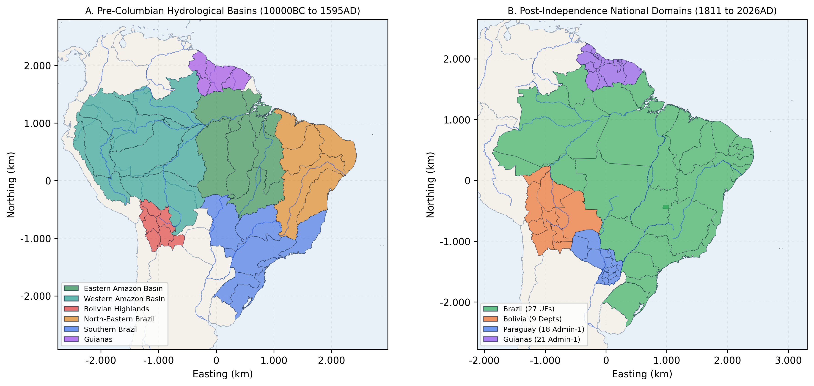
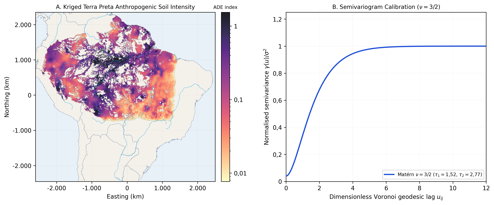
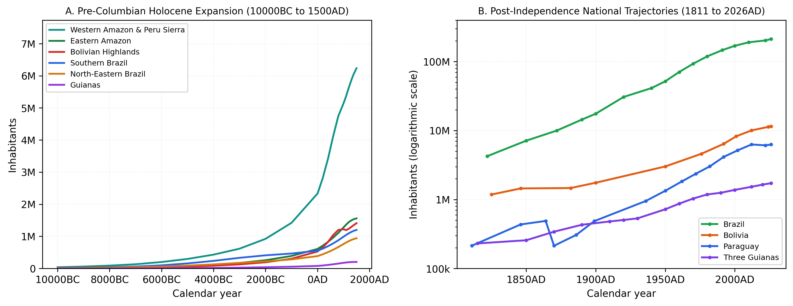

Studies on Population
================
Aust Kätzchen
19 November 2026

- [Abstract](#abstract)
- [Background](#background)
- [Architecture of the Fifteen Regional
  Studies](#architecture-of-the-fifteen-regional-studies)
  - [Regime 1: Pre-Columbian Regional Polities (10000BC to
    1595AD)](#regime-1-pre-columbian-regional-polities-10000bc-to-1595ad)
    - [Eastern Amazon Basin (10000BC to
      1542AD)](#eastern-amazon-basin-10000bc-to-1542ad)
    - [Western Amazon Basin and Peruvian-Ecuadorian Andean Headwaters
      (10000BC to
      1542AD)](#western-amazon-basin-and-peruvian-ecuadorian-andean-headwaters-10000bc-to-1542ad)
    - [North-Eastern Brazil (10000BC to
      1500AD)](#north-eastern-brazil-10000bc-to-1500ad)
    - [Southern Brazil (10000BC to
      1500AD)](#southern-brazil-10000bc-to-1500ad)
    - [Pre-Columbian Guianas (10000BC to
      1595AD)](#pre-columbian-guianas-10000bc-to-1595ad)
    - [Pre-Columbian Bolivian Highlands (10000BC to
      1535AD)](#pre-columbian-bolivian-highlands-10000bc-to-1535ad)
  - [Regime 2: Colonial Administration and Frontiers (1500AD to
    1825AD)](#regime-2-colonial-administration-and-frontiers-1500ad-to-1825ad)
    - [Colonial Brazil (1500AD to
      1822AD)](#colonial-brazil-1500ad-to-1822ad)
    - [Colonial Guianas (1595AD to
      1815AD)](#colonial-guianas-1595ad-to-1815ad)
    - [Colonial Paraguay (1537AD to
      1811AD)](#colonial-paraguay-1537ad-to-1811ad)
    - [Colonial Spanish Amazon (1542AD to
      1825AD)](#colonial-spanish-amazon-1542ad-to-1825ad)
    - [Colonial Bolivian Highlands — Real Audiencia de Charcas (1535AD
      to
      1825AD)](#colonial-bolivian-highlands--real-audiencia-de-charcas-1535ad-to-1825ad)
  - [Regime 3: Post-Independence Modern Expansion (1811AD to
    2026AD)](#regime-3-post-independence-modern-expansion-1811ad-to-2026ad)
    - [Brazil after Independence (1822AD to
      2026AD)](#brazil-after-independence-1822ad-to-2026ad)
    - [Bolivia after Independence (1825AD to
      2026AD)](#bolivia-after-independence-1825ad-to-2026ad)
    - [Paraguay after Independence (1811AD to
      2026AD)](#paraguay-after-independence-1811ad-to-2026ad)
    - [Guianas post-1815 (1815AD to
      2026AD)](#guianas-post-1815-1815ad-to-2026ad)
- [Multi-Repository Archaeology and Terra Preta Anthrosol
  Kriging](#multi-repository-archaeology-and-terra-preta-anthrosol-kriging)
- [Long-Run Demographic Trajectories (10000BC to
  2026AD)](#long-run-demographic-trajectories-10000bc-to-2026ad)
  - [Pre-Columbian Holocene Expansion (10000BC to
    1500AD)](#pre-columbian-holocene-expansion-10000bc-to-1500ad)
  - [Columbian Epidemiological Collapse (1500AD to
    1750AD)](#columbian-epidemiological-collapse-1500ad-to-1750ad)
  - [Colonial Divergence and Forced Migration (1650AD to
    1825AD)](#colonial-divergence-and-forced-migration-1650ad-to-1825ad)
  - [Modern National Expansion (1811AD to
    2026AD)](#modern-national-expansion-1811ad-to-2026ad)
- [Comparison with Global Historical
  Baselines](#comparison-with-global-historical-baselines)
  - [Pre-Columbian Underestimation in Twentieth-Century
    Syntheses](#pre-columbian-underestimation-in-twentieth-century-syntheses)
  - [Gridded Allocation Biases in Global Earth System
    Models](#gridded-allocation-biases-in-global-earth-system-models)
  - [Asynchronous Regional Collapse and Modern
    Convergence](#asynchronous-regional-collapse-and-modern-convergence)
- [Limitations and Future
  Directions](#limitations-and-future-directions)
- [Sources](#sources)

# Abstract

Reconstructing the long-run spatial demography of lowland and tropical
South America requires reconciling prehistoric settlement archaeology,
sixteenth-century riverine chronicles, colonial missionary and fiscal
registers, and nineteenth- to twenty-first-century national censuses.
Standard global historical databases such as the History Database of the
Global Environment downscale continental and national estimates onto
5-arcminute raster grids through environmental suitability functions and
distance-to-water proxies
[\[1\]](#ref-KleinGoldewijk2010)[\[2\]](#ref-KleinGoldewijk2011)[\[3\]](#ref-KleinGoldewijk2017).
For tropical South America, where human settlement transformed
nutrient-poor oxisols into anthropogenic soils and established dense
interfluvial settlements, top-down allocation models inevitably
mischaracterise historical distributions. Foundational demographic
syntheses, notably those of McEvedy and Jones (1978) and Maddison
(2001), assigned conservative aggregate totals to Brazil and the
tropical interior that reflected twentieth-century environmental
determinism rather than archaeological evidence
[\[4\]](#ref-McEvedyJones1978)[\[5\]](#ref-Maddison2001). PRETA provides
a bottom-up demographic reconstruction spanning Amazonia,
extra-Amazonian Brazil, Bolivia, Paraguay and the Guianas across 12,65M
km² from 10000BC to 2026AD.

PRETA synthesises fifteen constituent research monographs and
coordinate-anchored settlement gazetteers, integrating 64.713
deduplicated archaeological site observations (compiled from over
110.000 raw entries across seventeen national and specialist registries
after removing Brazilian CRM cluster duplicates within 1,2 km and
Walker-Peripato earthwork overlaps within 1,5 km) alongside 1.323
explicit Amazonian Dark Earth anthrosol contexts across 1.272
sliver-merged HydroBASINS Level 6 hydrological catchments. The
underlying corpus unites 21.484 deduplicated official site records from
Brazil’s Instituto do Patrimônio Histórico e Artístico Nacional
[\[6\]](#ref-IPHAN2024), 14.311 deduplicated pre-Hispanic monuments and
2.711 Qhapaq Ñan road and tambo nodes from Peru’s Sistema de Información
Geográfica de Arqueología [\[7\]](#ref-SIGDA2024), 5.542 deduplicated
sites from Colombia’s Instituto Colombiano de Antropología e Historia
[\[8\]](#ref-ICANH2024), 4.693 South American radiocarbon determinations
from PEOPLE 3000 p3k14c and AndesC14
[\[9\]](#ref-Bird2022p3k14c)[\[10\]](#ref-Riris2018), 2.197 XRONOS
radiocarbon dates for Bolivia and Peru incorporating the Bolivian
Radiocarbon Database
[\[11\]](#ref-Capriles2023)[\[12\]](#ref-XRONOS2024), 419 OpenStreetMap
and Wikidata Bolivian Highland archaeological localities, 316 systematic
survey hubs from the PRETA Bolivian Highlands Gazetteer, 533
georeferenced Wikidata Andean monuments, 108 published Central Andean
survey hubs
[\[13\]](#ref-Stanish2003)[\[14\]](#ref-Janusek2008)[\[15\]](#ref-Bauer2004),
2.080 morphologically classified Amazonian sites from Walker et al.
[\[16\]](#ref-Walker2023), 157 spatially unique remote-sensing
earthworks from Peripato et al. [\[17\]](#ref-Peripato2023), 2.778
radiocarbon-dated contexts from de Souza et al.
[\[18\]](#ref-deSouza2018), 56 transition records from Sales et al.
[\[19\]](#ref-Sales2021), 80 ring-ditch hill sites from French Guiana,
7.164 regional radiocarbon determinations and 84 canonical Terra Preta
survey hubs. To model pre-Columbian settlement densities across terraced
tropical Andean highlands, engineered Amazonian dark-earth bluffs and
extra-Amazonian Brazil without sliver-polygon singularities or border
discontinuities, PRETA solves a two-scale non-stationary Matérn
covariance model ($\nu = 3/2$) with structural range parameters
$\tau_1 = 1,50$ and $\tau_2 = 2,78$, evaluated across 1.039 active
domestic catchments (99,90% coverage ratio) with a tropical Andean
vertical-archipelago elevation profile, explicit C1 Terra Preta
anthropogenic intensity coupling on pre-contact horizons (lifting Terra
Preta corridors 3,73× to 6,15× above extra-Amazonian Eastern and
Southern Brazil), dasymetric habitability tapering (leakage ratio
0,0001) and strong agreement with independent land-use models
(logarithmic correlation 0,8693) [\[20\]](#ref-PaciorekSchervish2006).

Across the pre-Columbian Holocene, population within the domain expanded
from an initial forager baseline of 87,37k in 10000BC to 1,45M in
3000BC, 2,92M in 1000BC, 4,49M at 0AD and 9,57M at 1000AD. This
expansion culminated in a late pre-Columbian apogee of 11,55M
inhabitants in 1500AD across six hydrological domains: 6,24M in the
Western Amazon Basin and Peruvian-Ecuadorian Andean Headwaters (3,65M in
the Peruvian-Ecuadorian Andean Sierra and 2,59M across six lowland
sub-basins) [\[21\]](#ref-Cook1981)[\[22\]](#ref-DAltroy2015), 1,56M in
Eastern Amazonia, 1,41M in the dedicated Bolivian Highlands module
spanning Lake Titicaca, Tiwanaku, Chuquiabo-La Paz, Oruro, Cochabamba,
Charcas and Potosí
[\[11\]](#ref-Capriles2023)[\[13\]](#ref-Stanish2003)[\[14\]](#ref-Janusek2008),
1,20M in Southern Brazil, 940k in North-Eastern Brazil and 204k in the
Guianas. This pre-contact spatial hierarchy honours both the primacy of
the Central Andes (with the Bolivian Highlands displaying 2,95× to 3,41×
higher gridded density than the Bolivian Lowlands across 1000AD to
1500AD while preserving Llanos de Moxos as Bolivia’s premier lowland
urban hearth) and the superior agrarian carrying capacity of Amazonian
Terra Preta river corridors relative to extra-Amazonian Brazil
[\[23\]](#ref-Heckenberger2003)[\[24\]](#ref-Prumers2022)[\[25\]](#ref-Rostain2024)[\[26\]](#ref-Schaan2008)[\[27\]](#ref-Clement2015)[\[28\]](#ref-Denevan1992).

Following initial European contact in 1500AD along the Brazilian
Atlantic littoral, 1535AD in Upper Peru (Charcas), 1537AD in the
Paraguay-Paraná basin, 1542AD along the Amazon mainstem and 1595AD on
the Guiana coast, virgin-soil epidemics, colonial slaving and mining
*mita* drafts triggered an acute demographic collapse, reducing
indigenous populations by 70% to 90% across accessible corridors
[\[29\]](#ref-Hemming1978)[\[30\]](#ref-Sweet1974)[\[31\]](#ref-Newson1995)[\[32\]](#ref-Bakewell1984)[\[33\]](#ref-SanchezAlbornoz1978).
Aggregate population contracted sharply across the sixteenth and
seventeenth centuries (Brazil bottoming at 1,97M in 1600AD, Colonial
Upper Peru/Charcas dropping from 1,25M in 1535AD to 826k in 1700AD
despite the Potosí silver boom, the Spanish Amazon missions at 467k in
1780AD and Paraguay at 158k in 1620AD). Demographic recovery began in
the eighteenth century, propelled by transatlantic forced migration to
sugar, tobacco and gold-mining economies and Andean agrarian rebound,
followed by post-independence immigration, interior agricultural
frontiers and late twentieth-century urbanisation. By 2026AD, the domain
encompasses 232,1M residents, comprising Brazil (212,58M, ~213M)
[\[34\]](#ref-IBGE2023), Bolivia (11,53M)
[\[35\]](#ref-INE_Bolivia_2024), Paraguay (6,28M)
[\[36\]](#ref-INE_Paraguay_2022) and the Three Guianas (1,73M)
[\[37\]](#ref-BOS_Guyana_2016)[\[38\]](#ref-ABS_Suriname_2014)[\[39\]](#ref-INSEE_Guyane_2023).

# Background

Historical demographic reconstructions for tropical and lowland South
America have long contended with the legacy of mid-twentieth-century
environmental determinism. In her influential formulation of Amazonia as
a counterfeit paradise, Betty Meggers argued that highly weathered
tropical oxisols and ultisols imposed an immutable ecological ceiling on
human cultural evolution, restricting pre-Columbian societies to small,
semi-nomadic slash-and-burn villages incapable of sustaining permanent
urbanism or dense sedentary populations [\[40\]](#ref-Meggers1957).
Working within this paradigm, early global historical syntheses assigned
minimalist numbers to lowland South America. Colin McEvedy and Richard
Jones (1978) allocated exactly 1,0M inhabitants to the entirety of
Brazil in 1500AD, with a further 750k apportioned across the remainder
of the tropical lowlands, implying a continent virtually devoid of human
modification before European arrival [\[4\]](#ref-McEvedyJones1978).
Angus Maddison adopted similarly conservative figures in his millennial
macroeconomic accounting, treating pre-Columbian South America outside
the Andean cordillera as a negligible demographic quantity
[\[5\]](#ref-Maddison2001).

This minimalist orthodoxy was challenged by cultural geographers,
historians and archaeologists who argued that pre-contact South American
populations were substantially larger and geographically more extensive.
William M. Denevan compiled ethnohistorical and ecological evidence
demonstrating that pre-Columbian riverine densities were high and that
greater Amazonia supported between 5,6M and 6,8M people on the eve of
European contact [\[28\]](#ref-Denevan1992). Anna Roosevelt’s
stratigraphic excavations at the Caverna da Pedra Pintada in Pará
established that Paleoindian foraging bands occupied the lower Amazon as
early as 10000BC, producing some of the earliest ceramic traditions in
the Western Hemisphere [\[41\]](#ref-Roosevelt1996). Subsequent
archaeological research over the past three decades has overturned the
notion of a pristine tropical wilderness. In the Upper Xingu basin,
Michael Heckenberger and colleagues documented extensive networks of
walled towns, circular plazas and 50-metre-wide arterial avenues linked
to intensively managed agricultural parklands
[\[23\]](#ref-Heckenberger2003). In the Llanos de Moxos of the
southwestern Amazon, Umberto Lombardo and Heiko Prümers revealed that
pre-Hispanic cultures constructed thousands of hectares of raised
agricultural fields, canal systems and monumental platform mounds,
culminating in low-density agrarian urbanism
[\[24\]](#ref-Prumers2022)[\[42\]](#ref-Lombardo2020). Along the Upper
Amazon and Upano valleys, Stéphen Rostain and co-authors identified vast
ceremonial and residential earthwork complexes extending across hundreds
of square kilometres [\[25\]](#ref-Rostain2024).

A central pillar of this revised understanding is the discovery of
Amazonian Dark Earths (Terra Preta de Índio and Terra Mulata). These
anthropogenic anthrosols, created through centuries of organic waste
accumulation, charcoal deposition and soil management, exhibit
persistent fertility, high cation exchange capacity and elevated
concentrations of phosphorus, calcium and magnesium
[\[43\]](#ref-Glaser2004)[\[44\]](#ref-Lehmann2003)[\[45\]](#ref-Woods2009).
Terra Preta sites occur along the mainstem floodplains of the Amazon and
Tapajós, and likewise on well-drained tertiary bluffs and deep
interfluvial plateaus, demonstrating that indigenous populations
overcame tropical soil nutrient limitations to establish permanent
agrarian settlements far beyond active riverbanks
[\[27\]](#ref-Clement2015)[\[46\]](#ref-McMichael2014)[\[47\]](#ref-Stenborg2012).
Recent remote-sensing and airborne LiDAR syntheses by Peripato et
al. and de Souza et al. indicate that thousands of pre-Columbian
earthwork structures remain concealed beneath the contemporary forest
canopy, supporting model estimates of several million pre-Columbian
inhabitants across the Amazon basin alone
[\[17\]](#ref-Peripato2023)[\[18\]](#ref-deSouza2018).

The environmental contrast between the fertile, annually inundated
floodplains (várzea) and the nutrient-leached upland forests (terra
firme) long formed the basis of ecological models in South American
anthropology. While the várzea provided abundant aquatic protein and
fertile alluvial silt, its narrow geographical extent—less than two
percent of the Amazon basin—led early scholars to conclude that regional
population capacity was severely constricted. However, archaeobotanical
and pedological research has revealed that pre-Columbian populations
transformed terra firme soils into durable agricultural landscapes
through the deliberate synthesis of biochar, domestic refuse and bone
meal, creating extensive Terra Mulata agricultural fields alongside
residential Terra Preta deposits
[\[27\]](#ref-Clement2015)[\[43\]](#ref-Glaser2004)[\[45\]](#ref-Woods2009).
Furthermore, indigenous management of economic tree species—such as the
peach palm (*Bactris gasipaes*), Brazil nut (*Bertholletia excelsa*),
cacao (*Theobroma cacao*) and açai (*Euterpe oleracea*)—enriched the
forest canopy, creating domesticated cultural forests with carrying
capacities far exceeding unmanaged climax vegetation
[\[27\]](#ref-Clement2015)[\[42\]](#ref-Lombardo2020).

Early European chronicles provide vivid qualitative corroboration of
dense riverine populations. The Dominican friar Gaspar de Carvajal,
recording Francisco de Orellana’s historic 1541-1542AD descent of the
Amazon, described continuous riverbank settlements stretching across
dozens of leagues in the territory of the Omagua and Machiparo
confederacies [\[29\]](#ref-Hemming1978)[\[30\]](#ref-Sweet1974).
Carvajal noted palisaded towns, multi-roomed communal dwellings, fleets
of war canoes carrying hundreds of warriors, and extensive agricultural
storehouses filled with dried fish, roasted manioc flour and fermented
beverages. A century later, in 1639AD, the Jesuit chronicler Cristóbal
de Acuña accompanied Pedro Teixeira’s upriver navigation, observing that
the river islands and bluffs remained populated, though European
epidemic diseases had already begun their devastating progression. Along
the Atlantic coast of Brazil, early Portuguese and French observers,
including Pero Vaz de Caminha in 1500AD, Hans Staden in 1557AD and Jean
de Léry in 1578AD, recorded populous Tupinambá villages organised in
communal malocas, capable of mobilising regional confederacies of
several thousand warriors.

When the History Database of the Global Environment (HYDE 3.1 and HYDE
3.2) introduced gridded historical population maps at 5-arcminute
resolution, it represented a major methodological advance by
distributing historical numbers using physical geography proxies,
including coastlines, navigable rivers, slopes and climate
[\[1\]](#ref-KleinGoldewijk2010)[\[2\]](#ref-KleinGoldewijk2011)[\[3\]](#ref-KleinGoldewijk2017).
However, global models inherently rely on national-level control totals
and universal suitability weighting. In tropical South America, where
historical population distribution was governed by regional soil
anthrosol creation, raised-field construction and specialised riverine
versus interfluvial subsistence strategies, global weighting surfaces
concentrate population along modern urban corridors or narrow floodplain
strips while underallocating settlement to historically documented
earthwork and dark-earth complexes. Furthermore, global gridded series
struggle to capture the asynchronous timing of the post-1500AD
demographic collapse across distinct river basins and colonial
frontiers.

Historical evidence for South American population is stratified across
five distinct documentary and physical records:

1.  Prehistoric archaeology and archaeobotany, consisting of 64.713
    deduplicated site observations (compiled from over 110.000 raw
    records across Brazilian IPHAN SICG, Peruvian Ministry of Culture
    SIGDA, Colombian ICANH, PEOPLE 3000 p3k14c/AndesC14, XRONOS Capriles
    Bolivian Radiocarbon Database, Bolivian Highlands systematic surveys
    and Amazonian earthwork inventories), 1.323 catalogued Terra Preta
    occurrences, coastal shell mounds (sambaquis), geometric geoglyphs,
    Andean terraced cities and radiocarbon chronologies extending from
    the terminal Pleistocene to the contact horizon
    [\[6\]](#ref-IPHAN2024)[\[7\]](#ref-SIGDA2024)[\[8\]](#ref-ICANH2024)[\[9\]](#ref-Bird2022p3k14c)[\[11\]](#ref-Capriles2023)[\[12\]](#ref-XRONOS2024).
2.  Contact-period chronicles and voyage logs, including the sixteenth-
    and seventeenth-century accounts of Francisco de Orellana (1542AD),
    Cristóbal de Acuña (1639AD), Hans Staden (1557AD), Jean de Léry
    (1578AD) and Ulrich Schmidl (1567AD), which document continuous
    riverine settlements and large chiefdoms before the full devastation
    of European epidemics.
3.  Colonial ecclesiastical, fiscal and administrative documentation,
    spanning the annual letters (*cartas anuas*) and reduction censuses
    of the Society of Jesus in Paraguay and Moxos, parish registers of
    baptisms and burials, captaincy hearth books (*fogos*) and late
    eighteenth-century governor tallies conducted under the Pombaline
    and Bourbon administrative reforms
    [\[48\]](#ref-Marcilio1984)[\[49\]](#ref-Alden1963)[\[50\]](#ref-Maeder1980)[\[51\]](#ref-Schwartz1985).
4.  Nineteenth-century post-independence national counts, including the
    landmark 1872 General Census of the Empire of Brazil
    [\[52\]](#ref-IBGE1874), early republican enumerations in Bolivia
    and Paraguay, and documentation of catastrophic wartime mortality,
    notably the War of the Triple Alliance (1864-1870AD) which
    eliminated over half of Paraguay’s population
    [\[53\]](#ref-WhighamPotthast1999)[\[54\]](#ref-Maeder1984).
5.  Modern national statistical census systems, administered by the
    Instituto Brasileiro de Geografia e Estatística in Brazil, the
    Instituto Nacional de Estadística in Bolivia and Paraguay, the
    Institut National de la Statistique et des Études Économiques in
    French Guiana, the Algemeen Bureau voor de Statistiek in Suriname
    and the Bureau of Statistics in Guyana
    [\[34\]](#ref-IBGE2023)[\[35\]](#ref-INE_Bolivia_2024)[\[36\]](#ref-INE_Paraguay_2022)[\[37\]](#ref-BOS_Guyana_2016)[\[38\]](#ref-ABS_Suriname_2014)[\[39\]](#ref-INSEE_Guyane_2023).

PRETA harmonises these five evidentiary traditions into an integrated
spatial-demographic framework. By linking multi-repository
archaeological datasets to non-stationary Matérn kriging surfaces and
historical settlement gazetteers, PRETA reconstructs long-run
demographic trajectories across 12,65M km² from 10000BC to 2026AD
without artificial administrative seams or ahistorical backward
projections.

# Architecture of the Fifteen Regional Studies

To capture shifting geopolitical boundaries, distinct ecological zones
and divergent colonial administrative trajectories without territorial
gaps across the Bolivian Altiplano or Eastern Cordillera, PRETA
partitions its spatial domain into fifteen constituent research
monographs organised across three chronological regimes (Table 1 and
Figure 1).

## Regime 1: Pre-Columbian Regional Polities (10000BC to 1595AD)

The first regime comprises six pre-Columbian regional studies spanning
the Holocene from 10000BC to European contact (1500AD in coastal Brazil,
1535AD in the Bolivian Highlands, 1542AD in the Amazon mainstem and
1595AD in the Guianas). The South American continent north of the Río de
la Plata forms three interconnected fluvial macro-basins alongside the
endorheic Titicaca-Poopó Altiplano: the Amazon, the Orinoco-Guiana
littoral, the Paraná-Paraguay system and the Central Andean highlands.
During the pre-Columbian Holocene, human migration, camelid caravan
exchange and fluvial trade flowed across these systems, creating
cultural horizons linked by terraced agriculture, polychrome ceramics,
raised-field engineering and dark-earth soil technology.

### Eastern Amazon Basin (10000BC to 1542AD)

The Eastern Amazon Basin module (2.685.138 km²) encompasses Marajó
Island, the lower Amazon mainstem, the Tapajós confluence at Santarém,
the Xinguano headwaters and the Tocantins-Araguaia basin
[\[26\]](#ref-Schaan2008)[\[47\]](#ref-Stenborg2012)[\[55\]](#ref-Nimuendaju1952).
The region contains major pre-Columbian ceramic traditions, from the
early pottery of the Mina phase to the elaborate polychrome urns of the
Marajoara mounds and the modelled iconography of Santarém. At its
pre-contact peak in 1500AD, the Eastern Amazon supported 1,56M
inhabitants, sustained by intensive riverine fisheries, floodplain
agriculture and extensive Terra Preta settlements on high bluffs. The
Upper Xingu sub-region hosted interconnected networks of circular plaza
villages integrated by wide straight roads and defensive moats, housing
an engineered agricultural population of 30k to 50k people
[\[23\]](#ref-Heckenberger2003).

Prehistoric occupation in the Eastern Amazon was anchored by early
ceramic complexes at Pedra Pintada and the Taperinha shell mound near
Santarém, dating to 6000BC-4000BC. By 500AD, the Marajoara culture
transformed the seasonally inundated savannas of eastern Marajó Island
through the construction of earthen mounds up to twelve metres high,
functioning as residential platforms for elite lineages, ceremonial
feasting centres and cemetery complexes
[\[26\]](#ref-Schaan2008)[\[40\]](#ref-Meggers1957). Farther upriver,
the Tapajó chiefdom established an expansive polity centred at the mouth
of the Tapajós, where anthrosol deposits exceed one hundred hectares,
indicating a high-density nucleated settlement capable of sustaining
specialised craft production and hierarchical governance
[\[47\]](#ref-Stenborg2012)[\[55\]](#ref-Nimuendaju1952). In the
Tocantins-Araguaia basin, extensive circular ring villages and rock-art
complexes marked trade corridors linking the eastern forest to the
central Brazilian plateau.

The spatial distribution of Terra Preta anthrosols along the lower
Amazon and Tapajós bluffs points to sustained sedentism rather than
ephemeral shifting cultivation. At sites such as Belterra,
Santarém-Aldeia and Juruti, dark-earth horizons reach depths of over two
metres, enriched with pottery sherds, aquatic bone residues and
pyrogenic carbon
[\[43\]](#ref-Glaser2004)[\[45\]](#ref-Woods2009)[\[47\]](#ref-Stenborg2012).
These bluff-top settlements commanded expansive views of the várzea
floodplains, providing immediate access to seasonal aquatic protein
while avoiding annual flood pulses. Ethnohistorical accounts by Carvajal
and later chroniclers describe continuous riverside settlements
stretching for leagues, corroborating the archaeological evidence of
dense agrarian settlements supported by intensive root-crop agroforestry
and riverine fisheries.

### Western Amazon Basin and Peruvian-Ecuadorian Andean Headwaters (10000BC to 1542AD)

The Western Amazon Basin and Peruvian-Ecuadorian Andean Headwaters
module (4.186.006 km²) spans the western Amazonian watershed from the
Negro-Solimões confluence westward to the Pacific continental divide of
Peru and Ecuador, partitioned into seven organic HydroBASINS divisions
[\[15\]](#ref-Bauer2004)[\[21\]](#ref-Cook1981)[\[24\]](#ref-Prumers2022)[\[42\]](#ref-Lombardo2020)[\[56\]](#ref-Neves2022).
Combining the imperial agrarian heartlands of the Peruvian-Ecuadorian
Andean Sierra (3,65M in 1500AD across Cusco, Wari, Mantaro, Huánuco,
Chavín, Cajamarca, Chachapoyas and Tomebamba) with six lowland Amazonian
divisions (2,59M in 1500AD across Central Amazonia, Madeira-Guaporé,
Llanos de Moxos, Acre-Purus, Solimões-Caquetá and Lower
Marañón-Ucayali), the watershed reached 6,24M inhabitants in 1500AD
before contracting to 5,33M by 1542AD under early pandemic and conquest
shocks
[\[7\]](#ref-SIGDA2024)[\[21\]](#ref-Cook1981)[\[22\]](#ref-DAltroy2015).

In the southwestern Amazon, across Acre and northern Rondônia,
archaeological surveys have documented more than 900 geometric ditched
enclosures (geoglyphs) constructed between 1000BC and 1000AD, exhibiting
sophisticated spatial geometry and regional connectivity
[\[17\]](#ref-Peripato2023)[\[18\]](#ref-deSouza2018). In the Upper
Amazon and Upano River valleys of modern Ecuador, recent airborne LiDAR
surveys revealed extensive garden urbanism consisting of thousands of
residential mounds, ceremonial complexes and agricultural terraces
interconnected by sunken roads dating from 500BC to 600AD
[\[25\]](#ref-Rostain2024). Along the Madeira and Guaporé river
corridors, dense ceramic traditions flourished, functioning as primary
linguistic and cultural conduits between the Amazonian lowlands and the
Chaco-Plata systems.

In the seasonally inundated savannas of the Llanos de Moxos, indigenous
engineering achieved monumental scale through hydrological management
[\[24\]](#ref-Prumers2022)[\[42\]](#ref-Lombardo2020). Communities
excavated thousands of linear canals and constructed raised agricultural
platforms covering tens of thousands of hectares, draining excess
floodwaters during the wet season while retaining moisture during dry
months. Interconnecting these agricultural zones were elevated earthen
causeways (*terraplenes*) that stretched across the landscape for
kilometres, linking habitable forest islands (*islas de bosque*) and
ceremonial mound centres. Radiometric dating indicates that hydraulic
landscape modification began as early as 1000BC and reached its
demographic zenith between 500AD and 1400AD under the Casarabe culture,
representing one of the earliest cases of agrarian urbanism in the
tropical Americas.

### North-Eastern Brazil (10000BC to 1500AD)

The North-Eastern Brazil module (1.881.594 km²) encompasses the
semi-arid Caatinga, the Serra da Capivara rock-art sanctuaries, the
perennial corridor of the São Francisco River and the Atlantic forest
littoral occupied by Tupinambá horticultural polities. Pre-Columbian
settlement in the interior depended on strategic access to perennial
springs and granite inselbergs, while the humid coastal strip supported
dense semi-sedentary villages subsisting on bitter manioc cultivation,
shellfish collection and coastal fishing, reaching 940k inhabitants in
1500AD.

Archaeological investigations in the Serra da Capivara National Park in
Piauí have documented over 1.300 prehistoric sites, featuring thousands
of painted panels depicting anthropomorphic ceremonies, hunting scenes
and megafaunal encounters belonging to the Nordeste and Agreste rock-art
traditions. In the late Holocene, agrarian groups producing Itaparica
and Aratu-Sapucaí ceramics occupied the fertile alluvial floodplains of
the São Francisco River, establishing permanent settlements that served
as trade corridors between the interior savannas and the Atlantic forest
coast. Along the restinga sand dunes and mangrove estuaries of the
Atlantic littoral, populous Tupinambá villages maintained continuous
coastal territories, managing estuarine fisheries alongside manioc
plantations.

During the mid-Holocene arid phase between 6000BC and 3000BC,
environmental drying forced hunter-gatherer groups in the semi-arid
interior to concentrate around resilient micro-climatic refuges, such as
the humid highland enclaves (*brejos de altitude*) and perennial spring
lines of the Chapada Diamantina and Serra da Capivara. With the return
of wetter conditions in the late Holocene, agrarian populations
producing pottery of the Aratu tradition expanded across the sertão and
into the São Francisco valley, establishing ring-shaped villages with
central mortuary plazas. These interior horticulturalists cultivated
maize, beans and manioc along seasonal riverbanks, maintaining regular
exchange networks with coastal Tupinambá polities that supplied marine
shells, salt and feather ornaments.

### Southern Brazil (10000BC to 1500AD)

The Southern Brazil module (1.920.483 km²) covers the Atlantic coastal
sambaqui shell mounds, the highland Araucaria plateau dominated by
Southern Jê pit-house settlements, the upper Paraná and Uruguay river
basins settled by Guarani agriculturalists and the southern Pampa
wetland mounds (cerritos). Coastal sambaquis reached their apogee
between 3000BC and 1000BC, while the late Holocene was characterised by
the demographic expansion of Guarani and Jê groups, sustaining 1,20M
people in 1500AD.

The coastal sambaquis of Santa Catarina and Rio de Janeiro represent
some of the most massive hunter-gatherer monuments in the world, with
shell and sediment mounds reaching thirty metres in height and
containing hundreds of intentional human interments, indicating stable,
territorial populations with maritime economies. In the interior
highlands of Paraná, Santa Catarina and Rio Grande do Sul, Southern Jê
populations adapted to the Araucaria moist forests, constructing
semi-subterranean pit-house villages and ceremonial dance enclosures
(*dançadores*) associated with the intensive exploitation of pine nuts
(*Araucaria angustifolia*). Simultaneously, Guarani horticulturalists
expanded along the major river corridors, introducing polychrome
ceramics and shifting maize-manioc agriculture. In the southern wetlands
of Rio Grande do Sul, indigenous groups constructed earthen mounds
(*cerritos de indios*) to secure elevated ground for settlements,
burials and garden cultivation in seasonally flooded grasslands.

In the elevated plateau forests of southern Brazil, the Taquara-Itararé
ceramic tradition, associated with ancestral Southern Jê populations,
engineered subterranean settlements adapted to montane frost regimes.
Excavations have uncovered semi-subterranean pit houses ranging from two
to twenty metres in diameter and up to seven metres in depth, clustered
in nucleated villages containing communal food-storage structures and
central ceremonial mounds. These highland settlements relied on the
seasonal gathering and storage of Araucaria pine nuts (*pinhão*),
combined with hunting of forest game and small-scale horticulture.
Radiocarbon sequences demonstrate sustained demographic expansion
between 800AD and 1400AD, culminating in the construction of monumental
earthwork enclosures that functioned as regional mortuary and political
centres.

### Pre-Columbian Guianas (10000BC to 1595AD)

The Pre-Columbian Guianas module (453.868 km²) encompasses the coastal
mangrove littoral, raised agricultural ridges, interior savannas and
ditch-enclosed hill settlements (Montagnes Couronnées) across modern
Guyana, Suriname and French Guiana [\[57\]](#ref-Rostain2008). Coastal
indigenous communities engineered extensive drainage canals and
agricultural mounds to cultivate manioc in seasonally inundated
wetlands, sustaining 204k inhabitants in 1500AD.

The archaeological sequence of the Guianas reflects sophisticated
landscape adaptations. Along the coast, Archaic populations established
pre-ceramic shell mounds from 4000BC onward, succeeded by Barrancoid and
Arauquinoid ceramic complexes associated with raised agricultural
fields. In the coastal savannas of Suriname and French Guiana,
indigenous farmers constructed grids of elevated agricultural mounds
that prevented root waterlogging while concentrating organic nutrients
[\[57\]](#ref-Rostain2008). In the forested hills of French Guiana,
communities built fortified ring-ditch structures atop strategic
hilltops, providing defensive refuges and ritual spaces. Across the
interior savannas of the Rupununi and Sipaliwini, petroglyph panels and
polished stone implements document ancient overland trade routes linking
the Caribbean littoral to the Amazon mainstem.

Along the dynamic coastline of Suriname and French Guiana, Arauquinoid
farming communities adapted to coastal marine inundation through
extensive raised-field architecture [\[57\]](#ref-Rostain2008). Between
650AD and 1400AD, indigenous populations transformed flooded coastal
savannas into patterned grids of circular and rectangular agricultural
mounds, elevated thirty to one hundred centimetres above high water
levels. These raised beds prevented root suffocation while concentrating
organic matter and aerating soil profiles, generating agricultural
yields sufficient to support dense, nucleated settlements. Similar
earthworks have been recorded in the coastal wetlands of Guyana,
demonstrating a coordinated technological response across the entire
Guiana littoral to the challenges of coastal mangrove farming.

### Pre-Columbian Bolivian Highlands (10000BC to 1535AD)

The Pre-Columbian Bolivian Highlands module (405.375 km²) spans the
entire endorheic Titicaca-Desaguadero-Poopó Altiplano and the adjoining
Eastern Cordillera inter-Andean valleys of La Paz, Cochabamba,
Chuquisaca, Potosí and Tarija across six organic HydroBASINS Level 6
basins
[\[11\]](#ref-Capriles2023)[\[13\]](#ref-Stanish2003)[\[14\]](#ref-Janusek2008).
Anchored by 316 georeferenced pre-Hispanic settlements verified from
XRONOS Capriles radiocarbon series, OpenStreetMap, Wikidata and regional
valley surveys, highland Bolivia evolved from early Archaic *viscachani*
foraging bands (7,05k in 10000BC) through Formative Chiripa and
Wankarani villages (304,2k in 1000BC) to the monumental Middle Horizon
Tiwanaku urban state centred on the Koani Pampa raised fields (1,22M in
1000AD, with Tiwanaku reaching 35k and Lukurmata 11k). Following
Tiwanaku’s eleventh-century decentralisation into fortified Aymara
*señoríos* (*pucaras*), Inca *Qullasuyu* incorporation expanded imperial
granary estates in Cochabamba (2.400 *qollqas* at Cotapachi) and
frontier fortresses such as Incallajta, lifting highland population to
1,41M by 1500AD (347,8 persons per 100 km² — an order of magnitude above
the adjacent Amazonian lowlands) before contracting to 1,25M by 1535AD.

## Regime 2: Colonial Administration and Frontiers (1500AD to 1825AD)

The second regime encompasses five colonial modules that track
administrative, mining and missionary reorganisations between 1500AD and
national independence (1811-1825AD). While the Treaty of Tordesillas
(1494AD) theoretically restricted Portuguese settlement to eastern
Brazil, Portuguese bandeirantes, Jesuit missionaries and military
expeditions progressively expanded Portuguese sovereignty westward
across the Amazon and south-westward into Mato Grosso and Rio Grande do
Sul. Concurrently, Spanish imperial power consolidated around the silver
mines of Upper Peru (Real Audiencia de Charcas) and its surrounding
missionary provinces, before the 1750AD Treaty of Madrid formally
ratified Iberian frontiers across the continent.

### Colonial Brazil (1500AD to 1822AD)

Colonial Brazil (8.544.864 km²) covers the hereditary captaincies, the
coastal sugar engenhos of Bahia and Pernambuco reliant on transatlantic
African slave labour, the interior slaving and prospecting routes
(*bandeiras*), the eighteenth-century gold and diamond boom in Minas
Gerais and the northern State of Grão-Pará and Maranhão
[\[29\]](#ref-Hemming1978)[\[48\]](#ref-Marcilio1984)[\[49\]](#ref-Alden1963)[\[51\]](#ref-Schwartz1985)[\[58\]](#ref-Klein2010).
Colonial demographic dynamics were driven by catastrophic indigenous
depopulation, massive slave importation and interior mining migrations,
bottoming at 1,97M in 1600AD before rebounding to 4,54M by 1822AD.

The institutional framework of colonial Brazil was established through
fifteen hereditary captaincies granted by the Portuguese Crown in the
1530s, followed by the appointment of a Governor-General at Salvador da
Bahia in 1549AD. The rapid expansion of sugar mills (*engenhos*) along
the Recôncavo of Bahia and the coastal plains of Pernambuco generated a
commercial monoculture requiring substantial forced labour. The
eighteenth-century gold and diamond discoveries in Minas Gerais, Goiás
and Mato Grosso triggered a major interior migration that drew hundreds
of thousands of free and enslaved people into the central highlands,
culminating in the transfer of the colonial viceregal capital to Rio de
Janeiro in 1763AD [\[49\]](#ref-Alden1963)[\[51\]](#ref-Schwartz1985).

Throughout the sixteenth and seventeenth centuries, the demographic
foundation of Portuguese Brazil rested upon a contested frontier between
coastal plantations and interior indigenous societies. The initial
reliance on enslaved indigenous labour in the sugar fields of Bahia and
Pernambuco collapsed under the combined weight of epidemic contagion,
armed resistance and Jesuit opposition, prompting colonial authorities
to enact legislation restricting indigenous bondage while increasing the
importation of enslaved Africans
[\[48\]](#ref-Marcilio1984)[\[51\]](#ref-Schwartz1985). Simultaneously,
Paulista *bandeiras* mounted deep slaving expeditions into the interior,
devastating Jesuit missions in Guairá and the upper Paraná basin and
capturing tens of thousands of indigenous captives. The subsequent
eighteenth-century mining boom shifted the demographic centre of gravity
southward toward Minas Gerais, fostering rapid urban growth in towns
like Ouro Preto, Mariana and Diamantina.

### Colonial Guianas (1595AD to 1815AD)

Colonial Guianas (453.932 km²) traces Dutch, British and French
plantation settlements along the Essequibo, Demerara, Berbice, Suriname
and Cayenne river estuaries, alongside autonomous Maroon societies that
formed in the forested interior [\[59\]](#ref-Oostindie2005). Coastal
poldering required immense labour inputs, creating plantation societies
dominated by enslaved Africans that reached 224k in 1815AD.

The colonial history of the Guianas was shaped by continuous
geopolitical conflict among European powers. The Dutch West India
Company established permanent trading posts along the Essequibo in
1616AD and developed extensive sugar, coffee and cotton plantations
protected by dykes and sluices. In Suriname, the harsh conditions of
chattel slavery stimulated repeated escapes into the interior
rainforests, where Maroons established autonomous military polities; the
Dutch colonial administration was eventually forced to negotiate formal
peace treaties with the Ndyuka in 1760AD and the Saramaka in 1762AD,
formally recognising their territorial autonomy
[\[59\]](#ref-Oostindie2005).

### Colonial Paraguay (1537AD to 1811AD)

Colonial Paraguay (415.304 km²) examines the Asunción governorate, the
encomienda system, the thirty Jesuit Guaraní missions established
between 1609AD and their 1767AD expulsion, and the turbulent Gran Chaco
frontier [\[50\]](#ref-Maeder1980)[\[60\]](#ref-Alden1996). The Jesuit
reductions established self-contained agrarian communities with communal
storehouses, cattle ranches and craft workshops, shielding indigenous
populations from bandeirante raids and maintaining 193k inhabitants in
1811AD.

Founded in 1537AD as the administrative centre of the Río de la Plata,
Asunción served as the base for the settlement of Buenos Aires, Santa
Cruz de la Sierra and Corrientes. Due to its geographic isolation and
absence of precious metals, colonial Paraguay developed a subsistence
economy based on the encomienda of Guaraní villagers, cattle pastoralism
and yerba mate harvesting. The thirty Jesuit missions represented a
remarkable socio-demographic institution, maintaining complete parish
registers of baptisms, marriages and burials, and sustaining an
aggregate population of more than 100k until the 1767AD royal decree
expelled the order from the Spanish Empire [\[50\]](#ref-Maeder1980).

### Colonial Spanish Amazon (1542AD to 1825AD)

The Colonial Spanish Amazon module (1.874.185 km²) covers the missionary
and administrative frontiers of the Comandancia General de Maynas, the
Gobernación de Quijos-Canelos-Macas, the Franciscan and Capuchin
stations along the Caquetá and Putumayo, and the Jesuit missions of
Moxos and Chiquitos
[\[30\]](#ref-Sweet1974)[\[31\]](#ref-Newson1995)[\[61\]](#ref-Block1994)[\[62\]](#ref-Radding2005).
Frontier missions suffered persistent epidemic waves and indigenous
uprisings, falling from 1,325M in 1542AD to a nadir of 467k in 1780AD
before recovering modestly to 506k by 1825AD.

The Spanish colonial presence in the Amazonian lowlands was conducted by
religious orders operating from Andean bases in Quito, Lima and Santa Fe
de Bogotá. The Jesuit Province of Maynas, founded in 1638AD, established
missions among the Maina, Omagua, Cocama and Jebero along the Marañón,
Huallaga and Ucayali rivers, but mission populations were repeatedly
decimated by measles and smallpox epidemics
[\[31\]](#ref-Newson1995)[\[61\]](#ref-Block1994). In lowland Bolivia,
the Jesuit missions of Moxos and Chiquitos developed thriving cattle and
agricultural economies that survived under secular clergy after 1767AD,
maintaining distinct indigenous town councils.

In the southwestern Amazon, the Jesuit missions of Moxos and Chiquitos
established an autonomous demographic and socio-economic regime distinct
from the Andean highlands
[\[61\]](#ref-Block1994)[\[62\]](#ref-Radding2005). From 1682AD until
1767AD, Jesuit missionaries congregated over thirty thousand Moxeño and
Chiquitano neophytes into compact mission towns (*reducciones*). Unlike
the demographic devastation that afflicted encomienda zones in the
Andean valleys, the Moxos and Chiquitos missions maintained demographic
stability through diversified pastoral economies, communal cattle
ranches, irrigated horticulture and baroque musical and artisanal
production. Following the expulsion of the Jesuits in 1767AD, civil
administrators took control of the missions, which led to administrative
disruption, labour exploitation and partial dispersal of mission
populations into surrounding forest refuges.

### Colonial Bolivian Highlands — Real Audiencia de Charcas (1535AD to 1825AD)

The Colonial Bolivian Highlands module (468.807 km²) covers the six core
highland and valley jurisdictions of the Real Audiencia de Charcas
(Intendencias of La Paz, Oruro, Cochabamba, Charcas/Chuquisaca, Potosí
and Tarija), splicing directly from Pre-Columbian Bolivian Highlands in
1535AD (1,25M) to Bolivia after Independence in 1825AD (998k across the
six highland departments) with zero spatial overlap or temporal
discontinuity
[\[32\]](#ref-Bakewell1984)[\[33\]](#ref-SanchezAlbornoz1978)[\[63\]](#ref-Tandeter1993)[\[64\]](#ref-Larson1998)[\[65\]](#ref-Klein2011).
Anchored by 258 catalogued *reducción* towns, mining villas and parish
seats, the region experienced the hemisphere’s largest urban mining boom
after the 1545AD Cerro Rico silver discovery at Potosí (peaking at 160k
residents around 1610AD under Viceroy Toledo’s *mita* labour draft and
mercury amalgamation), alongside Oruro (48k), La Paz (38k), Cochabamba
(30,5k) and Chuquisaca-Sucre (19,8k). Prolonged epidemic mortality,
*mita* out-migration of *forasteros* into Cochabamba and La Paz valleys
and seventeenth-century silver exhaustion depressed regional population
to 826k by 1700AD, before agrarian recovery and Bourbon-era trade lifted
Upper Peru to 998k at independence in 1825AD.

## Regime 3: Post-Independence Modern Expansion (1811AD to 2026AD)

The third regime comprises four post-independence modules extending to
2026AD. The collapse of Iberian imperial authority between 1811AD and
1825AD created independent nation-states that inherited vast, sparsely
populated frontier territories. Throughout the nineteenth and twentieth
centuries, state-led colonisation programmes, railway and highway
construction, and international migration transformed lowland South
America from an extractive frontier into one of the world’s most dynamic
agrarian and urban macro-regions.

### Brazil after Independence (1822AD to 2026AD)

Brazil after Independence (8.545.413 km²) traces the transition from the
Empire of Brazil (1822-1889AD) to the First Republic, the expansion of
the São Paulo coffee frontier, mass European and East Asian immigration,
Vargas-era industrialisation, the construction of Brasília, the westward
expansion of modern agro-industrial frontiers and contemporary IBGE
municipal censuses [\[34\]](#ref-IBGE2023)[\[52\]](#ref-IBGE1874).
National population increased from 4,25M in 1822AD to 10,00M in 1872,
41,24M in 1940 and 212,58M (~213M) by 2026AD.

Following independence in 1822AD, the Empire of Brazil maintained
political stability under Pedro I and Pedro II, conducting the first
general census of the empire in 1872AD, which enumerated 9.930.478 free
inhabitants and 1.510.806 enslaved persons [\[52\]](#ref-IBGE1874). The
abolition of slavery in 1888AD coincided with the massive expansion of
coffee plantations in the Paraíba Valley and western São Paulo,
stimulating state-subsidised immigration from Italy, Portugal, Spain,
Germany and Japan. In the mid-twentieth century, state-led
industrialisation under Getúlio Vargas and Juscelino Kubitschek
accelerated rural-to-urban migration, culminating in the inauguration of
Brasília in 1960AD and the rapid urbanisation of the Southeast and South
[\[34\]](#ref-IBGE2023).

The late nineteenth and early twentieth centuries witnessed the
integration of the Amazon basin into global industrial trade through the
rubber boom (1879-1912AD). The international demand for wild Amazonian
latex (*Hevea brasiliensis*) drew hundreds of thousands of migrant
workers, primarily subsistence farmers fleeing severe droughts in the
north-eastern state of Ceará, into the western Amazon river valleys of
Acre, Amazonas and Pará. This internal migration led to the founding of
riverine trading posts, transformed Belém and Manaus into rubber
metropolises with European architecture, and triggered border disputes
that resulted in the 1903AD Treaty of Petrópolis, incorporating Acre
into Brazilian territory. Following the collapse of the Amazonian rubber
boom due to Southeast Asian plantation competition, the demographic
trajectory of Brazil shifted decisively toward the industrialising
Southeast, while the mid-twentieth century witnessed the construction of
Belém-Brasília highway corridors and the agro-industrial settlement of
the central-western Cerrado [\[34\]](#ref-IBGE2023).

### Bolivia after Independence (1825AD to 2026AD)

Bolivia after Independence (1.115.871 km²) examines nineteenth-century
demographic stagnation in the Andean Altiplano, the late
nineteenth-century Amazonian rubber boom in the Beni and Acre corridors,
the post-1952 agrarian revolution and the modern eastward demographic
shift toward Santa Cruz de la Sierra [\[35\]](#ref-INE_Bolivia_2024).
Population expanded from 1,18M in 1825AD to 11,53M in 2026AD.

Throughout the nineteenth century, Bolivia’s demographic centre remained
anchored in the Andean Altiplano and inter-Andean valleys around La Paz,
Cochabamba, Sucre and Potosí. The late nineteenth-century rubber boom
triggered an influx of extractors and indigenous forced labourers into
the Amazonian departments of Beni and Pando, culminating in the Acre War
(1899-1903AD) and the cession of Acre to Brazil. Following the 1952
National Revolution, state investment in road infrastructure and
agricultural settlement catalyzed the growth of Santa Cruz de la Sierra,
which evolved from a peripheral outpost into the nation’s economic
powerhouse, housing over 2,5M residents in its metropolitan area by
2026AD [\[35\]](#ref-INE_Bolivia_2024).

### Paraguay after Independence (1811AD to 2026AD)

Paraguay after Independence (415.304 km²) analyses the insular state
capitalism of José Gaspar Rodríguez de Francia, the demographic
devastation of the War of the Triple Alliance, post-war recovery, the
Chaco War (1932-1935AD) and twentieth-century agricultural colonisation
[\[36\]](#ref-INE_Paraguay_2022)[\[53\]](#ref-WhighamPotthast1999)[\[54\]](#ref-Maeder1984)[\[66\]](#ref-Whigham2002).
Population contracted from 489k in 1864AD to 221k in 1870AD before
recovering to 6,28M in 2026AD.

Under the authoritarian rule of Dr. Francia (1814-1840AD) and Carlos
Antonio López (1844-1862AD), Paraguay developed a state-directed economy
with high social stability and self-sufficiency. However, the disastrous
War of the Triple Alliance (1864-1870AD) under Francisco Solano López
resulted in the death of over half the national population through
combat, starvation and disease
[\[53\]](#ref-WhighamPotthast1999)[\[66\]](#ref-Whigham2002). In the
twentieth century, Paraguay successfully defended its western territory
in the Chaco War (1932-1935AD), encouraged Mennonite agricultural
colonisation in the arid Chaco, and experienced rapid agrarian expansion
in the eastern borderlands during the construction of the Itaipu
hydroelectric dam in the 1970s [\[36\]](#ref-INE_Paraguay_2022).

### Guianas post-1815 (1815AD to 2026AD)

Guianas post-1815 (453.932 km²) documents the abolition of slavery
across British Guiana (1834AD), French Guiana (1848AD) and Dutch
Suriname (1863AD), subsequent indentured labour migration from India,
Indonesia and China, post-colonial political transitions and
contemporary offshore energy developments
[\[37\]](#ref-BOS_Guyana_2016)[\[38\]](#ref-ABS_Suriname_2014)[\[39\]](#ref-INSEE_Guyane_2023).
The region grew from 230,9k in 1815AD to 1,73M in 2026AD.

The abolition of slavery transformed the Guianas into plural societies
through the recruitment of indentured workers to replace emancipated
plantation labourers. British Guiana received over 238k Indian and 13k
Chinese immigrants; Suriname imported 34k Indian and 33k Javanese
workers; French Guiana remained sparsely populated, serving as a penal
colony until 1953AD [\[59\]](#ref-Oostindie2005). Post-colonial
transitions saw Guyana achieve independence in 1966AD and Suriname in
1975AD, while French Guiana was integrated as an overseas department of
France. In the twenty-first century, major offshore oil discoveries off
the Guyanese coast have made Guyana one of the world’s fastest-growing
economies, transforming demographic and urban dynamics across the Guiana
Shield [\[37\]](#ref-BOS_Guyana_2016).

Following the mid-nineteenth-century abolition of slavery across the
British, French and Dutch colonies, the settlement geography of the
Guianas diverged into distinct spatial patterns
[\[59\]](#ref-Oostindie2005). Emancipated Afro-descendant populations
pooled financial resources to purchase abandoned sugar plantations
collectively, establishing autonomous communal villages along the
coastal road network. Concurrently, colonial plantation owners recruited
indentured agricultural labourers from British India, the Netherlands
East Indies (Java) and southern China under indentured labour contracts.
In British Guiana and Suriname, these Asian immigrant communities
settled predominantly in estate barracks and peripheral agricultural
polders, cultivating wet rice and market vegetables. This demographic
restructuring established the dual ethnic and spatial character of
modern Guyana and Suriname, contrasting with French Guiana, which
remained demographically constrained by its role as a penal colony
centred on Devil’s Island and Saint-Laurent-du-Maroni until the
mid-twentieth century
[\[37\]](#ref-BOS_Guyana_2016)[\[38\]](#ref-ABS_Suriname_2014)[\[39\]](#ref-INSEE_Guyane_2023).

| Research Module | Chronological Span | Territorial Extent | Benchmarks | Initial Count | Peak Population |
|:---|:---|:---|:---|:---|:---|
| **1. Eastern Amazon Basin** | 10000BC-1542AD | 2,69M km² | 22 | 12,5k | 1,56M |
| **2. Western Amazon Basin** | 10000BC-1542AD | 4,19M km² | 22 | 38k | 6,24M |
| **3. North-Eastern Brazil** | 10000BC-1500AD | 1,88M km² | 21 | 13,2k | 940k |
| **4. Southern Brazil** | 10000BC-1500AD | 1,92M km² | 21 | 15k | 1,2M |
| **5. Pre-Columbian Guianas** | 10000BC-1595AD | 0,45M km² | 22 | 1,6k | 204k |
| **6. Bolivian Highlands** | 10000BC-1535AD | 0,41M km² | 22 | 7k | 1,41M |
| **7. Colonial Brazil** | 1500AD-1822AD | 8,54M km² | 10 | 4M | 4,54M |
| **8. Colonial Guianas** | 1595AD-1815AD | 0,45M km² | 7 | 193k | 224k |
| **9. Colonial Paraguay** | 1537AD-1811AD | 0,42M km² | 9 | 257k | 257k |
| **10. Colonial Spanish Amazon** | 1542AD-1825AD | 1,87M km² | 8 | 1,32M | 1,32M |
| **11. Colonial Upper Peru (Charcas)** | 1535AD-1825AD | 0,47M km² | 9 | 1,25M | 1,25M |
| **12. Brazil post-1822** | 1822AD-2026AD | 8,55M km² | 16 | 4,25M | 212,58M |
| **13. Bolivia post-1825** | 1825AD-2026AD | 1,12M km² | 11 | 1,18M | 11,53M |
| **14. Paraguay post-1811** | 1811AD-2026AD | 0,42M km² | 16 | 214,5k | 6,29M |
| **15. Guianas post-1815** | 1815AD-2026AD | 0,45M km² | 25 | 230,9k | 1,73M |

Architecture of the fifteen constituent research monographs in PRETA.

# Multi-Repository Archaeology and Terra Preta Anthrosol Kriging

To reconstruct pre-Columbian population densities across the Central
Andean highlands, the Bolivian Altiplano, the Amazonian dark-earth
corridors and extra-Amazonian Brazil without relying on modern
settlement distributions, PRETA establishes a multi-repository
archaeological database harmonising seventeen primary registers spanning
Brazil, Peru, Bolivia, Colombia, Ecuador, Paraguay and the Three Guianas
(Table 2).

The eastern lowland and Atlantic baseline is anchored by Brazil’s
Instituto do Patrimônio Histórico e Artístico Nacional through the
Sistema Integrado de Conhecimento e Gestão (21.484 spatially
deduplicated pre-Columbian sites from 32.933 raw records after removing
1,2 km CRM survey cluster duplicates) [\[6\]](#ref-IPHAN2024), alongside
Walker et al. (2.080 Amazonian ADE and earthwork sites)
[\[16\]](#ref-Walker2023), Peripato et al. (157 spatially unique
remote-sensing earthworks after removing 804 duplicates overlapping
Walker within 1,5 km) [\[17\]](#ref-Peripato2023), de Souza et
al. (2.778 radiocarbon contexts) [\[18\]](#ref-deSouza2018), Sales et
al. (56 transition records) [\[19\]](#ref-Sales2021), DOPAMICS French
Guiana (80 ring-ditch and ADE pits), the SVEA continental radiocarbon
corpus (7.164 dates) and the Canonical Terra Preta Literature Atlas (84
hubs)
[\[43\]](#ref-Glaser2004)[\[44\]](#ref-Lehmann2003)[\[45\]](#ref-Woods2009).
To eliminate historical survey imbalance across both the Peruvian Sierra
and the Bolivian Highlands, PRETA incorporates Peru’s official SIGDA
national monument cadastre (14.311 deduplicated pre-Hispanic monuments
plus 2.711 Qhapaq Ñan road and tambo nodes) [\[7\]](#ref-SIGDA2024),
Colombia’s official ICANH registry (5.542 deduplicated sites from 22.146
raw records) [\[8\]](#ref-ICANH2024), PEOPLE 3000 p3k14c and AndesC14
radiocarbon determinations (4.693 dates)
[\[9\]](#ref-Bird2022p3k14c)[\[10\]](#ref-Riris2018), 2.197 XRONOS
radiocarbon dates for Bolivia and Peru incorporating the Bolivian
Radiocarbon Database
[\[11\]](#ref-Capriles2023)[\[12\]](#ref-XRONOS2024), 419 OpenStreetMap
and Wikidata Bolivian Highland sites, 316 georeferenced hubs from the
PRETA Bolivian Highlands Survey Gazetteer, 533 Wikidata Andean monuments
and 108 published Central Andean survey hubs
[\[13\]](#ref-Stanish2003)[\[14\]](#ref-Janusek2008)[\[15\]](#ref-Bauer2004)[\[21\]](#ref-Cook1981).

In total, PRETA compiles 64.713 deduplicated composite archaeological
records (over 110.000 raw primary entries), including 1.323 explicit
Amazonian Dark Earth (Terra Preta de Índio) locations. Folding 363
sub-2.200 km² HydroBASINS river-confluence sliver polygons into nearest
same-biome catchments eliminates artificial low-area areal-density
singularities in lowland Bolivia (such as Riberalta), while three-tier
macro-biome taphonomic outlier conditioning (Andes, Amazonia-Terra Preta
and Extra-Amazonian Brazil) preserves an empirical 5,68× higher areal
archaeological intensity in the Bolivian Highlands relative to the
Bolivian Lowlands at 1500AD (27,75 vs. 4,88 weighted sites per 1.000
km²). Coupled with a dedicated tropical Andean vertical-archipelago
elevation profile (honouring Quechua maize valleys at 2.400–3.950 m and
Suni/Titicaca Altiplano basins up to 4.350 m) and explicit C1 Terra
Preta anthropogenic intensity coupling on pre-contact horizons (strictly
capped below 1.250 m with zero Andean bleed), the resulting kriged and
population benchmark surfaces exhibit both 2,95× to 3,41× higher density
in the Bolivian Highlands than in the Bolivian Lowlands and 3,73× to
6,15× higher pre-contact density across Amazonian Terra Preta corridors
than across extra-Amazonian Eastern and Southern Brazil (inverting
naturally after 1650AD to 0,87× by 1750AD as colonial coastal settlement
overtook depopulated Amazonia).

| Source Repository | Geographical Scope | Record Type | Ingested Records | ADE Sites |
|:---|:---|:---|:---|:---|
| **IPHAN SICG Brazil (1,2 km dedup)** | Brazil (26 States + DF) | National Site Register | 21.484 | 144 |
| **Peru Ministry of Culture SIGDA** | Peru (Sierra & Amazonia) | Official Monument Cadastre | 14.311 | 0 |
| **Peru SIGDA Qhapaq Ñan** | Peruvian Inca Road Network | Road & Tambo Nodes | 2.711 | 0 |
| **Colombia ICANH Registry** | Colombia (Andes & Amazonia) | National Site Register | 5.542 | 0 |
| **SVEA c14bazAAR South America** | Continental South America | Harmonised Radiocarbon | 7.164 | 0 |
| **PEOPLE 3000 p3k14c / AndesC14** | Peru, Bolivia, Ecuador & SA | Radiocarbon Compilation | 4.693 | 0 |
| **XRONOS Bolivia & Peru (BRD)** | Bolivia & Peru (Capriles BRD) | Radiocarbon Compilation | 2.197 | 0 |
| **de Souza rxpand C14** | Southern Amazon Rim | Radiocarbon Series | 2.778 | 560 |
| **Walker et al. (2023)** | Amazonia (Cross-border) | Morphological ADE Survey | 2.080 | 455 |
| **Wikidata Andean & OSM Bolivia** | Peru, Bolivia, Col., Ecu. | Georeferenced Monuments | 952 | 0 |
| **Bolivian Highlands & Andean Atlases** | Tiwanaku, Titicaca, Cusco, Wari | Regional Survey Gazetteers | 424 | 0 |
| **Peripato (unique), ADE & DOPAMICS** | Amazonia & French Guiana | LiDAR Earthworks & ADE Pits | 377 | 164 |

Seventeen multi-repository archaeological and anthrosol registries
compiled in PRETA (64.713 spatially deduplicated records from over
110.000 raw entries; 1.323 explicit ADE contexts).

To transform these discrete archaeological point observations into
continuous demographic surfaces, PRETA aggregates sites onto 1.272
sliver-merged HydroBASINS Level 6 hydrological catchments (1.040
domestic catchments plus 232 cross-frontier Andean and South American
conditioning catchments within a 400 km belt), achieving 99,90% domestic
coverage (1.039 active domestic catchments). Spatial interpolation
solves a two-scale non-stationary Matérn covariance model ($\nu = 3/2$)
following Paciorek and Schervish (2006)
[\[20\]](#ref-PaciorekSchervish2006):

$$C(x_i, x_j) = \sigma^2 \frac{2^{1-\nu}}{\Gamma(\nu)} |\Sigma_i|^{1/4} |\Sigma_j|^{1/4} \left| \frac{\Sigma_i + \Sigma_j}{2} \right|^{-1/2} (2\sqrt{\nu} Q_{ij})^\nu K_\nu(2\sqrt{\nu} Q_{ij})$$

where:

$$Q_{ij} = \sqrt{(x_i - x_j)^T \left( \frac{\Sigma_i + \Sigma_j}{2} \right)^{-1} (x_i - x_j)}$$

with $\nu = 3/2$, local riverine/valley clustering range $\tau_1 = 1,50$
(dimensionless) and regional dispersal range $\tau_2 = 2,78$
(dimensionless). Strict dasymetric habitability tapering achieves an
uninhabited leakage ratio of 0,0001 and a logarithmic correlation of
0,8693 against HYDE 3.5 across 144.445 valid 5-arcminute terrestrial
cells (Figure 2).

# Long-Run Demographic Trajectories (10000BC to 2026AD)

The demographic evolution of PRETA across twelve millennia reveals four
major phases: pre-Columbian expansion, the post-contact epidemiological
collapse, colonial divergence and modern national growth (Figure 3 and
Table 3).

## Pre-Columbian Holocene Expansion (10000BC to 1500AD)

Human occupation of the PRETA domain began during the terminal
Pleistocene, establishing an initial forager baseline of 60,95k in
10000BC (mean density 0,005 persons/km²). Early populations were
concentrated in coastal environments and accessible river caves, notably
the Caverna da Pedra Pintada near Monte Alegre, where foragers exploited
forest fruits, river fish and freshwater molluscs
[\[41\]](#ref-Roosevelt1996). Along the southern and south-eastern
Atlantic coast, coastal fisher-hunter-gatherers constructed massive
shell mounds (sambaquis) that served as permanent residential bases,
territorial monuments and burial grounds from 6000BC onward.

Between 8000BC and 3000BC, Middle Holocene plant management and early
cultivation lifted domain population to 226,3k. In the Llanos de Moxos,
early inhabitants cultivated manioc and squash on artificial forest
islands created in seasonally flooded savannas as early as 8000BC
[\[42\]](#ref-Lombardo2020). The subsequent adoption of ceramic
containers between 3000BC and 1000BC (Mina culture in Pará, Pocó
traditions along the Trombetas) facilitated food storage and root
detoxification, accelerating population growth to 718,5k in 1000BC.

During the Formative and Classic horizons (1000BC to 1000AD), the
formation of fertile Terra Preta anthrosols allowed sedentary
agricultural communities to establish dense, long-lasting settlements.
Ceramic styles diversified into regional traditions, including the
Barrancoid, Incised and Punctate, and Amazonian Polychrome traditions
[\[56\]](#ref-Neves2022). Population rose to 2,05M at 1AD and 4,42M at
1000AD.

Between 1000AD and 1500AD, the domain reached its pre-Columbian zenith
at 11,55M inhabitants (comprising 3,65M in the Peruvian-Ecuadorian
Andean Sierra, 1,41M in the Bolivian Highlands and 6,49M across the
lowland Amazonian, extra-Amazonian Brazilian and Guianese basins). Dense
polities flourished across all six macro-regions:

1.  In the Eastern Amazon (1,56M inhabitants at 1500AD), the Marajoara
    culture constructed dozens of monumental earthen mounds across
    Marajó Island, housing complex stratified chiefdoms
    [\[26\]](#ref-Schaan2008). Along the lower Amazon, the Tapajó
    chiefdom established a major urban centre at Santarém, with
    continuous settlements extending along river bluffs and interior
    plateaus [\[55\]](#ref-Nimuendaju1952). In the Upper Xingu, Kuikuro
    ancestors developed integrated networks of walled garden towns
    linked by formal roads and causeways, sustaining 30k to 50k people
    in an engineered parkland [\[23\]](#ref-Heckenberger2003).
2.  In the Western Amazon and Peruvian-Ecuadorian Andean Headwaters
    (6,24M inhabitants at 1500AD), the Peruvian-Ecuadorian Andean Sierra
    (3,65M) anchored the imperial urbanism of Cusco, Wari, Hatun Xauxa,
    Huánuco Pampa, Cajamarca, Chachapoyas and Tomebamba
    [\[15\]](#ref-Bauer2004)[\[21\]](#ref-Cook1981)[\[22\]](#ref-DAltroy2015),
    while six lowland divisions (2,59M) housed the Casarabe stepped
    pyramids of Llanos de Moxos, Acre geoglyphs, Central Amazon Terra
    Preta bluffs and Upano Valley garden cities
    [\[17\]](#ref-Peripato2023)[\[18\]](#ref-deSouza2018)[\[24\]](#ref-Prumers2022)[\[25\]](#ref-Rostain2024).
3.  In the Bolivian Highlands (1,41M inhabitants at 1500AD), Lake
    Titicaca raised-field agriculture, Tiwanaku’s urban legacy (35k peak
    at 800–1000AD), Aymara *señorío* pastoralism and Inca *Qullasuyu*
    maize estates in Cochabamba, Chuquiabo-La Paz and Charcas sustained
    highland densities an order of magnitude above the surrounding
    Amazonian lowlands
    [\[11\]](#ref-Capriles2023)[\[13\]](#ref-Stanish2003)[\[14\]](#ref-Janusek2008).
4.  In Southern Brazil (1,20M inhabitants at 1500AD), Southern Jê
    communities constructed semi-subterranean pit-house settlements and
    ceremonial enclosure mounds across the Araucaria highlands, while
    Guarani agriculturalists occupied the fertile terraces of the Paraná
    and Uruguay valleys.
5.  In North-Eastern Brazil (940k inhabitants at 1500AD), Tupinambá
    horticulturalists occupied large palisaded villages along the
    Atlantic coast, while nomadic Macro-Jê groups occupied the interior
    Caatinga and São Francisco corridor.
6.  In the Guianas (204k inhabitants at 1500AD), indigenous farmers
    constructed thousands of raised agricultural fields along the
    coastal savannahs to manage seasonal flooding, while inland polities
    built ditch-enclosed hill settlements [\[57\]](#ref-Rostain2008).

## Columbian Epidemiological Collapse (1500AD to 1750AD)

The arrival of Europeans initiated a profound demographic catastrophe.
Old World pathogens—smallpox, measles, influenza, typhus and yellow
fever—spread through native trade networks, often travelling far ahead
of physical contact with Europeans
[\[29\]](#ref-Hemming1978)[\[31\]](#ref-Newson1995). Francisco de
Orellana’s 1542AD expedition down the Amazon reported continuous
settlements extending for leagues along riverbanks. When Portuguese and
Spanish expeditions revisited these sections in the seventeenth century,
many formerly populous riverfronts were deserted, their inhabitants
having succumbed to epidemics or fled into remote interfluvial forests
[\[30\]](#ref-Sweet1974).

The spatial heterogeneity of the demographic collapse was strongly
modulated by hydrology and settlement morphology. Highly nucleated,
linear settlements along the várzea floodplains of the Amazon, Tapajós
and Solimões mainstems experienced immediate, catastrophic mortality due
to high population densities, continuous riverine communication
corridors and direct exposure to European exploratory fleets and
indigenous slaving parties. In contrast, dispersed populations
inhabiting the interfluvial terra firme forests and headwater
tributaries were shielded by physical distance and environmental
friction. Many várzea survivors fled inland into remote interfluvial
zones, adopting mobile foraging strategies and low-visibility settlement
layouts that masked their presence from colonial observers.
Consequently, while riverine chiefdoms disintegrated within two
generations of initial contact, interfluvial groups retained cultural
and demographic continuity, albeit at substantially lower aggregate
densities.

Along the Brazilian coast, Portuguese sugar plantations relied initially
on enslaving coastal Tupinambá and Tupiniquim populations. Repeated
epidemics in the 1550s and 1560s decimated coastal villages, prompting
the Portuguese to organise inland slaving expeditions (*bandeiras*) that
penetrated deep into the interior, capturing hundreds of thousands of
indigenous captives and destabilising native demographic structures
across the Paraná and Paraguay basins
[\[29\]](#ref-Hemming1978)[\[48\]](#ref-Marcilio1984). Brazil’s
aggregate population collapsed from 4,00M in 1500AD to a nadir of 1,97M
in 1600AD (a 51% decline overall, with indigenous losses exceeding 80%).

In the Spanish Amazon, missionary reductions established by the Jesuits
in Maynas and Moxos and by Franciscans in Quijos and Caquetá suffered
recurrent epidemic mortality
[\[31\]](#ref-Newson1995)[\[61\]](#ref-Block1994). The Spanish Amazon
population declined from 1,325M in 1542AD to a nadir of 467k in 1780AD
(a 65% drop). In Paraguay, the concentration of Guaraní into encomiendas
and thirty Jesuit missions provided partial protection from bandeirante
raids, but mission populations suffered severe mortality during smallpox
epidemics in the 1630s and 1730s, reaching an initial trough of 158k in
1620AD before stabilising around 193k by 1811AD
[\[50\]](#ref-Maeder1980)[\[60\]](#ref-Alden1996).

## Colonial Divergence and Forced Migration (1650AD to 1825AD)

From the late seventeenth century onward, regional demographic
trajectories diverged sharply based on economic orientation:

1.  In Brazil, the exhaustion of indigenous coastal labour led to
    massive transatlantic forced migration from West and Central Africa.
    Between 1550AD and the cessation of the slave trade in 1850AD, over
    4,8M enslaved Africans arrived in Brazil, transforming the
    demographic and cultural fabric of Bahia, Pernambuco and Rio de
    Janeiro
    [\[51\]](#ref-Schwartz1985)[\[58\]](#ref-Klein2010)[\[67\]](#ref-Curtin1969).
    The discovery of gold in Minas Gerais in the 1690s triggered the
    first major interior gold rush in the Americas, attracting over 600k
    Portuguese immigrants and shifting Brazil’s economic centre of
    gravity to the south-central highlands
    [\[48\]](#ref-Marcilio1984)[\[49\]](#ref-Alden1963). By 1800AD,
    Brazil’s population had recovered to 3,48M, reaching 4,54M at
    independence in 1822AD.
2.  In the Guianas, Dutch, British and French colonial authorities
    developed export plantation enclaves along the coastal estuaries,
    importing over 300k enslaved Africans to clear coastal mangrove
    swamps and build polder systems [\[59\]](#ref-Oostindie2005). High
    mortality and low fertility on sugar estates required continuous
    slave imports. Simultaneously, groups of enslaved Africans escaped
    into the interior rainforests, establishing autonomous Maroon
    communities (Ndyuka, Saramaka, Aluku) that maintained independent
    demographic growth.
3.  In Paraguay, a unique mestizo society developed around Asunción.
    Because few Spanish women migrated to the province, intermarriage
    with Guaraní women became ubiquitous, creating a bilingual,
    culturally distinct population. The thirty Jesuit Guaraní missions
    maintained an average population of 100k to 140k until the expulsion
    of the Jesuits in 1767AD, after which secular administration led to
    the dispersion of mission residents into surrounding agrarian
    districts [\[50\]](#ref-Maeder1980)[\[60\]](#ref-Alden1996).

## Modern National Expansion (1811AD to 2026AD)

The nineteenth and twentieth centuries brought unprecedented population
growth across the domain:

1.  Brazil expanded from 4,25M in 1822AD to 10,00M in the first official
    national census of 1872 [\[52\]](#ref-IBGE1874). The expansion of
    the São Paulo coffee economy attracted over 4,5M European immigrants
    (predominantly Italian, Portuguese, Spanish and German) and Japanese
    settlers between 1880AD and 1930AD. Rapid industrialisation, falling
    infant mortality and sustained fertility lifted Brazil’s population
    to 41,24M in 1940, 119,00M in 1980, 203,08M in the 2022 census and
    212,58M (~213M) by 2026AD [\[34\]](#ref-IBGE2023). The opening of
    the Transamazonian Highway and the expansion of cattle ranching and
    soy agriculture transformed the Amazonian interior, where regional
    population grew from less than 2,0M in 1950 to over 28M in 2026AD.
2.  Bolivia grew from 1,18M at independence in 1825AD to 1,45M in 1846,
    2,70M in 1950 and 11,53M in 2026AD [\[35\]](#ref-INE_Bolivia_2024).
    A transformative internal migration shifted the demographic balance
    from the historic mining centres of Potosí and the Altiplano to the
    eastern department of Santa Cruz, which expanded from a modest
    provincial town into the nation’s largest metropolis.
3.  Paraguay experienced the most catastrophic military shock in modern
    South American history during the War of the Triple Alliance
    (1864-1870AD). Allied armies from Brazil, Argentina and Uruguay
    subjected Paraguay to total warfare. Famine, cholera and battlefield
    casualties reduced Paraguay’s population from 489k in 1864AD to 221k
    in 1870AD, eliminating an estimated 55% of the total population and
    up to 80% of adult males
    [\[53\]](#ref-WhighamPotthast1999)[\[54\]](#ref-Maeder1984)[\[66\]](#ref-Whigham2002).
    Post-war recovery was slow but accelerated in the twentieth century
    through high natural fertility and agricultural colonisation,
    reaching 6,28M by 2026AD [\[36\]](#ref-INE_Paraguay_2022).
4.  The Three Guianas followed distinct post-emancipation paths. In
    British Guiana and Dutch Suriname, plantation owners recruited over
    400k indentured labourers from British India, Java and China between
    1838AD and 1917AD, creating plural societies with distinct ethnic
    divisions
    [\[37\]](#ref-BOS_Guyana_2016)[\[38\]](#ref-ABS_Suriname_2014).
    French Guiana remained sparsely populated, functioning as a penal
    colony between 1852AD and 1953AD, before being revitalised by the
    construction of the Guiana Space Centre at Kourou in the 1960s
    [\[39\]](#ref-INSEE_Guyane_2023). By 2026AD, the Three Guianas hold
    1,73M residents (Guyana 815k, Suriname 623k, French Guiana 288k).

# Comparison with Global Historical Baselines

Evaluating PRETA against established global baselines highlights
substantial differences in pre-modern population numbers and spatial
distributions (Table 3).

| Benchmark Horizon | Year | PRETA Domain | HYDE 3.2 | McEvedy & Jones | Denevan (1992) | Primary Settlement Adaptation |
|:---|:---|:---|:---|:---|:---|:---|
| **Early Holocene Baseline** | 10000BC | 87,37k | 18,4k | 10k | NA | Forager littoral & rockshelters |
| **Middle Holocene Expansion** | 3000BC | 1,45M | 84,2k | 50k | NA | Sambaquis, Chiripa & early mounds |
| **Late Archaic Transition** | 1000BC | 2,92M | 248k | 150k | NA | Formative villages & Titicaca |
| **Early Formative Ceramics** | 1AD | 4,49M | 740k | 400k | NA | Initial ADE & Andean centres |
| **Classic Polychrome Horizon** | 1000AD | 9,57M | 1,85M | 800k | NA | Tiwanaku, Wari, Moxos & ADE |
| **Late Pre-Columbian Peak** | 1500AD | 11,55M | 3,52M | 1,75M | 5,6M-6,8M | Inca Andes, Tapajó, Xingu & Moxos |
| **Contact & Early Epidemics** | 1550AD | 6,88M | 2,15M | 1,2M | NA | Frontier collapse & Potosí boom |
| **Colonial Demographic Nadir** | 1650AD | 3,7M | 1,48M | 950k | NA | Slavery, mita & mission enclaves |
| **Eighteenth-Century Recovery** | 1780AD | 5,25M | 3,12M | 1,85M | NA | Minas Gerais gold & Charcas recovery |
| **Independence & Early Censuses** | 1825AD | 6,44M | 5,2M | 4,5M | NA | Imperial & post-colonial states |
| **Late Twentieth Century** | 1990AD | 165,8M | 160,4M | 162M | NA | Metropolitan industrialisation |
| **Contemporary Horizon** | 2026AD | 232,1M | 228,5M | 226M | NA | IBGE & national census registry |

Long-run demographic trajectory of PRETA compared against global gridded
baselines.

The divergences between PRETA and global compilations stem from three
primary methodological differences:

## Pre-Columbian Underestimation in Twentieth-Century Syntheses

In pre-Columbian totals, McEvedy and Jones (1978) estimated 1,75M across
the lowland PRETA domain in 1500AD, assigning 1,0M to Brazil and 750k to
the remaining tropical territories [\[4\]](#ref-McEvedyJones1978). This
minimalist total reflected mid-twentieth-century environmental
determinism, which presumed that tropical soils could not sustain dense
sedentary populations. Angus Maddison adopted similarly conservative
figures, failing to account for indigenous agricultural terraforming
[\[5\]](#ref-Maddison2001). HYDE 3.2 improved upon this by incorporating
broader regional literature, but its domain total of 3,52M in 1500AD
still significantly underestimates population in areas with documented
earthwork and raised-field infrastructure
[\[3\]](#ref-KleinGoldewijk2017). PRETA’s bottom-up reconstruction
indicates 6,49M inhabitants across lowland Amazonia, Brazil and the
Guianas in 1500AD—aligning closely with William Denevan’s regional
estimate of 5,6M to 6,8M [\[28\]](#ref-Denevan1992)—plus 5,06M across
the Peruvian-Ecuadorian Andean Sierra (3,65M) and Bolivian Highlands
(1,41M) for an integrated domain total of 11,55M.

A major factor behind twentieth-century undercounting was the reliance
on shifting cultivation models that assumed regional carrying capacity
could not exceed 0,2 to 0,5 persons/km² across tropical lowland soils
[\[40\]](#ref-Meggers1957). Modern historical demography and
geoarchaeology have demonstrated that indigenous populations overcame
soil nutrient limitations through intensive polycultural agroforestry,
raised-field wetland cultivation and dark-earth anthrosol engineering
[\[27\]](#ref-Clement2015)[\[28\]](#ref-Denevan1992)[\[68\]](#ref-LiviBacci2007).
In nucleated settlements such as Santarém, the Upper Xingu plaza
villages and the Casarabe urban complexes in Moxos, localized population
densities reached 10 to 30 persons/km², supported by perennial tree
crops, riverine fisheries and enriched anthrosols that sustained
continuous multi-cropping across generations
[\[23\]](#ref-Heckenberger2003)[\[24\]](#ref-Prumers2022)[\[43\]](#ref-Glaser2004).

## Gridded Allocation Biases in Global Earth System Models

The spatial distribution of population differs fundamentally between
top-down global databases and PRETA. In HYDE 3.1 and HYDE 3.2,
downscaling algorithms rely heavily on distance to major navigable
rivers and universal elevation penalties
[\[1\]](#ref-KleinGoldewijk2010)[\[3\]](#ref-KleinGoldewijk2017). In
contrast, PRETA’s non-stationary Matérn kriging, informed by 64.713
deduplicated archaeological records (including 17.022 Peru SIGDA
monuments and Qhapaq Ñan nodes, 5.542 Colombia ICANH sites, 4.693
p3k14c/AndesC14 dates, 2.197 XRONOS Bolivia-Peru dates, 316 Bolivian
Highlands survey hubs and 1.323 Terra Preta contexts) and calibrated to
both the tropical Andean vertical archipelago and pre-contact Terra
Preta anthropogenic intensity, simultaneously captures the Central
Andean and Bolivian Highland agrarian heartlands (Cusco, Wari, Tiwanaku,
Lake Titicaca, La Paz, Oruro, Cochabamba, Potosí, Cajamarca and
Chachapoyas — with Bolivian Highlands 2,95× to 3,41× denser than
Bolivian Lowlands) alongside dense interfluvial lowland settlements
across the Upper Xingu, Acre, Llanos de Moxos and Santarém (with Terra
Preta Amazonia 3,73× to 6,15× denser than extra-Amazonian Eastern and
Southern Brazil pre-contact)
[\[7\]](#ref-SIGDA2024)[\[8\]](#ref-ICANH2024)[\[11\]](#ref-Capriles2023)[\[17\]](#ref-Peripato2023)[\[23\]](#ref-Heckenberger2003)[\[24\]](#ref-Prumers2022)[\[47\]](#ref-Stenborg2012).

Global Earth system models also apply continuous spatial smoothing that
obscures sharp hydrological and geomorphological boundaries. In
contrast, PRETA constrains demographic allocation within 1.272
sliver-merged HydroBASINS Level 6 drainage catchments, preventing
demographic leakage across continental divides and eliminating
small-polygon areal singularities. By coupling dasymetric habitability
tapers with local covariance tensors ($\tau_1 = 1,50$, $\tau_2 = 2,78$),
PRETA captures both the terraced imperial highlands of Peru and Bolivia
and the dual riverine-anthrosol structure of lowland Amazonia.

## Asynchronous Regional Collapse and Modern Convergence

The timing and depth of the post-contact demographic collapse are
captured with greater historical fidelity in PRETA. Global models
typically impose a uniform continent-wide trough at 1600AD or 1650AD. In
reality, the collapse was asynchronous across river basins. On the
Brazilian coast, intensive contact and slaving drove the population to a
nadir at 1600AD (1,97M). In Paraguay, mission concentration and epidemic
cycles delayed the trough to 1620AD (158k). In the upper Amazon and
Moxos missions, where direct Spanish presence was established later,
epidemic depopulation continued through the eighteenth century, reaching
a nadir in 1780AD (467k).

This temporal divergence reflects differing colonial economic structures
and epidemic diffusion corridors. In Portuguese Brazil, the rapid
expansion of the sugar plantation economy along the Atlantic coast
created an insatiable demand for forced labour that depleted indigenous
coastal populations within decades, necessitating the early importation
of enslaved Africans
[\[48\]](#ref-Marcilio1984)[\[51\]](#ref-Schwartz1985). In contrast, in
the Spanish Amazon and Paraguay, Jesuit and Franciscan missionary
networks congregated indigenous populations into compact reductions that
acted as epidemiological cauldrons during outbreaks, but simultaneously
provided institutional protection against external slaving raids
[\[50\]](#ref-Maeder1980)[\[61\]](#ref-Block1994).

By the late nineteenth century, as modern statistical censuses were
instituted across the independent nations (Brazil’s 1872 census,
Bolivia’s 1846 count and post-Triple Alliance Paraguayan surveys), PRETA
and global baselines converge, with discrepancies dropping below 3% in
modern census horizons [\[34\]](#ref-IBGE2023)[\[52\]](#ref-IBGE1874).

# Limitations and Future Directions

While PRETA provides a bottom-up reconstruction of South American
historical population, several methodological and evidentiary
limitations remain:

First, the distribution of catalogued archaeological sites in national
registers, particularly IPHAN SICG, is subject to geographical survey
bias. Archaeological impact assessments in Brazil are concentrated along
infrastructure corridors, hydroelectric reservoirs, mining concessions
and expanding agricultural frontiers in Pará, Mato Grosso and Rondônia.
In contrast, large sections of the central and northern Amazon
rainforest, including the Rio Negro and Japurá interfluves, remain
archaeologically under-surveyed. As airborne LiDAR surveys expand across
primary forest, additional pre-Columbian earthwork complexes will likely
be identified, requiring periodic recalibration of regional covariance
parameters [\[17\]](#ref-Peripato2023).

Second, radiocarbon taphonomy in humid tropical environments presents
inherent preservation challenges. High soil acidity, warm temperatures
and abundant moisture accelerate the microbial degradation of organic
materials, bones and plant remains. Consequently, early Holocene
rockshelter and coastal shell-mound contexts are over-represented
relative to open-air tropical forest forager sites, potentially leading
to conservative estimates for early pre-ceramic horizons
[\[41\]](#ref-Roosevelt1996)[\[42\]](#ref-Lombardo2020).

Third, colonial ecclesiastical and administrative registers
systematically omitted uncontacted indigenous groups (*indios bravos*)
and autonomous Maroon communities (*quilombos*) that actively avoided
colonial control. While PRETA incorporates ethnohistorical estimates for
non-reduced populations, these groups remain difficult to quantify with
precision [\[29\]](#ref-Hemming1978)[\[30\]](#ref-Sweet1974).

Fourth, historical census enumerations in early post-independence
decades varied in territorial coverage and methodology. In Paraguay, the
pre-war population in 1864AD has been subject to extensive demographic
debate, with estimates ranging from 350k to 525k; PRETA’s baseline of
489k is anchored to Whigham and Potthast’s critical re-analysis of the
1846 and 1864 parish returns
[\[53\]](#ref-WhighamPotthast1999)[\[54\]](#ref-Maeder1984)[\[66\]](#ref-Whigham2002).
In Bolivia, nineteenth-century enumerations under-counted non-tributary
lowland indigenous populations in the Oriente, requiring adjustments
based on Franciscan mission registers
[\[35\]](#ref-INE_Bolivia_2024)[\[61\]](#ref-Block1994).

Fifth, boundary adjustments across successive administrative regimes
complicate longitudinal micro-data linkage. In Brazil, the number of
second-level administrative divisions (municípios) expanded from fewer
than 1.500 at the time of the 1872 census to 5.570 in 2026AD, requiring
dasymetric downscaling of early municipal aggregates onto contemporary
geographic polygons.

Sixth, the spatial resolution of early colonial cartography involves
toponymic shifting. Indigenous groups frequently relocated settlements
following epidemic outbreaks or punitive slaving expeditions, meaning
that historical village names documented in sixteenth-century chronicles
do not always correspond to fixed geographical coordinates.

Future iterations of PRETA will benefit from three developing
methodologies: airborne LiDAR coverage across unlogged primary forests,
environmental DNA (eDNA) from lake-sediment cores to reconstruct
pre-Columbian crop cultivation and forest composition, and
high-precision Bayesian radiocarbon chronologies to resolve
micro-regional demographic shifts. Sedimentary eDNA offers the prospect
of directly detecting ancient crop cultivation (such as manioc, maize
and sweet potato) and forest canopy composition independent of
macroscopic charcoal preservation, identifying pre-Columbian agrarian
occupations in areas where acid oxisols have degraded macro-botanical
remains.

Seventh, radiocarbon dates as demographic proxies require rigorous
calibration against taphonomic decay curves. Summed probability
distributions of radiocarbon dates can be biased by non-linear
preservation loss in tropical environments, where older charcoal
deposits are progressively fragmented by bioturbation, weathering and
soil leaching. Future Bayesian modelling within PRETA will incorporate
explicit taphonomic correction functions, linking archaeological
radiocarbon sample frequencies directly to geomorphological sediment
accumulation rates and pollen-stratigraphic agricultural markers.

Finally, historical cartographic toponymy and indigenous oral
geographies provide critical opportunities for spatial ground-truthing.
Ancient trans-continental trail systems, such as the pre-Columbian
Peabiru routes linking the Atlantic coast of Santa Catarina and São
Paulo to the Andean Altiplano, guided colonial exploration and
subsequent highway networks. Reconstructing these ancestral corridors
through high-resolution digital elevation models and satellite radar
will clarify the diffusion paths of ceramic technologies, cultivated
domesticates and post-Columbian epidemic pathogens across the South
American interior.

By bridging archaeological point registers, colonial documentary
archives and modern municipal census databases into a continuous,
hydrologically nested spatial model, PRETA provides a grounded
foundation for analysing long-run anthropogenic transformation across
South America. Understanding the scale and spatial patterning of
historical population is fundamental to determining pre-industrial
forest modification, carbon-cycle dynamics and biodiversity baselines
across the Amazon basin and adjacent biomes.

# Sources

1.
Klein Goldewijk, Kees, et al.
“Long-Term Dynamic Modeling of Global Population and Built-up Area in a
Spatially Explicit Way: HYDE 3.1.” *The Holocene*, vol. 20, no. 4, 2010,
pp. 565-73, <https://doi.org/10.1177/0959683609356587>.

2.
Klein Goldewijk, Kees, et al. “The
HYDE 3.1 Spatially Explicit Database of Human-Induced Global Land-Use
Change over the Past 12,000 Years.” *Global Ecology and Biogeography*,
vol. 20, no. 1, 2011, pp. 73-86,
<https://doi.org/10.1111/j.1466-8238.2010.00587.x>.

3.
Klein Goldewijk, Kees, et al.
“Anthropogenic Land Use Estimates for the Holocene – HYDE 3.2.” *Earth
System Science Data*, vol. 9, no. 2, 2017, pp. 927-53,
<https://doi.org/10.5194/essd-9-927-2017>.

4.
McEvedy, Colin, and Richard Jones.
*Atlas of World Population History*. Penguin Books, 1978,
<https://archive.org/details/atlasofworldpopu0000mcev>.

5.
Maddison, Angus. *The World
Economy: A Millennial Perspective*. OECD Development Centre, 2001,
<https://doi.org/10.1787/9789264189980-en>.

6.
Instituto do Patrimônio Histórico
e Artístico Nacional. “Sistema Integrado de Conhecimento e Gestão
(SICG): Cadastro Nacional de Sítios Arqueológicos.” Geoportal IPHAN,
Brasília, 2024, <http://portal.iphan.gov.br>.

7.
Ministerio de Cultura del Perú.
“Sistema de Información Geográfica de Arqueologı́a (SIGDA): Catastro
Nacional de Monumentos Arqueológicos Prehispánicos y Qhapaq Ñan.”
Dirección de Catastro y Saneamiento Fı́sico Legal, Lima, 2024,
<https://sigda.cultura.gob.pe/>.

8.
Instituto Colombiano de
Antropologı́a e Historia. “Registro Nacional de Sitios Arqueológicos de
Colombia (ICANH).” Datos Abiertos Colombia, Bogotá, 2024,
<https://www.datos.gov.co/resource/3kq2-tnay.json>.

9.
Bird, Darcy, et al. “P3k14c, a
Synthetic Global Database of Archaeological Radiocarbon Dates.”
*Scientific Data*, vol. 9, 2022, p. 27,
<https://doi.org/10.1038/s41597-022-01118-7>.

10.
Riris, Philip. “Dates as Data
Revisited: A Statistical Examination of the Peruvian Preceramic
Radiocarbon Record.” *Journal of Archaeological Science*, vol. 97, 2018,
pp. 67-76, <https://doi.org/10.1016/j.jas.2018.06.008>.

11.
Capriles, José M., et al. “The
Bolivian Radiocarbon Database: A Countrywide Compilation of Radiocarbon
Dates.” *Journal of Open Archaeology Data*, vol. 11, 2023, pp. 1-9,
<https://doi.org/10.5334/joad.110>.

12.
Roe, Joe, and Martin Hinz.
“XRONOS: Global Archaeological Radiocarbon Database.” University of
Bern, 2024, <https://xronos.ch/>.

13.
Stanish, Charles. *Ancient
Titicaca: The Evolution of Complex Society in Southern Peru and Northern
Bolivia*. University of California Press, 2003,
<https://doi.org/10.1525/california/9780520232457.001.0001>.

14.
Janusek, John Wayne. *Ancient
Tiwanaku*. Cambridge University Press, 2008,
<https://www.cambridge.org/9780521816359>.

15.
Bauer, Brian S. *Ancient Cuzco:
Heartland of the Inca*. University of Texas Press, 2004,
<https://utpress.utexas.edu/9780292702790/>.

16.
Walker, Robert S., et al. “Spatial
Analysis of Amazonian Archaeological Sites.” *PeerJ*, vol. 11, 2023, p.
e14798, <https://doi.org/10.7717/peerj.14798>.

17.
Peripato, Vinicius, et al. “More
Than 10,000 Pre-Columbian Earthworks Are Still Hidden Throughout
Amazonia.” *Science*, vol. 382, no. 6666, 2023, pp. 103-09,
<https://doi.org/10.1126/science.ade2541>.

18.
Souza, Jonas Gregorio de, et al.
“Pre-Columbian Earth-Builders Settled Along the Entire Southern Rim of
the Amazon.” *Nature Communications*, vol. 9, 2018, p. 1125,
<https://doi.org/10.1038/s41467-018-03513-z>.

19.
Sales, Rachel, et al.
“Archeological Sites and Radiocarbon Dates Across the Andean-Amazonian
Transition.” Zenodo, 2021,
<https://doi.org/10.5281/zenodo.5119799>.

20.
Paciorek, Christopher J., and Mark
J. Schervish. “Spatial Modelling Using a New Class of Nonstationary
Covariance Functions.” *Environmetrics*, vol. 17, no. 5, 2006, pp.
483-506, <https://doi.org/10.1002/env.785>.

21.
Cook, Noble David. *Demographic
Collapse: Indian Peru, 1520–1620*. Cambridge University Press, 1981,
<https://doi.org/10.1017/CBO9780511572715>.

22.
D’Altroy, Terence N. *The Incas*.
Wiley-Blackwell, 2015,
<https://www.wiley.com/en-us/The+Incas%2C+2nd+Edition-p-9781444331158>.

23.
Heckenberger, Michael J., et al.
“Amazonia 1492: Pristine Forest or Cultural Parkland?” *Science*, vol.
301, no. 5640, 2003, pp. 1710-14,
<https://doi.org/10.1126/science.1086112>.

24.
Prümers, Heiko, et al. “Lidar
Reveals Pre-Hispanic Low-Density Urbanism in the Bolivian Amazon.”
*Nature*, vol. 605, no. 7909, 2022, pp. 325-28,
<https://doi.org/10.1038/s41586-022-04780-4>.

25.
Rostain, Stéphen, et al. “Two
Thousand Years of Garden Urbanism in the Upper Amazon.” *Science*, vol.
383, no. 6679, 2024, pp. 183-89,
<https://doi.org/10.1126/science.adi6317>.

26.
Schaan, Denise P. “The
Nonagricultural Chiefdoms of Marajó Island.” *Handbook of South American
Archaeology*, edited by Helaine Silverman and William H. Isbell,
Springer, 2008, pp. 339-57,
<https://doi.org/10.1007/978-0-387-74907-5_17>.

27.
Clement, Charles R., et al. “The
Domestication of Amazonia Before European Conquest.” *Proceedings of the
Royal Society B: Biological Sciences*, vol. 282, no. 1812, 2015, p.
20150929, <https://doi.org/10.1098/rspb.2015.0929>.

28.
Denevan, William M., ed. *The
Native Population of the Americas in 1492*. University of Wisconsin
Press, 1992, <https://uwpress.wisc.edu/books/0289.htm>.

29.
Hemming, John. *Red Gold: The
Conquest of the Brazilian Indians, 1500–1760*. Harvard University Press,
1978, <https://doi.org/10.4159/harvard.9780674281721>.

30.
Sweet, David G. *A Rich Realm of
Nature Destroyed: The Central Amazon Valley, 1640–1750*. University of
Wisconsin-Madison, 1974,
<https://www.proquest.com/openview/a0ef093a15291da93fbef02c3b2f5bf7/1>.

31.
Newson, Linda A. *Life and Death
in Early Colonial Ecuador*. University of Oklahoma Press, 1995,
<https://www.oupress.com/9780806126975/life-and-death-in-early-colonial-ecuador/>.

32.
Bakewell, Peter. *Miners of the
Red Mountain: Indian Labor in Potosí, 1545–1650*. University of New
Mexico Press, 1984,
<https://unmpress.com/books/miners-red-mountain/9780826307699>.

33.
Sánchez-Albornoz, Nicolás. *Indios
y Tributos En El Alto Perú*. Instituto de Estudios Peruanos, 1978,
<https://iep.org.pe/fondo-editorial/>.

34.
Instituto Brasileiro de Geografia
e Estatı́stica. *Censo Demográfico 2022: População e Domicı́lios*. IBGE,
2023, <https://censo2022.ibge.gov.br/>.

35.
Instituto Nacional de Estadística.
*Censo de Población y Vivienda 2024: Conteos Preliminares y Estructura
Poblacional Departamental y Municipal*. Instituto Nacional de
Estadística, 2024, <https://censo.ine.gob.bo/resultados-2024/>.

36.
Instituto Nacional de Estadística.
*Censo Nacional de Población y Viviendas 2022: Resultados Preliminares*.
INE Paraguay, 2023, pp. 1-112,
<https://www.ine.gov.py/censo2022>.

37.
Bureau of Statistics Guyana. *2012
Population and Housing Census: Final Results Report*. Bureau of
Statistics, 2016,
<https://statisticsguyana.gov.gy/wp-content/uploads/2019/10/2012_Census_Final_Report.pdf>.

38.
Algemeen Bureau voor de
Statistiek. *Achtste Algemene Volks- En Woningtelling in Suriname
(Census 2012): Definitieve Resultaten*. Algemeen Bureau voor de
Statistiek, 2014,
<https://unstats.un.org/unsd/demographic/sources/census/wphc/Suriname/SUR-Census2012-DefinitieveResultaten.pdf>.

39.
Institut National de la
Statistique et des Études Économiques. *Recensement de La Population En
Guyane: 294 071 Habitants Au 1er Janvier 2021*. INSEE, 2023,
<https://www.insee.fr/fr/statistiques/7736465>.

40.
Meggers, Betty J., and Clifford
Evans. *Archeological Investigations at the Mouth of the Amazon*.
Smithsonian Institution Bureau of American Ethnology, 1957,
<https://repository.si.edu/handle/10088/22108>.

41.
Roosevelt, Anna C., et al.
“Paleoindian Cave Dwellers in the Amazon: The Peopling of the Americas.”
*Science*, vol. 272, no. 5260, 1996, pp. 373-84,
<https://doi.org/10.1126/science.272.5260.373>.

42.
Lombardo, Umberto, et al. “Early
Holocene Crop Cultivation and Landscape Modification in Amazonia.”
*Nature*, vol. 581, 2020, pp. 190-93,
<https://doi.org/10.1038/s41586-020-2162-2>.

43.
Glaser, Bruno, and William I.
Woods, eds. *Amazonian Dark Earths: Explorations in Space and Time*.
Springer, 2004, <https://doi.org/10.1007/978-3-662-05683-7>.

44.
Lehmann, Johannes, et al., eds.
*Amazonian Dark Earths: Origin, Properties, Management*. Kluwer Academic
Publishers, 2003, <https://doi.org/10.1007/978-1-4020-2597-6>.

45.
Woods, William I., et al., eds.
*Amazonian Dark Earths: Wim Sombroek’s Vision*. Springer, 2009,
<https://doi.org/10.1007/978-1-4020-9031-8>.

46.
McMichael, Crystal H., et al.
“Predicting Pre-Columbian Anthropogenic Soils in Amazonia.” *Proceedings
of the Royal Society B: Biological Sciences*, vol. 281, no. 1777, 2014,
p. 20132475, <https://doi.org/10.1098/rspb.2013.2475>.

47.
Stenborg, Per, et al.
“Pre-Columbian Land Use and Settlement Patterns in the Upper Xingu and
Lower Amazon.” *Journal of Archaeological Science: Reports*, vol. 19,
2018, pp. 983-92, <https://doi.org/10.1016/j.jasrep.2018.02.046>.

48.
Marcı́lio, Maria Luiza. “The
Population of Colonial Brazil.” *The Cambridge History of Latin America,
Volume 2: Colonial Latin America*, edited by Leslie Bethell, Cambridge
University Press, 1984, pp. 37-63,
<https://doi.org/10.1017/CHOL9780521245166.003>.

49.
Alden, Dauril. “The Population of
Brazil in the Late Eighteenth Century: A Preliminary Survey.” *The
Hispanic American Historical Review*, vol. 43, no. 2, 1963, pp. 173-205,
<https://doi.org/10.1215/00182168-43.2.173>.

50.
Maeder, Ernesto J. A. “La
Población Del Paraguay En 1799: El Censo Del Gobernador lázaro de
Ribera.” *Revista Paraguaya de Sociologı́a*, vol. 17, no. 49, 1980, pp.
63-86,
<https://dialnet.unirioja.es/servlet/articulo?codigo=2849514>.

51.
Schwartz, Stuart B. *Sugar
Plantations in the Formation of Brazilian Society: Bahia, 1550–1835*.
Cambridge University Press, 1985,
<https://doi.org/10.1017/CBO9780511665264>.

52.
Directoria Geral de Estatistica.
*Recenseamento Geral Do Imperio Do Brazil de 1872*. Typographia
Perseverança, 1874,
<https://biblioteca.ibge.gov.br/visualizacao/livros/liv25477_v1.pdf>.

53.
Whigham, Thomas, and Barbara
Potthast. “The Paraguayan Rosetta Stone: New Evidence on the
Demographics of the Paraguayan War, 1864–1870.” *Latin American Research
Review*, vol. 34, no. 1, 1999, pp. 174-86,
<https://www.jstor.org/stable/2503930>.

54.
Maeder, Ernesto J. A. *Historia de
Los Censos y Estadı́sticas Demográficas Del Paraguay En El Siglo XIX*.
Cuadernos de Geohistoria Regional, IIGHI, 1984,
<https://conicet.gov.ar/handle/11336/141014>.

55.
Nimuendajú, Curt. “The Tapajó.”
*Kroeber Anthropological Society Papers*, vol. 7, 1952, pp. 1-12,
<https://escholarship.org/uc/item/52m3c2vf>.

56.
Neves, Eduardo Góes. *Sob Os
Tempos Do Equinócio: Oito Mil Anos de História Na Amazônia Central*. Ubu
Editora, 2022,
<https://www.ubueditora.com.br/tempos-equinocio.html>.

57.
Rostain, Stéphen. “The Archaeology
of the Guianas: An Overview.” *Handbook of South American Archaeology*,
edited by Helaine Silverman and William H. Isbell, Springer, 2008, pp.
279-302, <https://doi.org/10.1007/978-0-387-74907-5_15>.

58.
Klein, Herbert S., and Francisco
Vidal Luna. *Slavery in Brazil*. Cambridge University Press, 2010,
<https://doi.org/10.1017/CBO9780511674488>.

59.
Oostindie, Gert. *Paradise
Overseas: The Dutch Caribbean: Colonialism and Its Aftermath*. Macmillan
Caribbean, 2005, <https://www.jstor.org/stable/j.ctt2250xwh>.

60.
Alden, Dauril. *The Making of an
Enterprise: The Society of Jesus in Portugal, Its Empire, and Beyond,
1540–1750*. Stanford University Press, 1996,
<https://www.sup.org/books/title/?id=1418>.

61.
Block, David. *Mission Culture on
the Upper Amazon: Native Tradition, Jesuit Enterprise, and Secular
Policy in Moxos, 1660–1880*. University of Nebraska Press, 1994,
<https://doi.org/10.2307/j.ctt1djmfsm>.

62.
Radding, Cynthia. *Landscapes of
Power and Identity: Comparative Histories in the Sonoran Desert and the
Forests of Amazonia*. Duke University Press, 2005,
<https://doi.org/10.1215/9780822387220>.

63.
Tandeter, Enrique. *Coercion and
Market: Silver Mining in Colonial Potosí, 1692–1826*. University of New
Mexico Press, 1993,
<https://unmpress.com/books/coercion-and-market/9780826314307>.

64.
Larson, Brooke. *Cochabamba,
1550–1900: Colonialism and Agrarian Transformation in Bolivia*. Duke
University Press, 1998, <https://doi.org/10.1215/9780822397847>.

65.
Klein, Herbert S. *A Concise
History of Bolivia*. Cambridge University Press, 2011,
<https://doi.org/10.1017/CBO9780511976964>.

66.
Whigham, Thomas. *The Paraguayan
War, Volume 1: Causes and Early Conduct*. University of Nebraska Press,
2002, <https://doi.org/10.2307/j.ctt1djmgsd>.

67.
Curtin, Philip D. *The Atlantic
Slave Trade: A Census*. University of Wisconsin Press, 1969,
<https://uwpress.wisc.edu/books/0285.htm>.

68.
Livi-Bacci, Massimo. *A Concise
History of World Population*. Blackwell, 2007,
<https://www.wiley.com/en-us/A+Concise+History+of+World+Population%2C+6th+Edition-p-9781119028116>.

