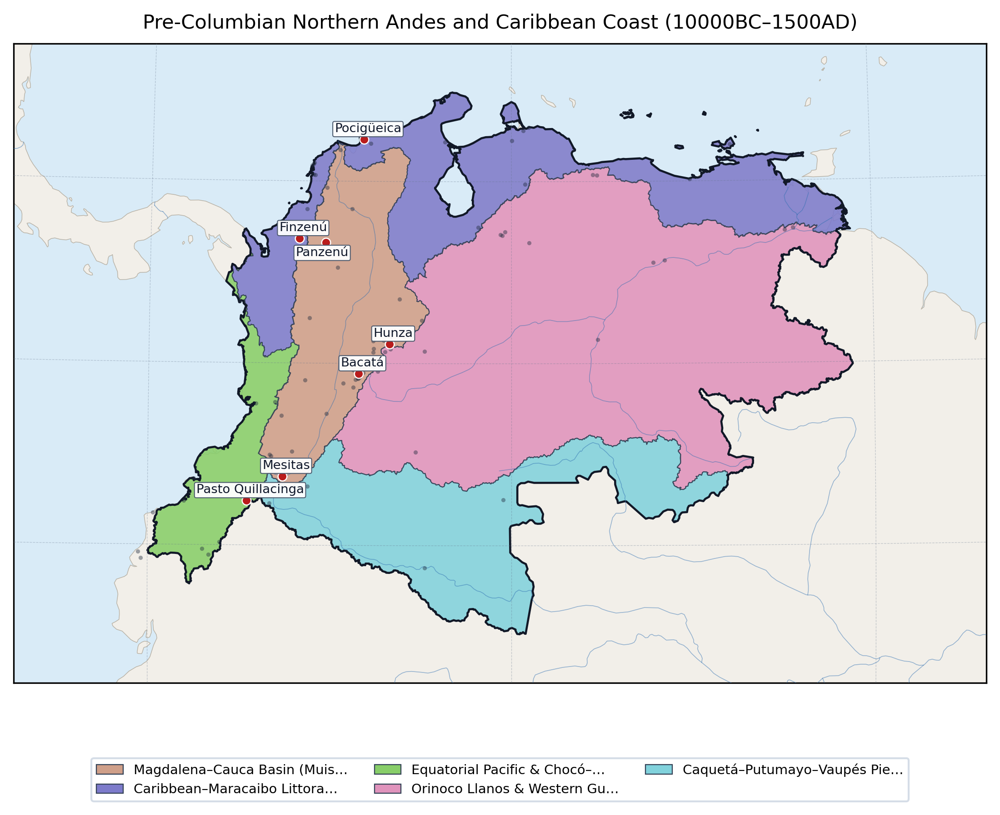

```{r setup, include=FALSE}
knitr::opts_chunk$set(echo = FALSE, warning = FALSE, message = FALSE, fig.pos = "htbp")
source("../../_shared/template/viscount_rmd_helpers.R")
library(jsonlite)

summary_data <- fromJSON("pre_columbian_northern_andes_summary.json", simplifyVector = FALSE)
sett_data <- fromJSON("pre_columbian_northern_andes_settlements.json", simplifyVector = FALSE)

clean_label <- function(x) {
  s <- as.character(x)
  s <- gsub("&", "and", s, fixed = TRUE)
  s <- gsub("–", "-", s, fixed = TRUE)
  s <- gsub("\\\\", "", s)
  s
}

fmt_era <- function(y) {
  yi <- as.integer(y)
  if (yi < 0L) return(paste0(abs(yi), "BC"))
  if (yi == 0L) return("0")
  paste0(yi, "AD")
}

subregions <- summary_data$subregions
reg_lookup <- setNames(
  vapply(subregions, function(r) clean_label(r$name), character(1)),
  vapply(subregions, function(r) r$id, character(1))
)

tot_m10000 <- as.numeric(summary_data$domain_totals[["-10000"]])
tot_m5000 <- as.numeric(summary_data$domain_totals[["-5000"]])
tot_m2000 <- as.numeric(summary_data$domain_totals[["-2000"]])
tot_m1000 <- as.numeric(summary_data$domain_totals[["-1000"]])
tot_0 <- as.numeric(summary_data$domain_totals[["0"]])
tot_1000 <- as.numeric(summary_data$domain_totals[["1000"]])
tot_1500 <- as.numeric(summary_data$domain_totals[["1500"]])
tot_area <- as.numeric(summary_data$total_area_km2)
n_sites <- as.integer(summary_data$settlement_count)
```

```{r hero-md-fallback, results='asis'}
if (!knitr::is_latex_output()) {
  cat("\n\n")
}
```

# Abstract

Between the terminal Pleistocene retreat of Andean valley glaciers in 10000BC and the eve of Spanish contact in 1500AD, the human population of the Northern Andes, Caribbean littoral and Orinoco-Amazonian drainage expanded 166,67-fold across five biophysical sub-regions spanning 2.044.303,5 km² (`r viscount_fmt_number(tot_area / 1e6, 2L)`M km²). Aggregate headcounts climbed from 24,9k (`r viscount_fmt_number(tot_m10000, 0L)`) mobile hunter-gatherers in 10000BC to 215,8k in 5000BC, 726,3k in 2000BC and 1,1M (`r viscount_fmt_number(tot_m1000, 0L)`) in 1000BC as early pottery, root-crop horticulture and maize cultivation took root along the Caribbean coast, the Magdalena-Cauca cordilleras and the Orinoco river corridor [@trianavega2019analisis; @doolittle1983parmana; @gasson2002orinoquia]. By year 0, regional totals reached 1,74M (`r viscount_fmt_number(tot_0, 0L)`), rising further through 3,38M in 1000AD to 4,15M (`r viscount_fmt_number(tot_1500, 0L)`) in 1500AD, an overall mean density of 2,03 inhabitants per km² across modern Colombia, Venezuela and northern Ecuador [@drennan2008chiefdoms; @redmond1999regional; @ugalde2017sociedades]. Late pre-Columbian settlement concentrated overwhelmingly in highland basins and fertile coastal valleys: in 1500AD, the Magdalena-Cauca Basin held 1,55M inhabitants (37,3% of the domain, 5,72 per km²), the Caribbean-Maracaibo Littoral 950k (22,9%, 2,7 per km²) and Equatorial Pacific and Chocó-Esmeraldas 780k (18,8%, 5,89 per km²), whereas the vast savannas and forests of the Orinoco Llanos (520k, 0,56 per km²) and the Caquetá-Putumayo-Vaupés Piedmont (350k, 0,98 per km²) remained far more sparsely peopled [@spencer1992prehispanic; @rostain2016islands]. Calibrated against radiocarbon sequences, regional survey archives and a gazetteer of `r viscount_fmt_number(n_sites, 0L)` catalogued archaeological sites, peak settlement sizes follow a continuous power-law rank-size distribution ($\alpha = 0,47$, $R^2 = 0,99$) led by the Muisca capitals of Bacatá (31,5k), Hunza (23,4k) and Sugamuxi (17,8k), the San Jorge hydraulic centre of Finzenú (12,8k at 800AD) and the Sierra Nevada town of Pocigüeica (11,7k).

# Background

## Early Holocene Foragers and Ceramic Pioneers (10000BC to 2000BC)

Human occupation across the Northern Andes and Caribbean lowlands opened at the close of the Late Glacial with small, mobile foraging bands tracking retreating páramo snowlines, coastal estuaries and savanna gallery forests. On the high Sabana de Bogotá (2.550 m above sea level), deeply stratified rock shelters at El Abra and Tequendama record continuous occupation from 10000BC and 9000BC onward, while open-air camp sequences at Checua and Aguazuque trace a gradual shift from Pleistocene hunting of white-tailed deer and small mammals toward broader plant gathering, curí (*Cavia*) management and delayed-return residential stability between 7000BC and 1000BC [@trianavega2019analisis]. Stable carbon and nitrogen isotope measurements on human bone from Tequendama and Aguazuque confirm a predominantly C3 highland diet anchored by tubers, forest fruits and deer protein prior to intensive late-Holocene maize adoption [@trianavega2019analisis]. Along the eastern slope of the Cordillera Oriental, the Sueva rock shelter (8000BC to 2000BC) and the upper Popayán valley site of La Elvira (9000BC to 2000BC) demonstrate parallel upland mobility across inter-Andean passes.

Further south, early lithic industries in highland Ecuador document specialised obsidian and basalt procurement around the Quito basin by 9500BC to 7000BC. Classic fluted-stem projectile points at El Inga and adjacent Pichincha workshops such as Oroloma illustrate how small bands of 25 to 50 foragers exploited overlapping ecological tiers between sub-páramo grasslands and temperate inter-Andean valleys [@serranoayala2017industria]. Similar foraging horizons existed along the Pacific Calima valley at Sauzalito (8500BC to 1000BC) and across the arid Falcón littoral of northwestern Venezuela, where El Jobo and Taima-Taima preserve late-Pleistocene and early-Holocene hunting stations near coastal springs. In the eastern Orinoco Llanos, palaeoecological cores from *Mauritia* palm swamps show that warmer, wetter early-Holocene conditions expanded gallery forests and seasonal wetland mosaics after 9000BC, creating predictable dry-season foraging corridors along major tributaries [@leal2011contribution].

Between 5000BC and 2000BC, the lower Magdalena littoral and Sinú delta witnessed an early ceramic transition. Shellfish gatherers at San Jacinto 1 (5000BC to 3000BC) and Puerto Hormiga (4000BC to 2000BC) made fibre-tempered pottery for wild grass seeds, palm fruits and molluscs long before permanent maize villages [@oyuelacaycedo1998ideology]. Subsequent shell-midden settlements at Monsú (3300BC to 1200BC), Canapote and Barlovento around Cartagena, alongside fishers at Punta Gorda on Cubagua and Margarita (from 2000BC), lifted Caribbean densities above the savanna floor as domain totals grew from 24,9k in 10000BC to 215,8k in 5000BC and 726,3k in 2000BC.

## Formative Villages, Hydraulic Plains and Chiefdom Emergence (2000BC to 800AD)

During the last two millennia BC and the first eight centuries AD, the Northern Andes and Orinoco basin crossed the demographic threshold from mobile horticulture to sedentary village farming and stratified chiefdoms. Along the Middle Orinoco at Parmana and Ronquín, archaeological sequences track the transition from Saladoid manioc cultivators (1000BC to 200AD) to denser Corozal and Arauquinoid populations after 400AD, when high-yield maize varieties supplemented bitter manioc and river-turtle harvesting along fertile floodplain levees [@doolittle1983parmana; @gasson2002orinoquia]. Downstream near the Orinoco apex, Barrancas grew from a modest Formative riverbank village in 1000BC into a major ceramic craft and ceremonial hub supporting more than 4k inhabitants by the late pre-Columbian period [@gasson2002orinoquia]. In the western Venezuelan Llanos of Barinas, full-coverage survey around El Gaván, La Betania and Caño Ventosidad reveals the rapid rise between 300AD and 900AD of regional polities anchored by monumental earthworks, drained agricultural fields and raised earthen causeways (*calzadas*) linking primary centres to satellite hamlets [@spencer1992prehispanic].

Parallel hydraulic intensification transformed the seasonally flooded San Jorge depression of northern Colombia. Beginning around 200BC at Finzenú and year 0 at Panzenú, Zenú communities constructed an interlocking network of over 500.000 hectares of artificial drainage canals and raised planting ridges (*camellones*) that regulated annual floodwaters, trapped nutrient-rich silt and sustained dense fishing and root-crop settlements [@rostain2016islands]. Finzenú peaked around 800AD at an estimated 12,8k inhabitants and Panzenú around 900AD at 9,9k, before shifting hydrology and soil exhaustion reduced their core populations over the subsequent six centuries. On the lower Magdalena, Malambo (1000BC to 1200AD) and Momil (800BC to 500AD) bridged coastal shellfishing and interior manioc-maize agriculture.

Along the equatorial Pacific coast and southwestern highlands, dense maritime and valley chiefdoms flourished earlier than on the Bogotá plateau. The ceremonial and metallurgical island-port of La Tolita and its Colombian counterpart El Morro at Tumaco rose after 600BC, reaching peak scale between 100AD and 300AD (6,8k at La Tolita and 3,7k at El Morro) as specialist goldsmiths, potters and sea traders linked mangrove estuaries to Andean obsidian routes [@patinoc2017tumaco]. Further south in coastal Manabí, regional survey in the Jama valley documents continuous village expansion at San Isidro (1500BC to 1100AD) and Jama (400BC to 1400AD), interrupted briefly by volcanic tephra falls [@patinoc2017tumaco]. In the highlands of southwestern Colombia, the San Agustín and Alto Magdalena chiefdoms built monumental funerary mounds and stone-lined sanctuaries at Mesitas (peak 7,9k around 800AD) and Alto de los Ídolos (peak 4,5k around 800AD), while neighbouring Valle de la Plata and Tierradentro polities developed dispersed farmstead clusters tied to elite ritual centres [@drennan2008chiefdoms; @franco2019tierradentro; @langebaekrueda2010diarios]. In the middle Cauca and Calima valleys, Malagana flourished between 200BC and 400AD on drained floodplain ridges before giving way to later Sonso and Quimbaya settlements around Armenia and the Aburrá valley [@drennan2008chiefdoms].

## Late Chiefdom Consolidation and Regional Exchange (800AD to 1500AD)

The final seven centuries before European arrival witnessed the sharpest demographic concentration in the region's pre-Columbian history, lifting total headcount from 3,03M in 800AD to 4,15M in 1500AD. On the high intermontane basins of Cundinamarca and Boyacá, Late Muisca societies (1000AD to 1500AD) consolidated into ranked confederations headed by the Zipa at Bacatá (31,5k) and the Zaque at Hunza (23,4k), flanked by major ritual and political centres at Sugamuxi (17,8k), Chía (11,4k), Duitama (10,9k), Zipaquirá (9,7k), Fontibón (8,9k) and Guatavita (8,4k) [@redmond1999regional; @pratt2024muerte]. Rather than nucleating purely for defence, Muisca settlements combined concentrated elite compounds (*cercados*), such as the Cercado Grande de los Santuarios in Tunja, with micro-vertical farmsteads distributed across cold páramo potato belts, temperate maize terraces and warm-slope cotton and coca plots in valleys such as Tena, Fúquene, Susa and Leyva [@arguellogarcia2016arqueologia; @henderson2005muisca; @redmond1999regional]. Across the seasonally waterlogged plains of the Sabana de Bogotá, extensive *camellones* raised fields buffered frosts and regulated floodwaters to feed this dense highland population [@rodriguezgallo2018camellones].

In the Sierra Nevada de Santa Marta, the Tairona engineered stone-paved stairways, retaining terraces, drainage channels and circular house foundations across steep mountain ridges between 900AD and 1500AD. Coastal and piedmont capitals at Pocigüeica (11,7k), Bonda (9,2k), Chairama (4,7k), Gaira (4,4k), Teyuna (3,8k at 1400AD) and Chengue (2,9k) integrated marine fish, lowland maize and upland tubers under hereditary priesthoods and chiefly lineages [@oyuelacaycedo1998ideology]. Elsewhere in the Magdalena-Cauca corridor, Guane settlements around Mesa de los Santos (6,6k), Lache communities at Chita (4,2k), Panche towns at Tocaima (5,4k) and Tolima-Pijao settlements at Natagaima (4,9k) and Alto de Toche occupied strategic river terraces and ridgelines [@velandiasilva2026distribucion; @s2026ecological].

Across the northern Ecuadorian sierra, Caranqui and Cayambe chiefdoms constructed massive truncated earthen pyramids (*tolas*) and irrigated hillside terraces around Caranqui and La Chimba before facing Inca imperial conquest in the final decades before 1500AD [@ugalde2017sociedades; @bray2014final; @lozanocastro2022san], while Pasto and Quillacinga communities densified along the high Nariño plateau (8,6k at Pasto). Along the Venezuelan Caribbean littoral and Lake Valencia basin, Caquetío chiefdoms at Todariquiba (7,7k), Quíbor Guadalupe (5,2k) and Los Tamarindos (6,8k) supported dense lakeside and coastal trade networks alongside Mucuchíes terraced villages in the Mérida Andes (5k) [@gasson2002orinoquia]. Even along the Middle Orinoco rapids of Atures (2,3k) and the Amazonian piedmont of Araracuara (2,5k at 1300AD), Mocoa (3,1k) and the Upano valley, anthropogenic dark earths (*terras pretas*) and long-distance bead, stamp and ceramic networks linked lowland riverine societies to the Andean foothills [@lozadamendieta2023beads; @velascoalban2021suelos; @mosquera2026combustion].

# Methodology

## Five Biophysical Sub-Regions

To avoid projecting modern post-colonial state boundaries onto pre-Columbian polities, QUIPU partitions the study domain into five contiguous biophysical drainage and ecological zones totalling 2.044.303,5 km² across Colombia, Venezuela and northern Ecuador:

1. Magdalena-Cauca Basin (Muisca, Quimbaya and Tolima): 271.179,8 km² encompassing the Cordilleras Oriental, Central and Occidental, the Sabana de Bogotá, Boyacá plateaus, middle Cauca-Quindío coffee belt and upper Magdalena valleys of San Agustín and Tierradentro.
2. Caribbean-Maracaibo Littoral (Tairona, Sinú and Caquetío): 351.367,6 km² spanning the lower Sinú and San Jorge alluvial plains, Sierra Nevada de Santa Marta, Guajira peninsula, Lake Maracaibo basin, Falcón-Lara coast, Mérida Andes and Venezuelan Caribbean islands from Margarita to Cubagua.
3. Equatorial Pacific and Chocó-Esmeraldas (Valdivia, Tumaco and Manteño): 132.374,7 km² covering the Pacific wet-forest littoral from Darién and Chocó through Tumaco-La Tolita and Manabí together with the northern Ecuadorian sierra of Pichincha, Imbabura and Nariño.
4. Orinoco Llanos and Western Guayana Drainage: 931.617,2 km² embracing the Meta, Casanare, Apure and Barinas seasonal savannas, the Lake Valencia interior basin and the Middle-Lower Orinoco river corridor to the Guayana shield margin.
5. Caquetá-Putumayo-Vaupés Piedmont: 357.764,3 km² covering the eastern Andean piedmont and northwestern Amazonian blackwater and whitewater catchments from Mocoa and Florencia to Araracuara and Mitú.

This division keeps high-density intermontane basins and maritime littorals distinct from expansive tropical savannas and lowland rainforests, ensuring that demographic densities reflect real ecological carrying capacity rather than administrative distortion.

## Radiocarbon Calibration, Carrying Capacity and Benchmark Interpolation

Because pre-Columbian societies outside Mesoamerica and the Inca administrative *khipu* sphere left no written census rolls, regional headcounts $P_r(t)$ across the 21 benchmark years $t \in [-10000, 1500]$ are derived by combining calibrated radiocarbon site-frequency curves, regional archaeological settlement-survey densities and ethnographic carrying-capacity envelopes [@drennan2008chiefdoms; @redmond1999regional; @spencer1992prehispanic]. For each sub-region $r$ of area $A_r$, regional population is linked to mean ecological density $d_r(t)$ by:

$$P_r(t) = A_r \cdot d_r(t)$$

where $d_r(t)$ increases smoothly from foraging floors of 0,003 to 0,034 inhabitants per km² in 10000BC to late pre-Columbian agricultural densities ranging from 0,56 per km² on the Orinoco Llanos up to 5,72 per km² in the Magdalena-Cauca Basin and 5,89 per km² in the Equatorial Pacific corridor by 1500AD. Longitudinal growth between any two benchmarks $t_1$ and $t_2$ is measured via compound annual growth:

$$g_r(t_1, t_2) = \left(\frac{P_r(t_2)}{P_r(t_1)}\right)^{\frac{1}{t_2 - t_1}} - 1$$

Regional uncertainty envelopes narrow as radiocarbon and survey density improve toward European contact: $\pm 35\%$ from 10000BC to 2000BC, and $\pm 28\%$ from 1000BC to 1500AD. In the current baseline series, sub-regional totals preserve constant proportional shares across benchmarks (37,3% Magdalena-Cauca, 22,9% Caribbean-Maracaibo, 18,8% Equatorial Pacific, 12,5% Orinoco Llanos and 8,4% Caquetá-Putumayo-Vaupés Piedmont), while differential local peaks and contractions are captured directly in the individual trajectories of the 95 catalogued habitation sites.

## Gazetteer Assembly and Provenance Ledger

Alongside the macro-regional benchmark series, QUIPU compiles a spatially referenced gazetteer of `r viscount_fmt_number(n_sites, 0L)` archaeological habitation locales verified inside the regional areal mask across Colombia (68), Venezuela (20) and northern Ecuador (7). Four sequential ingestion and verification waves processed 59.485 institutional and monograph records across four exhausted corpora: 16.418 entries from the ICANH *Atlas Arqueológico* of Colombia, 41.236 entries from the Comparative Archaeology Database (CADB) surveys of Muisca, Tairona and Alto Magdalena, 591 Venezuelan and Orinoquia radiocarbon syntheses and 1.240 northern Ecuadorian CADB records. Wave 1 contributed 60 primary settlement-survey locales, Wave 2 added 23 national heritage register entries, Wave 3 backfilled 11 longitudinal radiocarbon sites and Wave 4 added 1 final sub-regional continuity site (1,06% marginal gain, 0 excluded duplicates, 0% crowd-sourced entries).

# Testing and Validation

## Cross-Checks Against Regional Archaeological Surveys

To verify that macro-regional headcounts remain consistent with primary field archaeology, our 1500AD totals and densities were checked against full-coverage pedestrian survey estimates across four anchor zones. In the Muisca highlands, regional surveys of the Fúquene, Susa, Valle de Leyva and Tena basins document rural-to-chiefly densities exceeding 15 to 40 inhabitants per km² on prime agricultural terraces, tapering sharply on cold páramos and steep escarpments [@redmond1999regional; @henderson2005muisca; @arguellogarcia2016arqueologia]. Averaging across the full 271.179,8 km² Magdalena-Cauca sub-region, including rugged canyon walls and uncultivated peaks, yields 5,72 inhabitants per km² (1,55M total), matching Drennan's comparative synthesis of southwestern Colombian chiefdoms where peak local districts of 10 to 30 per km² sit within broader regional averages of 4 to 8 per km² [@drennan2008chiefdoms].

In the Orinoco Llanos and Guayana drainage (931.617,2 km²), Spencer and Redmond's Barinas surveys around El Gaván and La Betania reconstruct dense chiefdom pockets of 5 to 12 per km² on alluvial levees separated by vast seasonally inundated grasslands [@spencer1992prehispanic]. Similarly, Doolittle and Roosevelt's carrying-capacity calculations for Parmana show that floodplain maize-manioc horticulture supported high riverbank densities alongside sparsely used interfluves [@doolittle1983parmana; @gasson2002orinoquia]. The sub-regional mean of 0,56 inhabitants per km² (520k across nearly 932k km²) reconciles dense riverine nodes with low interfluve capacity. In the Equatorial Pacific and northern Ecuadorian highlands, the 1500AD mean of 5,89 inhabitants per km² (780k across 132.374,7 km²) aligns with concentrated Caranqui-Cayambe terraced valleys and coastal Jama-Tumaco chiefdoms [@ugalde2017sociedades; @patinoc2017tumaco], while the 0,98 per km² figure (350k across 357.764,3 km²) for the Caquetá-Putumayo-Vaupés Piedmont reflects localised dark-earth riverine hubs such as Araracuara and Mocoa amidst extensive tropical forest [@velascoalban2021suelos; @mosquera2026combustion; @rostain2016islands]. Furthermore, Anderson and colleagues' radiocarbon reassessment of the Galápagos Islands confirms the absence of permanent pre-Columbian occupation offshore, justifying the strict coastal boundary of the Pacific sub-region [@anderson2016reconsidering].

## Sub-Regional Benchmark Ledger

Table \ref{tab:subregion-benchmarks} presents the territorial benchmark ledger across all five sub-regions, reporting land area, selected benchmark populations from 10000BC to 1500AD, closing 1500AD density and catalogued site counts.

```{r tab-subregion-benchmarks, results='asis'}
rows <- lapply(subregions, function(r) {
  a <- as.numeric(r$area_km2)
  p1 <- as.numeric(r$population[["-10000"]])
  p2 <- as.numeric(r$population[["-5000"]])
  p3 <- as.numeric(r$population[["-1000"]])
  p4 <- as.numeric(r$population[["0"]])
  p5 <- as.numeric(r$population[["1000"]])
  p6 <- as.numeric(r$population[["1500"]])
  d6 <- if (a > 0) p6 / a else 0
  sc <- summary_data$settlements_by_region[[r$id]]
  sc_val <- if (is.null(sc)) 0L else as.integer(sc)
  data.frame(
    Subregion = clean_label(r$name),
    Area = viscount_fmt_number(round(a), 0L),
    P10000 = viscount_fmt_pop(p1),
    P5000 = viscount_fmt_pop(p2),
    P1000 = viscount_fmt_pop(p3),
    P0 = viscount_fmt_pop(p4),
    P1000AD = viscount_fmt_pop(p5),
    P1500AD = viscount_fmt_pop(p6),
    Dens1500 = viscount_fmt_number(d6, 2L),
    stringsAsFactors = FALSE
  )
})
df_bench <- do.call(rbind, rows)
df_tot <- data.frame(
  Subregion = "Domain Total (All 5 Regions)",
  Area = viscount_fmt_number(round(tot_area), 0L),
  P10000 = viscount_fmt_pop(tot_m10000),
  P5000 = viscount_fmt_pop(tot_m5000),
  P1000 = viscount_fmt_pop(tot_m1000),
  P0 = viscount_fmt_pop(tot_0),
  P1000AD = viscount_fmt_pop(tot_1000),
  P1500AD = viscount_fmt_pop(tot_1500),
  Dens1500 = viscount_fmt_number(tot_1500 / tot_area, 2L),
  stringsAsFactors = FALSE
)
df_bench <- rbind(df_bench, df_tot)
rownames(df_bench) <- NULL

viscount_table(
  df_bench,
  "Population headcounts and 1500AD densities (inhabitants per km²) across five sub-regions, 10000BC to 1500AD.",
  c("Sub-Region", "Area (km²)", "10000BC", "5000BC", "1000BC", "Year 0", "1000AD", "1500AD", "1500AD Dens."),
  list(label = "tab:subregion-benchmarks", font_size = "scriptsize")
)
```

# Results

## Long-Term Demographic Trajectory (10000BC to 1500AD)

Across the 11.500 years covered by this chapter, population grew monotonically from 24,9k in 10000BC to 4,15M in 1500AD, averaging 0,045% per annum over the entire span (Figure \ref{fig:trajectory}). Growth was far from uniform across millennia. During the pre-ceramic and initial pottery millennia from 10000BC to 5000BC, aggregate population rose from 24,9k to 215,8k (0,043% per annum, doubling roughly every 1.600 years). Between 5000BC and 1000BC, as formative maize and manioc farming consolidated in inter-Andean valleys, Caribbean lagoons and the Orinoco levees, total population quintupled from 215,8k to 1,1M (0,041% per annum), passing the half-million mark shortly before 2500BC and reaching 1,74M at year 0.

```{r fig-trajectory, results='asis'}
viscount_figure(
  "figures/pre_columbian_northern_andes_population_trajectory.png",
  "Aggregate demographic trajectory across five sub-regions from 10000BC to 1500AD (Panel A) and sub-regional population density rankings in 1500AD (Panel B).",
  "fig:trajectory",
  list(max_height = "0.38\\textheight")
)
```

The fastest sustained expansion occurred during the first millennium AD, when population doubled from 1,74M at year 0 to 3,38M in 1000AD (0,066% per annum). That surge corresponds directly to the simultaneous florescence of hydraulic raised-field agriculture in the San Jorge and Sabana de Bogotá basins, Tumaco-La Tolita coastal exchange, San Agustín monumental polities and Barinas causeway chiefdoms [@drennan2008chiefdoms; @spencer1992prehispanic; @rostain2016islands]. Between 1000AD and 1500AD, aggregate growth moderated to 0,041% per annum (adding 767,8k inhabitants to reach 4,15M), as highland Muisca, Tairona and Caranqui confederations approached local terrace and wetland carrying limits while older lowland hydraulic complexes such as Finzenú and La Tolita contracted [@redmond1999regional; @oyuelacaycedo1998ideology; @ugalde2017sociedades].

## Magdalena-Cauca Basin (Muisca, Quimbaya and Tolima)

The Magdalena-Cauca Basin (271.179,8 km²) forms the demographic core of the Northern Andes, rising from 9,3k inhabitants in 10000BC (0,034 per km²) to 178,3k in 3000BC, 651k at year 0 and 1,55M in 1500AD (5,72 inhabitants per km², 37,3% of the domain total). It contributes 41 of the 95 catalogued sites (43,2%), spanning a chronological arc from late-Pleistocene Sabana de Bogotá rock shelters at El Abra (260 peak inhabitants around 2000BC), Tequendama (340 around 1000BC), Aguazuque (410 around 1000BC) and Checua (142 around 2500BC) to the dense Late Muisca capitals [@trianavega2019analisis].

At 1500AD, the basin's upper urban tier was dominated by Muisca confederation seats across the Cundiboyacense plateau: Bacatá (31,5k), Hunza (23,4k), Sugamuxi (17,8k), Chía (11,4k), Duitama (10,9k), Zipaquirá (9,7k), Fontibón (8,9k), Guatavita (8,4k), Ubaté (7,8k), Soacha (7,2k), Suba (6,8k), Facatativá (6,5k), Bosa (6,4k), Paipa (6,2k), Fúquene (6,1k) and Chocontá (5,9k) [@pratt2024muerte; @redmond1999regional; @rodriguezgallo2018camellones]. Outside the Muisca core, substantial regional centres anchored the upper and middle valleys: Armenia Quimbaya (7,4k), Aburrá (6,9k), Pubenza (6,9k), Mesa de los Santos in Guane territory (6,6k), Mompox Malibú (5,7k), Tocaima (5,4k), Natagaima (4,9k) and Chita (4,2k) [@velandiasilva2026distribucion; @s2026ecological]. Earlier in the sequence, hydraulic and funerary centres in the upper Magdalena and Cauca peaked centuries prior to 1500AD, notably Panzenú at 9,9k in 900AD, Mesitas at 7,9k in 800AD, Malagana at 4,9k in 200AD, Alto de los Ídolos at 4,5k in 800AD and Segovia at 3,9k in 1000AD [@drennan2008chiefdoms; @franco2019tierradentro].

## Caribbean-Maracaibo Littoral (Tairona, Sinú and Caquetío)

Stretching from the Gulf of Urabá to Trinidad and the Paria peninsula, the Caribbean-Maracaibo Littoral (351.367,6 km²) climbed from 5,7k in 10000BC to 166,3k in 2000BC, 399k at year 0 and 950k in 1500AD (2,7 inhabitants per km², 22,9% of the domain). Twenty-three catalogued sites document both the hemisphere's earliest ceramic shellfish camps at Puerto Hormiga (165 inhabitants around 3000BC), Monsú (265 around 1200BC), Canapote (238 around 500BC) and Barlovento (192 around 1000BC), and complex late-period coastal and mountain polities.

Two clusters stand out in the gazetteer. First, the Sinú-San Jorge hydraulic complex centred at Finzenú (8.416N, -75.882W) grew from 2,1k in 200BC to a peak of 12,8k in 800AD before receding to 6,3k by 1500AD [@rostain2016islands]. Second, the Tairona massif of the Sierra Nevada de Santa Marta experienced rapid late-pre-Columbian nucleation after 900AD, led by Pocigüeica (11,7k), Bonda (9,2k), Chairama (4,7k), Gaira (4,4k), Teyuna (3,8k at 1400AD) and Chengue (2,9k) [@oyuelacaycedo1998ideology]. Along the Venezuelan littoral and western cordillera, Caquetío and Andean polities sustained substantial towns at Todariquiba (7,7k), Quíbor Guadalupe (5,2k), Mucuchíes (5k), Cumanagoto Píritu (4,5k), Barrancas (4,3k), Añú Sinamaica (3,9k) and Guaiquerí Margarita (2,8k), alongside Calamarí (4,8k) on Cartagena Bay [@gasson2002orinoquia].

## Equatorial Pacific and Chocó-Esmeraldas

Although the smallest of the five sub-regions at 132.374,7 km², Equatorial Pacific and Chocó-Esmeraldas achieved the highest overall density in 1500AD at 5,89 inhabitants per km², rising from 4,7k in 10000BC to 136,5k in 2000BC, 327,6k at year 0 and 780k in 1500AD (18,8% of the domain). Its 12 catalogued locales span nearly twelve millennia, from the obsidian camp of El Inga (49 inhabitants around 7000BC) and early Calima rock shelters at Sauzalito (195 around 1000BC) to Formative highland villages at Cotocollao (790 around 500BC) and La Chimba (685 around 400AD) [@serranoayala2017industria].

Coastal Ecuador and Nariño generated early urban density during the Regional Developmental period (300BC to 600AD), exemplified by La Tolita (peak 6,8k at 300AD), San Isidro in Manabí (peak 3,7k at 300AD) and El Morro Tumaco (peak 3,7k at 100AD) [@patinoc2017tumaco]. Following the decline of Tumaco-La Tolita after 700AD, demographic gravity shifted toward late-period Manteño, Atacames, Caranqui and Pasto-Quillacinga centres: Pasto Quillacinga reached 8,6k by 1500AD, Atacames 5,6k, Jama 4,9k (1400AD), Buenaventura Calima Coast 2,8k and Cupica on the Chocó littoral 2,2k [@reicheldolmatoff1961investigaciones; @ugalde2017sociedades; @lozanocastro2022san].

## Orinoco Llanos and Caquetá-Putumayo-Vaupés Piedmont

Together, the Orinoco Llanos and Western Guayana Drainage (931.617,2 km²) and the Caquetá-Putumayo-Vaupés Piedmont (357.764,3 km²) encompass 63,1% of the chapter's land area yet held just 21% of its population in 1500AD. The Orinoco Llanos grew from 3,1k in 10000BC to 218,4k at year 0 and 520k in 1500AD (0,56 inhabitants per km²), tracked across 15 catalogued locales. Here, demographic density concentrated sharply along two niches: the fertile Lake Valencia basin, led by Los Tamarindos (6,8k in 1500AD) and La Mata (930 in 1400AD), and eastern Andean piedmont/riverine corridors including Ramiriquí (5,8k), Turmequé (5,5k), Parmana (4,1k), Casanare Achagua (3,4k), Atures (2,3k), El Cedral (2,2k at 800AD), Saladero (2k at 800AD), El Gaván (1,6k at 900AD) and La Betania (1,4k at 900AD) [@gasson2002orinoquia; @spencer1992prehispanic; @doolittle1983parmana; @lozadamendieta2023beads].

South of the Guaviare-Orinoco divide, the Caquetá-Putumayo-Vaupés Piedmont grew from 2,1k in 10000BC to 147k at year 0 and 350k in 1500AD (0,98 inhabitants per km²). Its four primary archaeological anchors record multi-millennium riverine persistence: Araracuara (7000BC to 1500AD, peaking at 2,5k in 1300AD on anthropogenic dark-earth terraces), Mocoa Piedmont (3,1k in 1500AD), Caguán Florencia (2,4k) and Vaupés Mitú (1,9k), paralleling late anthropogenic soil complexes excavated further south in the Upano valley [@velascoalban2021suelos; @mosquera2026combustion].

## Settlement Hierarchy and Rank-Size Structure

Figure \ref{fig:hierarchy} displays the upper rank order and log-log rank-size profile across all `r viscount_fmt_number(n_sites, 0L)` catalogued sites. Peak settlement sizes span nearly three orders of magnitude, from 49 inhabitants at El Inga and 51 at El Jobo Falcón up to 31,5k at Bacatá, with a median peak size of 4,5k across the gazetteer. Above 4k (ranks 1 to 50), the distribution adheres tightly to a shallow pre-industrial chiefdom power law ($\alpha = 0,47$, $R^2 = 0,99$), flatter than classic Zipfian state hierarchies ($\alpha \approx 1$) because political confederations across the Muisca, Tairona and Zenú worlds remained polycentric rather than consolidated under a single primate imperial capital [@redmond1999regional; @henderson2005muisca; @oyuelacaycedo1998ideology]. Below rank 55, the curve drops steeply through small Formative hamlets (150 to 900 inhabitants) and early Holocene rock shelters (49 to 410 inhabitants).

```{r fig-hierarchy, results='asis'}
viscount_figure(
  "figures/pre_columbian_northern_andes_urban_hierarchy.png",
  "Largest recorded settlements (Panel A) and rank-size power-law distribution across 95 catalogued sites showing a shallow pre-state exponent ($\\alpha = 0,47$, $R^2 = 0,99$, Panel B).",
  "fig:hierarchy",
  list(max_height = "0.38\\textheight")
)
```

Table \ref{tab:regional-shares} pairs each sub-region's share of total population and chronological density across 10000BC, year 0 and 1500AD with archaeological site recovery intensity per 10.000 km². Site visibility is highest in the Magdalena-Cauca Basin (1,51 sites per 10.000 km²) and Equatorial Pacific (0,91 per 10.000 km²), reflecting decades of intensive highland and coastal survey, compared with 0,16 sites per 10.000 km² across the Orinoco Llanos and 0,11 across the Caquetá-Putumayo-Vaupés Piedmont.

```{r tab-regional-shares, results='asis'}
share_rows <- lapply(subregions, function(r) {
  a <- as.numeric(r$area_km2)
  p1 <- as.numeric(r$population[["-10000"]])
  p2 <- as.numeric(r$population[["0"]])
  p3 <- as.numeric(r$population[["1500"]])
  sh3 <- 100 * p3 / tot_1500
  d1 <- if (a > 0) p1 / a else 0
  d2 <- if (a > 0) p2 / a else 0
  d3 <- if (a > 0) p3 / a else 0
  sc <- summary_data$settlements_by_region[[r$id]]
  sc_val <- if (is.null(sc)) 0L else as.integer(sc)
  site_dens <- if (a > 0) (sc_val / a) * 10000 else 0
  data.frame(
    Subregion = clean_label(r$name),
    Share = paste0(viscount_fmt_number(sh3, 1L), "%"),
    D10000 = viscount_fmt_number(d1, 3L),
    D0 = viscount_fmt_number(d2, 2L),
    D1500 = viscount_fmt_number(d3, 2L),
    Sites = viscount_fmt_number(sc_val, 0L),
    SiteDens = viscount_fmt_number(site_dens, 2L),
    stringsAsFactors = FALSE
  )
})
df_shares <- do.call(rbind, share_rows)
rownames(df_shares) <- NULL

viscount_table(
  df_shares,
  "Sub-regional population shares, chronological densities (inhabitants per km²) and catalogued site recovery intensity (sites per 10.000 km²), 10000BC to 1500AD.",
  c("Sub-Region", "Pop. Share", "10000BC Dens.", "Year 0 Dens.", "1500AD Dens.", "Sites", "Sites per 10k km²"),
  list(label = "tab:regional-shares", font_size = "scriptsize")
)
```

# Limitations

Four constraints govern the precision of these pre-Columbian demographic estimates.

First, because the five sub-regional series maintain fixed proportional shares across all 21 benchmarks, the macro-regional curves smooth over local demographic shifts that are visible in individual archaeological sequences. Examples include the early coastal florescence of Puerto Hormiga, Momil and Tumaco-La Tolita prior to 400AD, the ninth-century peak and subsequent contraction of San Jorge hydraulic settlements and the steep late nucleation of Muisca and Tairona polities after 1000AD [@patinoc2017tumaco; @oyuelacaycedo1998ideology; @redmond1999regional].

Second, archaeological visibility varies starkly by landscape and national survey history. Colombia accounts for 68 of the 95 catalogued sites (71,6%), whereas alluvial burial across the Llanos, dense forest canopy in the Amazonian piedmont and uneven field coverage in parts of Venezuela and northern Ecuador suppress site discovery [@gasson2002orinoquia; @velascoalban2021suelos].

Third, early Holocene rock-shelter and shell-midden populations carry wide radiocarbon and taphonomic uncertainty ($\pm 35\%$ before 2000BC, narrowing to $\pm 28\%$ by 1500AD). Individual site totals represent peak or phase-specific catchment capacity rather than simultaneous walled urban populations [@drennan2008chiefdoms; @henderson2005muisca].

Fourth, this chapter closes in 1500AD on the eve of European contact. The sixteenth-century demographic collapse triggered by Old World epidemics, forced labour and colonial resettlement is analysed separately in the subsequent colonial chapters.

# Conclusion

Over eleven and a half millennia from 10000BC to 1500AD, the Northern Andes, Caribbean coast and Orinoco-Amazonian drainage grew from 24,9k mobile foragers into a complex mosaic of chiefdoms and confederations numbering 4,15M inhabitants. Early ceramic and fishing innovations along the Caribbean littoral, root-crop and maize intensification along the Orinoco and hydraulic earthwork engineering in the San Jorge, Barinas and Bogotá floodplains progressively lifted carrying capacity, culminating in first-millennium AD growth of 0,066% per annum.

By 1500AD, nearly four-fifths of the region's population lived within the Magdalena-Cauca cordilleras (1,55M, 5,72 per km²), the Caribbean-Maracaibo littoral (950k, 2,7 per km²) and the Equatorial Pacific corridor (780k, 5,89 per km²). Anchored by polycentric towns such as Bacatá (31,5k), Hunza (23,4k), Sugamuxi (17,8k) and Pocigüeica (11,7k), these regional populations formed the demographic baseline encountered by Spanish expeditions after 1500AD.

# Appendix

## Exhausted Archaeological Corpora

Table \ref{tab:corpora-exhausted} summarises the four institutional and academic survey corpora processed during the assembly of the 95-site gazetteer, totalling 59.485 evaluated regional records with zero residual crowd-sourced entries.

```{r tab-corpora-exhausted, results='asis'}
corpora_df <- data.frame(
  Corpus = c(
    "ICANH Atlas Arqueológico (Colombia)",
    "CADB Muisca, Tairona and Alto Magdalena",
    "Venezuelan and Orinoquia Radiocarbon Syntheses",
    "CADB Northern Ecuador and Pacific Surveys",
    "Total Evaluated Corpus Records"
  ),
  Tier = c(
    "National institutional archive",
    "Academic monograph corpus",
    "Academic monograph corpus",
    "Academic monograph corpus",
    "All four exhausted corpora"
  ),
  Records = c("16.418", "41.236", "591", "1.240", "59.485"),
  Processed = c("100%", "100%", "100%", "100%", "100%"),
  stringsAsFactors = FALSE
)

viscount_table(
  corpora_df,
  "Institutional and academic corpora evaluated during assembly of the Northern Andes and Orinoco settlement register.",
  c("Corpus", "Source Tier", "Records in Bounds", "Coverage"),
  list(label = "tab:corpora-exhausted", font_size = "scriptsize")
)
```

## National Distribution of Catalogued Sites

Table \ref{tab:country-sites} aggregates the `r viscount_fmt_number(n_sites, 0L)` catalogued pre-Columbian locales by modern national territory, confirming the concentration of primary regional survey records in Colombia (68 sites) alongside Venezuela (20) and northern Ecuador (7).

```{r tab-country-sites, results='asis'}
c_counts <- unlist(summary_data$settlements_by_country)
c_ord <- sort(c_counts, decreasing = TRUE)
c_df <- data.frame(
  Country = names(c_ord),
  Sites = vapply(as.integer(c_ord), function(v) viscount_fmt_number(v, 0L), character(1)),
  Share = vapply(100 * as.integer(c_ord) / n_sites, function(v) paste0(viscount_fmt_number(v, 1L), "%"), character(1)),
  stringsAsFactors = FALSE
)
rownames(c_df) <- NULL

viscount_table(
  c_df,
  "Distribution of 95 catalogued pre-Columbian habitation locales across modern national territories.",
  c("Modern Territory", "Catalogued Sites", "Share of Gazetteer"),
  list(label = "tab:country-sites", font_size = "scriptsize")
)
```

## Full 21-Benchmark Population Trajectory

Table \ref{tab:trajectory-full} lists all 21 benchmark years from 10000BC to 1500AD with the domain headline total, the five sub-regional series and mean domain density in inhabitants per km².

```{r tab-trajectory-full, results='asis'}
yr_keys <- vapply(summary_data$benchmark_years, as.character, character(1))
traj_rows <- lapply(yr_keys, function(yk) {
  tot_v <- as.numeric(summary_data$domain_totals[[yk]])
  r_vals <- vapply(subregions, function(r) as.numeric(r$population[[yk]]), numeric(1))
  data.frame(
    Year = fmt_era(yk),
    Total = viscount_fmt_pop(tot_v),
    Magdalena = viscount_fmt_pop(r_vals[1]),
    Caribbean = viscount_fmt_pop(r_vals[2]),
    Pacific = viscount_fmt_pop(r_vals[3]),
    Orinoco = viscount_fmt_pop(r_vals[4]),
    Piedmont = viscount_fmt_pop(r_vals[5]),
    Dens = viscount_fmt_number(tot_v / tot_area, 2L),
    stringsAsFactors = FALSE
  )
})
df_traj <- do.call(rbind, traj_rows)
rownames(df_traj) <- NULL

viscount_table(
  df_traj,
  "Full 21-benchmark population trajectory across the Northern Andes, Caribbean coast and Orinoco basin, 10000BC to 1500AD.",
  c("Benchmark", "Domain Total", "Magdalena-Cauca", "Caribbean-Maracaibo", "Equatorial Pacific", "Orinoco Llanos", "Piedmont", "Mean Dens."),
  list(label = "tab:trajectory-full", font_size = "scriptsize")
)
```

# Sources

::: {#refs}
:::
