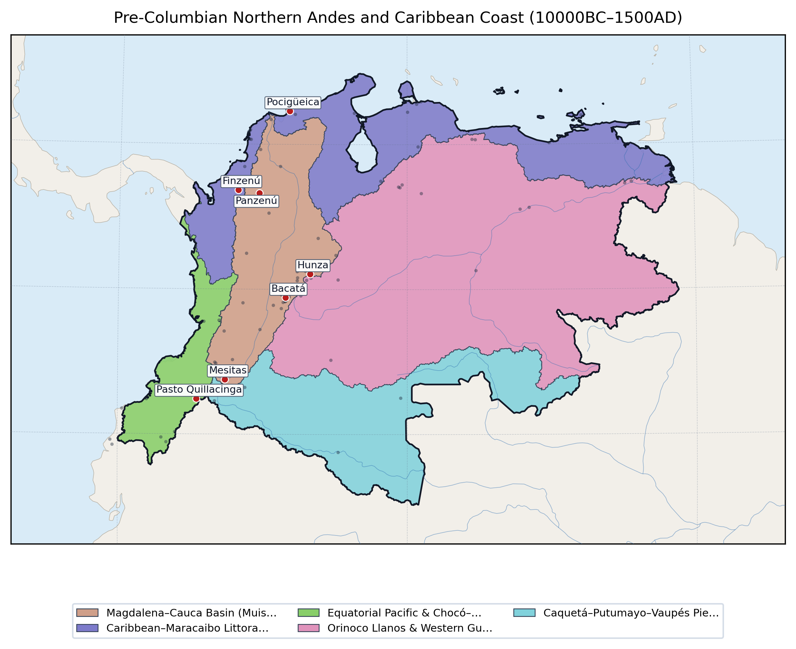
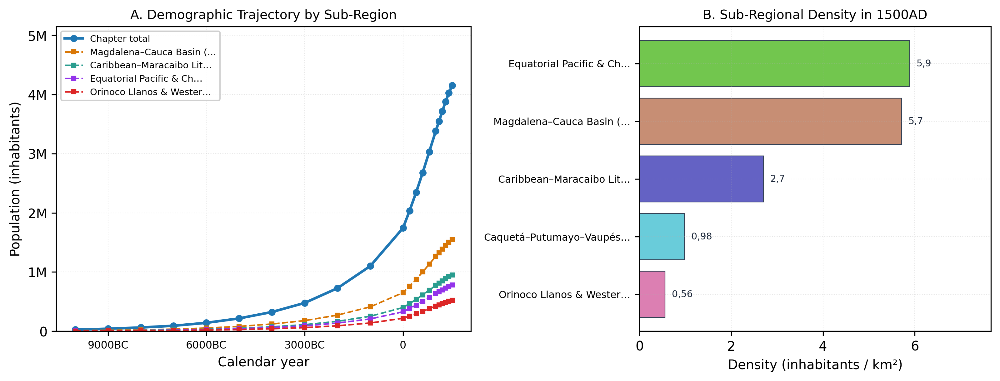
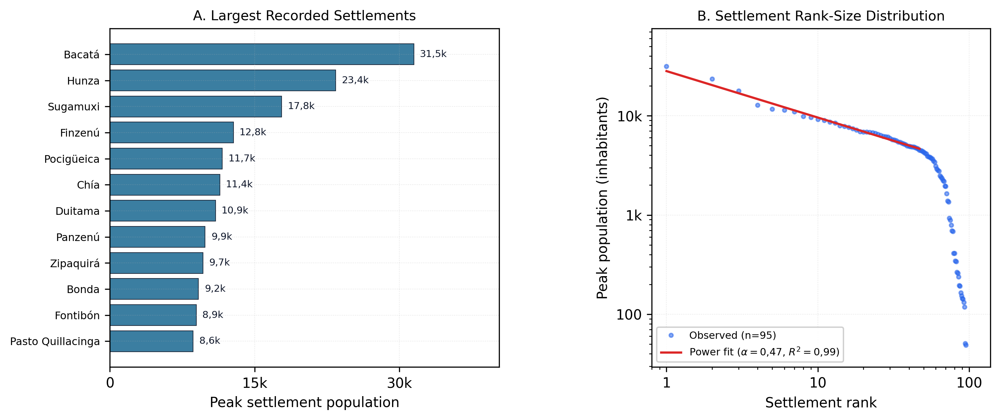

Pre-Columbian Northern Andes and Caribbean Coast
================
Aust Kätzchen
23 November 2026

- [Abstract](#abstract)
- [Background](#background)
  - [Early Holocene Foragers and Ceramic Pioneers (10000BC to
    2000BC)](#early-holocene-foragers-and-ceramic-pioneers-10000bc-to-2000bc)
  - [Formative Villages, Hydraulic Plains and Chiefdom Emergence (2000BC
    to
    800AD)](#formative-villages-hydraulic-plains-and-chiefdom-emergence-2000bc-to-800ad)
  - [Late Chiefdom Consolidation and Regional Exchange (800AD to
    1500AD)](#late-chiefdom-consolidation-and-regional-exchange-800ad-to-1500ad)
- [Methodology](#methodology)
  - [Five Biophysical Sub-Regions](#five-biophysical-sub-regions)
  - [Radiocarbon Calibration, Carrying Capacity and Benchmark
    Interpolation](#radiocarbon-calibration-carrying-capacity-and-benchmark-interpolation)
  - [Gazetteer Assembly and Provenance
    Ledger](#gazetteer-assembly-and-provenance-ledger)
- [Testing and Validation](#testing-and-validation)
  - [Cross-Checks Against Regional Archaeological
    Surveys](#cross-checks-against-regional-archaeological-surveys)
  - [Sub-Regional Benchmark Ledger](#sub-regional-benchmark-ledger)
- [Results](#results)
  - [Long-Term Demographic Trajectory (10000BC to
    1500AD)](#long-term-demographic-trajectory-10000bc-to-1500ad)
  - [Magdalena-Cauca Basin (Muisca, Quimbaya and
    Tolima)](#magdalena-cauca-basin-muisca-quimbaya-and-tolima)
  - [Caribbean-Maracaibo Littoral (Tairona, Sinú and
    Caquetío)](#caribbean-maracaibo-littoral-tairona-sinú-and-caquetío)
  - [Equatorial Pacific and
    Chocó-Esmeraldas](#equatorial-pacific-and-chocó-esmeraldas)
  - [Orinoco Llanos and Caquetá-Putumayo-Vaupés
    Piedmont](#orinoco-llanos-and-caquetá-putumayo-vaupés-piedmont)
  - [Settlement Hierarchy and Rank-Size
    Structure](#settlement-hierarchy-and-rank-size-structure)
- [Limitations](#limitations)
- [Conclusion](#conclusion)
- [Appendix](#appendix)
  - [Exhausted Archaeological
    Corpora](#exhausted-archaeological-corpora)
  - [National Distribution of Catalogued
    Sites](#national-distribution-of-catalogued-sites)
  - [Full 21-Benchmark Population
    Trajectory](#full-21-benchmark-population-trajectory)
- [Sources](#sources)

<figure>

<figcaption aria-hidden="true">Five biophysical sub-regions and 95
catalogued habitation locales across the Northern Andes, Caribbean
littoral and Orinoco basin from 10000BC to 1500AD.</figcaption>
</figure>

# Abstract

Between the terminal Pleistocene retreat of Andean valley glaciers in
10000BC and the eve of Spanish contact in 1500AD, the human population
of the Northern Andes, Caribbean littoral and Orinoco-Amazonian drainage
expanded 166,67-fold across five biophysical sub-regions spanning
2.044.303,5 km² (2,04M km²). Aggregate headcounts climbed from 24,9k
(24.900) mobile hunter-gatherers in 10000BC to 215,8k in 5000BC, 726,3k
in 2000BC and 1,1M (1.099.750) in 1000BC as early pottery, root-crop
horticulture and maize cultivation took root along the Caribbean coast,
the Magdalena-Cauca cordilleras and the Orinoco river corridor
[\[1\]](#ref-trianavega2019analisis)[\[2\]](#ref-doolittle1983parmana)[\[3\]](#ref-gasson2002orinoquia).
By year 0, regional totals reached 1,74M (1.743.000), rising further
through 3,38M in 1000AD to 4,15M (4.150.000) in 1500AD, an overall mean
density of 2,03 inhabitants per km² across modern Colombia, Venezuela
and northern Ecuador
[\[4\]](#ref-drennan2008chiefdoms)[\[5\]](#ref-redmond1999regional)[\[6\]](#ref-ugalde2017sociedades).
Late pre-Columbian settlement concentrated overwhelmingly in highland
basins and fertile coastal valleys: in 1500AD, the Magdalena-Cauca Basin
held 1,55M inhabitants (37,3% of the domain, 5,72 per km²), the
Caribbean-Maracaibo Littoral 950k (22,9%, 2,7 per km²) and Equatorial
Pacific and Chocó-Esmeraldas 780k (18,8%, 5,89 per km²), whereas the
vast savannas and forests of the Orinoco Llanos (520k, 0,56 per km²) and
the Caquetá-Putumayo-Vaupés Piedmont (350k, 0,98 per km²) remained far
more sparsely peopled
[\[7\]](#ref-spencer1992prehispanic)[\[8\]](#ref-rostain2016islands).
Calibrated against radiocarbon sequences, regional survey archives and a
gazetteer of 95 catalogued archaeological sites, peak settlement sizes
follow a continuous power-law rank-size distribution ($\alpha = 0,47$,
$R^2 = 0,99$) led by the Muisca capitals of Bacatá (31,5k), Hunza
(23,4k) and Sugamuxi (17,8k), the San Jorge hydraulic centre of Finzenú
(12,8k at 800AD) and the Sierra Nevada town of Pocigüeica (11,7k).

# Background

## Early Holocene Foragers and Ceramic Pioneers (10000BC to 2000BC)

Human occupation across the Northern Andes and Caribbean lowlands opened
at the close of the Late Glacial with small, mobile foraging bands
tracking retreating páramo snowlines, coastal estuaries and savanna
gallery forests. On the high Sabana de Bogotá (2.550 m above sea level),
deeply stratified rock shelters at El Abra and Tequendama record
continuous occupation from 10000BC and 9000BC onward, while open-air
camp sequences at Checua and Aguazuque trace a gradual shift from
Pleistocene hunting of white-tailed deer and small mammals toward
broader plant gathering, curí (*Cavia*) management and delayed-return
residential stability between 7000BC and 1000BC
[\[1\]](#ref-trianavega2019analisis). Stable carbon and nitrogen isotope
measurements on human bone from Tequendama and Aguazuque confirm a
predominantly C3 highland diet anchored by tubers, forest fruits and
deer protein prior to intensive late-Holocene maize adoption
[\[1\]](#ref-trianavega2019analisis). Along the eastern slope of the
Cordillera Oriental, the Sueva rock shelter (8000BC to 2000BC) and the
upper Popayán valley site of La Elvira (9000BC to 2000BC) demonstrate
parallel upland mobility across inter-Andean passes.

Further south, early lithic industries in highland Ecuador document
specialised obsidian and basalt procurement around the Quito basin by
9500BC to 7000BC. Classic fluted-stem projectile points at El Inga and
adjacent Pichincha workshops such as Oroloma illustrate how small bands
of 25 to 50 foragers exploited overlapping ecological tiers between
sub-páramo grasslands and temperate inter-Andean valleys
[\[9\]](#ref-serranoayala2017industria). Similar foraging horizons
existed along the Pacific Calima valley at Sauzalito (8500BC to 1000BC)
and across the arid Falcón littoral of northwestern Venezuela, where El
Jobo and Taima-Taima preserve late-Pleistocene and early-Holocene
hunting stations near coastal springs. In the eastern Orinoco Llanos,
palaeoecological cores from *Mauritia* palm swamps show that warmer,
wetter early-Holocene conditions expanded gallery forests and seasonal
wetland mosaics after 9000BC, creating predictable dry-season foraging
corridors along major tributaries [\[10\]](#ref-leal2011contribution).

Between 5000BC and 2000BC, the lower Magdalena littoral and Sinú delta
witnessed an early ceramic transition. Shellfish gatherers at San
Jacinto 1 (5000BC to 3000BC) and Puerto Hormiga (4000BC to 2000BC) made
fibre-tempered pottery for wild grass seeds, palm fruits and molluscs
long before permanent maize villages
[\[11\]](#ref-oyuelacaycedo1998ideology). Subsequent shell-midden
settlements at Monsú (3300BC to 1200BC), Canapote and Barlovento around
Cartagena, alongside fishers at Punta Gorda on Cubagua and Margarita
(from 2000BC), lifted Caribbean densities above the savanna floor as
domain totals grew from 24,9k in 10000BC to 215,8k in 5000BC and 726,3k
in 2000BC.

## Formative Villages, Hydraulic Plains and Chiefdom Emergence (2000BC to 800AD)

During the last two millennia BC and the first eight centuries AD, the
Northern Andes and Orinoco basin crossed the demographic threshold from
mobile horticulture to sedentary village farming and stratified
chiefdoms. Along the Middle Orinoco at Parmana and Ronquín,
archaeological sequences track the transition from Saladoid manioc
cultivators (1000BC to 200AD) to denser Corozal and Arauquinoid
populations after 400AD, when high-yield maize varieties supplemented
bitter manioc and river-turtle harvesting along fertile floodplain
levees
[\[2\]](#ref-doolittle1983parmana)[\[3\]](#ref-gasson2002orinoquia).
Downstream near the Orinoco apex, Barrancas grew from a modest Formative
riverbank village in 1000BC into a major ceramic craft and ceremonial
hub supporting more than 4k inhabitants by the late pre-Columbian period
[\[3\]](#ref-gasson2002orinoquia). In the western Venezuelan Llanos of
Barinas, full-coverage survey around El Gaván, La Betania and Caño
Ventosidad reveals the rapid rise between 300AD and 900AD of regional
polities anchored by monumental earthworks, drained agricultural fields
and raised earthen causeways (*calzadas*) linking primary centres to
satellite hamlets [\[7\]](#ref-spencer1992prehispanic).

Parallel hydraulic intensification transformed the seasonally flooded
San Jorge depression of northern Colombia. Beginning around 200BC at
Finzenú and year 0 at Panzenú, Zenú communities constructed an
interlocking network of over 500.000 hectares of artificial drainage
canals and raised planting ridges (*camellones*) that regulated annual
floodwaters, trapped nutrient-rich silt and sustained dense fishing and
root-crop settlements [\[8\]](#ref-rostain2016islands). Finzenú peaked
around 800AD at an estimated 12,8k inhabitants and Panzenú around 900AD
at 9,9k, before shifting hydrology and soil exhaustion reduced their
core populations over the subsequent six centuries. On the lower
Magdalena, Malambo (1000BC to 1200AD) and Momil (800BC to 500AD) bridged
coastal shellfishing and interior manioc-maize agriculture.

Along the equatorial Pacific coast and southwestern highlands, dense
maritime and valley chiefdoms flourished earlier than on the Bogotá
plateau. The ceremonial and metallurgical island-port of La Tolita and
its Colombian counterpart El Morro at Tumaco rose after 600BC, reaching
peak scale between 100AD and 300AD (6,8k at La Tolita and 3,7k at El
Morro) as specialist goldsmiths, potters and sea traders linked mangrove
estuaries to Andean obsidian routes [\[12\]](#ref-patinoc2017tumaco).
Further south in coastal Manabí, regional survey in the Jama valley
documents continuous village expansion at San Isidro (1500BC to 1100AD)
and Jama (400BC to 1400AD), interrupted briefly by volcanic tephra falls
[\[12\]](#ref-patinoc2017tumaco). In the highlands of southwestern
Colombia, the San Agustín and Alto Magdalena chiefdoms built monumental
funerary mounds and stone-lined sanctuaries at Mesitas (peak 7,9k around
800AD) and Alto de los Ídolos (peak 4,5k around 800AD), while
neighbouring Valle de la Plata and Tierradentro polities developed
dispersed farmstead clusters tied to elite ritual centres
[\[4\]](#ref-drennan2008chiefdoms)[\[13\]](#ref-franco2019tierradentro)[\[14\]](#ref-langebaekrueda2010diarios).
In the middle Cauca and Calima valleys, Malagana flourished between
200BC and 400AD on drained floodplain ridges before giving way to later
Sonso and Quimbaya settlements around Armenia and the Aburrá valley
[\[4\]](#ref-drennan2008chiefdoms).

## Late Chiefdom Consolidation and Regional Exchange (800AD to 1500AD)

The final seven centuries before European arrival witnessed the sharpest
demographic concentration in the region’s pre-Columbian history, lifting
total headcount from 3,03M in 800AD to 4,15M in 1500AD. On the high
intermontane basins of Cundinamarca and Boyacá, Late Muisca societies
(1000AD to 1500AD) consolidated into ranked confederations headed by the
Zipa at Bacatá (31,5k) and the Zaque at Hunza (23,4k), flanked by major
ritual and political centres at Sugamuxi (17,8k), Chía (11,4k), Duitama
(10,9k), Zipaquirá (9,7k), Fontibón (8,9k) and Guatavita (8,4k)
[\[5\]](#ref-redmond1999regional)[\[15\]](#ref-pratt2024muerte). Rather
than nucleating purely for defence, Muisca settlements combined
concentrated elite compounds (*cercados*), such as the Cercado Grande de
los Santuarios in Tunja, with micro-vertical farmsteads distributed
across cold páramo potato belts, temperate maize terraces and warm-slope
cotton and coca plots in valleys such as Tena, Fúquene, Susa and Leyva
[\[5\]](#ref-redmond1999regional)[\[16\]](#ref-arguellogarcia2016arqueologia)[\[17\]](#ref-henderson2005muisca).
Across the seasonally waterlogged plains of the Sabana de Bogotá,
extensive *camellones* raised fields buffered frosts and regulated
floodwaters to feed this dense highland population
[\[18\]](#ref-rodriguezgallo2018camellones).

In the Sierra Nevada de Santa Marta, the Tairona engineered stone-paved
stairways, retaining terraces, drainage channels and circular house
foundations across steep mountain ridges between 900AD and 1500AD.
Coastal and piedmont capitals at Pocigüeica (11,7k), Bonda (9,2k),
Chairama (4,7k), Gaira (4,4k), Teyuna (3,8k at 1400AD) and Chengue
(2,9k) integrated marine fish, lowland maize and upland tubers under
hereditary priesthoods and chiefly lineages
[\[11\]](#ref-oyuelacaycedo1998ideology). Elsewhere in the
Magdalena-Cauca corridor, Guane settlements around Mesa de los Santos
(6,6k), Lache communities at Chita (4,2k), Panche towns at Tocaima
(5,4k) and Tolima-Pijao settlements at Natagaima (4,9k) and Alto de
Toche occupied strategic river terraces and ridgelines
[\[19\]](#ref-velandiasilva2026distribucion)[\[20\]](#ref-s2026ecological).

Across the northern Ecuadorian sierra, Caranqui and Cayambe chiefdoms
constructed massive truncated earthen pyramids (*tolas*) and irrigated
hillside terraces around Caranqui and La Chimba before facing Inca
imperial conquest in the final decades before 1500AD
[\[6\]](#ref-ugalde2017sociedades)[\[21\]](#ref-bray2014final)[\[22\]](#ref-lozanocastro2022san),
while Pasto and Quillacinga communities densified along the high Nariño
plateau (8,6k at Pasto). Along the Venezuelan Caribbean littoral and
Lake Valencia basin, Caquetío chiefdoms at Todariquiba (7,7k), Quíbor
Guadalupe (5,2k) and Los Tamarindos (6,8k) supported dense lakeside and
coastal trade networks alongside Mucuchíes terraced villages in the
Mérida Andes (5k) [\[3\]](#ref-gasson2002orinoquia). Even along the
Middle Orinoco rapids of Atures (2,3k) and the Amazonian piedmont of
Araracuara (2,5k at 1300AD), Mocoa (3,1k) and the Upano valley,
anthropogenic dark earths (*terras pretas*) and long-distance bead,
stamp and ceramic networks linked lowland riverine societies to the
Andean foothills
[\[23\]](#ref-lozadamendieta2023beads)[\[24\]](#ref-velascoalban2021suelos)[\[25\]](#ref-mosquera2026combustion).

# Methodology

## Five Biophysical Sub-Regions

To avoid projecting modern post-colonial state boundaries onto
pre-Columbian polities, QUIPU partitions the study domain into five
contiguous biophysical drainage and ecological zones totalling
2.044.303,5 km² across Colombia, Venezuela and northern Ecuador:

1.  Magdalena-Cauca Basin (Muisca, Quimbaya and Tolima): 271.179,8 km²
    encompassing the Cordilleras Oriental, Central and Occidental, the
    Sabana de Bogotá, Boyacá plateaus, middle Cauca-Quindío coffee belt
    and upper Magdalena valleys of San Agustín and Tierradentro.
2.  Caribbean-Maracaibo Littoral (Tairona, Sinú and Caquetío): 351.367,6
    km² spanning the lower Sinú and San Jorge alluvial plains, Sierra
    Nevada de Santa Marta, Guajira peninsula, Lake Maracaibo basin,
    Falcón-Lara coast, Mérida Andes and Venezuelan Caribbean islands
    from Margarita to Cubagua.
3.  Equatorial Pacific and Chocó-Esmeraldas (Valdivia, Tumaco and
    Manteño): 132.374,7 km² covering the Pacific wet-forest littoral
    from Darién and Chocó through Tumaco-La Tolita and Manabí together
    with the northern Ecuadorian sierra of Pichincha, Imbabura and
    Nariño.
4.  Orinoco Llanos and Western Guayana Drainage: 931.617,2 km² embracing
    the Meta, Casanare, Apure and Barinas seasonal savannas, the Lake
    Valencia interior basin and the Middle-Lower Orinoco river corridor
    to the Guayana shield margin.
5.  Caquetá-Putumayo-Vaupés Piedmont: 357.764,3 km² covering the eastern
    Andean piedmont and northwestern Amazonian blackwater and whitewater
    catchments from Mocoa and Florencia to Araracuara and Mitú.

This division keeps high-density intermontane basins and maritime
littorals distinct from expansive tropical savannas and lowland
rainforests, ensuring that demographic densities reflect real ecological
carrying capacity rather than administrative distortion.

## Radiocarbon Calibration, Carrying Capacity and Benchmark Interpolation

Because pre-Columbian societies outside Mesoamerica and the Inca
administrative *khipu* sphere left no written census rolls, regional
headcounts $P_r(t)$ across the 21 benchmark years $t \in [-10000, 1500]$
are derived by combining calibrated radiocarbon site-frequency curves,
regional archaeological settlement-survey densities and ethnographic
carrying-capacity envelopes
[\[4\]](#ref-drennan2008chiefdoms)[\[5\]](#ref-redmond1999regional)[\[7\]](#ref-spencer1992prehispanic).
For each sub-region $r$ of area $A_r$, regional population is linked to
mean ecological density $d_r(t)$ by:

$$P_r(t) = A_r \cdot d_r(t)$$

where $d_r(t)$ increases smoothly from foraging floors of 0,003 to 0,034
inhabitants per km² in 10000BC to late pre-Columbian agricultural
densities ranging from 0,56 per km² on the Orinoco Llanos up to 5,72 per
km² in the Magdalena-Cauca Basin and 5,89 per km² in the Equatorial
Pacific corridor by 1500AD. Longitudinal growth between any two
benchmarks $t_1$ and $t_2$ is measured via compound annual growth:

$$g_r(t_1, t_2) = \left(\frac{P_r(t_2)}{P_r(t_1)}\right)^{\frac{1}{t_2 - t_1}} - 1$$

Regional uncertainty envelopes narrow as radiocarbon and survey density
improve toward European contact: $\pm 35\%$ from 10000BC to 2000BC, and
$\pm 28\%$ from 1000BC to 1500AD. In the current baseline series,
sub-regional totals preserve constant proportional shares across
benchmarks (37,3% Magdalena-Cauca, 22,9% Caribbean-Maracaibo, 18,8%
Equatorial Pacific, 12,5% Orinoco Llanos and 8,4%
Caquetá-Putumayo-Vaupés Piedmont), while differential local peaks and
contractions are captured directly in the individual trajectories of the
95 catalogued habitation sites.

## Gazetteer Assembly and Provenance Ledger

Alongside the macro-regional benchmark series, QUIPU compiles a
spatially referenced gazetteer of 95 archaeological habitation locales
verified inside the regional areal mask across Colombia (68), Venezuela
(20) and northern Ecuador (7). Four sequential ingestion and
verification waves processed 59.485 institutional and monograph records
across four exhausted corpora: 16.418 entries from the ICANH *Atlas
Arqueológico* of Colombia, 41.236 entries from the Comparative
Archaeology Database (CADB) surveys of Muisca, Tairona and Alto
Magdalena, 591 Venezuelan and Orinoquia radiocarbon syntheses and 1.240
northern Ecuadorian CADB records. Wave 1 contributed 60 primary
settlement-survey locales, Wave 2 added 23 national heritage register
entries, Wave 3 backfilled 11 longitudinal radiocarbon sites and Wave 4
added 1 final sub-regional continuity site (1,06% marginal gain, 0
excluded duplicates, 0% crowd-sourced entries).

# Testing and Validation

## Cross-Checks Against Regional Archaeological Surveys

To verify that macro-regional headcounts remain consistent with primary
field archaeology, our 1500AD totals and densities were checked against
full-coverage pedestrian survey estimates across four anchor zones. In
the Muisca highlands, regional surveys of the Fúquene, Susa, Valle de
Leyva and Tena basins document rural-to-chiefly densities exceeding 15
to 40 inhabitants per km² on prime agricultural terraces, tapering
sharply on cold páramos and steep escarpments
[\[5\]](#ref-redmond1999regional)[\[16\]](#ref-arguellogarcia2016arqueologia)[\[17\]](#ref-henderson2005muisca).
Averaging across the full 271.179,8 km² Magdalena-Cauca sub-region,
including rugged canyon walls and uncultivated peaks, yields 5,72
inhabitants per km² (1,55M total), matching Drennan’s comparative
synthesis of southwestern Colombian chiefdoms where peak local districts
of 10 to 30 per km² sit within broader regional averages of 4 to 8 per
km² [\[4\]](#ref-drennan2008chiefdoms).

In the Orinoco Llanos and Guayana drainage (931.617,2 km²), Spencer and
Redmond’s Barinas surveys around El Gaván and La Betania reconstruct
dense chiefdom pockets of 5 to 12 per km² on alluvial levees separated
by vast seasonally inundated grasslands
[\[7\]](#ref-spencer1992prehispanic). Similarly, Doolittle and
Roosevelt’s carrying-capacity calculations for Parmana show that
floodplain maize-manioc horticulture supported high riverbank densities
alongside sparsely used interfluves
[\[2\]](#ref-doolittle1983parmana)[\[3\]](#ref-gasson2002orinoquia). The
sub-regional mean of 0,56 inhabitants per km² (520k across nearly 932k
km²) reconciles dense riverine nodes with low interfluve capacity. In
the Equatorial Pacific and northern Ecuadorian highlands, the 1500AD
mean of 5,89 inhabitants per km² (780k across 132.374,7 km²) aligns with
concentrated Caranqui-Cayambe terraced valleys and coastal Jama-Tumaco
chiefdoms
[\[6\]](#ref-ugalde2017sociedades)[\[12\]](#ref-patinoc2017tumaco),
while the 0,98 per km² figure (350k across 357.764,3 km²) for the
Caquetá-Putumayo-Vaupés Piedmont reflects localised dark-earth riverine
hubs such as Araracuara and Mocoa amidst extensive tropical forest
[\[8\]](#ref-rostain2016islands)[\[24\]](#ref-velascoalban2021suelos)[\[25\]](#ref-mosquera2026combustion).
Furthermore, Anderson and colleagues’ radiocarbon reassessment of the
Galápagos Islands confirms the absence of permanent pre-Columbian
occupation offshore, justifying the strict coastal boundary of the
Pacific sub-region [\[26\]](#ref-anderson2016reconsidering).

## Sub-Regional Benchmark Ledger

Table presents the territorial benchmark ledger across all five
sub-regions, reporting land area, selected benchmark populations from
10000BC to 1500AD, closing 1500AD density and catalogued site counts.

| Sub-Region | Area (km²) | 10000BC | 5000BC | 1000BC | Year 0 | 1000AD | 1500AD | 1500AD Dens. |
|:---|:---|:---|:---|:---|:---|:---|:---|:---|
| **Magdalena-Cauca Basin (Muisca, Quimbaya and Tolima)** | 271.180 | 9,3k | 80,6k | 410,8k | 651k | 1,26M | 1,55M | 5,72 |
| **Caribbean-Maracaibo Littoral (Tairona, Sinú and Caquetío)** | 351.368 | 5,7k | 49,4k | 251,8k | 399k | 774,2k | 950k | 2,7 |
| **Equatorial Pacific and Chocó-Esmeraldas (Valdivia, Tumaco and Manteño)** | 132.375 | 4,7k | 40,6k | 206,7k | 327,6k | 635,7k | 780k | 5,89 |
| **Orinoco Llanos and Western Guayana Drainage** | 931.617 | 3,1k | 27k | 137,8k | 218,4k | 423,8k | 520k | 0,56 |
| **Caquetá-Putumayo-Vaupés Piedmont** | 357.764 | 2,1k | 18,2k | 92,8k | 147k | 285,2k | 350k | 0,98 |
| **Domain Total (All 5 Regions)** | 2.044.304 | 24,9k | 215,8k | 1,1M | 1,74M | 3,38M | 4,15M | 2,03 |

Population headcounts and 1500AD densities (inhabitants per km²) across
five sub-regions, 10000BC to 1500AD.

# Results

## Long-Term Demographic Trajectory (10000BC to 1500AD)

Across the 11.500 years covered by this chapter, population grew
monotonically from 24,9k in 10000BC to 4,15M in 1500AD, averaging 0,045%
per annum over the entire span (Figure ). Growth was far from uniform
across millennia. During the pre-ceramic and initial pottery millennia
from 10000BC to 5000BC, aggregate population rose from 24,9k to 215,8k
(0,043% per annum, doubling roughly every 1.600 years). Between 5000BC
and 1000BC, as formative maize and manioc farming consolidated in
inter-Andean valleys, Caribbean lagoons and the Orinoco levees, total
population quintupled from 215,8k to 1,1M (0,041% per annum), passing
the half-million mark shortly before 2500BC and reaching 1,74M at year
0.

The fastest sustained expansion occurred during the first millennium AD,
when population doubled from 1,74M at year 0 to 3,38M in 1000AD (0,066%
per annum). That surge corresponds directly to the simultaneous
florescence of hydraulic raised-field agriculture in the San Jorge and
Sabana de Bogotá basins, Tumaco-La Tolita coastal exchange, San Agustín
monumental polities and Barinas causeway chiefdoms
[\[4\]](#ref-drennan2008chiefdoms)[\[7\]](#ref-spencer1992prehispanic)[\[8\]](#ref-rostain2016islands).
Between 1000AD and 1500AD, aggregate growth moderated to 0,041% per
annum (adding 767,8k inhabitants to reach 4,15M), as highland Muisca,
Tairona and Caranqui confederations approached local terrace and wetland
carrying limits while older lowland hydraulic complexes such as Finzenú
and La Tolita contracted
[\[5\]](#ref-redmond1999regional)[\[6\]](#ref-ugalde2017sociedades)[\[11\]](#ref-oyuelacaycedo1998ideology).

## Magdalena-Cauca Basin (Muisca, Quimbaya and Tolima)

The Magdalena-Cauca Basin (271.179,8 km²) forms the demographic core of
the Northern Andes, rising from 9,3k inhabitants in 10000BC (0,034 per
km²) to 178,3k in 3000BC, 651k at year 0 and 1,55M in 1500AD (5,72
inhabitants per km², 37,3% of the domain total). It contributes 41 of
the 95 catalogued sites (43,2%), spanning a chronological arc from
late-Pleistocene Sabana de Bogotá rock shelters at El Abra (260 peak
inhabitants around 2000BC), Tequendama (340 around 1000BC), Aguazuque
(410 around 1000BC) and Checua (142 around 2500BC) to the dense Late
Muisca capitals [\[1\]](#ref-trianavega2019analisis).

At 1500AD, the basin’s upper urban tier was dominated by Muisca
confederation seats across the Cundiboyacense plateau: Bacatá (31,5k),
Hunza (23,4k), Sugamuxi (17,8k), Chía (11,4k), Duitama (10,9k),
Zipaquirá (9,7k), Fontibón (8,9k), Guatavita (8,4k), Ubaté (7,8k),
Soacha (7,2k), Suba (6,8k), Facatativá (6,5k), Bosa (6,4k), Paipa
(6,2k), Fúquene (6,1k) and Chocontá (5,9k)
[\[5\]](#ref-redmond1999regional)[\[15\]](#ref-pratt2024muerte)[\[18\]](#ref-rodriguezgallo2018camellones).
Outside the Muisca core, substantial regional centres anchored the upper
and middle valleys: Armenia Quimbaya (7,4k), Aburrá (6,9k), Pubenza
(6,9k), Mesa de los Santos in Guane territory (6,6k), Mompox Malibú
(5,7k), Tocaima (5,4k), Natagaima (4,9k) and Chita (4,2k)
[\[19\]](#ref-velandiasilva2026distribucion)[\[20\]](#ref-s2026ecological).
Earlier in the sequence, hydraulic and funerary centres in the upper
Magdalena and Cauca peaked centuries prior to 1500AD, notably Panzenú at
9,9k in 900AD, Mesitas at 7,9k in 800AD, Malagana at 4,9k in 200AD, Alto
de los Ídolos at 4,5k in 800AD and Segovia at 3,9k in 1000AD
[\[4\]](#ref-drennan2008chiefdoms)[\[13\]](#ref-franco2019tierradentro).

## Caribbean-Maracaibo Littoral (Tairona, Sinú and Caquetío)

Stretching from the Gulf of Urabá to Trinidad and the Paria peninsula,
the Caribbean-Maracaibo Littoral (351.367,6 km²) climbed from 5,7k in
10000BC to 166,3k in 2000BC, 399k at year 0 and 950k in 1500AD (2,7
inhabitants per km², 22,9% of the domain). Twenty-three catalogued sites
document both the hemisphere’s earliest ceramic shellfish camps at
Puerto Hormiga (165 inhabitants around 3000BC), Monsú (265 around
1200BC), Canapote (238 around 500BC) and Barlovento (192 around 1000BC),
and complex late-period coastal and mountain polities.

Two clusters stand out in the gazetteer. First, the Sinú-San Jorge
hydraulic complex centred at Finzenú (8.416N, -75.882W) grew from 2,1k
in 200BC to a peak of 12,8k in 800AD before receding to 6,3k by 1500AD
[\[8\]](#ref-rostain2016islands). Second, the Tairona massif of the
Sierra Nevada de Santa Marta experienced rapid late-pre-Columbian
nucleation after 900AD, led by Pocigüeica (11,7k), Bonda (9,2k),
Chairama (4,7k), Gaira (4,4k), Teyuna (3,8k at 1400AD) and Chengue
(2,9k) [\[11\]](#ref-oyuelacaycedo1998ideology). Along the Venezuelan
littoral and western cordillera, Caquetío and Andean polities sustained
substantial towns at Todariquiba (7,7k), Quíbor Guadalupe (5,2k),
Mucuchíes (5k), Cumanagoto Píritu (4,5k), Barrancas (4,3k), Añú
Sinamaica (3,9k) and Guaiquerí Margarita (2,8k), alongside Calamarí
(4,8k) on Cartagena Bay [\[3\]](#ref-gasson2002orinoquia).

## Equatorial Pacific and Chocó-Esmeraldas

Although the smallest of the five sub-regions at 132.374,7 km²,
Equatorial Pacific and Chocó-Esmeraldas achieved the highest overall
density in 1500AD at 5,89 inhabitants per km², rising from 4,7k in
10000BC to 136,5k in 2000BC, 327,6k at year 0 and 780k in 1500AD (18,8%
of the domain). Its 12 catalogued locales span nearly twelve millennia,
from the obsidian camp of El Inga (49 inhabitants around 7000BC) and
early Calima rock shelters at Sauzalito (195 around 1000BC) to Formative
highland villages at Cotocollao (790 around 500BC) and La Chimba (685
around 400AD) [\[9\]](#ref-serranoayala2017industria).

Coastal Ecuador and Nariño generated early urban density during the
Regional Developmental period (300BC to 600AD), exemplified by La Tolita
(peak 6,8k at 300AD), San Isidro in Manabí (peak 3,7k at 300AD) and El
Morro Tumaco (peak 3,7k at 100AD) [\[12\]](#ref-patinoc2017tumaco).
Following the decline of Tumaco-La Tolita after 700AD, demographic
gravity shifted toward late-period Manteño, Atacames, Caranqui and
Pasto-Quillacinga centres: Pasto Quillacinga reached 8,6k by 1500AD,
Atacames 5,6k, Jama 4,9k (1400AD), Buenaventura Calima Coast 2,8k and
Cupica on the Chocó littoral 2,2k
[\[6\]](#ref-ugalde2017sociedades)[\[22\]](#ref-lozanocastro2022san)[\[27\]](#ref-reicheldolmatoff1961investigaciones).

## Orinoco Llanos and Caquetá-Putumayo-Vaupés Piedmont

Together, the Orinoco Llanos and Western Guayana Drainage (931.617,2
km²) and the Caquetá-Putumayo-Vaupés Piedmont (357.764,3 km²) encompass
63,1% of the chapter’s land area yet held just 21% of its population in
1500AD. The Orinoco Llanos grew from 3,1k in 10000BC to 218,4k at year 0
and 520k in 1500AD (0,56 inhabitants per km²), tracked across 15
catalogued locales. Here, demographic density concentrated sharply along
two niches: the fertile Lake Valencia basin, led by Los Tamarindos (6,8k
in 1500AD) and La Mata (930 in 1400AD), and eastern Andean
piedmont/riverine corridors including Ramiriquí (5,8k), Turmequé (5,5k),
Parmana (4,1k), Casanare Achagua (3,4k), Atures (2,3k), El Cedral (2,2k
at 800AD), Saladero (2k at 800AD), El Gaván (1,6k at 900AD) and La
Betania (1,4k at 900AD)
[\[2\]](#ref-doolittle1983parmana)[\[3\]](#ref-gasson2002orinoquia)[\[7\]](#ref-spencer1992prehispanic)[\[23\]](#ref-lozadamendieta2023beads).

South of the Guaviare-Orinoco divide, the Caquetá-Putumayo-Vaupés
Piedmont grew from 2,1k in 10000BC to 147k at year 0 and 350k in 1500AD
(0,98 inhabitants per km²). Its four primary archaeological anchors
record multi-millennium riverine persistence: Araracuara (7000BC to
1500AD, peaking at 2,5k in 1300AD on anthropogenic dark-earth terraces),
Mocoa Piedmont (3,1k in 1500AD), Caguán Florencia (2,4k) and Vaupés Mitú
(1,9k), paralleling late anthropogenic soil complexes excavated further
south in the Upano valley
[\[24\]](#ref-velascoalban2021suelos)[\[25\]](#ref-mosquera2026combustion).

## Settlement Hierarchy and Rank-Size Structure

Figure displays the upper rank order and log-log rank-size profile
across all 95 catalogued sites. Peak settlement sizes span nearly three
orders of magnitude, from 49 inhabitants at El Inga and 51 at El Jobo
Falcón up to 31,5k at Bacatá, with a median peak size of 4,5k across the
gazetteer. Above 4k (ranks 1 to 50), the distribution adheres tightly to
a shallow pre-industrial chiefdom power law ($\alpha = 0,47$,
$R^2 = 0,99$), flatter than classic Zipfian state hierarchies
($\alpha \approx 1$) because political confederations across the Muisca,
Tairona and Zenú worlds remained polycentric rather than consolidated
under a single primate imperial capital
[\[5\]](#ref-redmond1999regional)[\[11\]](#ref-oyuelacaycedo1998ideology)[\[17\]](#ref-henderson2005muisca).
Below rank 55, the curve drops steeply through small Formative hamlets
(150 to 900 inhabitants) and early Holocene rock shelters (49 to 410
inhabitants).

Table pairs each sub-region’s share of total population and
chronological density across 10000BC, year 0 and 1500AD with
archaeological site recovery intensity per 10.000 km². Site visibility
is highest in the Magdalena-Cauca Basin (1,51 sites per 10.000 km²) and
Equatorial Pacific (0,91 per 10.000 km²), reflecting decades of
intensive highland and coastal survey, compared with 0,16 sites per
10.000 km² across the Orinoco Llanos and 0,11 across the
Caquetá-Putumayo-Vaupés Piedmont.

| Sub-Region | Pop. Share | 10000BC Dens. | Year 0 Dens. | 1500AD Dens. | Sites | Sites per 10k km² |
|:---|:---|:---|:---|:---|:---|:---|
| **Magdalena-Cauca Basin (Muisca, Quimbaya and Tolima)** | 37,3% | 0,034 | 2,4 | 5,72 | 41 | 1,51 |
| **Caribbean-Maracaibo Littoral (Tairona, Sinú and Caquetío)** | 22,9% | 0,016 | 1,14 | 2,7 | 23 | 0,65 |
| **Equatorial Pacific and Chocó-Esmeraldas (Valdivia, Tumaco and Manteño)** | 18,8% | 0,035 | 2,47 | 5,89 | 12 | 0,91 |
| **Orinoco Llanos and Western Guayana Drainage** | 12,5% | 0,003 | 0,23 | 0,56 | 15 | 0,16 |
| **Caquetá-Putumayo-Vaupés Piedmont** | 8,4% | 0,006 | 0,41 | 0,98 | 4 | 0,11 |

Sub-regional population shares, chronological densities (inhabitants per
km²) and catalogued site recovery intensity (sites per 10.000 km²),
10000BC to 1500AD.

# Limitations

Four constraints govern the precision of these pre-Columbian demographic
estimates.

First, because the five sub-regional series maintain fixed proportional
shares across all 21 benchmarks, the macro-regional curves smooth over
local demographic shifts that are visible in individual archaeological
sequences. Examples include the early coastal florescence of Puerto
Hormiga, Momil and Tumaco-La Tolita prior to 400AD, the ninth-century
peak and subsequent contraction of San Jorge hydraulic settlements and
the steep late nucleation of Muisca and Tairona polities after 1000AD
[\[5\]](#ref-redmond1999regional)[\[11\]](#ref-oyuelacaycedo1998ideology)[\[12\]](#ref-patinoc2017tumaco).

Second, archaeological visibility varies starkly by landscape and
national survey history. Colombia accounts for 68 of the 95 catalogued
sites (71,6%), whereas alluvial burial across the Llanos, dense forest
canopy in the Amazonian piedmont and uneven field coverage in parts of
Venezuela and northern Ecuador suppress site discovery
[\[3\]](#ref-gasson2002orinoquia)[\[24\]](#ref-velascoalban2021suelos).

Third, early Holocene rock-shelter and shell-midden populations carry
wide radiocarbon and taphonomic uncertainty ($\pm 35\%$ before 2000BC,
narrowing to $\pm 28\%$ by 1500AD). Individual site totals represent
peak or phase-specific catchment capacity rather than simultaneous
walled urban populations
[\[4\]](#ref-drennan2008chiefdoms)[\[17\]](#ref-henderson2005muisca).

Fourth, this chapter closes in 1500AD on the eve of European contact.
The sixteenth-century demographic collapse triggered by Old World
epidemics, forced labour and colonial resettlement is analysed
separately in the subsequent colonial chapters.

# Conclusion

Over eleven and a half millennia from 10000BC to 1500AD, the Northern
Andes, Caribbean coast and Orinoco-Amazonian drainage grew from 24,9k
mobile foragers into a complex mosaic of chiefdoms and confederations
numbering 4,15M inhabitants. Early ceramic and fishing innovations along
the Caribbean littoral, root-crop and maize intensification along the
Orinoco and hydraulic earthwork engineering in the San Jorge, Barinas
and Bogotá floodplains progressively lifted carrying capacity,
culminating in first-millennium AD growth of 0,066% per annum.

By 1500AD, nearly four-fifths of the region’s population lived within
the Magdalena-Cauca cordilleras (1,55M, 5,72 per km²), the
Caribbean-Maracaibo littoral (950k, 2,7 per km²) and the Equatorial
Pacific corridor (780k, 5,89 per km²). Anchored by polycentric towns
such as Bacatá (31,5k), Hunza (23,4k), Sugamuxi (17,8k) and Pocigüeica
(11,7k), these regional populations formed the demographic baseline
encountered by Spanish expeditions after 1500AD.

# Appendix

## Exhausted Archaeological Corpora

Table summarises the four institutional and academic survey corpora
processed during the assembly of the 95-site gazetteer, totalling 59.485
evaluated regional records with zero residual crowd-sourced entries.

| Corpus | Source Tier | Records in Bounds | Coverage |
|:---|:---|:---|:---|
| **ICANH Atlas Arqueológico (Colombia)** | National institutional archive | 16.418 | 100% |
| **CADB Muisca, Tairona and Alto Magdalena** | Academic monograph corpus | 41.236 | 100% |
| **Venezuelan and Orinoquia Radiocarbon Syntheses** | Academic monograph corpus | 591 | 100% |
| **CADB Northern Ecuador and Pacific Surveys** | Academic monograph corpus | 1.240 | 100% |
| **Total Evaluated Corpus Records** | All four exhausted corpora | 59.485 | 100% |

Institutional and academic corpora evaluated during assembly of the
Northern Andes and Orinoco settlement register.

## National Distribution of Catalogued Sites

Table aggregates the 95 catalogued pre-Columbian locales by modern
national territory, confirming the concentration of primary regional
survey records in Colombia (68 sites) alongside Venezuela (20) and
northern Ecuador (7).

| Modern Territory | Catalogued Sites | Share of Gazetteer |
|:-----------------|:-----------------|:-------------------|
| **Colombia**     | 68               | 71,6%              |
| **Venezuela**    | 20               | 21,1%              |
| **Ecuador**      | 7                | 7,4%               |

Distribution of 95 catalogued pre-Columbian habitation locales across
modern national territories.

## Full 21-Benchmark Population Trajectory

Table lists all 21 benchmark years from 10000BC to 1500AD with the
domain headline total, the five sub-regional series and mean domain
density in inhabitants per km².

| Benchmark | Domain Total | Magdalena-Cauca | Caribbean-Maracaibo | Equatorial Pacific | Orinoco Llanos | Piedmont | Mean Dens. |
|:---|:---|:---|:---|:---|:---|:---|:---|
| **10000BC** | 24,9k | 9,3k | 5,7k | 4,7k | 3,1k | 2,1k | 0,01 |
| **9000BC** | 41,5k | 15,5k | 9,5k | 7,8k | 5,2k | 3,5k | 0,02 |
| **8000BC** | 62,2k | 23,2k | 14,2k | 11,7k | 7,8k | 5,2k | 0,03 |
| **7000BC** | 91,3k | 34,1k | 20,9k | 17,2k | 11,4k | 7,7k | 0,04 |
| **6000BC** | 141,1k | 52,7k | 32,3k | 26,5k | 17,7k | 11,9k | 0,07 |
| **5000BC** | 215,8k | 80,6k | 49,4k | 40,6k | 27k | 18,2k | 0,11 |
| **4000BC** | 323,7k | 120,9k | 74,1k | 60,8k | 40,6k | 27,3k | 0,16 |
| **3000BC** | 477,2k | 178,2k | 109,2k | 89,7k | 59,8k | 40,2k | 0,23 |
| **2000BC** | 726,2k | 271,2k | 166,2k | 136,5k | 91k | 61,2k | 0,36 |
| **1000BC** | 1,1M | 410,8k | 251,8k | 206,7k | 137,8k | 92,8k | 0,54 |
| **0** | 1,74M | 651k | 399k | 327,6k | 218,4k | 147k | 0,85 |
| **200AD** | 2,03M | 759,5k | 465,5k | 382,2k | 254,8k | 171,5k | 0,99 |
| **400AD** | 2,34M | 875,8k | 536,8k | 440,7k | 293,8k | 197,8k | 1,15 |
| **600AD** | 2,68M | 999,8k | 612,8k | 503,1k | 335,4k | 225,8k | 1,31 |
| **800AD** | 3,03M | 1,13M | 693,5k | 569,4k | 379,6k | 255,5k | 1,48 |
| **1000AD** | 3,38M | 1,26M | 774,2k | 635,7k | 423,8k | 285,2k | 1,65 |
| **1100AD** | 3,55M | 1,33M | 812,2k | 666,9k | 444,6k | 299,2k | 1,74 |
| **1200AD** | 3,71M | 1,39M | 850,2k | 698,1k | 465,4k | 313,2k | 1,82 |
| **1300AD** | 3,88M | 1,45M | 888,2k | 729,3k | 486,2k | 327,2k | 1,9 |
| **1400AD** | 4,03M | 1,5M | 921,5k | 756,6k | 504,4k | 339,5k | 1,97 |
| **1500AD** | 4,15M | 1,55M | 950k | 780k | 520k | 350k | 2,03 |

Full 21-benchmark population trajectory across the Northern Andes,
Caribbean coast and Orinoco basin, 10000BC to 1500AD.

# Sources

1.
Triana Vega, Angélica Viviana, et
al. “Análisis de Isótopos estables en restos óseos
humanos y de fauna en los sitios arqueológicos del Holoceno temprano y
medio Tequendama y Aguazuque (sabana de Bogotá, Colombia).”
*Jangwa Pana*, vol. 19, no. 1, 2019, pp. 10-22,
<https://doi.org/10.21676/16574923.3432>.

2.
Doolittle, William E., and Anna
Curtenius Roosevelt. “Parmana: Prehistoric Maize
and Manioc Subsistence along the Amazon and Orinoco.”
*Geographical Review*, vol. 73, no. 1, 1983, p. 117,
<https://doi.org/10.2307/214400>.

3.
Gassón, Rafael A.
“Orinoquia: The Archaeology of the Orinoco River
Basin.” *Journal of World Prehistory*, vol. 16, no. 3, 2002, pp.
237-311, <https://doi.org/10.1023/a:1020978518142>.

4.
Drennan, Robert D.
“Chiefdoms of Southwestern Colombia.” *The
Handbook of South American Archaeology*, Springer New York, 2008, pp.
381-403, <https://doi.org/10.1007/978-0-387-74907-5_21>.

5.
Redmond, Elsa M., et al.
“Regional Archaeology in the Muisca Territory: A
Study of the Fuquene and Susa Valleys.” *The Journal of the Royal
Anthropological Institute*, vol. 5, no. 2, 1999, p. 284,
<https://doi.org/10.2307/2660702>.

6.
Ugalde, María Fernanda, and
Cristóbal Landázuri Narváez. “Sociedades
heterárquicas en el Ecuador preincaico: estudio diacrónico de la
organización política caranqui.” *Revista Española de
Antropología Americana*, vol. 46, 2017, pp. 197-218,
<https://doi.org/10.5209/reaa.58294>.

7.
Spencer, Charles S., and Elsa M.
Redmond. “Prehispanic chiefdoms of the western
VenezuelanIlanos.” *World Archaeology*, vol. 24, no. 1, 1992, pp.
134-57, <https://doi.org/10.1080/00438243.1992.9980198>.

8.
Rostain, Stéphen.
*Islands in the Rainforest*. Routledge,
2016, <https://doi.org/10.4324/9781315425931>.

9.
Serrano Ayala, Sthefano.
“La industria lítica de Oroloma, Pichincha,
Ecuador.” *Antropología Cuadernos de Investigación*, no. 12,
2017, p. 86, <https://doi.org/10.26807/ant.v0i12.75>.

10.
Leal, Alejandra, et al.
“Contribution to Early Holocene vegetation and
climate history of Eastern Orinoco Llanos, Venezuela, from a
paleoecological record of a Mauritia L.f. swamp.” *Acta
Amazonica*, vol. 41, no. 4, 2011, pp. 513-20,
<https://doi.org/10.1590/s0044-59672011000400009>.

11.
Oyuela-Caycedo, Augusto.
“Ideology, Temples, and Priests:” *Recent
Advances in the Archaeology of the Northern Andes*, Cotsen Institute of
Archaeology Press, 1998, pp. 39-53,
<https://doi.org/10.2307/j.ctvvh85bx.9>.

12.
Patiño C., Diógenes.
“Tumaco-Tolita: cultura, arte y poder en la costa
pacífica.” *Antropología Cuadernos de Investigación*, no. 18,
2017, p. 40, <https://doi.org/10.26807/ant.v0i18.123>.

13.
Franco, Luis Gerardo.
“Tierradentro: visiones y tensiones en torno al
patrimonio arqueológico.” *Antípoda. Revista de Antropología y
Arqueología*, no. 36, 2019, pp. 113-34,
<https://doi.org/10.7440/antipoda36.2019.06>.

14.
Langebaek Rueda, Carl Henrik.
“Diarios de campo extranjeros y diarios de campo
nacionales. Infidencias de José Pérez de Barradas y de Gregorio
Hernández de Alba en Tierradentro y San Agustín.” *Antípoda.
Revista de Antropología y Arqueología*, no. 11, 2010, pp. 125-61,
<https://doi.org/10.7440/antipoda11.2010.08>.

15.
Pratt, Melissa.
“Muerte y emociones en el Cercado Grande de los
Santuarios, Tunja (Colombia), periodo Muisca Tardío (1000 - 1550
d.C.).” *Jangwa Pana*, vol. 23, no. 3, 2024,
<https://doi.org/10.21676/16574923.5707>.

16.
Argüello García, Pedro María.
“Arqueología regional en el Valle de Tena: un
estudio sobre la microverticalidad muisca.” *Antípoda. Revista de
Antropología y Arqueología*, no. 25, 2016,
<https://doi.org/10.7440/antipoda25.2016.07>.

17.
Henderson, Hope, and Nicholas
Ostler. “Muisca settlement organization and chiefly
authority at Suta, Valle de Leyva, Colombia: A critical appraisal of
native concepts of house for studies of complex societies.”
*Journal of Anthropological Archaeology*, vol. 24, no. 2, 2005, pp.
148-78, <https://doi.org/10.1016/j.jaa.2005.01.002>.

18.
Rodríguez-Gallo, Lorena.
“Camellones e agricultura pré-hispânica na Sabana
de Bogotá-Colômbia: um exemplo de gestão da água em áreas
inundáveis.” *Estudos Do Quaternário / Quaternary Studies*, no.
18, 2018, pp. 77-91, <https://doi.org/10.30893/eq.v0i18.172>.

19.
Velandia Silva, César Augusto, et
al. “Distribución espacial y paisajística de los
asentamientos prehispánicos en el Alto de Toche, Colombia.”
*Revista CUHSO*, vol. 36, no. 1, 2026, pp. 1-60,
<https://doi.org/10.7770/cuhso-v36n1-art1088>.

20.
S, Fajardo, et al.
“Ecological legacies of pre-Columbian settlements
evident in palm clusters of neotropical mountain forests.”
*Scientific Reports*, vol. 16, no. 1, 2026, p. 15630,
<https://doi.org/10.1038/s41598-026-45976-2>.

21.
Bray, Tamara, and José Echeverría.
“Al final del Imperio: El sitio arqueológico
Inca-Caranqui en la Sierra Septentrional del Ecuador.”
*Antropología Cuadernos de Investigación*, no. 13, 2014, p. 127,
<https://doi.org/10.26807/ant.v0i13.61>.

22.
Lozano Castro, Alfredo.
“San Miguel de Ibarra, antigua Caranqui (Ecuador),
apropiación del centro sagrado y destrucción del trazado
simbólico.” *Arqueología*, vol. 28, no. 3, 2022, p. 10346,
<https://doi.org/10.34096/arqueologia.t28.n3.10346>.

23.
Lozada-Mendieta, Natalia, et al.
“Beads and Stamps in the Middle Orinoco:
Archaeological Evidence for Interaction and Exchange in the Atures
Rapids from AD 1000 to 1480.” *Latin American Antiquity*, vol.
34, no. 4, 2023, pp. 742-63,
<https://doi.org/10.1017/laq.2022.73>.

24.
Velasco Albán, Janny Mauricio.
“¿Suelos antrópicos en la alta Amazonía
ecuatoriana?: estudios geoarqueológicos en el basural La Lomita, valle
del Upano, Morona Santiago Ecuador.” *Antropología Cuadernos de
Investigación*, no. 24, 2021, pp. 65-79,
<https://doi.org/10.26807/ant.vi24.262>.

25.
Mosquera, Andrés, et al.
“Combustion and cooking areas at El Edén
archaeological site, Upano Valley, Ecuador—650 BP.” *Npj Heritage
Science*, vol. 14, no. 1, 2026,
<https://doi.org/10.1038/s40494-026-02686-2>.

26.
Anderson, Atholl, et al.
“Reconsidering Precolumbian Human Colonization in
the Galápagos Islands, Republic of Ecuador.” *Latin American
Antiquity*, vol. 27, no. 2, 2016, pp. 169-83,
<https://doi.org/10.7183/1045-6635.27.2.169>.

27.
Reichel-Dolmatoff, Gerardo, and
Alicia Reichel-Dolmatoff. “Investigaciones
arqueológicas en la Costa Pacífica de Colombia. I: El sitio de
Cupica.” *Revista Colombiana de Antropología*, vol. 10, 1961, pp.
239-317, <https://doi.org/10.22380/2539472x.1805>.

