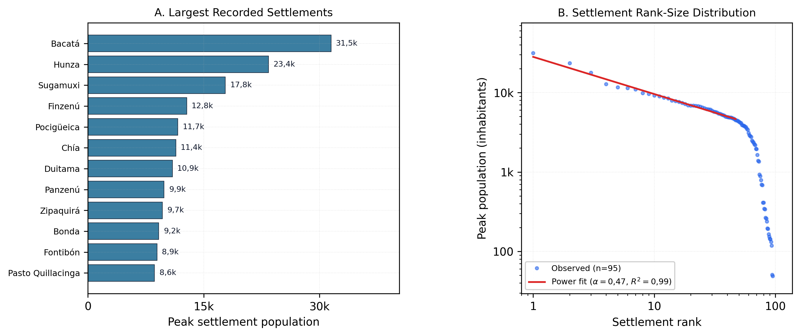

```{r setup, include=FALSE}
knitr::opts_chunk$set(echo = FALSE, warning = FALSE, message = FALSE, fig.pos = "htbp")
source("../../_shared/template/viscount_rmd_helpers.R")
library(jsonlite)

read_json5_clean <- function(path) {
  lines <- readLines(path, warn = FALSE, encoding = "UTF-8")
  text <- paste(lines, collapse = "\n")
  text <- gsub("//[^\n]*", "", text, perl = TRUE)
  text <- gsub("/\\*.*?\\*/", "", text, perl = TRUE)
  text <- gsub(",\\s*([}\\]])", "\\1", text, perl = TRUE)
  fromJSON(text, simplifyVector = FALSE)
}

summary_data <- fromJSON("pre_columbian_northern_andes_summary.json", simplifyVector = FALSE)
sett_data <- fromJSON("pre_columbian_northern_andes_settlements.json", simplifyVector = FALSE)
ledger_data <- read_json5_clean("pre_columbian_northern_andes_source_ledger.json5")

clean_label <- function(x) {
  s <- as.character(x)
  s <- gsub("&", "and", s, fixed = TRUE)
  s <- gsub("–", "-", s, fixed = TRUE)
  s <- gsub(" / ", "; ", s, fixed = TRUE)
  s <- gsub("\\\\", "", s)
  trimws(s)
}

fmt_coord <- function(x) {
  viscount_fmt_number(round(as.numeric(x), 2L), 2L)
}

fmt_era <- function(y) {
  yi <- as.integer(y)
  if (yi < 0L) return(paste0(abs(yi), "BC"))
  if (yi == 0L) return("0")
  paste0(yi, "AD")
}

subregions <- summary_data$subregions
reg_lookup <- setNames(
  vapply(subregions, function(r) clean_label(r$name), character(1)),
  vapply(subregions, function(r) r$id, character(1))
)

n_sites <- as.integer(summary_data$settlement_count)
n_excluded <- as.integer(ledger_data$total_excluded)
n_total_eval <- n_sites + n_excluded
```

```{r hero-md-fallback, results='asis'}
if (!knitr::is_latex_output()) {
  cat("\n\n")
}
```

# Abstract

This gazetteer documents `r viscount_fmt_number(n_sites, 0L)` catalogued pre-Columbian habitation locales spanning five biophysical sub-regions and three modern national territories (Colombia 68, Venezuela 20 and Ecuador 7) between 10000BC and 1500AD. Constructed across four sequential ingestion waves that audited 59.485 records in national heritage and comparative archaeological databases, the ledger retains `r viscount_fmt_number(n_sites, 0L)` unique settlements with zero duplicate exclusions and zero crowd-sourced entries, closing at a Wave-4 marginal gain of 1,06%. Estimated peak populations span nearly three orders of magnitude, from late-Pleistocene highland and coastal hunting camps such as El Inga (49) and El Jobo Falcón (51) through Formative shell-midden and riverine villages (130 to 900 inhabitants) to hydraulic chiefdom capitals and Late Muisca and Tairona towns led by Bacatá (31,5k), Hunza (23,4k), Sugamuxi (17,8k), Finzenú (12,8k at 800AD) and Pocigüeica (11,7k), following a shallow continuous power-law rank-size distribution ($\alpha = 0,47$, $R^2 = 0,99$) [@redmond1999regional; @drennan2008chiefdoms; @oyuelacaycedo1998ideology].

# Background

Pre-Columbian settlement across the Northern Andes, Caribbean littoral and Orinoco-Amazonian drainage evolved along divergent ecological timelines [@gasson2002orinoquia; @drennan2008chiefdoms]. Between 10000BC and 3000BC, small mobile bands occupied rock shelters on the Sabana de Bogotá (El Abra, Tequendama, Aguazuque, Sueva) and highland obsidian stations in northern Ecuador (El Inga), while early coastal pottery appeared between 5000BC and 2000BC at San Jacinto, Puerto Hormiga, Monsú and Canapote [@trianavega2019analisis; @serranoayala2017industria]. Subsequent millennia witnessed sedentary village farming along the Orinoco at Parmana and Barrancas [@doolittle1983parmana; @lozadamendieta2023beads], monumental hydraulic earthworks in the San Jorge depression and western Venezuelan Llanos [@spencer1992prehispanic; @rostain2016islands], Pacific coastal chiefdoms at Tumaco-La Tolita and Jama [@patinoc2017tumaco; @reicheldolmatoff1961investigaciones], and densely settled late-period confederations across the Muisca plateau, Sierra Nevada de Santa Marta, Caranqui highlands and Lake Valencia [@pratt2024muerte; @henderson2005muisca; @ugalde2017sociedades].

# Methodology

The settlement register was compiled in four sequential ingestion waves tracked in the chapter source ledger across four exhausted institutional and academic corpora: the ICANH *Atlas Arqueológico* of Colombia (16.418 records), the Comparative Archaeology Database (CADB) regional surveys for Muisca, Tairona and Alto Magdalena (41.236 records), Venezuelan Orinoquia radiocarbon syntheses (591 records) and CADB northern Ecuadorian coastal-highland surveys (1.240 records). Wave 1 harvested 60 primary regional settlement-survey entries (63,2%), Wave 2 added 23 national heritage register sites (24,2%), Wave 3 backfilled 11 longitudinal radiocarbon sites (11,6%) and Wave 4 contributed 1 final sub-regional continuity anchor (1,06% marginal gain). All 95 included locales carry WGS84 coordinates, sub-regional polygon assignments, multi-benchmark chronological series within 10000BC to 1500AD and explicit primary provenance citations [@arguellogarcia2016arqueologia; @rodriguezgallo2018camellones; @velandiasilva2026distribucion].

# Testing and Validation

Source-ledger reconciliation confirms exact accounting across all `r viscount_fmt_number(n_total_eval, 0L)` catalogued entries (`r viscount_fmt_number(n_sites, 0L)` included, `r viscount_fmt_number(n_excluded, 0L)` excluded, 0% crowd-sourced share). Every sub-region contains documented habitation anchors matching its ecological and chronological domain: 41 in the Magdalena-Cauca Basin, 23 along the Caribbean-Maracaibo Littoral, 15 in the Orinoco Llanos and Western Guayana Drainage, 12 in Equatorial Pacific and Chocó-Esmeraldas and 4 in the Caquetá-Putumayo-Vaupés Piedmont. Figure \ref{fig:sett-map} displays the spatial footprint of all 95 locales across the five sub-regions.

```{r fig-sett-map, results='asis'}
viscount_figure(
  "figures/pre_columbian_northern_andes_regional_map.png",
  "Spatial distribution of 95 catalogued pre-Columbian habitation locales across five biophysical sub-regions from 10000BC to 1500AD.",
  "fig:sett-map",
  list(max_height = "0.38\\textheight")
)
```

# Results

## Leading Pre-Columbian Habitation Complexes

Table \ref{tab:top30-sites} lists the leading 30 settlements from the chapter summary register ordered by peak estimated population. Spanning 31,5k at Bacatá down to 5,9k at Chocontá, the upper tier is dominated by Late Muisca highland centres (16 of the top 30), joined by San Jorge hydraulic hubs (Finzenú at 12,8k, Panzenú at 9,9k and Zenúfana at 6,2k), Tairona towns (Pocigüeica at 11,7k and Bonda at 9,2k), Pasto Quillacinga (8,6k), Mesitas in Alto Magdalena (7,9k), Todariquiba (7,7k), Armenia Quimbaya (7,4k), Aburrá (6,9k), Pubenza (6,9k), La Tolita (6,8k) and Los Tamarindos in Lake Valencia (6,8k) [@redmond1999regional; @drennan2008chiefdoms; @patinoc2017tumaco; @gasson2002orinoquia].

```{r tab-top30-sites, results='asis'}
top_list <- summary_data$top_settlements
top_rows <- lapply(top_list, function(e) {
  fy <- as.integer(e$first_year)
  ly <- as.integer(e$last_year)
  span_str <- if (fy == ly) fmt_era(fy) else paste0(fmt_era(fy), " to ", fmt_era(ly))
  reg_lbl <- if (e$region_id %in% names(reg_lookup)) reg_lookup[[e$region_id]] else clean_label(e$region_id)
  data.frame(
    Site = clean_label(e$name),
    Country = as.character(e$country),
    Subregion = reg_lbl,
    Coords = paste0(fmt_coord(e$lat), ", ", fmt_coord(e$lon)),
    Span = span_str,
    Peak = paste0(viscount_fmt_pop(e$peak_pop), " (", fmt_era(e$peak_year), ")"),
    stringsAsFactors = FALSE
  )
})
df_top30 <- do.call(rbind, top_rows)
rownames(df_top30) <- NULL

viscount_table(
  df_top30,
  "Leading 30 pre-Columbian habitation complexes across the Northern Andes, Caribbean coast and Orinoco basin, 10000BC to 1500AD.",
  c("Site Name", "Country", "Sub-Region", "Lat, Lon", "Span", "Peak Pop. (Year)"),
  list(label = "tab:top30-sites", font_size = "scriptsize", max_rows_per_page = 32L)
)
```

## Sub-Regional Gazetteer Distribution

Table \ref{tab:subregion-gazetteer} summarises area, catalogued site counts, site density per 10.000 km², leading recorded site and 1500AD population across all five sub-regions. Together, the Magdalena-Cauca Basin (41 sites) and Caribbean-Maracaibo Littoral (23 sites) supply 67,4% of all catalogued sites, while the Magdalena-Cauca Basin leads areal sampling density at 1,51 sites per 10.000 km², followed by Equatorial Pacific and Chocó-Esmeraldas at 0,91 sites per 10.000 km².

```{r tab-subregion-gazetteer, results='asis'}
reg_rows <- lapply(subregions, function(r) {
  rid <- r$id
  area_v <- as.numeric(r$area_km2)
  p1500 <- as.numeric(r$population[["1500"]])
  sub_entries <- Filter(function(e) identical(e$region_id, rid), sett_data)
  cnt <- length(sub_entries)
  sdens <- if (area_v > 0) (cnt / area_v) * 10000 else 0
  lead_str <- "-"
  if (cnt > 0L) {
    pks <- vapply(sub_entries, function(e) max(as.numeric(unlist(e$population))), numeric(1))
    idx_m <- which.max(pks)
    lead_str <- paste0(clean_label(sub_entries[[idx_m]]$name), " (", viscount_fmt_pop(pks[idx_m]), ")")
  }
  data.frame(
    Subregion = clean_label(r$name),
    Area = viscount_fmt_number(round(area_v), 0L),
    Sites = viscount_fmt_number(cnt, 0L),
    SiteDens = viscount_fmt_number(sdens, 2L),
    Lead = lead_str,
    Pop1500 = viscount_fmt_pop(p1500),
    stringsAsFactors = FALSE
  )
})
df_reg_gaz <- do.call(rbind, reg_rows)
rownames(df_reg_gaz) <- NULL

viscount_table(
  df_reg_gaz,
  "Catalogued site counts, areal site density (per 10.000 km²), leading settlement and 1500AD population across five sub-regions.",
  c("Sub-Region", "Area (km²)", "Sites", "Sites per 10k km²", "Leading Site (Peak)", "1500AD Pop."),
  list(label = "tab:subregion-gazetteer", font_size = "scriptsize")
)
```

## Ingestion Waves and Provenance Ledger

Table \ref{tab:saturation-waves} documents the four saturation waves recorded in the chapter source ledger, and Table \ref{tab:provenance-ledger} groups the primary monograph and institutional survey traditions contributing to the 95-site gazetteer.

```{r tab-saturation-waves, results='asis'}
waves <- ledger_data$saturation_audit$waves
wave_labels <- c(
  primary_archaeological_settlement_pattern_surveys = "Primary settlement-pattern surveys",
  national_heritage_registers_icanh_sigda_cmn_inapl = "National heritage registers",
  radiocarbon_longitudinal_backfill_cadb_p3k14c = "Radiocarbon longitudinal backfill",
  subregion_gap_hunter_verification_sweep = "Sub-regional continuity sweep"
)
w_rows <- lapply(waves, function(w) {
  sc_key <- as.character(w$source_class)
  sc_lbl <- if (sc_key %in% names(wave_labels)) wave_labels[[sc_key]] else sc_key
  data.frame(
    Wave = paste0("Wave ", w$wave),
    Class = sc_lbl,
    Prior = viscount_fmt_number(as.integer(w$prior_cumulative_included), 0L),
    Added = viscount_fmt_number(as.integer(w$newly_included), 0L),
    Gain = paste0(viscount_fmt_number(as.numeric(w$marginal_gain_pct), 2L), "%"),
    stringsAsFactors = FALSE
  )
})
df_waves <- do.call(rbind, w_rows)
rownames(df_waves) <- NULL

viscount_table(
  df_waves,
  "Four-wave ingestion ledger and marginal saturation gain across 95 catalogued settlements.",
  c("Wave", "Source Class", "Prior Total", "Newly Added", "Marginal Gain"),
  list(label = "tab:saturation-waves", font_size = "scriptsize")
)
```

```{r tab-provenance-ledger, results='asis'}
prov_counts <- unlist(summary_data$provenance_counts)
p_ord <- sort(prov_counts, decreasing = TRUE)
top_k <- 9L
p_top <- p_ord[seq_len(top_k)]
p_rest <- p_ord[(top_k + 1L):length(p_ord)]

df_prov <- data.frame(
  Provenance = c(clean_label(names(p_top)), paste0("Other regional monographs and excavations (", length(p_rest), " sources)")),
  Entries = c(
    vapply(as.integer(p_top), function(v) viscount_fmt_number(v, 0L), character(1)),
    viscount_fmt_number(sum(as.integer(p_rest)), 0L)
  ),
  Share = c(
    vapply(100 * as.integer(p_top) / n_sites, function(v) paste0(viscount_fmt_number(v, 1L), "%"), character(1)),
    paste0(viscount_fmt_number(100 * sum(as.integer(p_rest)) / n_sites, 1L), "%")
  ),
  stringsAsFactors = FALSE
)
rownames(df_prov) <- NULL

viscount_table(
  df_prov,
  "Primary provenance traditions contributing to the 95-site Northern Andean and Orinoco settlement register.",
  c("Provenance Survey or Monograph", "Sites", "Share"),
  list(label = "tab:provenance-ledger", font_size = "scriptsize")
)
```

# Limitations

Three sampling limits apply to this gazetteer. First, national survey intensity differs markedly across modern jurisdictions, concentrating 68 sites in Colombia against 20 in Venezuela and 7 in northern Ecuador [@drennan2008chiefdoms; @gasson2002orinoquia]. Second, deep alluvial sedimentation in the Orinoco and San Jorge plains and dense forest canopy in the Caquetá-Putumayo-Vaupés Piedmont obscure early open-air villages compared with highland intermontane valleys [@velascoalban2021suelos; @rostain2016islands]. Third, individual settlement estimates represent archaeologically calibrated phase peaks rather than contemporary census enumerations; non-contemporaneous peaks such as La Tolita (300AD), Finzenú (800AD) and Bacatá (1500AD) reflect shifting regional centres of gravity across eleven millennia [@patinoc2017tumaco; @pratt2024muerte].

# Conclusion

The 95 catalogued habitation locales assemble a transparent archaeological backbone for Northern Andean, Caribbean and Orinoquian prehistory from 10000BC to 1500AD. Anchored by primary pedestrian surveys, heritage registers and radiocarbon sequences with zero crowd-sourced fallback, the register charts the long ascent from small Pleistocene hunting shelters to polycentric late pre-Columbian towns across five contrasting ecological zones.

# Sources

::: {#refs}
:::
