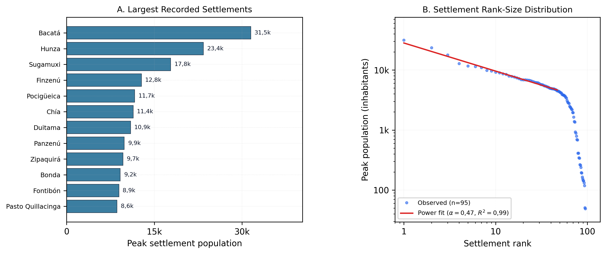
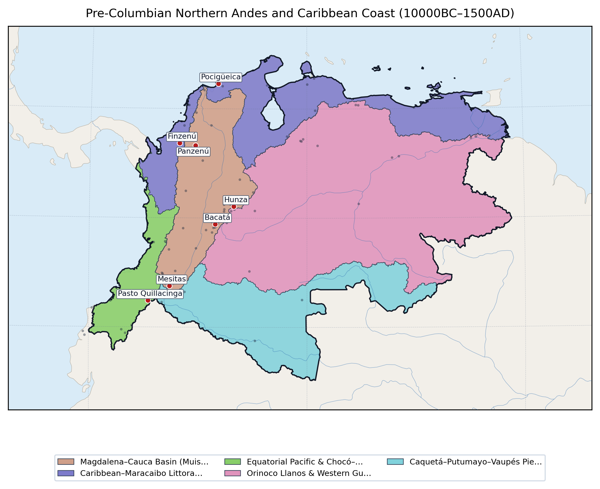

Pre-Columbian Northern Andes and Caribbean Coast
================
Aust Kätzchen
23 November 2026

- [Abstract](#abstract)
- [Background](#background)
- [Methodology](#methodology)
- [Testing and Validation](#testing-and-validation)
- [Results](#results)
  - [Leading Pre-Columbian Habitation
    Complexes](#leading-pre-columbian-habitation-complexes)
  - [Sub-Regional Gazetteer
    Distribution](#sub-regional-gazetteer-distribution)
  - [Ingestion Waves and Provenance
    Ledger](#ingestion-waves-and-provenance-ledger)
- [Limitations](#limitations)
- [Conclusion](#conclusion)
- [Sources](#sources)

<figure>

<figcaption aria-hidden="true">Leading 12 pre-Columbian settlements and
rank-size distribution across 95 catalogued habitation locales from
10000BC to 1500AD.</figcaption>
</figure>

# Abstract

This gazetteer documents 95 catalogued pre-Columbian habitation locales
spanning five biophysical sub-regions and three modern national
territories (Colombia 68, Venezuela 20 and Ecuador 7) between 10000BC
and 1500AD. Constructed across four sequential ingestion waves that
audited 59.485 records in national heritage and comparative
archaeological databases, the ledger retains 95 unique settlements with
zero duplicate exclusions and zero crowd-sourced entries, closing at a
Wave-4 marginal gain of 1,06%. Estimated peak populations span nearly
three orders of magnitude, from late-Pleistocene highland and coastal
hunting camps such as El Inga (49) and El Jobo Falcón (51) through
Formative shell-midden and riverine villages (130 to 900 inhabitants) to
hydraulic chiefdom capitals and Late Muisca and Tairona towns led by
Bacatá (31,5k), Hunza (23,4k), Sugamuxi (17,8k), Finzenú (12,8k at
800AD) and Pocigüeica (11,7k), following a shallow continuous power-law
rank-size distribution ($\alpha = 0,47$, $R^2 = 0,99$)
[\[1\]](#ref-redmond1999regional)[\[2\]](#ref-drennan2008chiefdoms)[\[3\]](#ref-oyuelacaycedo1998ideology).

# Background

Pre-Columbian settlement across the Northern Andes, Caribbean littoral
and Orinoco-Amazonian drainage evolved along divergent ecological
timelines
[\[2\]](#ref-drennan2008chiefdoms)[\[4\]](#ref-gasson2002orinoquia).
Between 10000BC and 3000BC, small mobile bands occupied rock shelters on
the Sabana de Bogotá (El Abra, Tequendama, Aguazuque, Sueva) and
highland obsidian stations in northern Ecuador (El Inga), while early
coastal pottery appeared between 5000BC and 2000BC at San Jacinto,
Puerto Hormiga, Monsú and Canapote
[\[5\]](#ref-trianavega2019analisis)[\[6\]](#ref-serranoayala2017industria).
Subsequent millennia witnessed sedentary village farming along the
Orinoco at Parmana and Barrancas
[\[7\]](#ref-doolittle1983parmana)[\[8\]](#ref-lozadamendieta2023beads),
monumental hydraulic earthworks in the San Jorge depression and western
Venezuelan Llanos
[\[9\]](#ref-spencer1992prehispanic)[\[10\]](#ref-rostain2016islands),
Pacific coastal chiefdoms at Tumaco-La Tolita and Jama
[\[11\]](#ref-patinoc2017tumaco)[\[12\]](#ref-reicheldolmatoff1961investigaciones),
and densely settled late-period confederations across the Muisca
plateau, Sierra Nevada de Santa Marta, Caranqui highlands and Lake
Valencia
[\[13\]](#ref-pratt2024muerte)[\[14\]](#ref-henderson2005muisca)[\[15\]](#ref-ugalde2017sociedades).

# Methodology

The settlement register was compiled in four sequential ingestion waves
tracked in the chapter source ledger across four exhausted institutional
and academic corpora: the ICANH *Atlas Arqueológico* of Colombia (16.418
records), the Comparative Archaeology Database (CADB) regional surveys
for Muisca, Tairona and Alto Magdalena (41.236 records), Venezuelan
Orinoquia radiocarbon syntheses (591 records) and CADB northern
Ecuadorian coastal-highland surveys (1.240 records). Wave 1 harvested 60
primary regional settlement-survey entries (63,2%), Wave 2 added 23
national heritage register sites (24,2%), Wave 3 backfilled 11
longitudinal radiocarbon sites (11,6%) and Wave 4 contributed 1 final
sub-regional continuity anchor (1,06% marginal gain). All 95 included
locales carry WGS84 coordinates, sub-regional polygon assignments,
multi-benchmark chronological series within 10000BC to 1500AD and
explicit primary provenance citations
[\[16\]](#ref-arguellogarcia2016arqueologia)[\[17\]](#ref-rodriguezgallo2018camellones)[\[18\]](#ref-velandiasilva2026distribucion).

# Testing and Validation

Source-ledger reconciliation confirms exact accounting across all 95
catalogued entries (95 included, 0 excluded, 0% crowd-sourced share).
Every sub-region contains documented habitation anchors matching its
ecological and chronological domain: 41 in the Magdalena-Cauca Basin, 23
along the Caribbean-Maracaibo Littoral, 15 in the Orinoco Llanos and
Western Guayana Drainage, 12 in Equatorial Pacific and Chocó-Esmeraldas
and 4 in the Caquetá-Putumayo-Vaupés Piedmont. Figure displays the
spatial footprint of all 95 locales across the five sub-regions.

# Results

## Leading Pre-Columbian Habitation Complexes

Table lists the leading 30 settlements from the chapter summary register
ordered by peak estimated population. Spanning 31,5k at Bacatá down to
5,9k at Chocontá, the upper tier is dominated by Late Muisca highland
centres (16 of the top 30), joined by San Jorge hydraulic hubs (Finzenú
at 12,8k, Panzenú at 9,9k and Zenúfana at 6,2k), Tairona towns
(Pocigüeica at 11,7k and Bonda at 9,2k), Pasto Quillacinga (8,6k),
Mesitas in Alto Magdalena (7,9k), Todariquiba (7,7k), Armenia Quimbaya
(7,4k), Aburrá (6,9k), Pubenza (6,9k), La Tolita (6,8k) and Los
Tamarindos in Lake Valencia (6,8k)
[\[1\]](#ref-redmond1999regional)[\[2\]](#ref-drennan2008chiefdoms)[\[4\]](#ref-gasson2002orinoquia)[\[11\]](#ref-patinoc2017tumaco).

| Site Name | Country | Sub-Region | Lat, Lon | Span | Peak Pop. (Year) |
|:---|:---|:---|:---|:---|:---|
| **Bacatá** | Colombia | Magdalena-Cauca Basin (Muisca, Quimbaya and Tolima) | 4,72, -74,21 | 800AD to 1500AD | 31,5k (1500AD) |
| **Hunza** | Colombia | Magdalena-Cauca Basin (Muisca, Quimbaya and Tolima) | 5,54, -73,37 | 800AD to 1500AD | 23,4k (1500AD) |
| **Sugamuxi** | Colombia | Magdalena-Cauca Basin (Muisca, Quimbaya and Tolima) | 5,72, -72,93 | 800AD to 1500AD | 17,8k (1500AD) |
| **Finzenú** | Colombia | Caribbean-Maracaibo Littoral (Tairona, Sinú and Caquetío) | 8,42, -75,88 | 200BC to 1500AD | 12,8k (800AD) |
| **Pocigüeica** | Colombia | Caribbean-Maracaibo Littoral (Tairona, Sinú and Caquetío) | 11,15, -74,11 | 1000AD to 1500AD | 11,6k (1500AD) |
| **Chía** | Colombia | Magdalena-Cauca Basin (Muisca, Quimbaya and Tolima) | 4,86, -74,06 | 1000AD to 1500AD | 11,4k (1500AD) |
| **Duitama** | Colombia | Magdalena-Cauca Basin (Muisca, Quimbaya and Tolima) | 5,83, -73,03 | 1000AD to 1500AD | 10,9k (1500AD) |
| **Panzenú** | Colombia | Magdalena-Cauca Basin (Muisca, Quimbaya and Tolima) | 8,31, -75,14 | 0 to 1500AD | 9,9k (900AD) |
| **Zipaquirá** | Colombia | Magdalena-Cauca Basin (Muisca, Quimbaya and Tolima) | 5,02, -74 | 800AD to 1500AD | 9,6k (1500AD) |
| **Bonda** | Colombia | Caribbean-Maracaibo Littoral (Tairona, Sinú and Caquetío) | 11,23, -74,12 | 1000AD to 1500AD | 9,2k (1500AD) |
| **Fontibón** | Colombia | Magdalena-Cauca Basin (Muisca, Quimbaya and Tolima) | 4,68, -74,14 | 1100AD to 1500AD | 8,9k (1500AD) |
| **Pasto Quillacinga** | Colombia | Equatorial Pacific and Chocó-Esmeraldas (Valdivia, Tumaco and Manteño) | 1,21, -77,28 | 600AD to 1500AD | 8,6k (1500AD) |
| **Guatavita** | Colombia | Magdalena-Cauca Basin (Muisca, Quimbaya and Tolima) | 4,93, -73,83 | 900AD to 1500AD | 8,4k (1500AD) |
| **Mesitas** | Colombia | Magdalena-Cauca Basin (Muisca, Quimbaya and Tolima) | 1,89, -76,3 | 1000BC to 1500AD | 7,9k (800AD) |
| **Ubaté** | Colombia | Magdalena-Cauca Basin (Muisca, Quimbaya and Tolima) | 5,31, -73,82 | 1000AD to 1500AD | 7,8k (1500AD) |
| **Todariquiba** | Venezuela | Caribbean-Maracaibo Littoral (Tairona, Sinú and Caquetío) | 11,4, -69,67 | 600AD to 1500AD | 7,6k (1500AD) |
| **Armenia Quimbaya** | Colombia | Magdalena-Cauca Basin (Muisca, Quimbaya and Tolima) | 4,53, -75,68 | 0 to 1500AD | 7,4k (1500AD) |
| **Soacha** | Colombia | Magdalena-Cauca Basin (Muisca, Quimbaya and Tolima) | 4,58, -74,22 | 0 to 1500AD | 7,2k (1500AD) |
| **Aburrá** | Colombia | Magdalena-Cauca Basin (Muisca, Quimbaya and Tolima) | 6,24, -75,58 | 400AD to 1500AD | 6,9k (1500AD) |
| **Pubenza** | Colombia | Magdalena-Cauca Basin (Muisca, Quimbaya and Tolima) | 2,44, -76,61 | 600AD to 1500AD | 6,9k (1500AD) |
| **La Tolita** | Ecuador | Equatorial Pacific and Chocó-Esmeraldas (Valdivia, Tumaco and Manteño) | 1,2, -79 | 600BC to 700AD | 6,8k (300AD) |
| **Los Tamarindos** | Venezuela | Orinoco Llanos and Western Guayana Drainage | 10,19, -67,74 | 200AD to 1500AD | 6,8k (1500AD) |
| **Suba** | Colombia | Magdalena-Cauca Basin (Muisca, Quimbaya and Tolima) | 4,74, -74,08 | 1100AD to 1500AD | 6,8k (1500AD) |
| **Mesa de los Santos** | Colombia | Magdalena-Cauca Basin (Muisca, Quimbaya and Tolima) | 6,76, -73,1 | 1000AD to 1500AD | 6,6k (1500AD) |
| **Facatativá** | Colombia | Magdalena-Cauca Basin (Muisca, Quimbaya and Tolima) | 4,81, -74,36 | 1000AD to 1500AD | 6,5k (1500AD) |
| **Bosa** | Colombia | Magdalena-Cauca Basin (Muisca, Quimbaya and Tolima) | 4,62, -74,19 | 1000AD to 1500AD | 6,3k (1500AD) |
| **Paipa** | Colombia | Magdalena-Cauca Basin (Muisca, Quimbaya and Tolima) | 5,78, -73,12 | 1100AD to 1500AD | 6,2k (1500AD) |
| **Zenúfana** | Colombia | Magdalena-Cauca Basin (Muisca, Quimbaya and Tolima) | 7,62, -74,81 | 200AD to 1500AD | 6,2k (1100AD) |
| **Fúquene** | Colombia | Magdalena-Cauca Basin (Muisca, Quimbaya and Tolima) | 5,4, -73,8 | 900AD to 1500AD | 6,1k (1500AD) |
| **Chocontá** | Colombia | Magdalena-Cauca Basin (Muisca, Quimbaya and Tolima) | 5,15, -73,69 | 1000AD to 1500AD | 5,9k (1500AD) |

Leading 30 pre-Columbian habitation complexes across the Northern Andes,
Caribbean coast and Orinoco basin, 10000BC to 1500AD.

## Sub-Regional Gazetteer Distribution

Table summarises area, catalogued site counts, site density per 10.000
km², leading recorded site and 1500AD population across all five
sub-regions. Together, the Magdalena-Cauca Basin (41 sites) and
Caribbean-Maracaibo Littoral (23 sites) supply 67,4% of all catalogued
sites, while the Magdalena-Cauca Basin leads areal sampling density at
1,51 sites per 10.000 km², followed by Equatorial Pacific and
Chocó-Esmeraldas at 0,91 sites per 10.000 km².

| Sub-Region | Area (km²) | Sites | Sites per 10k km² | Leading Site (Peak) | 1500AD Pop. |
|:---|:---|:---|:---|:---|:---|
| **Magdalena-Cauca Basin (Muisca, Quimbaya and Tolima)** | 271.180 | 41 | 1,51 | Bacatá (31,5k) | 1,55M |
| **Caribbean-Maracaibo Littoral (Tairona, Sinú and Caquetío)** | 351.368 | 23 | 0,65 | Finzenú (12,8k) | 950k |
| **Equatorial Pacific and Chocó-Esmeraldas (Valdivia, Tumaco and Manteño)** | 132.375 | 12 | 0,91 | Pasto Quillacinga (8,6k) | 780k |
| **Orinoco Llanos and Western Guayana Drainage** | 931.617 | 15 | 0,16 | Los Tamarindos (6,8k) | 520k |
| **Caquetá-Putumayo-Vaupés Piedmont** | 357.764 | 4 | 0,11 | Mocoa Piedmont (3,1k) | 350k |

Catalogued site counts, areal site density (per 10.000 km²), leading
settlement and 1500AD population across five sub-regions.

## Ingestion Waves and Provenance Ledger

Table documents the four saturation waves recorded in the chapter source
ledger, and Table groups the primary monograph and institutional survey
traditions contributing to the 95-site gazetteer.

| Wave | Source Class | Prior Total | Newly Added | Marginal Gain |
|:---|:---|:---|:---|:---|
| **Wave 1** | Primary settlement-pattern surveys | 0 | 60 | 100% |
| **Wave 2** | National heritage registers | 60 | 23 | 38,33% |
| **Wave 3** | Radiocarbon longitudinal backfill | 83 | 11 | 13,25% |
| **Wave 4** | Sub-regional continuity sweep | 94 | 1 | 1,06% |

Four-wave ingestion ledger and marginal saturation gain across 95
catalogued settlements.

| Provenance Survey or Monograph | Sites | Share |
|:---|:---|:---|
| **Langebaek (1987, 1995) Muisca Settlement Surveys** | 22 | 23,2% |
| **Drennan (1995, 2006) Alto Magdalena; Valle de la Plata CADB** | 6 | 6,3% |
| **Oyuela-Caycedo (1995); Serje (1987) Sierra Nevada Survey** | 6 | 6,3% |
| **Mora (2003); Herrera et al. (1992) Araracuara Caquetá** | 5 | 5,3% |
| **Plazas and Falchetti (1981) San Jorge Hydraulic Complex** | 4 | 4,2% |
| **Valdez (1987); Bouchard (1995) Tumaco-La Tolita** | 3 | 3,2% |
| **Spencer and Redmond (1992, 1998) Barinas Chiefdoms** | 3 | 3,2% |
| **Langebaek et al. (2002) Valle de Aburrá CADB** | 1 | 1,1% |
| **Correal Urrego (1990) Aguazuque** | 1 | 1,1% |
| **Other regional monographs and excavations (44 sources)** | 44 | 46,3% |

Primary provenance traditions contributing to the 95-site Northern
Andean and Orinoco settlement register.

# Limitations

Three sampling limits apply to this gazetteer. First, national survey
intensity differs markedly across modern jurisdictions, concentrating 68
sites in Colombia against 20 in Venezuela and 7 in northern Ecuador
[\[2\]](#ref-drennan2008chiefdoms)[\[4\]](#ref-gasson2002orinoquia).
Second, deep alluvial sedimentation in the Orinoco and San Jorge plains
and dense forest canopy in the Caquetá-Putumayo-Vaupés Piedmont obscure
early open-air villages compared with highland intermontane valleys
[\[10\]](#ref-rostain2016islands)[\[19\]](#ref-velascoalban2021suelos).
Third, individual settlement estimates represent archaeologically
calibrated phase peaks rather than contemporary census enumerations;
non-contemporaneous peaks such as La Tolita (300AD), Finzenú (800AD) and
Bacatá (1500AD) reflect shifting regional centres of gravity across
eleven millennia
[\[11\]](#ref-patinoc2017tumaco)[\[13\]](#ref-pratt2024muerte).

# Conclusion

The 95 catalogued habitation locales assemble a transparent
archaeological backbone for Northern Andean, Caribbean and Orinoquian
prehistory from 10000BC to 1500AD. Anchored by primary pedestrian
surveys, heritage registers and radiocarbon sequences with zero
crowd-sourced fallback, the register charts the long ascent from small
Pleistocene hunting shelters to polycentric late pre-Columbian towns
across five contrasting ecological zones.

# Sources

1.
Redmond, Elsa M., et al.
“Regional Archaeology in the Muisca Territory: A
Study of the Fuquene and Susa Valleys.” *The Journal of the Royal
Anthropological Institute*, vol. 5, no. 2, 1999, p. 284,
<https://doi.org/10.2307/2660702>.

2.
Drennan, Robert D.
“Chiefdoms of Southwestern Colombia.” *The
Handbook of South American Archaeology*, Springer New York, 2008, pp.
381-403, <https://doi.org/10.1007/978-0-387-74907-5_21>.

3.
Oyuela-Caycedo, Augusto.
“Ideology, Temples, and Priests:” *Recent
Advances in the Archaeology of the Northern Andes*, Cotsen Institute of
Archaeology Press, 1998, pp. 39-53,
<https://doi.org/10.2307/j.ctvvh85bx.9>.

4.
Gassón, Rafael A.
“Orinoquia: The Archaeology of the Orinoco River
Basin.” *Journal of World Prehistory*, vol. 16, no. 3, 2002, pp.
237-311, <https://doi.org/10.1023/a:1020978518142>.

5.
Triana Vega, Angélica Viviana, et
al. “Análisis de Isótopos estables en restos óseos
humanos y de fauna en los sitios arqueológicos del Holoceno temprano y
medio Tequendama y Aguazuque (sabana de Bogotá, Colombia).”
*Jangwa Pana*, vol. 19, no. 1, 2019, pp. 10-22,
<https://doi.org/10.21676/16574923.3432>.

6.
Serrano Ayala, Sthefano.
“La industria lítica de Oroloma, Pichincha,
Ecuador.” *Antropología Cuadernos de Investigación*, no. 12,
2017, p. 86, <https://doi.org/10.26807/ant.v0i12.75>.

7.
Doolittle, William E., and Anna
Curtenius Roosevelt. “Parmana: Prehistoric Maize
and Manioc Subsistence along the Amazon and Orinoco.”
*Geographical Review*, vol. 73, no. 1, 1983, p. 117,
<https://doi.org/10.2307/214400>.

8.
Lozada-Mendieta, Natalia, et al.
“Beads and Stamps in the Middle Orinoco:
Archaeological Evidence for Interaction and Exchange in the Atures
Rapids from AD 1000 to 1480.” *Latin American Antiquity*, vol.
34, no. 4, 2023, pp. 742-63,
<https://doi.org/10.1017/laq.2022.73>.

9.
Spencer, Charles S., and Elsa M.
Redmond. “Prehispanic chiefdoms of the western
VenezuelanIlanos.” *World Archaeology*, vol. 24, no. 1, 1992, pp.
134-57, <https://doi.org/10.1080/00438243.1992.9980198>.

10.
Rostain, Stéphen.
*Islands in the Rainforest*. Routledge,
2016, <https://doi.org/10.4324/9781315425931>.

11.
Patiño C., Diógenes.
“Tumaco-Tolita: cultura, arte y poder en la costa
pacífica.” *Antropología Cuadernos de Investigación*, no. 18,
2017, p. 40, <https://doi.org/10.26807/ant.v0i18.123>.

12.
Reichel-Dolmatoff, Gerardo, and
Alicia Reichel-Dolmatoff. “Investigaciones
arqueológicas en la Costa Pacífica de Colombia. I: El sitio de
Cupica.” *Revista Colombiana de Antropología*, vol. 10, 1961, pp.
239-317, <https://doi.org/10.22380/2539472x.1805>.

13.
Pratt, Melissa.
“Muerte y emociones en el Cercado Grande de los
Santuarios, Tunja (Colombia), periodo Muisca Tardío (1000 - 1550
d.C.).” *Jangwa Pana*, vol. 23, no. 3, 2024,
<https://doi.org/10.21676/16574923.5707>.

14.
Henderson, Hope, and Nicholas
Ostler. “Muisca settlement organization and chiefly
authority at Suta, Valle de Leyva, Colombia: A critical appraisal of
native concepts of house for studies of complex societies.”
*Journal of Anthropological Archaeology*, vol. 24, no. 2, 2005, pp.
148-78, <https://doi.org/10.1016/j.jaa.2005.01.002>.

15.
Ugalde, María Fernanda, and
Cristóbal Landázuri Narváez. “Sociedades
heterárquicas en el Ecuador preincaico: estudio diacrónico de la
organización política caranqui.” *Revista Española de
Antropología Americana*, vol. 46, 2017, pp. 197-218,
<https://doi.org/10.5209/reaa.58294>.

16.
Argüello García, Pedro María.
“Arqueología regional en el Valle de Tena: un
estudio sobre la microverticalidad muisca.” *Antípoda. Revista de
Antropología y Arqueología*, no. 25, 2016,
<https://doi.org/10.7440/antipoda25.2016.07>.

17.
Rodríguez-Gallo, Lorena.
“Camellones e agricultura pré-hispânica na Sabana
de Bogotá-Colômbia: um exemplo de gestão da água em áreas
inundáveis.” *Estudos Do Quaternário / Quaternary Studies*, no.
18, 2018, pp. 77-91, <https://doi.org/10.30893/eq.v0i18.172>.

18.
Velandia Silva, César Augusto, et
al. “Distribución espacial y paisajística de los
asentamientos prehispánicos en el Alto de Toche, Colombia.”
*Revista CUHSO*, vol. 36, no. 1, 2026, pp. 1-60,
<https://doi.org/10.7770/cuhso-v36n1-art1088>.

19.
Velasco Albán, Janny Mauricio.
“¿Suelos antrópicos en la alta Amazonía
ecuatoriana?: estudios geoarqueológicos en el basural La Lomita, valle
del Upano, Morona Santiago Ecuador.” *Antropología Cuadernos de
Investigación*, no. 24, 2021, pp. 65-79,
<https://doi.org/10.26807/ant.vi24.262>.

