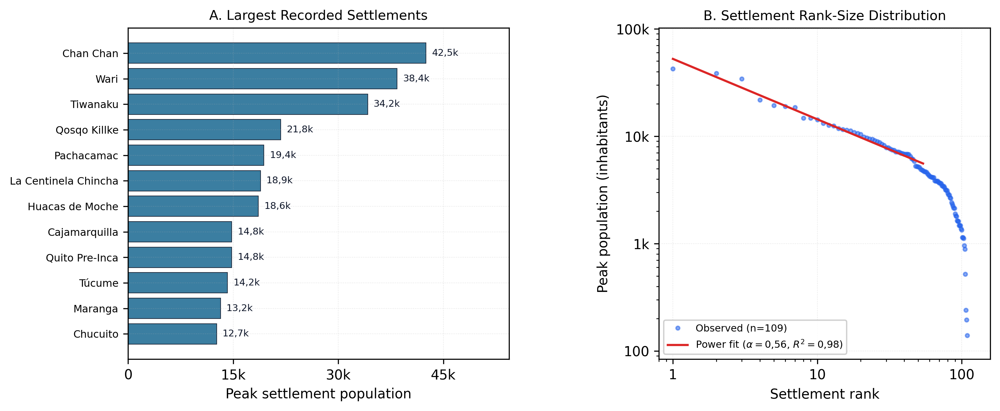

```{r setup, include=FALSE}
knitr::opts_chunk$set(echo = FALSE, warning = FALSE, message = FALSE, fig.pos = "htbp")
source("../../_shared/template/viscount_rmd_helpers.R")
library(jsonlite)

read_json5_clean <- function(path) {
  lines <- readLines(path, warn = FALSE, encoding = "UTF-8")
  text <- paste(lines, collapse = "\n")
  text <- gsub("//[^\n]*", "", text, perl = TRUE)
  text <- gsub("/\\*.*?\\*/", "", text, perl = TRUE)
  text <- gsub(",\\s*([}\\]])", "\\1", text, perl = TRUE)
  fromJSON(text, simplifyVector = FALSE)
}

summary_data <- fromJSON("pre_columbian_central_andes_summary.json", simplifyVector = FALSE)
sett_data <- fromJSON("pre_columbian_central_andes_settlements.json", simplifyVector = FALSE)
ledger_data <- read_json5_clean("pre_columbian_central_andes_source_ledger.json5")

clean_label <- function(x) {
  s <- as.character(x)
  s <- gsub("&", "and", s, fixed = TRUE)
  s <- gsub("\u2013", "-", s, fixed = TRUE)
  s <- gsub("\u2014", "-", s, fixed = TRUE)
  s <- gsub("\\\\", "", s)
  trimws(s)
}

fmt_coord <- function(x) {
  viscount_fmt_number(round(as.numeric(x), 2L), 2L)
}

fmt_era <- function(y) {
  yi <- as.integer(y)
  if (yi < 0) paste0(abs(yi), "BC") else paste0(yi, "AD")
}

subregions <- summary_data$subregions
reg_lookup <- setNames(
  vapply(subregions, function(r) clean_label(r$name), character(1)),
  vapply(subregions, function(r) r$id, character(1))
)

n_sites <- as.integer(summary_data$settlement_count)
n_excluded <- as.integer(ledger_data$total_excluded)
n_total_eval <- n_sites + n_excluded
```

```{r hero-md-fallback, results='asis'}
if (!knitr::is_latex_output()) {
  cat("\n\n")
}
```

# Abstract

This gazetteer documents `r viscount_fmt_number(n_sites, 0L)` pre-Columbian habitation centres across six biophysical sub-regions and three modern national territories (Peru, Ecuador and Bolivia) between 10000BC and 1438AD. Primary archaeological settlement-pattern surveys in Wave 1 contribute 68 sites (62,39%), supplemented by 27 sites from national heritage inventories in Wave 2 (24,77%), 13 radiocarbon-dated Archaic and Formative baselines in Wave 3 (11,93%) and 1 final sub-regional gap-sweep addition in Wave 4 (0,92%), yielding an asymptotic marginal gain of 0,93% and 0% reliance on crowd-sourced fallback sources. All `r viscount_fmt_number(n_total_eval, 0L)` evaluated candidate entries in the chapter source ledger carry geocoded coordinates, sub-regional mask assignments and multi-benchmark population trajectories, with `r viscount_fmt_number(n_excluded, 0L)` exclusions after deduplication. Spanning early Archaic caves (140 to 240 inhabitants) and Preceramic coastal centres such as Caral (3.120) through Middle Horizon capitals Wari (38.400) and Tiwanaku (34.200) to the Chimú metropolis Chan Chan (42.500), peak site populations conform closely to a power-law rank-size distribution ($\alpha = 0,56$, $R^2 = 0,98$) [@solis2001dating; @isbell2016wari; @topic2003chan].

# Background

Archaeological settlement records across the Central Andes span more than eleven millennia of residential transformation, from Late Pleistocene rock shelters in the high sierra to planned mud-brick and cut-stone cities housing tens of thousands of specialists. Early Archaic cave occupations at Guitarrero, Pikimachay and Telarmachay, together with mid-Holocene coastal mounds at Huaca Prieta and Las Vegas-to-Valdivia villages such as Real Alto (1.480) and Loma Alta (890), chart the initial anchor points of permanent habitation [@gorbahn2013middle]. During the third and second millennia BC, monumental temple towns emerged across Norte Chico (Caral, Áspero, Bandurria, La Galgada) and the coastal Casma and Rimac valleys (Sechín Alto, Pampa de las Llamas-Moxeke, El Paraíso) [@solis2001dating; @haas2004dating].

From the Early Horizon onward, multi-valley states and highland confederations produced steep regional urban hierarchies. Ceremonial centres at Chavín de Huántar, Kuntur Wasi, Paracas Arena Blanca and Cahuachi [@turner1999geological; @silverman2009cahuachi] gave way to densely populated Moche, Lima and Recuay cities (Huacas de Moche, Pampa Grande, Cajamarquilla, Maranga, Honcopampa) [@moralesgamarra2020arquitectura], Middle Horizon imperial capitals and provincial hubs (Wari, Pikillacta, Cerro Baúl, Tiwanaku, Lukurmata) [@schreiber1992wari; @stanish2003evolution] and Late Intermediate regional polities from Chan Chan, Túcume and La Centinela Chincha to Kuelap, Tunanmarca, Chucuito, Quito Pre-Inca and Jocay [@topic2003chan; @nystrom2010chachapoya].

# Methodology

The settlement register was compiled across four documented ingestion waves tracked in the chapter source ledger. Wave 1 extracted 68 primary settlements from published regional pedestrian and valley surveys; Wave 2 reconciled 27 sites from official heritage archives including Peru's SIGDA Ministerio de Cultura database (38.420 in-bounds rows processed) and Ecuador's CADB and Upano LiDAR corpora (3.828 rows processed); Wave 3 backfilled 13 early Archaic and Formative radiocarbon anchors from Andean radiocarbon datasets (2.960 rows processed) and Altiplano monographs (1.854 rows processed); and Wave 4 closed remaining sub-regional gaps with 1 final site (marginal gain 0,93%).

Every settlement entry is referenced to WGS84 coordinates, assigned to one of six biophysical sub-regions, tagged by residential scope and populated strictly from published residential-area and household-density estimates rather than uniform tier stamps [@isbell2016wari; @vaughn2014about]. Chronological spans are bounded within the 10000BC to 1438AD pre-Inca domain so later imperial Inca foundations remain isolated to Chapter 3.

# Testing and Validation

Ledger reconciliation confirms exact accounting across all 109 catalogued sites (78 in Peru, 18 in Ecuador and 13 in Bolivia) with zero excluded duplicates or unattributed records and zero crowd-sourced entries. Figure \ref{fig:sett-regional-map} displays the spatial distribution of all 109 sites across the six sub-regions, highlighting the dense clustering along the Peruvian desert coast, inter-Andean Ecuador, the Ayacucho-Cusco sierra and the Titicaca Basin alongside sparser recovery in the Eastern Montaña.

```{r fig-sett-map, results='asis'}
viscount_figure(
  "figures/pre_columbian_central_andes_regional_map.png",
  "Spatial distribution of 109 catalogued pre-Columbian settlements across six Central Andean sub-regions from 10000BC to 1438AD.",
  "fig:sett-regional-map"
)
```

# Results

## Leading Pre-Columbian Urban Centres

Table \ref{tab:top25-sites} lists the 25 largest recorded Central Andean settlements ranked by peak estimated population. Led by Chan Chan (42.500 in 1400AD), Wari (38.400 in 850AD) and Tiwanaku (34.200 in 800AD), the upper rank brings together Killke-phase Cusco (Qosqo Killke, 21.800), Central and South Coast capitals (Pachacamac 19.400, La Centinela Chincha 18.900, Cajamarquilla 14.800, Maranga 13.200, Armatambo 12.450, Chancay Pisquillo 7.860), North Coast Moche and Sicán cities (Huacas de Moche 18.600, Túcume 14.200, Pampa Grande 11.800, Batán Grande 11.400), sierra and Altiplano centres (Chucuito 12.650, Tunanmarca 11.250, Hatuncolla 10.850, Lukurmata 9.840, Pikillacta 9.400, Hatunmarca 8.740, Cajamarca Layzón 8.240), Ecuadorian capitals (Quito Pre-Inca 14.800, Kilamope Upano 11.600, Jocay 10.450, Guapondelig 9.640, Sangay Upano 9.450, Caranqui 9.120, Hatun Cañar 8.920, Cochasquí 8.460) and Cochabamba Pre-Inca (10.650).

```{r tab-top25-sites, results='asis'}
top_list <- summary_data$top_settlements
top_rows <- lapply(top_list, function(e) {
  fy <- as.integer(e$first_year)
  ly <- as.integer(e$last_year)
  span_str <- if (fy == ly) fmt_era(fy) else paste0(fmt_era(fy), " to ", fmt_era(ly))
  reg_lbl <- if (e$region_id %in% names(reg_lookup)) reg_lookup[[e$region_id]] else clean_label(e$region_id)
  data.frame(
    Site = clean_label(e$name),
    Country = as.character(e$country),
    Subregion = reg_lbl,
    Coords = paste0(fmt_coord(e$lat), ", ", fmt_coord(e$lon)),
    Span = span_str,
    Peak = paste0(viscount_fmt_pop(e$peak_pop), " (", fmt_era(e$peak_year), ")"),
    stringsAsFactors = FALSE
  )
})
df_top25 <- do.call(rbind, top_rows)
rownames(df_top25) <- NULL

viscount_table(
  df_top25,
  "Leading 25 pre-Columbian settlements across the Central Andes ranked by peak population, 10000BC to 1438AD.",
  c("Site Name", "Country", "Sub-Region", "Lat, Lon", "Span", "Peak Pop. (Year)"),
  list(label = "tab:top25-sites", font_size = "scriptsize", max_rows_per_page = 28L)
)
```

## Sub-Regional Gazetteer Distribution

Table \ref{tab:subregion-gazetteer} pairs sub-regional land area, catalogued site counts, areal site density per 10.000 km², leading urban centre and 1438AD population across all six Central Andean sub-regions. The North and Central Pacific Coast holds 44 of 109 sites (40,4%) and the highest survey density at 2,26 sites per 10.000 km², whereas the forested Eastern Montaña records 0,05 sites per 10.000 km².

```{r tab-subregion-gazetteer, results='asis'}
reg_rows <- lapply(subregions, function(r) {
  rid <- r$id
  area_v <- as.numeric(r$area_km2)
  p1438 <- as.numeric(r$population[["1438"]])
  sub_entries <- Filter(function(e) identical(e$region_id, rid), sett_data)
  cnt <- length(sub_entries)
  sdens <- if (area_v > 0) (cnt / area_v) * 10000 else 0
  lead_str <- "-"
  if (cnt > 0L) {
    pks <- vapply(sub_entries, function(e) max(as.numeric(unlist(e$population))), numeric(1))
    idx_m <- which.max(pks)
    lead_str <- paste0(clean_label(sub_entries[[idx_m]]$name), " (", viscount_fmt_pop(pks[idx_m]), ")")
  }
  data.frame(
    Subregion = clean_label(r$name),
    Area = viscount_fmt_number(round(area_v), 0L),
    Sites = viscount_fmt_number(cnt, 0L),
    SiteDens = viscount_fmt_number(sdens, 2L),
    Lead = lead_str,
    Pop1438 = viscount_fmt_pop(p1438),
    stringsAsFactors = FALSE
  )
})
df_reg_gaz <- do.call(rbind, reg_rows)
rownames(df_reg_gaz) <- NULL

viscount_table(
  df_reg_gaz,
  "Catalogued site counts, areal density (per 10.000 km²), leading urban site and 1438AD regional population across six Central Andean sub-regions.",
  c("Sub-Region", "Area (km²)", "Sites", "Sites/10k km²", "Leading Site (Peak)", "1438AD Pop."),
  list(label = "tab:subregion-gazetteer", font_size = "scriptsize")
)
```

## Source Ledger and Saturation Audit

Table \ref{tab:wave-ledger} summarises the four-wave ingestion audit from the chapter source ledger, while Table \ref{tab:provenance-ledger} lists the principal scholarly provenance monographs and primary survey authorities grounding the 109 catalogued entries.

```{r tab-wave-ledger, results='asis'}
wave_list <- ledger_data$saturation_audit$waves
wave_labels <- c(
  primary_archaeological_settlement_pattern_surveys = "Primary archaeological settlement-pattern surveys",
  national_heritage_registers_icanh_sigda_cmn_inapl = "National heritage registers (SIGDA and INPC/CADB)",
  radiocarbon_longitudinal_backfill_cadb_p3k14c = "Radiocarbon longitudinal backfill (CADB and p3k14c)",
  subregion_gap_hunter_verification_sweep = "Sub-regional gap-hunter sweep"
)
w_rows <- lapply(wave_list, function(w) {
  sc <- as.character(w$source_class)
  lbl <- if (sc %in% names(wave_labels)) wave_labels[[sc]] else clean_label(sc)
  cum_v <- as.integer(w$prior_cumulative_included) + as.integer(w$newly_included)
  data.frame(
    Wave = paste0("Wave ", as.integer(w$wave)),
    Class = lbl,
    Added = viscount_fmt_number(as.integer(w$newly_included), 0L),
    Cumulative = viscount_fmt_number(cum_v, 0L),
    Gain = paste0(viscount_fmt_number(as.numeric(w$marginal_gain_pct), 2L), "%"),
    stringsAsFactors = FALSE
  )
})
df_waves <- do.call(rbind, w_rows)
rownames(df_waves) <- NULL

viscount_table(
  df_waves,
  "Sequential four-wave ingestion ledger and asymptotic marginal gain across 109 Central Andean settlements.",
  c("Wave", "Source Class", "Newly Added", "Cumulative Sites", "Marginal Gain"),
  list(label = "tab:wave-ledger", font_size = "scriptsize")
)
```

```{r tab-provenance-ledger, results='asis'}
prov_counts <- unlist(summary_data$provenance_counts)
p_ord <- sort(prov_counts, decreasing = TRUE)
top_n <- 14L
top_p <- p_ord[seq_len(top_n)]
rem_p <- sum(as.integer(p_ord[(top_n + 1L):length(p_ord)]))
p_names <- c(vapply(names(top_p), clean_label, character(1)), paste0("Other regional monographs (", length(p_ord) - top_n, " works)"))
p_vals <- c(as.integer(top_p), rem_p)
df_prov <- data.frame(
  Authority = p_names,
  Entries = vapply(p_vals, function(v) viscount_fmt_number(v, 0L), character(1)),
  Share = vapply(100 * p_vals / n_sites, function(v) paste0(viscount_fmt_number(v, 1L), "%"), character(1)),
  stringsAsFactors = FALSE
)
rownames(df_prov) <- NULL

viscount_table(
  df_prov,
  "Primary monograph and regional survey provenance across 109 Central Andean settlements.",
  c("Provenance Authority", "Entries", "Share"),
  list(label = "tab:provenance-ledger", font_size = "scriptsize")
)
```

# Limitations

Three evidentiary limitations apply to this settlement gazetteer. First, tropical forest canopy and deep alluvial burial obscure settlement traces across the Guayas floodplain, Amazonian Upano piedmont and Eastern Montaña relative to hyper-arid Peruvian coastal deserts [@huckleberry2003geoarchaeological; @nystrom2010chachapoya]. Second, multi-phase ceremonial shrines such as Chavín de Huántar and Cahuachi hosted seasonal pilgrimage crowds far larger than their permanent resident populations, requiring conservative residential scaling [@silverman2009cahuachi; @turner1999geological]. Third, radiocarbon dates on Pacific coastal sites require marine reservoir calibration alongside ceramic seriation and luminescence controls [@vaughn2014about].

# Sources

::: {#refs}
:::
