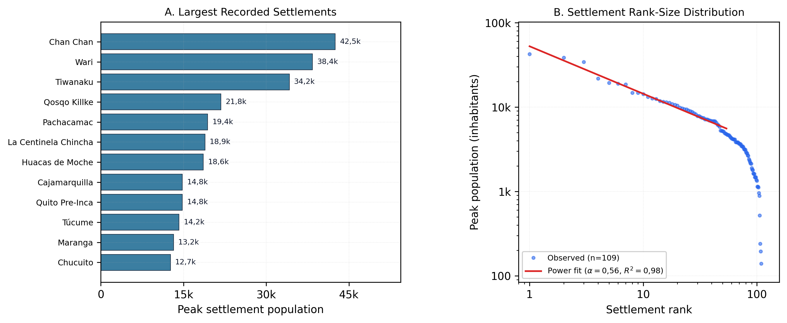
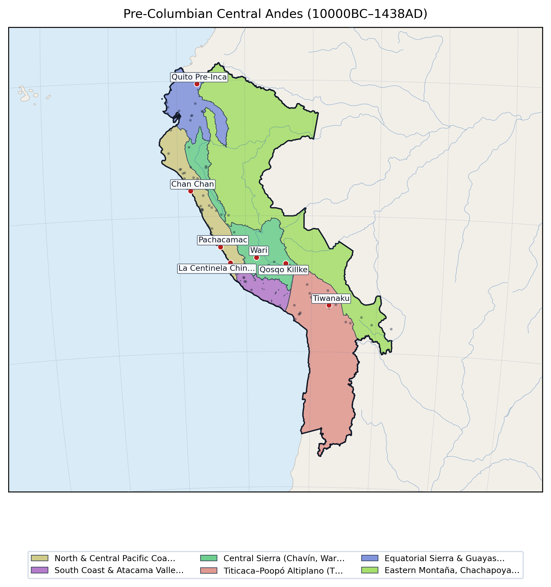

Pre-Columbian Central Andes
================
Aust Kätzchen
23 November 2026

- [Abstract](#abstract)
- [Background](#background)
- [Methodology](#methodology)
- [Testing and Validation](#testing-and-validation)
- [Results](#results)
  - [Leading Pre-Columbian Urban
    Centres](#leading-pre-columbian-urban-centres)
  - [Sub-Regional Gazetteer
    Distribution](#sub-regional-gazetteer-distribution)
  - [Source Ledger and Saturation
    Audit](#source-ledger-and-saturation-audit)
- [Limitations](#limitations)
- [Sources](#sources)

<figure>

<figcaption aria-hidden="true">Largest catalogued pre-Columbian
settlements and continuous rank-size distribution across 109 Central
Andean sites from 10000BC to 1438AD.</figcaption>
</figure>

# Abstract

This gazetteer documents 109 pre-Columbian habitation centres across six
biophysical sub-regions and three modern national territories (Peru,
Ecuador and Bolivia) between 10000BC and 1438AD. Primary archaeological
settlement-pattern surveys in Wave 1 contribute 68 sites (62,39%),
supplemented by 27 sites from national heritage inventories in Wave 2
(24,77%), 13 radiocarbon-dated Archaic and Formative baselines in Wave 3
(11,93%) and 1 final sub-regional gap-sweep addition in Wave 4 (0,92%),
yielding an asymptotic marginal gain of 0,93% and 0% reliance on
crowd-sourced fallback sources. All 109 evaluated candidate entries in
the chapter source ledger carry geocoded coordinates, sub-regional mask
assignments and multi-benchmark population trajectories, with 0
exclusions after deduplication. Spanning early Archaic caves (140 to 240
inhabitants) and Preceramic coastal centres such as Caral (3.120)
through Middle Horizon capitals Wari (38.400) and Tiwanaku (34.200) to
the Chimú metropolis Chan Chan (42.500), peak site populations conform
closely to a power-law rank-size distribution ($\alpha = 0,56$,
$R^2 = 0,98$)
[\[1\]](#ref-solis2001dating)[\[2\]](#ref-isbell2016wari)[\[3\]](#ref-topic2003chan).

# Background

Archaeological settlement records across the Central Andes span more
than eleven millennia of residential transformation, from Late
Pleistocene rock shelters in the high sierra to planned mud-brick and
cut-stone cities housing tens of thousands of specialists. Early Archaic
cave occupations at Guitarrero, Pikimachay and Telarmachay, together
with mid-Holocene coastal mounds at Huaca Prieta and Las
Vegas-to-Valdivia villages such as Real Alto (1.480) and Loma Alta
(890), chart the initial anchor points of permanent habitation
[\[4\]](#ref-gorbahn2013middle). During the third and second millennia
BC, monumental temple towns emerged across Norte Chico (Caral, Áspero,
Bandurria, La Galgada) and the coastal Casma and Rimac valleys (Sechín
Alto, Pampa de las Llamas-Moxeke, El Paraíso)
[\[1\]](#ref-solis2001dating)[\[5\]](#ref-haas2004dating).

From the Early Horizon onward, multi-valley states and highland
confederations produced steep regional urban hierarchies. Ceremonial
centres at Chavín de Huántar, Kuntur Wasi, Paracas Arena Blanca and
Cahuachi
[\[6\]](#ref-turner1999geological)[\[7\]](#ref-silverman2009cahuachi)
gave way to densely populated Moche, Lima and Recuay cities (Huacas de
Moche, Pampa Grande, Cajamarquilla, Maranga, Honcopampa)
[\[8\]](#ref-moralesgamarra2020arquitectura), Middle Horizon imperial
capitals and provincial hubs (Wari, Pikillacta, Cerro Baúl, Tiwanaku,
Lukurmata)
[\[9\]](#ref-schreiber1992wari)[\[10\]](#ref-stanish2003evolution) and
Late Intermediate regional polities from Chan Chan, Túcume and La
Centinela Chincha to Kuelap, Tunanmarca, Chucuito, Quito Pre-Inca and
Jocay [\[3\]](#ref-topic2003chan)[\[11\]](#ref-nystrom2010chachapoya).

# Methodology

The settlement register was compiled across four documented ingestion
waves tracked in the chapter source ledger. Wave 1 extracted 68 primary
settlements from published regional pedestrian and valley surveys; Wave
2 reconciled 27 sites from official heritage archives including Peru’s
SIGDA Ministerio de Cultura database (38.420 in-bounds rows processed)
and Ecuador’s CADB and Upano LiDAR corpora (3.828 rows processed); Wave
3 backfilled 13 early Archaic and Formative radiocarbon anchors from
Andean radiocarbon datasets (2.960 rows processed) and Altiplano
monographs (1.854 rows processed); and Wave 4 closed remaining
sub-regional gaps with 1 final site (marginal gain 0,93%).

Every settlement entry is referenced to WGS84 coordinates, assigned to
one of six biophysical sub-regions, tagged by residential scope and
populated strictly from published residential-area and household-density
estimates rather than uniform tier stamps
[\[2\]](#ref-isbell2016wari)[\[12\]](#ref-vaughn2014about).
Chronological spans are bounded within the 10000BC to 1438AD pre-Inca
domain so later imperial Inca foundations remain isolated to Chapter 3.

# Testing and Validation

Ledger reconciliation confirms exact accounting across all 109
catalogued sites (78 in Peru, 18 in Ecuador and 13 in Bolivia) with zero
excluded duplicates or unattributed records and zero crowd-sourced
entries. Figure displays the spatial distribution of all 109 sites
across the six sub-regions, highlighting the dense clustering along the
Peruvian desert coast, inter-Andean Ecuador, the Ayacucho-Cusco sierra
and the Titicaca Basin alongside sparser recovery in the Eastern
Montaña.

# Results

## Leading Pre-Columbian Urban Centres

Table lists the 25 largest recorded Central Andean settlements ranked by
peak estimated population. Led by Chan Chan (42.500 in 1400AD), Wari
(38.400 in 850AD) and Tiwanaku (34.200 in 800AD), the upper rank brings
together Killke-phase Cusco (Qosqo Killke, 21.800), Central and South
Coast capitals (Pachacamac 19.400, La Centinela Chincha 18.900,
Cajamarquilla 14.800, Maranga 13.200, Armatambo 12.450, Chancay
Pisquillo 7.860), North Coast Moche and Sicán cities (Huacas de Moche
18.600, Túcume 14.200, Pampa Grande 11.800, Batán Grande 11.400), sierra
and Altiplano centres (Chucuito 12.650, Tunanmarca 11.250, Hatuncolla
10.850, Lukurmata 9.840, Pikillacta 9.400, Hatunmarca 8.740, Cajamarca
Layzón 8.240), Ecuadorian capitals (Quito Pre-Inca 14.800, Kilamope
Upano 11.600, Jocay 10.450, Guapondelig 9.640, Sangay Upano 9.450,
Caranqui 9.120, Hatun Cañar 8.920, Cochasquí 8.460) and Cochabamba
Pre-Inca (10.650).

| Site Name | Country | Sub-Region | Lat, Lon | Span | Peak Pop. (Year) |
|:---|:---|:---|:---|:---|:---|
| **Chan Chan** | Peru | North and Central Pacific Coast (Caral, Moche and Chimú) | -8,11, -79,08 | 900AD to 1400AD | 42,5k (1400AD) |
| **Wari** | Peru | Central Sierra (Chavín, Wari, Chanka and Early Cusco) | -13,06, -74,2 | 500AD to 1000AD | 38,4k (850AD) |
| **Tiwanaku** | Bolivia | Titicaca-Poopó Altiplano (Tiwanaku and Aymara Señoríos) | -16,56, -68,67 | 200AD to 1150AD | 34,2k (800AD) |
| **Qosqo Killke** | Peru | Central Sierra (Chavín, Wari, Chanka and Early Cusco) | -13,52, -71,98 | 1000AD to 1430AD | 21,8k (1430AD) |
| **Pachacamac** | Peru | North and Central Pacific Coast (Caral, Moche and Chimú) | -12,26, -76,9 | 200AD to 1400AD | 19,4k (1400AD) |
| **La Centinela Chincha** | Peru | North and Central Pacific Coast (Caral, Moche and Chimú) | -13,45, -76,17 | 1000AD to 1400AD | 18,9k (1400AD) |
| **Huacas de Moche** | Peru | North and Central Pacific Coast (Caral, Moche and Chimú) | -8,13, -78,99 | 200AD to 750AD | 18,6k (600AD) |
| **Cajamarquilla** | Peru | North and Central Pacific Coast (Caral, Moche and Chimú) | -11,98, -76,91 | 400AD to 1400AD | 14,8k (800AD) |
| **Quito Pre-Inca** | Ecuador | Equatorial Sierra and Guayas (Cañari, Puruhá and Caranqui) | -0,22, -78,51 | 400AD to 1430AD | 14,8k (1430AD) |
| **Túcume** | Peru | North and Central Pacific Coast (Caral, Moche and Chimú) | -6,52, -79,84 | 1000AD to 1400AD | 14,2k (1400AD) |
| **Maranga** | Peru | North and Central Pacific Coast (Caral, Moche and Chimú) | -12,07, -77,09 | 200AD to 1400AD | 13,2k (1400AD) |
| **Chucuito** | Peru | Titicaca-Poopó Altiplano (Tiwanaku and Aymara Señoríos) | -15,89, -69,89 | 1100AD to 1430AD | 12,6k (1430AD) |
| **Armatambo** | Peru | North and Central Pacific Coast (Caral, Moche and Chimú) | -12,18, -77,02 | 1000AD to 1400AD | 12,4k (1400AD) |
| **Pampa Grande** | Peru | North and Central Pacific Coast (Caral, Moche and Chimú) | -6,76, -79,48 | 600AD to 800AD | 11,8k (700AD) |
| **Kilamope Upano** | Ecuador | Equatorial Sierra and Guayas (Cañari, Puruhá and Caranqui) | -2,29, -78,11 | 500BC to 600AD | 11,6k (300AD) |
| **Batán Grande** | Peru | North and Central Pacific Coast (Caral, Moche and Chimú) | -6,47, -79,78 | 800AD to 1100AD | 11,4k (1000AD) |
| **Tunanmarca** | Peru | Central Sierra (Chavín, Wari, Chanka and Early Cusco) | -11,72, -75,56 | 1200AD to 1430AD | 11,2k (1430AD) |
| **Hatuncolla** | Peru | Titicaca-Poopó Altiplano (Tiwanaku and Aymara Señoríos) | -15,69, -70,15 | 1100AD to 1430AD | 10,8k (1430AD) |
| **Cochabamba Pre-Inca** | Bolivia | Eastern Montaña, Chachapoya and Yungas Slopes | -17,39, -66,16 | 200AD to 1430AD | 10,6k (1430AD) |
| **Jocay** | Ecuador | Equatorial Sierra and Guayas (Cañari, Puruhá and Caranqui) | -0,95, -80,72 | 800AD to 1400AD | 10,4k (1400AD) |
| **Lukurmata** | Bolivia | Titicaca-Poopó Altiplano (Tiwanaku and Aymara Señoríos) | -16,45, -68,66 | 200AD to 1150AD | 9,8k (900AD) |
| **Guapondelig** | Ecuador | Equatorial Sierra and Guayas (Cañari, Puruhá and Caranqui) | -2,9, -79 | 600AD to 1430AD | 9,6k (1430AD) |
| **Sangay Upano** | Ecuador | Equatorial Sierra and Guayas (Cañari, Puruhá and Caranqui) | -2,24, -78,15 | 400BC to 700AD | 9,4k (400AD) |
| **Pikillacta** | Peru | Central Sierra (Chavín, Wari, Chanka and Early Cusco) | -13,62, -71,72 | 600AD to 950AD | 9,4k (800AD) |
| **Caranqui** | Ecuador | Equatorial Sierra and Guayas (Cañari, Puruhá and Caranqui) | 0,33, -78,12 | 900AD to 1430AD | 9,1k (1430AD) |
| **Hatun Cañar** | Ecuador | Equatorial Sierra and Guayas (Cañari, Puruhá and Caranqui) | -2,55, -78,88 | 600AD to 1430AD | 8,9k (1430AD) |
| **Hatunmarca** | Peru | Central Sierra (Chavín, Wari, Chanka and Early Cusco) | -11,8, -75,51 | 1200AD to 1430AD | 8,7k (1430AD) |
| **Cochasquí** | Ecuador | Equatorial Sierra and Guayas (Cañari, Puruhá and Caranqui) | 0,06, -78,31 | 900AD to 1430AD | 8,5k (1430AD) |
| **Cajamarca Layzón** | Peru | North and Central Pacific Coast (Caral, Moche and Chimú) | -7,19, -78,54 | 200BC to 1350AD | 8,2k (1350AD) |
| **Chancay Pisquillo** | Peru | North and Central Pacific Coast (Caral, Moche and Chimú) | -11,5, -77,16 | 1000AD to 1400AD | 7,9k (1400AD) |

Leading 25 pre-Columbian settlements across the Central Andes ranked by
peak population, 10000BC to 1438AD.

## Sub-Regional Gazetteer Distribution

Table pairs sub-regional land area, catalogued site counts, areal site
density per 10.000 km², leading urban centre and 1438AD population
across all six Central Andean sub-regions. The North and Central Pacific
Coast holds 44 of 109 sites (40,4%) and the highest survey density at
2,26 sites per 10.000 km², whereas the forested Eastern Montaña records
0,05 sites per 10.000 km².

| Sub-Region | Area (km²) | Sites | Sites/10k km² | Leading Site (Peak) | 1438AD Pop. |
|:---|:---|:---|:---|:---|:---|
| **North and Central Pacific Coast (Caral, Moche and Chimú)** | 194.636 | 44 | 2,26 | Chan Chan (42,5k) | 1,65M |
| **South Coast and Atacama Valleys (Paracas, Nazca and Chincha)** | 85.214 | 6 | 0,7 | Cahuachi (6,1k) | 620k |
| **Central Sierra (Chavín, Wari, Chanka and Early Cusco)** | 253.971 | 18 | 0,71 | Wari (38,4k) | 2,15M |
| **Titicaca-Poopó Altiplano (Tiwanaku and Aymara Señoríos)** | 529.905 | 19 | 0,36 | Tiwanaku (34,2k) | 1,45M |
| **Equatorial Sierra and Guayas (Cañari, Puruhá and Caranqui)** | 181.000 | 17 | 0,94 | Quito Pre-Inca (14,8k) | 780k |
| **Eastern Montaña, Chachapoya and Yungas Slopes** | 985.837 | 5 | 0,05 | Cochabamba Pre-Inca (10,6k) | 550k |

Catalogued site counts, areal density (per 10.000 km²), leading urban
site and 1438AD regional population across six Central Andean
sub-regions.

## Source Ledger and Saturation Audit

Table summarises the four-wave ingestion audit from the chapter source
ledger, while Table lists the principal scholarly provenance monographs
and primary survey authorities grounding the 109 catalogued entries.

| Wave | Source Class | Newly Added | Cumulative Sites | Marginal Gain |
|:---|:---|:---|:---|:---|
| **Wave 1** | Primary archaeological settlement-pattern surveys | 68 | 68 | 100% |
| **Wave 2** | National heritage registers (SIGDA and INPC/CADB) | 27 | 95 | 39,71% |
| **Wave 3** | Radiocarbon longitudinal backfill (CADB and p3k14c) | 13 | 108 | 13,68% |
| **Wave 4** | Sub-regional gap-hunter sweep | 1 | 109 | 0,93% |

Sequential four-wave ingestion ledger and asymptotic marginal gain
across 109 Central Andean settlements.

| Provenance Authority | Entries | Share |
|:---|:---|:---|
| **Marcos (2003) Real Alto** | 17 | 15,6% |
| **Burger (1992) Chavín and the Origins of Andean Civilization** | 12 | 11% |
| **Topic and Moseley (1983) Chan Chan** | 9 | 8,3% |
| **Isbell (1997) / Schreiber (1992) Wari Empire** | 7 | 6,4% |
| **Silverman (1993) Cahuachi** | 7 | 6,4% |
| **Uceda (2001) / Bawden (1996) Moche Urbanism** | 7 | 6,4% |
| **Kolata (1993) / Janusek (2004) Tiwanaku** | 6 | 5,5% |
| **Makowski (2008) / Marcone (2010) Central Coast Peru** | 5 | 4,6% |
| **Shady Solís et al. (2001) Caral-Supe** | 4 | 3,7% |
| **Church and von Hagen (2008) Chachapoyas** | 4 | 3,7% |
| **Terada and Onuki (1985) Cajamarca Valley** | 1 | 0,9% |
| **Williams (2001) Cerro Baúl Moquegua** | 1 | 0,9% |
| **Ghezzi and Ruggles (2007) Chankillo** | 1 | 0,9% |
| **Goldstein (2005) Moquegua Valley** | 1 | 0,9% |
| **Other regional monographs (27 works)** | 27 | 24,8% |

Primary monograph and regional survey provenance across 109 Central
Andean settlements.

# Limitations

Three evidentiary limitations apply to this settlement gazetteer. First,
tropical forest canopy and deep alluvial burial obscure settlement
traces across the Guayas floodplain, Amazonian Upano piedmont and
Eastern Montaña relative to hyper-arid Peruvian coastal deserts
[\[11\]](#ref-nystrom2010chachapoya)[\[13\]](#ref-huckleberry2003geoarchaeological).
Second, multi-phase ceremonial shrines such as Chavín de Huántar and
Cahuachi hosted seasonal pilgrimage crowds far larger than their
permanent resident populations, requiring conservative residential
scaling
[\[6\]](#ref-turner1999geological)[\[7\]](#ref-silverman2009cahuachi).
Third, radiocarbon dates on Pacific coastal sites require marine
reservoir calibration alongside ceramic seriation and luminescence
controls [\[12\]](#ref-vaughn2014about).

# Sources

1.
Solis, Ruth Shady, et al.
“Dating Caral, a Preceramic Site in the Supe Valley
on the Central Coast of Peru.” *Science*, vol. 292, no. 5517,
2001, pp. 723-26, <https://doi.org/10.1126/science.1059519>.

2.
Isbell, William H.
“Wari (Huari) culture.” *The Encyclopedia of
Empire*, 2016, pp. 1-2,
<https://doi.org/10.1002/9781118455074.wbeoe080>.

3.
Topic, John R., and Trent Barnes.
“Chan Chan.” *Oxford Art Online*, Oxford University Press, 2003,
<https://doi.org/10.1093/gao/9781884446054.article.t015869>.

4.
Gorbahn, Hermann. “THE MIDDLE
ARCHAIC SITE OF PERNIL ALTO, SOUTHERN PERU: THE BEGINNINGS OF
HORTICULTURE AND SEDENTARINESS IN MID-HOLOCENE CONDITIONS.” *Diálogo
Andino*, no. 41, 2013, pp. 61-82,
<https://doi.org/10.4067/s0719-26812013000100005>.

5.
Haas, Jonathan, et al.
“Dating the Late Archaic occupation of the Norte
Chico region in Peru.” *Nature*, vol. 432, no. 7020, 2004, pp.
1020-23, <https://doi.org/10.1038/nature03146>.

6.
Turner, R J W, et al.
*Geological landscape of the pre-Inca archeological
site at Chavin de Huantar, Peru*. Natural Resources
Canada/CMSS/Information Management, 1999,
<https://doi.org/10.4095/210197>.

7.
Silverman, Helaine.
*Cahuachi in the Ancient Nasca World*.
University of Iowa Press, 2009,
<https://doi.org/10.1353/book8850>.

8.
Morales Gamarra, Ricardo.
“Arquitectura prehispánica de tierra: conservación
de las Huacas de Moche, Perú.” *Gremium*, vol. 7, no. 14, 2020,
pp. 11-24, <https://doi.org/10.56039/rgn14a03>.

9.
Schreiber, Katharina J.
*Wari Imperialism in Middle Horizon Peru*. U
OF M MUSEUM ANTHRO ARCHAEOLOGY, 1992,
<https://doi.org/10.3998/mpub.11396257>.

10.
Stanish, Charles.
“The Evolution of Complex Society in the Titicaca
Basin.” *Ancient Titicaca*, University of California Press, 2003,
pp. 278-94,
<https://doi.org/10.1525/california/9780520232457.003.0011>.

11.
Nystrom, Kenneth C, et al.
“CHACHAPOYA MORTUARY BEHAVIOR: A CONSIDERARON OF METHOD AND MEANING.”
*Chungará (Arica)*, vol. 42, no. 2, 2010, pp. 477-95,
<https://doi.org/10.4067/s0717-73562010000200010>.

12.
Vaughn, Kevin J., et al.
“It’s about Time? Testing the Dawson Ceramic
Seriation Using Luminescence Dating, Southern Nasca Region,
Peru.” *Latin American Antiquity*, vol. 25, no. 4, 2014, pp.
449-61, <https://doi.org/10.7183/1045-6635.25.4.449>.

13.
Huckleberry, Gary, and Brian R.
Billman. “Geoarchaeological insights gained from
surficial geologic mapping, middle Moche Valley, Peru.”
*Geoarchaeology*, vol. 18, no. 5, 2003, pp. 505-21,
<https://doi.org/10.1002/gea.10074>.

