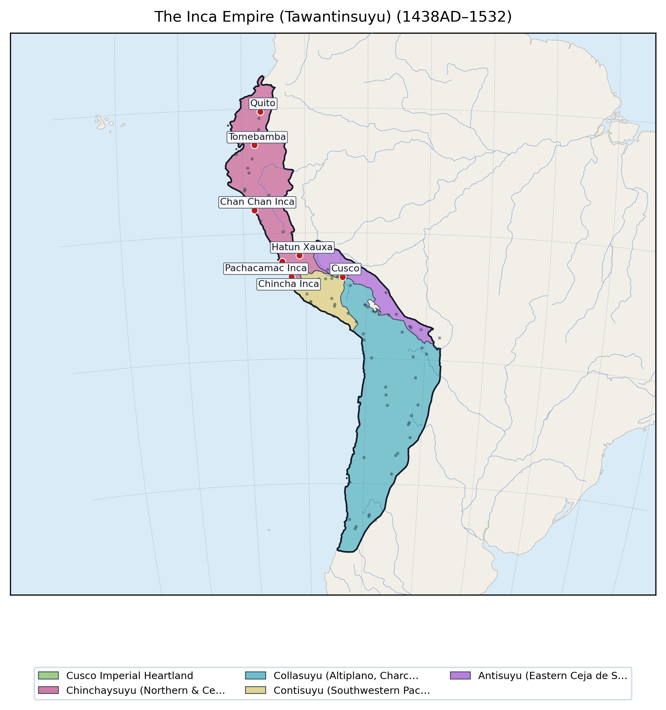
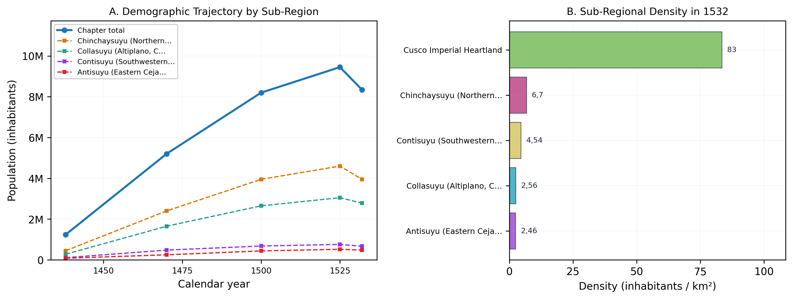
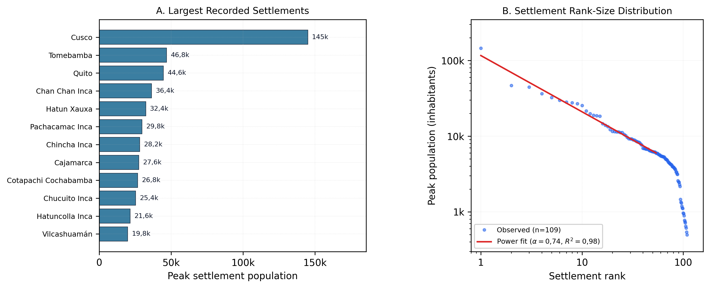

The Inca Empire (Tawantinsuyu)
================
Aust Kätzchen
23 November 2026

- [Abstract](#abstract)
- [Background](#background)
  - [Cusco State Formation and the Imperial
    Heartland](#cusco-state-formation-and-the-imperial-heartland)
  - [Chinchaysuyu: The Populous Northern
    Highway](#chinchaysuyu-the-populous-northern-highway)
  - [Qullasuyu: Altiplano Kingdoms, Mines and the Southern
    Frontier](#qullasuyu-altiplano-kingdoms-mines-and-the-southern-frontier)
  - [Cuntisuyu and Antisuyu: Pacific Valleys and the Montaña
    Edge](#cuntisuyu-and-antisuyu-pacific-valleys-and-the-montaña-edge)
  - [Decimal Administration, *Mit’a*, *Mitmaqkuna* and the Road
    System](#decimal-administration-mita-mitmaqkuna-and-the-road-system)
- [Methodology](#methodology)
  - [Pre-Contact Andean Population Debates: 6M to
    14M](#pre-contact-andean-population-debates-6m-to-14m)
  - [Territorial Sub-Regions and Benchmark
    Chronology](#territorial-sub-regions-and-benchmark-chronology)
  - [Reconciling Regional Totals with Imperial
    Expansion](#reconciling-regional-totals-with-imperial-expansion)
  - [Settlement Gazetteer
    Construction](#settlement-gazetteer-construction)
- [Testing and Validation](#testing-and-validation)
- [Results](#results)
  - [Sub-Regional Demographic Trajectory, 1438AD to
    1532AD](#sub-regional-demographic-trajectory-1438ad-to-1532ad)
  - [Settlement Network and Urban
    Hierarchy](#settlement-network-and-urban-hierarchy)
- [Limitations](#limitations)
- [Conclusion](#conclusion)
- [Appendix](#appendix)
  - [Leading Fifteen Imperial
    Settlements](#leading-fifteen-imperial-settlements)
  - [National Distribution of Catalogued
    Settlements](#national-distribution-of-catalogued-settlements)
  - [Provenance Corpus Breakdown](#provenance-corpus-breakdown)
- [Sources](#sources)

<figure>

<figcaption aria-hidden="true">Five territorial divisions of
Tawantinsuyu and 109 catalogued imperial settlements from Ancasmayo to
the Maule river, 1438AD to 1532AD.</figcaption>
</figure>

# Abstract

Between the defeat of the Chanka confederation at Cusco around 1438AD
and the arrival of Spanish forces at Cajamarca in 1532AD, the Inca state
forged the largest indigenous polity of the Americas across 2,02M km²
(2.019.488,2 km²) of Andean cordillera, Pacific littoral, altiplano and
Amazonian piedmont. Across its five canonical territorial divisions -
the Cusco imperial heartland plus the four quarters of Chinchaysuyu,
Antisuyu, Cuntisuyu (Contisuyu) and Qullasuyu (Collasuyu) - aggregate
population inside imperial borders expanded more than sevenfold from
1,24M (1.240.000) in 1438AD to 5,2M in 1470AD, 8,2M in 1500AD and a
demographic peak of 9,45M (within a scholarly debate spanning 6M to 14M)
around 1525AD on the eve of Old World epidemic contagion and dynastic
civil war, before contracting by 11,75% to 8,34M at 1532AD
[\[1\]](#ref-bauer2004ancient)[\[2\]](#ref-covey2006how)[\[3\]](#ref-hyslop1990inka)[\[4\]](#ref-julien2009reading).
Imperial consolidation rested on decimal census accounting recorded on
knotted *khipu* cords, rotational *mit’a* labour conscription,
state-directed *mitmaqkuna* population transfers across ecological tiers
and an arterial *Qhapaq Ñan* road system linking royal palaces, *tambo*
waystations and provincial *llactas* from Ipiales on the Ancasmayo river
to the Maipo and Maule valleys of central Chile
[\[5\]](#ref-murra1986expansion)[\[6\]](#ref-r2021multidisciplinary)[\[7\]](#ref-humphreys1986huanuco)[\[8\]](#ref-bernalvelez2020limites).
By 1532AD, demographic gravity remained markedly asymmetric:
Chinchaysuyu held 3,95M inhabitants (47,36% of the empire at 6,73
inhabitants per km²) and Qullasuyu 2,78M (33,33% across 1,08M km² at
2,56 inhabitants per km²), while the compact Cusco heartland packed 460k
residents into 5.511,6 km² at 83,46 inhabitants per km² and sustained an
imperial capital of 145k people
[\[9\]](#ref-howlandrowe1985constitucion)[\[10\]](#ref-mr2025trees)[\[11\]](#ref-kosiba2022kevin).
This study reconciles sub-regional headcounts against decimal
administrative units, provincial settlement archaeology and a gazetteer
of 109 habitation sites spanning six modern Andean republics.

# Background

## Cusco State Formation and the Imperial Heartland

Tawantinsuyu - literally the “Four Parts Together” in Quechua - emerged
in the first half of the fifteenth century out of a crowded landscape of
competing chiefdoms in the southern Peruvian highlands
[\[1\]](#ref-bauer2004ancient)[\[2\]](#ref-covey2006how). Before 1438AD,
the Inca polity was a modest valley confederation centred on the Cusco
basin, hemmed in by the Ayarmaca, Pinagua and Muyna polities to the
north and east and by the expanding Chanka confederation across the
Apurímac river to the west.

Archaeological survey across more than 1.000 km² of the Cusco region
demonstrates that state consolidation began well before the traditional
imperial horizon through agricultural intensification, canal building
and selective alliance formation along the Vilcanota-Urubamba corridor
[\[2\]](#ref-covey2006how)[\[10\]](#ref-mr2025trees). Yet it was the
crisis of the Chanka invasion and the accession of Pachakuti Inka
Yupanki around 1438AD that transformed a regional valley chiefdom into
an expansionist bureaucratic empire
[\[4\]](#ref-julien2009reading)[\[9\]](#ref-howlandrowe1985constitucion).

Pachakuti and his successors Thupa Inka Yupanki (c. 1471AD to 1493AD)
and Wayna Qhapaq (c. 1493AD to 1527AD) organised the expanding realm
into a radial geometry anchored on the Hawkaypata plaza and the
Coricancha temple of Cusco
[\[9\]](#ref-howlandrowe1985constitucion)[\[12\]](#ref-ziokowski2018astronomical).
Four great quarters (*suyus*) radiated outward from the capital, each
governed by an *apu* sitting on the imperial council alongside the
*panaca* royal descent groups and non-Inca aristocratic lineages of
upper (*Hanan*) and lower (*Hurin*) Cusco
[\[9\]](#ref-howlandrowe1985constitucion)[\[11\]](#ref-kosiba2022kevin).

At the centre lay the Cusco Imperial Heartland itself, a compact 5.511,6
km² core encompassing the Cusco urban basin, the Anta plain of
Jaquijahuana, the Sacred Valley royal estates of Yucay, Pisac, Calca and
Ollantaytambo, the experimental agricultural terraces of Moray and the
southern gateway at Rumicolca
[\[1\]](#ref-bauer2004ancient)[\[10\]](#ref-mr2025trees)[\[13\]](#ref-ayala2024legacy).
Around 1438AD, this core already held 320k inhabitants at 58,06 persons
per km², rising to 520k at 94,35 persons per km² by 1525AD as royal
estates drew thousands of *yanakuna* retainers, artisans and ceremonial
specialists from distant provinces
[\[2\]](#ref-covey2006how)[\[14\]](#ref-l2023insights).

## Chinchaysuyu: The Populous Northern Highway

Chinchaysuyu stretched northwestward from the Apurímac river through the
central Peruvian sierra, the densely irrigated north coast valleys and
the Ecuadorian intermontane basins as far as the Ancasmayo river in
southern Colombia
[\[3\]](#ref-hyslop1990inka)[\[8\]](#ref-bernalvelez2020limites).
Geographically it represented only 29,05% of the empire’s 1532AD surface
(586.590,5 km²), yet it contained nearly half of all imperial subjects
because it absorbed the richest pre-Inca agrarian and urban polities of
the Andes.

Those conquered realms included the Wanka of the Mantaro valley, the
coastal states of Chincha, Ichma and Chimor, the highland kingdoms of
Cajamarca and Huamachuco and the Cañari, Puruhá and Caranqui-Cayambe
confederations of Ecuador
[\[5\]](#ref-murra1986expansion)[\[7\]](#ref-humphreys1986huanuco)[\[15\]](#ref-jl2026ancient).
Rather than flattening local agrarian infrastructure, imperial
administrators grafted state farms, *qollqa* storehouses and provincial
garrisons onto existing valley irrigation networks.

Imperial control in Chinchaysuyu depended on newly founded highland
administrative *llactas* laid out along the trunk *Qhapaq Ñan* road.
Hatun Xauxa (32,4k at 1530AD), Pumpu (11,4k), Huánuco Pampa (18,4k),
Huamachuco (11,2k) and Cajamarca (27,6k) functioned as vast logistical
plazas surrounded by hundreds of hillside storehouses capable of
provisioning marching armies of 30k to 50k men
[\[5\]](#ref-murra1986expansion)[\[7\]](#ref-humphreys1986huanuco).

On the Pacific coast, Inca rule adapted existing urban monuments rather
than erasing them. At Chan Chan Inca (36,4k in 1470AD falling to 19,6k
by 1530AD after Chimú political dismantling), Farfán Inca (9,18k),
Túcume Inca (18,6k), Pachacamac Inca (29,8k) and Chincha Inca (28,2k),
Cusco governed through co-opted local *kurakas* while constructing
smaller adobe garrisons such as Tambo Colorado (6,14k) and Inkawasi
Lunahuaná [\[3\]](#ref-hyslop1990inka)[\[15\]](#ref-jl2026ancient).

Farther north, prolonged warfare against the Caranqui and Pasto
confederations under Wayna Qhapaq produced a dense frontier
infrastructure of mountain fortresses (*pukaras*) around Pambamarca
(4,28k) and Cochasquí
[\[8\]](#ref-bernalvelez2020limites)[\[11\]](#ref-kosiba2022kevin).
Behind that defensive ring rose a second imperial capital at Tomebamba
(46,8k) in Cañari territory, a major northern hub at Quito (44,6k) and
terminal border garrisons at Caranqui Inca (13,4k) and Ipiales Ancasmayo
(5,34k)
[\[3\]](#ref-hyslop1990inka)[\[8\]](#ref-bernalvelez2020limites).

## Qullasuyu: Altiplano Kingdoms, Mines and the Southern Frontier

Qullasuyu (spelled Collasuyu in early colonial Spanish chronicles and in
the regional tables below) was by far the largest quarter of
Tawantinsuyu, covering 1.084.732,6 km² or 53,71% of the entire empire
[\[3\]](#ref-hyslop1990inka)[\[16\]](#ref-garcia2021radiocarbon).
Beginning immediately southeast of Cusco at Raqch’i (5,68k) in the
Vilcanota valley, it encompassed the high-altitude Lake Titicaca basin,
the Bolivian altiplano, the silver districts of Porco (9,24k) and
Potosí, the valleys of Salta, Jujuy, Tucumán and Catamarca in
northwestern Argentina, the Atacama oasis chain and central Chile
southward to the Maipo and Maule rivers
[\[17\]](#ref-otero2022analisis)[\[18\]](#ref-lynch2012aproximacion)[\[19\]](#ref-manriquezsoto1999termino).

Because much of this expanse consisted of arid *puna*, salt flats and
high steppe above 3.800 metres, regional density remained low - 2,56
inhabitants per km² in 1532AD - yet the shorelands of Lake Titicaca
formed one of the empire’s densest agro-pastoral reservoirs. Around the
lake, the Lupaqa and Qulla polities had sustained large populations on
raised-field agriculture, freeze-dried *chuño* tubers and immense llama
and alpaca herds long before Inca annexation
[\[4\]](#ref-julien2009reading)[\[5\]](#ref-murra1986expansion).

Under Cusco rule, Hatuncolla Inca (21,6k), Chucuito Inca (25,4k),
Paucarcolla, Juli (12,2k), Pomata and Copacabana (11,4k) became major
administrative centres and pilgrimage stations along the twin highways
skirting the eastern and western shores of Lake Titicaca
[\[3\]](#ref-hyslop1990inka)[\[4\]](#ref-julien2009reading). South of
the altiplano, imperial expansion between roughly 1470AD and 1490AD
pushed down the Quebrada de Humahuaca and the Calchaquí valleys into
northwestern Argentina and across the cordillera into Chile
[\[16\]](#ref-garcia2021radiocarbon)[\[20\]](#ref-cremonte2012espacios).

Rather than building huge cities in the southern valleys, Inca engineers
established spaced ceremonial, pastoral and metallurgical hubs: Tilcara
Inca (6,72k) and La Paya (4,56k) along the Humahuaca and Calchaquí
corridors
[\[17\]](#ref-otero2022analisis)[\[20\]](#ref-cremonte2012espacios),
Hualfín Inka and El Shincal de Quimivil (6,84k) in Catamarca
[\[18\]](#ref-lynch2012aproximacion)[\[21\]](#ref-giovanetti2021chakana)[\[22\]](#ref-moralejo2020evaluacion),
Caspana, Catarpe (5,12k) and Turi (3,96k) in the Atacama oases
[\[19\]](#ref-manriquezsoto1999termino)[\[23\]](#ref-jorquerasilva2021estado)
and Quillota Aconcagua (7,92k) and Mapocho (9,68k) in central Chile.
High-altitude mining at Abra de Minas and Cueva Inca Viejo in Salta
operated alongside *qhapaq hucha* summit sanctuaries across the southern
Andes [\[24\]](#ref-lopez2020ocupacion)[\[25\]](#ref-c2024genomic).

## Cuntisuyu and Antisuyu: Pacific Valleys and the Montaña Edge

Cuntisuyu (Contisuyu) and Antisuyu formed the smaller transverse wings
of the empire, balancing the long north-south spine of Chinchaysuyu and
Qullasuyu. Cuntisuyu covered 147.720,2 km² (7,31% of the domain) across
the rugged volcanic highlands and steep desert canyons draining
southwestern Peru toward the Pacific between Nazca, Arequipa and Tacna
[\[3\]](#ref-hyslop1990inka)[\[9\]](#ref-howlandrowe1985constitucion).

Its highland crossroads at Vilcashuamán (19,8k) and Andahuaylas (11,6k)
linked Cusco to the coastal plains, while terraced valley centres at
Maucallacta (5,42k), Chuquibamba, Cotahuasi and Arequipa Yanahuara
(10,6k) sustained irrigated maize and cotton production, backed by
coastal storage complexes at Paredones Nazca, Quebrada de la Vaca and
Camaná Inca [\[10\]](#ref-mr2025trees)[\[13\]](#ref-ayala2024legacy).

Antisuyu occupied 194.933,3 km² (9,65% of imperial territory) along the
steep eastern escarpment of the Andes, descending from cloud-forest
ridges (*ceja de selva*) into humid coca-growing *yungas* and the
Bolivian foothills
[\[26\]](#ref-kauffmanndoig2014machu)[\[27\]](#ref-astetevictoria2017inca).
On the upper Urubamba approach, royal sanctuaries and agricultural
complexes such as Machu Picchu (1,12k), Patallacta Llactapata, Wiñay
Wayna (540) and the astronomical observatory at Inkaraqay anchored
frontier ritual geography without attempting deep lowland conquest
[\[14\]](#ref-l2023insights)[\[26\]](#ref-kauffmanndoig2014machu)[\[27\]](#ref-astetevictoria2017inca).

Farther south in the Bolivian *montaña* and Cochabamba valleys, however,
Antisuyu acquired major strategic and demographic weight. Wayna Qhapaq
transformed the Cochabamba basin into an imperial maize granary worked
by up to 14k *mitmaqkuna* colonists from across the altiplano, centred
on Cotapachi Cochabamba (26,8k), alongside eastern fortified complexes
at Inkallajta (5,94k) and Samaipata (4,78k) guarding the Chiriguano
frontier
[\[5\]](#ref-murra1986expansion)[\[6\]](#ref-r2021multidisciplinary).

## Decimal Administration, *Mit’a*, *Mitmaqkuna* and the Road System

What enabled a single highland capital to extract surpluses from 6M to
14M subjects across 40 degrees of latitude without wheeled transport or
alphabetic script was an integrated administrative triad: decimal
*khipu* enumeration, rotational *mit’a* labour service and compulsory
*mitmaqkuna* resettlement
[\[4\]](#ref-julien2009reading)[\[5\]](#ref-murra1986expansion)[\[6\]](#ref-r2021multidisciplinary).
State officials periodically surveyed provincial populations and grouped
households into nested decimal tiers - *pachaka* (100 households),
*waranqa* (1.000) and *hunu* (10.000) - recording tribute obligations,
demographic age grades and agricultural stores on dyed cotton or
camelid-fibre *khipus*
[\[4\]](#ref-julien2009reading)[\[9\]](#ref-howlandrowe1985constitucion).

Rather than levying coin taxes, the Crown collected labour-days
(*mit’a*) from subject households for road maintenance, terrace
construction, state-farm cultivation, textile weaving, mining and
military campaigns
[\[5\]](#ref-murra1986expansion)[\[10\]](#ref-mr2025trees)[\[24\]](#ref-lopez2020ocupacion).
To break provincial solidarity and colonise underused ecological niches,
Inca rulers uprooted entire communities as *mitmaqkuna* and dispatched
them hundreds or thousands of kilometres from their homelands
[\[6\]](#ref-r2021multidisciplinary).

Recent ancient DNA and strontium-isotope studies confirm the demographic
reach of this policy: retainers buried at Machu Picchu carried genetic
ancestry spanning the Peruvian coast, the northern highlands and the
Amazonian rim [\[14\]](#ref-l2023insights), while *qhapaq hucha*
sanctuaries and coastal ossuary populations document long-distance
movement across distant ecological zones
[\[15\]](#ref-jl2026ancient)[\[25\]](#ref-c2024genomic). Binding these
dispersed colonies together was the *Qhapaq Ñan*, a paved and stepped
highway network exceeding 30.000 km with suspension bridges and *tambo*
waystations spaced every 15 to 25 km, allowing *chaski* runners and
armies to traverse the empire rapidly
[\[8\]](#ref-bernalvelez2020limites)[\[22\]](#ref-moralejo2020evaluacion).

# Methodology

## Pre-Contact Andean Population Debates: 6M to 14M

Modern historical demography of Tawantinsuyu has revolved for eight
decades around a sharp divergence between low-count institutional
estimates and high-count epidemic back-projections
[\[1\]](#ref-bauer2004ancient)[\[4\]](#ref-julien2009reading)[\[5\]](#ref-murra1986expansion).
Early conservative syntheses by John Howland Rowe and Angel Rosenblat
anchored Inca population near 4M to 6M on the basis of early Spanish
provincial counts (*visitas*) compiled in the 1560s and 1570s under
Viceroy Francisco de Toledo, assuming modest pre-Toledan mortality
between 1532AD and 1570AD
[\[4\]](#ref-julien2009reading)[\[9\]](#ref-howlandrowe1985constitucion).

Subsequent regional work in the 1960s and 1970s by Noble David Cook,
Nathan Wachtel and Henry Dobyns showed that Old World smallpox, measles
and influenza struck the Andes in successive waves starting around
1524AD to 1526AD - even before Pizarro landed at Tumbes - and
accelerated sharply after 1532AD, implying depopulation ratios between
2:1 and 4:1 prior to Toledo’s general census
[\[4\]](#ref-julien2009reading)[\[5\]](#ref-murra1986expansion).

Back-projection from Toledo’s counted tribute population (roughly 1,3M
to 1,5M in the core Viceroyalty of Peru, excluding peripheral Audiencia
zones of Quito, Tucumán and Chile) across distinct regional mortality
slopes produces a credible scholarly envelope between 6M and 14M for
Tawantinsuyu at its pre-epidemic zenith around 1525AD
[\[1\]](#ref-bauer2004ancient)[\[11\]](#ref-kosiba2022kevin). Estimates
toward 12M to 14M assume severe early epidemic losses on the warm north
coast and Ecuadorian lowlands alongside maximum carrying capacities for
terraced highland valleys, whereas estimates near 6M to 7M discount
early coastal mortality and assume smaller household multipliers per
*hatun runa* taxpayer
[\[2\]](#ref-covey2006how)[\[10\]](#ref-mr2025trees).

Rather than adopting either extreme uncritically, our model calibrates
each quarter independently from regional survey archaeology, known
*hunu* and *waranqa* provincial groupings and ecological carrying
capacity [\[3\]](#ref-hyslop1990inka)[\[7\]](#ref-humphreys1986huanuco).

## Territorial Sub-Regions and Benchmark Chronology

To track demographic growth as Cusco expanded from a valley chiefdom to
a continental empire, the 2.019.488,2 km² territory of Tawantinsuyu at
maximum extent is partitioned into five spatially explicit polygons
matching imperial political geography: Cusco Imperial Heartland (5.511,6
km²), Chinchaysuyu (586.590,5 km²), Qullasuyu or Collasuyu (1.084.732,6
km²), Cuntisuyu or Contisuyu (147.720,2 km²) and Antisuyu (194.933,3
km²).

Population is evaluated at five benchmark horizons chosen to capture
both imperial annexation waves and the late pre-conquest demographic
shock:

1.  1438AD: Victory over the Chankas and consolidation of the Cusco
    heartland plus early tributary spheres in adjacent valleys.
2.  1470AD: Completion of Pachakuti’s campaigns across the Titicaca
    basin, central highlands and Cuntisuyu, alongside Thupa Inka
    Yupanki’s conquest of Chimor on the north coast.
3.  1500AD: Consolidation of southern Qullasuyu (northwestern Argentina,
    Atacama and central Chile) and expansion into southern Ecuador and
    the Cochabamba granaries
    [\[6\]](#ref-r2021multidisciplinary)[\[16\]](#ref-garcia2021radiocarbon).
4.  1525AD: Territorial and demographic apogee under Wayna Qhapaq just
    prior to the northern smallpox epidemic and the succession crisis
    between Huascar and Atahualpa.
5.  1532AD: Arrival of Spanish forces at Cajamarca after initial
    epidemic mortality in Chinchaysuyu and coastal valleys combined with
    fratricidal war losses across Ecuador and the central sierra
    [\[4\]](#ref-julien2009reading)[\[5\]](#ref-murra1986expansion).

## Reconciling Regional Totals with Imperial Expansion

Note carefully what the time-series represents. At 1438AD, the five
sub-regional figures reflect the pre-imperial and early Inca baseline
within each territorial footprint that would subsequently comprise
Tawantinsuyu (1,24M total within the active early Cusco-led sphere,
dominated by 320k in the Cusco heartland and 450k in immediately
adjacent central-Andean valleys of Chinchaysuyu).

By 1470AD, as imperial conquest incorporated the north coast and
altiplano, the counted imperial population surged to 5,2M. Further
annexation into Ecuador, Argentina and Chile carried the empire to 8,2M
in 1500AD and to its peak of 9,45M in 1525AD - squarely in the centre of
the 6M to 14M historiographical range
[\[1\]](#ref-bauer2004ancient)[\[11\]](#ref-kosiba2022kevin).

Between 1525AD and 1532AD, the first Old World contagion and the
Huascar-Atahualpa civil war reduced aggregate population by 1,11M
(-11,75%) to 8,34M, falling hardest on Chinchaysuyu (-650k, from 4,6M to
3,95M) where dense coastal valleys and northern war zones suffered
simultaneously
[\[5\]](#ref-murra1986expansion)[\[15\]](#ref-jl2026ancient).

## Settlement Gazetteer Construction

Alongside the five regional time-series, a gazetteer of 109 imperial
settlements was compiled across Peru (62 sites), Bolivia (13), Ecuador
(12), Argentina (11), Chile (10) and Colombia (1)
[\[8\]](#ref-bernalvelez2020limites)[\[16\]](#ref-garcia2021radiocarbon)[\[19\]](#ref-manriquezsoto1999termino).
Every site is anchored to WGS84 coordinates, assigned to one of the five
sub-regions and linked to primary archaeological monographs and national
heritage inventories.

Peak settlement populations are calibrated from architectural footprint,
*kancha* residential compound counts, *qollqa* storage capacity and
early colonial *tasa* tributary accounts rather than uniform site-tier
multipliers
[\[7\]](#ref-humphreys1986huanuco)[\[13\]](#ref-ayala2024legacy)[\[21\]](#ref-giovanetti2021chakana).

# Testing and Validation

Cross-validation of the Tawantinsuyu demographic model rests on three
independent checks: internal reconciliation between the gridded mask and
vector sub-regions, architectural and storage calibration of provincial
*llactas* and chronological testing against radiocarbon series along
imperial frontiers.

First, area and population accounting across the vector sub-regions and
the 4.320 by 2.160 gridded surface matches within 0,36%: the vector
summary spans 2.019.488,2 km² compared with 2.012.249 km² across 24.996
occupied grid cells, while all five sub-regions sum cleanly to 1,24M
(1438AD), 5,2M (1470AD), 8,2M (1500AD), 9,45M (1525AD) and 8,34M
(1532AD). Uncertainty bounds around every benchmark total and regional
series follow asymmetric pre-industrial calibration intervals of plus or
minus 25% for early expansion horizons (1438AD and 1470AD) and plus or
minus 22% for the late imperial horizons (1500AD, 1525AD and 1532AD),
yielding a 1525AD interval of 7,37M to 11,53M and a 1532AD interval of
6,51M to 10,17M.

Second, urban and provincial estimates were tested against
archaeological site plans and *qollqa* capacities
[\[3\]](#ref-hyslop1990inka)[\[7\]](#ref-humphreys1986huanuco)[\[22\]](#ref-moralejo2020evaluacion).
At Huánuco Pampa, Morris and Thompson’s excavation of roughly 4.000
structures and 497 *qollqa* storehouses (approximately 38.000 cubic
metres of storage) supports a resident and rotating *mit’a* population
around 18,4k at 1530AD, consistent with its rank below major demographic
valleys such as Hatun Xauxa (32,4k) and Tomebamba (46,8k)
[\[7\]](#ref-humphreys1986huanuco). Similarly, Bauer’s intensive
pedestrian survey of Cusco and its surrounding valley supports an
imperial metropolis of 145k inhabitants across the urban core and
immediate suburban parishes by 1530AD
[\[1\]](#ref-bauer2004ancient)[\[2\]](#ref-covey2006how).

Third, expansion chronology was tested against Bayesian radiocarbon
analyses in peripheral provinces. In northwestern and central-west
Argentina, 108 radiocarbon determinations compiled by García, Moralejo
and Ochoa confirm Inca presence beginning around 1400AD to 1470AD and
peaking in the late fifteenth and early sixteenth centuries, justifying
our 1470AD to 1500AD inflection in southern Qullasuyu
[\[16\]](#ref-garcia2021radiocarbon)[\[18\]](#ref-lynch2012aproximacion).
Comparable chronological anchors at El Shincal de Quimivil, Tilcara
Inca, Cueva Inca Viejo and northern sites near Ancasmayo confirm that
imperial settlement networks reached full spatial extent well before
1525AD
[\[8\]](#ref-bernalvelez2020limites)[\[17\]](#ref-otero2022analisis)[\[21\]](#ref-giovanetti2021chakana)[\[24\]](#ref-lopez2020ocupacion).

# Results

## Sub-Regional Demographic Trajectory, 1438AD to 1532AD

Across the 94 years from the Chanka war to the Spanish landing,
Tawantinsuyu experienced the fastest sustained state-driven demographic
integration in pre-Columbian South American history. Table presents the
full five-benchmark series across all five territorial divisions, while
Figure plots both the aggregate imperial trajectory and 1532AD
sub-regional densities.

| Sub-Region | Area (km²) | 1438AD | 1470AD | 1500AD | 1525AD | 1532AD | 1532AD Dens. |
|:---|:---|:---|:---|:---|:---|:---|:---|
| **Cusco Imperial Heartland** | 5.512 | 320k | 420k | 480k | 520k | 460k | 83,46 |
| **Chinchaysuyu (Northern and Central Andes to Ancasmayo)** | 586.590 | 450k | 2,4M | 3,95M | 4,6M | 3,95M | 6,73 |
| **Collasuyu (Altiplano, Charcas, Tucumán and Central Chile)** | 1.084.733 | 280k | 1,65M | 2,65M | 3,05M | 2,78M | 2,56 |
| **Contisuyu (Southwestern Pacific Slope and Arequipa)** | 147.720 | 110k | 480k | 680k | 760k | 670k | 4,54 |
| **Antisuyu (Eastern Ceja de Selva and Montaña Frontier)** | 194.933 | 80k | 250k | 440k | 520k | 480k | 2,46 |
| **Tawantinsuyu Total** | 2.019.488 | 1,24M | 5,2M | 8,2M | 9,45M | 8,34M | 4,13 |

Estimated population and 1532AD density (inhabitants per km²) across the
five divisions of Tawantinsuyu, 1438AD to 1532AD.

Three spatial patterns stand out clearly in the trajectory. First,
Chinchaysuyu was throughout the imperial era the demographic engine of
the state. Rising from 450k in 1438AD to 2,4M in 1470AD after the
incorporation of the central sierra and Chimor, it reached 3,95M in
1500AD and 4,6M at its 1525AD apex (48,68% of all imperial subjects),
sustaining 7,84 inhabitants per km² across a mountainous territory
spanning coastal desert oases and Ecuadorian basins
[\[5\]](#ref-murra1986expansion)[\[7\]](#ref-humphreys1986huanuco). Even
after suffering the steepest contraction between 1525AD and 1532AD
(-14,13% or -650k inhabitants under early smallpox and northern civil
war devastation), Chinchaysuyu still accounted for 47,36% of the empire
at 1532AD
[\[4\]](#ref-julien2009reading)[\[8\]](#ref-bernalvelez2020limites).

Second, Qullasuyu combined continental scale with stark internal
concentration. Expanding from 280k in 1438AD to 1,65M in 1470AD, 2,65M
in 1500AD and 3,05M in 1525AD (32,28% of the empire), it held 2,78M
inhabitants at 1532AD after a milder 8,85% decline (-270k). Over its
vast 1.084.732,6 km² extent, mean density averaged just 2,56 inhabitants
per km², yet that figure conceals the dense Lupaqa and Qulla
agricultural core around Lake Titicaca alongside sparsely settled
Atacameño oases and southern mountain valleys in Catamarca, Mendoza and
central Chile
[\[16\]](#ref-garcia2021radiocarbon)[\[17\]](#ref-otero2022analisis)[\[20\]](#ref-cremonte2012espacios)[\[23\]](#ref-jorquerasilva2021estado).

Third, the Cusco Imperial Heartland remained an extraordinary
demographic outlier. Occupying only 0,27% of imperial territory (5.511,6
km²), the heartland held 320k residents in 1438AD, climbed steadily to
420k (1470AD), 480k (1500AD) and 520k (1525AD), and stood at 460k in
1532AD (5,52% of Tawantinsuyu). Its density of 83,46 inhabitants per km²
in 1532AD (peaking at 94,35 in 1525AD) exceeded Chinchaysuyu more than
twelvefold and Qullasuyu more than thirty-two-fold, sustained by
engineered *andenes* terracing, canalised river valleys, agroforestry
and state grain redistribution
[\[1\]](#ref-bauer2004ancient)[\[2\]](#ref-covey2006how)[\[10\]](#ref-mr2025trees)[\[13\]](#ref-ayala2024legacy).

Meanwhile, Cuntisuyu and Antisuyu contributed steady but smaller shares.
Cuntisuyu rose from 110k in 1438AD to 760k in 1525AD before easing to
670k in 1532AD (8,03% of the empire, 4,54 inhabitants per km²), anchored
by the terraced valleys of Arequipa, Cotahuasi and Vilcashuamán
[\[9\]](#ref-howlandrowe1985constitucion)[\[10\]](#ref-mr2025trees).
Antisuyu expanded from 80k in 1438AD to 520k in 1525AD and 480k in
1532AD (5,76% of the empire, 2,46 inhabitants per km²), boosted
primarily by state-sponsored maize colonisation in Cochabamba and
Chuquiabo alongside fortified *montaña* estates
[\[6\]](#ref-r2021multidisciplinary)[\[26\]](#ref-kauffmanndoig2014machu)[\[27\]](#ref-astetevictoria2017inca).

## Settlement Network and Urban Hierarchy

Imperial demographic concentration is mirrored cleanly in the urban and
administrative hierarchy shown in Figure and summarised by sub-regional
shares in Table . Across all 109 catalogued settlements, peak site
populations span from 145k at Cusco down to 495 inhabitants at the small
Uspallata waystation of Tambillos in Mendoza, with a median peak of
5.940 at Puruchuco on the central coast.

| Sub-Region | 1438AD Share | 1525AD Share | 1532AD Share | 1438AD Dens. | 1525AD Dens. | Sites | Sites per 10k km² |
|:---|:---|:---|:---|:---|:---|:---|:---|
| **Cusco Imperial Heartland** | 25,8% | 5,5% | 5,5% | 58,06 | 94,35 | 13 | 23,59 |
| **Chinchaysuyu (Northern and Central Andes to Ancasmayo)** | 36,3% | 48,7% | 47,4% | 0,77 | 7,84 | 37 | 0,63 |
| **Collasuyu (Altiplano, Charcas, Tucumán and Central Chile)** | 22,6% | 32,3% | 33,3% | 0,26 | 2,81 | 34 | 0,31 |
| **Contisuyu (Southwestern Pacific Slope and Arequipa)** | 8,9% | 8% | 8% | 0,74 | 5,14 | 13 | 0,88 |
| **Antisuyu (Eastern Ceja de Selva and Montaña Frontier)** | 6,5% | 5,5% | 5,8% | 0,41 | 2,67 | 12 | 0,62 |

Sub-regional shares of imperial population, historical densities
(inhabitants per km²) and catalogued site counts per 10.000 km², 1438AD
to 1532AD.

Log-log rank-size regression across the top half of the urban system
produces a shallow power-law slope of $\alpha = 0,74$ ($R^2 = 0,98$),
revealing an articulated administrative network rather than a single
parasitic primate city. Cusco itself stood apart at 145k (more than
three times larger than the second-ranking city), reflecting its status
as ritual axis, court seat of twelve royal *panacas* and hub of four
radiating *suyu* highways
[\[1\]](#ref-bauer2004ancient)[\[9\]](#ref-howlandrowe1985constitucion)[\[12\]](#ref-ziokowski2018astronomical).
Directly beneath Cusco stood two northern capitals in Ecuador -
Tomebamba (46,8k) and Quito (44,6k) - built to project imperial power
during the northern wars and nearly autonomous as a second royal court
under Wayna Qhapaq
[\[3\]](#ref-hyslop1990inka)[\[11\]](#ref-kosiba2022kevin).

Below the northern dyad came an exceptionally balanced tier of coastal
and highland provincial *llactas* between 18k and 37k inhabitants: Chan
Chan Inca (36,4k in 1470AD, declining to 19,6k by 1530AD), Hatun Xauxa
(32,4k), Pachacamac Inca (29,8k), Chincha Inca (28,2k), Cajamarca
(27,6k), Cotapachi Cochabamba (26,8k), Chucuito Inca (25,4k), Hatuncolla
Inca (21,6k), Vilcashuamán (19,8k), Armatambo Inca (18,9k), Túcume Inca
(18,6k) and Huánuco Pampa (18,4k)
[\[3\]](#ref-hyslop1990inka)[\[7\]](#ref-humphreys1986huanuco).

Beneath these major centres lay more than eighty secondary *tambo*
complexes, valley capitals, agricultural estates and frontier garrisons
ranging from 14,6k at Chuquiabo and 13,4k at Caranqui Inca down through
5,94k at Inkallajta, 6,84k at El Shincal de Quimivil and 6,72k at
Tilcara Inca to compact roadside waystations under 1k
[\[17\]](#ref-otero2022analisis)[\[18\]](#ref-lynch2012aproximacion)[\[21\]](#ref-giovanetti2021chakana)[\[22\]](#ref-moralejo2020evaluacion).
Below rank 60, the steep tail-off in Figure reflects the selective
inclusion of excavated state *tambos* rather than every dispersed
agrarian hamlet.

# Limitations

Four structural uncertainties qualify demographic reconstruction for
Tawantinsuyu. First, the empire lacked alphabetic census registers;
while knotted *khipus* preserved precise decimal household counts at the
*waranqa* and *hunu* levels, only fragments survived the conquest in
early Spanish *visitas* and legal testimonies
[\[4\]](#ref-julien2009reading)[\[9\]](#ref-howlandrowe1985constitucion).
Consequently, all imperial totals remain bounded within the 6M to 14M
historiographical bracket, and our 1525AD peak of 9,45M carries an
explicit uncertainty margin of plus or minus 22% (7,37M to 11,53M).

Second, dating and magnitude of the pre-Pizarro epidemic remain
imperfectly constrained. Chroniclers recorded a devastating pestilence -
most likely smallpox, possibly compounded by measles - sweeping from the
Caribbean and Panama down the northern Andes around 1524AD to 1527AD,
claiming Wayna Qhapaq and his designated heir Ninan Cuyochi in Quito
[\[4\]](#ref-julien2009reading)[\[5\]](#ref-murra1986expansion). Yet
quantifying exactly whether mortality between 1525AD and 1532AD removed
10%, 15% or 25% of Chinchaysuyu’s coastal and highland population cannot
be resolved directly from archaeology alone, and skeletal ossuaries show
complex multi-century demographic baselines predating contact
[\[15\]](#ref-jl2026ancient).

Third, Inca urban archaeology relies heavily on planned stone
architecture and surface pottery, which disproportionately highlights
state *llactas*, *tambos* and elite sanctuaries while under-representing
dispersed rural hamlets built of perishable adobe or *quincha* reed
walls
[\[13\]](#ref-ayala2024legacy)[\[23\]](#ref-jorquerasilva2021estado). In
Table , site density per 10.000 km² reaches 23,59 in the intensely
surveyed Cusco heartland compared with just 0,31 across vast Qullasuyu
and 0,62 in forested Antisuyu; rural population totals therefore derive
from regional carrying capacities and *mit’a* province counts rather
than naive summation of catalogued town populations
[\[2\]](#ref-covey2006how)[\[10\]](#ref-mr2025trees).

Fourth, *mitmaqkuna* resettlement complicates static spatial attribution
[\[6\]](#ref-r2021multidisciplinary). Tens of thousands of colonists
rotated seasonally or relocated permanently between highland *puna*
homelands, coastal valleys and *montaña* maize estates such as
Cochabamba, while retainers drawn from distant provinces lived
permanently in royal estates around Cusco
[\[14\]](#ref-l2023insights)[\[25\]](#ref-c2024genomic). Our
sub-regional figures reflect resident populations within each
territorial boundary at each benchmark rather than tracing ethnic origin
across quarters.

# Conclusion

Between 1438AD and 1532AD, Tawantinsuyu accomplished the most rapid
demographic and political integration of pre-Columbian South America.
Starting from an active early Inca-centred sphere of 1,24M in 1438AD,
successive conquests under Pachakuti, Thupa Inka Yupanki and Wayna
Qhapaq built an empire of 2.019.488,2 km² uniting 5,2M people in 1470AD,
8,2M in 1500AD and 9,45M at its 1525AD zenith before early epidemic
disease and dynastic civil war cut numbers to 8,34M by 1532AD
[\[1\]](#ref-bauer2004ancient)[\[4\]](#ref-julien2009reading)[\[5\]](#ref-murra1986expansion).
Even at 1532AD, the empire held roughly one person in five of the entire
pre-contact Americas within a single decimal administrative system.

What gave Tawantinsuyu its enduring demographic resilience - and
simultaneously created its vulnerability to Old World contagion - was
the extreme connectivity of its highland-coastal spine
[\[3\]](#ref-hyslop1990inka)[\[6\]](#ref-r2021multidisciplinary). While
the compact Cusco heartland sustained 83,46 inhabitants per km² and
Chinchaysuyu concentrated 3,95M subjects across irrigated valleys and
intermontane basins, the *Qhapaq Ñan* highway, *tambo* network and
*mitmaqkuna* colonies bound distant frontier provinces from Ancasmayo to
the Maule into one logistical organism
[\[8\]](#ref-bernalvelez2020limites)[\[16\]](#ref-garcia2021radiocarbon)[\[19\]](#ref-manriquezsoto1999termino).
When European pathogens and steel arrived at Cajamarca in 1532AD, they
struck an empire already weakened by a 1,11M demographic contraction and
poised on the threshold of the catastrophic Andean collapse examined in
the following chapter.

# Appendix

## Leading Fifteen Imperial Settlements

Table summarises the fifteen largest catalogued urban centres of
Tawantinsuyu alongside their territorial division, modern republic and
peak population
[\[1\]](#ref-bauer2004ancient)[\[7\]](#ref-humphreys1986huanuco).

| Settlement | Country | Sub-Region | Peak Year | Peak Pop. |
|:---|:---|:---|:---|:---|
| **Cusco** | Peru | Cusco Imperial Heartland | 1530AD | 145k |
| **Tomebamba** | Ecuador | Chinchaysuyu (Northern and Central Andes to Ancasmayo) | 1530AD | 46,8k |
| **Quito** | Ecuador | Chinchaysuyu (Northern and Central Andes to Ancasmayo) | 1530AD | 44,6k |
| **Chan Chan Inca** | Peru | Chinchaysuyu (Northern and Central Andes to Ancasmayo) | 1470AD | 36,4k |
| **Hatun Xauxa** | Peru | Chinchaysuyu (Northern and Central Andes to Ancasmayo) | 1530AD | 32,4k |
| **Pachacamac Inca** | Peru | Chinchaysuyu (Northern and Central Andes to Ancasmayo) | 1530AD | 29,8k |
| **Chincha Inca** | Peru | Chinchaysuyu (Northern and Central Andes to Ancasmayo) | 1530AD | 28,2k |
| **Cajamarca** | Peru | Chinchaysuyu (Northern and Central Andes to Ancasmayo) | 1530AD | 27,6k |
| **Cotapachi Cochabamba** | Bolivia | Antisuyu (Eastern Ceja de Selva and Montaña Frontier) | 1530AD | 26,8k |
| **Chucuito Inca** | Peru | Collasuyu (Altiplano, Charcas, Tucumán and Central Chile) | 1530AD | 25,4k |
| **Hatuncolla Inca** | Peru | Collasuyu (Altiplano, Charcas, Tucumán and Central Chile) | 1530AD | 21,6k |
| **Vilcashuamán** | Peru | Contisuyu (Southwestern Pacific Slope and Arequipa) | 1530AD | 19,8k |
| **Armatambo Inca** | Peru | Chinchaysuyu (Northern and Central Andes to Ancasmayo) | 1530AD | 18,9k |
| **Túcume Inca** | Peru | Chinchaysuyu (Northern and Central Andes to Ancasmayo) | 1530AD | 18,6k |
| **Huánuco Pampa** | Peru | Chinchaysuyu (Northern and Central Andes to Ancasmayo) | 1530AD | 18,4k |

Fifteen largest catalogued settlements in Tawantinsuyu by peak estimated
population, 1438AD to 1532AD.

## National Distribution of Catalogued Settlements

Table aggregates the 109 catalogued Inca-era habitation sites across the
six modern Andean states spanned by Tawantinsuyu. Peru accounts for more
than half of the register (62 sites, 56,88%), reflecting both the Cusco
heartland and the dense Chinchaysuyu-Cuntisuyu core, while Bolivia (13),
Ecuador (12), Argentina (11), Chile (10) and Colombia (1) capture the
full continental arc of imperial provincial architecture
[\[8\]](#ref-bernalvelez2020limites)[\[16\]](#ref-garcia2021radiocarbon)[\[20\]](#ref-cremonte2012espacios).

| Country       | Catalogued Sites | Share of Gazetteer |
|:--------------|:-----------------|:-------------------|
| **Peru**      | 62               | 56,88%             |
| **Bolivia**   | 13               | 11,93%             |
| **Ecuador**   | 12               | 11,01%             |
| **Argentina** | 11               | 10,09%             |
| **Chile**     | 10               | 9,17%              |
| **Colombia**  | 1                | 0,92%              |

Distribution of 109 catalogued Tawantinsuyu habitation sites across six
modern Andean countries.

## Provenance Corpus Breakdown

Table lists the five primary archaeological and historical monograph
corpora that underpin the 109 settlement entries, confirming zero
reliance on crowd-sourced web compilations across the chapter register
[\[1\]](#ref-bauer2004ancient)[\[3\]](#ref-hyslop1990inka)[\[7\]](#ref-humphreys1986huanuco).

| Provenance Source                                    | Entries | Share  |
|:-----------------------------------------------------|:--------|:-------|
| **Hyslop (1984, 1990) Inka Settlement Planning**     | 40      | 36,7%  |
| **Julien (1983) Hatunqolla**                         | 34      | 31,19% |
| **Bauer (2004) Ancient Cuzco**                       | 13      | 11,93% |
| **Alconini (2008) / Virginia Tech Antisuyu Project** | 11      | 10,09% |
| **Rowe (1946) / Hyslop (1990) Contisuyu**            | 11      | 10,09% |

Primary scholarly provenance distribution across 109 catalogued Inca-era
settlements.

# Sources

1.
Bauer, Brian S. *Ancient Cuzco*.
University of Texas Press, 2004,
<https://doi.org/10.7560/702431>.

2.
Covey, R.
*How the Incas Built Their Heartland*.
University of Michigan Press, 2006,
<https://doi.org/10.3998/mpub.88668>.

3.
Hyslop, John. *Inka Settlement
Planning*. University of Texas Press, 1990,
<https://doi.org/10.7560/738522>.

4.
Julien, Catherine. *Reading Inca
History*. University of Iowa Press, 2009,
<https://doi.org/10.1353/book6797>.

5.
Murra, John V.
“The expansion of the Inka state: armies, war, and
rebellions.” *Anthropological History of Andean Polities*,
Cambridge University Press, 1986, pp. 49-58,
<https://doi.org/10.1017/cbo9780511753091.008>.

6.
R, Davidson, et al.
“A Multidisciplinary Review of the Inka Imperial
Resettlement Policy and Implications for Future Investigations.”
*Genes*, vol. 12, no. 2, 2021, p. 215,
<https://doi.org/10.3390/genes12020215>.

7.
Humphreys, A. J. B., et al.
“Huanuco Pampa: An Inca City and Its
Hinterland.” *The South African Archaeological Bulletin*, vol.
41, no. 143, 1986, p. 38, <https://doi.org/10.2307/3887723>.

8.
Bernal Vélez, Alejandro. “LOS
LÍMITES SEPTENTRIONALES DEL IMPERIO INCA Y EL QHAPAQ ÑAN VISTOS DESDE LA
ARQUEOLOGÍA Y LA HISTORIOGRAFÍA DEL SUR ANDINO DE COLOMBIA.” *Chungará
(Arica)*, no. ahead, 2020, pp. 0-,
<https://doi.org/10.4067/s0717-73562020005001701>.

9.
Howland Rowe, John.
“La Constitución Inca del Cuzco.”
*Histórica*, vol. 9, no. 1, 1985, pp. 35-73,
<https://doi.org/10.18800/historica.198501.003>.

10.
MR, Frogley, et al.
“Trees, terraces and llamas: Resilient watershed
management and sustainable agriculture the Inca way.” *Ambio*,
vol. 54, no. 5, 2025, pp. 793-807,
<https://doi.org/10.1007/s13280-024-02121-5>.

11.
Kosiba, Steve.
“Kevin Lane. 2022. The Inca: lost civilizations.
London: Reaktion; 978-1-78914-546-5 hardback £18.” *Antiquity*,
vol. 96, no. 390, 2022, pp. 1647-49,
<https://doi.org/10.15184/aqy.2022.135>.

12.
Ziółkowski, Mariusz, and Jacek
Kościuk. “Astronomical observations in the Inca
Temple of Coricancha (Cusco)? A critical review of the
hypothesis.” *Teka Komisji Architektury, Urbanistyki i Studiów
Krajobrazowych*, vol. 14, no. 1, 2018, pp. 7-33,
<https://doi.org/10.35784/teka.1737>.

13.
Ayala, Samantha Aymee More, et al.
“The Legacy of the Inca Empire Through the
Vernacular Architecture in the City of Ollantaytambo, Cusco,
Peru.” *International Journal of Religion*, vol. 5, no. 10, 2024,
pp. 154-61, <https://doi.org/10.61707/w0qrfz64>.

14.
L, Salazar, et al.
“Insights into the genetic histories and lifeways
of Machu Picchu’s occupants.” *Science Advances*, vol. 9, no. 30,
2023, p. eadg3377, <https://doi.org/10.1126/sciadv.adg3377>.

15.
JL, Bongers, et al.
“Ancient DNA reveals a family ossuary and
long-distance migration on the Pacific coast before the Inca
Empire.” *Nature Communications*, vol. 17, no. 1, 2026, p. 4222,
<https://doi.org/10.1038/s41467-026-72216-y>.

16.
García, Alejandro, et al.
“Radiocarbon Chronology of the Inca Expansion in
Argentina.” *Antípoda. Revista de Antropología y Arqueología*,
no. 42, 2021, pp. 51-83,
<https://doi.org/10.7440/antipoda42.2021.03>.

17.
Otero, Clarisa, and Maria Laura
Fuchs. “Análisis en clave de género de contextos
mortuorios en una capital incaica del Collasuyu (Tilcara,
Argentina).” *Antípoda. Revista de Antropología y Arqueología*,
no. 49, 2022, pp. 37-65,
<https://doi.org/10.7440/antipoda49.2022.02>.

18.
Lynch, Julieta.
“Una aproximación cronológica al centro
administrativo Hualfín Inka, Catamarca, Argentina.” *Revista
Española de Antropología Americana*, vol. 42, no. 2, 2012, pp. 321-37,
<https://doi.org/10.5209/rev_reaa.2012.v42.n2.40108>.

19.
Manríquez Soto, Viviana Patricia.
“El término Ylla y su potencial simbólico en el
Tawantinsuyu. Una reflexión acerca de la presencia inca en Caspana (río
Loa, desierto de Atacama).” *Estudios Atacameños*, no. 18, 1999,
pp. 107-18, <https://doi.org/10.22199/s07181043.1999.0018.00009>.

20.
Cremonte, María Beatriz, and María
Soledad Gheggi. “Espacios rituales y cultura
material en un sitio arqueológico Humahuaca- Inca (Quebrada de
Humahuaca, Jujuy, Argentina).” *Revista Española de Antropología
Americana*, vol. 42, no. 1, 2012,
<https://doi.org/10.5209/rev_reaa.2012.v42.n1.38633>.

21.
Giovanetti, Marco, and Sofía
Silva. “La Chakana en la configuración espacial de
El Shincal de Quimivil (Catamarca).” *Estudios Atacameños*, no.
66, 2021, pp. 213-35,
<https://doi.org/10.22199/issn.0718-1043-2020-0052>.

22.
Moralejo, Reinaldo A., et al.
“Evaluación del paisaje visual a través del
movimiento: el caso del sitio inca El Shincal de Quimivil (Londres,
Catamarca, Argentina).” *Comechingonia. Revista de Arqueología*,
vol. 24, no. 3, 2020, pp. 27-54,
<https://doi.org/10.37603/2250.7728.v24.n3.31090>.

23.
Jorquera Silva, Natalia Soledad,
et al. “Estado actual y transformaciones de la
arquitectura de la vivienda tradicional likan antai.” *Estudios
Atacameños*, vol. 67, 2021, p. e3747,
<https://doi.org/10.22199/issn.0718-1043-2021-0016>.

24.
López, Gabriel, et al.
“Ocupación incaica en Cueva Inca Viejo y Abra de
Minas, Puna de Salta, Argentina.” *Estudios Atacameños*, no. 66,
2020, pp. 49-82,
<https://doi.org/10.22199/issn.0718-1043-2020-0043>.

25.
Fuente Castro C, de la, et al.
“The Genomic and Cultural Diversity of the Inka
Qhapaq Hucha Ceremony in Chile and Argentina.” *Genome Biology
and Evolution*, vol. 16, no. 9, 2024, p. evae196,
<https://doi.org/10.1093/gbe/evae196>.

26.
Kauffmann Doig, Federico.
“Machu Picchu: Portento de la arquitectura
inca.” *LEX*, vol. 12, no. 13, 2014, p. 319,
<https://doi.org/10.21503/lex.v12i13.48>.

27.
Astete Victoria, Fernando, et al.
“On Inca astronomical instruments: the observatory
at Inkaraqay – El Mirador (National Archaeological Park of Machu Picchu,
Peru).” *Estudios Latinoamericanos*, vol. 37, 2017,
<https://doi.org/10.36447/estudios2017.v36-37.art1>.

