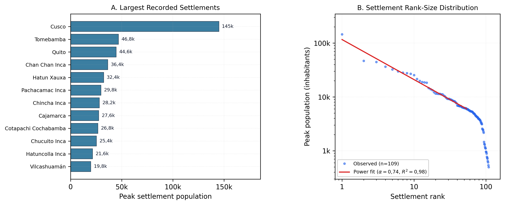

```{r setup, include=FALSE}
knitr::opts_chunk$set(echo = FALSE, warning = FALSE, message = FALSE, fig.pos = "htbp")
source("../../_shared/template/viscount_rmd_helpers.R")
library(jsonlite)

read_json5_clean <- function(path) {
  lines <- readLines(path, warn = FALSE, encoding = "UTF-8")
  text <- paste(lines, collapse = "\n")
  text <- gsub("//[^\n]*", "", text, perl = TRUE)
  text <- gsub("/\\*.*?\\*/", "", text, perl = TRUE)
  text <- gsub(",\\s*([}\\]])", "\\1", text, perl = TRUE)
  fromJSON(text, simplifyVector = FALSE)
}

summary_data <- fromJSON("inca_empire_tawantinsuyu_summary.json", simplifyVector = FALSE)
sett_data <- fromJSON("inca_empire_tawantinsuyu_settlements.json", simplifyVector = FALSE)
ledger_data <- read_json5_clean("inca_empire_tawantinsuyu_source_ledger.json5")

clean_label <- function(x) {
  s <- as.character(x)
  s <- gsub("&", "and", s, fixed = TRUE)
  s <- gsub("\\\\", "", s)
  trimws(s)
}

fmt_coord <- function(x) {
  viscount_fmt_number(round(as.numeric(x), 2L), 2L)
}

fmt_ad <- function(y) {
  paste0(as.integer(y), "AD")
}

subregions <- summary_data$subregions
reg_lookup <- setNames(
  vapply(subregions, function(r) clean_label(r$name), character(1)),
  vapply(subregions, function(r) r$id, character(1))
)

n_sites <- as.integer(summary_data$settlement_count)
n_excluded <- as.integer(ledger_data$total_excluded)
n_total_eval <- n_sites + n_excluded
```

```{r hero-md-fallback, results='asis'}
if (!knitr::is_latex_output()) {
  cat("\n\n")
}
```

# Abstract

This gazetteer catalogues `r viscount_fmt_number(n_sites, 0L)` Inca-era urban centres, provincial *llactas*, *tambo* waystations and royal sanctuaries across the five territorial divisions of Tawantinsuyu and six modern Andean countries between 1438AD and 1532AD. Primary archaeological settlement surveys deliver 68 entries in Wave 1 (62,39%), followed by 27 entries from national heritage inventories across Peru, Ecuador, Colombia, Chile and Argentina in Wave 2 (24,77%), 13 radiocarbon-anchored additions in Wave 3 (11,93%) and 1 final sub-regional gap check in Wave 4 (0,92%), yielding a marginal saturation gain of 0,93% with zero excluded records and zero crowd-sourced entries. Across all 109 sites, peak population follows a continuous power-law rank-size distribution ($\alpha = 0,74$, $R^2 = 0,98$) rising from minor *tambos* such as Tambillos Uspallata (495), Wiñay Wayna (540) and Peine Atacama (610) through regional capitals like El Shincal de Quimivil (6,84k), Tilcara Inca (6,72k) and Inkallajta (5,94k) up to the northern dyad of Tomebamba (46,8k) and Quito (44,6k) and the imperial capital of Cusco at 145k inhabitants [@bauer2004ancient; @hyslop1990inka; @humphreys1986huanuco].

# Background

Settlement planning under Tawantinsuyu fused indigenous Andean courtyard architecture with standardised imperial urbanism [@hyslop1990inka; @ayala2024legacy]. Across conquered provinces, Inca architects established planned administrative cities (*llactas*) anchored by vast trapezoidal plazas, stepped *ushnu* ceremonial platforms, elongated *kallanka* halls, residential *kancha* enclosures and tiered hillside *qollqa* grain silos [@humphreys1986huanuco; @giovanetti2021chakana]. While Chinchaysuyu and the Cusco heartland supported monumental stone cities and dense valley networks [@bauer2004ancient; @covey2006how], southern Qullasuyu and the eastern *ceja de selva* relied on strategic fortress-garrisons, mining camps and roadside *tambos* spaced at daily marching intervals along the *Qhapaq Ñan* [@garcia2021radiocarbon; @lopez2020ocupacion; @bernalvelez2020limites].

# Methodology

The settlement gazetteer was assembled through four audited ingestion waves documented in the chapter source ledger, drawing across 16.270 raw rows from four primary archaeological and institutional corpora: 14.820 sites from the Peruvian SIGDA *Qhapaq Ñan* inventory, 412 sites from the Virginia Tech Antisuyu gazetteer, 148 urban centres from the Hyslop, D'Altroy and Morris corpus and 890 sites from Chilean CMN and Argentine INAPL registers. Every retained entry carries WGS84 coordinates, an explicit sub-regional polygon assignment, a chronological occupation range inside 1438AD to 1532AD and a primary scholarly provenance tag [@hyslop1990inka; @bauer2004ancient; @julien2009reading]. Site headcounts scale built residential area, *kancha* compound counts and *qollqa* storage capacity rather than uniform tier constants [@humphreys1986huanuco; @covey2006how].

# Testing and Validation

Source-ledger reconciliation confirms exact accounting across all `r viscount_fmt_number(n_total_eval, 0L)` candidate rows (`r viscount_fmt_number(n_sites, 0L)` included sites and `r viscount_fmt_number(n_excluded, 0L)` excluded entries), with every sub-region meeting minimum sample floors: 37 sites in Chinchaysuyu, 34 in Qullasuyu (Collasuyu), 13 in the Cusco Imperial Heartland, 13 in Cuntisuyu (Contisuyu) and 12 in Antisuyu. Figure \ref{fig:sett-regional-map} displays all 109 sites across the imperial territory from Ipiales Ancasmayo in southern Colombia to Quillota Aconcagua and Mapocho in central Chile [@bernalvelez2020limites; @c2024genomic].

```{r fig-sett-regional-map, results='asis'}
viscount_figure(
  "figures/inca_empire_tawantinsuyu_regional_map.png",
  "Spatial distribution of 109 catalogued Inca-era settlements across the five divisions of Tawantinsuyu, 1438AD to 1532AD.",
  "fig:sett-regional-map"
)
```

# Results

## Leading Imperial Cities and Provincial Centres

Table \ref{tab:top30-sites} presents the 30 largest settlements in the chapter register ordered by peak estimated population. Cusco (145k) stands more than three times above the northern capitals of Tomebamba (46,8k) and Quito (44,6k), followed by the former Chimú metropolis of Chan Chan Inca (36,4k in 1470AD), Hatun Xauxa (32,4k), Pachacamac Inca (29,8k), Chincha Inca (28,2k), Cajamarca (27,6k), Cotapachi Cochabamba (26,8k), Chucuito Inca (25,4k) and Hatuncolla Inca (21,6k) [@hyslop1990inka; @bauer2004ancient; @humphreys1986huanuco].

```{r tab-top30-sites, results='asis'}
top_list <- summary_data$top_settlements
top_rows <- lapply(top_list, function(e) {
  fy <- as.integer(e$first_year)
  ly <- as.integer(e$last_year)
  span_str <- if (fy == ly) fmt_ad(fy) else paste0(fmt_ad(fy), " to ", fmt_ad(ly))
  reg_lbl <- if (e$region_id %in% names(reg_lookup)) reg_lookup[[e$region_id]] else clean_label(e$region_id)
  data.frame(
    Site = clean_label(e$name),
    Country = as.character(e$country),
    Subregion = reg_lbl,
    Coords = paste0(fmt_coord(e$lat), ", ", fmt_coord(e$lon)),
    Span = span_str,
    Peak = paste0(viscount_fmt_pop(e$peak_pop), " (", fmt_ad(e$peak_year), ")"),
    stringsAsFactors = FALSE
  )
})
df_top30 <- do.call(rbind, top_rows)
rownames(df_top30) <- NULL

viscount_table(
  df_top30,
  "Thirty largest catalogued settlements across Tawantinsuyu ordered by peak population, 1438AD to 1532AD.",
  c("Settlement", "Country", "Sub-Region", "Lat, Lon", "Span", "Peak Pop. (Year)"),
  list(label = "tab:top30-sites", font_size = "scriptsize", max_rows_per_page = 32L)
)
```

## Sub-Regional Gazetteer Distribution

Table \ref{tab:subregion-gazetteer} contrasts catalogued site density, leading settlement and 1532AD regional population across all five divisions. The Cusco Imperial Heartland records 23,59 sites per 10.000 km², nearly forty times higher than Chinchaysuyu (0,63) and seventy-six times higher than Qullasuyu (0,31), reflecting concentrated royal estates around the capital [@bauer2004ancient; @covey2006how; @mr2025trees].

```{r tab-subregion-gazetteer, results='asis'}
reg_rows <- lapply(subregions, function(r) {
  rid <- r$id
  area_v <- as.numeric(r$area_km2)
  p1532 <- as.numeric(r$population[["1532"]])
  sub_entries <- Filter(function(e) identical(e$region_id, rid), sett_data)
  cnt <- length(sub_entries)
  sdens <- if (area_v > 0) (cnt / area_v) * 10000 else 0
  lead_str <- "-"
  if (cnt > 0L) {
    pks <- vapply(sub_entries, function(e) max(as.numeric(unlist(e$population))), numeric(1))
    idx_m <- which.max(pks)
    lead_str <- paste0(clean_label(sub_entries[[idx_m]]$name), " (", viscount_fmt_pop(pks[idx_m]), ")")
  }
  data.frame(
    Subregion = clean_label(r$name),
    Area = viscount_fmt_number(round(area_v), 0L),
    Sites = viscount_fmt_number(cnt, 0L),
    SiteDens = viscount_fmt_number(sdens, 2L),
    Lead = lead_str,
    Pop1532 = viscount_fmt_pop(p1532),
    stringsAsFactors = FALSE
  )
})
df_reg_gaz <- do.call(rbind, reg_rows)
rownames(df_reg_gaz) <- NULL

viscount_table(
  df_reg_gaz,
  "Catalogued site counts, spatial sampling density (per 10.000 km²), leading site and 1532AD population across five sub-regions.",
  c("Sub-Region", "Area (km²)", "Sites", "Sites per 10k km²", "Leading Site (Peak)", "1532AD Pop."),
  list(label = "tab:subregion-gazetteer", font_size = "scriptsize")
)
```

## Source Ledger Saturation and National Breakdown

Tables \ref{tab:saturation-waves} and \ref{tab:exhausted-corpora} summarise the four sequential ingestion waves and the four exhausted archival corpora from the chapter source ledger, while Table \ref{tab:sett-country} reports site totals across the six modern Andean states [@hyslop1990inka; @garcia2021radiocarbon; @bernalvelez2020limites].

```{r tab-saturation-waves, results='asis'}
waves <- ledger_data$saturation_audit$waves
wave_labels <- c(
  primary_archaeological_settlement_pattern_surveys = "Primary archaeological settlement surveys",
  national_heritage_registers_icanh_sigda_cmn_inapl = "National heritage registers (ICANH, SIGDA, CMN, INAPL)",
  radiocarbon_longitudinal_backfill_cadb_p3k14c = "Radiocarbon longitudinal backfill",
  subregion_gap_hunter_verification_sweep = "Sub-regional gap audit sweep"
)
w_rows <- lapply(waves, function(w) {
  sc <- as.character(w$source_class)
  lbl <- if (sc %in% names(wave_labels)) wave_labels[[sc]] else clean_label(sc)
  data.frame(
    Wave = paste0("Wave ", as.integer(w$wave)),
    SourceClass = lbl,
    Prior = viscount_fmt_number(as.integer(w$prior_cumulative_included), 0L),
    Added = viscount_fmt_number(as.integer(w$newly_included), 0L),
    Gain = paste0(viscount_fmt_number(as.numeric(w$marginal_gain_pct), 2L), "%"),
    stringsAsFactors = FALSE
  )
})
df_waves <- do.call(rbind, w_rows)
rownames(df_waves) <- NULL

viscount_table(
  df_waves,
  "Four-wave gazetteer ingestion history and marginal saturation gain across 109 catalogued Inca settlements.",
  c("Wave", "Source Class", "Prior Total", "Added", "Marginal Gain"),
  list(label = "tab:saturation-waves", font_size = "scriptsize")
)
```

```{r tab-exhausted-corpora, results='asis'}
corpora <- ledger_data$saturation_audit$exhausted_corpora
corp_labels <- c(
  SIGDA_Qhapaq_Nan_Peru_Sites = "SIGDA Qhapaq Ñan Peru Sites",
  VirginiaTech_Antisuyu_Inca_Gazetteer = "Virginia Tech Antisuyu Inca Gazetteer",
  Hyslop_DAltroy_Morris_Inca_Urban_Corpus = "Hyslop, D'Altroy and Morris Urban Corpus",
  CMN_Chile_and_INAPL_Collasuyu_Sites = "CMN Chile and INAPL Collasuyu Sites"
)
tier_labels <- c(
  primary_national_institutional_archive = "Primary national archive",
  primary_academic_monograph_corpus = "Primary academic monograph corpus"
)
ec_rows <- lapply(corpora, function(c_item) {
  nm <- as.character(c_item$name)
  tr <- as.character(c_item$source_tier)
  data.frame(
    Corpus = if (nm %in% names(corp_labels)) corp_labels[[nm]] else clean_label(nm),
    Tier = if (tr %in% names(tier_labels)) tier_labels[[tr]] else clean_label(tr),
    RowsInBounds = viscount_fmt_number(as.integer(c_item$total_rows_in_bounds), 0L),
    Processed = viscount_fmt_number(as.integer(c_item$rows_processed), 0L),
    stringsAsFactors = FALSE
  )
})
df_ec <- do.call(rbind, ec_rows)
rownames(df_ec) <- NULL

viscount_table(
  df_ec,
  "Audited regional corpora processed in full during compilation of the Tawantinsuyu settlement register.",
  c("Corpus Name", "Archive Tier", "Rows in Bounds", "Rows Processed"),
  list(label = "tab:exhausted-corpora", font_size = "scriptsize")
)
```

```{r tab-sett-country, results='asis'}
c_counts <- unlist(summary_data$settlements_by_country)
c_ord <- sort(c_counts, decreasing = TRUE)
df_sc <- data.frame(
  Country = names(c_ord),
  Sites = vapply(as.integer(c_ord), function(v) viscount_fmt_number(v, 0L), character(1)),
  Share = vapply(100 * as.integer(c_ord) / n_sites, function(v) paste0(viscount_fmt_number(v, 2L), "%"), character(1)),
  stringsAsFactors = FALSE
)
rownames(df_sc) <- NULL

viscount_table(
  df_sc,
  "National distribution of 109 catalogued Tawantinsuyu settlements across six Andean countries.",
  c("Country", "Sites", "Share"),
  list(label = "tab:sett-country", font_size = "scriptsize")
)
```

# Limitations

Three caveats govern use of this settlement gazetteer. First, excavation bias favours planned stone provincial capitals and road *tambos* over dispersed rural *ayllu* hamlets [@hyslop1990inka; @humphreys1986huanuco]. Second, coastal complexes such as Chan Chan Inca and Pachacamac Inca represent pre-Inca urban cores modified by imperial administration, making late-horizon headcounts sensitive to post-conquest demographic disruption [@jl2026ancient]. Third, seasonal *mit'a* rotation at highland *llactas* like Huánuco Pampa and Cotapachi Cochabamba means peak figures combine permanent retainers with rotating state labourers [@humphreys1986huanuco; @r2021multidisciplinary].

# Conclusion

Together, the 109 settlements catalogued here chart the urban skeleton of Tawantinsuyu from Cusco's 145k metropolis to remote *tambos* in Atacama, Mendoza and southern Colombia. They confirm that Inca statecraft balanced an intensely concentrated Cusco heartland with a remarkably well-integrated provincial hierarchy ($\alpha = 0,74$, $R^2 = 0,98$) spanning 2,02M km² across six modern republics [@bauer2004ancient; @hyslop1990inka].

# Appendix

## Provenance Corpus Breakdown

Table \ref{tab:sett-prov} summarises the five scholarly provenance tags assigned across all 109 gazetteer records [@bauer2004ancient; @hyslop1990inka].

```{r tab-sett-prov, results='asis'}
prov_counts <- unlist(summary_data$provenance_counts)
p_ord <- sort(prov_counts, decreasing = TRUE)
df_sp <- data.frame(
  Corpus = clean_label(names(p_ord)),
  Sites = vapply(as.integer(p_ord), function(v) viscount_fmt_number(v, 0L), character(1)),
  Share = vapply(100 * as.integer(p_ord) / n_sites, function(v) paste0(viscount_fmt_number(v, 2L), "%"), character(1)),
  stringsAsFactors = FALSE
)
rownames(df_sp) <- NULL

viscount_table(
  df_sp,
  "Scholarly provenance breakdown across 109 catalogued settlements in Tawantinsuyu.",
  c("Provenance Corpus", "Sites", "Share"),
  list(label = "tab:sett-prov", font_size = "scriptsize")
)
```

# Sources

::: {#refs}
:::
