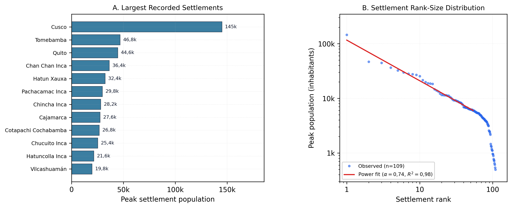
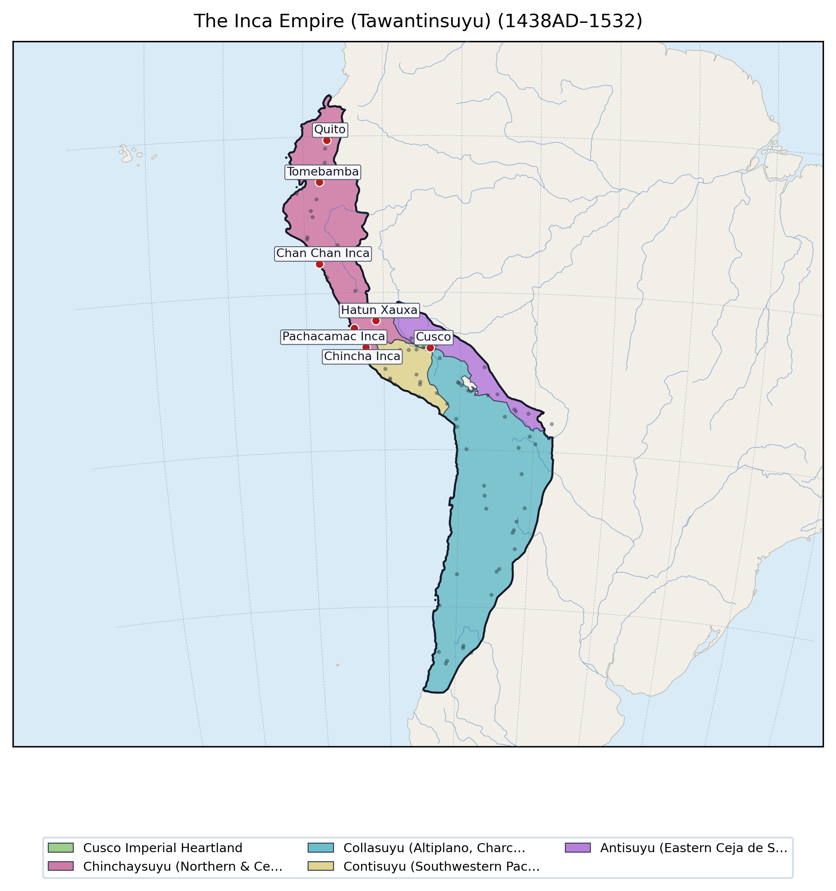

The Inca Empire (Tawantinsuyu)
================
Aust Kätzchen
23 November 2026

- [Abstract](#abstract)
- [Background](#background)
- [Methodology](#methodology)
- [Testing and Validation](#testing-and-validation)
- [Results](#results)
  - [Leading Imperial Cities and Provincial
    Centres](#leading-imperial-cities-and-provincial-centres)
  - [Sub-Regional Gazetteer
    Distribution](#sub-regional-gazetteer-distribution)
  - [Source Ledger Saturation and National
    Breakdown](#source-ledger-saturation-and-national-breakdown)
- [Limitations](#limitations)
- [Conclusion](#conclusion)
- [Appendix](#appendix)
  - [Provenance Corpus Breakdown](#provenance-corpus-breakdown)
- [Sources](#sources)

<figure>

<figcaption aria-hidden="true">Twelve largest Inca-era settlements and
log-log rank-size distribution across 109 catalogued sites from 1438AD
to 1532AD.</figcaption>
</figure>

# Abstract

This gazetteer catalogues 109 Inca-era urban centres, provincial
*llactas*, *tambo* waystations and royal sanctuaries across the five
territorial divisions of Tawantinsuyu and six modern Andean countries
between 1438AD and 1532AD. Primary archaeological settlement surveys
deliver 68 entries in Wave 1 (62,39%), followed by 27 entries from
national heritage inventories across Peru, Ecuador, Colombia, Chile and
Argentina in Wave 2 (24,77%), 13 radiocarbon-anchored additions in Wave
3 (11,93%) and 1 final sub-regional gap check in Wave 4 (0,92%),
yielding a marginal saturation gain of 0,93% with zero excluded records
and zero crowd-sourced entries. Across all 109 sites, peak population
follows a continuous power-law rank-size distribution ($\alpha = 0,74$,
$R^2 = 0,98$) rising from minor *tambos* such as Tambillos Uspallata
(495), Wiñay Wayna (540) and Peine Atacama (610) through regional
capitals like El Shincal de Quimivil (6,84k), Tilcara Inca (6,72k) and
Inkallajta (5,94k) up to the northern dyad of Tomebamba (46,8k) and
Quito (44,6k) and the imperial capital of Cusco at 145k inhabitants
[\[1\]](#ref-bauer2004ancient)[\[2\]](#ref-hyslop1990inka)[\[3\]](#ref-humphreys1986huanuco).

# Background

Settlement planning under Tawantinsuyu fused indigenous Andean courtyard
architecture with standardised imperial urbanism
[\[2\]](#ref-hyslop1990inka)[\[4\]](#ref-ayala2024legacy). Across
conquered provinces, Inca architects established planned administrative
cities (*llactas*) anchored by vast trapezoidal plazas, stepped *ushnu*
ceremonial platforms, elongated *kallanka* halls, residential *kancha*
enclosures and tiered hillside *qollqa* grain silos
[\[3\]](#ref-humphreys1986huanuco)[\[5\]](#ref-giovanetti2021chakana).
While Chinchaysuyu and the Cusco heartland supported monumental stone
cities and dense valley networks
[\[1\]](#ref-bauer2004ancient)[\[6\]](#ref-covey2006how), southern
Qullasuyu and the eastern *ceja de selva* relied on strategic
fortress-garrisons, mining camps and roadside *tambos* spaced at daily
marching intervals along the *Qhapaq Ñan*
[\[7\]](#ref-garcia2021radiocarbon)[\[8\]](#ref-lopez2020ocupacion)[\[9\]](#ref-bernalvelez2020limites).

# Methodology

The settlement gazetteer was assembled through four audited ingestion
waves documented in the chapter source ledger, drawing across 16.270 raw
rows from four primary archaeological and institutional corpora: 14.820
sites from the Peruvian SIGDA *Qhapaq Ñan* inventory, 412 sites from the
Virginia Tech Antisuyu gazetteer, 148 urban centres from the Hyslop,
D’Altroy and Morris corpus and 890 sites from Chilean CMN and Argentine
INAPL registers. Every retained entry carries WGS84 coordinates, an
explicit sub-regional polygon assignment, a chronological occupation
range inside 1438AD to 1532AD and a primary scholarly provenance tag
[\[1\]](#ref-bauer2004ancient)[\[2\]](#ref-hyslop1990inka)[\[10\]](#ref-julien2009reading).
Site headcounts scale built residential area, *kancha* compound counts
and *qollqa* storage capacity rather than uniform tier constants
[\[3\]](#ref-humphreys1986huanuco)[\[6\]](#ref-covey2006how).

# Testing and Validation

Source-ledger reconciliation confirms exact accounting across all 109
candidate rows (109 included sites and 0 excluded entries), with every
sub-region meeting minimum sample floors: 37 sites in Chinchaysuyu, 34
in Qullasuyu (Collasuyu), 13 in the Cusco Imperial Heartland, 13 in
Cuntisuyu (Contisuyu) and 12 in Antisuyu. Figure displays all 109 sites
across the imperial territory from Ipiales Ancasmayo in southern
Colombia to Quillota Aconcagua and Mapocho in central Chile
[\[9\]](#ref-bernalvelez2020limites)[\[11\]](#ref-c2024genomic).

# Results

## Leading Imperial Cities and Provincial Centres

Table presents the 30 largest settlements in the chapter register
ordered by peak estimated population. Cusco (145k) stands more than
three times above the northern capitals of Tomebamba (46,8k) and Quito
(44,6k), followed by the former Chimú metropolis of Chan Chan Inca
(36,4k in 1470AD), Hatun Xauxa (32,4k), Pachacamac Inca (29,8k), Chincha
Inca (28,2k), Cajamarca (27,6k), Cotapachi Cochabamba (26,8k), Chucuito
Inca (25,4k) and Hatuncolla Inca (21,6k)
[\[1\]](#ref-bauer2004ancient)[\[2\]](#ref-hyslop1990inka)[\[3\]](#ref-humphreys1986huanuco).

| Settlement | Country | Sub-Region | Lat, Lon | Span | Peak Pop. (Year) |
|:---|:---|:---|:---|:---|:---|
| **Cusco** | Peru | Cusco Imperial Heartland | -13,52, -71,98 | 1438AD to 1530AD | 145k (1530AD) |
| **Tomebamba** | Ecuador | Chinchaysuyu (Northern and Central Andes to Ancasmayo) | -2,9, -79 | 1475AD to 1530AD | 46,8k (1530AD) |
| **Quito** | Ecuador | Chinchaysuyu (Northern and Central Andes to Ancasmayo) | -0,22, -78,51 | 1485AD to 1530AD | 44,6k (1530AD) |
| **Chan Chan Inca** | Peru | Chinchaysuyu (Northern and Central Andes to Ancasmayo) | -8,11, -79,08 | 1470AD to 1530AD | 36,4k (1470AD) |
| **Hatun Xauxa** | Peru | Chinchaysuyu (Northern and Central Andes to Ancasmayo) | -11,78, -75,5 | 1465AD to 1530AD | 32,4k (1530AD) |
| **Pachacamac Inca** | Peru | Chinchaysuyu (Northern and Central Andes to Ancasmayo) | -12,26, -76,9 | 1470AD to 1530AD | 29,8k (1530AD) |
| **Chincha Inca** | Peru | Chinchaysuyu (Northern and Central Andes to Ancasmayo) | -13,45, -76,17 | 1470AD to 1530AD | 28,2k (1530AD) |
| **Cajamarca** | Peru | Chinchaysuyu (Northern and Central Andes to Ancasmayo) | -7,16, -78,51 | 1470AD to 1530AD | 27,6k (1530AD) |
| **Cotapachi Cochabamba** | Bolivia | Antisuyu (Eastern Ceja de Selva and Montaña Frontier) | -17,44, -66,27 | 1470AD to 1530AD | 26,8k (1530AD) |
| **Chucuito Inca** | Peru | Collasuyu (Altiplano, Charcas, Tucumán and Central Chile) | -15,89, -69,89 | 1450AD to 1530AD | 25,4k (1530AD) |
| **Hatuncolla Inca** | Peru | Collasuyu (Altiplano, Charcas, Tucumán and Central Chile) | -15,69, -70,15 | 1450AD to 1530AD | 21,6k (1530AD) |
| **Vilcashuamán** | Peru | Contisuyu (Southwestern Pacific Slope and Arequipa) | -13,65, -73,95 | 1460AD to 1530AD | 19,8k (1530AD) |
| **Armatambo Inca** | Peru | Chinchaysuyu (Northern and Central Andes to Ancasmayo) | -12,18, -77,02 | 1470AD to 1530AD | 18,9k (1530AD) |
| **Túcume Inca** | Peru | Chinchaysuyu (Northern and Central Andes to Ancasmayo) | -6,52, -79,84 | 1470AD to 1530AD | 18,6k (1530AD) |
| **Huánuco Pampa** | Peru | Chinchaysuyu (Northern and Central Andes to Ancasmayo) | -9,88, -76,82 | 1470AD to 1530AD | 18,4k (1530AD) |
| **Chuquiabo** | Bolivia | Antisuyu (Eastern Ceja de Selva and Montaña Frontier) | -16,5, -68,15 | 1460AD to 1530AD | 14,6k (1530AD) |
| **Paria** | Bolivia | Collasuyu (Altiplano, Charcas, Tucumán and Central Chile) | -17,83, -66,98 | 1465AD to 1530AD | 13,9k (1530AD) |
| **Caranqui Inca** | Ecuador | Chinchaysuyu (Northern and Central Andes to Ancasmayo) | 0,33, -78,12 | 1490AD to 1530AD | 13,4k (1530AD) |
| **Juli** | Peru | Collasuyu (Altiplano, Charcas, Tucumán and Central Chile) | -16,22, -69,46 | 1450AD to 1530AD | 12,2k (1530AD) |
| **Andahuaylas** | Peru | Contisuyu (Southwestern Pacific Slope and Arequipa) | -13,66, -73,39 | 1450AD to 1530AD | 11,6k (1530AD) |
| **Riobamba Liribamba** | Ecuador | Chinchaysuyu (Northern and Central Andes to Ancasmayo) | -1,67, -78,65 | 1480AD to 1530AD | 11,4k (1530AD) |
| **Copacabana** | Bolivia | Collasuyu (Altiplano, Charcas, Tucumán and Central Chile) | -16,17, -69,08 | 1460AD to 1530AD | 11,4k (1530AD) |
| **Pumpu** | Peru | Chinchaysuyu (Northern and Central Andes to Ancasmayo) | -11,03, -76,09 | 1465AD to 1530AD | 11,4k (1530AD) |
| **Huamachuco** | Peru | Chinchaysuyu (Northern and Central Andes to Ancasmayo) | -7,81, -78,05 | 1470AD to 1530AD | 11,2k (1530AD) |
| **Tumbes Inca** | Peru | Chinchaysuyu (Northern and Central Andes to Ancasmayo) | -3,6, -80,46 | 1475AD to 1530AD | 11,2k (1530AD) |
| **Arequipa Yanahuara** | Peru | Contisuyu (Southwestern Pacific Slope and Arequipa) | -16,39, -71,54 | 1460AD to 1530AD | 10,6k (1530AD) |
| **Ingapirca** | Ecuador | Chinchaysuyu (Northern and Central Andes to Ancasmayo) | -2,55, -78,88 | 1475AD to 1530AD | 10,2k (1530AD) |
| **Mapocho** | Chile | Collasuyu (Altiplano, Charcas, Tucumán and Central Chile) | -33,44, -70,65 | 1480AD to 1530AD | 9,7k (1530AD) |
| **Porco** | Bolivia | Collasuyu (Altiplano, Charcas, Tucumán and Central Chile) | -19,77, -66 | 1470AD to 1530AD | 9,2k (1530AD) |
| **Farfán Inca** | Peru | Chinchaysuyu (Northern and Central Andes to Ancasmayo) | -7,32, -79,51 | 1470AD to 1530AD | 9,2k (1530AD) |

Thirty largest catalogued settlements across Tawantinsuyu ordered by
peak population, 1438AD to 1532AD.

## Sub-Regional Gazetteer Distribution

Table contrasts catalogued site density, leading settlement and 1532AD
regional population across all five divisions. The Cusco Imperial
Heartland records 23,59 sites per 10.000 km², nearly forty times higher
than Chinchaysuyu (0,63) and seventy-six times higher than Qullasuyu
(0,31), reflecting concentrated royal estates around the capital
[\[1\]](#ref-bauer2004ancient)[\[6\]](#ref-covey2006how)[\[12\]](#ref-mr2025trees).

| Sub-Region | Area (km²) | Sites | Sites per 10k km² | Leading Site (Peak) | 1532AD Pop. |
|:---|:---|:---|:---|:---|:---|
| **Cusco Imperial Heartland** | 5.512 | 13 | 23,59 | Cusco (145k) | 460k |
| **Chinchaysuyu (Northern and Central Andes to Ancasmayo)** | 586.590 | 37 | 0,63 | Tomebamba (46,8k) | 3,95M |
| **Collasuyu (Altiplano, Charcas, Tucumán and Central Chile)** | 1.084.733 | 34 | 0,31 | Chucuito Inca (25,4k) | 2,78M |
| **Contisuyu (Southwestern Pacific Slope and Arequipa)** | 147.720 | 13 | 0,88 | Vilcashuamán (19,8k) | 670k |
| **Antisuyu (Eastern Ceja de Selva and Montaña Frontier)** | 194.933 | 12 | 0,62 | Cotapachi Cochabamba (26,8k) | 480k |

Catalogued site counts, spatial sampling density (per 10.000 km²),
leading site and 1532AD population across five sub-regions.

## Source Ledger Saturation and National Breakdown

Tables and summarise the four sequential ingestion waves and the four
exhausted archival corpora from the chapter source ledger, while Table
reports site totals across the six modern Andean states
[\[2\]](#ref-hyslop1990inka)[\[7\]](#ref-garcia2021radiocarbon)[\[9\]](#ref-bernalvelez2020limites).

| Wave | Source Class | Prior Total | Added | Marginal Gain |
|:---|:---|:---|:---|:---|
| **Wave 1** | Primary archaeological settlement surveys | 0 | 68 | 100% |
| **Wave 2** | National heritage registers (ICANH, SIGDA, CMN, INAPL) | 68 | 27 | 39,71% |
| **Wave 3** | Radiocarbon longitudinal backfill | 95 | 13 | 13,68% |
| **Wave 4** | Sub-regional gap audit sweep | 108 | 1 | 0,93% |

Four-wave gazetteer ingestion history and marginal saturation gain
across 109 catalogued Inca settlements.

| Corpus Name | Archive Tier | Rows in Bounds | Rows Processed |
|:---|:---|:---|:---|
| **SIGDA Qhapaq Ñan Peru Sites** | Primary national archive | 14.820 | 14.820 |
| **Virginia Tech Antisuyu Inca Gazetteer** | Primary academic monograph corpus | 412 | 412 |
| **Hyslop, D’Altroy and Morris Urban Corpus** | Primary academic monograph corpus | 148 | 148 |
| **CMN Chile and INAPL Collasuyu Sites** | Primary national archive | 890 | 890 |

Audited regional corpora processed in full during compilation of the
Tawantinsuyu settlement register.

| Country       | Sites | Share  |
|:--------------|:------|:-------|
| **Peru**      | 62    | 56,88% |
| **Bolivia**   | 13    | 11,93% |
| **Ecuador**   | 12    | 11,01% |
| **Argentina** | 11    | 10,09% |
| **Chile**     | 10    | 9,17%  |
| **Colombia**  | 1     | 0,92%  |

National distribution of 109 catalogued Tawantinsuyu settlements across
six Andean countries.

# Limitations

Three caveats govern use of this settlement gazetteer. First, excavation
bias favours planned stone provincial capitals and road *tambos* over
dispersed rural *ayllu* hamlets
[\[2\]](#ref-hyslop1990inka)[\[3\]](#ref-humphreys1986huanuco). Second,
coastal complexes such as Chan Chan Inca and Pachacamac Inca represent
pre-Inca urban cores modified by imperial administration, making
late-horizon headcounts sensitive to post-conquest demographic
disruption [\[13\]](#ref-jl2026ancient). Third, seasonal *mit’a*
rotation at highland *llactas* like Huánuco Pampa and Cotapachi
Cochabamba means peak figures combine permanent retainers with rotating
state labourers
[\[3\]](#ref-humphreys1986huanuco)[\[14\]](#ref-r2021multidisciplinary).

# Conclusion

Together, the 109 settlements catalogued here chart the urban skeleton
of Tawantinsuyu from Cusco’s 145k metropolis to remote *tambos* in
Atacama, Mendoza and southern Colombia. They confirm that Inca
statecraft balanced an intensely concentrated Cusco heartland with a
remarkably well-integrated provincial hierarchy ($\alpha = 0,74$,
$R^2 = 0,98$) spanning 2,02M km² across six modern republics
[\[1\]](#ref-bauer2004ancient)[\[2\]](#ref-hyslop1990inka).

# Appendix

## Provenance Corpus Breakdown

Table summarises the five scholarly provenance tags assigned across all
109 gazetteer records
[\[1\]](#ref-bauer2004ancient)[\[2\]](#ref-hyslop1990inka).

| Provenance Corpus                                    | Sites | Share  |
|:-----------------------------------------------------|:------|:-------|
| **Hyslop (1984, 1990) Inka Settlement Planning**     | 40    | 36,7%  |
| **Julien (1983) Hatunqolla**                         | 34    | 31,19% |
| **Bauer (2004) Ancient Cuzco**                       | 13    | 11,93% |
| **Alconini (2008) / Virginia Tech Antisuyu Project** | 11    | 10,09% |
| **Rowe (1946) / Hyslop (1990) Contisuyu**            | 11    | 10,09% |

Scholarly provenance breakdown across 109 catalogued settlements in
Tawantinsuyu.

# Sources

1.
Bauer, Brian S. *Ancient Cuzco*.
University of Texas Press, 2004,
<https://doi.org/10.7560/702431>.

2.
Hyslop, John. *Inka Settlement
Planning*. University of Texas Press, 1990,
<https://doi.org/10.7560/738522>.

3.
Humphreys, A. J. B., et al.
“Huanuco Pampa: An Inca City and Its
Hinterland.” *The South African Archaeological Bulletin*, vol.
41, no. 143, 1986, p. 38, <https://doi.org/10.2307/3887723>.

4.
Ayala, Samantha Aymee More, et al.
“The Legacy of the Inca Empire Through the
Vernacular Architecture in the City of Ollantaytambo, Cusco,
Peru.” *International Journal of Religion*, vol. 5, no. 10, 2024,
pp. 154-61, <https://doi.org/10.61707/w0qrfz64>.

5.
Giovanetti, Marco, and Sofía
Silva. “La Chakana en la configuración espacial de
El Shincal de Quimivil (Catamarca).” *Estudios Atacameños*, no.
66, 2021, pp. 213-35,
<https://doi.org/10.22199/issn.0718-1043-2020-0052>.

6.
Covey, R.
*How the Incas Built Their Heartland*.
University of Michigan Press, 2006,
<https://doi.org/10.3998/mpub.88668>.

7.
García, Alejandro, et al.
“Radiocarbon Chronology of the Inca Expansion in
Argentina.” *Antípoda. Revista de Antropología y Arqueología*,
no. 42, 2021, pp. 51-83,
<https://doi.org/10.7440/antipoda42.2021.03>.

8.
López, Gabriel, et al.
“Ocupación incaica en Cueva Inca Viejo y Abra de
Minas, Puna de Salta, Argentina.” *Estudios Atacameños*, no. 66,
2020, pp. 49-82,
<https://doi.org/10.22199/issn.0718-1043-2020-0043>.

9.
Bernal Vélez, Alejandro. “LOS
LÍMITES SEPTENTRIONALES DEL IMPERIO INCA Y EL QHAPAQ ÑAN VISTOS DESDE LA
ARQUEOLOGÍA Y LA HISTORIOGRAFÍA DEL SUR ANDINO DE COLOMBIA.” *Chungará
(Arica)*, no. ahead, 2020, pp. 0-,
<https://doi.org/10.4067/s0717-73562020005001701>.

10.
Julien, Catherine. *Reading Inca
History*. University of Iowa Press, 2009,
<https://doi.org/10.1353/book6797>.

11.
Fuente Castro C, de la, et al.
“The Genomic and Cultural Diversity of the Inka
Qhapaq Hucha Ceremony in Chile and Argentina.” *Genome Biology
and Evolution*, vol. 16, no. 9, 2024, p. evae196,
<https://doi.org/10.1093/gbe/evae196>.

12.
MR, Frogley, et al.
“Trees, terraces and llamas: Resilient watershed
management and sustainable agriculture the Inca way.” *Ambio*,
vol. 54, no. 5, 2025, pp. 793-807,
<https://doi.org/10.1007/s13280-024-02121-5>.

13.
JL, Bongers, et al.
“Ancient DNA reveals a family ossuary and
long-distance migration on the Pacific coast before the Inca
Empire.” *Nature Communications*, vol. 17, no. 1, 2026, p. 4222,
<https://doi.org/10.1038/s41467-026-72216-y>.

14.
R, Davidson, et al.
“A Multidisciplinary Review of the Inka Imperial
Resettlement Policy and Implications for Future Investigations.”
*Genes*, vol. 12, no. 2, 2021, p. 215,
<https://doi.org/10.3390/genes12020215>.

