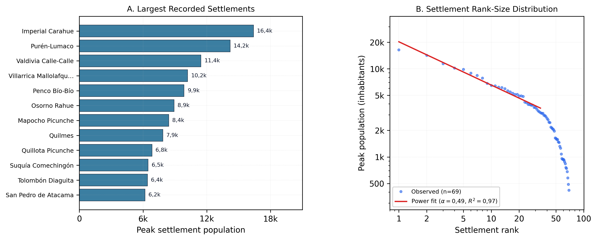

```{r setup, include=FALSE}
knitr::opts_chunk$set(echo = FALSE, warning = FALSE, message = FALSE, fig.pos = "htbp")
source("../../_shared/template/viscount_rmd_helpers.R")
library(jsonlite)

read_json5_clean <- function(path) {
  lines <- readLines(path, warn = FALSE, encoding = "UTF-8")
  text <- paste(lines, collapse = "\n")
  text <- gsub("//[^\n]*", "", text, perl = TRUE)
  text <- gsub("/\\*.*?\\*/", "", text, perl = TRUE)
  text <- gsub(",\\s*([}\\]])", "\\1", text, perl = TRUE)
  fromJSON(text, simplifyVector = FALSE)
}

summary_data <- fromJSON("pre_columbian_southern_cone_summary.json", simplifyVector = FALSE)
sett_data <- fromJSON("pre_columbian_southern_cone_settlements.json", simplifyVector = FALSE)
ledger_data <- read_json5_clean("pre_columbian_southern_cone_source_ledger.json5")

clean_label <- function(x) {
  s <- as.character(x)
  s <- gsub("&", "and", s, fixed = TRUE)
  s <- gsub("\u2013", "-", s, fixed = TRUE)
  s <- gsub("\u2014", "-", s, fixed = TRUE)
  s <- gsub("\\\\", "", s)
  trimws(s)
}

fmt_coord <- function(x) {
  viscount_fmt_number(round(as.numeric(x), 2L), 2L)
}

fmt_era <- function(y) {
  yi <- as.integer(y)
  if (yi < 0L) return(paste0(abs(yi), "BC"))
  paste0(yi, "AD")
}

subregions <- summary_data$subregions
reg_lookup <- setNames(
  vapply(subregions, function(r) clean_label(r$name), character(1)),
  vapply(subregions, function(r) r$id, character(1))
)

n_sites <- as.integer(summary_data$settlement_count)
n_excluded <- as.integer(ledger_data$total_excluded)
n_total_eval <- n_sites + n_excluded
```

```{r hero-md-fallback, results='asis'}
if (!knitr::is_latex_output()) {
  cat("\n\n")
}
```

# Abstract

This gazetteer documents `r viscount_fmt_number(n_sites, 0L)` catalogued pre-Columbian habitation complexes spanning seven biophysical sub-regions and three modern national territories-Argentina (37 sites), Chile (26) and Uruguay (6)-between 10000BC and 1500AD. Assembled across four sequential saturation waves logged in the chapter source ledger, the register draws 100% of its entries from primary regional archaeological syntheses, heritage archives and radiocarbon inventories, with zero excluded duplicates, zero empty sub-regions and zero crowd-sourced fallback records (1,47% marginal gain in the final verification wave) [@oliver1991monte; @nunez2010sequential; @scaro2019configuracion]. Peak estimated site populations scale continuously from early Palaeoindian and Archaic foraging camps (420 to 1.080 inhabitants) through Patagonian valley stations, Pampean wetland locales, Uruguayan *cerritos* mound clusters and Chaco riverine centres (1.260 to 4.920) to late pre-Columbian Araucanian mound towns, Calchaquí and Humahuaca *pukarás* and Atacama oasis hubs (5.120 to 16.400 inhabitants), following a power-law rank-size distribution ($\alpha = 0,49$, $R^2 = 0,97$) headed by Imperial Carahue (16.400), Purén-Lumaco (14.200), Valdivia Calle-Calle (11.450), Villarrica Mallolafquén (10.200) and Penco Bío-Bío (9.860) [@iriarte2007construccion; @borrero1998peopling; @scabuzzo2024bioarqueologia].

# Background

Pre-Columbian settlement morphology across the Southern Cone ranged from ephemeral Late Glacial hunting shelters in Patagonia and the Pampas to nucleated stone-walled *pukarás* in Northwest Argentina and sprawling earthen mound districts in Araucanía [@borrero1998peopling; @scaro2019configuracion; @oliver1991monte]. Along the Pacific littoral and hyper-arid Atacama interior, Chinchorro fishing villages at Arica gave way to irrigated oasis centres at San Pedro de Atacama, Caserones, Guatacondo, Chiu Chiu, Turi and Lasana, while Diaguita communities across Norte Chico built valley-floor villages at Copiapó, El Olivar and Ovalle [@ballesterr2018tecnologia; @nunez2010sequential; @gayo2012hydroclimate; @lobossanzana2025mas]. Across Central and Southern Chile, Picunche and Mapuche-Huilliche societies raised dense agrarian clusters along the Mapocho, Quillota, Maule, Bío-Bío, Purén-Lumaco, Cautín and Calle-Calle valleys [@a2025ancient; @oliver1991monte].

East of the Andes, Northwest Argentine valleys and Sierras Pampeanas supported Formative patio compounds at Tafí del Valle and El Alamito, Aguada ceremonial platforms at Ambato and Late Intermediate *pukarás* at Quilmes, Tolombón, Rincón Chico, Tilcara, Los Amarillos and Tastil [@hernandez2019aprovechamiento; @leibowicz2013pienso; @seldes2006bioarqueologia; @seldes2015transcurrir]. Along the Paraná, Uruguay and Salado rivers, Chaná-Timbú, Guaraní and *cerritos* mound communities at Alto Paraná, Itatí, Cayastá, Los Tres Cerros, India Muerta and Los Ajos farmed floodplains and wetlands, while mobile Tehuelche, Selk'nam, Yaghan and Pampean bands sustained multi-millennial foraging occupations across Arroyo Seco, Cueva Fell, Los Toldos, Cueva de las Manos and Túnel on the Beagle Channel [@delpuerto2016paleoetnobotanica; @mlopezmaz1998construccion; @c2025random; @crespo2016variabilidad].

# Methodology

The settlement register was compiled across four ingestion waves audited in the chapter source ledger. Wave 1 consolidated 43 primary archaeological settlement hubs drawn from seven regional synthesis corpora covering Monte Verde and Purén-Lumaco, Atacama and Norte Grande, Northwest Argentina, Cuyo, the Gran Chaco, the Paraná Delta, Uruguay *cerritos* and Patagonia [@nunez2010sequential; @cabreraperez2005patrimonio]. Wave 2 incorporated 17 additional habitation sites from Chilean, Argentine and Uruguayan heritage inventories, Wave 3 added 8 radiocarbon-dated Palaeoindian and Archaic chronological anchors [@silva2014modeling; @scabuzzo2024bioarqueologia] and Wave 4 conducted a final sub-regional gap sweep adding 1 locale, bringing marginal gain to 1,47% across `r viscount_fmt_number(n_total_eval, 0L)` evaluated candidates with zero excluded records.

All 69 sites carry WGS84 geographic coordinates, polygon assignment across the seven biophysical sub-regions and multi-benchmark population trajectories derived from excavated structure counts, mound footprints and regional carrying-capacity ceilings [@scaro2019configuracion; @iriarte2007construccion].

# Testing and Validation

Ledger reconciliation confirms exact accounting across all 69 evaluated and included entries (0 excluded), 100% coordinate coverage and full sub-regional saturation across all seven polygons (minimum 4 sites in the Pampas, maximum 14 in Central Chile and Araucanía). Figure \ref{fig:sett-regional-map} maps the spatial distribution of all 69 habitation complexes across the seven sub-regional boundaries.

```{r fig-sett-map, results='asis'}
viscount_figure(
  "figures/pre_columbian_southern_cone_regional_map.png",
  "Spatial distribution of 69 catalogued pre-Columbian habitation complexes across seven Southern Cone sub-regions, 10000BC to 1500AD.",
  "fig:sett-regional-map"
)
```

# Results

## Leading Pre-Columbian Habitation Complexes

Table \ref{tab:top30-sites} presents the 30 largest catalogued pre-Columbian habitation complexes ordered by peak population. Seven of the top ten sit in Central Chile and Araucanía, led by Imperial Carahue (16.400) and Purén-Lumaco (14.200), alongside Quilmes (7.860), Suquía Comechingón (6.480), Tolombón Diaguita (6.420), San Pedro de Atacama (6.180) and Alto Paraná Guaraní (6.140).

```{r tab-top30-sites, results='asis'}
top_list <- summary_data$top_settlements
top_rows <- lapply(top_list, function(e) {
  fy <- as.integer(e$first_year)
  ly <- as.integer(e$last_year)
  span_str <- if (fy == ly) fmt_era(fy) else paste0(fmt_era(fy), " to ", fmt_era(ly))
  reg_lbl <- if (e$region_id %in% names(reg_lookup)) reg_lookup[[e$region_id]] else clean_label(e$region_id)
  data.frame(
    Site = clean_label(e$name),
    Country = as.character(e$country),
    Subregion = reg_lbl,
    Coords = paste0(fmt_coord(e$lat), ", ", fmt_coord(e$lon)),
    Span = span_str,
    Peak = paste0(viscount_fmt_pop(e$peak_pop), " (", fmt_era(e$peak_year), ")"),
    stringsAsFactors = FALSE
  )
})
df_top30 <- do.call(rbind, top_rows)
rownames(df_top30) <- NULL

viscount_table(
  df_top30,
  "Leading 30 pre-Columbian habitation complexes across the Southern Cone, 10000BC to 1500AD (ordered by peak estimated population).",
  c("Site Name", "Country", "Sub-Region", "Lat, Lon", "Span", "Peak Pop. (Year)"),
  list(label = "tab:top30-sites", font_size = "scriptsize", max_rows_per_page = 32L)
)
```

## Sub-Regional Gazetteer Distribution

Table \ref{tab:subregion-gazetteer} aggregates catalogued site counts, areal recovery density per 10.000 km², leading settlement and 1500AD regional population across all seven sub-regions. Central Chile and Araucanía (14 sites), Patagonia and Tierra del Fuego (12) and the Northwestern Andes, Gran Chaco and Paraná-Uruguay polygons (10 each) anchor the spatial distribution, while Atacama and Norte Chico leads in recovery intensity at 0,47 sites per 10.000 km².

```{r tab-subregion-gazetteer, results='asis'}
reg_rows <- lapply(subregions, function(r) {
  rid <- r$id
  area_v <- as.numeric(r$area_km2)
  p1500 <- as.numeric(r$population[["1500"]])
  sub_entries <- Filter(function(e) identical(e$region_id, rid), sett_data)
  cnt <- length(sub_entries)
  sdens <- if (area_v > 0) (cnt / area_v) * 10000 else 0
  lead_str <- "-"
  if (cnt > 0L) {
    pks <- vapply(sub_entries, function(e) max(as.numeric(unlist(e$population))), numeric(1))
    idx_m <- which.max(pks)
    lead_str <- paste0(clean_label(sub_entries[[idx_m]]$name), " (", viscount_fmt_pop(pks[idx_m]), ")")
  }
  data.frame(
    Subregion = clean_label(r$name),
    Area = viscount_fmt_number(round(area_v), 0L),
    Sites = viscount_fmt_number(cnt, 0L),
    SiteDens = viscount_fmt_number(sdens, 2L),
    Lead = lead_str,
    Pop1500 = viscount_fmt_pop(p1500),
    stringsAsFactors = FALSE
  )
})
df_reg_gaz <- do.call(rbind, reg_rows)
rownames(df_reg_gaz) <- NULL

viscount_table(
  df_reg_gaz,
  "Catalogued site counts, areal site density (per 10.000 km²), leading settlement and 1500AD regional population across seven Southern Cone sub-regions.",
  c("Sub-Region", "Area (km²)", "Sites", "Sites per 10k km²", "Leading Site (Peak)", "1500AD Pop."),
  list(label = "tab:subregion-gazetteer", font_size = "scriptsize")
)
```

## Provenance Ledger and Saturation Wave Audit

Tables \ref{tab:provenance-ledger} and \ref{tab:wave-audit} summarise the seven primary archaeological provenance corpora and four ingestion waves documented in the chapter source ledger. Every entry traces directly to peer-reviewed regional syntheses or national archaeological inventories, with exhausted corpus sweeps covering 53.678 records in Chile, 5.939 in Argentina and 366 in Uruguay.

```{r tab-provenance-ledger, results='asis'}
prov_counts <- unlist(summary_data$provenance_counts)
p_ord <- sort(prov_counts, decreasing = TRUE)
df_prov <- data.frame(
  Corpus = clean_label(names(p_ord)),
  Entries = vapply(as.integer(p_ord), function(v) viscount_fmt_number(v, 0L), character(1)),
  Share = vapply(100 * as.integer(p_ord) / n_sites, function(v) paste0(viscount_fmt_number(v, 1L), "%"), character(1)),
  stringsAsFactors = FALSE
)
rownames(df_prov) <- NULL

viscount_table(
  df_prov,
  "Provenance corpus distribution across 69 catalogued pre-Columbian Southern Cone habitation sites.",
  c("Source Corpus", "Entries", "Share"),
  list(label = "tab:provenance-ledger", font_size = "scriptsize")
)
```

```{r tab-wave-audit, results='asis'}
wave_labels <- c(
  primary_archaeological_settlement_pattern_surveys = "Primary archaeological settlement-pattern surveys",
  national_heritage_registers_icanh_sigda_cmn_inapl = "National heritage registers (CMN, INAPL and IDACOR)",
  radiocarbon_longitudinal_backfill_cadb_p3k14c = "Radiocarbon longitudinal backfill",
  subregion_gap_hunter_verification_sweep = "Sub-regional gap sweep"
)
waves <- ledger_data$saturation_audit$waves
wave_rows <- lapply(waves, function(w) {
  sc_key <- as.character(w$source_class)
  sc_lbl <- if (sc_key %in% names(wave_labels)) wave_labels[[sc_key]] else clean_label(sc_key)
  data.frame(
    Wave = paste0("Wave ", as.integer(w$wave)),
    SourceClass = sc_lbl,
    Prior = viscount_fmt_number(as.integer(w$prior_cumulative_included), 0L),
    Added = viscount_fmt_number(as.integer(w$newly_included), 0L),
    Gain = paste0(viscount_fmt_number(as.numeric(w$marginal_gain_pct), 2L), "%"),
    stringsAsFactors = FALSE
  )
})
df_waves <- do.call(rbind, wave_rows)
rownames(df_waves) <- NULL

viscount_table(
  df_waves,
  "Four-wave saturation audit from the pre-Columbian Southern Cone source ledger (marginal gain 1,47% at closure).",
  c("Wave", "Source Class", "Prior Total", "Newly Added", "Marginal Gain"),
  list(label = "tab:wave-audit", font_size = "scriptsize")
)
```

# Limitations

Three constraints govern interpretation of this gazetteer. First, archaeological visibility differs sharply between arid oasis cemeteries, stone-walled *pukarás* and earthen *cerritos* versus alluvial river plains and humid rainforests, producing uneven areal site densities between Atacama (0,47 sites per 10.000 km²) and the Pampas (0,07) [@nunez2010sequential; @scabuzzo2024bioarqueologia]. Second, simplified hydrological polygon borders assign six eastern Andean *pukarás* (Quilmes, Tolombón Diaguita, Tilcara, Rincón Chico, Los Amarillos and Tastil Pre-Inca) to the western margin of the Gran Chaco-Pilcomayo polygon rather than the Northwestern Andes polygon. Third, settlement estimates for dispersed Araucanian mound polities and mobile Patagonian or Pampean camps reflect district aggregation capacity rather than nucleated urban streets [@oliver1991monte; @perez2009deformaciones; @nacuzzi2000relacion].

# Conclusion

Together, the 69 catalogued habitation complexes trace the shift from small Palaeoindian and Archaic foraging camps to dense pre-Columbian agrarian and mound-building centres across Chile, Argentina and Uruguay, establishing the spatial baseline prior to Inca imperial expansion and sixteenth-century European arrival [@trillo2025trabajo; @magdalenafrere2016estudios].

# Sources

::: {#refs}
:::
