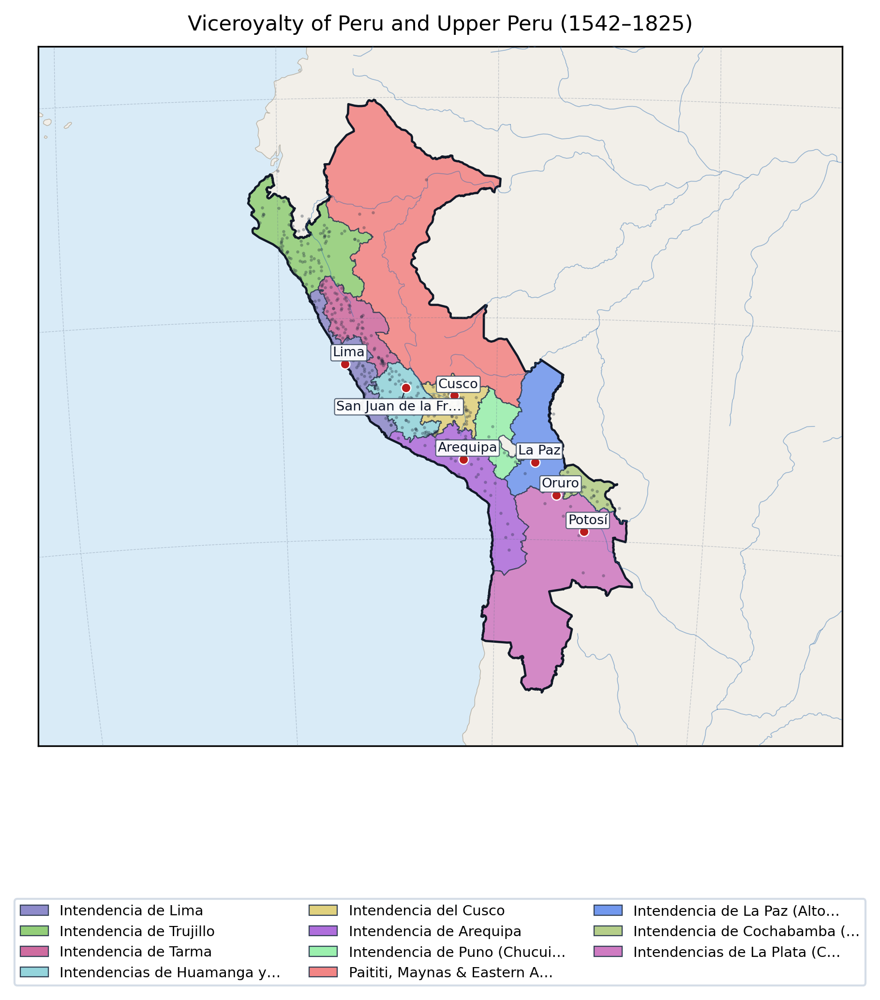

```{r setup, include=FALSE}
knitr::opts_chunk$set(echo = FALSE, warning = FALSE, message = FALSE, fig.pos = "htbp")
source("../../_shared/template/viscount_rmd_helpers.R")
library(jsonlite)

summary_data <- fromJSON("viceroyalty_peru_upper_peru_summary.json", simplifyVector = FALSE)
sett_raw <- fromJSON("viceroyalty_peru_upper_peru_settlements.json", simplifyVector = FALSE)

clean_label <- function (x) {
  s <- as.character(x)
  s <- gsub("&", "and", s, fixed = TRUE)
  s <- gsub("\\\\", "", s)
  trimws(s)
}

fmt_num <- function (vals, digits = 2L) {
  vapply(vals, function (v) viscount_fmt_number(v, digits), character(1))
}

fmt_pct <- function (vals, digits = 1L) {
  vapply(vals, function (v) paste0(viscount_fmt_number(v, digits), "%"), character(1))
}

subregions <- summary_data$subregions
sub_ids <- vapply(subregions, function (r) as.character(r$id), character(1))
sub_names <- vapply(subregions, function (r) clean_label(r$name), character(1))
sub_areas <- vapply(subregions, function (r) as.numeric(r$area_km2), numeric(1))

pop_1542 <- vapply(subregions, function (r) as.numeric(r$population[["1542"]]), numeric(1))
pop_1570 <- vapply(subregions, function (r) as.numeric(r$population[["1570"]]), numeric(1))
pop_1620 <- vapply(subregions, function (r) as.numeric(r$population[["1620"]]), numeric(1))
pop_1700 <- vapply(subregions, function (r) as.numeric(r$population[["1700"]]), numeric(1))
pop_1750 <- vapply(subregions, function (r) as.numeric(r$population[["1750"]]), numeric(1))
pop_1795 <- vapply(subregions, function (r) as.numeric(r$population[["1795"]]), numeric(1))
pop_1825 <- vapply(subregions, function (r) as.numeric(r$population[["1825"]]), numeric(1))

total_area <- as.numeric(summary_data$total_area_km2)
tot_1542 <- as.numeric(summary_data$domain_totals[["1542"]])
tot_1570 <- as.numeric(summary_data$domain_totals[["1570"]])
tot_1620 <- as.numeric(summary_data$domain_totals[["1620"]])
tot_1700 <- as.numeric(summary_data$domain_totals[["1700"]])
tot_1750 <- as.numeric(summary_data$domain_totals[["1750"]])
tot_1795 <- as.numeric(summary_data$domain_totals[["1795"]])
tot_1825 <- as.numeric(summary_data$domain_totals[["1825"]])
n_settlements <- as.integer(summary_data$settlement_count)
```

```{r hero-md-fallback, results='asis'}
if (!knitr::is_latex_output()) {
  cat("\n\n")
}
```

# Abstract

Between the establishment of the Viceroyalty of Peru in 1542 and the creation of Bolivia in 1825, the central and southern Andean world traced a deep asymmetric U-shaped demographic arc. Across a territory of `r viscount_fmt_number(total_area, 0L)` km² spanning 11 colonial administrative sub-regions from the northern Peruvian desert to the Bolivian altiplano and the eastern Amazonian missions, aggregate population fell from `r viscount_fmt_pop(tot_1542)` in 1542 (`r viscount_fmt_number(tot_1542 / total_area, 2L)` persons per km²) to `r viscount_fmt_pop(tot_1570)` on the eve of Viceroy Francisco de Toledo's general inspection in 1570 and `r viscount_fmt_pop(tot_1620)` by 1620, bottoming out near `r viscount_fmt_pop(tot_1700)` around 1700 (`r viscount_fmt_number(tot_1700 / total_area, 2L)` persons per km²) [@cook1979indios; @reyes2013saberes; @mayer1991indigenous]. Recovery gathered pace after the Great Andean Plague of 1719-1721, lifting the domain to `r viscount_fmt_pop(tot_1750)` in 1750 and `r viscount_fmt_pop(tot_1795)` (1.930.122) at the 1795 benchmark calibrated against Viceroy Francisco Gil de Taboada's census of Peru and late colonial Charcas enumerations, before reaching `r viscount_fmt_pop(tot_1825)` at independence in 1825 [@gootenberg1991population; @larson1998cochabamba; @gaviramarquez2010poblacion]. Colonial extraction reshaped the internal map: highland silver mining at Potosí and mercury mining at Huancavelica drew tens of thousands of *mitayos* from sixteen provinces while provoking widespread flight into *forastero* status, coastal Lima and Trujillo rebuilt multi-ethnic casta and Afro-Peruvian cohorts, and Cochabamba emerged as an agrarian mestizo hearth [@zagalsky2014mita; @saignes1987miners; @haskett1995coercion]. Synthesising colonial *visitas*, Bourbon padrones, tributary tallies and a 546-settlement gazetteer, this study reconciles the demographic history of Lower and Upper Peru across nearly three centuries of Spanish rule.

# Background

## Conquest Aftermath, Reducciones and the Toledan Equilibrium (1542-1620)

When Charles V erected the Viceroyalty of Peru in November 1542, the Andean world was already reeling from European infectious disease and civil war among the conquistadors. Smallpox and measles had run ahead of Francisco Pizarro's columns in the late 1520s, and a decade of factional fighting between Pizarrists and Almagrists disrupted irrigation canals, storehouses and highland llama herds [@jimenezkanahuaty2025charcas; @presta1997encomienda].

Even so, the central and southern Andes still held roughly `r viscount_fmt_pop(tot_1542)` inhabitants in 1542, heavily concentrated in the intermontane basins of Cusco (`r viscount_fmt_pop(pop_1542[5])`), Charcas (`r viscount_fmt_pop(pop_1542[11])`), Trujillo (`r viscount_fmt_pop(pop_1542[2])`), Tarma (`r viscount_fmt_pop(pop_1542[3])`) and La Paz (`r viscount_fmt_pop(pop_1542[9])`). Across the coastal valleys of Lima and Trujillo, irrigation-dependent societies collapsed far faster than upland communities, as malaria, typhus and European livestock intrusions compounded epidemic mortality on the warm littoral [@cook1979indios; @jr2015genomic].

During the first quarter-century of viceregal rule, demographic administration rested uneasily on private *encomiendas* whose holders competed with royal magistrates for shrinking indigenous tribute [@presta1997encomienda; @jimenezkanahuaty2025charcas]. Early colonial theorists such as the Charcas oidor Juan de Matienzo argued in his *Gobierno del Perú* (1567) that dispersed Andean *ayllus* could neither be taxed reliably nor catechised unless resettled into nucleated Spanish-style towns (*reducciones*) [@reyes2013saberes].

Between 1570 and 1575, Viceroy Francisco de Toledo translated Matienzo's blueprint into a sweeping demographic and fiscal reorganisation. His *Visita General* counted roughly 1,3M indigenous people across Lower and Upper Peru, including 75.000 to 77.000 tributaries in Cusco (at least 260k to 270k persons), roughly 40.000 in Arequipa (200k to 201.830), 22.000 to 23.600 in Huamanga (112k to 130k), about 30.000 in La Paz (150k minimum) and 45.000 to 46.000 in La Plata-Charcas [@cook1979indios; @zagalsky2014mita]. Over the same years Toledo forced hundreds of thousands of highlanders out of scattered stone hamlets and *chullpa* ancestral landscapes into compact grid-plan towns, a spatial rupture still visible in colonial archaeology across Bolivia and northern Chile [@villanuevacriales2019arqueologia].

By 1570, total domain population had already fallen by 47,4% from its 1542 mark to `r viscount_fmt_pop(tot_1570)`. Contraction slowed after the Toledan *reducciones* stabilised fiscal boundaries, yet further epidemic waves (notably the severe 1585-1591 smallpox and typhus pandemic) carried the domain down another 24,4% to `r viscount_fmt_pop(tot_1620)` by 1620.

Crucially, the coastal lowlands bore the sharpest early losses: Trujillo dropped by 69,8% between 1542 and 1620 (`r viscount_fmt_pop(pop_1542[2])` to `r viscount_fmt_pop(pop_1620[2])`) and Arequipa by 65,3% (`r viscount_fmt_pop(pop_1542[6])` to `r viscount_fmt_pop(pop_1620[6])`), whereas Charcas and Potosí retained 56,7% of their 1542 numbers (`r viscount_fmt_pop(pop_1620[11])`) because silver-driven migration pulled people southward onto the altiplano [@cook1979indios; @saignes1987miners].

## Potosí Silver, Huancavelica Mercury and the Mita Labour System

No single factor bent colonial Andean population geography more forcefully than the pairing of Potosí silver with Huancavelica mercury. Discovered in 1545 at 4.090 m above sea level in southern Charcas, the Cerro Rico de Potosí mushroomed from 14.000 residents in 1546 to 120.000 by 1573, 148.000 by 1611 and roughly 160.000 at its mid-seventeenth-century zenith around 1650 [@saignes1987miners; @zagalsky2014mita]. Initially smelted in indigenous wind-blown *huayras*, Potosí ore shifted in the early 1570s to cold-mercury amalgamation (*beneficio de patio*) supplied by the Santa Bárbara cinnabar mines at Huancavelica, which reached 11.840 residents by 1600.

To keep both mines staffed despite falling rural numbers, Toledo instituted the *mita* in 1573, drafting roughly 13.500 adult male *mitayos* annually on a rotating seventh-year basis from sixteen highland provinces stretching from Cusco through Chucuito, La Paz, Carangas and Paria down to Porco and Chayanta [@zagalsky2014mita; @revillaorias2022lunes]. Although *mitayos* were legally obliged to serve one year in seven alongside their wives and children, actual demographic strain far exceeded the formal draft. Journeying up to 1.000 km on foot across frigid punas exhausted family herds and left many communities unable to meet both labour quotas and silver tribute [@zagalsky2014mita; @saignes1987miners].

Around the core coerced workforce grew a larger market city of voluntary wage miners (*mingas*), artisans, Spanish merchants, African slaves, *yanaconas* and service workers. Provisioning 160k high-altitude consumers generated a continental supply web: Cochabamba valleys expanded wheaten grain and maize exports to Potosí, *panaderías* in the imperial villa relied on unfree and indebted labour to bake wheaten bread for Spanish households, mules and textiles moved along the Tucumán-Córdoba corridor, and Pacific silver-and-mercury logistics linked Arica and Atacama Cobija to the altiplano [@larson1998cochabamba; @mechalski2017spanish; @gonzaleznavarro2024circulacion; @garciaalbarido2022ruta]. When secondary silver strikes erupted at Oruro after 1606, that highland camp surged to 36.820 inhabitants by 1628 [@zulawski1994they].

## Forastero Flight, Epidemic Shock and the 1700 Trough (1620-1721)

Throughout the seventeenth century, indigenous households used spatial mobility as their primary demographic defence against the *mita* and *corregidor* exactions. By abandoning their ancestral *reducciones* and settling as *forasteros* (outsiders without community land rights) on Spanish haciendas, in cities such as Cusco, La Plata and La Paz, or in exempt frontier valleys such as Pilaya y Paspaya and Cochabamba, families escaped rotating mine drafts while paying lower tribute rates [@mayer1991indigenous; @zulawski1994they; @revillaorias2022lunes].

In the diocese of Cusco, Wightman's parish series demonstrate that *forasteros* grew from an almost negligible share in Toledo's time to over a third of rural indigenous tributaries by 1690, eroding the demographic base of *originario* *ayllus* even where regional headcounts had begun to flatten [@mayer1991indigenous]. In Charcas, Nicolás Sánchez-Albornoz's analysis of the 1683-1686 *Numeración General* ordered by Viceroy Duque de la Palata captured this massive redistribution: Potosí's nominal *mita* catchment had shrunk so drastically that *forasteros* outnumbered *originarios* across several Upper Peruvian provinces [@cook1979indios; @zulawski1994they].

Declining Potosí ore grades and shrinking *mita* turnouts coincided with stagnation across the viceroyalty. Between 1620 and 1700, total domain population slipped by a further 9,3% from `r viscount_fmt_pop(tot_1620)` to its colonial minimum of `r viscount_fmt_pop(tot_1700)` (`r viscount_fmt_number(tot_1700 / total_area, 2L)` persons per km²). Potosí itself halved from 160.000 in 1650 to 70.000 by 1700, dragging the Charcas-Potosí sub-region down from `r viscount_fmt_pop(pop_1620[11])` to `r viscount_fmt_pop(pop_1700[11])` (-27,1%), while Cusco fell from `r viscount_fmt_pop(pop_1620[5])` to `r viscount_fmt_pop(pop_1700[5])` and Arequipa from `r viscount_fmt_pop(pop_1620[6])` to `r viscount_fmt_pop(pop_1700[6])`. Only the northern coast around Trujillo (`r viscount_fmt_pop(pop_1620[2])` to `r viscount_fmt_pop(pop_1700[2])`) had begun mild natural recovery before 1700, supported by mixed rural estates and *mestizo* growth.

Recovery in the southern highlands was brutally interrupted by the Great Andean Plague of 1719-1721. Triggered in Buenos Aires and carried up the silver road into Upper Peru, Cusco and the central sierra, this fast-moving epidemic (variously identified in contemporary chronicles as haemorrhagic typhus or influenza complicated by secondary pneumonia) killed roughly 200k to 300k people across the Andes within three years, emptying Potosí's parishes and forcing emergency reductions in tribute assessments [@cook1979indios; @mayer1991indigenous]. Yet unlike the sixteenth-century pandemics, the 1719-1721 mortality spike was followed by rapid rebound. Acquired immunity among surviving mixed and indigenous cohorts, wider cultivation of potatoes and maize and lower *mita* burdens outside the Potosí core allowed crude birth rates to outpace mortality across the 1730s and 1740s, lifting total viceregal population by 13,1% from `r viscount_fmt_pop(tot_1700)` in 1700 to `r viscount_fmt_pop(tot_1750)` by 1750 [@haskett1995coercion; @larson1998cochabamba].

## Bourbon Reforms, Charcas Transfer and the Great Andean Rebellions (1721-1825)

In the second half of the eighteenth century, Bourbon administrative and fiscal centralisation collided directly with a growing Andean population. In 1776, Madrid detached the entire Audiencia de Charcas (including La Paz, Cochabamba, Potosí, La Plata and the Titicaca basin around Puno) from Lima and placed it under the newly created Viceroyalty of the Río de la Plata so that Upper Peruvian silver would finance Atlantic defence at Buenos Aires [@fisher2006redes; @gaviramarquez2010poblacion]. Simultaneously, *visitador general* José Antonio de Areche raised sales taxes (*alcabalas*), tightened customs houses and expanded compulsory *reparto de mercancías* (forced credit sales of mules, textiles and tools by *corregidores*), while Potosí mine owners intensified coerced productivity quotas (*tareas*) to revive silver output [@haskett1995coercion; @ophelangodoy1992rebeliones].

Those pressures detonated the Great Andean Rebellions of 1780-1783 across both Lower and Upper Peru. Sparked in Chayanta by Tomás Katari's fiscal protest and launched on a viceregal scale in November 1780 by José Gabriel Condorcanqui (Túpac Amaru II) in Tinta near Cusco, the insurgency spread rapidly across the altiplano under Julián Apaza (Túpac Katari), who besieged La Paz twice in 1781, and Diego Cristóbal Túpac Amaru in Azángaro and Puno [@ophelangodoy1992rebeliones; @barragan2026caciques].

Contemporary royalist dispatches and modern historiography reckon total war-related deaths at 80k to 100k across Cusco, Puno, La Paz and northern Potosí, alongside the destruction of livestock and *obraje* textile workshops [@ophelangodoy1992rebeliones; @gaviramarquez2010poblacion]. In the wake of suppression, the Crown abolished the *corregimientos* and *reparto*, installing the Bourbon Intendancy system in Charcas (1782) and Peru (1784) staffed by peninsular and creole bureaucrats [@fisher2006redes]. In February 1796, strategic security concerns led Madrid to return the Intendancy of Puno (Lampa, Azángaro and Carabaya plus Chucuito) from Río de la Plata back to Lima [@fisher2006redes; @gootenberg1991population].

Despite the 1780-1783 bloodshed, late colonial growth continued steadily. Viceroy Francisco Gil de Taboada's 1791-1795 general census of the seven Lower Peruvian intendancies recorded 1.076.122 inhabitants in the *Mercurio Peruano* summary (1.076.997 in Hipólito Unanue's *Guía del Perú* and 1.115.207 in the provincial archive compilation), rising to 1.232.122 once Puno's 156.000 residents were reincorporated in 1796 [@gootenberg1991population; @campana2023identidad]. Table 1 reproduces the published *Mercurio Peruano* casta enumeration across all seven Lower Peruvian intendancies. Combined with Upper Peru's highland intendancies and the Amazonian frontier, domain population reached `r viscount_fmt_pop(tot_1795)` (1.930.122) at 1795 and accelerated to `r viscount_fmt_pop(tot_1825)` by 1825, even though the Independence Wars and *Trienio Liberal* constitutional experiments (1820-1824) temporarily depressed mining towns such as Potosí (down to 9.000) and Sucre (12.000) while boosting agrarian valleys and Lima [@salaivila2011trienio; @gootenberg1991population; @larson1998cochabamba].

```{r tbl_gil_taboada, results='asis'}
df_gil <- data.frame(
  Intendancy = c(
    "Lima",
    "Trujillo",
    "Tarma",
    "Huancavelica",
    "Huamanga",
    "Cusco",
    "Arequipa",
    "Reported 7-Intendancy Total"
  ),
  Espanoles = fmt_num(c(22370, 19098, 15939, 2341, 5378, 31828, 39357, 136311), 0L),
  Indios = fmt_num(c(63181, 136813, 110499, 38084, 73074, 151590, 68941, 642182), 0L),
  Mestizos = fmt_num(c(13747, 76949, 78682, 4537, 29621, 23104, 17797, 244437), 0L),
  Pardos = fmt_num(c(17864, 13757, 844, 0, 943, 993, 7003, 41404), 0L),
  Esclavos = fmt_num(c(29763, 4725, 236, 41, 30, 284, 5258, 40337), 0L),
  Total = fmt_num(c(149112, 230967, 201259, 30917, 111410, 216282, 136175, 1076122), 0L),
  stringsAsFactors = FALSE
)
rownames(df_gil) <- NULL

viscount_table(
  df_gil,
  "Lower Peruvian intendancy populations by casta in the 1791-1795 Censo de Gil de Taboada (Mercurio Peruano compilation, excluding Puno's 156.000 reincorporated in 1796).",
  c("Intendancy", "Españoles", "Indios", "Mestizos", "Pardos Libres", "Esclavos", "Reported Total"),
  list(label = "tab:gil-taboada", font_size = "footnotesize")
)
```

# Methodology

The demographic series spans `r viscount_fmt_number(total_area, 0L)` km² across 11 sub-regions anchored in late colonial Bourbon intendancy jurisdictions rather than modern republican frontiers. Lower Peru comprises seven coastal and sierra units: Lima (`r viscount_fmt_number(sub_areas[1], 0L)` km²), Trujillo (`r viscount_fmt_number(sub_areas[2], 0L)` km²), Tarma (`r viscount_fmt_number(sub_areas[3], 0L)` km²), combined Huamanga and Huancavelica (`r viscount_fmt_number(sub_areas[4], 0L)` km²), Cusco (`r viscount_fmt_number(sub_areas[5], 0L)` km²), Arequipa (`r viscount_fmt_number(sub_areas[6], 0L)` km², including Arica and Tarapacá) and Puno (`r viscount_fmt_number(sub_areas[7], 0L)` km², encompassing Chucuito, Lampa, Azángaro and Carabaya).

Eastern Amazonia forms a distinct mission frontier covering Paititi and Maynas (`r viscount_fmt_number(sub_areas[8], 0L)` km²). Upper Peru (Audiencia de Charcas) comprises three sub-regions: La Paz (`r viscount_fmt_number(sub_areas[9], 0L)` km²), Cochabamba (`r viscount_fmt_number(sub_areas[10], 0L)` km²) and combined La Plata-Charcas and Potosí (`r viscount_fmt_number(sub_areas[11], 0L)` km², extending down to Atacama Cobija on the Pacific).

Seven chronological benchmarks capture every major structural inflection between 1542 and 1825: 1542 (viceregal foundation), 1570 (pre-Toledan baseline), 1620 (post-amalgamation plateau), 1700 (silver contraction trough), 1750 (mid-Bourbon recovery), 1795 (Bourbon census anchor) and 1825 (Bolivian independence). Unlike earlier periods reconstructed from archaeology alone, colonial Andean demography works backwards and forwards from two solid fiscal-census piers: the 1570-1575 *Visita General* of Toledo and the 1791-1796 Bourbon counts [@cook1979indios; @gootenberg1991population].

For 1570, Toledo's surviving *tributario* counts (taxpaying indigenous men aged 18 to 50) in Cusco, Huamanga, Arequipa, La Paz and La Plata are inflated to total indigenous inhabitants using Noble David Cook's empirically tested regional dependency ratios of 4,2 to 5,0 persons per tributary, adjusted upward for non-tributary *yanaconas*, urban Spanish-mestizo nuclei and the missing Lima and Trujillo folios lost in the 1884 Tribunal de Cuentas fire [@cook1979indios; @presta1997encomienda]. Intermediate benchmarks at 1620 and 1700 interpolate surviving parish series, Palata's 1683-1686 *revisitas* and *forastero* shares across Cusco, Oruro and Carangas [@mayer1991indigenous; @zulawski1994they; @gaviramarquez2010poblacion].

For 1795, Lower Peru adopts the exact Gil de Taboada *Mercurio Peruano* intendancy totals (1.076.122) plus Puno's 156.000 (sum 1.232.122), while Upper Peru reconciles the 1796 ecclesiastical count (552.700 across La Plata, La Paz and Santa Cruz), Francisco de Viedma's 1793 Cochabamba inspection (22.305 in the Cercado alone and over 200k across the broader Santa Cruz jurisdiction) and late eighteenth-century *revisitas* into sub-regional totals of 225.000 for La Paz, 150.000 for Cochabamba and 255.000 for La Plata-Potosí [@larson1998cochabamba; @gaviramarquez2010poblacion; @barragan2026caciques]. The 1825 closing horizon links directly into early republican departmental series in Peru and Bolivia, bridging Gootenberg's 1827 Peruvian fiscal revisions (1,52M for Lower Peru including Puno) and Charcas republican baselines (922k across the core Upper Peruvian departments) [@gootenberg1991population; @haskett1995coercion].

Spatial allocation inside each sub-region draws on a `r viscount_fmt_number(n_settlements, 0L)`-settlement geo-referenced gazetteer assembled without crowdsourced data: 457 Bourbon-era urban and *partido* nodes from HGIS de las Indias (1701-1808), 54 sixteenth-century centres from Toledo's *Visita General* as edited by Cook, 21 Upper Peruvian urban series from Cook, Tandeter and Sánchez-Albornoz, 8 Maynas mission reductions from Chantre y Herrera and Golob, and 6 early Spanish towns from López de Velasco's 1574 *Geografía* [@cook1979indios; @haskett1995coercion; @saignes1987miners]. Table 2 summarises sub-regional land areas and all seven benchmark populations.

```{r tbl_subregions, results='asis'}
df_sub <- data.frame(
  Subregion = c(sub_names, "Total Viceregal Domain"),
  Area = fmt_num(c(sub_areas, total_area), 0L),
  Y1542 = vapply(c(pop_1542, tot_1542), viscount_fmt_pop, character(1)),
  Y1570 = vapply(c(pop_1570, tot_1570), viscount_fmt_pop, character(1)),
  Y1620 = vapply(c(pop_1620, tot_1620), viscount_fmt_pop, character(1)),
  Y1700 = vapply(c(pop_1700, tot_1700), viscount_fmt_pop, character(1)),
  Y1750 = vapply(c(pop_1750, tot_1750), viscount_fmt_pop, character(1)),
  Y1795 = vapply(c(pop_1795, tot_1795), viscount_fmt_pop, character(1)),
  Y1825 = vapply(c(pop_1825, tot_1825), viscount_fmt_pop, character(1)),
  stringsAsFactors = FALSE
)
rownames(df_sub) <- NULL

viscount_table(
  df_sub,
  "Sub-regional surface area and benchmark populations across the Viceroyalty of Peru and Upper Peru, 1542-1825.",
  c("Sub-Region", "Area (km²)", "1542", "1570", "1620", "1700", "1750", "1795", "1825"),
  list(label = "tab:subregions", font_size = "scriptsize")
)
```

# Testing and Validation

Evaluating a three-century colonial series requires cross-checking fiscal headcounts against biological carrying capacities, urban supply thresholds and independent genomic and ecclesiastical baselines. Five quantitative tests bound the 1542-1825 trajectory.

First, the 1542 total of `r viscount_fmt_pop(tot_1542)` sits comfortably within the post-conquest scholarly corridor. Cook's tributary life-table models for Peru alone place indigenous numbers near 3,3M in 1530 and 1,3M by 1570 [@cook1979indios]. Adding Upper Peru's populous Aymara kingdoms around Lake Titicaca, Cochabamba and Charcas plus early Spanish urban contingents accounts cleanly for `r viscount_fmt_pop(tot_1542)` in 1542 and `r viscount_fmt_pop(tot_1570)` in 1570, implying an annualised contraction of -2,27% per year during the initial twenty-eight-year shock and -0,56% per year from 1570 to 1620.

Second, agrarian carrying capacity confirms that highland densities remained well within pre-industrial Andean limits. Even at the 1825 independence benchmark of `r viscount_fmt_pop(tot_1825)`, mean density across the inhabited coastal and sierra sub-regions (excluding the `r viscount_fmt_number(sub_areas[8], 0L)` km² Amazonian frontier) stood at only `r viscount_fmt_number((tot_1825 - pop_1825[8]) / (total_area - sub_areas[8]), 2L)` persons per km². By 1825, fertile Cochabamba led the entire viceroyalty at `r viscount_fmt_number(pop_1825[10] / sub_areas[10], 2L)` persons per km², followed by Cusco (`r viscount_fmt_number(pop_1825[5] / sub_areas[5], 2L)`), Tarma (`r viscount_fmt_number(pop_1825[3] / sub_areas[3], 2L)`) and Puno (`r viscount_fmt_number(pop_1825[7] / sub_areas[7], 2L)`). These densities match terraced maize-and-potato cultivation across valley floors (2.000 to 3.600 m) combined with camelid pastoralism on the puna [@larson1998cochabamba; @gaviramarquez2010poblacion].

Third, urban provisioning ratios corroborate the peak size of Potosí and Lima. Sustaining 160k inhabitants at 4.090 m in 1650 demanded roughly 32.000 to 40.000 tonnes of grain and dried tubers annually, matching surviving *alcabala* and flour accounts linking Potosí *panaderías* to Cochabamba, Chuquisaca and Chayanta [@mechalski2017spanish; @larson1998cochabamba]. On the coast, Lima's gradual rise from 9.800 in 1561 to 37.259 in 1700, 52.627 in 1791 and 63.809 by 1812 reflects its dual role as viceregal capital and import-export entrepôt fed by coastal valleys and Chilean wheat fleets [@iwasakicauti1994vidas; @bustamantemontoro2025hibridaciones].

Fourth, late colonial casta ratios align with modern South American genomic ancestry profiles. In Gil de Taboada's 1791-1795 table, *indios* formed 59,7% of the reported seven-intendancy total (642.182 of 1.076.122), *mestizos* 22,7% (244.437), *españoles* 12,7% (136.311), *pardos libres* 3,8% (41.404) and *esclavos* 3,7% (40.337) [@gootenberg1991population]. Including Puno (>90% indigenous) lifts the indigenous share of Lower Peru above 63%, while coastal Lima held 73,8% of the viceroyalty's enslaved African population (29.763 of 40.337). Genome-wide ancestry analyses of contemporary Andean populations recover precisely this regional gradient: high indigenous ancestry (>75%) across the Peruvian and Bolivian sierra paired with stronger European and sub-Saharan African admixture on the Peruvian coast [@jr2015genomic].

Fifth, Table 3 tests implied growth symmetry across all 11 sub-regions. Across the 158-year contraction phase from 1542 to 1700, every sub-region shrank at annual rates between -0,43% (Paititi-Maynas) and -0,77% (Arequipa and Cusco). Over the 125-year recovery phase from 1700 to 1825, all ten coastal and sierra sub-regions rebounded at +0,30% to +0,56% per year, while only the mission frontier continued declining (-0,25% per year) as *reducción* epidemics persisted in Amazonia [@rosanacuzzi2015declaraciones].

```{r tbl_validation_growth, results='asis'}
d1542 <- pop_1542 / sub_areas
d1700 <- pop_1700 / sub_areas
d1795 <- pop_1795 / sub_areas
d1825 <- pop_1825 / sub_areas

cagr_drop <- ((pop_1700 / pop_1542)^(1 / 158) - 1) * 100
cagr_rec <- ((pop_1825 / pop_1700)^(1 / 125) - 1) * 100
net_chg <- ((pop_1825 - pop_1542) / pop_1542) * 100

tot_cagr_drop <- ((tot_1700 / tot_1542)^(1 / 158) - 1) * 100
tot_cagr_rec <- ((tot_1825 / tot_1700)^(1 / 125) - 1) * 100
tot_net_chg <- ((tot_1825 - tot_1542) / tot_1542) * 100

df_val <- data.frame(
  Subregion = c(sub_names, "Total Viceregal Domain"),
  D1542 = fmt_num(c(d1542, tot_1542 / total_area), 2L),
  D1700 = fmt_num(c(d1700, tot_1700 / total_area), 2L),
  D1795 = fmt_num(c(d1795, tot_1795 / total_area), 2L),
  D1825 = fmt_num(c(d1825, tot_1825 / total_area), 2L),
  RDrop = fmt_pct(c(cagr_drop, tot_cagr_drop), 2L),
  RRec = fmt_pct(c(cagr_rec, tot_cagr_rec), 2L),
  Net = fmt_pct(c(net_chg, tot_net_chg), 1L),
  stringsAsFactors = FALSE
)
rownames(df_val) <- NULL

viscount_table(
  df_val,
  "Sub-regional population densities (persons per km²) at four benchmarks, annualised contraction (1542-1700) and recovery (1700-1825) rates and net change.",
  c("Sub-Region", "1542 Dens.", "1700 Dens.", "1795 Dens.", "1825 Dens.", "1542-1700 (%/yr)", "1700-1825 (%/yr)", "1542-1825 Change"),
  list(label = "tab:validation-growth", font_size = "scriptsize")
)
```

# Results

## Aggregate Trajectory across Lower and Upper Peru (1542-1825)

Over the 283 years from 1542 to 1825, the Viceroyalty of Peru and Upper Peru never regained its conquest-era population. Starting at `r viscount_fmt_pop(tot_1542)` in 1542, the domain lost 64,0% of its inhabitants over the first 158 years, reaching `r viscount_fmt_pop(tot_1700)` around 1700. Subsequent eighteenth-century growth restored `r viscount_fmt_pop(tot_1825 - tot_1700)` inhabitants (+59,5%), bringing the 1825 total to `r viscount_fmt_pop(tot_1825)`, or 57,5% of the 1542 baseline. Figure 1 displays both the overall trajectory and the 1825 density ranking across the ten settled coastal and highland sub-regions.

```{r fig_trajectory, results='asis'}
viscount_figure(
  "figures/viceroyalty_peru_upper_peru_population_trajectory.png",
  "Aggregate and leading sub-regional population trajectories (1542-1825) alongside sub-regional population densities in 1825.",
  "fig:trajectory"
)
```

Beneath that aggregate curve lay a decisive shift in regional weight. In 1542, the three core Lower Peruvian sierra and northern coastal basins of Cusco, Trujillo and Tarma held 35,4% of total inhabitants (`r viscount_fmt_pop(pop_1542[5] + pop_1542[2] + pop_1542[3])`), while the three Upper Peruvian sub-regions of La Paz, Cochabamba and La Plata-Potosí held 28,7% (`r viscount_fmt_pop(pop_1542[9] + pop_1542[10] + pop_1542[11])`). By 1825, Upper Peru's share had risen to 38,4% (`r viscount_fmt_pop(pop_1825[9] + pop_1825[10] + pop_1825[11])`), powered by resilient agrarian growth in Cochabamba and La Paz after 1750, whereas Cusco's share dropped from 13,9% to 10,3% [@larson1998cochabamba; @haskett1995coercion].

## Coastal and Northern Sierra Intendancies: Lima, Trujillo and Tarma

The Intendencia de Lima (`r viscount_fmt_number(sub_areas[1], 0L)` km²) experienced the steepest demographic contrast between urban capital and rural hinterland anywhere in Spanish South America. Provincial numbers slid from `r viscount_fmt_pop(pop_1542[1])` in 1542 to `r viscount_fmt_pop(pop_1620[1])` in 1620 and `r viscount_fmt_pop(pop_1700[1])` in 1700 before recovering to `r viscount_fmt_pop(pop_1795[1])` (149.112) in Gil de Taboada's census and `r viscount_fmt_pop(pop_1825[1])` in 1825.

Yet while indigenous villages along the Rimac, Cañete and Ica valleys shrank catastrophically in the sixteenth century, Lima city expanded from 9.800 in 1561 to 25.454 in 1614, 37.259 in 1700 and 63.809 by 1812, concentrating over a third of its intendancy's entire population inside a walled capital built around Afro-Peruvian artisans, enslaved domestic workers, creole elites and peninsular merchants [@iwasakicauti1994vidas; @bustamantemontoro2025hibridaciones]. Coastal Ica (11.706 in 1792) and port Callao formed secondary nodes along this arid littoral.

North of Lima, the Intendencia de Trujillo (`r viscount_fmt_number(sub_areas[2], 0L)` km²) recovered earliest and fastest on the Pacific side. Falling from `r viscount_fmt_pop(pop_1542[2])` in 1542 to a 1620 floor of `r viscount_fmt_pop(pop_1620[2])`, Trujillo rebounded earlier than the south, reaching `r viscount_fmt_pop(pop_1700[2])` in 1700, `r viscount_fmt_pop(pop_1795[2])` (230.967) in 1795 and `r viscount_fmt_pop(pop_1825[2])` in 1825. Its northern irrigated valleys (Lambayeque, Chiclayo, Piura) and sierra highlands around Cajamarca (12.480 in 1791) and Chota (11.518 in 1779) developed a balanced mix of indigenous peasant villages (136.813, 59,2%) and *mestizo* smallholders (76.949, 33,3%), vividly documented in Bishop Baltasar Jaime Martínez Compañón's late eighteenth-century *Códice de Trujillo* [@campana2023identidad].

Inland in the central sierra, the Intendencia de Tarma (`r viscount_fmt_number(sub_areas[3], 0L)` km²) combined dense Mantaro Valley agriculture around Jauja (10.178 in 1792) with revived silver extraction at Cerro de Pasco (6.974 in 1792, surging to 12.400 by 1815) and Huánuco (12.228 in 1792). Sliding from `r viscount_fmt_pop(pop_1542[3])` in 1542 to `r viscount_fmt_pop(pop_1700[3])` in 1700, Tarma grew briskly across the eighteenth century to `r viscount_fmt_pop(pop_1795[3])` (201.259) in 1795 and `r viscount_fmt_pop(pop_1825[3])` in 1825, attaining a density of `r viscount_fmt_number(pop_1825[3] / sub_areas[3], 2L)` persons per km², the third highest in the viceroyalty.

## Central and Southern Highlands: Huamanga, Huancavelica, Cusco, Arequipa and Puno

Between Lima and Cusco, the combined Intendencias de Huamanga y Huancavelica (`r viscount_fmt_number(sub_areas[4], 0L)` km²) fell from `r viscount_fmt_pop(pop_1542[4])` in 1542 to `r viscount_fmt_pop(pop_1700[4])` in 1700 before recovering to `r viscount_fmt_pop(pop_1795[4])` (142.327 in the *Mercurio Peruano* summary: 111.410 in Huamanga plus 30.917 in Huancavelica) and `r viscount_fmt_pop(pop_1825[4])` by 1825. Huancavelica's mercury *mita* proved even more lethal per worker than Potosí because of cinnabar toxicity and underground cave-ins, causing Huancavelica town to decline from 11.840 in 1600 to 5.146 in 1791 while San Juan de la Frontera de Huamanga (Ayacucho) sustained 25.870 to 26.045 residents as a regional administrative and textile centre [@cook1979indios; @fisher2006redes].

The Intendencia del Cusco (`r viscount_fmt_number(sub_areas[5], 0L)` km²) formed the demographic anchor of Lower Peru throughout the colonial era. Dropping from `r viscount_fmt_pop(pop_1542[5])` in 1542 to `r viscount_fmt_pop(pop_1570[5])` in 1570 and `r viscount_fmt_pop(pop_1700[5])` in 1700, Cusco recovered to `r viscount_fmt_pop(pop_1795[5])` (216.282) by 1795 and `r viscount_fmt_pop(pop_1825[5])` in 1825 (`r viscount_fmt_number(pop_1825[5] / sub_areas[5], 2L)` persons per km², second only to Cochabamba). Even after losing thousands of residents in the 1719-1721 plague and the 1780-1782 Túpac Amaru rebellion, the former Inca capital held 31.982 inhabitants in 1791-1792, flanked by provincial agricultural centres such as Sicuani (9.261) [@mayer1991indigenous; @ophelangodoy1992rebeliones].

Southward, the Intendencia de Arequipa (`r viscount_fmt_number(sub_areas[6], 0L)` km²) stretched from fertile volcanic valleys down through the arid Atacama-Tarapacá coast to Arica. Because coastal valleys emptied early while silver ports at Arica declined alongside Potosí's seventeenth-century slump, Arequipa contracted from `r viscount_fmt_pop(pop_1542[6])` in 1542 to `r viscount_fmt_pop(pop_1700[6])` in 1700 before climbing to `r viscount_fmt_pop(pop_1795[6])` (136.175) in 1795 and `r viscount_fmt_pop(pop_1825[6])` in 1825; Arequipa city itself grew from 8.435 in 1573 to 24.511 in 1792 and 26.400 by 1812, boasting the highest *español* share (28,9%) of any Lower Peruvian intendancy [@gootenberg1991population; @salaivila2011trienio].

Adjacent on the northern Titicaca rim, the Intendencia de Puno (`r viscount_fmt_number(sub_areas[7], 0L)` km²) dropped from `r viscount_fmt_pop(pop_1542[7])` in 1542 to `r viscount_fmt_pop(pop_1700[7])` in 1700, recovered to `r viscount_fmt_pop(pop_1795[7])` upon its 1796 return to Peru and reached `r viscount_fmt_pop(pop_1825[7])` in 1825, even as lakeside *reducciones* such as Chucuito (16.415 in 1567 to 5.420 in 1795) and Juli (11.340 to 4.860) bled *mitayos* and *forasteros* [@cook1979indios; @zagalsky2014mita].

## Audiencia de Charcas (Alto Perú): La Paz, Cochabamba, La Plata and Potosí

Upper Peru's three sub-regions displayed striking internal divergence between mining decline and agrarian expansion. The Intendencia de La Paz (`r viscount_fmt_number(sub_areas[9], 0L)` km²) fell from `r viscount_fmt_pop(pop_1542[9])` in 1542 to `r viscount_fmt_pop(pop_1700[9])` in 1700, recovered to `r viscount_fmt_pop(pop_1795[9])` by 1795 despite bearing the heaviest casualties of Túpac Katari's 1781 siege, and expanded rapidly to `r viscount_fmt_pop(pop_1825[9])` by 1825, while La Paz city climbed from 8.925 in 1573 to 21.120 in 1796 and 32.000 in 1825 [@ophelangodoy1992rebeliones; @cook1979indios].

The compact Intendencia de Cochabamba (`r viscount_fmt_number(sub_areas[10], 0L)` km²) proved the most dynamic demographic basin in the entire Andean south. After dipping from `r viscount_fmt_pop(pop_1542[10])` in 1542 to `r viscount_fmt_pop(pop_1700[10])` in 1700, Cochabamba grew to `r viscount_fmt_pop(pop_1795[10])` in 1795 and surged to `r viscount_fmt_pop(pop_1825[10])` in 1825 (`r viscount_fmt_number(pop_1825[10] / sub_areas[10], 2L)` persons per km²).

Exempt from the Potosí *mita*, Cochabamba's temperate valleys absorbed thousands of highland *forasteros* and fostered rapid *mestizaje*: in Francisco de Viedma's 1793 inspection of Cochabamba Cercado (22.305 inhabitants, growing to 30.000 by 1825), *mestizos* constituted 58,2% (12.980) and *españoles* 28,5% (6.368), whereas registered *indios* made up just 5,3% (1.182), alongside 1.600 *mulatos* and 175 *negros* [@larson1998cochabamba]. Secondary valley towns such as Punata (9.732 in 1793) and Tarata reinforced this dense agrarian corridor.

To the south, the vast mining and pastoral expanse of La Plata-Charcas and Potosí (`r viscount_fmt_number(sub_areas[11], 0L)` km²) experienced the sharpest internal boom-and-bust cycle. Held high through the seventeenth century by silver output (`r viscount_fmt_pop(pop_1620[11])` in 1620), the sub-region sank to `r viscount_fmt_pop(pop_1700[11])` in 1700 as Potosí dwindled from 160.000 in 1650 to 70.000 in 1700 and 22.622 in 1779, recovering modestly to 35.000 in 1795 before independence warfare slashed Potosí to 9.000 and Oruro to under 6.000 [@haskett1995coercion; @zulawski1994they]. Even so, rural provinces such as Chayanta, Porco and Carangas expanded steadily in the late eighteenth century, lifting the combined Charcas-Potosí sub-region from `r viscount_fmt_pop(pop_1795[11])` in 1795 to `r viscount_fmt_pop(pop_1825[11])` in 1825 [@gaviramarquez2010poblacion; @barragan2026caciques].

## Eastern Amazonian Frontier: Maynas and the Foothill Missions

Covering `r viscount_fmt_number(sub_areas[8], 0L)` km² (34,4% of the study area), Paititi, Maynas and the Eastern Amazonian Frontier followed a monotonic downward path across all three colonial centuries. Spread thinly along the Marañón, Huallaga and Ucayali rivers, indigenous populations fell from `r viscount_fmt_pop(pop_1542[8])` in 1542 to `r viscount_fmt_pop(pop_1620[8])` in 1620, `r viscount_fmt_pop(pop_1700[8])` in 1700, `r viscount_fmt_pop(pop_1795[8])` in 1795 and `r viscount_fmt_pop(pop_1825[8])` by 1825 (`r viscount_fmt_number(pop_1825[8] / sub_areas[8], 2L)` persons per km²).

Jesuit missionary *reducciones* clustered dispersed riverine groups at Borja Maynas (1.640 in 1680), Lagunas (2.340 in 1737), Jéberos (2.140 in 1795), Yurimaguas (1.140 in 1795) and Iquitos (840 in 1815), but repeated smallpox and measles outbreaks after the 1767 Jesuit expulsion kept lowland mortality chronically above birth rates [@rosanacuzzi2015declaraciones; @cook1979indios].

## Casta Composition and Colonial Urban Hierarchy

Urban settlement across Peru and Upper Peru never lost the extreme primacy forged during the sixteenth-century silver boom. Figure 2 plots the leading urban nodes and the rank-size curve across all `r viscount_fmt_number(n_settlements, 0L)` catalogued locales ($\alpha = 0,67$, $R^2 = 0,97$). Potosí's mid-seventeenth-century peak (160k) stood two and a half times above Lima's highest colonial count (63,8k in 1812) and more than four times above Oruro (36,8k in 1628) and Cusco (34,2k in 1690). Behind that primate tier sat a remarkably even cluster of regional capitals between 18k and 32k inhabitants: La Paz (32k in 1825), Cochabamba (30k in 1825), Arequipa (26,4k in 1812), Huamanga (26k in 1792) and Sucre-La Plata (18,4k in 1795), supported by over 500 parish *doctrinas*, mining camps and provincial market towns ranging from 500 to 12k residents [@haskett1995coercion; @larson1998cochabamba; @bustamantemontoro2025hibridaciones].

```{r fig_urban, results='asis'}
viscount_figure(
  "figures/viceroyalty_peru_upper_peru_urban_hierarchy.png",
  "Peak recorded populations of leading colonial settlements and rank-size scaling across 546 catalogued locales (1542-1825).",
  "fig:urban"
)
```

# Limitations

Five evidentiary constraints limit the precision of this reconstruction and should be weighed when comparing sub-regions or individual years.

First, surviving sixteenth-century census evidence is asymmetrical. While Toledo's 1570-1575 *Visita General* provides detailed tributary counts for the southern sierra and Upper Peru, the original *visita* folios for Lima and Trujillo perished in the 1884 fire at the Tribunal de Cuentas in Lima [@cook1979indios]. Earlier 1542 totals rest on backward projection from 1570 using documented epidemic mortality ratios, carrying an uncertainty band of roughly 16% on either side of the central estimates.

Second, fiscal evasion and clerical recording discrepancies blur late colonial headcounts. Throughout the seventeenth and eighteenth centuries, *caciques* and villagers concealed tributaries or shifted residents into exempt *forastero* and *yanacona* lists to lighten *mita* drafts [@barragan2026caciques; @mayer1991indigenous]. Even inside the celebrated 1791-1795 *Censo de Gil de Taboada*, the *Mercurio Peruano* summary (1.076.122), Hipólito Unanue's *Guía* (1.076.997) and provincial *contaduría* summaries (1.115.207 across the seven intendancies) diverge noticeably in Huancavelica (30.917 versus 45.040) and Trujillo (230.967 versus 251.994), partly owing to omitted clergy, transhumant herders and delayed parish returns [@gootenberg1991population; @ophelangodoy1992rebeliones].

Third, Upper Peru lacks a single synchronous viceregal census matching Gil de Taboada. The 1796 ecclesiastical count of 552.700 across La Plata, La Paz and Santa Cruz significantly under-counted dispersed rural *ayllus* and lowland provinces compared with the scholarly c.1800 consensus near 800.000 [@larson1998cochabamba; @gaviramarquez2010poblacion]. Our 1795 Charcas sum of 630.000 (225k La Paz, 150k Cochabamba and 255k La Plata-Potosí) reconciles fiscal *revisitas* with Viedma's 1793 inspection, yet remains an informed synthesis rather than a single door-to-door headcount.

Fourth, the `r viscount_fmt_number(sub_areas[8], 0L)` km² Amazonian frontier remains thinly documented outside Jesuit mission ledgers. Uncontacted or mobile groups beyond Maynas, Moxos and Chiquitos appear only as macro-ecological estimates, and even mission registers suffered sharp breaks after 1767 [@rosanacuzzi2015declaraciones].

Fifth, combining urban series across archival corpora introduces two paired historic-city labels into Figure 2 (*El Cuzco* with Cusco, and *San Juan de la Frontera de Huamanga* with Ayacucho, reflecting separate 1792 HGIS de las Indias and Toledo-Cook series). Neither pair inflates regional intendancy totals, nor obscures the 1810-1825 war disruption that scattered highland mining labour [@salaivila2011trienio; @haskett1995coercion].

# Conclusion

Across nearly three centuries between 1542 and 1825, the Viceroyalty of Peru and Upper Peru moved from demographic catastrophe through prolonged stagnation to uneven regional recovery. From `r viscount_fmt_pop(tot_1542)` at the founding of the viceroyalty, population halved by 1570 (`r viscount_fmt_pop(tot_1570)`) and touched bottom at `r viscount_fmt_pop(tot_1700)` around 1700 before rising 59,5% to `r viscount_fmt_pop(tot_1825)` by independence.

Colonial institutions redistributed survivors nearly as profoundly as epidemics thinned them: Potosí's rise to 160k and subsequent collapse to 9.000, Huancavelica's mercury *mita*, *forastero* migration out of Titicaca and Cusco *ayllus*, enslaved African labour in Lima and rapid *mestizo* expansion in Cochabamba and Trujillo forged the human geography inherited by republican Peru and Bolivia in the nineteenth century.

# Appendix

## Territorial Reconciliation and Gazetteer Provenance

Because colonial viceregal borders cut across modern Andean republics, Table 4 reconciles the `r viscount_fmt_number(n_settlements, 0L)` catalogued settlements across the four contemporary states overlapping the `r viscount_fmt_number(total_area, 0L)` km² study domain alongside their archival provenance corpora. Peru contains 89,7% of recorded entries (490), followed by Bolivia (48, 8,8%), northern Chile (7, 1,3%, comprising Arica, Atacama Cobija, Camiña, Cibaya, Codpa, Pica and San Lorenzo de Tarapacá) and southern Ecuador (1, Machala on the northern Trujillo boundary). Zero crowdsourced records enter the gazetteer; primary archival compilations and peer-reviewed historical demography supply 100% of entries.

## Intendancy Reallocation and Archival Dossier

The 11 administrative polygons reconcile shifting viceregal boundaries without double-counting border provinces. Puno's three northern *partidos* of Lampa, Azángaro and Carabaya alongside Chucuito are tracked consistently inside the Puno sub-region across all seven benchmarks despite their temporary placement under Buenos Aires between 1776 and 1796, whereas the coastal corridor of Arica and Tarapacá remains inside Arequipa and Atacama Cobija inside La Plata-Potosí. Nineteen primary and secondary scholarly monographs housed in the chapter repository anchor the *visita*, *mita*, rebellion and census parameters used in this study.

```{r tbl_appendix_territories, results='asis'}
ctry_vec <- vapply(sett_raw, function (x) as.character(x$country), character(1))
prov_vec <- vapply(sett_raw, function (x) as.character(x$provenance_source), character(1))

ctries <- c("Peru", "Bolivia", "Chile", "Ecuador")
p_hgis <- "HGIS_de_las_Indias_1701_1808"
p_toledo <- "Visita General del Virrey Francisco de Toledo (1570-1575; Cook 1975, 1981)"
p_alto <- "Cook (1981) / Tandeter (1993) / Sánchez-Albornoz (1978) Alto Perú"
p_maynas <- "Chantre y Herrera (1770) / Golob (1982) Maynas Missions"
p_lopez <- "López de Velasco (1574) Geografía y Descripción Universal de las Indias"

tot_c <- vapply(ctries, function (c) sum(ctry_vec == c), integer(1))
c_hgis <- vapply(ctries, function (c) sum(ctry_vec == c & prov_vec == p_hgis), integer(1))
c_tol <- vapply(ctries, function (c) sum(ctry_vec == c & prov_vec == p_toledo), integer(1))
c_alt <- vapply(ctries, function (c) sum(ctry_vec == c & prov_vec == p_alto), integer(1))
c_oth <- vapply(ctries, function (c) sum(ctry_vec == c & (prov_vec == p_maynas | prov_vec == p_lopez)), integer(1))

df_app <- data.frame(
  Territory = c(ctries, "Total Viceregal Domain"),
  Total = fmt_num(c(tot_c, sum(tot_c)), 0L),
  Share = fmt_pct(c(100 * tot_c / sum(tot_c), 100), 1L),
  HGIS = fmt_num(c(c_hgis, sum(c_hgis)), 0L),
  Toledo = fmt_num(c(c_tol, sum(c_tol)), 0L),
  AltoPeru = fmt_num(c(c_alt, sum(c_alt)), 0L),
  Other = fmt_num(c(c_oth, sum(c_oth)), 0L),
  stringsAsFactors = FALSE
)
rownames(df_app) <- NULL

viscount_table(
  df_app,
  "Distribution of the 546 catalogued colonial settlements by modern national territory and archival provenance corpus.",
  c("Modern Territory", "Total Sites", "Share", "HGIS (1701-1808)", "Toledo (1570s)", "Alto Perú", "Maynas & Velasco"),
  list(label = "tab:appendix-territories", font_size = "footnotesize")
)
```

# Sources

::: {#refs}
:::
