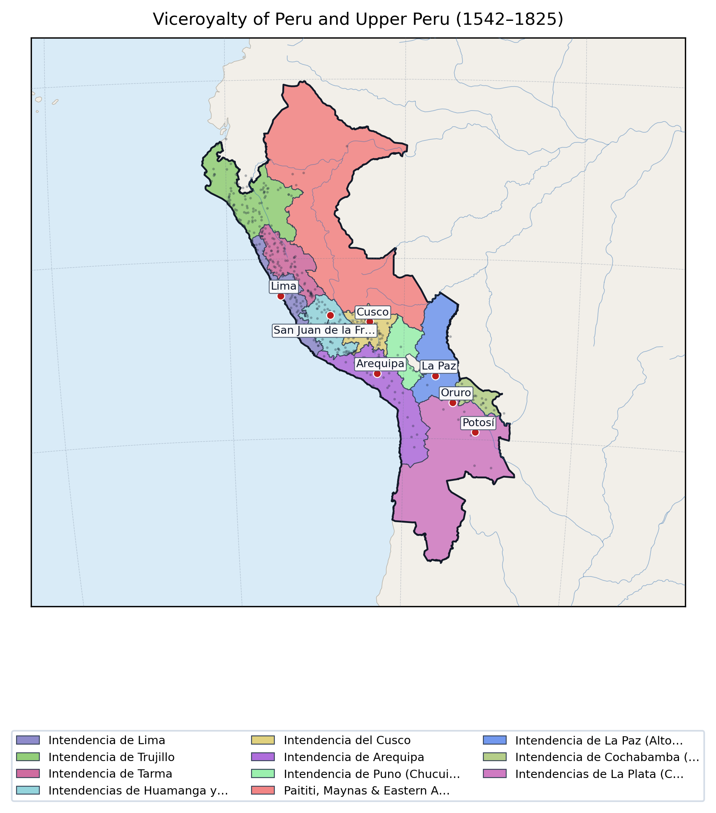
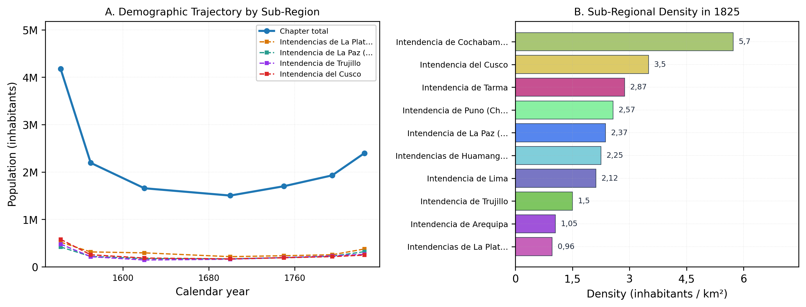
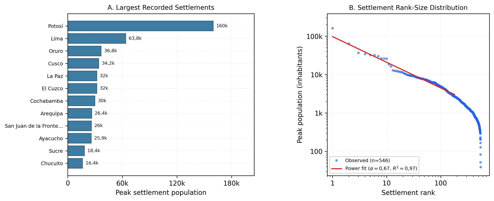

Viceroyalty of Peru and Upper Peru
================
Aust Kätzchen
23 November 2026

- [Abstract](#abstract)
- [Background](#background)
  - [Conquest Aftermath, Reducciones and the Toledan Equilibrium
    (1542-1620)](#conquest-aftermath-reducciones-and-the-toledan-equilibrium-1542-1620)
  - [Potosí Silver, Huancavelica Mercury and the Mita Labour
    System](#potosí-silver-huancavelica-mercury-and-the-mita-labour-system)
  - [Forastero Flight, Epidemic Shock and the 1700 Trough
    (1620-1721)](#forastero-flight-epidemic-shock-and-the-1700-trough-1620-1721)
  - [Bourbon Reforms, Charcas Transfer and the Great Andean Rebellions
    (1721-1825)](#bourbon-reforms-charcas-transfer-and-the-great-andean-rebellions-1721-1825)
- [Methodology](#methodology)
- [Testing and Validation](#testing-and-validation)
- [Results](#results)
  - [Aggregate Trajectory across Lower and Upper Peru
    (1542-1825)](#aggregate-trajectory-across-lower-and-upper-peru-1542-1825)
  - [Coastal and Northern Sierra Intendancies: Lima, Trujillo and
    Tarma](#coastal-and-northern-sierra-intendancies-lima-trujillo-and-tarma)
  - [Central and Southern Highlands: Huamanga, Huancavelica, Cusco,
    Arequipa and
    Puno](#central-and-southern-highlands-huamanga-huancavelica-cusco-arequipa-and-puno)
  - [Audiencia de Charcas (Alto Perú): La Paz, Cochabamba, La Plata and
    Potosí](#audiencia-de-charcas-alto-perú-la-paz-cochabamba-la-plata-and-potosí)
  - [Eastern Amazonian Frontier: Maynas and the Foothill
    Missions](#eastern-amazonian-frontier-maynas-and-the-foothill-missions)
  - [Casta Composition and Colonial Urban
    Hierarchy](#casta-composition-and-colonial-urban-hierarchy)
- [Limitations](#limitations)
- [Conclusion](#conclusion)
- [Appendix](#appendix)
  - [Territorial Reconciliation and Gazetteer
    Provenance](#territorial-reconciliation-and-gazetteer-provenance)
  - [Intendancy Reallocation and Archival
    Dossier](#intendancy-reallocation-and-archival-dossier)
- [Sources](#sources)

<figure>

<figcaption aria-hidden="true">Eleven colonial administrative
sub-regions and 546 catalogued settlements across the Viceroyalty of
Peru and Upper Peru from 1542 to 1825.</figcaption>
</figure>

# Abstract

Between the establishment of the Viceroyalty of Peru in 1542 and the
creation of Bolivia in 1825, the central and southern Andean world
traced a deep asymmetric U-shaped demographic arc. Across a territory of
1.926.616 km² spanning 11 colonial administrative sub-regions from the
northern Peruvian desert to the Bolivian altiplano and the eastern
Amazonian missions, aggregate population fell from 4,17M in 1542 (2,17
persons per km²) to 2,19M on the eve of Viceroy Francisco de Toledo’s
general inspection in 1570 and 1,66M by 1620, bottoming out near 1,5M
around 1700 (0,78 persons per km²)
[\[1\]](#ref-cook1979indios)[\[2\]](#ref-reyes2013saberes)[\[3\]](#ref-mayer1991indigenous).
Recovery gathered pace after the Great Andean Plague of 1719-1721,
lifting the domain to 1,7M in 1750 and 1,93M (1.930.122) at the 1795
benchmark calibrated against Viceroy Francisco Gil de Taboada’s census
of Peru and late colonial Charcas enumerations, before reaching 2,4M at
independence in 1825
[\[4\]](#ref-gootenberg1991population)[\[5\]](#ref-larson1998cochabamba)[\[6\]](#ref-gaviramarquez2010poblacion).
Colonial extraction reshaped the internal map: highland silver mining at
Potosí and mercury mining at Huancavelica drew tens of thousands of
*mitayos* from sixteen provinces while provoking widespread flight into
*forastero* status, coastal Lima and Trujillo rebuilt multi-ethnic casta
and Afro-Peruvian cohorts, and Cochabamba emerged as an agrarian mestizo
hearth
[\[7\]](#ref-zagalsky2014mita)[\[8\]](#ref-saignes1987miners)[\[9\]](#ref-haskett1995coercion).
Synthesising colonial *visitas*, Bourbon padrones, tributary tallies and
a 546-settlement gazetteer, this study reconciles the demographic
history of Lower and Upper Peru across nearly three centuries of Spanish
rule.

# Background

## Conquest Aftermath, Reducciones and the Toledan Equilibrium (1542-1620)

When Charles V erected the Viceroyalty of Peru in November 1542, the
Andean world was already reeling from European infectious disease and
civil war among the conquistadors. Smallpox and measles had run ahead of
Francisco Pizarro’s columns in the late 1520s, and a decade of factional
fighting between Pizarrists and Almagrists disrupted irrigation canals,
storehouses and highland llama herds
[\[10\]](#ref-jimenezkanahuaty2025charcas)[\[11\]](#ref-presta1997encomienda).

Even so, the central and southern Andes still held roughly 4,17M
inhabitants in 1542, heavily concentrated in the intermontane basins of
Cusco (580k), Charcas (520k), Trujillo (480k), Tarma (420k) and La Paz
(420k). Across the coastal valleys of Lima and Trujillo,
irrigation-dependent societies collapsed far faster than upland
communities, as malaria, typhus and European livestock intrusions
compounded epidemic mortality on the warm littoral
[\[1\]](#ref-cook1979indios)[\[12\]](#ref-jr2015genomic).

During the first quarter-century of viceregal rule, demographic
administration rested uneasily on private *encomiendas* whose holders
competed with royal magistrates for shrinking indigenous tribute
[\[10\]](#ref-jimenezkanahuaty2025charcas)[\[11\]](#ref-presta1997encomienda).
Early colonial theorists such as the Charcas oidor Juan de Matienzo
argued in his *Gobierno del Perú* (1567) that dispersed Andean *ayllus*
could neither be taxed reliably nor catechised unless resettled into
nucleated Spanish-style towns (*reducciones*)
[\[2\]](#ref-reyes2013saberes).

Between 1570 and 1575, Viceroy Francisco de Toledo translated Matienzo’s
blueprint into a sweeping demographic and fiscal reorganisation. His
*Visita General* counted roughly 1,3M indigenous people across Lower and
Upper Peru, including 75.000 to 77.000 tributaries in Cusco (at least
260k to 270k persons), roughly 40.000 in Arequipa (200k to 201.830),
22.000 to 23.600 in Huamanga (112k to 130k), about 30.000 in La Paz
(150k minimum) and 45.000 to 46.000 in La Plata-Charcas
[\[1\]](#ref-cook1979indios)[\[7\]](#ref-zagalsky2014mita). Over the
same years Toledo forced hundreds of thousands of highlanders out of
scattered stone hamlets and *chullpa* ancestral landscapes into compact
grid-plan towns, a spatial rupture still visible in colonial archaeology
across Bolivia and northern Chile
[\[13\]](#ref-villanuevacriales2019arqueologia).

By 1570, total domain population had already fallen by 47,4% from its
1542 mark to 2,19M. Contraction slowed after the Toledan *reducciones*
stabilised fiscal boundaries, yet further epidemic waves (notably the
severe 1585-1591 smallpox and typhus pandemic) carried the domain down
another 24,4% to 1,66M by 1620.

Crucially, the coastal lowlands bore the sharpest early losses: Trujillo
dropped by 69,8% between 1542 and 1620 (480k to 145k) and Arequipa by
65,3% (360k to 125k), whereas Charcas and Potosí retained 56,7% of their
1542 numbers (295k) because silver-driven migration pulled people
southward onto the altiplano
[\[1\]](#ref-cook1979indios)[\[8\]](#ref-saignes1987miners).

## Potosí Silver, Huancavelica Mercury and the Mita Labour System

No single factor bent colonial Andean population geography more
forcefully than the pairing of Potosí silver with Huancavelica mercury.
Discovered in 1545 at 4.090 m above sea level in southern Charcas, the
Cerro Rico de Potosí mushroomed from 14.000 residents in 1546 to 120.000
by 1573, 148.000 by 1611 and roughly 160.000 at its
mid-seventeenth-century zenith around 1650
[\[7\]](#ref-zagalsky2014mita)[\[8\]](#ref-saignes1987miners). Initially
smelted in indigenous wind-blown *huayras*, Potosí ore shifted in the
early 1570s to cold-mercury amalgamation (*beneficio de patio*) supplied
by the Santa Bárbara cinnabar mines at Huancavelica, which reached
11.840 residents by 1600.

To keep both mines staffed despite falling rural numbers, Toledo
instituted the *mita* in 1573, drafting roughly 13.500 adult male
*mitayos* annually on a rotating seventh-year basis from sixteen
highland provinces stretching from Cusco through Chucuito, La Paz,
Carangas and Paria down to Porco and Chayanta
[\[7\]](#ref-zagalsky2014mita)[\[14\]](#ref-revillaorias2022lunes).
Although *mitayos* were legally obliged to serve one year in seven
alongside their wives and children, actual demographic strain far
exceeded the formal draft. Journeying up to 1.000 km on foot across
frigid punas exhausted family herds and left many communities unable to
meet both labour quotas and silver tribute
[\[7\]](#ref-zagalsky2014mita)[\[8\]](#ref-saignes1987miners).

Around the core coerced workforce grew a larger market city of voluntary
wage miners (*mingas*), artisans, Spanish merchants, African slaves,
*yanaconas* and service workers. Provisioning 160k high-altitude
consumers generated a continental supply web: Cochabamba valleys
expanded wheaten grain and maize exports to Potosí, *panaderías* in the
imperial villa relied on unfree and indebted labour to bake wheaten
bread for Spanish households, mules and textiles moved along the
Tucumán-Córdoba corridor, and Pacific silver-and-mercury logistics
linked Arica and Atacama Cobija to the altiplano
[\[5\]](#ref-larson1998cochabamba)[\[15\]](#ref-mechalski2017spanish)[\[16\]](#ref-gonzaleznavarro2024circulacion)[\[17\]](#ref-garciaalbarido2022ruta).
When secondary silver strikes erupted at Oruro after 1606, that highland
camp surged to 36.820 inhabitants by 1628
[\[18\]](#ref-zulawski1994they).

## Forastero Flight, Epidemic Shock and the 1700 Trough (1620-1721)

Throughout the seventeenth century, indigenous households used spatial
mobility as their primary demographic defence against the *mita* and
*corregidor* exactions. By abandoning their ancestral *reducciones* and
settling as *forasteros* (outsiders without community land rights) on
Spanish haciendas, in cities such as Cusco, La Plata and La Paz, or in
exempt frontier valleys such as Pilaya y Paspaya and Cochabamba,
families escaped rotating mine drafts while paying lower tribute rates
[\[3\]](#ref-mayer1991indigenous)[\[14\]](#ref-revillaorias2022lunes)[\[18\]](#ref-zulawski1994they).

In the diocese of Cusco, Wightman’s parish series demonstrate that
*forasteros* grew from an almost negligible share in Toledo’s time to
over a third of rural indigenous tributaries by 1690, eroding the
demographic base of *originario* *ayllus* even where regional headcounts
had begun to flatten [\[3\]](#ref-mayer1991indigenous). In Charcas,
Nicolás Sánchez-Albornoz’s analysis of the 1683-1686 *Numeración
General* ordered by Viceroy Duque de la Palata captured this massive
redistribution: Potosí’s nominal *mita* catchment had shrunk so
drastically that *forasteros* outnumbered *originarios* across several
Upper Peruvian provinces
[\[1\]](#ref-cook1979indios)[\[18\]](#ref-zulawski1994they).

Declining Potosí ore grades and shrinking *mita* turnouts coincided with
stagnation across the viceroyalty. Between 1620 and 1700, total domain
population slipped by a further 9,3% from 1,66M to its colonial minimum
of 1,5M (0,78 persons per km²). Potosí itself halved from 160.000 in
1650 to 70.000 by 1700, dragging the Charcas-Potosí sub-region down from
295k to 215k (-27,1%), while Cusco fell from 185k to 168k and Arequipa
from 125k to 105k. Only the northern coast around Trujillo (145k to
162k) had begun mild natural recovery before 1700, supported by mixed
rural estates and *mestizo* growth.

Recovery in the southern highlands was brutally interrupted by the Great
Andean Plague of 1719-1721. Triggered in Buenos Aires and carried up the
silver road into Upper Peru, Cusco and the central sierra, this
fast-moving epidemic (variously identified in contemporary chronicles as
haemorrhagic typhus or influenza complicated by secondary pneumonia)
killed roughly 200k to 300k people across the Andes within three years,
emptying Potosí’s parishes and forcing emergency reductions in tribute
assessments
[\[1\]](#ref-cook1979indios)[\[3\]](#ref-mayer1991indigenous). Yet
unlike the sixteenth-century pandemics, the 1719-1721 mortality spike
was followed by rapid rebound. Acquired immunity among surviving mixed
and indigenous cohorts, wider cultivation of potatoes and maize and
lower *mita* burdens outside the Potosí core allowed crude birth rates
to outpace mortality across the 1730s and 1740s, lifting total viceregal
population by 13,1% from 1,5M in 1700 to 1,7M by 1750
[\[5\]](#ref-larson1998cochabamba)[\[9\]](#ref-haskett1995coercion).

## Bourbon Reforms, Charcas Transfer and the Great Andean Rebellions (1721-1825)

In the second half of the eighteenth century, Bourbon administrative and
fiscal centralisation collided directly with a growing Andean
population. In 1776, Madrid detached the entire Audiencia de Charcas
(including La Paz, Cochabamba, Potosí, La Plata and the Titicaca basin
around Puno) from Lima and placed it under the newly created Viceroyalty
of the Río de la Plata so that Upper Peruvian silver would finance
Atlantic defence at Buenos Aires
[\[6\]](#ref-gaviramarquez2010poblacion)[\[19\]](#ref-fisher2006redes).
Simultaneously, *visitador general* José Antonio de Areche raised sales
taxes (*alcabalas*), tightened customs houses and expanded compulsory
*reparto de mercancías* (forced credit sales of mules, textiles and
tools by *corregidores*), while Potosí mine owners intensified coerced
productivity quotas (*tareas*) to revive silver output
[\[9\]](#ref-haskett1995coercion)[\[20\]](#ref-ophelangodoy1992rebeliones).

Those pressures detonated the Great Andean Rebellions of 1780-1783
across both Lower and Upper Peru. Sparked in Chayanta by Tomás Katari’s
fiscal protest and launched on a viceregal scale in November 1780 by
José Gabriel Condorcanqui (Túpac Amaru II) in Tinta near Cusco, the
insurgency spread rapidly across the altiplano under Julián Apaza (Túpac
Katari), who besieged La Paz twice in 1781, and Diego Cristóbal Túpac
Amaru in Azángaro and Puno
[\[20\]](#ref-ophelangodoy1992rebeliones)[\[21\]](#ref-barragan2026caciques).

Contemporary royalist dispatches and modern historiography reckon total
war-related deaths at 80k to 100k across Cusco, Puno, La Paz and
northern Potosí, alongside the destruction of livestock and *obraje*
textile workshops
[\[6\]](#ref-gaviramarquez2010poblacion)[\[20\]](#ref-ophelangodoy1992rebeliones).
In the wake of suppression, the Crown abolished the *corregimientos* and
*reparto*, installing the Bourbon Intendancy system in Charcas (1782)
and Peru (1784) staffed by peninsular and creole bureaucrats
[\[19\]](#ref-fisher2006redes). In February 1796, strategic security
concerns led Madrid to return the Intendancy of Puno (Lampa, Azángaro
and Carabaya plus Chucuito) from Río de la Plata back to Lima
[\[4\]](#ref-gootenberg1991population)[\[19\]](#ref-fisher2006redes).

Despite the 1780-1783 bloodshed, late colonial growth continued
steadily. Viceroy Francisco Gil de Taboada’s 1791-1795 general census of
the seven Lower Peruvian intendancies recorded 1.076.122 inhabitants in
the *Mercurio Peruano* summary (1.076.997 in Hipólito Unanue’s *Guía del
Perú* and 1.115.207 in the provincial archive compilation), rising to
1.232.122 once Puno’s 156.000 residents were reincorporated in 1796
[\[4\]](#ref-gootenberg1991population)[\[22\]](#ref-campana2023identidad).
Table 1 reproduces the published *Mercurio Peruano* casta enumeration
across all seven Lower Peruvian intendancies. Combined with Upper Peru’s
highland intendancies and the Amazonian frontier, domain population
reached 1,93M (1.930.122) at 1795 and accelerated to 2,4M by 1825, even
though the Independence Wars and *Trienio Liberal* constitutional
experiments (1820-1824) temporarily depressed mining towns such as
Potosí (down to 9.000) and Sucre (12.000) while boosting agrarian
valleys and Lima
[\[4\]](#ref-gootenberg1991population)[\[5\]](#ref-larson1998cochabamba)[\[23\]](#ref-salaivila2011trienio).

| Intendancy | Españoles | Indios | Mestizos | Pardos Libres | Esclavos | Reported Total |
|:---|:---|:---|:---|:---|:---|:---|
| **Lima** | 22.370 | 63.181 | 13.747 | 17.864 | 29.763 | 149.112 |
| **Trujillo** | 19.098 | 136.813 | 76.949 | 13.757 | 4.725 | 230.967 |
| **Tarma** | 15.939 | 110.499 | 78.682 | 844 | 236 | 201.259 |
| **Huancavelica** | 2.341 | 38.084 | 4.537 | 0 | 41 | 30.917 |
| **Huamanga** | 5.378 | 73.074 | 29.621 | 943 | 30 | 111.410 |
| **Cusco** | 31.828 | 151.590 | 23.104 | 993 | 284 | 216.282 |
| **Arequipa** | 39.357 | 68.941 | 17.797 | 7.003 | 5.258 | 136.175 |
| **Reported 7-Intendancy Total** | 136.311 | 642.182 | 244.437 | 41.404 | 40.337 | 1.076.122 |

Lower Peruvian intendancy populations by casta in the 1791-1795 Censo de
Gil de Taboada (Mercurio Peruano compilation, excluding Puno’s 156.000
reincorporated in 1796).

# Methodology

The demographic series spans 1.926.616 km² across 11 sub-regions
anchored in late colonial Bourbon intendancy jurisdictions rather than
modern republican frontiers. Lower Peru comprises seven coastal and
sierra units: Lima (79.259 km²), Trujillo (176.402 km²), Tarma (80.107
km²), combined Huamanga and Huancavelica (71.958 km²), Cusco (70.830
km²), Arequipa (149.998 km², including Arica and Tarapacá) and Puno
(70.907 km², encompassing Chucuito, Lampa, Azángaro and Carabaya).

Eastern Amazonia forms a distinct mission frontier covering Paititi and
Maynas (661.970 km²). Upper Peru (Audiencia de Charcas) comprises three
sub-regions: La Paz (135.151 km²), Cochabamba (39.267 km²) and combined
La Plata-Charcas and Potosí (390.768 km², extending down to Atacama
Cobija on the Pacific).

Seven chronological benchmarks capture every major structural inflection
between 1542 and 1825: 1542 (viceregal foundation), 1570 (pre-Toledan
baseline), 1620 (post-amalgamation plateau), 1700 (silver contraction
trough), 1750 (mid-Bourbon recovery), 1795 (Bourbon census anchor) and
1825 (Bolivian independence). Unlike earlier periods reconstructed from
archaeology alone, colonial Andean demography works backwards and
forwards from two solid fiscal-census piers: the 1570-1575 *Visita
General* of Toledo and the 1791-1796 Bourbon counts
[\[1\]](#ref-cook1979indios)[\[4\]](#ref-gootenberg1991population).

For 1570, Toledo’s surviving *tributario* counts (taxpaying indigenous
men aged 18 to 50) in Cusco, Huamanga, Arequipa, La Paz and La Plata are
inflated to total indigenous inhabitants using Noble David Cook’s
empirically tested regional dependency ratios of 4,2 to 5,0 persons per
tributary, adjusted upward for non-tributary *yanaconas*, urban
Spanish-mestizo nuclei and the missing Lima and Trujillo folios lost in
the 1884 Tribunal de Cuentas fire
[\[1\]](#ref-cook1979indios)[\[11\]](#ref-presta1997encomienda).
Intermediate benchmarks at 1620 and 1700 interpolate surviving parish
series, Palata’s 1683-1686 *revisitas* and *forastero* shares across
Cusco, Oruro and Carangas
[\[3\]](#ref-mayer1991indigenous)[\[6\]](#ref-gaviramarquez2010poblacion)[\[18\]](#ref-zulawski1994they).

For 1795, Lower Peru adopts the exact Gil de Taboada *Mercurio Peruano*
intendancy totals (1.076.122) plus Puno’s 156.000 (sum 1.232.122), while
Upper Peru reconciles the 1796 ecclesiastical count (552.700 across La
Plata, La Paz and Santa Cruz), Francisco de Viedma’s 1793 Cochabamba
inspection (22.305 in the Cercado alone and over 200k across the broader
Santa Cruz jurisdiction) and late eighteenth-century *revisitas* into
sub-regional totals of 225.000 for La Paz, 150.000 for Cochabamba and
255.000 for La Plata-Potosí
[\[5\]](#ref-larson1998cochabamba)[\[6\]](#ref-gaviramarquez2010poblacion)[\[21\]](#ref-barragan2026caciques).
The 1825 closing horizon links directly into early republican
departmental series in Peru and Bolivia, bridging Gootenberg’s 1827
Peruvian fiscal revisions (1,52M for Lower Peru including Puno) and
Charcas republican baselines (922k across the core Upper Peruvian
departments)
[\[4\]](#ref-gootenberg1991population)[\[9\]](#ref-haskett1995coercion).

Spatial allocation inside each sub-region draws on a 546-settlement
geo-referenced gazetteer assembled without crowdsourced data: 457
Bourbon-era urban and *partido* nodes from HGIS de las Indias
(1701-1808), 54 sixteenth-century centres from Toledo’s *Visita General*
as edited by Cook, 21 Upper Peruvian urban series from Cook, Tandeter
and Sánchez-Albornoz, 8 Maynas mission reductions from Chantre y Herrera
and Golob, and 6 early Spanish towns from López de Velasco’s 1574
*Geografía*
[\[1\]](#ref-cook1979indios)[\[8\]](#ref-saignes1987miners)[\[9\]](#ref-haskett1995coercion).
Table 2 summarises sub-regional land areas and all seven benchmark
populations.

| Sub-Region | Area (km²) | 1542 | 1570 | 1620 | 1700 | 1750 | 1795 | 1825 |
|:---|:---|:---|:---|:---|:---|:---|:---|:---|
| **Intendencia de Lima** | 79.259 | 290k | 155k | 118k | 115k | 130k | 149,1k | 168k |
| **Intendencia de Trujillo** | 176.402 | 480k | 215k | 145k | 162k | 195k | 231k | 265k |
| **Intendencia de Tarma** | 80.107 | 420k | 210k | 148k | 145k | 172k | 201,3k | 230k |
| **Intendencias de Huamanga y Huancavelica** | 71.958 | 340k | 158k | 112k | 108k | 124k | 142,3k | 162k |
| **Intendencia del Cusco** | 70.830 | 580k | 255k | 185k | 168k | 192k | 216,3k | 248k |
| **Intendencia de Arequipa** | 149.998 | 360k | 201k | 125k | 105k | 120k | 136,2k | 158k |
| **Intendencia de Puno (Chucuito and Azángaro)** | 70.907 | 320k | 175k | 130k | 118k | 135k | 156k | 182k |
| **Paititi, Maynas and Eastern Amazonian Frontier** | 661.970 | 185k | 145k | 110k | 88k | 75k | 68k | 64k |
| **Intendencia de La Paz (Alto Perú)** | 135.151 | 420k | 220k | 175k | 168k | 195k | 225k | 320k |
| **Intendencia de Cochabamba (Alto Perú)** | 39.267 | 260k | 145k | 115k | 112k | 128k | 150k | 225k |
| **Intendencias de La Plata (Charcas) y Potosí** | 390.768 | 520k | 315k | 295k | 215k | 235k | 255k | 377k |
| **Total Viceregal Domain** | 1.926.616 | 4,17M | 2,19M | 1,66M | 1,5M | 1,7M | 1,93M | 2,4M |

Sub-regional surface area and benchmark populations across the
Viceroyalty of Peru and Upper Peru, 1542-1825.

# Testing and Validation

Evaluating a three-century colonial series requires cross-checking
fiscal headcounts against biological carrying capacities, urban supply
thresholds and independent genomic and ecclesiastical baselines. Five
quantitative tests bound the 1542-1825 trajectory.

First, the 1542 total of 4,17M sits comfortably within the post-conquest
scholarly corridor. Cook’s tributary life-table models for Peru alone
place indigenous numbers near 3,3M in 1530 and 1,3M by 1570
[\[1\]](#ref-cook1979indios). Adding Upper Peru’s populous Aymara
kingdoms around Lake Titicaca, Cochabamba and Charcas plus early Spanish
urban contingents accounts cleanly for 4,17M in 1542 and 2,19M in 1570,
implying an annualised contraction of -2,27% per year during the initial
twenty-eight-year shock and -0,56% per year from 1570 to 1620.

Second, agrarian carrying capacity confirms that highland densities
remained well within pre-industrial Andean limits. Even at the 1825
independence benchmark of 2,4M, mean density across the inhabited
coastal and sierra sub-regions (excluding the 661.970 km² Amazonian
frontier) stood at only 1,85 persons per km². By 1825, fertile
Cochabamba led the entire viceroyalty at 5,73 persons per km², followed
by Cusco (3,5), Tarma (2,87) and Puno (2,57). These densities match
terraced maize-and-potato cultivation across valley floors (2.000 to
3.600 m) combined with camelid pastoralism on the puna
[\[5\]](#ref-larson1998cochabamba)[\[6\]](#ref-gaviramarquez2010poblacion).

Third, urban provisioning ratios corroborate the peak size of Potosí and
Lima. Sustaining 160k inhabitants at 4.090 m in 1650 demanded roughly
32.000 to 40.000 tonnes of grain and dried tubers annually, matching
surviving *alcabala* and flour accounts linking Potosí *panaderías* to
Cochabamba, Chuquisaca and Chayanta
[\[5\]](#ref-larson1998cochabamba)[\[15\]](#ref-mechalski2017spanish).
On the coast, Lima’s gradual rise from 9.800 in 1561 to 37.259 in 1700,
52.627 in 1791 and 63.809 by 1812 reflects its dual role as viceregal
capital and import-export entrepôt fed by coastal valleys and Chilean
wheat fleets
[\[24\]](#ref-iwasakicauti1994vidas)[\[25\]](#ref-bustamantemontoro2025hibridaciones).

Fourth, late colonial casta ratios align with modern South American
genomic ancestry profiles. In Gil de Taboada’s 1791-1795 table, *indios*
formed 59,7% of the reported seven-intendancy total (642.182 of
1.076.122), *mestizos* 22,7% (244.437), *españoles* 12,7% (136.311),
*pardos libres* 3,8% (41.404) and *esclavos* 3,7% (40.337)
[\[4\]](#ref-gootenberg1991population). Including Puno (\>90%
indigenous) lifts the indigenous share of Lower Peru above 63%, while
coastal Lima held 73,8% of the viceroyalty’s enslaved African population
(29.763 of 40.337). Genome-wide ancestry analyses of contemporary Andean
populations recover precisely this regional gradient: high indigenous
ancestry (\>75%) across the Peruvian and Bolivian sierra paired with
stronger European and sub-Saharan African admixture on the Peruvian
coast [\[12\]](#ref-jr2015genomic).

Fifth, Table 3 tests implied growth symmetry across all 11 sub-regions.
Across the 158-year contraction phase from 1542 to 1700, every
sub-region shrank at annual rates between -0,43% (Paititi-Maynas) and
-0,77% (Arequipa and Cusco). Over the 125-year recovery phase from 1700
to 1825, all ten coastal and sierra sub-regions rebounded at +0,30% to
+0,56% per year, while only the mission frontier continued declining
(-0,25% per year) as *reducción* epidemics persisted in Amazonia
[\[26\]](#ref-rosanacuzzi2015declaraciones).

| Sub-Region | 1542 Dens. | 1700 Dens. | 1795 Dens. | 1825 Dens. | 1542-1700 (%/yr) | 1700-1825 (%/yr) | 1542-1825 Change |
|:---|:---|:---|:---|:---|:---|:---|:---|
| **Intendencia de Lima** | 3,66 | 1,45 | 1,88 | 2,12 | -0,58% | 0,3% | -42,1% |
| **Intendencia de Trujillo** | 2,72 | 0,92 | 1,31 | 1,5 | -0,69% | 0,39% | -44,8% |
| **Intendencia de Tarma** | 5,24 | 1,81 | 2,51 | 2,87 | -0,67% | 0,37% | -45,2% |
| **Intendencias de Huamanga y Huancavelica** | 4,72 | 1,5 | 1,98 | 2,25 | -0,72% | 0,32% | -52,4% |
| **Intendencia del Cusco** | 8,19 | 2,37 | 3,05 | 3,5 | -0,78% | 0,31% | -57,2% |
| **Intendencia de Arequipa** | 2,4 | 0,7 | 0,91 | 1,05 | -0,78% | 0,33% | -56,1% |
| **Intendencia de Puno (Chucuito and Azángaro)** | 4,51 | 1,66 | 2,2 | 2,57 | -0,63% | 0,35% | -43,1% |
| **Paititi, Maynas and Eastern Amazonian Frontier** | 0,28 | 0,13 | 0,1 | 0,1 | -0,47% | -0,25% | -65,4% |
| **Intendencia de La Paz (Alto Perú)** | 3,11 | 1,24 | 1,66 | 2,37 | -0,58% | 0,52% | -23,8% |
| **Intendencia de Cochabamba (Alto Perú)** | 6,62 | 2,85 | 3,82 | 5,73 | -0,53% | 0,56% | -13,5% |
| **Intendencias de La Plata (Charcas) y Potosí** | 1,33 | 0,55 | 0,65 | 0,96 | -0,56% | 0,45% | -27,5% |
| **Total Viceregal Domain** | 2,17 | 0,78 | 1 | 1,25 | -0,64% | 0,37% | -42,5% |

Sub-regional population densities (persons per km²) at four benchmarks,
annualised contraction (1542-1700) and recovery (1700-1825) rates and
net change.

# Results

## Aggregate Trajectory across Lower and Upper Peru (1542-1825)

Over the 283 years from 1542 to 1825, the Viceroyalty of Peru and Upper
Peru never regained its conquest-era population. Starting at 4,17M in
1542, the domain lost 64,0% of its inhabitants over the first 158 years,
reaching 1,5M around 1700. Subsequent eighteenth-century growth restored
895k inhabitants (+59,5%), bringing the 1825 total to 2,4M, or 57,5% of
the 1542 baseline. Figure 1 displays both the overall trajectory and the
1825 density ranking across the ten settled coastal and highland
sub-regions.

Beneath that aggregate curve lay a decisive shift in regional weight. In
1542, the three core Lower Peruvian sierra and northern coastal basins
of Cusco, Trujillo and Tarma held 35,4% of total inhabitants (1,48M),
while the three Upper Peruvian sub-regions of La Paz, Cochabamba and La
Plata-Potosí held 28,7% (1,2M). By 1825, Upper Peru’s share had risen to
38,4% (922k), powered by resilient agrarian growth in Cochabamba and La
Paz after 1750, whereas Cusco’s share dropped from 13,9% to 10,3%
[\[5\]](#ref-larson1998cochabamba)[\[9\]](#ref-haskett1995coercion).

## Coastal and Northern Sierra Intendancies: Lima, Trujillo and Tarma

The Intendencia de Lima (79.259 km²) experienced the steepest
demographic contrast between urban capital and rural hinterland anywhere
in Spanish South America. Provincial numbers slid from 290k in 1542 to
118k in 1620 and 115k in 1700 before recovering to 149,1k (149.112) in
Gil de Taboada’s census and 168k in 1825.

Yet while indigenous villages along the Rimac, Cañete and Ica valleys
shrank catastrophically in the sixteenth century, Lima city expanded
from 9.800 in 1561 to 25.454 in 1614, 37.259 in 1700 and 63.809 by 1812,
concentrating over a third of its intendancy’s entire population inside
a walled capital built around Afro-Peruvian artisans, enslaved domestic
workers, creole elites and peninsular merchants
[\[24\]](#ref-iwasakicauti1994vidas)[\[25\]](#ref-bustamantemontoro2025hibridaciones).
Coastal Ica (11.706 in 1792) and port Callao formed secondary nodes
along this arid littoral.

North of Lima, the Intendencia de Trujillo (176.402 km²) recovered
earliest and fastest on the Pacific side. Falling from 480k in 1542 to a
1620 floor of 145k, Trujillo rebounded earlier than the south, reaching
162k in 1700, 231k (230.967) in 1795 and 265k in 1825. Its northern
irrigated valleys (Lambayeque, Chiclayo, Piura) and sierra highlands
around Cajamarca (12.480 in 1791) and Chota (11.518 in 1779) developed a
balanced mix of indigenous peasant villages (136.813, 59,2%) and
*mestizo* smallholders (76.949, 33,3%), vividly documented in Bishop
Baltasar Jaime Martínez Compañón’s late eighteenth-century *Códice de
Trujillo* [\[22\]](#ref-campana2023identidad).

Inland in the central sierra, the Intendencia de Tarma (80.107 km²)
combined dense Mantaro Valley agriculture around Jauja (10.178 in 1792)
with revived silver extraction at Cerro de Pasco (6.974 in 1792, surging
to 12.400 by 1815) and Huánuco (12.228 in 1792). Sliding from 420k in
1542 to 145k in 1700, Tarma grew briskly across the eighteenth century
to 201,3k (201.259) in 1795 and 230k in 1825, attaining a density of
2,87 persons per km², the third highest in the viceroyalty.

## Central and Southern Highlands: Huamanga, Huancavelica, Cusco, Arequipa and Puno

Between Lima and Cusco, the combined Intendencias de Huamanga y
Huancavelica (71.958 km²) fell from 340k in 1542 to 108k in 1700 before
recovering to 142,3k (142.327 in the *Mercurio Peruano* summary: 111.410
in Huamanga plus 30.917 in Huancavelica) and 162k by 1825.
Huancavelica’s mercury *mita* proved even more lethal per worker than
Potosí because of cinnabar toxicity and underground cave-ins, causing
Huancavelica town to decline from 11.840 in 1600 to 5.146 in 1791 while
San Juan de la Frontera de Huamanga (Ayacucho) sustained 25.870 to
26.045 residents as a regional administrative and textile centre
[\[1\]](#ref-cook1979indios)[\[19\]](#ref-fisher2006redes).

The Intendencia del Cusco (70.830 km²) formed the demographic anchor of
Lower Peru throughout the colonial era. Dropping from 580k in 1542 to
255k in 1570 and 168k in 1700, Cusco recovered to 216,3k (216.282) by
1795 and 248k in 1825 (3,5 persons per km², second only to Cochabamba).
Even after losing thousands of residents in the 1719-1721 plague and the
1780-1782 Túpac Amaru rebellion, the former Inca capital held 31.982
inhabitants in 1791-1792, flanked by provincial agricultural centres
such as Sicuani (9.261)
[\[3\]](#ref-mayer1991indigenous)[\[20\]](#ref-ophelangodoy1992rebeliones).

Southward, the Intendencia de Arequipa (149.998 km²) stretched from
fertile volcanic valleys down through the arid Atacama-Tarapacá coast to
Arica. Because coastal valleys emptied early while silver ports at Arica
declined alongside Potosí’s seventeenth-century slump, Arequipa
contracted from 360k in 1542 to 105k in 1700 before climbing to 136,2k
(136.175) in 1795 and 158k in 1825; Arequipa city itself grew from 8.435
in 1573 to 24.511 in 1792 and 26.400 by 1812, boasting the highest
*español* share (28,9%) of any Lower Peruvian intendancy
[\[4\]](#ref-gootenberg1991population)[\[23\]](#ref-salaivila2011trienio).

Adjacent on the northern Titicaca rim, the Intendencia de Puno (70.907
km²) dropped from 320k in 1542 to 118k in 1700, recovered to 156k upon
its 1796 return to Peru and reached 182k in 1825, even as lakeside
*reducciones* such as Chucuito (16.415 in 1567 to 5.420 in 1795) and
Juli (11.340 to 4.860) bled *mitayos* and *forasteros*
[\[1\]](#ref-cook1979indios)[\[7\]](#ref-zagalsky2014mita).

## Audiencia de Charcas (Alto Perú): La Paz, Cochabamba, La Plata and Potosí

Upper Peru’s three sub-regions displayed striking internal divergence
between mining decline and agrarian expansion. The Intendencia de La Paz
(135.151 km²) fell from 420k in 1542 to 168k in 1700, recovered to 225k
by 1795 despite bearing the heaviest casualties of Túpac Katari’s 1781
siege, and expanded rapidly to 320k by 1825, while La Paz city climbed
from 8.925 in 1573 to 21.120 in 1796 and 32.000 in 1825
[\[1\]](#ref-cook1979indios)[\[20\]](#ref-ophelangodoy1992rebeliones).

The compact Intendencia de Cochabamba (39.267 km²) proved the most
dynamic demographic basin in the entire Andean south. After dipping from
260k in 1542 to 112k in 1700, Cochabamba grew to 150k in 1795 and surged
to 225k in 1825 (5,73 persons per km²).

Exempt from the Potosí *mita*, Cochabamba’s temperate valleys absorbed
thousands of highland *forasteros* and fostered rapid *mestizaje*: in
Francisco de Viedma’s 1793 inspection of Cochabamba Cercado (22.305
inhabitants, growing to 30.000 by 1825), *mestizos* constituted 58,2%
(12.980) and *españoles* 28,5% (6.368), whereas registered *indios* made
up just 5,3% (1.182), alongside 1.600 *mulatos* and 175 *negros*
[\[5\]](#ref-larson1998cochabamba). Secondary valley towns such as
Punata (9.732 in 1793) and Tarata reinforced this dense agrarian
corridor.

To the south, the vast mining and pastoral expanse of La Plata-Charcas
and Potosí (390.768 km²) experienced the sharpest internal boom-and-bust
cycle. Held high through the seventeenth century by silver output (295k
in 1620), the sub-region sank to 215k in 1700 as Potosí dwindled from
160.000 in 1650 to 70.000 in 1700 and 22.622 in 1779, recovering
modestly to 35.000 in 1795 before independence warfare slashed Potosí to
9.000 and Oruro to under 6.000
[\[9\]](#ref-haskett1995coercion)[\[18\]](#ref-zulawski1994they). Even
so, rural provinces such as Chayanta, Porco and Carangas expanded
steadily in the late eighteenth century, lifting the combined
Charcas-Potosí sub-region from 255k in 1795 to 377k in 1825
[\[6\]](#ref-gaviramarquez2010poblacion)[\[21\]](#ref-barragan2026caciques).

## Eastern Amazonian Frontier: Maynas and the Foothill Missions

Covering 661.970 km² (34,4% of the study area), Paititi, Maynas and the
Eastern Amazonian Frontier followed a monotonic downward path across all
three colonial centuries. Spread thinly along the Marañón, Huallaga and
Ucayali rivers, indigenous populations fell from 185k in 1542 to 110k in
1620, 88k in 1700, 68k in 1795 and 64k by 1825 (0,1 persons per km²).

Jesuit missionary *reducciones* clustered dispersed riverine groups at
Borja Maynas (1.640 in 1680), Lagunas (2.340 in 1737), Jéberos (2.140 in
1795), Yurimaguas (1.140 in 1795) and Iquitos (840 in 1815), but
repeated smallpox and measles outbreaks after the 1767 Jesuit expulsion
kept lowland mortality chronically above birth rates
[\[1\]](#ref-cook1979indios)[\[26\]](#ref-rosanacuzzi2015declaraciones).

## Casta Composition and Colonial Urban Hierarchy

Urban settlement across Peru and Upper Peru never lost the extreme
primacy forged during the sixteenth-century silver boom. Figure 2 plots
the leading urban nodes and the rank-size curve across all 546
catalogued locales ($\alpha = 0,67$, $R^2 = 0,97$). Potosí’s
mid-seventeenth-century peak (160k) stood two and a half times above
Lima’s highest colonial count (63,8k in 1812) and more than four times
above Oruro (36,8k in 1628) and Cusco (34,2k in 1690). Behind that
primate tier sat a remarkably even cluster of regional capitals between
18k and 32k inhabitants: La Paz (32k in 1825), Cochabamba (30k in 1825),
Arequipa (26,4k in 1812), Huamanga (26k in 1792) and Sucre-La Plata
(18,4k in 1795), supported by over 500 parish *doctrinas*, mining camps
and provincial market towns ranging from 500 to 12k residents
[\[5\]](#ref-larson1998cochabamba)[\[9\]](#ref-haskett1995coercion)[\[25\]](#ref-bustamantemontoro2025hibridaciones).

# Limitations

Five evidentiary constraints limit the precision of this reconstruction
and should be weighed when comparing sub-regions or individual years.

First, surviving sixteenth-century census evidence is asymmetrical.
While Toledo’s 1570-1575 *Visita General* provides detailed tributary
counts for the southern sierra and Upper Peru, the original *visita*
folios for Lima and Trujillo perished in the 1884 fire at the Tribunal
de Cuentas in Lima [\[1\]](#ref-cook1979indios). Earlier 1542 totals
rest on backward projection from 1570 using documented epidemic
mortality ratios, carrying an uncertainty band of roughly 16% on either
side of the central estimates.

Second, fiscal evasion and clerical recording discrepancies blur late
colonial headcounts. Throughout the seventeenth and eighteenth
centuries, *caciques* and villagers concealed tributaries or shifted
residents into exempt *forastero* and *yanacona* lists to lighten *mita*
drafts
[\[3\]](#ref-mayer1991indigenous)[\[21\]](#ref-barragan2026caciques).
Even inside the celebrated 1791-1795 *Censo de Gil de Taboada*, the
*Mercurio Peruano* summary (1.076.122), Hipólito Unanue’s *Guía*
(1.076.997) and provincial *contaduría* summaries (1.115.207 across the
seven intendancies) diverge noticeably in Huancavelica (30.917 versus
45.040) and Trujillo (230.967 versus 251.994), partly owing to omitted
clergy, transhumant herders and delayed parish returns
[\[4\]](#ref-gootenberg1991population)[\[20\]](#ref-ophelangodoy1992rebeliones).

Third, Upper Peru lacks a single synchronous viceregal census matching
Gil de Taboada. The 1796 ecclesiastical count of 552.700 across La
Plata, La Paz and Santa Cruz significantly under-counted dispersed rural
*ayllus* and lowland provinces compared with the scholarly c.1800
consensus near 800.000
[\[5\]](#ref-larson1998cochabamba)[\[6\]](#ref-gaviramarquez2010poblacion).
Our 1795 Charcas sum of 630.000 (225k La Paz, 150k Cochabamba and 255k
La Plata-Potosí) reconciles fiscal *revisitas* with Viedma’s 1793
inspection, yet remains an informed synthesis rather than a single
door-to-door headcount.

Fourth, the 661.970 km² Amazonian frontier remains thinly documented
outside Jesuit mission ledgers. Uncontacted or mobile groups beyond
Maynas, Moxos and Chiquitos appear only as macro-ecological estimates,
and even mission registers suffered sharp breaks after 1767
[\[26\]](#ref-rosanacuzzi2015declaraciones).

Fifth, combining urban series across archival corpora introduces two
paired historic-city labels into Figure 2 (*El Cuzco* with Cusco, and
*San Juan de la Frontera de Huamanga* with Ayacucho, reflecting separate
1792 HGIS de las Indias and Toledo-Cook series). Neither pair inflates
regional intendancy totals, nor obscures the 1810-1825 war disruption
that scattered highland mining labour
[\[9\]](#ref-haskett1995coercion)[\[23\]](#ref-salaivila2011trienio).

# Conclusion

Across nearly three centuries between 1542 and 1825, the Viceroyalty of
Peru and Upper Peru moved from demographic catastrophe through prolonged
stagnation to uneven regional recovery. From 4,17M at the founding of
the viceroyalty, population halved by 1570 (2,19M) and touched bottom at
1,5M around 1700 before rising 59,5% to 2,4M by independence.

Colonial institutions redistributed survivors nearly as profoundly as
epidemics thinned them: Potosí’s rise to 160k and subsequent collapse to
9.000, Huancavelica’s mercury *mita*, *forastero* migration out of
Titicaca and Cusco *ayllus*, enslaved African labour in Lima and rapid
*mestizo* expansion in Cochabamba and Trujillo forged the human
geography inherited by republican Peru and Bolivia in the nineteenth
century.

# Appendix

## Territorial Reconciliation and Gazetteer Provenance

Because colonial viceregal borders cut across modern Andean republics,
Table 4 reconciles the 546 catalogued settlements across the four
contemporary states overlapping the 1.926.616 km² study domain alongside
their archival provenance corpora. Peru contains 89,7% of recorded
entries (490), followed by Bolivia (48, 8,8%), northern Chile (7, 1,3%,
comprising Arica, Atacama Cobija, Camiña, Cibaya, Codpa, Pica and San
Lorenzo de Tarapacá) and southern Ecuador (1, Machala on the northern
Trujillo boundary). Zero crowdsourced records enter the gazetteer;
primary archival compilations and peer-reviewed historical demography
supply 100% of entries.

## Intendancy Reallocation and Archival Dossier

The 11 administrative polygons reconcile shifting viceregal boundaries
without double-counting border provinces. Puno’s three northern
*partidos* of Lampa, Azángaro and Carabaya alongside Chucuito are
tracked consistently inside the Puno sub-region across all seven
benchmarks despite their temporary placement under Buenos Aires between
1776 and 1796, whereas the coastal corridor of Arica and Tarapacá
remains inside Arequipa and Atacama Cobija inside La Plata-Potosí.
Nineteen primary and secondary scholarly monographs housed in the
chapter repository anchor the *visita*, *mita*, rebellion and census
parameters used in this study.

| Modern Territory | Total Sites | Share | HGIS (1701-1808) | Toledo (1570s) | Alto Perú | Maynas & Velasco |
|:---|:---|:---|:---|:---|:---|:---|
| **Peru** | 490 | 89,7% | 422 | 53 | 1 | 14 |
| **Bolivia** | 48 | 8,8% | 29 | 0 | 19 | 0 |
| **Chile** | 7 | 1,3% | 5 | 1 | 1 | 0 |
| **Ecuador** | 1 | 0,2% | 1 | 0 | 0 | 0 |
| **Total Viceregal Domain** | 546 | 100% | 457 | 54 | 21 | 14 |

Distribution of the 546 catalogued colonial settlements by modern
national territory and archival provenance corpus.

# Sources

1.
Cook, Noble David, and Nicolas
Sanchez-Albornoz. “Indios y tributos en el Alto
Peru.” *The Hispanic American Historical Review*, vol. 59, no. 4,
1979, p. 725, <https://doi.org/10.2307/2514088>.

2.
Reyes, Germán Morong.
“Saberes hegemónicos y Proyecto de dominio colonial
: los indios en la obra de Juan de Matienzo gobierno del Perú
(1567).” *Fronteras de La Historia*, vol. 18, no. 2, 2013, pp.
77-103, <http://www.redalyc.org/articulo.oa?id=83329725003>.

3.
Mayer, Enrique, and Ann M.
Wightman. “Indigenous Migration and Social Change:
The Forasteros of Cuzco, 1520-1720.” *Ethnohistory*, vol. 38, no.
4, 1991, p. 475, <https://doi.org/10.2307/482492>.

4.
Gootenberg, Paul.
“Population and Ethnicity in Early Republican Peru:
Some Revisions.” *Latin American Research Review*, vol. 26, no.
3, 1991, pp. 109-57, <https://doi.org/10.1017/s0023879100023955>.

5.
Larson, Brooke. *Cochabamba,
1550–1900*. Duke University Press, 1998,
<https://doi.org/10.1215/9780822379850>.

6.
Gavira Márquez, María Concepción.
“La población del corregimiento de Carangas
(virreinato del Río de la Plata) a fines del siglo XVIII.”
*América Latina En La Historia Económica*, vol. 17, no. 1, 2010, p. 65,
<https://doi.org/10.18232/alhe.v17i1.429>.

7.
Zagalsky, Paula C. “LA MITA DE
POTOSÍ: UNA IMPOSICIÓN COLONIAL INVARIABLE EN UN CONTEXTO DE MÚLTIPLES
TRANSFORMACIONES (SIGLOS XVI-XVII; CHARCAS, VIRREINATO DEL PERÚ).”
*Chungará (Arica)*, vol. 46, no. 3, 2014, pp. 375-95,
<https://doi.org/10.4067/s0717-73562014000300005>.

8.
Saignes, Thierry, et al.
“The Miners in Colonial Potosí.” *Bulletin
of Latin American Research*, vol. 6, no. 1, 1987, p. 89,
<https://doi.org/10.2307/3338352>.

9.
Haskett, Robert, and Enrique
Tandeter. “Coercion and Market: Silver Mining in
Colonial Potosi, 1692-1826.” *Ethnohistory*, vol. 42, no. 2,
1995, p. 356, <https://doi.org/10.2307/483106>.

10.
Jiménez Kanahuaty, Christian.
“Charcas: orígenes históricos de una sociedad
colonial 1535-1565.” *Revista Ciencia y Cultura*, vol. 29, no.
55, 2025, pp. 351-53, <https://doi.org/10.35319/rcyc.2025551406>.

11.
Presta, Ana María.
“Encomienda, familia y redes en Charcas colonial:
los Almendras, 1540-1600.” *Revista de Indias*, vol. 57, no. 209,
1997, pp. 21-53,
<https://doi.org/10.3989/revindias.1997.i209.793>.

12.
JR, Homburger, et al.
“Genomic Insights into the Ancestry and Demographic
History of South America.” *PLoS Genetics*, vol. 11, no. 12,
2015, p. e1005602,
<https://doi.org/10.1371/journal.pgen.1005602>.

13.
Villanueva Criales, Juan, et al.
“Arqueología de la ruptura colonial: mouros,
chullpas, gentiles y abuelos en España, Bolivia y Chile en perspectiva
comparada.” *Estudios Atacameños*, no. 60, 2019, pp. 9-30,
<https://doi.org/10.4067/s0718-10432018005001402>.

14.
Revilla Orías, Paola A. “LOS LUNES
EN LA PLAZA: SOBRE EL SERVICIO DE MITA EN LA PLATA, CHARCAS (SIGLOS
XVI-XVII).” *Diálogo Andino*, no. 69, 2022, pp. 103-12,
<https://doi.org/10.4067/s0719-26812022000300103>.

15.
Mechalski, Keltie.
“Spanish supremacy: Wheaten bread and Panaderias in
Colonial Potosi.” *COMPASS*, vol. 1, no. 2, 2017, pp. 47-49,
<https://doi.org/10.29173/comp43>.

16.
González Navarro, Constanza.
“Circulación de textiles y génesis de la actividad
artesanal colonial en Córdoba (virreinato del Perú) en el último cuarto
del siglo XVI.” *Revista Latinoamericana de Trabajo y
Trabajadores*, no. 7, 2024, pp. 31-65,
<https://doi.org/10.48038/revlatt.n7.86>.

17.
García-Albarido, Francisco.
“La ruta colonial de Potosí a Cobija y la vieja
nueva praxis de modelos andinos mercantiles.” *Estudios
Atacameños*, vol. 68, 2022, p. e5003,
<https://doi.org/10.22199/issn.0718-1043-2022-0013>.

18.
ZULAWSKI, ANN.
*They Eat from Their Labor*. University of
Pittsburgh Press, 1994, <https://doi.org/10.2307/jj.3385966>.

19.
Fisher, John R.
“Redes de poder en el Virreinato del Perú,
1776-1824: los burócratas.” *Revista de Indias*, vol. 66, no.
236, 2006, pp. 149-64,
<https://doi.org/10.3989/revindias.2006.i236.364>.

20.
O’Phelan Godoy, Scarlett.
“Rebeliones andinas anticoloniales. Nueva Granada,
Perú y charcas entre el siglo XVIII y el XIX.” *Anuario de
Estudios Americanos*, vol. 49, no. 1, 1992, pp. 395-440,
<https://doi.org/10.3989/aeamer.1992.v49.i1.545>.

21.
Barragán, Rossana, and Xochitl
Inostroza Ponce. “Los caciques como administradores
del trabajo colonial de los ayllus: tributarios y no tributarios en el
caso de Chayanta en Charcas a fines del siglo XVIII.” *Revista
Latinoamericana de Trabajo y Trabajadores*, no. 10, 2026, pp. 5-41,
<https://doi.org/10.52024/k7x38b74>.

22.
Campana, Teresita. “IDENTIDAD Y
ALTERALIDAD: EL CÓDICE DE TRUJILLO, MÚSICA Y DANZAS DEL VIRREINATO DEL
PERÚ DEL SIGLO XVIII.” *Quodlibet. Revista de Especialización Musical*,
no. 78, 2023, pp. 95-127,
<https://doi.org/10.37536/quodlibet.2022.78.1984>.

23.
Sala i Vila, Núria.
“El Trienio Liberal en el Virreinato peruano: los
ayuntamientos constitucionales de Arequipa, Cusco y Huamanga,
1820-1824.” *Revista de Indias*, vol. 71, no. 253, 2011, pp.
693-728, <https://doi.org/10.3989/revindias.2011.023>.

24.
Iwasaki Cauti, Fernando.
“Vidas de santos y santas vidas: hagiografías
reales e imaginarias en Lima colonial.” *Anuario de Estudios
Americanos*, vol. 51, no. 1, 1994, pp. 47-64,
<https://doi.org/10.3989/aeamer.1994.v51.i1.499>.

25.
BUSTAMANTE MONTORO, ROSA.
“Hibridaciones arquitectónicas desde el virreinato
en los centros históricos de Perú.” *Gremium*, vol. 12, no. 26,
2025, <https://doi.org/10.56039/rgn26a05>.

26.
Rosa Nacuzzi, Lidia, and Carina
Paula Lucaioli. “DECLARACIONES DE CAUTIVOS: PIEZAS DE ARCHIVO
MULTIVOCALES DE LA FRONTERA COLONIAL (VIRREINATO DEL RÍO DE LA PLATA,
SIGLO XVIII).” *Diálogo Andino*, no. 46, 2015, pp. 27-37,
<https://doi.org/10.4067/s0719-26812015000100003>.

