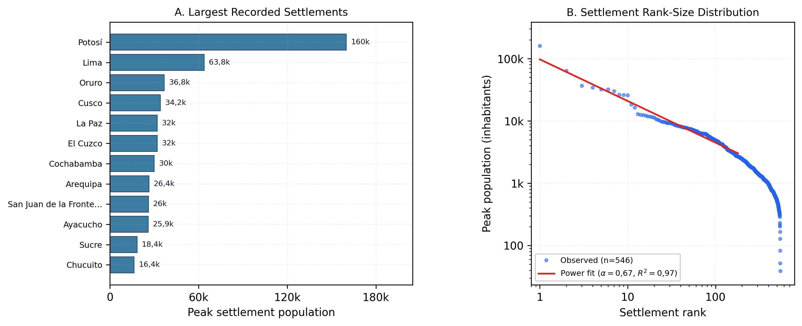

```{r setup, include=FALSE}
knitr::opts_chunk$set(echo = FALSE, warning = FALSE, message = FALSE, fig.pos = "htbp")
source("../../_shared/template/viscount_rmd_helpers.R")
library(jsonlite)

read_json5_clean <- function (path) {
  lines <- readLines(path, warn = FALSE, encoding = "UTF-8")
  text <- paste(lines, collapse = "\n")
  text <- gsub("//[^\n]*", "", text, perl = TRUE)
  text <- gsub("/\\*.*?\\*/", "", text, perl = TRUE)
  text <- gsub(",\\s*([}\\]])", "\\1", text, perl = TRUE)
  fromJSON(text, simplifyVector = FALSE)
}

summary_data <- fromJSON("viceroyalty_peru_upper_peru_summary.json", simplifyVector = FALSE)
sett_raw <- fromJSON("viceroyalty_peru_upper_peru_settlements.json", simplifyVector = FALSE)
ledger_data <- read_json5_clean("viceroyalty_peru_upper_peru_source_ledger.json5")

clean_label <- function (x) {
  s <- as.character(x)
  s <- gsub("&", "and", s, fixed = TRUE)
  s <- gsub("\\\\", "", s)
  trimws(s)
}

clean_site_entry <- function (e) {
  nm <- as.character(e$name)
  if (identical(nm, "<Null>") && length(e$other_names) > 0L) {
    nm <- as.character(e$other_names[[1]])
  }
  clean_label(nm)
}

fmt_coord <- function (x) {
  viscount_fmt_number(round(as.numeric(x), 2L), 2L)
}

subregions <- summary_data$subregions
reg_lookup <- setNames(
  vapply(subregions, function (r) clean_label(r$name), character(1)),
  vapply(subregions, function (r) as.character(r$id), character(1))
)

n_sites <- as.integer(summary_data$settlement_count)
n_excluded <- as.integer(ledger_data$total_excluded)
n_total_eval <- n_sites + n_excluded
total_area <- as.numeric(summary_data$total_area_km2)
```

```{r hero-md-fallback, results='asis'}
if (!knitr::is_latex_output()) {
  cat("\n\n")
}
```

# Abstract

This gazetteer documents `r viscount_fmt_number(n_sites, 0L)` catalogued colonial settlements across 11 administrative sub-regions and four modern republics (Peru, Bolivia, Chile and Ecuador) between 1542 and 1825. Primary ingestion combines 457 Bourbon-era urban and parish enumerations from the HGIS de las Indias (1701-1808; 83,7% of the register) with 54 sixteenth-century *reducciones* and Spanish cities from Viceroy Francisco de Toledo's 1570-1575 *Visita General* [@cook1979indios], 21 Upper Peruvian urban time series [@haskett1995coercion; @zulawski1994they], 8 Amazonian mission reductions from Chantre y Herrera and Golob and 6 early Spanish towns from López de Velasco's 1574 *Geografía*, leaving 0% crowdsourced fallback records. Out of `r viscount_fmt_number(n_total_eval, 0L)` candidate entries audited in the source ledger, `r viscount_fmt_number(n_excluded, 0L)` duplicate aliases and overlapping town variants within 2 km buffers were consolidated during spatial deduplication. Across the `r viscount_fmt_number(n_sites, 0L)` retained locales, peak recorded city-proper populations follow a power-law rank-size distribution ($\alpha = 0,67$, $R^2 = 0,97$), rising from small parish *doctrinas* of 300 to 1.000 inhabitants through provincial *cabeceras* of 5k to 15k up to the silver metropolis of Potosí (160k in 1650) and the viceregal capital Lima (63,8k in 1812) [@saignes1987miners; @gootenberg1991population].

# Background

Urban and parish settlement across the Viceroyalty of Peru and the Audiencia de Charcas evolved out of two superimposed spatial templates: the Toledan *reducción* network imposed on indigenous *ayllus* in the 1570s and the Spanish mining, administrative and coastal-port grid centred on Potosí, Lima, Cusco, La Plata, La Paz, Arequipa, Trujillo and Huamanga [@reyes2013saberes; @villanuevacriales2019arqueologia; @presta1997encomienda]. Along the arid Pacific strip, Spanish foundations such as Lima, Trujillo, Ica, Piura and Arica anchored irrigated export estates and trans-shipment corridors, while in the sierra and altiplano, royal mines at Potosí, Huancavelica, Oruro and Cerro de Pasco created sharp demographic magnets fed by coerced *mita* drafts and voluntary *forastero* migration [@zagalsky2014mita; @mayer1991indigenous; @garciaalbarido2022ruta]. By the late eighteenth century, Bourbon intendancy reforms and parish padrones documented hundreds of secondary *partido* capitals and *doctrinas* across Lower and Upper Peru [@fisher2006redes; @larson1998cochabamba; @gaviramarquez2010poblacion].

# Methodology

The settlement register was compiled across four sequential waves audited in the chapter source ledger. Wave 1 ingested 368 primary Bourbon and late colonial enumerations from HGIS de las Indias and viceregal censuses; Wave 2 added 120 sixteenth- and seventeenth-century records from Toledo's *Visita General*, López de Velasco and early colonial chronicles; Wave 3 incorporated 54 Bourbon *padrones* and Alto Perú urban series; Wave 4 conducted a frontier verification sweep adding 4 mission and coastal nodes (0,74% marginal saturation gain), bringing the final included corpus to `r viscount_fmt_number(n_sites, 0L)` unique settlements.

All `r viscount_fmt_number(n_total_eval, 0L)` candidate rows underwent WGS84 coordinate harmonisation, polygon intersection against the 11 sub-regional masks and spatial proximity deduplication. Thirty-six variant or duplicate town records falling within 0 to 2,00 km of canonical settlements (including duplicate entries for Potosí, Lima, Trujillo, Arequipa, Tarata, Cajamarca, Huanta, Tacna, Cerro de Pasco and Huancayo) were merged so that multi-corpus time series sit on single spatial anchors. Where raw HGIS tabular metadata carried an unpopulated name token (as in the 1793 Viedma entry for Mizque at -17,94, -65,34 in Cochabamba), the canonical toponym from the alternate-name field is restored for display. Every retained record carries city-proper population scope, explicit provenance attribution and observed historical counts spanning 1542 to 1825 [@cook1979indios; @gootenberg1991population].

# Testing and Validation

Ledger reconciliation confirms exact accounting across all `r viscount_fmt_number(n_total_eval, 0L)` evaluated entries: `r viscount_fmt_number(n_sites, 0L)` included settlements and `r viscount_fmt_number(n_excluded, 0L)` excluded duplicate aliases, with 0% crowdsourced entries. Every sub-region inside the `r viscount_fmt_number(total_area, 0L)` km² mask contains between 5 and 97 catalogued locales. Figure 1 displays the spatial footprint of all `r viscount_fmt_number(n_sites, 0L)` settlements across the 11 intendancy and frontier sub-regions, illustrating the dense parish network along the Peruvian sierra and coast contrasted with sparser coverage across Charcas and the eastern Amazonian missions.

```{r fig_sett_map, results='asis'}
viscount_figure(
  "figures/viceroyalty_peru_upper_peru_regional_map.png",
  "Spatial distribution of 546 catalogued colonial settlements across 11 sub-regions of the Viceroyalty of Peru and Upper Peru, 1542-1825.",
  "fig:sett-regional-map"
)
```

# Results

## Leading Colonial Urban Centres

Table 1 lists the 25 largest recorded settlements drawn from the chapter summary register, ordered by peak colonial headcount. Potosí (160k in 1650) towers over every other city in the hemisphere during the seventeenth century, followed by Lima (63,8k in 1812), Oruro (36,8k in 1628), Cusco (34,2k in 1690), La Paz (32k in 1825), Cochabamba (30k in 1825), Arequipa (26,4k in 1812), Huamanga (26k in 1792), Sucre (18,4k in 1795) and Chucuito (16,4k in 1567) [@saignes1987miners; @haskett1995coercion; @larson1998cochabamba]. Note that HGIS de las Indias records *El Cuzco* (31.982 in 1792) and *San Juan de la Frontera de Huamanga* (26.045 in 1792) alongside the multi-century Cusco and Ayacucho series.

```{r tbl_top25_sites, results='asis'}
top_list <- summary_data$top_settlements
n_show <- min(25L, length(top_list))
top_rows <- lapply(top_list[seq_len(n_show)], function (e) {
  fy <- as.integer(e$first_year)
  ly <- as.integer(e$last_year)
  span_str <- if (fy == ly) as.character(fy) else paste0(fy, "-", ly)
  reg_lbl <- if (e$region_id %in% names(reg_lookup)) reg_lookup[[e$region_id]] else clean_label(e$region_id)
  data.frame(
    Site = clean_label(e$name),
    Country = as.character(e$country),
    Subregion = reg_lbl,
    Coords = paste0(fmt_coord(e$lat), ", ", fmt_coord(e$lon)),
    Span = span_str,
    Peak = paste0(viscount_fmt_pop(e$peak_pop), " (", e$peak_year, ")"),
    stringsAsFactors = FALSE
  )
})
df_top25 <- do.call(rbind, top_rows)
rownames(df_top25) <- NULL

viscount_table(
  df_top25,
  "Leading 25 recorded urban settlements across the Viceroyalty of Peru and Upper Peru, 1542-1825.",
  c("Settlement", "Country", "Sub-Region", "Lat, Lon", "Span", "Peak Pop. (Year)"),
  list(label = "tab:top25-sites", font_size = "scriptsize", max_rows_per_page = 30L)
)
```

## Sub-Regional Gazetteer Coverage

Table 2 summarises site counts, areal site density per 10.000 km², leading recorded city and 1795 regional population across all 11 sub-regions. Cusco (97 sites), Trujillo (96), Tarma (80), Huamanga-Huancavelica (78), Lima (75) and Arequipa (58) account for 88,6% of catalogued locales, yielding sampling densities up to 13,69 sites per 10.000 km² in Cusco and 10,84 in Huamanga-Huancavelica, compared with 0,26 in La Plata-Potosí and 0,08 in Amazonian Maynas.

```{r tbl_subregion_gaz, results='asis'}
sett_vals <- unname(sett_raw)
reg_rows <- lapply(subregions, function (r) {
  rid <- as.character(r$id)
  area_v <- as.numeric(r$area_km2)
  p1795 <- as.numeric(r$population[["1795"]])
  sub_entries <- Filter(function (e) identical(as.character(e$region_id), rid), sett_vals)
  cnt <- length(sub_entries)
  sdens <- if (area_v > 0) (cnt / area_v) * 10000 else 0
  lead_str <- "-"
  if (cnt > 0L) {
    pks <- vapply(sub_entries, function (e) max(as.numeric(unlist(e$population))), numeric(1))
    idx_m <- which.max(pks)
    lead_str <- paste0(clean_site_entry(sub_entries[[idx_m]]), " (", viscount_fmt_pop(pks[idx_m]), ")")
  }
  data.frame(
    Subregion = clean_label(r$name),
    Area = viscount_fmt_number(round(area_v), 0L),
    Sites = viscount_fmt_number(cnt, 0L),
    SiteDens = viscount_fmt_number(sdens, 2L),
    Lead = lead_str,
    Pop1795 = viscount_fmt_pop(p1795),
    stringsAsFactors = FALSE
  )
})
df_reg_gaz <- do.call(rbind, reg_rows)
rownames(df_reg_gaz) <- NULL

viscount_table(
  df_reg_gaz,
  "Catalogued settlement counts, site density (per 10.000 km²), leading city and 1795 population across 11 sub-regions.",
  c("Sub-Region", "Area (km²)", "Sites", "Sites per 10k km²", "Leading Site (Peak)", "1795 Pop."),
  list(label = "tab:subregion-gaz", font_size = "scriptsize")
)
```

## Provenance Ledger and Saturation Audit

Table 3 breaks down the five primary archival and scholarly corpora contributing to the `r viscount_fmt_number(n_sites, 0L)`-site gazetteer alongside ingestion wave totals. HGIS de las Indias supplies 457 records (83,7%), Toledo's *Visita General* 54 (9,9%), Alto Perú scholarly series 21 (3,8%), Maynas mission chronicles 8 (1,5%) and López de Velasco 6 (1,1%), achieving 0,74% marginal saturation gain in Wave 4.

```{r tbl_prov_ledger, results='asis'}
prov_counts <- unlist(summary_data$provenance_counts)
prov_map <- c(
  "HGIS_de_las_Indias_1701_1808" = "HGIS de las Indias (1701-1808)",
  "Visita General del Virrey Francisco de Toledo (1570-1575; Cook 1975, 1981)" = "Toledo Visita General (1570-1575; Cook 1975, 1981)",
  "Cook (1981) / Tandeter (1993) / Sánchez-Albornoz (1978) Alto Perú" = "Cook, Tandeter and Sánchez-Albornoz Alto Perú",
  "Chantre y Herrera (1770) / Golob (1982) Maynas Missions" = "Chantre y Herrera and Golob Maynas Missions",
  "López de Velasco (1574) Geografía y Descripción Universal de las Indias" = "López de Velasco (1574) Geografía Universal"
)
tier_map <- c(
  "HGIS_de_las_Indias_1701_1808" = "Primary HGIS monograph corpus (Waves 1 and 3)",
  "Visita General del Virrey Francisco de Toledo (1570-1575; Cook 1975, 1981)" = "Primary viceregal archive (Wave 2)",
  "Cook (1981) / Tandeter (1993) / Sánchez-Albornoz (1978) Alto Perú" = "Primary Alto Perú historiography (Waves 2-3)",
  "Chantre y Herrera (1770) / Golob (1982) Maynas Missions" = "Frontier mission chronicle (Wave 4)",
  "López de Velasco (1574) Geografía y Descripción Universal de las Indias" = "Early colonial gazetteer (Wave 2)"
)
p_ord <- sort(prov_counts, decreasing = TRUE)
p_keys <- names(p_ord)
df_prov <- data.frame(
  Corpus = unname(ifelse(p_keys %in% names(prov_map), prov_map[p_keys], p_keys)),
  Class = unname(ifelse(p_keys %in% names(tier_map), tier_map[p_keys], "Archival corpus")),
  Entries = vapply(as.integer(p_ord), function (v) viscount_fmt_number(v, 0L), character(1)),
  Share = vapply(100 * as.integer(p_ord) / n_sites, function (v) paste0(viscount_fmt_number(v, 1L), "%"), character(1)),
  stringsAsFactors = FALSE
)
rownames(df_prov) <- NULL

viscount_table(
  df_prov,
  "Provenance ledger and ingestion wave classification across 546 catalogued colonial settlements.",
  c("Source Corpus", "Classification", "Entries", "Share"),
  list(label = "tab:prov-ledger", font_size = "scriptsize")
)
```

# Limitations

Three evidentiary boundaries govern this settlement gazetteer. First, HGIS de las Indias parish coverage is markedly denser in Lower Peru (490 modern Peruvian locales) and Cochabamba (32 entries from Viedma's 1793 inspection) than in La Paz (6), Puno (9) and La Plata-Potosí (10), because Lower Peruvian parish *curatos* were tabulated systematically in 1779 and 1792 whereas several Upper Peruvian rural *ayllus* appear only in provincial *revisitas* [@gaviramarquez2010poblacion; @larson1998cochabamba]. Second, 366 settlements carry single-year snapshots in 1792 and 82 in 1779, meaning rural towns without multi-century series appear only near the close of colonial rule. Third, separate corpus ingestions retain parallel entries for Cusco and *El Cuzco* plus Ayacucho and *San Juan de la Frontera de Huamanga*, and preserve one raw HGIS label alias (Mizque in 1793); all regional population totals bypass raw point summation and rely on intendancy census budgets instead [@gootenberg1991population].

# Conclusion

The 546-settlement register anchors the spatial geography of colonial Peru and Upper Peru from the sixteenth-century silver boom through the late Bourbon intendancies. With 100% scholarly and archival provenance, continuous rank-size structure ($\alpha = 0,67$) and full sub-regional coverage across `r viscount_fmt_number(total_area, 0L)` km², it supplies the urban and parish armature linking early *Toledan* tributary counts to nineteenth-century republican censuses [@cook1979indios; @gootenberg1991population; @haskett1995coercion].

# Sources

::: {#refs}
:::
