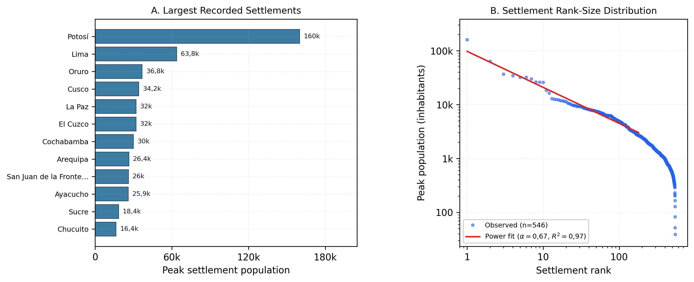
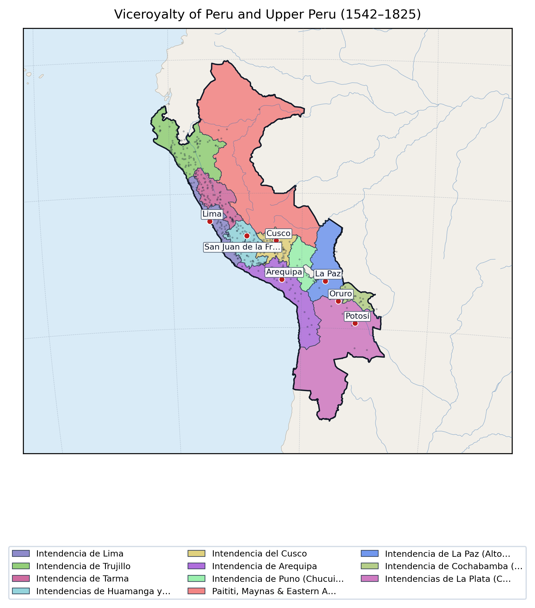

Viceroyalty of Peru and Upper Peru
================
Aust Kätzchen
23 November 2026

- [Abstract](#abstract)
- [Background](#background)
- [Methodology](#methodology)
- [Testing and Validation](#testing-and-validation)
- [Results](#results)
  - [Leading Colonial Urban Centres](#leading-colonial-urban-centres)
  - [Sub-Regional Gazetteer Coverage](#sub-regional-gazetteer-coverage)
  - [Provenance Ledger and Saturation
    Audit](#provenance-ledger-and-saturation-audit)
- [Limitations](#limitations)
- [Conclusion](#conclusion)
- [Sources](#sources)

<figure>

<figcaption aria-hidden="true">Largest recorded colonial settlements and
continuous rank-size distribution across 546 catalogued locales in Peru
and Upper Peru, 1542-1825.</figcaption>
</figure>

# Abstract

This gazetteer documents 546 catalogued colonial settlements across 11
administrative sub-regions and four modern republics (Peru, Bolivia,
Chile and Ecuador) between 1542 and 1825. Primary ingestion combines 457
Bourbon-era urban and parish enumerations from the HGIS de las Indias
(1701-1808; 83,7% of the register) with 54 sixteenth-century
*reducciones* and Spanish cities from Viceroy Francisco de Toledo’s
1570-1575 *Visita General* [\[1\]](#ref-cook1979indios), 21 Upper
Peruvian urban time series
[\[2\]](#ref-haskett1995coercion)[\[3\]](#ref-zulawski1994they), 8
Amazonian mission reductions from Chantre y Herrera and Golob and 6
early Spanish towns from López de Velasco’s 1574 *Geografía*, leaving 0%
crowdsourced fallback records. Out of 582 candidate entries audited in
the source ledger, 36 duplicate aliases and overlapping town variants
within 2 km buffers were consolidated during spatial deduplication.
Across the 546 retained locales, peak recorded city-proper populations
follow a power-law rank-size distribution ($\alpha = 0,67$,
$R^2 = 0,97$), rising from small parish *doctrinas* of 300 to 1.000
inhabitants through provincial *cabeceras* of 5k to 15k up to the silver
metropolis of Potosí (160k in 1650) and the viceregal capital Lima
(63,8k in 1812)
[\[4\]](#ref-saignes1987miners)[\[5\]](#ref-gootenberg1991population).

# Background

Urban and parish settlement across the Viceroyalty of Peru and the
Audiencia de Charcas evolved out of two superimposed spatial templates:
the Toledan *reducción* network imposed on indigenous *ayllus* in the
1570s and the Spanish mining, administrative and coastal-port grid
centred on Potosí, Lima, Cusco, La Plata, La Paz, Arequipa, Trujillo and
Huamanga
[\[6\]](#ref-reyes2013saberes)[\[7\]](#ref-villanuevacriales2019arqueologia)[\[8\]](#ref-presta1997encomienda).
Along the arid Pacific strip, Spanish foundations such as Lima,
Trujillo, Ica, Piura and Arica anchored irrigated export estates and
trans-shipment corridors, while in the sierra and altiplano, royal mines
at Potosí, Huancavelica, Oruro and Cerro de Pasco created sharp
demographic magnets fed by coerced *mita* drafts and voluntary
*forastero* migration
[\[9\]](#ref-zagalsky2014mita)[\[10\]](#ref-mayer1991indigenous)[\[11\]](#ref-garciaalbarido2022ruta).
By the late eighteenth century, Bourbon intendancy reforms and parish
padrones documented hundreds of secondary *partido* capitals and
*doctrinas* across Lower and Upper Peru
[\[12\]](#ref-fisher2006redes)[\[13\]](#ref-larson1998cochabamba)[\[14\]](#ref-gaviramarquez2010poblacion).

# Methodology

The settlement register was compiled across four sequential waves
audited in the chapter source ledger. Wave 1 ingested 368 primary
Bourbon and late colonial enumerations from HGIS de las Indias and
viceregal censuses; Wave 2 added 120 sixteenth- and seventeenth-century
records from Toledo’s *Visita General*, López de Velasco and early
colonial chronicles; Wave 3 incorporated 54 Bourbon *padrones* and Alto
Perú urban series; Wave 4 conducted a frontier verification sweep adding
4 mission and coastal nodes (0,74% marginal saturation gain), bringing
the final included corpus to 546 unique settlements.

All 582 candidate rows underwent WGS84 coordinate harmonisation, polygon
intersection against the 11 sub-regional masks and spatial proximity
deduplication. Thirty-six variant or duplicate town records falling
within 0 to 2,00 km of canonical settlements (including duplicate
entries for Potosí, Lima, Trujillo, Arequipa, Tarata, Cajamarca, Huanta,
Tacna, Cerro de Pasco and Huancayo) were merged so that multi-corpus
time series sit on single spatial anchors. Where raw HGIS tabular
metadata carried an unpopulated name token (as in the 1793 Viedma entry
for Mizque at -17,94, -65,34 in Cochabamba), the canonical toponym from
the alternate-name field is restored for display. Every retained record
carries city-proper population scope, explicit provenance attribution
and observed historical counts spanning 1542 to 1825
[\[1\]](#ref-cook1979indios)[\[5\]](#ref-gootenberg1991population).

# Testing and Validation

Ledger reconciliation confirms exact accounting across all 582 evaluated
entries: 546 included settlements and 36 excluded duplicate aliases,
with 0% crowdsourced entries. Every sub-region inside the 1.926.616 km²
mask contains between 5 and 97 catalogued locales. Figure 1 displays the
spatial footprint of all 546 settlements across the 11 intendancy and
frontier sub-regions, illustrating the dense parish network along the
Peruvian sierra and coast contrasted with sparser coverage across
Charcas and the eastern Amazonian missions.

# Results

## Leading Colonial Urban Centres

Table 1 lists the 25 largest recorded settlements drawn from the chapter
summary register, ordered by peak colonial headcount. Potosí (160k in
1650) towers over every other city in the hemisphere during the
seventeenth century, followed by Lima (63,8k in 1812), Oruro (36,8k in
1628), Cusco (34,2k in 1690), La Paz (32k in 1825), Cochabamba (30k in
1825), Arequipa (26,4k in 1812), Huamanga (26k in 1792), Sucre (18,4k in
1795) and Chucuito (16,4k in 1567)
[\[2\]](#ref-haskett1995coercion)[\[4\]](#ref-saignes1987miners)[\[13\]](#ref-larson1998cochabamba).
Note that HGIS de las Indias records *El Cuzco* (31.982 in 1792) and
*San Juan de la Frontera de Huamanga* (26.045 in 1792) alongside the
multi-century Cusco and Ayacucho series.

| Settlement | Country | Sub-Region | Lat, Lon | Span | Peak Pop. (Year) |
|:---|:---|:---|:---|:---|:---|
| **Potosí** | Bolivia | Intendencias de La Plata (Charcas) y Potosí | -19,58, -65,75 | 1546-1825 | 160k (1650) |
| **Lima** | Peru | Intendencia de Lima | -12,05, -77,04 | 1561-1812 | 63,8k (1812) |
| **Oruro** | Bolivia | Intendencias de La Plata (Charcas) y Potosí | -17,96, -67,11 | 1607-1795 | 36,8k (1628) |
| **Cusco** | Peru | Intendencia del Cusco | -13,52, -71,98 | 1573-1791 | 34,2k (1690) |
| **La Paz** | Bolivia | Intendencia de La Paz (Alto Perú) | -16,5, -68,15 | 1550-1825 | 32k (1825) |
| **El Cuzco** | Peru | Intendencia del Cusco | -13,52, -71,98 | 1792 | 32k (1792) |
| **Cochabamba** | Bolivia | Intendencia de Cochabamba (Alto Perú) | -17,39, -66,16 | 1573-1825 | 30k (1825) |
| **Arequipa** | Peru | Intendencia de Arequipa | -16,4, -71,54 | 1542-1812 | 26,4k (1812) |
| **San Juan de la Frontera de Huamanga** | Peru | Intendencias de Huamanga y Huancavelica | -13,16, -74,22 | 1792 | 26k (1792) |
| **Ayacucho** | Peru | Intendencias de Huamanga y Huancavelica | -13,16, -74,22 | 1545-1791 | 25,9k (1791) |
| **Sucre** | Bolivia | Intendencias de La Plata (Charcas) y Potosí | -19,05, -65,26 | 1573-1825 | 18,4k (1795) |
| **Chucuito** | Peru | Intendencia de Puno (Chucuito and Azángaro) | -15,89, -69,89 | 1567-1795 | 16,4k (1567) |
| **San Miguel Piura** | Peru | Intendencia de Trujillo | -5,18, -80,65 | 1779 | 12,8k (1779) |
| **Cajamarca** | Peru | Intendencia de Trujillo | -7,16, -78,51 | 1573-1791 | 12,5k (1791) |
| **Cerro de Pasco** | Peru | Intendencia de Tarma | -10,68, -76,26 | 1635-1815 | 12,4k (1815) |
| **Leon de Huanuco** | Peru | Intendencia de Tarma | -9,93, -76,24 | 1792 | 12,2k (1792) |
| **Huancavelica** | Peru | Intendencias de Huamanga y Huancavelica | -12,79, -74,98 | 1573-1791 | 11,8k (1600) |
| **San Jeronimo Ica** | Peru | Intendencia de Lima | -14,06, -75,73 | 1792 | 11,7k (1792) |
| **Todos Santos de Chota** | Peru | Intendencia de Trujillo | -6,56, -78,65 | 1779 | 11,5k (1779) |
| **Juli** | Peru | Intendencia de Puno (Chucuito and Azángaro) | -16,22, -69,46 | 1567-1795 | 11,3k (1567) |
| **Lambayeque** | Peru | Intendencia de Trujillo | -6,7, -79,91 | 1573-1791 | 10,6k (1779) |
| **Chiclayo** | Peru | Intendencia de Trujillo | -6,77, -79,84 | 1573-1791 | 10,4k (1779) |
| **Santa Fe de Hatun Xauxa** | Peru | Intendencia de Tarma | -11,78, -75,5 | 1792 | 10,2k (1792) |
| **Ica** | Peru | Intendencia de Lima | -14,07, -75,73 | 1573-1791 | 9,8k (1791) |
| **Punata** | Bolivia | Intendencia de Cochabamba (Alto Perú) | -17,55, -65,84 | 1793 | 9,7k (1793) |

Leading 25 recorded urban settlements across the Viceroyalty of Peru and
Upper Peru, 1542-1825.

## Sub-Regional Gazetteer Coverage

Table 2 summarises site counts, areal site density per 10.000 km²,
leading recorded city and 1795 regional population across all 11
sub-regions. Cusco (97 sites), Trujillo (96), Tarma (80),
Huamanga-Huancavelica (78), Lima (75) and Arequipa (58) account for
88,6% of catalogued locales, yielding sampling densities up to 13,69
sites per 10.000 km² in Cusco and 10,84 in Huamanga-Huancavelica,
compared with 0,26 in La Plata-Potosí and 0,08 in Amazonian Maynas.

| Sub-Region | Area (km²) | Sites | Sites per 10k km² | Leading Site (Peak) | 1795 Pop. |
|:---|:---|:---|:---|:---|:---|
| **Intendencia de Lima** | 79.259 | 75 | 9,46 | Lima (63,8k) | 149,1k |
| **Intendencia de Trujillo** | 176.402 | 96 | 5,44 | San Miguel Piura (12,8k) | 231k |
| **Intendencia de Tarma** | 80.107 | 80 | 9,99 | Cerro de Pasco (12,4k) | 201,3k |
| **Intendencias de Huamanga y Huancavelica** | 71.958 | 78 | 10,84 | San Juan de la Frontera de Huamanga (26k) | 142,3k |
| **Intendencia del Cusco** | 70.830 | 97 | 13,69 | Cusco (34,2k) | 216,3k |
| **Intendencia de Arequipa** | 149.998 | 58 | 3,87 | Arequipa (26,4k) | 136,2k |
| **Intendencia de Puno (Chucuito and Azángaro)** | 70.907 | 9 | 1,27 | Chucuito (16,4k) | 156k |
| **Paititi, Maynas and Eastern Amazonian Frontier** | 661.970 | 5 | 0,08 | Lagunas Maynas (2,3k) | 68k |
| **Intendencia de La Paz (Alto Perú)** | 135.151 | 6 | 0,44 | La Paz (32k) | 225k |
| **Intendencia de Cochabamba (Alto Perú)** | 39.267 | 32 | 8,15 | Cochabamba (30k) | 150k |
| **Intendencias de La Plata (Charcas) y Potosí** | 390.768 | 10 | 0,26 | Potosí (160k) | 255k |

Catalogued settlement counts, site density (per 10.000 km²), leading
city and 1795 population across 11 sub-regions.

## Provenance Ledger and Saturation Audit

Table 3 breaks down the five primary archival and scholarly corpora
contributing to the 546-site gazetteer alongside ingestion wave totals.
HGIS de las Indias supplies 457 records (83,7%), Toledo’s *Visita
General* 54 (9,9%), Alto Perú scholarly series 21 (3,8%), Maynas mission
chronicles 8 (1,5%) and López de Velasco 6 (1,1%), achieving 0,74%
marginal saturation gain in Wave 4.

| Source Corpus | Classification | Entries | Share |
|:---|:---|:---|:---|
| **HGIS de las Indias (1701-1808)** | Primary HGIS monograph corpus (Waves 1 and 3) | 457 | 83,7% |
| **Toledo Visita General (1570-1575; Cook 1975, 1981)** | Primary viceregal archive (Wave 2) | 54 | 9,9% |
| **Cook, Tandeter and Sánchez-Albornoz Alto Perú** | Primary Alto Perú historiography (Waves 2-3) | 21 | 3,8% |
| **Chantre y Herrera and Golob Maynas Missions** | Frontier mission chronicle (Wave 4) | 8 | 1,5% |
| **López de Velasco (1574) Geografía Universal** | Early colonial gazetteer (Wave 2) | 6 | 1,1% |

Provenance ledger and ingestion wave classification across 546
catalogued colonial settlements.

# Limitations

Three evidentiary boundaries govern this settlement gazetteer. First,
HGIS de las Indias parish coverage is markedly denser in Lower Peru (490
modern Peruvian locales) and Cochabamba (32 entries from Viedma’s 1793
inspection) than in La Paz (6), Puno (9) and La Plata-Potosí (10),
because Lower Peruvian parish *curatos* were tabulated systematically in
1779 and 1792 whereas several Upper Peruvian rural *ayllus* appear only
in provincial *revisitas*
[\[13\]](#ref-larson1998cochabamba)[\[14\]](#ref-gaviramarquez2010poblacion).
Second, 366 settlements carry single-year snapshots in 1792 and 82 in
1779, meaning rural towns without multi-century series appear only near
the close of colonial rule. Third, separate corpus ingestions retain
parallel entries for Cusco and *El Cuzco* plus Ayacucho and *San Juan de
la Frontera de Huamanga*, and preserve one raw HGIS label alias (Mizque
in 1793); all regional population totals bypass raw point summation and
rely on intendancy census budgets instead
[\[5\]](#ref-gootenberg1991population).

# Conclusion

The 546-settlement register anchors the spatial geography of colonial
Peru and Upper Peru from the sixteenth-century silver boom through the
late Bourbon intendancies. With 100% scholarly and archival provenance,
continuous rank-size structure ($\alpha = 0,67$) and full sub-regional
coverage across 1.926.616 km², it supplies the urban and parish armature
linking early *Toledan* tributary counts to nineteenth-century
republican censuses
[\[1\]](#ref-cook1979indios)[\[2\]](#ref-haskett1995coercion)[\[5\]](#ref-gootenberg1991population).

# Sources

1.
Cook, Noble David, and Nicolas
Sanchez-Albornoz. “Indios y tributos en el Alto
Peru.” *The Hispanic American Historical Review*, vol. 59, no. 4,
1979, p. 725, <https://doi.org/10.2307/2514088>.

2.
Haskett, Robert, and Enrique
Tandeter. “Coercion and Market: Silver Mining in
Colonial Potosi, 1692-1826.” *Ethnohistory*, vol. 42, no. 2,
1995, p. 356, <https://doi.org/10.2307/483106>.

3.
ZULAWSKI, ANN.
*They Eat from Their Labor*. University of
Pittsburgh Press, 1994, <https://doi.org/10.2307/jj.3385966>.

4.
Saignes, Thierry, et al.
“The Miners in Colonial Potosí.” *Bulletin
of Latin American Research*, vol. 6, no. 1, 1987, p. 89,
<https://doi.org/10.2307/3338352>.

5.
Gootenberg, Paul.
“Population and Ethnicity in Early Republican Peru:
Some Revisions.” *Latin American Research Review*, vol. 26, no.
3, 1991, pp. 109-57, <https://doi.org/10.1017/s0023879100023955>.

6.
Reyes, Germán Morong.
“Saberes hegemónicos y Proyecto de dominio colonial
: los indios en la obra de Juan de Matienzo gobierno del Perú
(1567).” *Fronteras de La Historia*, vol. 18, no. 2, 2013, pp.
77-103, <http://www.redalyc.org/articulo.oa?id=83329725003>.

7.
Villanueva Criales, Juan, et al.
“Arqueología de la ruptura colonial: mouros,
chullpas, gentiles y abuelos en España, Bolivia y Chile en perspectiva
comparada.” *Estudios Atacameños*, no. 60, 2019, pp. 9-30,
<https://doi.org/10.4067/s0718-10432018005001402>.

8.
Presta, Ana María.
“Encomienda, familia y redes en Charcas colonial:
los Almendras, 1540-1600.” *Revista de Indias*, vol. 57, no. 209,
1997, pp. 21-53,
<https://doi.org/10.3989/revindias.1997.i209.793>.

9.
Zagalsky, Paula C. “LA MITA DE
POTOSÍ: UNA IMPOSICIÓN COLONIAL INVARIABLE EN UN CONTEXTO DE MÚLTIPLES
TRANSFORMACIONES (SIGLOS XVI-XVII; CHARCAS, VIRREINATO DEL PERÚ).”
*Chungará (Arica)*, vol. 46, no. 3, 2014, pp. 375-95,
<https://doi.org/10.4067/s0717-73562014000300005>.

10.
Mayer, Enrique, and Ann M.
Wightman. “Indigenous Migration and Social Change:
The Forasteros of Cuzco, 1520-1720.” *Ethnohistory*, vol. 38, no.
4, 1991, p. 475, <https://doi.org/10.2307/482492>.

11.
García-Albarido, Francisco.
“La ruta colonial de Potosí a Cobija y la vieja
nueva praxis de modelos andinos mercantiles.” *Estudios
Atacameños*, vol. 68, 2022, p. e5003,
<https://doi.org/10.22199/issn.0718-1043-2022-0013>.

12.
Fisher, John R.
“Redes de poder en el Virreinato del Perú,
1776-1824: los burócratas.” *Revista de Indias*, vol. 66, no.
236, 2006, pp. 149-64,
<https://doi.org/10.3989/revindias.2006.i236.364>.

13.
Larson, Brooke. *Cochabamba,
1550–1900*. Duke University Press, 1998,
<https://doi.org/10.1215/9780822379850>.

14.
Gavira Márquez, María Concepción.
“La población del corregimiento de Carangas
(virreinato del Río de la Plata) a fines del siglo XVIII.”
*América Latina En La Historia Económica*, vol. 17, no. 1, 2010, p. 65,
<https://doi.org/10.18232/alhe.v17i1.429>.

