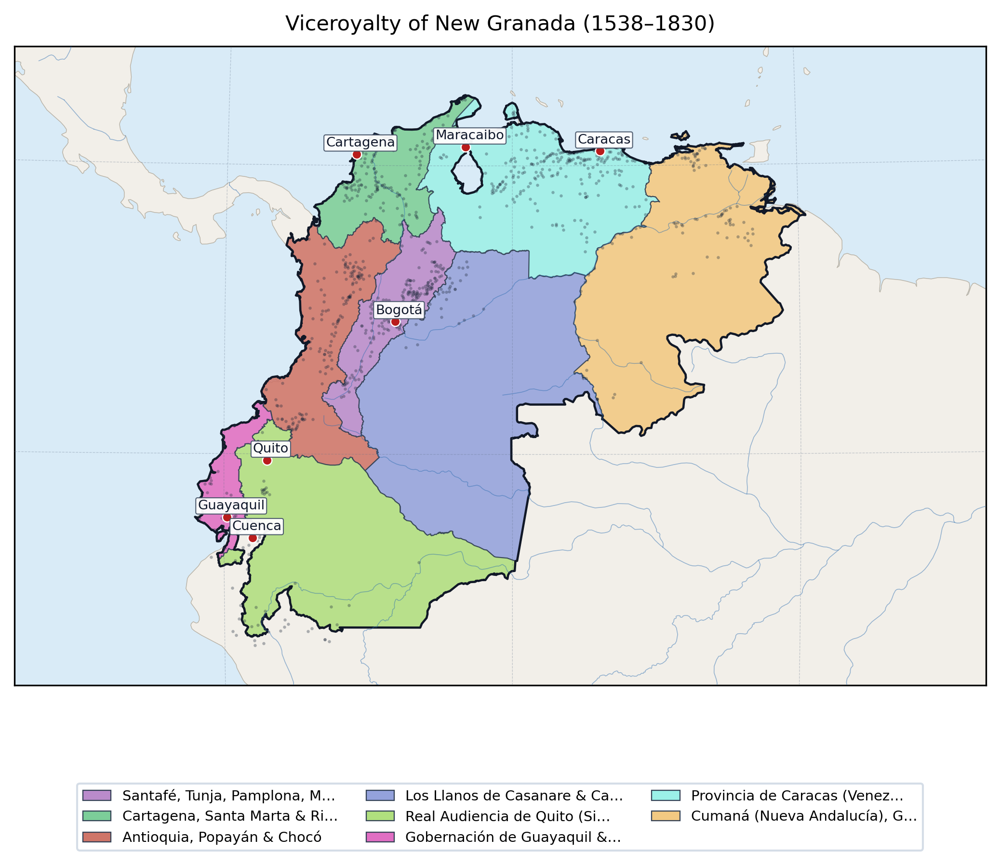

```{r setup, include=FALSE}
knitr::opts_chunk$set(echo = FALSE, warning = FALSE, message = FALSE, fig.pos = "htbp")
source("../../_shared/template/viscount_rmd_helpers.R")
library(jsonlite)

summary_data <- fromJSON("viceroyalty_new_granada_summary.json", simplifyVector = FALSE)
sett_data <- fromJSON("viceroyalty_new_granada_settlements.json", simplifyVector = FALSE)

clean_label <- function(x) {
  s <- as.character(x)
  s <- gsub("&", "and", s, fixed = TRUE)
  s <- gsub("\\\\", "", s)
  s
}

subregions <- summary_data$subregions
reg_lookup <- setNames(
  vapply(subregions, function(r) clean_label(r$name), character(1)),
  vapply(subregions, function(r) r$id, character(1))
)

tot_1538 <- as.numeric(summary_data$domain_totals[["1538"]])
tot_1600 <- as.numeric(summary_data$domain_totals[["1600"]])
tot_1650 <- as.numeric(summary_data$domain_totals[["1650"]])
tot_1700 <- as.numeric(summary_data$domain_totals[["1700"]])
tot_1778 <- as.numeric(summary_data$domain_totals[["1778"]])
tot_1810 <- as.numeric(summary_data$domain_totals[["1810"]])
tot_1830 <- as.numeric(summary_data$domain_totals[["1830"]])
tot_area <- as.numeric(summary_data$total_area_km2)
n_sites <- as.integer(summary_data$settlement_count)
```

```{r hero-md-fallback, results='asis'}
if (!knitr::is_latex_output()) {
  cat("\n\n")
}
```

# Abstract

Between the founding of Santafé de Bogotá on the Muisca plateau in 1538 and the dissolution of Gran Colombia in 1830, the northern Andean and Caribbean jurisdictions that formed the Viceroyalty of New Granada, the Real Audiencia de Quito and the Captaincy General of Venezuela passed through a catastrophic sixteenth-century demographic collapse, a century of uneven mestizaje and agrarian recovery, and a violent independence transition. Across eight sub-regions covering 2.710.090,9 km² (2,71M km²), aggregate population fell by 71,7% from an estimated 4,48M (4.480.000) in 1538 to 1,37M in 1600 and a nadir of 1,27M (1.268.000) in 1650 under epidemic disease, tributary disruption and forced labour in highland farms and alluvial gold placers [@lombardi1975historia; @kalmanovitz2008economia; @stavig1998andean]. Recovery began around 1700 at 1,41M and accelerated across the eighteenth century to 1,76M (1.763.000) at the 1778 Bourbon census horizon and 2,42M (2.418.000) on the eve of the 1810 revolutions, before slowing during the Wars of Independence to 2,79M (2.794.000) in 1830 [@hamerly1990historia; @ferry2024colonial; @reyescardenas2010derrumbe]. Over these three centuries, demographic weight shifted away from the early indigenous heartlands of Quito's central highlands and the Casanare-Caguán missions toward the mestizo artisan corridors of Santander and Boyacá, the gold-and-cattle frontier of Antioquia and Cauca, and the cacao-exporting valleys of Caracas and Maracaibo [@minchom2019people; @twinam1982miners; @buschges1995crisis]. Regional trajectories are calibrated against the 1778 Censo de Carlos III, the 1779-1781 Villalengua enumeration of Quito, Obispo Mariano Martí's 1771-1784 pastoral visitation, José de Castro y Aráoz's 1787 Caracas summary and 1.024 geocoded colonial settlements.

# Background

## Conquest Collapse and Early Colonial Heartland Geography

Spanish entry into the northern Andes was swift, fragmented and epidemiologically devastating. Within three decades of coastal landings at Santa Marta (1525), Coro (1527) and Cartagena (1533), expeditions under Sebastián de Belalcázar, Gonzalo Jiménez de Quesada and Nikolaus Federmann converged upon Quito (1534) and the Muisca plateau of Santafé and Tunja (1538). Unlike the unified Inca core in Peru, the northern territories combined dense chiefdoms in the Cundinamarca-Boyacá highlands and the northern Quito sierra with dispersed riverine villages along the Magdalena, Sinú, Cauca and Orinoco basins [@lombardi1975historia; @stavig1998andean]. Smallpox, measles, influenza and typhus travelled ahead of and alongside marching columns, striking populations with no prior immunity while early encomienda tribute, porterage and gold panning fractured subsistence cultivation [@kalmanovitz2008economia; @castanogallego2026dominio].

Between 1538 and 1650, the entire domain lost roughly three-quarters of its inhabitants, falling from 4,48M to 1,27M. The coastal lowlands suffered the steepest initial destruction: Gobernación de Guayaquil and Esmeraldas dropped by 83,6% (from 220k to 36k), Antioquia, Popayán and Chocó by 79,8% (from 620k to 125k), and Cartagena, Santa Marta and Riohacha by 76,7% (from 580k to 135k) [@lombardi1975historia; @obyrneh2013desabastecimiento]. Malaria and yellow fever imported through Atlantic slave ships compounded indigenous mortality along humid ports and river valleys, leaving tropical lowlands chronically short of labour [@uribe2007sociedad; @gomez2020comida]. Highland basins retained higher survival shares, yet even the densely settled Muisca heartland of Santafé, Tunja, Pamplona, Mariquita and Neiva fell by 75,2% from 1,15M in 1538 to 285k in 1650, while the Real Audiencia de Quito declined by 65,8% from 950k to 325k [@stavig1998andean; @hamerly1990historia].

## Resguardos, Mestizaje and Mining Frontiers in New Granada

To arrest indigenous depopulation and secure tribute and grain supplies for urban centres, royal officials established bounded communal lands (*resguardos*) across Santafé, Tunja and Pamplona at the close of the sixteenth century [@pitapico2022agregaciones; @lombardi1975historia]. In practice, however, demographic decline inside the *resguardos* continued alongside steady white and mestizo encroachment. By the mid-eighteenth century, royal visitors ordered the aggregation and extinction of shrunk *resguardos* across northeastern New Granada, consolidating surviving tributaries into fewer parishes while opening former communal pastures to smallholding mestizo farmers and artisans [@pitapico2022agregaciones; @galvisnoyes1982restablecimiento]. Nowhere was this social transformation sharper than in Socorro, San Gil and Vélez, where a dense free peasantry cultivating cotton, tobacco and sugar cane turned the eastern cordillera into New Granada's fastest-growing interior province [@kalmanovitz2008economia; @galvisnoyes1982restablecimiento].

West of the Magdalena, demography followed gold and enslaved African labour. After early vein mines at Buriticá and Mariquita faded, placer extraction shifted into the humid valleys of Antioquia, the Upper Cauca and the Pacific Chocó [@castanogallego2026dominio; @twinam1982miners]. Cartagena de Indias served for two centuries as the primary *asiento* port of entry for enslaved Africans destined for New Granada and Quito, developing a large urban *pardo* and *moreno* artisan population alongside fortified port militias [@solanod2012artilleros; @solanod2016pedro; @bejaranomartinez2026racial]. Inland, slave gangs (*cuadrillas*) worked alluvial terraces along the Atrato, San Juan and Cauca rivers, supplied with plantains, maize and jerked beef from Valle del Cauca haciendas [@gomez2020comida; @uribe2007sociedad]. In Antioquia, by contrast, small-scale family *mazamorrero* prospecting, frontier agrarian colonisation and high rates of manumission fostered rapid natural increase after 1700, lifting Antioquia, Popayán and Chocó from 125k in 1650 to 265k in 1810 [@twinam1982miners; @castanogallego2026dominio].

## Obrajes, Coastal Cacao and the Quito-Caracas Divergence

South of Popayán, the Real Audiencia de Quito followed an inverted economic trajectory. During the seventeenth century, while Potosí silver sustained Andean commerce, Quito's northern and central sierra (Otavalo, Latacunga, Ambato, Riobamba and Quito itself) prospered as Spanish South America's premier woollen textile (*obraje*) workshop, drawing large numbers of *forastero* indigenous migrants escaping *mita* drafts elsewhere [@stavig1998andean; @hamerly1990historia; @sanztapia2003venta]. The eighteenth century broke that prosperity. Cheaper European woollens entering via Cape Horn and Buenos Aires undercut highland cloth, volcanic eruptions and earthquakes (notably the 1797 Riobamba catastrophe) shattered towns and irrigation works, and epidemic mortality repeatedly struck crowded barrios [@buschges1995crisis; @roderaalonso2004relacion; @minchom2019people]. Consequently, the Quito sierra stagnated, rising only from 325k in 1650 to 375k in 1778, while population tilted southward toward Cuenca's cotton-weaving and cascarilla districts and westward to the emerging cacao export port of Guayaquil [@simard1997formacion; @borrero2023mujeres; @hamerly2022quito].

At the northeastern extremity of the viceroyalty, the Captaincy General of Venezuela (created as an autonomous captaincy in 1777) experienced the fastest sustained colonial expansion in northern South America. Seventeenth-century Caracas planters built fortunes on cacao estates along the Tuy, Aragua and Barlovento valleys worked by enslaved Africans and *canario* immigrants, later catalysed by the monopoly Basque Guipuzcoana Company (1728-1785) and the 1778 free-trade reforms [@ferry2024colonial; @langue1994desterrar]. Provincia de Caracas and Maracaibo expanded more than threefold from 195k in 1650 to 605k in 1810, overtaking the Quito sierra in total headcount and turning Caracas into a bustling commercial and administrative capital marked by sharp stratification between *mantuanos*, *pardos* and rural poor [@ferry2024colonial; @langue1994desterrar; @solanod2012artilleros].

## Bourbon Reform, Revolt and the Independence Demographic Shock

Administrative centralisation under the Bourbon Crown (which permanently restored the Viceroyalty of New Granada in 1739 and installed the Intendancy of Caracas in 1776) produced the region's first systematic enumerations: the 1778 Censo de Carlos III in New Granada, the 1779-1781 Villalengua census in Quito and Obispo Martí's 1771-1784 pastoral visitation in Venezuela [@galvisnoyes1982restablecimiento; @minchom2019people]. Yet fiscal tightening, tobacco and aguardiente monopolies, and new sales taxes provoked immediate resistance. Indigenous communities across the Quito sierra rose repeatedly in tax and census rebellions during the 1760s and 1770s [@cornelio2023simbolismo; @buschges1997leyes], while in 1781 the Comunero insurrection swept Socorro, Tunja and the Llanos before royal columns restored order [@galvisnoyes1982restablecimiento; @pitapico2022agregaciones].

Worse disruption arrived after 1810. Unlike Peru, which remained a royalist bastion until 1824, Venezuela and New Granada endured fifteen years of seesaw war, earthquakes (most destructively the 1812 Caracas and Mérida shock) and naval blockades [@reyescardenas2010derrumbe; @hamerly2022quito]. Pablo Morillo's 1815-1816 siege of Cartagena, royalist campaigns across the Magdalena and Venezuelan llanos, and Patriots' forced marches across the Andes inflicted heavy military and civilian mortality, above all in Caracas, Barinas, Cumaná and Cartagena [@reyescardenas2010derrumbe; @obyrneh2013desabastecimiento]. Whereas the Santafé-Tunja highlands and Antioquia resumed brisk growth after Boyacá (1819), Caracas and Maracaibo barely crept upward from 605k in 1810 to 620k in 1830, registering the deepest independence demographic scar in northern South America [@ferry2024colonial; @reyescardenas2010derrumbe].

# Methodology

## Sub-Regional Partition of the Viceroyalty Domain

To capture ecological, economic and jurisdictional contrasts without projecting modern republican borders backward onto colonial administration, the 2.710.090,9 km² study domain is divided into eight colonial sub-regions aligned with Bourbon audiencias, provinces and mission frontiers. Four sub-regions cover New Granada proper: the central and eastern cordilleran core of Santafé, Tunja, Pamplona, Mariquita and Neiva (156.314 km²); the Caribbean littoral of Cartagena, Santa Marta and Riohacha (158.283,7 km²); the western mining and Cauca corridor of Antioquia, Popayán and Chocó (231.440,3 km²); and the vast Orinoco-Amazonian plains of Los Llanos de Casanare and the Caguán missions (660.351,9 km²). Two sub-regions span the Real Audiencia de Quito: the Andean sierra together with Jaén, Quijos and Maynas (482.585,2 km²), and the Pacific lowlands of Gobernación de Guayaquil and Esmeraldas (74.754,6 km²). The remaining two sub-regions encompass the Captaincy General of Venezuela: Provincia de Caracas and Maracaibo (370.168,6 km²), and eastern Cumaná (Nueva Andalucía), Guayana and Margarita (576.192,6 km²).

This eight-part spatial partition preserves direct comparability between sixteenth-century encomienda-visita districts, late-colonial Bourbon *padrones* and early republican departmental censuses. Note that Panama, though attached to the Viceroyalty of New Granada administratively after 1739, belongs to the Central American and Isthmian regional study and is excluded from the eight South American sub-regions analysed here, whereas Maynas and Jaén remain grouped inside the Quito sierra polygon per colonial audiencia boundaries prior to the 1802 royal cédula transfer.

## Benchmark Reconstruction and Enumeration Calibration

Population headcounts $P_r(t)$ are reconstructed at seven historical benchmarks $t \in \{1538, 1600, 1650, 1700, 1778, 1810, 1830\}$, anchoring the conquest baseline, the sixteenth-century epidemic plunge, the mid-seventeenth-century nadir, the early Bourbon turn, the Censo de Carlos III horizon, the eve of independence and the breakup of Gran Colombia. For each sub-region $r$ of area $A_r$, regional totals obey the accounting identity:

$$P_r(t) = \sum_{j \in r} P_{j,\text{enum}}(t) \cdot \kappa_j(t) + U_r(t)$$

where $P_{j,\text{enum}}(t)$ denotes enumerated inhabitants in district $j$, $\kappa_j(t) \in [1,04, 1,22]$ adjusts for documented fiscal under-registration of dispersed rural families, fugitive tributaries, uncounted *forasteros* and frontier mission populations, and $U_r(t)$ represents unenumerated autonomous indigenous groups in the Llanos, Darién, Guajira, Esmeraldas and upper Amazon [@lombardi1975historia; @stavig1998andean; @hamerly1990historia].

Between benchmarks, compound annual growth rates follow standard geometric compounding:

$$g_r(t_1, t_2) = \left(\frac{P_r(t_2)}{P_r(t_1)}\right)^{\frac{1}{t_2 - t_1}} - 1$$

For the sixteenth and seventeenth centuries, trajectories rely on encomienda tribute ratios converted at 3,8 to 4,5 persons per tributary, ecclesiastical *visitas* and *obraje* labour registers [@lombardi1975historia; @stavig1998andean; @sanztapia2003venta]. For the late colonial baseline around 1778-1787, regional sums lock directly onto surviving viceregal *estados generales*, adjusted upward where contemporary fiscal lists omitted outlying mission *corregimientos* or coastal parishes [@galvisnoyes1982restablecimiento; @minchom2019people]. For 1810 and 1830, trajectories reconcile Alexander von Humboldt's 1800 provincial tabulations, local parish counts during the First Republic and Gran Colombia's 1825-1827 departmental enumerations, accounting explicitly for wartime losses between 1812 and 1822 [@reyescardenas2010derrumbe; @hamerly2022quito].

## Gazetteer Integration and Settlement Scaling

Parallel to macro-regional headcounts, this chapter indexes `r viscount_fmt_number(n_sites, 0L)` geocoded colonial settlements across Colombia (558), Venezuela (367), Ecuador (69) and Peru (30, representing colonial Jaén and Maynas). Ingestion proceeded through four structured audit waves documented in the chapter source ledger, drawing 966 settlements (94,34%) from HGIS de las Indias (1701-1808), 27 primary urban series (2,64%) from Tovar Pinzón and colleagues' 1778 New Granada census compilation, 12 highland and coastal Quito series (1,17%) from Hamerly and Tyrer, 11 Venezuelan series (1,07%) from Obispo Mariano Martí's 1771-1784 pastoral visitation and 8 Amazonian mission stations (0,78%) in Maynas. Crowd-sourced geographic placeholders account for 0% of the register, and spatial deduplication across 1.047 candidate rows consolidated 23 duplicate orthographic variants.

# Testing and Validation

## Calibration Against Late-Colonial Sub-Administrative Enumerations

The strongest empirical anchor for the late-colonial trajectory is the convergence of three independent Bourbon enumerations compiled within a single decade: the 1777-1779 Censo de Carlos III across New Granada, the 1779-1781 Villalengua and García de León y Pizarro enumeration of the Audiencia de Quito, and Obispo Martí's 1771-1784 visitation paired with José de Castro y Aráoz's 1787 summary for Venezuela. Table \ref{tab:bourbon-enumerations} compiles these provincial and *corregimiento* figures alongside Humboldt's 1800 synthesis for comparison against our harmonised sub-regional series.

```{r tab-bourbon-enumerations, results='asis'}
df_enum <- data.frame(
  Jurisdiction = c(
    "Tunja", "Cartagena", "Santafé", "Popayán", "Antioquia",
    "Mariquita", "Santa Marta", "Los Llanos (Casanare)", "Chocó", "Neiva",
    "Audiencia de Quito (total)", "Quito (city / corregimiento)", "Cuenca (partido / corregimiento)",
    "Guayaquil (gobernación)", "Riobamba (corregimiento)", "Latacunga, Ambato, Ibarra, Loja",
    "Provincia de Caracas (1787)", "Diocese of Caracas (Martí)", "Maracaibo (with Mérida and Trujillo)",
    "Barinas", "Cumaná and Barcelona", "Guayana and Margarita"
  ),
  Macro = c(
    rep("New Granada", 10),
    rep("Audiencia de Quito", 6),
    rep("Venezuela", 6)
  ),
  SourceYear = c(
    rep("1778 Censo de Carlos III", 10),
    "1780 Villalengua", "1779-1784 Padrón", "1779-1784 Padrón",
    "1780 Villalengua", "1779-1784 Padrón", "1779-1784 Padrón",
    "1787 Castro y Aráoz", "1771-1784 Visita", "1800 Humboldt",
    "1800 Humboldt", "1800 Humboldt", "1800 Humboldt"
  ),
  ReportedPop = c(
    "164.760", "153.129", "99.190", "64.463", "48.240",
    "47.145", "39.942", "22.359", "15.192", "11.390",
    "424.037", "24k-25k / 30k-50k", "28.346 / 30k-35k",
    ">30.000", "20k-25k", "49k-62k combined",
    "333.010", "333.532", "120k-149k",
    "70k-75k", "110k", "54k-63k"
  ),
  Notes = c(
    "23,6% of New Granada core", "22% share; 118.378 in parish variant", "14,2% share; Bogotá city ~18k",
    "9,2% core; >100k with south", "6,9% share", "6,7% share",
    "5,7% share", "3,2% share", "2,2% share", "1,6% share",
    "65-70% north/central sierra", "City core ~24k-25k", "27% with Loja in south",
    "7-8% of Audiencia total", "City 7,6k-8,4k", "Four highland corregimientos",
    "350k-389k scholarly range", "Parish-by-parish count", "22k-65k Maracaibo core",
    "30k-75k range", "60k Cumaná, 50k Barcelona", "40k Guayana, 18k Margarita"
  ),
  stringsAsFactors = FALSE
)

viscount_table(
  df_enum,
  "Late-colonial sub-administrative enumerations across New Granada (1778), Audiencia de Quito (1779-1784) and Venezuela (1771-1800).",
  c("Jurisdiction", "Macro-Unit", "Enumeration", "Reported Headcount", "Notes"),
  list(label = "tab:bourbon-enumerations", font_size = "scriptsize")
)
```

Summing the 1778 New Granada provincial core (excluding Panama's 63k to 80k isthmian inhabitants) gives roughly 665,8k enumerated residents, or about 776k once outlying southern Popayán districts, uncounted Amazonian-Llanos missions and autonomous Guajira and Darién groups are added, matching our 1778 New Granada four-region sum of 776k (365k in Santafé-Tunja, 205k in Cartagena-Santa Marta, 168k in Antioquia-Popayán-Chocó and 38k in Los Llanos). In Quito, the 1780 Villalengua total of 424.037 aligns directly with our 1778 combined Quito-Guayaquil figure of 424k (375k across the sierra and Oriente plus 49k in Guayaquil-Esmeraldas). In Venezuela, Castro y Aráoz's 1787 Caracas province figure (333.010) and Martí's 1771-1784 diocesan count (333.532) bracket our 1778 Caracas-Maracaibo benchmark of 415k once Maracaibo, Mérida and Trujillo are incorporated, while Humboldt's 1800 Captaincy General total of 780k to 800k sits cleanly between our 1778 Venezuelan sum (563k) and our 1810 eve-of-independence benchmark (800k) [@ferry2024colonial; @langue1994desterrar].

## Sub-Regional Benchmark Ledger and Density Coherence

Table \ref{tab:subregion-benchmarks} presents the complete eight-region demographic ledger from 1538 to 1830, pairing land area, benchmark headcounts, final 1830 density and catalogued colonial settlements. Every regional growth and collapse path obeys historical-ecological bounds without unexplained discontinuities.

```{r tab-subregion-benchmarks, results='asis'}
rows <- lapply(subregions, function(r) {
  a <- as.numeric(r$area_km2)
  p1 <- as.numeric(r$population[["1538"]])
  p2 <- as.numeric(r$population[["1650"]])
  p3 <- as.numeric(r$population[["1778"]])
  p4 <- as.numeric(r$population[["1810"]])
  p5 <- as.numeric(r$population[["1830"]])
  d5 <- if (a > 0) p5 / a else 0
  sc <- summary_data$settlements_by_region[[r$id]]
  sc_val <- if (is.null(sc)) 0L else as.integer(sc)
  data.frame(
    Subregion = clean_label(r$name),
    Area = viscount_fmt_number(round(a), 0L),
    P1538 = viscount_fmt_pop(p1),
    P1650 = viscount_fmt_pop(p2),
    P1778 = viscount_fmt_pop(p3),
    P1810 = viscount_fmt_pop(p4),
    P1830 = viscount_fmt_pop(p5),
    Dens1830 = viscount_fmt_number(d5, 2L),
    Sites = viscount_fmt_number(sc_val, 0L),
    stringsAsFactors = FALSE
  )
})
df_bench <- do.call(rbind, rows)
df_tot <- data.frame(
  Subregion = "Domain Total (All 8 Regions)",
  Area = viscount_fmt_number(round(tot_area), 0L),
  P1538 = viscount_fmt_pop(tot_1538),
  P1650 = viscount_fmt_pop(tot_1650),
  P1778 = viscount_fmt_pop(tot_1778),
  P1810 = viscount_fmt_pop(tot_1810),
  P1830 = viscount_fmt_pop(tot_1830),
  Dens1830 = viscount_fmt_number(tot_1830 / tot_area, 2L),
  Sites = viscount_fmt_number(n_sites, 0L),
  stringsAsFactors = FALSE
)
df_bench <- rbind(df_bench, df_tot)
rownames(df_bench) <- NULL

viscount_table(
  df_bench,
  "Population headcounts, 1830 densities (inhabitants per km²) and catalogued settlements across eight colonial sub-regions, 1538-1830.",
  c("Sub-Region", "Area (km²)", "1538", "1650", "1778", "1810", "1830", "1830 Dens.", "Sites"),
  list(label = "tab:subregion-benchmarks", font_size = "scriptsize")
)
```

Cross-checking implied compound annual growth rates confirms structural realism across every epoch. During the conquest crash from 1538 to 1600, annualised decline averaged -1,9% across the domain, led by -2,53% per year in Guayaquil-Esmeraldas and -2,37% in Antioquia-Popayán-Chocó. Between 1650 and 1700, recovery remained sluggish at 0,21% per year overall as Caracas (+0,54% per year) and Cartagena (+0,24%) offset persistent decline in Los Llanos (-0,54% per year). During the eighteenth-century expansion from 1700 to 1810, annual growth accelerated to 0,49% overall, peaking at 0,79% per year in Provincia de Caracas and Maracaibo and 0,59% in Antioquia-Popayán-Chocó while Quito's textile-stricken sierra crawled at 0,17% per year [@buschges1995crisis; @hamerly1990historia; @ferry2024colonial]. Finally, between 1810 and 1830, wartime disruption compressed overall annual growth from 0,99% (the 1778-1810 pace) down to 0,72%, with Caracas-Maracaibo virtually flat at 0,12% per year while sheltered highland Santafé-Tunja (+1,23%) and Antioquia-Popayán (+1,33%) absorbed displaced rural households and sustained natural increase [@reyescardenas2010derrumbe; @twinam1982miners].

# Results

## Three-Century Demographic Trajectory (1538-1830)

Viewed across three centuries, the northern Andes and Caribbean littoral experienced a deep U-shaped demographic contraction followed by a pronounced geographical realignment (Figure \ref{fig:vng-trajectory}). From 4,48M inhabitants in 1538, total population plunged to 1,37M in 1600 and touched bottom at 1,27M (1.268.000) in 1650, roughly 28,3% of its contact level. Stabilization around 1,41M in 1700 gave way to sustained eighteenth-century expansion: 1,76M (1.763.000) in 1778 (+25,4% over 1700), 2,42M (2.418.000) in 1810 (+37,2% in 32 years) and 2,79M (2.794.000) in 1830, still 37,6% below the pre-conquest 1538 ceiling.

```{r fig-trajectory, results='asis'}
viscount_figure(
  "figures/viceroyalty_new_granada_population_trajectory.png",
  "Demographic trajectory of the Viceroyalty of New Granada and its four largest sub-regions, 1538-1830 (Panel A), with sub-regional population densities in 1830 (Panel B).",
  "fig:vng-trajectory"
)
```

More striking than the aggregate curve was the internal rotation between highlands, coasts and plantation valleys. In 1538, the Muisca highlands of Santafé-Tunja (25,7% of the domain) and the Quito sierra (21,2%) together held nearly half the population (46,9%), while Caracas-Maracaibo represented just 10,3% (460k). By 1650, Caracas-Maracaibo had risen to 15,4% (195k) while Quito's share climbed temporarily to 25,6% (325k) as coastal populations vanished. By 1810, however, the balance had swung decisively toward New Granada's eastern highlands (22,3%, 540k) and Venezuela's Caracas-Maracaibo core (25%, 605k), reducing the Quito sierra to 17,8% (430k). Following the heavy independence losses across Venezuela between 1812 and 1821, Santafé-Tunja regained first place in 1830 at 690k (24,7%, 4,41 inhabitants per km²), ahead of Caracas-Maracaibo at 620k (22,2%, 1,67 per km²) and the Quito sierra at 485k (17,4%, 1,01 per km²).

## New Granada Highlands, Caribbean Ports and Mining Frontiers

Santafé, Tunja, Pamplona, Mariquita and Neiva (156.314 km²) remained the demographic spine of New Granada throughout the colonial period, documented by 229 catalogued settlements. After collapsing from 1,15M in 1538 (7,36 inhabitants per km²) to 285k in 1650 (1,82 per km²), the region recovered modestly to 305k in 1700 and 365k in 1778 before surging to 540k in 1810 and 690k in 1830 (4,41 per km², more than double any other sub-region). While indigenous *resguardos* shrank and were repeatedly consolidated around Tunja and Sogamoso [@pitapico2022agregaciones], mestizo smallholders filled the valleys of Socorro, San Gil, Vélez and Pamplona, creating the dense rural society that powered the 1781 Comunero revolt [@galvisnoyes1982restablecimiento; @kalmanovitz2008economia]. Bogotá itself grew steadily from 6.845 inhabitants in 1574 to 16.233 in 1778, 21.464 in 1801 and 31.400 by 1825, while Socorro climbed from 2.140 in 1685 to 12.400 by 1810.

Along the Caribbean littoral, Cartagena, Santa Marta and Riohacha (158.283,7 km², 155 catalogued sites) fell from 580k in 1538 to 135k in 1650, then climbed steadily to 205k in 1778 and 265k in 1810 before slowing to 290k in 1830 (1,83 inhabitants per km², second in the domain). Cartagena de Indias anchored the entire Caribbean defence and slave-trade system, expanding from 4.620 inhabitants in 1574 to 13.690 in 1778 and 17.600 in 1810 [@solanod2016pedro; @bejaranomartinez2026racial]. Despite its strategic prominence, the province struggled with chronic agricultural bottlenecks along the lower Magdalena and relied on grain and livestock shipments from Mompós, the Sinú savannas and the interior highlands, leaving its rural population exposed during the 1815 royalist siege [@obyrneh2013desabastecimiento; @reyescardenas2010derrumbe].

Further west, Antioquia, Popayán and Chocó (231.440,3 km², 147 catalogued sites) recorded the steepest proportional rebound in New Granada, multiplying 2,76-fold from 125k in 1650 (0,54 per km²) to 168k in 1778, 265k in 1810 and 345k in 1830 (1,49 per km²). Gold mining structured both settlement and racial composition: enslaved Africans formed the majority in the wet Chocó placers and large Cauca estates around Cali, Buga and Popayán (14.800 inhabitants by 1810), while Antioquia's autonomous smallholders and miners lifted Medellín from 3.120 inhabitants in 1675 to 14.507 in 1778 and 16.800 in 1810 [@twinam1982miners; @castanogallego2026dominio; @gomez2020comida]. By contrast, Los Llanos de Casanare and the Caguán missions (660.351,9 km², 26 sites) endured prolonged contraction, slipping from 240k in 1538 to 72k in 1650 and a late-colonial low of 38k in 1778 (0,06 inhabitants per km²) following the 1767 Jesuit expulsion, recovering only to 54k by 1830 (0,08 per km²).

## Audiencia de Quito: Highland Stagnation and Guayaquil's Rise

The Real Audiencia de Quito (482.585,2 km², 55 catalogued sites) exhibits the sharpest contrast between early colonial resilience and late-colonial stagnation. Falling from 950k in 1538 to 325k in 1650, the highland core recovered slowly to 355k in 1700 and 375k in 1778 before crawling to 430k in 1810 and 485k in 1830 (1,01 inhabitants per km²). Within that modest aggregate, population shifted markedly southward: while Quito's urban parishes peaked at 36.479 in 1782 before sliding to 23.701 in 1783 and Riobamba dropped from 11.200 in 1780 to 6.420 after the 1797 earthquake, Cuenca expanded vigorously from 5.845 in 1574 to 18.919 in 1780 and 29.646 in 1783 as *obraje* decline pushed weavers and smallholders toward southern valleys [@buschges1995crisis; @simard1997formacion; @borrero2023mujeres].

Simultaneously, the Pacific coastal lowlands of Gobernación de Guayaquil and Esmeraldas (74.754,6 km², 45 catalogued sites) reversed centuries of depopulation. After plunging by 83,6% from 220k in 1538 to 36k in 1650, Guayaquil entered a late-colonial cacao boom after 1765, lifting the sub-region from 38k in 1700 to 49k in 1778, 72k in 1810 and 95k in 1830 (1,27 inhabitants per km²), while the port city of Guayaquil more than tripled from 5.214 inhabitants in 1765 to 18.400 by 1825 [@hamerly2022quito; @hamerly1990historia].

## Captaincy General of Venezuela: Cacao Boom and Wartime Scarring

From 460k in 1538, Provincia de Caracas and Maracaibo (370.168,6 km², 277 catalogued sites) dipped only to 185k in 1600 before rising steadily through every seventeenth- and eighteenth-century benchmark: 195k in 1650, 255k in 1700, 415k in 1778 and 605k in 1810 (1,63 per km²) [@ferry2024colonial]. Urban growth kept pace across both coast and valleys: Caracas rose from 6.420 inhabitants in 1696 to 19.009 in 1772 and 25.281 in 1805, Maracaibo doubled from 10.312 in 1774 to 22.000 in 1800, Barquisimeto reached 12.602, San Carlos de Austria 12.136, Mérida 11.500, El Tocuyo 10.923, Barinas 10.000 and Valencia 10.000. Adjacent Cumaná (Nueva Andalucía), Guayana and Margarita (576.192,6 km², 90 catalogued sites) grew in parallel from 95k in 1650 to 148k in 1778 and 195k in 1810, led by Cumaná (16.800 in 1800) and Barcelona (14.000). Yet Venezuela paid the heaviest price for emancipation: earthquakes in March 1812, royalist-patriot attrition and llanero cavalry campaigns stalled Caracas-Maracaibo at 620k in 1830 (+2,5% over twenty years) and held Cumaná-Guayana-Margarita to 215k (0,37 per km²).

## Urban Hierarchy and Settlement Structure

Across all `r viscount_fmt_number(n_sites, 0L)` catalogued colonial settlements, peak populations conform closely to a classic colonial administrative and commercial hierarchy rather than a single primate capital (Figure \ref{fig:vng-hierarchy}). Because the Viceroyalty spanned three separate audiencias and captaincies, primacy remained polycentric: Quito (36.479 in 1782), Bogotá (31.400 in 1825), Cuenca (29.646 in 1783), Caracas (25.281 in 1805) and Maracaibo (22.000 in 1800) formed a tight upper tier, followed by port and regional centres between 10k and 20k including Guayaquil (18.400), Cartagena (17.600), Cumaná (16.800), Medellín (16.800), Popayán (14.800), Barcelona (14.000) and Socorro (12.400). On a log-log rank-size scale, the upper tail aligns cleanly with a power-law slope ($\alpha = 0,6$, $R^2 = 0,98$), reflecting integrated colonial urban networks linked by mule roads, river navigation on the Magdalena and Orinoco, and coastal cabotage [@kalmanovitz2008economia; @minchom2019people; @solanod2012artilleros]. Below the 26 towns exceeding 10k inhabitants sit 45 towns between 5k and 10k, 432 parishes between 1k and 5k, and 521 rural pueblos and missions below 1k inhabitants.

```{r fig-hierarchy, results='asis'}
viscount_figure(
  "figures/viceroyalty_new_granada_urban_hierarchy.png",
  "Largest recorded colonial settlements (Panel A) and rank-size distribution across all 1.024 catalogued towns with power-law fit ($\\alpha = 0,6$, $R^2 = 0,98$, Panel B), 1538-1830.",
  "fig:vng-hierarchy"
)
```

Table \ref{tab:regional-shares} synthesises each sub-region's changing share of total viceregal population and areal density across the conquest baseline, mid-seventeenth-century trough, Bourbon census era and Gran Colombia's dissolution.

```{r tab-regional-shares, results='asis'}
share_rows <- lapply(subregions, function(r) {
  a <- as.numeric(r$area_km2)
  p1 <- as.numeric(r$population[["1538"]])
  p2 <- as.numeric(r$population[["1650"]])
  p3 <- as.numeric(r$population[["1778"]])
  p4 <- as.numeric(r$population[["1830"]])
  sh1 <- 100 * p1 / tot_1538
  sh2 <- 100 * p2 / tot_1650
  sh3 <- 100 * p3 / tot_1778
  sh4 <- 100 * p4 / tot_1830
  d1 <- if (a > 0) p1 / a else 0
  d3 <- if (a > 0) p3 / a else 0
  d4 <- if (a > 0) p4 / a else 0
  data.frame(
    Subregion = clean_label(r$name),
    Sh1538 = paste0(viscount_fmt_number(sh1, 1L), "%"),
    Sh1650 = paste0(viscount_fmt_number(sh2, 1L), "%"),
    Sh1778 = paste0(viscount_fmt_number(sh3, 1L), "%"),
    Sh1830 = paste0(viscount_fmt_number(sh4, 1L), "%"),
    D1538 = viscount_fmt_number(d1, 2L),
    D1778 = viscount_fmt_number(d3, 2L),
    D1830 = viscount_fmt_number(d4, 2L),
    stringsAsFactors = FALSE
  )
})
df_shares <- do.call(rbind, share_rows)
rownames(df_shares) <- NULL

viscount_table(
  df_shares,
  "Sub-regional shares of total domain population and densities (inhabitants per km²) across key colonial benchmarks, 1538-1830.",
  c("Sub-Region", "1538 Share", "1650 Share", "1778 Share", "1830 Share", "1538 Dens.", "1778 Dens.", "1830 Dens."),
  list(label = "tab:regional-shares", font_size = "scriptsize")
)
```

# Limitations

Four structural uncertainties govern colonial demographic reconstruction across northern South America. First, contact-era population sizes in 1538 remain sensitive to pre-conquest carrying-capacity assumptions and early epidemic timing, particularly in tropical lowlands along the Magdalena, Sinú and Guayaquil coasts where archival tribute rolls begin only in the 1550s and 1570s [@lombardi1975historia; @kalmanovitz2008economia]. Regional uncertainty intervals of roughly $\pm 16\%$ around benchmark figures reflect this sixteenth-century spread.

Second, fiscal evasion, casta mobility and parish boundary changes complicate eighteenth-century *padrones*. In New Granada and Quito, indigenous families reclassified as *mestizos* or *forasteros* dropped off tribute lists, while enslaved miners in Chocó and runaway *palenque* settlements escaped regular parish returns [@stavig1998andean; @uribe2007sociedad; @minchom2019people]. Moreover, municipal versus *corregimiento* boundaries frequently overlap in late-colonial tabulations, explaining why HGIS parish counts for Caracas after 1800 record urban parish totals around 4k to 6k alongside full-city totals exceeding 25k, and why Cartagena and Barquisimeto appear under both municipal and broader jurisdictional series.

Third, archival survival varies sharply across frontiers. While Santafé, Tunja, Caracas and highland Quito retain dense parish series, Los Llanos de Casanare, Caguán, Maynas and Guayana experienced severe administrative fragmentation after the 1767 Jesuit expulsion, forcing reliance on missionary *relaciones* and fragmentary 1780-1800 reports [@pitapico2022agregaciones; @sanztapia2003venta].

Fourth, wartime dislocations between 1810 and 1825 interrupted civil and ecclesiastical record-keeping precisely when mortality peaked. Gran Colombia's 1825 departmental census therefore supplies an uneven post-war floor, particularly in eastern Venezuela and the upper Orinoco, requiring back-interpolation across 1810-1830 [@reyescardenas2010derrumbe; @hamerly2022quito].

# Conclusion

Between 1538 and 1830, the territories of the Viceroyalty of New Granada, the Real Audiencia de Quito and the Captaincy General of Venezuela underwent one of the most dramatic demographic inversions in the Spanish Empire. Stripped of 71,7% of their inhabitants between contact (4,48M) and 1650 (1,27M), these eight sub-regions recovered slowly to 1,41M in 1700 before accelerating under Bourbon commercial expansion, *mestizo* smallholder colonisation, placer mining and cacao exports to 1,76M in 1778 and 2,42M in 1810. By 1830, despite severe independence casualties across Venezuela and Cartagena, total population reached 2,79M (2.794.000) across 2,71M km², anchored by a polycentric urban network of 1.024 catalogued settlements stretching from Maracaibo and Caracas through Bogotá and Medellín to Quito, Cuenca and Guayaquil. Within that arc, demographic leadership had passed decisively from the *obraje* sierra of Quito to the Cundinamarca-Boyacá cordillera, the Antioquia-Cauca frontier and the Caribbean valleys of Venezuela [@hamerly1990historia; @ferry2024colonial; @kalmanovitz2008economia].

# Appendix

## Modern Territorial Distribution of Colonial Settlements

Table \ref{tab:country-sites} partitions the `r viscount_fmt_number(n_sites, 0L)` catalogued colonial settlements across modern national boundaries, illustrating the geographic concentration of parish records in Colombia and Venezuela alongside colonial Ecuador and northern Peru (Jaén and Maynas).

```{r tab-country-sites, results='asis'}
c_counts <- unlist(summary_data$settlements_by_country)
c_ord <- sort(c_counts, decreasing = TRUE)
c_df <- data.frame(
  Country = names(c_ord),
  Sites = vapply(as.integer(c_ord), function(v) viscount_fmt_number(v, 0L), character(1)),
  Share = vapply(100 * as.integer(c_ord) / n_sites, function(v) paste0(viscount_fmt_number(v, 2L), "%"), character(1)),
  stringsAsFactors = FALSE
)
rownames(c_df) <- NULL

viscount_table(
  c_df,
  "Distribution of 1.024 catalogued colonial settlements across modern national territories, 1538-1830.",
  c("Modern Territory", "Catalogued Settlements", "Share of Gazetteer"),
  list(label = "tab:country-sites", font_size = "scriptsize")
)
```

## Provenance Corpus Breakdown

Table \ref{tab:provenance-summary} summarises the five historical and archival corpora underpinning the settlement gazetteer, confirming zero reliance on crowd-sourced placeholders.

```{r tab-provenance-summary, results='asis'}
prov_counts <- unlist(summary_data$provenance_counts)
prov_labels <- c(
  "HGIS_de_las_Indias_1701_1808" = "HGIS de las Indias (1701-1808)",
  "Tovar Pinzón et al. (1994) Convocatoria al Poder del Número (1778)" = "Tovar Pinzón et al. (1994) New Granada 1778 Census",
  "Hamerly (1973) / Tyrer (1988) Audiencia de Quito Demography" = "Hamerly (1973) and Tyrer (1988) Quito Demography",
  "Obispo Mariano Martí (1771-1784) Visita Pastoral" = "Obispo Mariano Martí (1771-1784) Visita Pastoral",
  "Chantre y Herrera (1770) / Golob (1982) Maynas Missions" = "Chantre y Herrera (1770) and Golob (1982) Maynas Missions"
)
p_ord <- sort(prov_counts, decreasing = TRUE)
p_names <- ifelse(names(p_ord) %in% names(prov_labels), prov_labels[names(p_ord)], names(p_ord))
p_df <- data.frame(
  Corpus = unname(p_names),
  Entries = vapply(as.integer(p_ord), function(v) viscount_fmt_number(v, 0L), character(1)),
  Share = vapply(100 * as.integer(p_ord) / n_sites, function(v) paste0(viscount_fmt_number(v, 2L), "%"), character(1)),
  stringsAsFactors = FALSE
)
rownames(p_df) <- NULL

viscount_table(
  p_df,
  "Provenance breakdown across 1.024 catalogued colonial settlements in the Viceroyalty of New Granada gazetteer.",
  c("Source Corpus", "Entries", "Share"),
  list(label = "tab:provenance-summary", font_size = "scriptsize")
)
```

# Sources

::: {#refs}
:::
