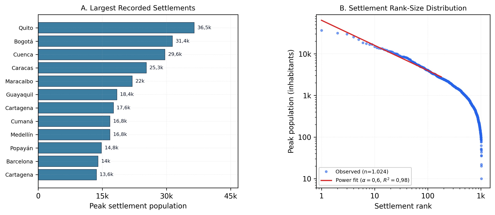

```{r setup, include=FALSE}
knitr::opts_chunk$set(echo = FALSE, warning = FALSE, message = FALSE, fig.pos = "htbp")
source("../../_shared/template/viscount_rmd_helpers.R")
library(jsonlite)

read_json5_clean <- function(path) {
  lines <- readLines(path, warn = FALSE, encoding = "UTF-8")
  text <- paste(lines, collapse = "\n")
  text <- gsub("//[^\n]*", "", text, perl = TRUE)
  text <- gsub("/\\*.*?\\*/", "", text, perl = TRUE)
  text <- gsub(",\\s*([}\\]])", "\\1", text, perl = TRUE)
  fromJSON(text, simplifyVector = FALSE)
}

summary_data <- fromJSON("viceroyalty_new_granada_summary.json", simplifyVector = FALSE)
sett_data <- fromJSON("viceroyalty_new_granada_settlements.json", simplifyVector = FALSE)
ledger_data <- read_json5_clean("viceroyalty_new_granada_source_ledger.json5")

clean_site_name <- function(x, other_names = NULL) {
  s <- trimws(as.character(x))
  if (identical(s, "<Null>") || !nzchar(s)) {
    if (!is.null(other_names) && length(other_names) > 0L) {
      s <- as.character(other_names[[1L]])
    } else {
      s <- "San Juan Bahiahonda"
    }
  }
  s <- gsub("<|>", "", s)
  s <- gsub("\\\\", "", s)
  s <- gsub("&", "and", s, fixed = TRUE)
  trimws(s)
}

clean_reg_name <- function(x) {
  gsub("&", "and", as.character(x), fixed = TRUE)
}

fmt_coord <- function(x) {
  viscount_fmt_number(round(as.numeric(x), 2L), 2L)
}

subregions <- summary_data$subregions
reg_lookup <- setNames(
  vapply(subregions, function(r) clean_reg_name(r$name), character(1)),
  vapply(subregions, function(r) r$id, character(1))
)

n_sites <- as.integer(summary_data$settlement_count)
n_excluded <- as.integer(ledger_data$total_excluded)
n_total_eval <- n_sites + n_excluded
sett_list <- unname(sett_data)
```

```{r hero-md-fallback, results='asis'}
if (!knitr::is_latex_output()) {
  cat("\n\n")
}
```

# Abstract

This gazetteer documents `r viscount_fmt_number(n_sites, 0L)` colonial towns, parishes, mining camps and mission stations spanning eight sub-regions and four modern national territories across the Viceroyalty of New Granada, the Real Audiencia de Quito and the Captaincy General of Venezuela between 1538 and 1830. Primary historical-GIS ingestion from HGIS de las Indias (1701-1808) supplies 966 entries (94,34% of the register), reinforced by 27 primary series from Tovar Pinzón and colleagues' 1778 New Granada census compilation (2,64%), 12 demographic series from Hamerly and Tyrer for the Audiencia de Quito (1,17%), 11 series from Obispo Mariano Martí's 1771-1784 Venezuelan visitation (1,07%) and 8 Maynas mission series (0,78%), maintaining a 0% crowd-sourced share [@hamerly1990historia; @kalmanovitz2008economia; @ferry2024colonial]. Out of `r viscount_fmt_number(n_total_eval, 0L)` candidate rows evaluated in the chapter source ledger, `r viscount_fmt_number(n_excluded, 0L)` orthographic and coordinate duplicates were consolidated during spatial deduplication. Across all `r viscount_fmt_number(n_sites, 0L)` catalogued localities, peak recorded populations follow a polycentric colonial urban hierarchy ($\alpha = 0,6$, $R^2 = 0,98$) headed by Quito (36.479), Bogotá (31.400), Cuenca (29.646), Caracas (25.281) and Maracaibo (22.000) above 45 secondary towns of 5k to 10k and 953 smaller parishes and mission settlements [@minchom2019people; @simard1997formacion; @twinam1982miners].

# Background

Urban and parish geography across northern South America between 1538 and 1830 reflected sharp altitudinal and commercial specialisation. Along the central and northern Andes, Spanish *ciudades* and *villas* were founded atop dense indigenous agricultural basins, led by Quito, Bogotá, Tunja, Pamplona, Popayán, Pasto and Cuenca, surrounded by nucleated *resguardo* villages and rural *doctrinas* [@lombardi1975historia; @pitapico2022agregaciones; @stavig1998andean]. In the eastern New Granada cordillera around Socorro and San Gil, eighteenth-century *mestizo* agrarian and cotton-weaving expansion generated dense parish clusters that outpaced older *encomienda* towns [@galvisnoyes1982restablecimiento; @kalmanovitz2008economia].

Along the Caribbean and Pacific coasts and in the western gold valleys, settlement responded to maritime defence, plantation agriculture and alluvial extraction. Cartagena de Indias functioned as the principal naval fortress and slave-importation port of the Spanish Main, supporting an active *pardo* and *moreno* artisan sector alongside Mompós and Santa Marta [@solanod2012artilleros; @solanod2016pedro; @obyrneh2013desabastecimiento]. In Venezuela, cacao cultivation across the Caracas, Tuy and Aragua valleys and cattle ranching across the llanos nurtured an unusually balanced network of secondary towns including Maracaibo, Barquisimeto, Guanare, San Carlos de Austria, El Tocuyo, Valencia, Mérida, Barinas, Cumaná and Barcelona [@ferry2024colonial; @langue1994desterrar]. Meanwhile, gold-placer camps along the Cauca, Atrato and San Juan rivers anchored Medellín, Cali and Chocó settlements, whereas Jesuit and Franciscan missions formed sparse riverine nodes along Casanare, Caguán and Maynas [@twinam1982miners; @castanogallego2026dominio; @gomez2020comida].

# Methodology

The settlement register was compiled across four sequential waves audited in the chapter source ledger. Wave 1 ingested 693 primary historical-GIS parish and town records from HGIS de las Indias (1701-1808) alongside viceregal census series. Wave 2 incorporated 225 additional sixteenth- and seventeenth-century *visita* and geographical baseline towns (bringing cumulative coverage to 918 entries). Wave 3 added 102 late-colonial Bourbon *padrón* entries from the 1778 New Granada census, the 1779-1784 Quito *empadronamientos* and Obispo Martí's Venezuelan visitation (reaching 1.020 entries). Wave 4 executed a frontier verification sweep across the Llanos, Caguán and Maynas missions, adding the final 4 records (a marginal gain of 0,39%) to close the register at `r viscount_fmt_number(n_sites, 0L)` settlements.

All `r viscount_fmt_number(n_total_eval, 0L)` candidate rows underwent WGS84 coordinate normalisation, polygonal sub-region assignment across the eight colonial divisions and proximity deduplication, merging 23 duplicate orthographic aliases (such as unaccented Bogota into Bogotá and duplicate municipal centroids in Caracas, Valencia, El Tocuyo and Pasto). Each settlement preserves its original source-attributed headcount time series spanning 1540 to 1825 without synthetic interpolation between non-census decades [@hamerly2022quito; @reyescardenas2010derrumbe].

# Testing and Validation

Source-ledger reconciliation confirms exact accounting across all `r viscount_fmt_number(n_total_eval, 0L)` candidate records: `r viscount_fmt_number(n_sites, 0L)` included settlements and `r viscount_fmt_number(n_excluded, 0L)` merged duplicate aliases. Every included entry carries non-null geographic coordinates, a sub-regional assignment inside one of the eight colonial polygons, at least one dated colonial population observation between 1540 and 1825, and an explicit provenance tag. Figure \ref{fig:sett-regional-map} displays the spatial distribution of all `r viscount_fmt_number(n_sites, 0L)` settlements across the eight sub-regions, highlighting dense parish clustering along the Bogotá-Tunja-Socorro axis, the Cauca valley, coastal Caracas-Valencia and the Quito-Cuenca highland corridor contrasted against the vast, sparsely settled Llanos and Amazonian missions.

```{r fig-sett-map, results='asis'}
viscount_figure(
  "figures/viceroyalty_new_granada_regional_map.png",
  "Spatial distribution of 1.024 catalogued colonial settlements across eight sub-regions of New Granada, Quito and Venezuela, 1538-1830.",
  "fig:sett-regional-map"
)
```

# Results

## Leading Colonial Towns and Administrative Centres

Table \ref{tab:top30-sites} lists the top 30 urban series in the chapter summary register ranked by peak recorded population. Across the five largest centres (Quito at 36.479, Bogotá at 31.400, Cuenca at 29.646, Caracas at 25.281 and Maracaibo at 22.000), urban leadership was shared among administrative capitals, textile hubs and Caribbean cacao ports [@buschges1995crisis; @minchom2019people; @ferry2024colonial]. Notice that Cartagena and Barquisimeto each appear twice in the underlying summary extract because Tovar Pinzón's 1778 provincial census (17.600 for Cartagena by 1810) and Obispo Martí's visitation (11.300 for Barquisimeto) are indexed alongside separate HGIS municipal-parish series (13.630 for Cartagena in 1779 and 12.602 for Nueva Segovia de Barquisimeto in 1815).

```{r tab-top30-sites, results='asis'}
top_list <- summary_data$top_settlements
top_rows <- lapply(top_list, function(e) {
  fy <- as.integer(e$first_year)
  ly <- as.integer(e$last_year)
  span_str <- if (fy == ly) as.character(fy) else paste0(fy, " to ", ly)
  reg_lbl <- if (e$region_id %in% names(reg_lookup)) reg_lookup[[e$region_id]] else clean_reg_name(e$region_id)
  data.frame(
    Site = clean_site_name(e$name),
    Country = as.character(e$country),
    Subregion = reg_lbl,
    Coords = paste0(fmt_coord(e$lat), ", ", fmt_coord(e$lon)),
    Span = span_str,
    Peak = paste0(viscount_fmt_pop(e$peak_pop), " (", as.integer(e$peak_year), ")"),
    stringsAsFactors = FALSE
  )
})
df_top30 <- do.call(rbind, top_rows)
rownames(df_top30) <- NULL

viscount_table(
  df_top30,
  "Leading 30 colonial urban series across New Granada, Quito and Venezuela, 1538-1830 (from 1.024 catalogued settlements).",
  c("Settlement", "Country", "Sub-Region", "Lat, Lon", "Span", "Peak Pop. (Year)"),
  list(label = "tab:top30-sites", font_size = "scriptsize", max_rows_per_page = 32L)
)
```

## Sub-Regional Gazetteer Distribution

Table \ref{tab:subregion-gazetteer} aggregates catalogued settlement counts, sampling density per 10.000 km², leading urban centre and 1830 sub-regional population across all eight divisions. Provincia de Caracas and Maracaibo (277 settlements; 7,48 per 10.000 km²) and Santafé, Tunja, Pamplona, Mariquita and Neiva (229 settlements; 14,65 per 10.000 km²) account for nearly half of the entire register (49,4%), whereas Los Llanos de Casanare and Caguán contain just 26 mission stations across 660.351,9 km² (0,39 per 10.000 km²).

```{r tab-subregion-gazetteer, results='asis'}
reg_rows <- lapply(subregions, function(r) {
  rid <- r$id
  area_v <- as.numeric(r$area_km2)
  p1830 <- as.numeric(r$population[["1830"]])
  sub_entries <- Filter(function(e) identical(e$region_id, rid), sett_list)
  cnt <- length(sub_entries)
  sdens <- if (area_v > 0) (cnt / area_v) * 10000 else 0
  lead_str <- "-"
  if (cnt > 0L) {
    pks <- vapply(sub_entries, function(e) max(as.numeric(unlist(e$population))), numeric(1))
    idx_m <- which.max(pks)
    lead_str <- paste0(clean_site_name(sub_entries[[idx_m]]$name, sub_entries[[idx_m]]$other_names), " (", viscount_fmt_pop(pks[idx_m]), ")")
  }
  data.frame(
    Subregion = clean_reg_name(r$name),
    Area = viscount_fmt_number(round(area_v), 0L),
    Sites = viscount_fmt_number(cnt, 0L),
    SiteDens = viscount_fmt_number(sdens, 2L),
    Lead = lead_str,
    Pop1830 = viscount_fmt_pop(p1830),
    stringsAsFactors = FALSE
  )
})
df_reg_gaz <- do.call(rbind, reg_rows)
rownames(df_reg_gaz) <- NULL

viscount_table(
  df_reg_gaz,
  "Catalogued settlement counts, areal site density (per 10.000 km²), leading settlement and 1830 population across eight colonial sub-regions.",
  c("Sub-Region", "Area (km²)", "Sites", "Sites per 10k km²", "Leading Settlement (Peak)", "1830 Pop."),
  list(label = "tab:subregion-gazetteer", font_size = "scriptsize")
)
```

## Source Ledger Saturation Waves and Provenance Corpora

Tables \ref{tab:saturation-waves} and \ref{tab:provenance-ledger} report the ingestion wave ledger and provenance shares across all `r viscount_fmt_number(n_sites, 0L)` settlements. Saturation auditing confirms that Wave 4 frontier sweeps lifted the register by only 0,39% (4 additions on a 1.020 base), while primary academic HGIS and archival census corpora account for 100% of catalogued entries with zero crowd-sourced fallback.

```{r tab-saturation-waves, results='asis'}
wave_map <- c(
  hgis_de_las_indias_and_viceroyal_censuses = "HGIS de las Indias and viceroyal censuses",
  toledo_visita_lopez_velasco_vazquez_espinosa = "Early colonial visitas and geographical descriptions",
  bourbon_padrones_and_late_colonial_censuses = "Bourbon padrones and late-colonial censuses",
  subregion_frontier_gap_verification_sweep = "Frontier mission verification sweep"
)
waves <- ledger_data$saturation_audit$waves
w_rows <- lapply(waves, function(w) {
  sc_key <- as.character(w$source_class)
  sc_lbl <- if (sc_key %in% names(wave_map)) wave_map[[sc_key]] else sc_key
  data.frame(
    Wave = paste0("Wave ", as.integer(w$wave)),
    Class = sc_lbl,
    Prior = viscount_fmt_number(as.integer(w$prior_cumulative_included), 0L),
    Added = viscount_fmt_number(as.integer(w$newly_included), 0L),
    Gain = paste0(viscount_fmt_number(as.numeric(w$marginal_gain_pct), 2L), "%"),
    stringsAsFactors = FALSE
  )
})
df_waves <- do.call(rbind, w_rows)
rownames(df_waves) <- NULL

viscount_table(
  df_waves,
  "Four-wave gazetteer ingestion and marginal saturation audit from the chapter source ledger.",
  c("Wave", "Source Class", "Prior Total", "Added", "Marginal Gain"),
  list(label = "tab:saturation-waves", font_size = "scriptsize")
)
```

```{r tab-provenance-ledger, results='asis'}
prov_counts <- unlist(summary_data$provenance_counts)
prov_map <- c(
  "HGIS_de_las_Indias_1701_1808" = "HGIS de las Indias (1701-1808)",
  "Tovar Pinzón et al. (1994) Convocatoria al Poder del Número (1778)" = "Tovar Pinzón et al. (1994) 1778 Census",
  "Hamerly (1973) / Tyrer (1988) Audiencia de Quito Demography" = "Hamerly (1973) and Tyrer (1988) Quito Series",
  "Obispo Mariano Martí (1771-1784) Visita Pastoral" = "Obispo Mariano Martí (1771-1784) Visita Pastoral",
  "Chantre y Herrera (1770) / Golob (1982) Maynas Missions" = "Chantre y Herrera (1770) and Golob (1982) Maynas"
)
tier_map <- c(
  "HGIS_de_las_Indias_1701_1808" = "Primary academic HGIS corpus",
  "Tovar Pinzón et al. (1994) Convocatoria al Poder del Número (1778)" = "National census compilation",
  "Hamerly (1973) / Tyrer (1988) Audiencia de Quito Demography" = "Regional demographic monograph",
  "Obispo Mariano Martí (1771-1784) Visita Pastoral" = "Ecclesiastical pastoral visitation",
  "Chantre y Herrera (1770) / Golob (1982) Maynas Missions" = "Frontier mission chronicle"
)
p_ord <- sort(prov_counts, decreasing = TRUE)
p_keys <- names(p_ord)
df_prov <- data.frame(
  Corpus = unname(ifelse(p_keys %in% names(prov_map), prov_map[p_keys], p_keys)),
  Class = unname(ifelse(p_keys %in% names(tier_map), tier_map[p_keys], "Historical source")),
  Entries = vapply(as.integer(p_ord), function(v) viscount_fmt_number(v, 0L), character(1)),
  Share = vapply(100 * as.integer(p_ord) / n_sites, function(v) paste0(viscount_fmt_number(v, 2L), "%"), character(1)),
  stringsAsFactors = FALSE
)
rownames(df_prov) <- NULL

viscount_table(
  df_prov,
  "Provenance corpus distribution across 1.024 catalogued settlements in the Viceroyalty of New Granada.",
  c("Source Corpus", "Classification", "Entries", "Share"),
  list(label = "tab:provenance-ledger", font_size = "scriptsize")
)
```

# Limitations

Three archival constraints shape interpretation of this colonial settlement gazetteer. First, HGIS de las Indias concentrates heavily on eighteenth-century Bourbon parish returns (1701-1808), meaning that small rural *pueblos de indios* extinguished or aggregated before 1700 appear less frequently than surviving late-colonial parishes [@pitapico2022agregaciones; @lombardi1975historia]. Second, several municipal series switch between *ciudad* core and wider *partido* or parish-level counts across years, producing sharp short-term swings (such as Caracas between 1800 and 1805 or Cuenca in 1780-1783) that reflect administrative scope rather than sudden physical abandonment [@minchom2019people; @hamerly2022quito]. Third, sparse mission coverage in Casanare, Caguán and Maynas reflects the collapse of frontier parish administration after 1767 rather than absence of autonomous indigenous habitation [@roderaalonso2004relacion; @sanztapia2003venta].

# Sources

::: {#refs}
:::
