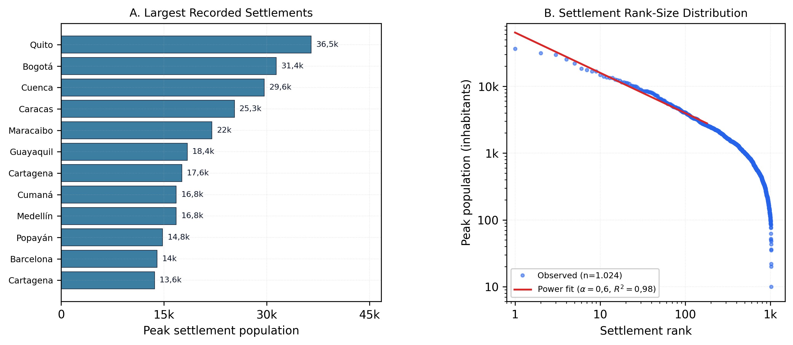
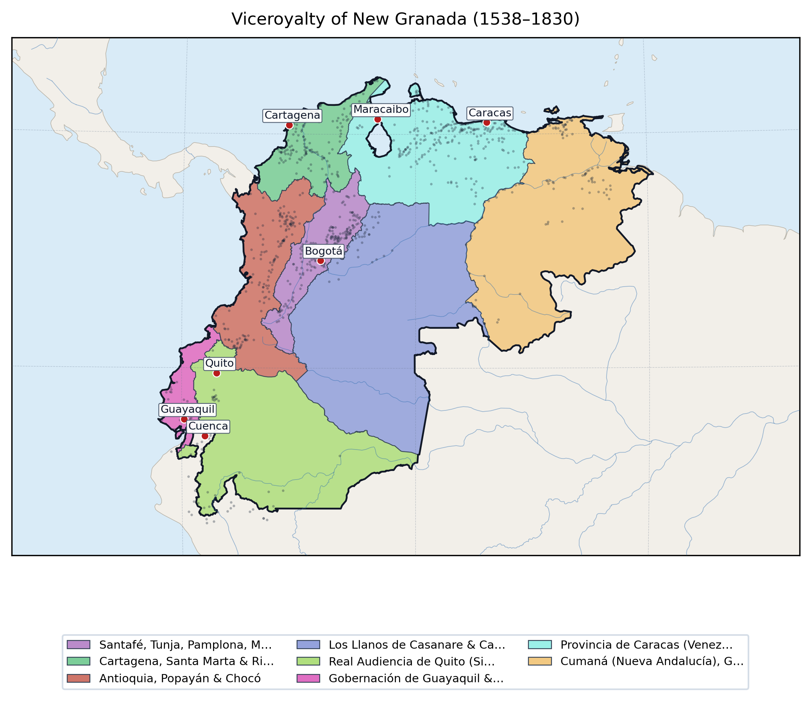

Viceroyalty of New Granada
================
Aust Kätzchen
23 November 2026

- [Abstract](#abstract)
- [Background](#background)
- [Methodology](#methodology)
- [Testing and Validation](#testing-and-validation)
- [Results](#results)
  - [Leading Colonial Towns and Administrative
    Centres](#leading-colonial-towns-and-administrative-centres)
  - [Sub-Regional Gazetteer
    Distribution](#sub-regional-gazetteer-distribution)
  - [Source Ledger Saturation Waves and Provenance
    Corpora](#source-ledger-saturation-waves-and-provenance-corpora)
- [Limitations](#limitations)
- [Sources](#sources)

<figure>

<figcaption aria-hidden="true">Largest recorded colonial towns and
rank-size distribution across 1.024 catalogued settlements in New
Granada, Quito and Venezuela, 1538-1830.</figcaption>
</figure>

# Abstract

This gazetteer documents 1.024 colonial towns, parishes, mining camps
and mission stations spanning eight sub-regions and four modern national
territories across the Viceroyalty of New Granada, the Real Audiencia de
Quito and the Captaincy General of Venezuela between 1538 and 1830.
Primary historical-GIS ingestion from HGIS de las Indias (1701-1808)
supplies 966 entries (94,34% of the register), reinforced by 27 primary
series from Tovar Pinzón and colleagues’ 1778 New Granada census
compilation (2,64%), 12 demographic series from Hamerly and Tyrer for
the Audiencia de Quito (1,17%), 11 series from Obispo Mariano Martí’s
1771-1784 Venezuelan visitation (1,07%) and 8 Maynas mission series
(0,78%), maintaining a 0% crowd-sourced share
[\[1\]](#ref-hamerly1990historia)[\[2\]](#ref-kalmanovitz2008economia)[\[3\]](#ref-ferry2024colonial).
Out of 1.047 candidate rows evaluated in the chapter source ledger, 23
orthographic and coordinate duplicates were consolidated during spatial
deduplication. Across all 1.024 catalogued localities, peak recorded
populations follow a polycentric colonial urban hierarchy
($\alpha = 0,6$, $R^2 = 0,98$) headed by Quito (36.479), Bogotá
(31.400), Cuenca (29.646), Caracas (25.281) and Maracaibo (22.000) above
45 secondary towns of 5k to 10k and 953 smaller parishes and mission
settlements
[\[4\]](#ref-minchom2019people)[\[5\]](#ref-simard1997formacion)[\[6\]](#ref-twinam1982miners).

# Background

Urban and parish geography across northern South America between 1538
and 1830 reflected sharp altitudinal and commercial specialisation.
Along the central and northern Andes, Spanish *ciudades* and *villas*
were founded atop dense indigenous agricultural basins, led by Quito,
Bogotá, Tunja, Pamplona, Popayán, Pasto and Cuenca, surrounded by
nucleated *resguardo* villages and rural *doctrinas*
[\[7\]](#ref-lombardi1975historia)[\[8\]](#ref-pitapico2022agregaciones)[\[9\]](#ref-stavig1998andean).
In the eastern New Granada cordillera around Socorro and San Gil,
eighteenth-century *mestizo* agrarian and cotton-weaving expansion
generated dense parish clusters that outpaced older *encomienda* towns
[\[2\]](#ref-kalmanovitz2008economia)[\[10\]](#ref-galvisnoyes1982restablecimiento).

Along the Caribbean and Pacific coasts and in the western gold valleys,
settlement responded to maritime defence, plantation agriculture and
alluvial extraction. Cartagena de Indias functioned as the principal
naval fortress and slave-importation port of the Spanish Main,
supporting an active *pardo* and *moreno* artisan sector alongside
Mompós and Santa Marta
[\[11\]](#ref-solanod2012artilleros)[\[12\]](#ref-solanod2016pedro)[\[13\]](#ref-obyrneh2013desabastecimiento).
In Venezuela, cacao cultivation across the Caracas, Tuy and Aragua
valleys and cattle ranching across the llanos nurtured an unusually
balanced network of secondary towns including Maracaibo, Barquisimeto,
Guanare, San Carlos de Austria, El Tocuyo, Valencia, Mérida, Barinas,
Cumaná and Barcelona
[\[3\]](#ref-ferry2024colonial)[\[14\]](#ref-langue1994desterrar).
Meanwhile, gold-placer camps along the Cauca, Atrato and San Juan rivers
anchored Medellín, Cali and Chocó settlements, whereas Jesuit and
Franciscan missions formed sparse riverine nodes along Casanare, Caguán
and Maynas
[\[6\]](#ref-twinam1982miners)[\[15\]](#ref-castanogallego2026dominio)[\[16\]](#ref-gomez2020comida).

# Methodology

The settlement register was compiled across four sequential waves
audited in the chapter source ledger. Wave 1 ingested 693 primary
historical-GIS parish and town records from HGIS de las Indias
(1701-1808) alongside viceregal census series. Wave 2 incorporated 225
additional sixteenth- and seventeenth-century *visita* and geographical
baseline towns (bringing cumulative coverage to 918 entries). Wave 3
added 102 late-colonial Bourbon *padrón* entries from the 1778 New
Granada census, the 1779-1784 Quito *empadronamientos* and Obispo
Martí’s Venezuelan visitation (reaching 1.020 entries). Wave 4 executed
a frontier verification sweep across the Llanos, Caguán and Maynas
missions, adding the final 4 records (a marginal gain of 0,39%) to close
the register at 1.024 settlements.

All 1.047 candidate rows underwent WGS84 coordinate normalisation,
polygonal sub-region assignment across the eight colonial divisions and
proximity deduplication, merging 23 duplicate orthographic aliases (such
as unaccented Bogota into Bogotá and duplicate municipal centroids in
Caracas, Valencia, El Tocuyo and Pasto). Each settlement preserves its
original source-attributed headcount time series spanning 1540 to 1825
without synthetic interpolation between non-census decades
[\[17\]](#ref-hamerly2022quito)[\[18\]](#ref-reyescardenas2010derrumbe).

# Testing and Validation

Source-ledger reconciliation confirms exact accounting across all 1.047
candidate records: 1.024 included settlements and 23 merged duplicate
aliases. Every included entry carries non-null geographic coordinates, a
sub-regional assignment inside one of the eight colonial polygons, at
least one dated colonial population observation between 1540 and 1825,
and an explicit provenance tag. Figure displays the spatial distribution
of all 1.024 settlements across the eight sub-regions, highlighting
dense parish clustering along the Bogotá-Tunja-Socorro axis, the Cauca
valley, coastal Caracas-Valencia and the Quito-Cuenca highland corridor
contrasted against the vast, sparsely settled Llanos and Amazonian
missions.

# Results

## Leading Colonial Towns and Administrative Centres

Table lists the top 30 urban series in the chapter summary register
ranked by peak recorded population. Across the five largest centres
(Quito at 36.479, Bogotá at 31.400, Cuenca at 29.646, Caracas at 25.281
and Maracaibo at 22.000), urban leadership was shared among
administrative capitals, textile hubs and Caribbean cacao ports
[\[3\]](#ref-ferry2024colonial)[\[4\]](#ref-minchom2019people)[\[19\]](#ref-buschges1995crisis).
Notice that Cartagena and Barquisimeto each appear twice in the
underlying summary extract because Tovar Pinzón’s 1778 provincial census
(17.600 for Cartagena by 1810) and Obispo Martí’s visitation (11.300 for
Barquisimeto) are indexed alongside separate HGIS municipal-parish
series (13.630 for Cartagena in 1779 and 12.602 for Nueva Segovia de
Barquisimeto in 1815).

| Settlement | Country | Sub-Region | Lat, Lon | Span | Peak Pop. (Year) |
|:---|:---|:---|:---|:---|:---|
| **Quito** | Ecuador | Real Audiencia de Quito (Sierra, Jaén, Quijos and Maynas) | -0,22, -78,51 | 1574 to 1825 | 36,5k (1782) |
| **Bogotá** | Colombia | Santafé, Tunja, Pamplona, Mariquita and Neiva | 4,61, -74,08 | 1540 to 1825 | 31,4k (1825) |
| **Cuenca** | Ecuador | Gobernación de Guayaquil and Esmeraldas | -2,9, -79 | 1560 to 1825 | 29,6k (1783) |
| **Caracas** | Venezuela | Provincia de Caracas (Venezuela) and Maracaibo | 10,51, -66,92 | 1574 to 1822 | 25,3k (1805) |
| **Maracaibo** | Venezuela | Provincia de Caracas (Venezuela) and Maracaibo | 10,65, -71,64 | 1574 to 1800 | 22k (1800) |
| **Guayaquil** | Ecuador | Gobernación de Guayaquil and Esmeraldas | -2,19, -79,89 | 1545 to 1825 | 18,4k (1825) |
| **Cartagena** | Colombia | Cartagena, Santa Marta and Riohacha | 10,39, -75,48 | 1574 to 1810 | 17,6k (1810) |
| **Cumaná** | Venezuela | Cumaná (Nueva Andalucía), Guayana and Margarita | 10,45, -64,18 | 1574 to 1800 | 16,8k (1800) |
| **Medellín** | Colombia | Antioquia, Popayán and Chocó | 6,24, -75,58 | 1675 to 1810 | 16,8k (1810) |
| **Popayán** | Colombia | Antioquia, Popayán and Chocó | 2,44, -76,61 | 1540 to 1810 | 14,8k (1810) |
| **Barcelona** | Venezuela | Cumaná (Nueva Andalucía), Guayana and Margarita | 10,14, -64,69 | 1640 to 1800 | 14k (1800) |
| **Cartagena** | Colombia | Cartagena, Santa Marta and Riohacha | 10,42, -75,55 | 1779 to 1780 | 13,6k (1779) |
| **Espiritu Santo del Valle de Guanaguanare** | Venezuela | Provincia de Caracas (Venezuela) and Maracaibo | 9,03, -69,74 | 1778 to 1817 | 13,4k (1802) |
| **Azogues** | Ecuador | Real Audiencia de Quito (Sierra, Jaén, Quijos and Maynas) | -2,74, -78,85 | 1783 | 13,3k (1783) |
| **Nueva Segovia de Barquisimeto** | Venezuela | Provincia de Caracas (Venezuela) and Maracaibo | 10,07, -69,32 | 1779 to 1815 | 12,6k (1815) |
| **Socorro** | Colombia | Santafé, Tunja, Pamplona, Mariquita and Neiva | 6,47, -73,26 | 1685 to 1810 | 12,4k (1810) |
| **San Carlos de Austria** | Venezuela | Provincia de Caracas (Venezuela) and Maracaibo | 9,66, -68,59 | 1781 to 1824 | 12,1k (1811) |
| **Todos Santos de Chota** | Peru | Real Audiencia de Quito (Sierra, Jaén, Quijos and Maynas) | -6,56, -78,65 | 1779 | 11,5k (1779) |
| **Mérida** | Venezuela | Provincia de Caracas (Venezuela) and Maracaibo | 8,59, -71,16 | 1562 to 1800 | 11,5k (1800) |
| **Barquisimeto** | Venezuela | Provincia de Caracas (Venezuela) and Maracaibo | 10,07, -69,35 | 1555 to 1800 | 11,3k (1800) |
| **Riobamba** | Ecuador | Real Audiencia de Quito (Sierra, Jaén, Quijos and Maynas) | -1,67, -78,65 | 1540 to 1797 | 11,2k (1780) |
| **El Tocuyo** | Venezuela | Provincia de Caracas (Venezuela) and Maracaibo | 9,79, -69,78 | 1550 to 1820 | 10,9k (1819) |
| **Santiago Cali** | Colombia | Antioquia, Popayán and Chocó | 3,45, -76,53 | 1778 to 1787 | 10,2k (1787) |
| **Altagracia Quibor** | Venezuela | Provincia de Caracas (Venezuela) and Maracaibo | 9,93, -69,62 | 1776 to 1820 | 10,2k (1820) |
| **Barinas** | Venezuela | Provincia de Caracas (Venezuela) and Maracaibo | 8,62, -70,21 | 1577 to 1800 | 10k (1800) |
| **Valencia** | Venezuela | Provincia de Caracas (Venezuela) and Maracaibo | 10,18, -68 | 1560 to 1819 | 10k (1800) |
| **Pasto** | Colombia | Antioquia, Popayán and Chocó | 1,21, -77,28 | 1542 to 1795 | 9,8k (1778) |
| **Gualaceo** | Ecuador | Real Audiencia de Quito (Sierra, Jaén, Quijos and Maynas) | -2,89, -78,78 | 1783 | 9,4k (1783) |
| **Maracay** | Venezuela | Provincia de Caracas (Venezuela) and Maracaibo | 10,25, -67,6 | 1769 to 1820 | 9k (1804) |
| **Otavalo** | Ecuador | Real Audiencia de Quito (Sierra, Jaén, Quijos and Maynas) | 0,23, -78,26 | 1574 to 1780 | 8,9k (1780) |

Leading 30 colonial urban series across New Granada, Quito and
Venezuela, 1538-1830 (from 1.024 catalogued settlements).

## Sub-Regional Gazetteer Distribution

Table aggregates catalogued settlement counts, sampling density per
10.000 km², leading urban centre and 1830 sub-regional population across
all eight divisions. Provincia de Caracas and Maracaibo (277
settlements; 7,48 per 10.000 km²) and Santafé, Tunja, Pamplona,
Mariquita and Neiva (229 settlements; 14,65 per 10.000 km²) account for
nearly half of the entire register (49,4%), whereas Los Llanos de
Casanare and Caguán contain just 26 mission stations across 660.351,9
km² (0,39 per 10.000 km²).

| Sub-Region | Area (km²) | Sites | Sites per 10k km² | Leading Settlement (Peak) | 1830 Pop. |
|:---|:---|:---|:---|:---|:---|
| **Santafé, Tunja, Pamplona, Mariquita and Neiva** | 156.314 | 229 | 14,65 | Bogotá (31,4k) | 690k |
| **Cartagena, Santa Marta and Riohacha** | 158.284 | 155 | 9,79 | Cartagena (17,6k) | 290k |
| **Antioquia, Popayán and Chocó** | 231.440 | 147 | 6,35 | Medellín (16,8k) | 345k |
| **Los Llanos de Casanare and Caguán Missions** | 660.352 | 26 | 0,39 | Pore Casanare (2,6k) | 54k |
| **Real Audiencia de Quito (Sierra, Jaén, Quijos and Maynas)** | 482.585 | 55 | 1,14 | Quito (36,5k) | 485k |
| **Gobernación de Guayaquil and Esmeraldas** | 74.755 | 45 | 6,02 | Cuenca (29,6k) | 95k |
| **Provincia de Caracas (Venezuela) and Maracaibo** | 370.169 | 277 | 7,48 | Caracas (25,3k) | 620k |
| **Cumaná (Nueva Andalucía), Guayana and Margarita** | 576.193 | 90 | 1,56 | Cumaná (16,8k) | 215k |

Catalogued settlement counts, areal site density (per 10.000 km²),
leading settlement and 1830 population across eight colonial
sub-regions.

## Source Ledger Saturation Waves and Provenance Corpora

Tables and report the ingestion wave ledger and provenance shares across
all 1.024 settlements. Saturation auditing confirms that Wave 4 frontier
sweeps lifted the register by only 0,39% (4 additions on a 1.020 base),
while primary academic HGIS and archival census corpora account for 100%
of catalogued entries with zero crowd-sourced fallback.

| Wave | Source Class | Prior Total | Added | Marginal Gain |
|:---|:---|:---|:---|:---|
| **Wave 1** | HGIS de las Indias and viceroyal censuses | 0 | 693 | 100% |
| **Wave 2** | Early colonial visitas and geographical descriptions | 693 | 225 | 32,47% |
| **Wave 3** | Bourbon padrones and late-colonial censuses | 918 | 102 | 11,11% |
| **Wave 4** | Frontier mission verification sweep | 1.020 | 4 | 0,39% |

Four-wave gazetteer ingestion and marginal saturation audit from the
chapter source ledger.

| Source Corpus | Classification | Entries | Share |
|:---|:---|:---|:---|
| **HGIS de las Indias (1701-1808)** | Primary academic HGIS corpus | 966 | 94,34% |
| **Tovar Pinzón et al. (1994) 1778 Census** | National census compilation | 27 | 2,64% |
| **Hamerly (1973) and Tyrer (1988) Quito Series** | Regional demographic monograph | 12 | 1,17% |
| **Obispo Mariano Martí (1771-1784) Visita Pastoral** | Ecclesiastical pastoral visitation | 11 | 1,07% |
| **Chantre y Herrera (1770) and Golob (1982) Maynas** | Frontier mission chronicle | 8 | 0,78% |

Provenance corpus distribution across 1.024 catalogued settlements in
the Viceroyalty of New Granada.

# Limitations

Three archival constraints shape interpretation of this colonial
settlement gazetteer. First, HGIS de las Indias concentrates heavily on
eighteenth-century Bourbon parish returns (1701-1808), meaning that
small rural *pueblos de indios* extinguished or aggregated before 1700
appear less frequently than surviving late-colonial parishes
[\[7\]](#ref-lombardi1975historia)[\[8\]](#ref-pitapico2022agregaciones).
Second, several municipal series switch between *ciudad* core and wider
*partido* or parish-level counts across years, producing sharp
short-term swings (such as Caracas between 1800 and 1805 or Cuenca in
1780-1783) that reflect administrative scope rather than sudden physical
abandonment
[\[4\]](#ref-minchom2019people)[\[17\]](#ref-hamerly2022quito). Third,
sparse mission coverage in Casanare, Caguán and Maynas reflects the
collapse of frontier parish administration after 1767 rather than
absence of autonomous indigenous habitation
[\[20\]](#ref-roderaalonso2004relacion)[\[21\]](#ref-sanztapia2003venta).

# Sources

1.
Hamerly, Michael T., and Robson
Brines Tyrer. “Historia demografica y economica de
la audiencia de Quito: Poblacion indigena e industria textil,
1600-1800.” *The Hispanic American Historical Review*, vol. 70,
no. 1, 1990, p. 195, <https://doi.org/10.2307/2516393>.

2.
Kalmanovitz, Salomón.
*La economía de la Nueva Granada*. Editorial
Utadeo, 2008, <https://doi.org/10.2307/j.ctv2175p1m>.

3.
FERRY, ROBERT J.
*The Colonial Elite of Early Caracas*.
University of California Press, 2024,
<https://doi.org/10.2307/jj.15306392>.

4.
Minchom, Martin.
*The People of Quito, 1690-1810*. Routledge,
2019, <https://doi.org/10.4324/9780429313462>.

5.
Simard, Jacques P.
“Formación, desarrollo y configuración socio-étnica
de una ciudad colonial: Cuenca, siglos XVI-XVIII.” *Anuario de
Estudios Americanos*, vol. 54, no. 2, 1997, pp. 413-45,
<https://doi.org/10.3989/aeamer.1997.v54.i2.381>.

6.
Twinam, Ann.
*Miners, Merchants, and Farmers in Colonial
Colombia*. University of Texas Press, 1982,
<https://doi.org/10.7560/720343>.

7.
Lombardi, John V., and German
Colmenares. “Historia economica y social de
Colombia, 1537-1719.” *The Hispanic American Historical Review*,
vol. 55, no. 2, 1975, p. 348, <https://doi.org/10.2307/2512113>.

8.
Pita Pico, Roger.
“agregaciones y extinciones de resguardos indígenas
en el nororiente del nuevo reino de Granada, siglo XVIII.”
*Cuadernos Dieciochistas*, vol. 23, 2022, pp. 235-61,
<https://doi.org/10.14201/cuadieci202223235261>.

9.
Stavig, Ward, et al.
“Andean Journeys: Migration, Ethnogenesis, and the
State in Colonial Quito.” *Ethnohistory*, vol. 45, no. 2, 1998,
p. 366, <https://doi.org/10.2307/483067>.

10.
Galvis Noyes, Antonio J.
“Restablecimiento del orden colonial en la
provincia de Tunja después del movimiento comunero.” *Revista de
Las Fuerzas Armadas*, no. 103, 1982, pp. 394-413,
<https://doi.org/10.25062/0120-0631.1894>.

11.
Solano D., Sergio Paolo, and
Roicer Flórez Bolívar. “‘Artilleros pardos y
morenos artistas’: artesanos, raza, milicias y reconocimiento social en
el Nuevo Reino de Granada, 1770-1812.” *Historia Crítica*, no.
48, 2012, pp. 11-37,
<https://doi.org/10.7440/histcrit48.2012.02>.

12.
Solano D., Sergio Paolo.
“Pedro Romero, el artesano: trabajo, raza y
diferenciación social en Cartagena de Indias a finales del dominio
colonial.” *Historia Crítica*, no. 61, 2016, pp. 151-70,
<https://doi.org/10.7440/histcrit61.2016.08>.

13.
O’Byrne H., Alexander.
“El desabastecimiento de géneros agrícolas en la
provincia de Cartagena de Indias a fines del período colonial.”
*Historia Crítica*, no. 50, 2013, pp. 59-103,
<https://doi.org/10.7440/histcrit50.2013.03>.

14.
Langue, Fréderique.
“Desterrar el vicio y serenar las conciencias:
mendicidad y pobreza en la Caracas del siglo XVIII.” *Revista de
Indias*, vol. 54, no. 201, 1994, pp. 355-81,
<https://doi.org/10.3989/revindias.1994.i201.1128>.

15.
Castaño Gallego, Andrés.
“Dominio y posesión en tierras auríferas: Nuevo
Reino de Granada, siglo XVIII.” *Fronteras de La Historia*, vol.
31, no. 1, 2026, pp. 58-83,
<https://doi.org/10.22380/20274688.3017>.

16.
Gómez, Esteban Zabala.
“‘Comida de negrería’: alimentación y esclavitud en
el Valle Cauca, Nueva Granada, 1750-1851.” *Revista Ingesta*,
vol. 2, no. 1, 2020, pp. 53-75,
<https://doi.org/10.11606/issn.2596-3147.v2i1p53-75>.

17.
Hamerly, Michael T.
“Quito, Cuenca y Guayaquil en 1840: un estudio
demográfico comparativo.” *Procesos. Revista Ecuatoriana de
Historia*, 2022, pp. 11-46,
<https://doi.org/10.29078/procesos.v.n55.2022.2759>.

18.
Reyes Cárdenas, Ana Catalina.
“El derrumbe de la primera república en la Nueva
Granada entre 1810 – 1816.” *Historia Crítica*, no. 41, 2010, pp.
38-61, <https://doi.org/10.7440/histcrit41.2010.05>.

19.
Büschges, Christian.
“Crisis y Reestructuración. La industria textil de
la Real Audiencia de Quito al final del período colonial.”
*Anuario de Estudios Americanos*, vol. 52, no. 2, 1995, pp. 75-98,
<https://doi.org/10.3989/aeamer.1995.v52.i2.449>.

20.
Rodera Alonso, Alexandra.
“Relación de hospitales coloniales en la Real
Audiencia de Quito.” *Estudios Humanísticos. Historia*, no. 3,
2004, p. 197, <https://doi.org/10.18002/ehh.v0i3.3057>.

21.
Sanz Tapia, Ángel.
“La venta de oficios de hacienda en la audiencia de
Quito (1650-1700).” *Revista de Indias*, vol. 63, no. 229, 2003,
pp. 633-48, <https://doi.org/10.3989/revindias.2003.i229.452>.

