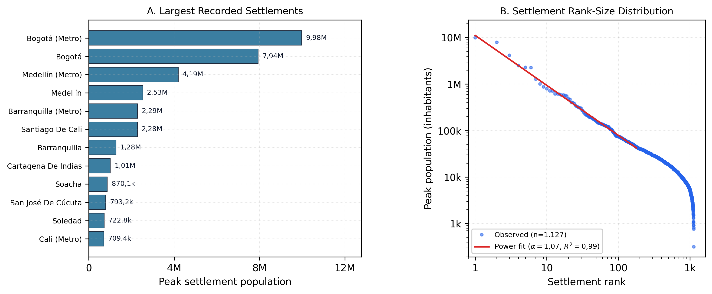

```{r setup, include=FALSE}
knitr::opts_chunk$set(echo = FALSE, warning = FALSE, message = FALSE, fig.pos = "htbp")
source("../../_shared/template/viscount_rmd_helpers.R")
library(jsonlite)

read_json5_clean <- function(arg0_path) {
  txt <- readLines(arg0_path, warn = FALSE, encoding = "UTF-8")
  txt <- gsub("//[^\n]*", "", txt, perl = TRUE)
  txt <- paste(txt, collapse = "\n")
  txt <- gsub(",\\s*([}\\]])", "\\1", txt, perl = TRUE)
  fromJSON(txt, simplifyVector = FALSE)
}

summary_data <- fromJSON("colombia_after_independence_summary.json", simplifyVector = FALSE)
sett_raw <- fromJSON("colombia_after_independence_settlements.json", simplifyVector = FALSE)
sett_list <- unname(sett_raw)
ledger_data <- read_json5_clean("colombia_after_independence_source_ledger.json5")

subregions <- summary_data$subregions
tot_area <- as.numeric(summary_data$total_area_km2)
n_sites <- length(sett_list)
n_excluded <- as.integer(ledger_data$total_excluded)

clean_dept_name <- function(x) {
  s <- as.character(x)
  s <- gsub("&", "and", s, fixed = TRUE)
  if (identical(s, "Bogota Capital District")) return("Bogotá Capital District")
  if (identical(s, "Archipiélago de San Andrés, Providencia y Santa Catalina")) return("San Andrés y Providencia")
  s
}

reg_lookup <- setNames(
  vapply(subregions, function(r) clean_dept_name(r$name), character(1)),
  vapply(subregions, function(r) r$id, character(1))
)

fmt_coord <- function(x) {
  viscount_fmt_number(round(as.numeric(x), 2L), 2L)
}
```

```{r hero-md-fallback, results='asis'}
if (!knitr::is_latex_output()) {
  cat("\n\n")
}
```

# Abstract

This gazetteer documents `r viscount_fmt_number(n_sites, 0L)` catalogued urban, municipal and metropolitan settlements across the 32 departments and Bogotá Capital District of Colombia between 1819 and 2026. Built in four sequential ingestion waves from DANE's DIVIPOLA municipal directory, the 1985-2042 municipal population series, CNPV 2018 census extracts and historical national censuses from 1835 to 1973 [@Estadistica2020Censo; @Estadistica2021Informe], the register achieves zero crowd-sourced fallback entries and zero excluded duplicates in the chapter source ledger. Structurally, the dataset retains 1.085 unified city-proper municipalities, 38 independent extra-municipal suburbs and four metropolitan reconciliation aggregates. Bogotá Capital District remains unified at municipal level, climbing from 35k inhabitants in 1835 and 648,3k in 1951 to 7,39M in 2018 and 7,94M in 2025 without artificial fragmentation into urban *localidades*, while its eleven-municipality metropolitan corridor attains 9,98M alongside Soacha (870,1k). Together with Medellín (2,53M proper, 4,19M Aburrá Valley metro), Santiago de Cali (2,28M proper) and Barranquilla (1,28M proper, 2,29M metro), Colombia's settlement system follows a tight Zipfian rank-size slope ($\alpha = 1,07$, $R^2 = 0,99$) spanning national metropolises, intermediate departmental capitals and rural *cabeceras* [@Lopez2019Demografia; @Barbosa2024Estimating].

# Background

Colombia's municipal network reflects the layering of Spanish colonial foundations onto dense Andean, Caribbean and riverine settlement corridors, transformed after 1870 by internal highland colonisation and twentieth-century industrialisation [@Caillavet1997Frontera; @Bacca2013Colonizacion]. Unlike countries where provincial towns shrivelled around a solitary port capital, rugged cordilleras fostered self-contained regional urban systems around Bogotá on the eastern plateau, Medellín in the Aburrá Valley, Cali in the upper Cauca Valley and Barranquilla at the mouth of the Magdalena [@Meza1995Resena; @Lopez2019Demografia].

During the nineteenth century, most Colombian *municipios* remained small agrarian market seats of 2k to 15k residents [@Munoz2006Geografia]. Only after 1912 did coffee exports, railway construction and early textiles propel rapid municipal divergence [@Bacca2013Colonizacion; @Cruz2015Analisis]. From 1948 onward, rural displacement during *La Violencia* and sharp mortality decline accelerated urban concentration across both established regional capitals and sprawling peripheral municipalities such as Soacha, Soledad, Bello and Palmira [@Steiner2008Exodos; @Hidalgo2015Paro; @Ocampo2003Urbanizacion]. By 2025, 65 cities exceeded 100k inhabitants and eight municipal cores surpassed 580k, including Cúcuta, Bucaramanga, Valledupar, Villavicencio and Santa Marta [@Barbosa2024Estimating].

# Methodology

Settlement assembly proceeded through four auditable waves recorded in the source ledger. Wave 1 harvested 898 core municipalities directly from DANE's 1985-2042 municipal population series calibrated to CNPV 2018 [@Estadistica2020Censo]. Wave 2 added 157 georeferenced and metro-reconciled entries (17,48% incremental gain), Wave 3 incorporated 67 historical nineteenth- and twentieth-century census backfill records (6,35% gain) and Wave 4 added 5 final regional gap entries (0,45% gain), reaching saturation across all 33 sub-regions with `r viscount_fmt_number(n_sites, 0L)` active records and zero exclusions.

Every record is tagged with WGS84 decimal coordinates, departmental mask assignment and scope classification. Municipal boundaries follow strict non-decomposition: intra-urban *localidades* and *comunas* inside Bogotá, Medellín, Cali, Barranquilla and Cartagena remain consolidated within each city proper, while 38 legally independent commuter municipalities around Bogotá, Medellín, Barranquilla, Cali and Bucaramanga are preserved as distinct suburban entries [@Vega2016Movilidad; @Fernandez2013Vereda]. Four metropolitan aggregates track multi-municipal urban regions without double-counting core totals.

# Testing and Validation

Ledger reconciliation confirms exact accounting across all 1.127 entries: zero missing coordinates, zero unmapped sub-regions across all 33 territories and 100% primary institutional provenance from DANE national series and historical censuses. Figure \ref{fig:sett-colombia-map} illustrates the dense spatial clustering of municipal seats along the Andean cordilleras and Caribbean plains contrasted with sparse settlement across the Orinoquia and Amazonia.

```{r fig-sett-map, results='asis'}
viscount_figure(
  "figures/colombia_after_independence_regional_map.png",
  "Spatial distribution of 1.127 catalogued municipalities and metropolitan centres across 33 Colombian territories, 1819 to 2026.",
  "fig:sett-colombia-map"
)
```

# Results

## Leading Settlements and Metropolitan Hierarchy

Table \ref{tab:top45-colombia} lists the 45 largest settlement entries in the gazetteer ordered by peak documented population through 2025, contrasting core municipal cities, independent suburbs and metropolitan aggregates across 1985, 2005, 2018 and 2025.

```{r tab-top45, results='asis'}
get_pop_val <- function(e, y) {
  v <- e[["population"]][[y]]
  if (is.null(v)) return("-")
  viscount_fmt_pop(v)
}

scope_label <- function(s) {
  if (identical(s, "city_proper")) return("City proper")
  if (identical(s, "suburb")) return("Suburb")
  if (identical(s, "metro")) return("Metro")
  as.character(s)
}

peaks <- vapply(sett_list, function(e) max(as.numeric(unlist(e[["population"]]))), numeric(1))
ord <- order(peaks, decreasing = TRUE)
top_n <- min(45L, length(ord))

top_rows <- lapply(sett_list[ord[seq_len(top_n)]], function(e) {
  pks <- as.numeric(unlist(e[["population"]]))
  pk_y <- names(e[["population"]])[which.max(pks)]
  pk_v <- max(pks)
  reg_lbl <- if (e[["region_id"]] %in% names(reg_lookup)) reg_lookup[[e[["region_id"]]]] else e[["region_id"]]
  data.frame(
    Settlement = e[["name"]],
    Department = reg_lbl,
    Scope = scope_label(e[["population_scope"]]),
    Coords = paste0(fmt_coord(e[["coords"]][[1]]), ", ", fmt_coord(e[["coords"]][[2]])),
    P1985 = get_pop_val(e, "1985"),
    P2005 = get_pop_val(e, "2005"),
    P2018 = get_pop_val(e, "2018"),
    P2025 = get_pop_val(e, "2025"),
    Peak = paste0(viscount_fmt_pop(pk_v), " (", pk_y, ")"),
    stringsAsFactors = FALSE
  )
})
df_top45 <- do.call(rbind, top_rows)
rownames(df_top45) <- NULL

viscount_table(
  df_top45,
  "Top 45 settlements and metropolitan entries across Colombia ranked by peak population (across 1.127 total entries).",
  c("Settlement", "Territory", "Scope", "Lat, Lon", "1985", "2005", "2018", "2025", "Peak (Year)"),
  list(label = "tab:top45-colombia", font_size = "scriptsize", max_rows_per_page = 24L)
)
```

## Metropolitan Aggregates and Suburban Belts

Table \ref{tab:metro-reconciliation} reconciles the four metropolitan aggregates with their underlying member lists and independent commuter suburbs. Bogotá D.C., Medellín and Barranquilla combine the core city with contiguous suburban municipalities, whereas the Cali metropolitan aggregate compiles only the four surrounding Valle del Cauca suburbs (709,4k in 2025) separately from Santiago de Cali (2,28M proper).

```{r tab-metro-reconciliation, results='asis'}
metro_entries <- Filter(function(e) identical(e[["population_scope"]], "metro"), sett_list)
m_pks <- vapply(metro_entries, function(e) as.numeric(e[["population"]][["2025"]]), numeric(1))
metro_entries <- metro_entries[order(m_pks, decreasing = TRUE)]

m_rows <- lapply(metro_entries, function(e) {
  mems <- unlist(e[["metro_members"]])
  reg_lbl <- if (e[["region_id"]] %in% names(reg_lookup)) reg_lookup[[e[["region_id"]]]] else e[["region_id"]]
  data.frame(
    Metro = e[["name"]],
    Territory = reg_lbl,
    Members = as.character(length(mems)),
    P1985 = get_pop_val(e, "1985"),
    P2005 = get_pop_val(e, "2005"),
    P2018 = get_pop_val(e, "2018"),
    P2025 = get_pop_val(e, "2025"),
    MemberList = paste(mems, collapse = ", "),
    stringsAsFactors = FALSE
  )
})
df_metro <- do.call(rbind, m_rows)
rownames(df_metro) <- NULL

viscount_table(
  df_metro,
  "Reconciled metropolitan aggregates and constituent municipal memberships across Colombia, 1985 to 2025.",
  c("Metropolitan Aggregate", "Territory", "Units", "1985", "2005", "2018", "2025", "Constituent Municipalities"),
  list(label = "tab:metro-reconciliation", font_size = "scriptsize")
)
```

## Departmental Gazetteer Distribution

Table \ref{tab:regsum-colombia} reports catalogued site counts, spatial site density per 10.000 km², leading urban or metropolitan centre and 2024 departmental population across all 33 sub-regions. Cundinamarca (129 entries), Antioquia (116), Boyacá (116), Santander (85) and Nariño (64) together supply 45,3% of Colombia's municipal register, contrasting with just 2 entries each in insular San Andrés y Providencia and frontier Vichada.

```{r tab-regsum, results='asis'}
reg_rows <- lapply(subregions, function(r) {
  rid <- r$id
  area_v <- as.numeric(r$area_km2)
  p24 <- as.numeric(r$population[["2024"]])
  sub_e <- Filter(function(e) identical(e[["region_id"]], rid), sett_list)
  cnt <- length(sub_e)
  sdens <- if (area_v > 0) (cnt / area_v) * 10000 else 0
  lead_str <- "-"
  if (cnt > 0L) {
    pks <- vapply(sub_e, function(e) max(as.numeric(unlist(e[["population"]]))), numeric(1))
    idx_m <- which.max(pks)
    lead_str <- paste0(sub_e[[idx_m]][["name"]], " (", viscount_fmt_pop(pks[idx_m]), ")")
  }
  data.frame(
    Territory = clean_dept_name(r$name),
    Area = viscount_fmt_number(round(area_v), 0L),
    Sites = viscount_fmt_number(cnt, 0L),
    SiteDens = viscount_fmt_number(sdens, 2L),
    Lead = lead_str,
    Pop2024 = viscount_fmt_pop(p24),
    stringsAsFactors = FALSE
  )
})
df_reg <- do.call(rbind, reg_rows)
rownames(df_reg) <- NULL

viscount_table(
  df_reg,
  "Catalogued settlement counts, areal site density (per 10.000 km²), leading entry and 2024 population across 33 Colombian territories.",
  c("Territory", "Area (km²)", "Sites", "Sites per 10k km²", "Leading Entry (Peak)", "2024 Pop."),
  list(label = "tab:regsum-colombia", font_size = "scriptsize", max_rows_per_page = 36L)
)
```

## Source Ledger and Saturation Audit

Table \ref{tab:ledger-waves} summarises the four-wave ingestion progression from the chapter source ledger, confirming asymptotic saturation at 0,45% marginal gain in Wave 4 across 1.123 processed rows of DANE's modern municipal series and 199 processed historical census extracts.

```{r tab-ledger-waves, results='asis'}
wave_labels <- c(
  primary_national_statistical_office_full_census_extract = "Primary statistical office full census extract",
  secondary_georeference_repair_and_metro_reconciliation = "Georeference repair and metro reconciliation",
  longitudinal_19th_20th_century_official_national_census_backfill = "Historical 19th-20th century census backfill",
  subregion_gap_hunter_verification_sweep = "Sub-region gap sweep"
)

waves <- ledger_data$saturation_audit$waves
w_rows <- lapply(waves, function(w) {
  sc <- as.character(w$source_class)
  lbl <- if (sc %in% names(wave_labels)) wave_labels[[sc]] else sc
  data.frame(
    Wave = as.character(w$wave),
    Class = lbl,
    Prior = viscount_fmt_number(as.numeric(w$prior_cumulative_included), 0L),
    Added = viscount_fmt_number(as.numeric(w$newly_included), 0L),
    Gain = paste0(viscount_fmt_number(as.numeric(w$marginal_gain_pct), 2L), "%"),
    stringsAsFactors = FALSE
  )
})
df_waves <- do.call(rbind, w_rows)
rownames(df_waves) <- NULL

viscount_table(
  df_waves,
  "Source ledger ingestion waves and marginal saturation audit across 1.127 Colombian settlements.",
  c("Wave", "Ingestion Stage", "Prior Total", "Newly Added", "Marginal Gain"),
  list(label = "tab:ledger-waves", font_size = "scriptsize")
)
```

# Limitations

Three technical constraints affect settlement-level comparison. First, continuous municipal populations back to 1835, 1851, 1870, 1905, 1912, 1918, 1938, 1951, 1964 and 1973 are attached only to 16 major historical cities and capitals, while the remaining 1.111 entries commence in 1985 when DANE established a uniform national municipal time series. Second, during historical Wave-3 backfill matching, the municipal name Armenia triggered identical 1912-1938 census entries on both the Quindío capital and the small municipality of Armenia in Antioquia. Third, DANE municipal series enumerate entire *municipios* (urban *cabecera* plus rural *resto*), which causes large rural territories such as Tumaco or Tibú to rank slightly above compact urban cores, and the Cali (Metro) aggregate sums four peripheral Valle del Cauca suburbs separately from core Santiago de Cali.

# Conclusion

Colombia's `r viscount_fmt_number(n_sites, 0L)`-settlement gazetteer captures the full national hierarchy from 9,98M-resident metropolitan Bogotá down to frontier river towns along the Amazon and Orinoco. Retaining unified municipal cores alongside 38 distinct suburban municipalities and four reconciled metropolitan belts provides a consistent urban-geographic foundation for spatial population analysis across the entire post-independence era.

# Appendix

## Early Republican and Mid-Century City Benchmarks (1835 to 1973)

Table \ref{tab:early-cities} compiles the 15 distinct principal cities and departmental capitals carrying pre-1985 census records in the settlement gazetteer (excluding the duplicate homonym entry in Antioquia), tracing urban growth from early republican counts through DANE's 1951-1973 enumerations.

```{r tab-early-cities, results='asis'}
early_entries <- Filter(function(e) {
  any(as.integer(names(e[["population"]])) < 1985L) && !identical(e[["key"]], "Armenia (col_antioquia)-Colombia")
}, sett_list)

e_p38 <- vapply(early_entries, function(e) {
  v <- e[["population"]][["1938"]]
  if (is.null(v)) 0 else as.numeric(v)
}, numeric(1))
early_entries <- early_entries[order(e_p38, decreasing = TRUE)]

e_rows <- lapply(early_entries, function(e) {
  reg_lbl <- if (e[["region_id"]] %in% names(reg_lookup)) reg_lookup[[e[["region_id"]]]] else e[["region_id"]]
  data.frame(
    City = e[["name"]],
    Territory = reg_lbl,
    P1835 = get_pop_val(e, "1835"),
    P1851 = get_pop_val(e, "1851"),
    P1870 = get_pop_val(e, "1870"),
    P1912 = get_pop_val(e, "1912"),
    P1938 = get_pop_val(e, "1938"),
    P1951 = get_pop_val(e, "1951"),
    P1973 = get_pop_val(e, "1973"),
    stringsAsFactors = FALSE
  )
})
df_early <- do.call(rbind, e_rows)
rownames(df_early) <- NULL

viscount_table(
  df_early,
  "Principal Colombian cities with pre-1985 historical census returns, 1835 to 1973.",
  c("City", "Territory", "1835", "1851", "1870", "1912", "1938", "1951", "1973"),
  list(label = "tab:early-cities", font_size = "scriptsize")
)
```

# Sources

::: {#refs}
:::
