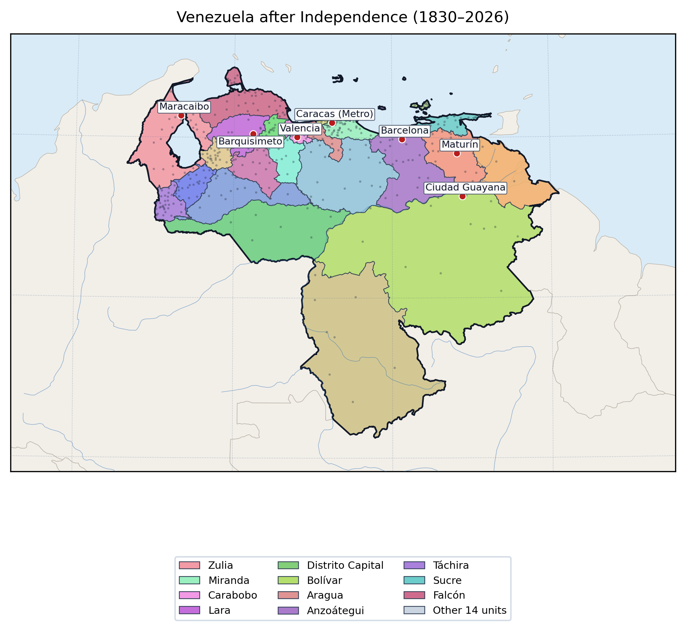

```{r setup, include=FALSE}
knitr::opts_chunk$set(echo = FALSE, warning = FALSE, message = FALSE, fig.pos = "htbp")
source("../../_shared/template/viscount_rmd_helpers.R")
library(jsonlite)

summary_data <- fromJSON("venezuela_after_independence_summary.json", simplifyVector = FALSE)
sett_data <- fromJSON("venezuela_after_independence_settlements.json", simplifyVector = FALSE)

clean_label <- function(x) {
  s <- as.character(x)
  s <- gsub("&", "and", s, fixed = TRUE)
  s <- gsub(" / ", " and ", s, fixed = TRUE)
  s <- gsub("\\\\", "", s)
  trimws(s)
}

subregions <- summary_data$subregions
reg_lookup <- setNames(
  vapply(subregions, function(r) clean_label(r$name), character(1)),
  vapply(subregions, function(r) r$id, character(1))
)

tot_area <- as.numeric(summary_data$total_area_km2)
n_sites <- as.integer(summary_data$settlement_count)
yrs_bench <- vapply(summary_data$benchmark_years, as.character, character(1))
dom_tots <- vapply(yrs_bench, function(y) as.numeric(summary_data$domain_totals[[y]]), numeric(1))
```

```{r hero-md-fallback, results='asis'}
if (!knitr::is_latex_output()) {
  cat("\n\n")
}
```

# Abstract

Between its separation from Gran Colombia in 1830 and the opening quarter of the twenty-first century, Venezuela underwent one of the sharpest demographic and spatial reversals in South America. Across 25 modern federal entities spanning 954.575 km², the official enumerated population rose from 1.732.421 (1,73M, or 1,81 inhabitants per km²) at Antonio Guzmán Blanco's first national census in 1873 to 2.479.525 (2,48M) in 1920, before petroleum extraction in the Lake Maracaibo basin and Arnoldo Gabaldón's anti-malaria DDT campaign after 1945 drove annual growth above 3,5% and carried the republic to 5,1M in 1950, 14,71M in 1981 and 27,23M at the 2011 census [@Nacionales1926Quinto; @Roitman1972Venezuela; @Garcia1999Transferencia]. Whereas 1873 Venezuela remained a rural agrarian country led by the central Llanos state of Guárico (173.748) and agricultural Lara (143.818) while Zulia held only 59.235 inhabitants, a century of oil-rent concentration, highway integration, European and Colombian immigration and planned industrial settlement at Ciudad Guayana shifted overwhelming weight toward the northern coastal cordillera and the Maracaibo lowland [@Bustillos2023Politica; @Allen2013Politicas]. By 2011, Zulia (3,7M), Miranda (2,68M), Carabobo (2,25M), Distrito Capital (1,94M), Lara (1,77M) and Aragua (1,63M) accounted for 51,3% of the national total, and Caracas had expanded into a metropolitan conurbation exceeding 3M inhabitants [@Garciaguadilla2009Crisis; @Ferrer2005Del]. Although unadjusted official projection series carry the administrative baseline to 32,22M in 2019 and 34,14M in 2024 (35,77 inhabitants per km²), post-2015 economic collapse and hyperinflation triggered an unprecedented humanitarian exodus exceeding 7M emigrants, leaving resident headcount sharply below formal registry extrapolations [@Arias2024Demography; @C2020Migracion; @Stonawski2025Heterogeneity]. This study integrates 16 census and projection benchmarks with a primary gazetteer of 422 settlements and 388 historical administrative units from 1830 to 2026.

# Background

## Independence Aftermath, Caudillo Wars and Malaria Stagnation (1830 to 1873)

When Venezuela dissolved its union with Colombia and Ecuador in 1830, the new republic inherited an impoverished, thinly populated territory scarred by two decades of independence warfare. Across roughly 954.575 km² of Caribbean littoral, Andean valleys, Orinoco savannas and Guiana highlands, scarcely 850k to 900k inhabitants survived in 1830, scattered in small agro-pastoral towns and river ports that had lost substantial shares of their late-colonial population to combat, requisitioning and disease. During the next four decades, demographic recovery stayed slow and fragile. Coffee cultivation expanded gradually across the central valleys and the Andean cordilleras of Mérida, Trujillo and Táchira, yet coastal plains and interior savannas remained under the grip of endemic malaria, yellow fever and dysentery, reinforced by recurrent civil wars [@Calderon2020Censo].

The decisive mid-century demographic shock was the Federal War of 1859 to 1863. Guerrilla campaigns, cattle slaughter and epidemics swept across the western and central Llanos, especially Guárico, Cojedes, Portuguesa, Barinas and Apure, disrupting rural family formation and pushing displaced peasants toward sheltered Andean slopes or coastal towns. Even after fighting subsided, poor road links left most interior provinces isolated from Caracas and Puerto Cabello. No national headcount existed until President Antonio Guzmán Blanco created the *Dirección General de Estadística* and executed Venezuela's first modern national census in November 1873 [@Nacionales1926Quinto; @Calderon2020Censo].

That 1873 enumeration revealed a geographical balance quite unfamiliar to modern eyes. Out of 1.732.421 inhabitants nationwide (1,81 per km²), the central savanna state of Guárico stood first at 173.748, followed by Lara (143.818), Carabobo (113.715), Aragua (110.828), Miranda (109.917), Trujillo (108.672), Anzoátegui (101.396) and Falcón (99.920). Distrito Capital held only 72.465 inhabitants (Caracas city proper 48.897), placing twelfth among federal entities, while Zulia counted just 59.235 (Maracaibo 21.954) and Bolívar only 28.287 (Ciudad Bolívar 8.486). Interior savanna provinces still outweighed the western oil basin and the Guiana shield combined [@Nacionales1926Quinto].

Across those nineteenth-century lowlands, demographic expansion remained tightly constrained by pastoral disease ecology and seasonal flooding. Cattle ranching in Apure, Barinas, Guárico and the Lake Maracaibo lowlands exposed rural households to mosquito-borne pathogens, including endemic malaria and periodic epizootics of Venezuelan equine encephalitis [@Valero2010Seroprevalenci]. High infant mortality and recurrent fevers kept natural increase sluggish even during years of domestic peace, ensuring that upland valleys above 800 metres retained healthier survival ratios than the humid Orinoco plains [@Calderon2020Censo].

## Late-Nineteenth-Century Coffee Growth and Llanos Depopulation (1873 to 1920)

Between 1873 and 1891, modest railway construction around Caracas, Valencia and Barquisimeto, together with rising European and North American demand for Andean coffee, lifted the enumerated population from 1.732.421 to 2.005.139 in 1881 (1,84% annual growth) and 2.221.573 in 1891 (1,03% per annum). Growth concentrated along the western highlands and eastern coastal valleys: between 1873 and 1891, Táchira rose from 68.619 to 101.709 (+48,2%), Sucre from 62.181 to 92.030 (+48%) and Bolívar from 28.287 to 55.589 (+96,5% on the back of Orinoco gold and rubber commerce), while Caracas city proper grew from 48.897 to 72.429.

Coffee prosperity simultaneously drew smallholders from older colonial towns in Trujillo and Mérida westward onto the forested slopes of Táchira, founding market hubs around San Cristóbal, Rubio and San Antonio del Táchira. Because coffee prices remained resilient through the 1880s while Llanos beef herds recovered only slowly from civil-war losses, the Andean cordillera steadily increased its share of national population even before the turn of the century.

After 1891, however, Venezuela experienced nearly three decades without a census, and its demographic momentum stalled. Civil wars around the turn of the century, the international naval blockade of 1902 to 1903, severe malaria outbreaks across the Llanos and the 1918 influenza pandemic combined to hold national population growth to just 0,38% per annum between 1891 and 1920, when the fourth national census recorded 2.479.525 inhabitants (2,6 per km²). Over those 29 years, rural malaria and agrarian decay emptied whole stretches of the interior plains: Guárico dropped by 30,9% from 174.929 in 1891 to 120.841 in 1920, Portuguesa fell by 45,3% from 96.045 to 52.549, Anzoátegui declined from 134.064 to 103.573, and Aragua, Barinas and Cojedes all stagnated or contracted. Conversely, Andean coffee growers in Táchira (147.076), Mérida (123.232) and Trujillo (178.942), together with eastern cacao and salt-fishery ports in Sucre (150.211) and the expanding administrative hub of Distrito Capital (220.389), carried virtually all net national growth [@Nacionales1926Quinto].

## Petroleum Discovery, Maracaibo Boom and Inter-War Censuses (1920 to 1945)

The structural break in Venezuelan population history occurred in December 1922, when the Barroso No. 2 well blew out at La Rosa near Cabimas on the eastern shore of Lake Maracaibo. Foreign oil companies poured capital, drilling rigs and wage labour into western Venezuela, turning Zulia from an isolated cattle and coffee-transit lakeside into the republic's primary magnet for internal migration [@Ferrer2005Del; @Garcia1999Transferencia]. By the fifth national census in early 1926, Venezuela's total had jumped to 3.064.505 inhabitants, an extraordinary intercensal surge of 3,59% per annum over six years [@Nacionales1926Quinto]. Zulia almost doubled from 119.458 in 1920 to 222.613 in 1926 (+86,4%), while Maracaibo climbed from 46.706 to 74.767 and Cabimas entered the national urban ledger at 5.840 inhabitants. Falcón rose from 128.255 to 178.642 as Paraguaná and coastal transit points supplied labour to the lake fields, and Orinoco frontier zones in Bolívar (98.258) and Amazonas registered heightened extractive activity [@Nacionales1926Quinto].

Great Depression oil cutbacks slowed overall growth between 1926 and 1936 to 0,94% per annum (3.364.347 inhabitants in 1936), yet the geographical shift toward the western oil zone and central government core continued unabated. Zulia reached 275.421 in 1936 and 345.667 in 1941, overtaking Lara (332.975) to become Venezuela's second most populous entity behind Distrito Capital (380.099). Meanwhile, eastern oil fields discovered in Monagas (Quiriquire and Jusepín) and Anzoátegui (Oficina and El Tigre) reversed decades of stagnation along the eastern Llanos: Monagas nearly doubled from 62.421 in 1920 to 122.901 in 1941, and Anzoátegui climbed from 103.573 to 155.746. By 1941, the seventh census recorded 3.901.949 inhabitants (4,09 per km²) on the eve of Venezuela's epidemiological revolution [@Roitman1972Venezuela].

## Anti-Malaria DDT Revolution, Mass Immigration and Urbanisation (1945 to 1981)

Between 1945 and 1961, Venezuela compressed a century of European demographic transition into less than two decades. In December 1945, physician and malariologist Arnoldo Gabaldón launched the world's first nationwide DDT residual-spraying campaign from Maracay, targeting *Anopheles darlingi* and *Anopheles albimanus* across the Llanos, Lake Valencia, the Yaracuy valley and the Orinoco delta. Within ten years, malaria mortality collapsed from roughly 110 per 100.000 inhabitants in the early 1940s to near zero across more than 400.000 km² of tropical lowlands, cutting national crude death rates in half while crude birth rates stayed above 44 per thousand [@Roitman1972Venezuela; @Rodriguezmorales2021Should]. Freed from hyperendemic fever, national population growth surged to 3,02% per annum in 1941 to 1950 (5.101.752 inhabitants), 3,72% in 1950 to 1961 (7.623.994) and 3,61% in 1961 to 1971 (10.864.013).

Simultaneously, the state actively recruited overseas labour under selective immigration policies to build highways, hydroelectric dams, housing blocks and steelworks [@Bustillos2023Politica]. Between 1948 and 1960, hundreds of thousands of Spaniards (especially Canarians and Galicians), Italians and Portuguese settled in Caracas, Valencia, Maracay, Barquisimeto and Maracaibo, joined by Levantine merchants from Lebanon and Syria who integrated rapidly into regional retail and wholesale trade [@Bustillos2023Politica; @Yordi2016Tras]. When oil prices quadrupled in 1973, Venezuela shifted from European recruitment to absorbing large cross-border inflows from Colombia, alongside smaller numbers from Ecuador, Peru, Chile and Argentina [@Allen2013Politicas; @Camargo2023Migracion].

Internal migration reshaped every corridor of the republic. In the west, Zulia climbed from 560.336 in 1950 to 1.674.252 in 1981 as Maracaibo grew from 235k to 890.653 and Cabimas reached 140.435 [@Ferrer2005Del]. In the central cordillera, oil-rent fiscal transfers concentrated public employment, manufacturing and services along the Caracas-Maracay-Valencia axis [@Garcia1999Transferencia; @Roitman1972Venezuela]. Distrito Capital expanded from 709.602 in 1950 to 2.070.742 in 1981, while spillover saturated Miranda (276.273 to 1.421.442), Carabobo (242.923 to 1.062.268) and Aragua (189.891 to 891.623) [@Roitman1972Venezuela; @Garciaguadilla2009Crisis; @Atehortua2017Barrio]. In the western Llanos, newly malaria-free agricultural frontiers drew settlers out of the Andes into Portuguesa (122.153 in 1950 to 424.984 in 1981) and Barinas (79.944 to 326.166). In the southeast, the planned industrial city of Ciudad Guayana, founded in July 1961 by uniting Puerto Ordaz and San Félix beside the Caroní hydroelectric dams and Orinoco iron mines, rose from 43k in 1961 to 314.497 in 1981, transforming Bolívar from a sleepy frontier of 127.436 in 1950 to 668.340 in 1981.

## Late-Transition Slowdown and the Post-2015 Exodus (1981 to 2026)

From the early 1980s, declining real oil rents after the 1983 *Viernes Negro* currency crisis, urban female schooling and rising contraception slowed Venezuela's natural increase. Intercensal growth fell from 3,08% per annum in 1971 to 1981 (14.709.665) to 2,33% in 1981 to 1990 (18.105.265), 2,22% in 1990 to 2001 (23.054.210) and 1,68% in 2001 to 2011 (27.227.930) [@Roa2012Situacion; @Allen2013Politicas]. Inside the capital basin, physical saturation of the Libertador municipality stabilised Distrito Capital near 1,82M to 1,94M between 1990 and 2011, pushing residential growth outward into Miranda (1,87M to 2,68M), Guarenas-Guatire, Valles del Tuy and La Guaira [@Garciaguadilla2009Crisis; @Atehortua2017Barrio].

After 2014, however, Venezuela experienced a demographic rupture without parallel in modern Latin America. Sovereign debt default, collapsing oil output, hyperinflation, shortages of food and medicines and the resurgence of vector-borne diseases such as malaria and Venezuelan hemorrhagic fever reversed six decades of net immigration into mass flight [@Rodriguezmorales2021Should; @C2020Migracion; @Arias2024Demography]. Between 2015 and 2024, more than 7M Venezuelans left the country, led by working-age adults and young families crossing into Colombia (receiving nearly 2,9M), Peru, Brazil, Ecuador, Chile, Argentina, Spain and the United States [@Arias2024Demography; @Stonawski2025Heterogeneity; @Camargo2023Migracion]. Because the National Institute of Statistics (INE) conducted no published full population census after 2011, official administrative projection tables still extend pre-crisis trends to 32.219.521 in 2019 and 34.140.725 in 2024, diverging sharply from de facto resident reality by roughly 6M to 8M inhabitants [@Arias2024Demography; @C2020Migracion].

# Methodology

## Sub-Regional Harmonisation across 25 Federal Entities

This chapter reconstructs Venezuela's spatial demography from 1830 to 2026 across 25 canonical first-order administrative units: 23 states, Distrito Capital and the maritime Dependencias Federales, covering 954.575 km² of terrestrial and insular territory in the harmonised QUIPU spatial framework. Because nineteenth- and early-twentieth-century censuses organised the republic under shifting provincial arrangements - such as the Grande Estado Miranda, Guzmán Blanco, Los Andes (combining Mérida, Trujillo and Táchira), Bermúdez (Anzoátegui, Monagas and Sucre), Zamora (Barinas and Cojedes) and the former Federal Territories of Amazonas, Delta Amacuro and Vargas (modern La Guaira) - all historical enumerations from 1873 through 1941 were reassigned onto consistent 2025 state polygons using district- and municipality-level boundary concordances [@Nacionales1926Quinto; @Calderon2020Censo].

For the period 1873 to 2011, state headcounts match published enumerations of the *Dirección General de Estadística* (1873, 1881, 1891, 1920, 1926, 1936 and 1941) and the *Oficina Central de Estadística e Informática* / *Instituto Nacional de Estadística* (1950, 1961, 1971, 1981, 1990, 2001 and 2011) [@Nacionales1926Quinto; @Roa2012Situacion]. Notice that the 1926 census records an anomalous spike of 60.276 in Amazonas (compared with 3.298 in 1920 and 1.715 in 1936) arising from broad administrative estimates of unenumerated indigenous riverine populations along the Upper Orinoco and Casiquiare, which the raw registry series preserves transparently [@Nacionales1926Quinto]. For 2019 and 2024, the baseline table retains the official INE sub-national projection schedule (32,22M and 34,14M) so state weights remain continuous with the 2011 administrative frame, while our demographic analysis explicitly contrasts those unadjusted de jure schedules against de facto post-2015 emigration losses documented in international demographic surveys [@Arias2024Demography; @Stonawski2025Heterogeneity; @C2020Migracion].

```{r tab-national-benchmarks, results='asis'}
bench_rows <- lapply(seq_along(yrs_bench), function(i) {
  y <- yrs_bench[i]
  p <- dom_tots[i]
  dens <- p / tot_area
  cagr_str <- "-"
  if (i > 1L) {
    dt <- as.numeric(yrs_bench[i]) - as.numeric(yrs_bench[i - 1L])
    cagr <- ( (p / dom_tots[i - 1L])^(1 / dt) - 1 ) * 100
    cagr_str <- paste0(viscount_fmt_number(cagr, 2L), "%")
  }
  pops_y <- vapply(subregions, function(r) as.numeric(r$population[[y]]), numeric(1))
  lead_idx <- which.max(pops_y)
  lead_str <- paste0(clean_label(subregions[[lead_idx]]$name), " (", viscount_fmt_pop(pops_y[lead_idx]), ")")
  src_lbl <- if (as.integer(y) <= 1941L) {
    "DGE National Census"
  } else if (as.integer(y) <= 2011L) {
    "OCEI or INE National Census"
  } else {
    "INE Official Projection (unadjusted)"
  }
  data.frame(
    Year = y,
    Pop = viscount_fmt_number(p, 0L),
    Compact = viscount_fmt_pop(p),
    Dens = viscount_fmt_number(dens, 2L),
    CAGR = cagr_str,
    Lead = lead_str,
    Source = src_lbl,
    stringsAsFactors = FALSE
  )
})
df_nat <- do.call(rbind, bench_rows)
rownames(df_nat) <- NULL

viscount_table(
  df_nat,
  "Venezuelan national census and official projection benchmarks across 25 federal entities (954.575 km²), 1873 to 2024.",
  c("Year", "Total Pop.", "Abbrev.", "Density (km²)", "Growth (p.a.)", "Leading State", "Series Basis"),
  list(label = "tab:national-benchmarks", font_size = "scriptsize")
)
```

## Settlement Gazetteer Construction and Municipal Consolidation

Urban and rural settlement series were compiled from four archival feeds: the 2011 INE municipal census via OCHA/HDX COD-PS (290 entries), multi-census city tables for 1981 to 2019 (130 entries), long-run metropolitan series from 1950 to 1981 (1 entry) and Dependencias Federales insular enumerations (1 entry). Across 506 evaluated candidates, 422 distinct settlements met spatial coordinate and temporal rules, while 50 duplicate municipal-capital aliases (such as *Iribarren* co-located with Barquisimeto, *Caroní* with Ciudad Guayana, *Simón Bolívar* with Barcelona and *Carirubana* with Punto Fijo) and 34 unlocated toponyms were excluded to prevent double counting [@Calderon2020Censo].

Strict municipal-scope tagging separates unified city-proper entities (387 entries) from distinct outer suburban municipalities (34 entries) and the metropolitan aggregate *Caracas (Metro)* (1 entry) [@Garciaguadilla2009Crisis]. By distinguishing Caracas city proper (Libertador municipality, 2,09M in 2019) from surrounding Miranda and La Guaira suburbs such as Petare (441,7k), Baruta (309,4k), Guarenas (244,6k), Los Teques (230,8k), Guatire (180,5k), Catia La Mar (141,9k), El Hatillo (92,9k) and Chacao (79,3k), the regional model reconciles overlapping metropolitan and municipal totals without inflating the central valley's population [@Garciaguadilla2009Crisis; @Atehortua2017Barrio].

Outside the capital valley, the same municipal distinction prevents overlap around Valencia, Maracay, Maracaibo and Barcelona-Puerto La Cruz. Independent outer industrial and dormitory centres such as Naguanagua, San Diego and Los Guayos near Valencia, Turmero and Cagua beside Maracay, and San Francisco on the southern edge of Maracaibo remain distinct records rather than being folded into core city totals, preserving accurate spatial density gradients across metropolitan corridors [@Ferrer2005Del; @Roitman1972Venezuela].

## Archival Census Continuity (1873 to 2024)

Table \ref{tab:national-benchmarks} pairs the seven early *Dirección General de Estadística* censuses (1873 to 1941) with the seven *Oficina Central de Estadística e Informática* and INE enumerations (1950 to 2011) and the unadjusted 2019 and 2024 official projection horizons. Reading annualised growth rates across the 16 benchmarks brings out both the 1920 to 1926 petroleum break (3,59% per annum) and the sustained 1950 to 1971 demographic peak above 3,6% per annum.

# Testing and Validation

All 25 state polygons, 16 benchmark series and 422 settlement records passed automated topological, arithmetic and provenance audits. Polygon summation across the 25 sub-regions reconciles exactly to the national totals at every benchmark from 1873 (1.732.421) to 2024 (34.140.725), and every inhabited sub-region contains between 1 (Dependencias Federales) and 36 (Táchira) geocoded settlements with zero missing coordinates or boundary mismatches.

Sixteen historic cities (including Caracas, Maracaibo, Valencia, Barquisimeto, Cumaná, Barcelona, Ciudad Bolívar, Coro, Maracay, Maturín, Mérida, Puerto Cabello and San Cristóbal from 1873, Carayaca from 1833, Tinaquillo from 1836 and Cabimas from 1926) anchor pre-1950 urban growth rates against archival census volumes [@Nacionales1926Quinto]. Across all 422 catalogued settlements, peak recorded populations span nearly three orders of magnitude from Dependencias Federales (2,29k) and small Andean parishes up to Caracas (Metro) (3,38M), yielding a clean rank-size power-law fit ($\alpha = 0,83$, $R^2 = 0,98$) consistent with an oil-financed primate urban hierarchy [@Garcia1999Transferencia; @Ferrer2005Del].

At the national level, cross-checking the 2011 census (27.227.930) against the post-2015 migration literature confirms the divergence between statutory projection tables and resident population [@Arias2024Demography; @Camargo2023Migracion]. While INE projections report 32,22M for 2019 and 34,14M for 2024 by extending 2001 to 2011 fertility and zero-emigration assumptions, demographic reconstructions incorporating border crossings, host-country residence permits and household surveys indicate cumulative net outflows exceeding 7M persons since 2015, implying a true resident population near 26M to 28M by 2024 [@Arias2024Demography; @Stonawski2025Heterogeneity; @Ruizsantacruz2022Caracterizacio].

# Results

## National Demographic Trajectory (1873 to 2024)

Venezuela's demographic curve divides into four sharply defined epochs: slow agrarian and war-scarred stagnation before 1920, an initial petroleum takeoff from 1920 to 1941, an extraordinary mortality-driven explosion from 1945 to 1981 and progressive fertility transition cut short by post-2015 emigration (Figure \ref{fig:venezuela-trajectory}). Over the full 151-year span covered by the benchmark table, enumerated and officially projected national headcount multiplied 19,71 times, from 1.732.421 in 1873 to 34.140.725 in 2024, lifting national mean density from 1,81 to 35,77 inhabitants per km².

```{r fig-trajectory, results='asis'}
viscount_figure(
  "figures/venezuela_after_independence_population_trajectory.png",
  "National and leading state demographic trajectories from 1873 to 2024 (Panel A) and top ten sub-regional population densities in 2024 (Panel B).",
  "fig:venezuela-trajectory"
)
```

Between 1873 and 1920, Venezuela gained just 747.104 inhabitants (+43,1%, 0,76% per annum) under Llanos malaria and civil strife. From 1920 to 1941, oil revenues and sanitation lifted totals by 1.422.424 (+57,4%, 2,18% per annum) from 2,48M to 3,9M. Between 1941 and 1981, population nearly quadrupled (+277%, adding 10.807.716 at 3,37% per annum) as DDT malaria control cut infant mortality and immigrants poured into cities [@Roitman1972Venezuela; @Bustillos2023Politica]. From 1981 to 2011, totals rose by 12.518.265 (+85,1%) as fertility fell, before post-2015 emigration reversed growth despite official extrapolations [@Arias2024Demography; @Roa2012Situacion].

## Regional Divergence: Coastal-Central Core, Zulia Oil Basin and Llanos Frontier

Table \ref{tab:state-enumerations} sets out the full state-level enumeration series across seven canonical milestones (1873, 1920, 1950, 1981, 2011 and 2024) alongside 2024 densities. The long-run redistribution of Venezuela's inhabitants across these 25 entities reveals how completely petroleum and state-led industrialisation overturned the nineteenth-century agrarian map [@Garcia1999Transferencia; @Allen2013Politicas].

```{r tab-state-enumerations, results='asis'}
state_rows <- lapply(subregions, function(r) {
  a <- as.numeric(r$area_km2)
  p1873 <- as.numeric(r$population[["1873"]])
  p1920 <- as.numeric(r$population[["1920"]])
  p1950 <- as.numeric(r$population[["1950"]])
  p1981 <- as.numeric(r$population[["1981"]])
  p2011 <- as.numeric(r$population[["2011"]])
  p2024 <- as.numeric(r$population[["2024"]])
  d2024 <- if (a > 0) p2024 / a else 0
  data.frame(
    State = clean_label(r$name),
    Area = viscount_fmt_number(round(a), 0L),
    P1873 = viscount_fmt_pop(p1873),
    P1920 = viscount_fmt_pop(p1920),
    P1950 = viscount_fmt_pop(p1950),
    P1981 = viscount_fmt_pop(p1981),
    P2011 = viscount_fmt_pop(p2011),
    P2024 = viscount_fmt_pop(p2024),
    D2024 = viscount_fmt_number(d2024, 1L),
    stringsAsFactors = FALSE
  )
})
df_states <- do.call(rbind, state_rows)
df_states <- rbind(
  df_states,
  data.frame(
    State = "Venezuela (Total)",
    Area = viscount_fmt_number(round(tot_area), 0L),
    P1873 = viscount_fmt_pop(summary_data$domain_totals[["1873"]]),
    P1920 = viscount_fmt_pop(summary_data$domain_totals[["1920"]]),
    P1950 = viscount_fmt_pop(summary_data$domain_totals[["1950"]]),
    P1981 = viscount_fmt_pop(summary_data$domain_totals[["1981"]]),
    P2011 = viscount_fmt_pop(summary_data$domain_totals[["2011"]]),
    P2024 = viscount_fmt_pop(summary_data$domain_totals[["2024"]]),
    D2024 = viscount_fmt_number(as.numeric(summary_data$domain_totals[["2024"]]) / tot_area, 1L),
    stringsAsFactors = FALSE
  )
)
rownames(df_states) <- NULL

viscount_table(
  df_states,
  "State-level census enumerations and official projections across 25 federal entities, 1873 to 2024.",
  c("Entity", "Area (km²)", "1873", "1920", "1950", "1981", "2011", "2024*", "2024 Dens."),
  list(label = "tab:state-enumerations", font_size = "scriptsize", max_rows_per_page = 30L)
)
```

Three spatial blocks stand out in Table \ref{tab:state-enumerations}. First, the **Western Oil Corridor** centred on Zulia multiplied 77,3 times between 1873 (59.235) and 2024 (4,58M), overtaking every other state after 2001 to become Venezuela's single largest federal entity (3,7M in 2011). Alongside Maracaibo's metropolitan expansion across the western shore and San Francisco (446,8k in 2011), eastern lake oil hubs at Cabimas (299,7k in 2019), Lagunillas and Bachaquero turned a sparse lakeside cattle district into an urbanised industrial corridor [@Ferrer2005Del; @Guerrerorios2026Population; @Garcia2010Factores]. Nearby Falcón (99.920 in 1873 to 902.847 in 2011) captured Paraguaná refinery towns around Punto Fijo, while Lara (143.818 to 1,77M) linked Barquisimeto (1,09M in 2019) as the western commercial crossroads between the Andes, Zulia and central valleys.

Second, the **Coastal-Central Core**, combining Distrito Capital (72.465 in 1873 to 1,94M in 2011), Miranda (109.917 to 2,68M), La Guaira (11.146 to 352.920), Carabobo (113.715 to 2,25M) and Aragua (110.828 to 1,63M), expanded from 418.071 inhabitants in 1873 (24,1% of Venezuela) to 8,85M in 2011 (32,5% of the nation) on just 2,98% of national territory (28.656 km²). By 2024 projections, Distrito Capital reaches 2.257,3 inhabitants per km², followed by insular Nueva Esparta (414,1 per km², boosted by Margarita Island's duty-free port growth after 1971), Miranda (366,6 per km²), Carabobo (356,4 per km²), Aragua (220,8 per km²) and La Guaira (186,3 per km²). Within this corridor, Valencia (1,59M in 2019) and Maracay (464,7k, anchored by Girardot and neighbouring Turmero at 379,5k) absorbed heavy manufacturing, textiles and automotive assembly along the Lake Valencia basin [@Roitman1972Venezuela; @Garcia1999Transferencia].

Third, the **Interior Llanos, Andes and Guayana Frontier** traced two diverging paths. The old central Llanos cattle states grew slowest of all over 151 years: Cojedes grew only 4,7 times (85.678 in 1873 to 400.151 in 2024) and Guárico just 5,9 times (173.748 to 1,03M), having lost decades to pre-1945 malaria and subsequent migration to Caracas and Valencia. By contrast, post-1945 DDT spraying and agricultural colonisation revived the western Llanos of Portuguesa (14,1x to 1,13M) and Barinas (17,2x to 1,02M) and eastern oil provinces of Monagas (22,5x to 1,07M) and Anzoátegui (18,4x to 1,87M, anchored by Barcelona at 454,2k, Puerto La Cruz at 299,5k and El Tigre).

Further south, **Bolívar** exploded 70,7 times from 28.287 in 1873 to 2M in 2024 after the foundation of Ciudad Guayana (893,4k in 2019) and Guri hydroelectric development [@Allen2013Politicas], while Amazonas (223,7k across 193.241,5 km², 1,16 per km²) and Delta Amacuro (229,7k across 41.246,8 km², 5,57 per km²) remained vast riverine and rainforest frontiers. Meanwhile, the three Andean states of Táchira (68.619 to 1,31M), Mérida (67.849 to 1,13M) and Trujillo (108.672 to 931.135) shifted from being Venezuela's main domestic emigration reservoir in the mid-twentieth century to major border-transit zones after 2015 [@Orjuela2023Historias; @Claro2023Migracion].

Along the eastern Caribbean littoral, Sucre (62.181 in 1873 to 1,17M in 2024) and Nueva Esparta (30.983 to 698.167) followed a maritime trajectory distinct from the central industrial belt. Cumaná (384,9k in 2019) and Carúpano sustained fishing, cacao and coastal shipping across the Gulf of Cariaco, whereas Nueva Esparta accelerated only after Margarita Island received duty-free port status in 1971, turning Porlamar and Pampatar into commercial and tourism centres that lifted insular density to 414,1 inhabitants per km² by 2024.

## Urban Primacy and the Venezuelan City Hierarchy

Oil rents turned Venezuela from one of South America's least urbanised nations (roughly 15% urban in 1920) into one of its most urbanised (exceeding 88% by 2011) [@Roitman1972Venezuela; @Garciaguadilla2009Crisis]. Figure \ref{fig:venezuela-hierarchy} captures both the dominance of the top urban centres and the regular power-law scaling ($\alpha = 0,83$, $R^2 = 0,98$) across all 422 catalogued settlements.

```{r fig-hierarchy, results='asis'}
viscount_figure(
  "figures/venezuela_after_independence_urban_hierarchy.png",
  "Twelve largest recorded urban entities (Panel A) and rank-size distribution across 422 Venezuelan settlements (Panel B), 1830 to 2026.",
  "fig:venezuela-hierarchy"
)
```

At the summit sits Caracas (Metro), climbing from 704.567 inhabitants in 1950 to 1,68M in 1961, 2,63M in 1971 and a metro-scope peak of 3,38M in 1981 (3,05M on strict five-municipality metropolitan boundaries in 2019), while Caracas city proper (Libertador) grew from 48.897 in 1873 and 92.212 in 1920 to 269.030 in 1941 and 2,09M in 2019 [@Garciaguadilla2009Crisis; @Atehortua2017Barrio]. Behind Caracas stand four regional metropolises exceeding 850k inhabitants in 2019: Maracaibo (2,26M), Valencia (1,59M), Barquisimeto (1,09M) and Ciudad Guayana (893,4k). A broad tier of medium-sized industrial, oil, port and regional capitals between 250k and 550k - Maturín (542,3k in 2011), Maracay (464,7k), Barcelona (454,2k), San Francisco (446,8k), Petare (441,7k), Ciudad Bolívar (425k), Cumaná (384,9k), Turmero (379,5k), Barinas (356,8k), Baruta (309,4k), Cabimas (299,7k), Puerto La Cruz (299,5k), Mérida (289,8k) and San Cristóbal (284,6k) - forms a dense urban network along the Caribbean rim, Andean foothills and eastern oil belt [@Ferrer2005Del; @Roitman1972Venezuela].

Beneath those twenty largest urban municipalities sits a tightly packed provincial middle tier of 71 secondary centres between 100k and 250k inhabitants, anchored by Guarenas (244,6k), Coro (231,6k), Los Teques (230,8k), El Tigre (215,8k), Guacara (196,4k), Puerto Cabello (191k), Guatire (180,5k), Valera (165,5k), Carúpano (159,3k), Naguanagua (157,4k in 2011) and Punto Fijo (154,1k). Together, these secondary manufacturing, refinery, port and agricultural service towns carried the bulk of Venezuela's late-twentieth-century provincial urbanisation, extending paved highway corridors across Yaracuy, Portuguesa, Barinas, Anzoátegui and Monagas while absorbing rural migrants who bypassed the capital valley [@Roitman1972Venezuela; @Allen2013Politicas].

## Demographic Ageing and Labour Force Shift (1975 to 2015)

Alongside spatial concentration, Venezuela experienced rapid age-structure maturation between 1975 and 2015. Total fertility fell from more than 5,5 births per woman in the 1960s to roughly 2,4 by 2010, expanding the working-age share of the population and steadily raising the proportion of older adults inside urban labour markets [@Roa2012Situacion]. Rising female educational attainment and formal-sector service employment in Caracas, Valencia and Maracaibo delayed marriage and lowered completed family size even before the post-2014 economic contraction accelerated birth-rate declines and pushed young workers out of the country [@Roa2012Situacion; @Arias2024Demography].

## Post-2015 Emigration and Regional Redistribution Abroad

No contemporary treatment of Venezuelan population can treat the 2019 and 2024 official projection figures as uncontested resident counts. Beginning slowly among skilled professionals between 2000 and 2013 and accelerating dramatically after 2015, crisis-driven emigration drained working-age cohorts from Caracas, Zulia, Carabobo, Táchira and Bolívar alike [@C2020Migracion; @Camargo2023Migracion; @Arias2024Demography]. Border studies along the Táchira-Norte de Santander and Bolívar-Roraima crossings document sustained overland departures of families, pregnant women and school-age children seeking health care, nutrition and employment in Colombia, Brazil, Ecuador, Peru, Chile and Argentina [@Rada2021Forced; @Galvao2021Future; @Orjuela2023Historias; @Claro2023Migracion].

In Colombia, Venezuelan inflows reshaped municipal labour markets and urban expansion across Bogotá, Cúcuta, Barranquilla, Medellín and Bucaramanga [@Ruizsantacruz2022Caracterizacio; @Romero2024Mapping; @Barbosa2024Estimating], while secondary streams established growing communities in Buenos Aires [@Mera2025Vivienda], Madrid and South Florida [@Belokonev2019Impact]. Household coping strategies varied sharply by timing and education, with early waves dominated by university-educated migrants and post-2017 outflows increasingly drawn from lower-income households [@Stonawski2025Heterogeneity; @Arias2024Demography]. Internally, the departure of more than 7M residents (roughly a fifth to a quarter of the pre-crisis population) has accelerated demographic ageing among remaining cohorts, depressed school enrolment and partially reversed rural-to-urban pressure across smaller interior towns [@Roa2012Situacion; @Arias2024Demography].

# Limitations

Four structural constraints qualify interpretation of Venezuela's post-independence demographic record. First, **no national census was published between 1891 and 1920, nor after 2011**. While the 1891 to 1920 gap leaves the precise timing of late-nineteenth-century civil-war losses and the 1918 influenza mortality spike unmeasured at annual resolution, the post-2011 census hiatus creates an acute divergence between official INE projection tables (32,22M in 2019 and 34,14M in 2024) and actual resident headcount after 7M+ emigrants departed between 2015 and 2024 [@Arias2024Demography; @Camargo2023Migracion]. Second, **early territorial enumerations in remote interior basins remain imprecise**: the 1926 census entry of 60.276 for Amazonas reflects administrative guesswork for scattered indigenous riverine groups rather than house-by-house enumeration, in contrast with 3.298 in 1920 and 1.715 in 1936 [@Nacionales1926Quinto].

Third, **boundary reorganisations and dual administrative reporting complicate local series**. Nineteenth-century super-states (*Los Andes*, *Bermúdez*, *Zamora*) and twentieth-century municipal splits - such as Vargas separating from Distrito Federal in 1998 to become modern La Guaira, and Chacao, Baruta and El Hatillo separating within Miranda - require careful scope alignment so metropolitan Caracas totals are never added atop constituent suburbs [@Garciaguadilla2009Crisis; @Calderon2020Censo]. Similarly, a small number of historical city series in the 1950 to 2011 multi-census archive retain municipality-level (*municipio*) totals alongside urban locality figures (for example Ciudad Bolívar and Maturín), producing modest step shifts between 2001, 2011 and 2019. Fourth, **sub-national emigration shares are imperfectly recorded**: while national outflow estimates above 7M are firmly grounded in regional border and residence-permit registries [@Romero2024Mapping; @Arias2024Demography], official domestic projections do not disaggregate differential out-migration across individual Venezuelan states, so state-level 2019 and 2024 projection values in Table \ref{tab:state-enumerations} represent unadjusted administrative baselines rather than resident counts.

# Conclusion

Venezuela's post-independence population history offers one of the starkest illustrations in the Americas of how epidemiology, mineral extraction and political economy jointly govern settlement geography. For nearly a century after 1830, endemic malaria across the Orinoco lowlands and chronic civil conflict held growth below 1% per annum, leaving the 1920 republic at just 2,48M inhabitants, still anchored in interior savanna states and Andean coffee valleys. Within two generations after the 1922 Maracaibo oil blowout and the 1945 DDT eradication campaign, Venezuela broke every demographic ceiling: crude death rates halved, natural increase exceeded 3,5% per year, European and Colombian immigrants poured into coastal cities and industrial centres, and total population multiplied elevenfold from 2,48M in 1920 to 27,23M at the 2011 census [@Nacionales1926Quinto; @Roitman1972Venezuela; @Bustillos2023Politica].

That century-long upward trajectory concentrated nearly one-third of all Venezuelans into the narrow coastal-central crescent from Caracas to Valencia and Maracay, raised Zulia to the nation's largest state, and planted a nearly million-strong planned industrial city on the Orinoco at Ciudad Guayana [@Garcia1999Transferencia; @Ferrer2005Del]. Yet Venezuela's dependence on volatile oil rents left its urban society uniquely exposed when economic collapse arrived after 2014. The ensuing departure of more than 7M citizens across Colombia, the Southern Cone, Brazil, Europe and North America marks a historic inflection point, transforming a twentieth-century country of immigration into South America's largest source of cross-border emigration while leaving future national censuses with the urgent task of measuring how deeply a decade of exodus has hollowed out its cities and provinces [@Arias2024Demography; @C2020Migracion; @Stonawski2025Heterogeneity].

# Appendix

## Leading Venezuelan Settlements (1830 to 2019)

Table \ref{tab:top20-settlements} summarises the twenty largest urban records in the Venezuelan gazetteer, distinguishing metropolitan, city-proper and suburban administrative scopes alongside coordinates and observed census spans.

```{r tab-top20-settlements, results='asis'}
top_list <- summary_data$top_settlements[seq_len(min(20L, length(summary_data$top_settlements)))]
top_rows <- lapply(top_list, function(e) {
  nm <- clean_label(e$name)
  scope_val <- "city proper"
  for (sk in names(sett_data)) {
    if (identical(sett_data[[sk]]$name, e$name) && identical(sett_data[[sk]]$region_id, e$region_id)) {
      scope_val <- gsub("_", " ", as.character(sett_data[[sk]]$population_scope))
      break
    }
  }
  reg_lbl <- if (e$region_id %in% names(reg_lookup)) reg_lookup[[e$region_id]] else clean_label(e$region_id)
  fy <- as.integer(e$first_year)
  ly <- as.integer(e$last_year)
  span_str <- if (fy == ly) as.character(fy) else paste0(fy, " to ", ly)
  data.frame(
    Name = nm,
    State = reg_lbl,
    Scope = scope_val,
    Span = span_str,
    Peak = paste0(viscount_fmt_pop(e$peak_pop), " (", e$peak_year, ")"),
    stringsAsFactors = FALSE
  )
})
df_top20 <- do.call(rbind, top_rows)
rownames(df_top20) <- NULL

viscount_table(
  df_top20,
  "Twenty largest catalogued urban entries in Venezuela with state assignment, scope, census span and peak population, 1830 to 2019.",
  c("Settlement", "Entity", "Scope", "Observed Span", "Peak Pop. (Year)"),
  list(label = "tab:top20-settlements", font_size = "scriptsize")
)
```

## Sub-Regional Growth Multiples and Settlement Coverage

Table \ref{tab:regional-growth} reports compound annual growth rates across Venezuela's three great historical phases - late agrarian stagnation (1873 to 1920), oil and anti-malaria takeoff (1920 to 1961) and modern urban maturation (1961 to 2011) - together with cumulative 1873 to 2024 expansion multiples and catalogued settlement counts across all 25 federal entities.

```{r tab-regional-growth, results='asis'}
grow_rows <- lapply(subregions, function(r) {
  p1 <- as.numeric(r$population[["1873"]])
  p2 <- as.numeric(r$population[["1920"]])
  p3 <- as.numeric(r$population[["1961"]])
  p4 <- as.numeric(r$population[["2011"]])
  p5 <- as.numeric(r$population[["2024"]])
  g1 <- ((p2 / p1)^(1 / 47) - 1) * 100
  g2 <- ((p3 / p2)^(1 / 41) - 1) * 100
  g3 <- ((p4 / p3)^(1 / 50) - 1) * 100
  mult <- p5 / p1
  sc <- summary_data$settlements_by_region[[r$id]]
  sc_val <- if (is.null(sc)) 0L else as.integer(sc)
  data.frame(
    Entity = clean_label(r$name),
    G1 = paste0(viscount_fmt_number(g1, 2L), "%"),
    G2 = paste0(viscount_fmt_number(g2, 2L), "%"),
    G3 = paste0(viscount_fmt_number(g3, 2L), "%"),
    Mult = paste0(viscount_fmt_number(mult, 1L), "x"),
    Sites = viscount_fmt_number(sc_val, 0L),
    stringsAsFactors = FALSE
  )
})
df_grow <- do.call(rbind, grow_rows)
rownames(df_grow) <- NULL

viscount_table(
  df_grow,
  "Annual demographic growth rates across three historical periods (1873 to 1920, 1920 to 1961 and 1961 to 2011), total 1873 to 2024 multiples and catalogued settlement counts across 25 federal entities.",
  c("Entity", "1873 to 1920", "1920 to 1961", "1961 to 2011", "1873 to 2024", "Sites"),
  list(label = "tab:regional-growth", font_size = "scriptsize", max_rows_per_page = 30L)
)
```

# Sources

::: {#refs}
:::
