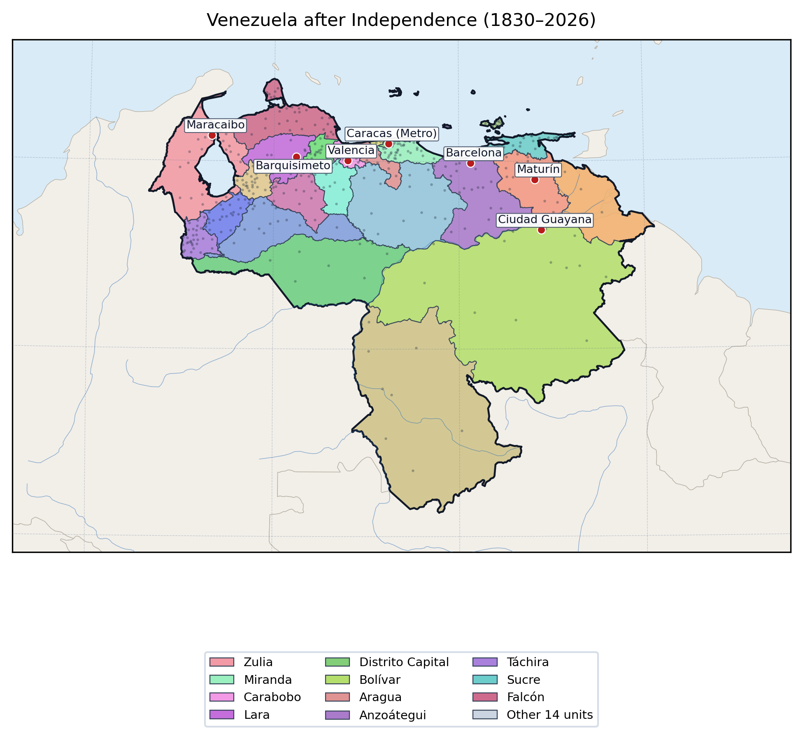
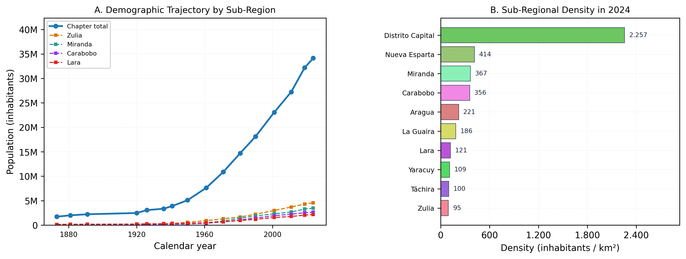
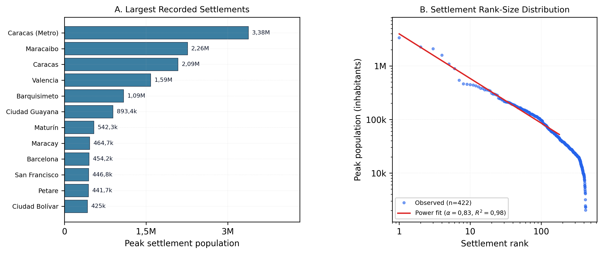

Venezuela after Independence
================
Aust Kätzchen
23 November 2026

- [Abstract](#abstract)
- [Background](#background)
  - [Independence Aftermath, Caudillo Wars and Malaria Stagnation (1830
    to
    1873)](#independence-aftermath-caudillo-wars-and-malaria-stagnation-1830-to-1873)
  - [Late-Nineteenth-Century Coffee Growth and Llanos Depopulation (1873
    to
    1920)](#late-nineteenth-century-coffee-growth-and-llanos-depopulation-1873-to-1920)
  - [Petroleum Discovery, Maracaibo Boom and Inter-War Censuses (1920 to
    1945)](#petroleum-discovery-maracaibo-boom-and-inter-war-censuses-1920-to-1945)
  - [Anti-Malaria DDT Revolution, Mass Immigration and Urbanisation
    (1945 to
    1981)](#anti-malaria-ddt-revolution-mass-immigration-and-urbanisation-1945-to-1981)
  - [Late-Transition Slowdown and the Post-2015 Exodus (1981 to
    2026)](#late-transition-slowdown-and-the-post-2015-exodus-1981-to-2026)
- [Methodology](#methodology)
  - [Sub-Regional Harmonisation across 25 Federal
    Entities](#sub-regional-harmonisation-across-25-federal-entities)
  - [Settlement Gazetteer Construction and Municipal
    Consolidation](#settlement-gazetteer-construction-and-municipal-consolidation)
  - [Archival Census Continuity (1873 to
    2024)](#archival-census-continuity-1873-to-2024)
- [Testing and Validation](#testing-and-validation)
- [Results](#results)
  - [National Demographic Trajectory (1873 to
    2024)](#national-demographic-trajectory-1873-to-2024)
  - [Regional Divergence: Coastal-Central Core, Zulia Oil Basin and
    Llanos
    Frontier](#regional-divergence-coastal-central-core-zulia-oil-basin-and-llanos-frontier)
  - [Urban Primacy and the Venezuelan City
    Hierarchy](#urban-primacy-and-the-venezuelan-city-hierarchy)
  - [Demographic Ageing and Labour Force Shift (1975 to
    2015)](#demographic-ageing-and-labour-force-shift-1975-to-2015)
  - [Post-2015 Emigration and Regional Redistribution
    Abroad](#post-2015-emigration-and-regional-redistribution-abroad)
- [Limitations](#limitations)
- [Conclusion](#conclusion)
- [Appendix](#appendix)
  - [Leading Venezuelan Settlements (1830 to
    2019)](#leading-venezuelan-settlements-1830-to-2019)
  - [Sub-Regional Growth Multiples and Settlement
    Coverage](#sub-regional-growth-multiples-and-settlement-coverage)
- [Sources](#sources)

<figure>

<figcaption aria-hidden="true">Twenty-five federal entities and 422
catalogued settlements across Venezuela from independence in 1830 to
2026.</figcaption>
</figure>

# Abstract

Between its separation from Gran Colombia in 1830 and the opening
quarter of the twenty-first century, Venezuela underwent one of the
sharpest demographic and spatial reversals in South America. Across 25
modern federal entities spanning 954.575 km², the official enumerated
population rose from 1.732.421 (1,73M, or 1,81 inhabitants per km²) at
Antonio Guzmán Blanco’s first national census in 1873 to 2.479.525
(2,48M) in 1920, before petroleum extraction in the Lake Maracaibo basin
and Arnoldo Gabaldón’s anti-malaria DDT campaign after 1945 drove annual
growth above 3,5% and carried the republic to 5,1M in 1950, 14,71M in
1981 and 27,23M at the 2011 census
[\[1\]](#ref-Nacionales1926Quinto)[\[2\]](#ref-Roitman1972Venezuela)[\[3\]](#ref-Garcia1999Transferencia).
Whereas 1873 Venezuela remained a rural agrarian country led by the
central Llanos state of Guárico (173.748) and agricultural Lara
(143.818) while Zulia held only 59.235 inhabitants, a century of
oil-rent concentration, highway integration, European and Colombian
immigration and planned industrial settlement at Ciudad Guayana shifted
overwhelming weight toward the northern coastal cordillera and the
Maracaibo lowland
[\[4\]](#ref-Bustillos2023Politica)[\[5\]](#ref-Allen2013Politicas). By
2011, Zulia (3,7M), Miranda (2,68M), Carabobo (2,25M), Distrito Capital
(1,94M), Lara (1,77M) and Aragua (1,63M) accounted for 51,3% of the
national total, and Caracas had expanded into a metropolitan conurbation
exceeding 3M inhabitants
[\[6\]](#ref-Garciaguadilla2009Crisis)[\[7\]](#ref-Ferrer2005Del).
Although unadjusted official projection series carry the administrative
baseline to 32,22M in 2019 and 34,14M in 2024 (35,77 inhabitants per
km²), post-2015 economic collapse and hyperinflation triggered an
unprecedented humanitarian exodus exceeding 7M emigrants, leaving
resident headcount sharply below formal registry extrapolations
[\[8\]](#ref-Arias2024Demography)[\[9\]](#ref-C2020Migracion)[\[10\]](#ref-Stonawski2025Heterogeneity).
This study integrates 16 census and projection benchmarks with a primary
gazetteer of 422 settlements and 388 historical administrative units
from 1830 to 2026.

# Background

## Independence Aftermath, Caudillo Wars and Malaria Stagnation (1830 to 1873)

When Venezuela dissolved its union with Colombia and Ecuador in 1830,
the new republic inherited an impoverished, thinly populated territory
scarred by two decades of independence warfare. Across roughly 954.575
km² of Caribbean littoral, Andean valleys, Orinoco savannas and Guiana
highlands, scarcely 850k to 900k inhabitants survived in 1830, scattered
in small agro-pastoral towns and river ports that had lost substantial
shares of their late-colonial population to combat, requisitioning and
disease. During the next four decades, demographic recovery stayed slow
and fragile. Coffee cultivation expanded gradually across the central
valleys and the Andean cordilleras of Mérida, Trujillo and Táchira, yet
coastal plains and interior savannas remained under the grip of endemic
malaria, yellow fever and dysentery, reinforced by recurrent civil wars
[\[11\]](#ref-Calderon2020Censo).

The decisive mid-century demographic shock was the Federal War of 1859
to 1863. Guerrilla campaigns, cattle slaughter and epidemics swept
across the western and central Llanos, especially Guárico, Cojedes,
Portuguesa, Barinas and Apure, disrupting rural family formation and
pushing displaced peasants toward sheltered Andean slopes or coastal
towns. Even after fighting subsided, poor road links left most interior
provinces isolated from Caracas and Puerto Cabello. No national
headcount existed until President Antonio Guzmán Blanco created the
*Dirección General de Estadística* and executed Venezuela’s first modern
national census in November 1873
[\[1\]](#ref-Nacionales1926Quinto)[\[11\]](#ref-Calderon2020Censo).

That 1873 enumeration revealed a geographical balance quite unfamiliar
to modern eyes. Out of 1.732.421 inhabitants nationwide (1,81 per km²),
the central savanna state of Guárico stood first at 173.748, followed by
Lara (143.818), Carabobo (113.715), Aragua (110.828), Miranda (109.917),
Trujillo (108.672), Anzoátegui (101.396) and Falcón (99.920). Distrito
Capital held only 72.465 inhabitants (Caracas city proper 48.897),
placing twelfth among federal entities, while Zulia counted just 59.235
(Maracaibo 21.954) and Bolívar only 28.287 (Ciudad Bolívar 8.486).
Interior savanna provinces still outweighed the western oil basin and
the Guiana shield combined [\[1\]](#ref-Nacionales1926Quinto).

Across those nineteenth-century lowlands, demographic expansion remained
tightly constrained by pastoral disease ecology and seasonal flooding.
Cattle ranching in Apure, Barinas, Guárico and the Lake Maracaibo
lowlands exposed rural households to mosquito-borne pathogens, including
endemic malaria and periodic epizootics of Venezuelan equine
encephalitis [\[12\]](#ref-Valero2010Seroprevalenci). High infant
mortality and recurrent fevers kept natural increase sluggish even
during years of domestic peace, ensuring that upland valleys above 800
metres retained healthier survival ratios than the humid Orinoco plains
[\[11\]](#ref-Calderon2020Censo).

## Late-Nineteenth-Century Coffee Growth and Llanos Depopulation (1873 to 1920)

Between 1873 and 1891, modest railway construction around Caracas,
Valencia and Barquisimeto, together with rising European and North
American demand for Andean coffee, lifted the enumerated population from
1.732.421 to 2.005.139 in 1881 (1,84% annual growth) and 2.221.573 in
1891 (1,03% per annum). Growth concentrated along the western highlands
and eastern coastal valleys: between 1873 and 1891, Táchira rose from
68.619 to 101.709 (+48,2%), Sucre from 62.181 to 92.030 (+48%) and
Bolívar from 28.287 to 55.589 (+96,5% on the back of Orinoco gold and
rubber commerce), while Caracas city proper grew from 48.897 to 72.429.

Coffee prosperity simultaneously drew smallholders from older colonial
towns in Trujillo and Mérida westward onto the forested slopes of
Táchira, founding market hubs around San Cristóbal, Rubio and San
Antonio del Táchira. Because coffee prices remained resilient through
the 1880s while Llanos beef herds recovered only slowly from civil-war
losses, the Andean cordillera steadily increased its share of national
population even before the turn of the century.

After 1891, however, Venezuela experienced nearly three decades without
a census, and its demographic momentum stalled. Civil wars around the
turn of the century, the international naval blockade of 1902 to 1903,
severe malaria outbreaks across the Llanos and the 1918 influenza
pandemic combined to hold national population growth to just 0,38% per
annum between 1891 and 1920, when the fourth national census recorded
2.479.525 inhabitants (2,6 per km²). Over those 29 years, rural malaria
and agrarian decay emptied whole stretches of the interior plains:
Guárico dropped by 30,9% from 174.929 in 1891 to 120.841 in 1920,
Portuguesa fell by 45,3% from 96.045 to 52.549, Anzoátegui declined from
134.064 to 103.573, and Aragua, Barinas and Cojedes all stagnated or
contracted. Conversely, Andean coffee growers in Táchira (147.076),
Mérida (123.232) and Trujillo (178.942), together with eastern cacao and
salt-fishery ports in Sucre (150.211) and the expanding administrative
hub of Distrito Capital (220.389), carried virtually all net national
growth [\[1\]](#ref-Nacionales1926Quinto).

## Petroleum Discovery, Maracaibo Boom and Inter-War Censuses (1920 to 1945)

The structural break in Venezuelan population history occurred in
December 1922, when the Barroso No. 2 well blew out at La Rosa near
Cabimas on the eastern shore of Lake Maracaibo. Foreign oil companies
poured capital, drilling rigs and wage labour into western Venezuela,
turning Zulia from an isolated cattle and coffee-transit lakeside into
the republic’s primary magnet for internal migration
[\[3\]](#ref-Garcia1999Transferencia)[\[7\]](#ref-Ferrer2005Del). By the
fifth national census in early 1926, Venezuela’s total had jumped to
3.064.505 inhabitants, an extraordinary intercensal surge of 3,59% per
annum over six years [\[1\]](#ref-Nacionales1926Quinto). Zulia almost
doubled from 119.458 in 1920 to 222.613 in 1926 (+86,4%), while
Maracaibo climbed from 46.706 to 74.767 and Cabimas entered the national
urban ledger at 5.840 inhabitants. Falcón rose from 128.255 to 178.642
as Paraguaná and coastal transit points supplied labour to the lake
fields, and Orinoco frontier zones in Bolívar (98.258) and Amazonas
registered heightened extractive activity
[\[1\]](#ref-Nacionales1926Quinto).

Great Depression oil cutbacks slowed overall growth between 1926 and
1936 to 0,94% per annum (3.364.347 inhabitants in 1936), yet the
geographical shift toward the western oil zone and central government
core continued unabated. Zulia reached 275.421 in 1936 and 345.667 in
1941, overtaking Lara (332.975) to become Venezuela’s second most
populous entity behind Distrito Capital (380.099). Meanwhile, eastern
oil fields discovered in Monagas (Quiriquire and Jusepín) and Anzoátegui
(Oficina and El Tigre) reversed decades of stagnation along the eastern
Llanos: Monagas nearly doubled from 62.421 in 1920 to 122.901 in 1941,
and Anzoátegui climbed from 103.573 to 155.746. By 1941, the seventh
census recorded 3.901.949 inhabitants (4,09 per km²) on the eve of
Venezuela’s epidemiological revolution
[\[2\]](#ref-Roitman1972Venezuela).

## Anti-Malaria DDT Revolution, Mass Immigration and Urbanisation (1945 to 1981)

Between 1945 and 1961, Venezuela compressed a century of European
demographic transition into less than two decades. In December 1945,
physician and malariologist Arnoldo Gabaldón launched the world’s first
nationwide DDT residual-spraying campaign from Maracay, targeting
*Anopheles darlingi* and *Anopheles albimanus* across the Llanos, Lake
Valencia, the Yaracuy valley and the Orinoco delta. Within ten years,
malaria mortality collapsed from roughly 110 per 100.000 inhabitants in
the early 1940s to near zero across more than 400.000 km² of tropical
lowlands, cutting national crude death rates in half while crude birth
rates stayed above 44 per thousand
[\[2\]](#ref-Roitman1972Venezuela)[\[13\]](#ref-Rodriguezmorales2021Should).
Freed from hyperendemic fever, national population growth surged to
3,02% per annum in 1941 to 1950 (5.101.752 inhabitants), 3,72% in 1950
to 1961 (7.623.994) and 3,61% in 1961 to 1971 (10.864.013).

Simultaneously, the state actively recruited overseas labour under
selective immigration policies to build highways, hydroelectric dams,
housing blocks and steelworks [\[4\]](#ref-Bustillos2023Politica).
Between 1948 and 1960, hundreds of thousands of Spaniards (especially
Canarians and Galicians), Italians and Portuguese settled in Caracas,
Valencia, Maracay, Barquisimeto and Maracaibo, joined by Levantine
merchants from Lebanon and Syria who integrated rapidly into regional
retail and wholesale trade
[\[4\]](#ref-Bustillos2023Politica)[\[14\]](#ref-Yordi2016Tras). When
oil prices quadrupled in 1973, Venezuela shifted from European
recruitment to absorbing large cross-border inflows from Colombia,
alongside smaller numbers from Ecuador, Peru, Chile and Argentina
[\[5\]](#ref-Allen2013Politicas)[\[15\]](#ref-Camargo2023Migracion).

Internal migration reshaped every corridor of the republic. In the west,
Zulia climbed from 560.336 in 1950 to 1.674.252 in 1981 as Maracaibo
grew from 235k to 890.653 and Cabimas reached 140.435
[\[7\]](#ref-Ferrer2005Del). In the central cordillera, oil-rent fiscal
transfers concentrated public employment, manufacturing and services
along the Caracas-Maracay-Valencia axis
[\[2\]](#ref-Roitman1972Venezuela)[\[3\]](#ref-Garcia1999Transferencia).
Distrito Capital expanded from 709.602 in 1950 to 2.070.742 in 1981,
while spillover saturated Miranda (276.273 to 1.421.442), Carabobo
(242.923 to 1.062.268) and Aragua (189.891 to 891.623)
[\[2\]](#ref-Roitman1972Venezuela)[\[6\]](#ref-Garciaguadilla2009Crisis)[\[16\]](#ref-Atehortua2017Barrio).
In the western Llanos, newly malaria-free agricultural frontiers drew
settlers out of the Andes into Portuguesa (122.153 in 1950 to 424.984 in
1981) and Barinas (79.944 to 326.166). In the southeast, the planned
industrial city of Ciudad Guayana, founded in July 1961 by uniting
Puerto Ordaz and San Félix beside the Caroní hydroelectric dams and
Orinoco iron mines, rose from 43k in 1961 to 314.497 in 1981,
transforming Bolívar from a sleepy frontier of 127.436 in 1950 to
668.340 in 1981.

## Late-Transition Slowdown and the Post-2015 Exodus (1981 to 2026)

From the early 1980s, declining real oil rents after the 1983 *Viernes
Negro* currency crisis, urban female schooling and rising contraception
slowed Venezuela’s natural increase. Intercensal growth fell from 3,08%
per annum in 1971 to 1981 (14.709.665) to 2,33% in 1981 to 1990
(18.105.265), 2,22% in 1990 to 2001 (23.054.210) and 1,68% in 2001 to
2011 (27.227.930)
[\[5\]](#ref-Allen2013Politicas)[\[17\]](#ref-Roa2012Situacion). Inside
the capital basin, physical saturation of the Libertador municipality
stabilised Distrito Capital near 1,82M to 1,94M between 1990 and 2011,
pushing residential growth outward into Miranda (1,87M to 2,68M),
Guarenas-Guatire, Valles del Tuy and La Guaira
[\[6\]](#ref-Garciaguadilla2009Crisis)[\[16\]](#ref-Atehortua2017Barrio).

After 2014, however, Venezuela experienced a demographic rupture without
parallel in modern Latin America. Sovereign debt default, collapsing oil
output, hyperinflation, shortages of food and medicines and the
resurgence of vector-borne diseases such as malaria and Venezuelan
hemorrhagic fever reversed six decades of net immigration into mass
flight
[\[8\]](#ref-Arias2024Demography)[\[9\]](#ref-C2020Migracion)[\[13\]](#ref-Rodriguezmorales2021Should).
Between 2015 and 2024, more than 7M Venezuelans left the country, led by
working-age adults and young families crossing into Colombia (receiving
nearly 2,9M), Peru, Brazil, Ecuador, Chile, Argentina, Spain and the
United States
[\[8\]](#ref-Arias2024Demography)[\[10\]](#ref-Stonawski2025Heterogeneity)[\[15\]](#ref-Camargo2023Migracion).
Because the National Institute of Statistics (INE) conducted no
published full population census after 2011, official administrative
projection tables still extend pre-crisis trends to 32.219.521 in 2019
and 34.140.725 in 2024, diverging sharply from de facto resident reality
by roughly 6M to 8M inhabitants
[\[8\]](#ref-Arias2024Demography)[\[9\]](#ref-C2020Migracion).

# Methodology

## Sub-Regional Harmonisation across 25 Federal Entities

This chapter reconstructs Venezuela’s spatial demography from 1830 to
2026 across 25 canonical first-order administrative units: 23 states,
Distrito Capital and the maritime Dependencias Federales, covering
954.575 km² of terrestrial and insular territory in the harmonised QUIPU
spatial framework. Because nineteenth- and early-twentieth-century
censuses organised the republic under shifting provincial arrangements -
such as the Grande Estado Miranda, Guzmán Blanco, Los Andes (combining
Mérida, Trujillo and Táchira), Bermúdez (Anzoátegui, Monagas and Sucre),
Zamora (Barinas and Cojedes) and the former Federal Territories of
Amazonas, Delta Amacuro and Vargas (modern La Guaira) - all historical
enumerations from 1873 through 1941 were reassigned onto consistent 2025
state polygons using district- and municipality-level boundary
concordances
[\[1\]](#ref-Nacionales1926Quinto)[\[11\]](#ref-Calderon2020Censo).

For the period 1873 to 2011, state headcounts match published
enumerations of the *Dirección General de Estadística* (1873, 1881,
1891, 1920, 1926, 1936 and 1941) and the *Oficina Central de Estadística
e Informática* / *Instituto Nacional de Estadística* (1950, 1961, 1971,
1981, 1990, 2001 and 2011)
[\[1\]](#ref-Nacionales1926Quinto)[\[17\]](#ref-Roa2012Situacion).
Notice that the 1926 census records an anomalous spike of 60.276 in
Amazonas (compared with 3.298 in 1920 and 1.715 in 1936) arising from
broad administrative estimates of unenumerated indigenous riverine
populations along the Upper Orinoco and Casiquiare, which the raw
registry series preserves transparently
[\[1\]](#ref-Nacionales1926Quinto). For 2019 and 2024, the baseline
table retains the official INE sub-national projection schedule (32,22M
and 34,14M) so state weights remain continuous with the 2011
administrative frame, while our demographic analysis explicitly
contrasts those unadjusted de jure schedules against de facto post-2015
emigration losses documented in international demographic surveys
[\[8\]](#ref-Arias2024Demography)[\[9\]](#ref-C2020Migracion)[\[10\]](#ref-Stonawski2025Heterogeneity).

| Year | Total Pop. | Abbrev. | Density (km²) | Growth (p.a.) | Leading State | Series Basis |
|:---|:---|:---|:---|:---|:---|:---|
| **1873** | 1.732.421 | 1,73M | 1,81 | \- | Guárico (173,7k) | DGE National Census |
| **1881** | 2.005.139 | 2,01M | 2,1 | 1,84% | Guárico (186,7k) | DGE National Census |
| **1891** | 2.221.573 | 2,22M | 2,33 | 1,03% | Lara (189,6k) | DGE National Census |
| **1920** | 2.479.525 | 2,48M | 2,6 | 0,38% | Distrito Capital (220,4k) | DGE National Census |
| **1926** | 3.064.505 | 3,06M | 3,21 | 3,59% | Lara (271,4k) | DGE National Census |
| **1936** | 3.364.347 | 3,36M | 3,52 | 0,94% | Lara (291,2k) | DGE National Census |
| **1941** | 3.901.949 | 3,9M | 4,09 | 3,01% | Distrito Capital (380,1k) | DGE National Census |
| **1950** | 5.101.752 | 5,1M | 5,34 | 3,02% | Distrito Capital (709,6k) | OCEI or INE National Census |
| **1961** | 7.623.994 | 7,62M | 7,99 | 3,72% | Distrito Capital (1,26M) | OCEI or INE National Census |
| **1971** | 10.864.013 | 10,86M | 11,38 | 3,61% | Distrito Capital (1,86M) | OCEI or INE National Census |
| **1981** | 14.709.665 | 14,71M | 15,41 | 3,08% | Distrito Capital (2,07M) | OCEI or INE National Census |
| **1990** | 18.105.265 | 18,11M | 18,97 | 2,33% | Zulia (2,24M) | OCEI or INE National Census |
| **2001** | 23.054.210 | 23,05M | 24,15 | 2,22% | Zulia (2,98M) | OCEI or INE National Census |
| **2011** | 27.227.930 | 27,23M | 28,52 | 1,68% | Zulia (3,7M) | OCEI or INE National Census |
| **2019** | 32.219.521 | 32,22M | 33,75 | 2,13% | Zulia (4,31M) | INE Official Projection (unadjusted) |
| **2024** | 34.140.725 | 34,14M | 35,77 | 1,17% | Zulia (4,58M) | INE Official Projection (unadjusted) |

Venezuelan national census and official projection benchmarks across 25
federal entities (954.575 km²), 1873 to 2024.

## Settlement Gazetteer Construction and Municipal Consolidation

Urban and rural settlement series were compiled from four archival
feeds: the 2011 INE municipal census via OCHA/HDX COD-PS (290 entries),
multi-census city tables for 1981 to 2019 (130 entries), long-run
metropolitan series from 1950 to 1981 (1 entry) and Dependencias
Federales insular enumerations (1 entry). Across 506 evaluated
candidates, 422 distinct settlements met spatial coordinate and temporal
rules, while 50 duplicate municipal-capital aliases (such as *Iribarren*
co-located with Barquisimeto, *Caroní* with Ciudad Guayana, *Simón
Bolívar* with Barcelona and *Carirubana* with Punto Fijo) and 34
unlocated toponyms were excluded to prevent double counting
[\[11\]](#ref-Calderon2020Censo).

Strict municipal-scope tagging separates unified city-proper entities
(387 entries) from distinct outer suburban municipalities (34 entries)
and the metropolitan aggregate *Caracas (Metro)* (1 entry)
[\[6\]](#ref-Garciaguadilla2009Crisis). By distinguishing Caracas city
proper (Libertador municipality, 2,09M in 2019) from surrounding Miranda
and La Guaira suburbs such as Petare (441,7k), Baruta (309,4k), Guarenas
(244,6k), Los Teques (230,8k), Guatire (180,5k), Catia La Mar (141,9k),
El Hatillo (92,9k) and Chacao (79,3k), the regional model reconciles
overlapping metropolitan and municipal totals without inflating the
central valley’s population
[\[6\]](#ref-Garciaguadilla2009Crisis)[\[16\]](#ref-Atehortua2017Barrio).

Outside the capital valley, the same municipal distinction prevents
overlap around Valencia, Maracay, Maracaibo and Barcelona-Puerto La
Cruz. Independent outer industrial and dormitory centres such as
Naguanagua, San Diego and Los Guayos near Valencia, Turmero and Cagua
beside Maracay, and San Francisco on the southern edge of Maracaibo
remain distinct records rather than being folded into core city totals,
preserving accurate spatial density gradients across metropolitan
corridors [\[2\]](#ref-Roitman1972Venezuela)[\[7\]](#ref-Ferrer2005Del).

## Archival Census Continuity (1873 to 2024)

Table pairs the seven early *Dirección General de Estadística* censuses
(1873 to 1941) with the seven *Oficina Central de Estadística e
Informática* and INE enumerations (1950 to 2011) and the unadjusted 2019
and 2024 official projection horizons. Reading annualised growth rates
across the 16 benchmarks brings out both the 1920 to 1926 petroleum
break (3,59% per annum) and the sustained 1950 to 1971 demographic peak
above 3,6% per annum.

# Testing and Validation

All 25 state polygons, 16 benchmark series and 422 settlement records
passed automated topological, arithmetic and provenance audits. Polygon
summation across the 25 sub-regions reconciles exactly to the national
totals at every benchmark from 1873 (1.732.421) to 2024 (34.140.725),
and every inhabited sub-region contains between 1 (Dependencias
Federales) and 36 (Táchira) geocoded settlements with zero missing
coordinates or boundary mismatches.

Sixteen historic cities (including Caracas, Maracaibo, Valencia,
Barquisimeto, Cumaná, Barcelona, Ciudad Bolívar, Coro, Maracay, Maturín,
Mérida, Puerto Cabello and San Cristóbal from 1873, Carayaca from 1833,
Tinaquillo from 1836 and Cabimas from 1926) anchor pre-1950 urban growth
rates against archival census volumes
[\[1\]](#ref-Nacionales1926Quinto). Across all 422 catalogued
settlements, peak recorded populations span nearly three orders of
magnitude from Dependencias Federales (2,29k) and small Andean parishes
up to Caracas (Metro) (3,38M), yielding a clean rank-size power-law fit
($\alpha = 0,83$, $R^2 = 0,98$) consistent with an oil-financed primate
urban hierarchy
[\[3\]](#ref-Garcia1999Transferencia)[\[7\]](#ref-Ferrer2005Del).

At the national level, cross-checking the 2011 census (27.227.930)
against the post-2015 migration literature confirms the divergence
between statutory projection tables and resident population
[\[8\]](#ref-Arias2024Demography)[\[15\]](#ref-Camargo2023Migracion).
While INE projections report 32,22M for 2019 and 34,14M for 2024 by
extending 2001 to 2011 fertility and zero-emigration assumptions,
demographic reconstructions incorporating border crossings, host-country
residence permits and household surveys indicate cumulative net outflows
exceeding 7M persons since 2015, implying a true resident population
near 26M to 28M by 2024
[\[8\]](#ref-Arias2024Demography)[\[10\]](#ref-Stonawski2025Heterogeneity)[\[18\]](#ref-Ruizsantacruz2022Caracterizacio).

# Results

## National Demographic Trajectory (1873 to 2024)

Venezuela’s demographic curve divides into four sharply defined epochs:
slow agrarian and war-scarred stagnation before 1920, an initial
petroleum takeoff from 1920 to 1941, an extraordinary mortality-driven
explosion from 1945 to 1981 and progressive fertility transition cut
short by post-2015 emigration (Figure ). Over the full 151-year span
covered by the benchmark table, enumerated and officially projected
national headcount multiplied 19,71 times, from 1.732.421 in 1873 to
34.140.725 in 2024, lifting national mean density from 1,81 to 35,77
inhabitants per km².

Between 1873 and 1920, Venezuela gained just 747.104 inhabitants
(+43,1%, 0,76% per annum) under Llanos malaria and civil strife. From
1920 to 1941, oil revenues and sanitation lifted totals by 1.422.424
(+57,4%, 2,18% per annum) from 2,48M to 3,9M. Between 1941 and 1981,
population nearly quadrupled (+277%, adding 10.807.716 at 3,37% per
annum) as DDT malaria control cut infant mortality and immigrants poured
into cities
[\[2\]](#ref-Roitman1972Venezuela)[\[4\]](#ref-Bustillos2023Politica).
From 1981 to 2011, totals rose by 12.518.265 (+85,1%) as fertility fell,
before post-2015 emigration reversed growth despite official
extrapolations
[\[8\]](#ref-Arias2024Demography)[\[17\]](#ref-Roa2012Situacion).

## Regional Divergence: Coastal-Central Core, Zulia Oil Basin and Llanos Frontier

Table sets out the full state-level enumeration series across seven
canonical milestones (1873, 1920, 1950, 1981, 2011 and 2024) alongside
2024 densities. The long-run redistribution of Venezuela’s inhabitants
across these 25 entities reveals how completely petroleum and state-led
industrialisation overturned the nineteenth-century agrarian map
[\[3\]](#ref-Garcia1999Transferencia)[\[5\]](#ref-Allen2013Politicas).

| Entity | Area (km²) | 1873 | 1920 | 1950 | 1981 | 2011 | 2024\* | 2024 Dens. |
|:---|:---|:---|:---|:---|:---|:---|:---|:---|
| **Amazonas** | 193.242 | 528 | 3,3k | 10,6k | 45,7k | 146,5k | 223,7k | 1,2 |
| **Anzoátegui** | 49.119 | 101,4k | 103,6k | 242,1k | 683,7k | 1,47M | 1,87M | 38,1 |
| **Apure** | 74.052 | 18,6k | 39,2k | 88,9k | 188,2k | 459k | 679,2k | 9,2 |
| **Aragua** | 8.798 | 110,8k | 97,3k | 189,9k | 891,6k | 1,63M | 1,94M | 220,8 |
| **Barinas** | 36.472 | 59,4k | 55,1k | 79,9k | 326,2k | 816,3k | 1,02M | 28 |
| **Bolívar** | 248.551 | 28,3k | 65,9k | 127,4k | 668,3k | 1,41M | 2M | 8,1 |
| **Carabobo** | 7.438 | 113,7k | 125,5k | 242,9k | 1,06M | 2,25M | 2,65M | 356,4 |
| **Cojedes** | 15.680 | 85,7k | 81,8k | 52,1k | 134k | 323,2k | 400,2k | 25,5 |
| **Delta Amacuro** | 41.247 | 5,8k | 12,3k | 33,6k | 56,7k | 165,5k | 229,7k | 5,6 |
| **Dependencias Federales** | 506 | 100 | 271 | 779 | 850 | 2,2k | 2,3k | 4,5 |
| **Distrito Capital** | 929 | 72,5k | 220,4k | 709,6k | 2,07M | 1,94M | 2,1M | 2.257,3 |
| **Falcón** | 30.334 | 99,9k | 128,3k | 258,8k | 503,9k | 902,8k | 1,15M | 38 |
| **Guárico** | 60.427 | 173,7k | 120,8k | 164,5k | 393,5k | 747,7k | 1,03M | 17 |
| **La Guaira** | 2.026 | 11,1k | 33,9k | 66,9k | 192,9k | 352,9k | 377,5k | 186,3 |
| **Lara** | 17.916 | 143,8k | 219,8k | 368,2k | 945,1k | 1,77M | 2,17M | 121,3 |
| **Miranda** | 9.466 | 109,9k | 174,3k | 276,3k | 1,42M | 2,68M | 3,47M | 366,6 |
| **Monagas** | 30.248 | 47,9k | 62,4k | 175,6k | 388,5k | 905,4k | 1,07M | 35,5 |
| **Mérida** | 12.484 | 67,8k | 123,2k | 211,1k | 459,4k | 828,6k | 1,13M | 90,2 |
| **Nueva Esparta** | 1.686 | 31k | 56k | 75,9k | 197,2k | 491,6k | 698,2k | 414,1 |
| **Portuguesa** | 18.574 | 79,9k | 52,5k | 122,2k | 425k | 876,5k | 1,13M | 60,9 |
| **Sucre** | 15.794 | 62,2k | 150,2k | 333,6k | 585,7k | 896,3k | 1,17M | 74 |
| **Trujillo** | 10.928 | 108,7k | 178,9k | 273,9k | 433,7k | 686,4k | 931,1k | 85,2 |
| **Táchira** | 13.098 | 68,6k | 147,1k | 304,2k | 660,2k | 1,17M | 1,31M | 100,2 |
| **Yaracuy** | 7.352 | 71,7k | 108k | 132,4k | 300,6k | 600,9k | 800,6k | 108,9 |
| **Zulia** | 48.210 | 59,2k | 119,5k | 560,3k | 1,67M | 3,7M | 4,58M | 95 |
| **Venezuela (Total)** | 954.575 | 1,73M | 2,48M | 5,1M | 14,71M | 27,23M | 34,14M | 35,8 |

State-level census enumerations and official projections across 25
federal entities, 1873 to 2024.

Three spatial blocks stand out in Table . First, the **Western Oil
Corridor** centred on Zulia multiplied 77,3 times between 1873 (59.235)
and 2024 (4,58M), overtaking every other state after 2001 to become
Venezuela’s single largest federal entity (3,7M in 2011). Alongside
Maracaibo’s metropolitan expansion across the western shore and San
Francisco (446,8k in 2011), eastern lake oil hubs at Cabimas (299,7k in
2019), Lagunillas and Bachaquero turned a sparse lakeside cattle
district into an urbanised industrial corridor
[\[7\]](#ref-Ferrer2005Del)[\[19\]](#ref-Guerrerorios2026Population)[\[20\]](#ref-Garcia2010Factores).
Nearby Falcón (99.920 in 1873 to 902.847 in 2011) captured Paraguaná
refinery towns around Punto Fijo, while Lara (143.818 to 1,77M) linked
Barquisimeto (1,09M in 2019) as the western commercial crossroads
between the Andes, Zulia and central valleys.

Second, the **Coastal-Central Core**, combining Distrito Capital (72.465
in 1873 to 1,94M in 2011), Miranda (109.917 to 2,68M), La Guaira (11.146
to 352.920), Carabobo (113.715 to 2,25M) and Aragua (110.828 to 1,63M),
expanded from 418.071 inhabitants in 1873 (24,1% of Venezuela) to 8,85M
in 2011 (32,5% of the nation) on just 2,98% of national territory
(28.656 km²). By 2024 projections, Distrito Capital reaches 2.257,3
inhabitants per km², followed by insular Nueva Esparta (414,1 per km²,
boosted by Margarita Island’s duty-free port growth after 1971), Miranda
(366,6 per km²), Carabobo (356,4 per km²), Aragua (220,8 per km²) and La
Guaira (186,3 per km²). Within this corridor, Valencia (1,59M in 2019)
and Maracay (464,7k, anchored by Girardot and neighbouring Turmero at
379,5k) absorbed heavy manufacturing, textiles and automotive assembly
along the Lake Valencia basin
[\[2\]](#ref-Roitman1972Venezuela)[\[3\]](#ref-Garcia1999Transferencia).

Third, the **Interior Llanos, Andes and Guayana Frontier** traced two
diverging paths. The old central Llanos cattle states grew slowest of
all over 151 years: Cojedes grew only 4,7 times (85.678 in 1873 to
400.151 in 2024) and Guárico just 5,9 times (173.748 to 1,03M), having
lost decades to pre-1945 malaria and subsequent migration to Caracas and
Valencia. By contrast, post-1945 DDT spraying and agricultural
colonisation revived the western Llanos of Portuguesa (14,1x to 1,13M)
and Barinas (17,2x to 1,02M) and eastern oil provinces of Monagas (22,5x
to 1,07M) and Anzoátegui (18,4x to 1,87M, anchored by Barcelona at
454,2k, Puerto La Cruz at 299,5k and El Tigre).

Further south, **Bolívar** exploded 70,7 times from 28.287 in 1873 to 2M
in 2024 after the foundation of Ciudad Guayana (893,4k in 2019) and Guri
hydroelectric development [\[5\]](#ref-Allen2013Politicas), while
Amazonas (223,7k across 193.241,5 km², 1,16 per km²) and Delta Amacuro
(229,7k across 41.246,8 km², 5,57 per km²) remained vast riverine and
rainforest frontiers. Meanwhile, the three Andean states of Táchira
(68.619 to 1,31M), Mérida (67.849 to 1,13M) and Trujillo (108.672 to
931.135) shifted from being Venezuela’s main domestic emigration
reservoir in the mid-twentieth century to major border-transit zones
after 2015
[\[21\]](#ref-Orjuela2023Historias)[\[22\]](#ref-Claro2023Migracion).

Along the eastern Caribbean littoral, Sucre (62.181 in 1873 to 1,17M in
2024) and Nueva Esparta (30.983 to 698.167) followed a maritime
trajectory distinct from the central industrial belt. Cumaná (384,9k in
2019) and Carúpano sustained fishing, cacao and coastal shipping across
the Gulf of Cariaco, whereas Nueva Esparta accelerated only after
Margarita Island received duty-free port status in 1971, turning
Porlamar and Pampatar into commercial and tourism centres that lifted
insular density to 414,1 inhabitants per km² by 2024.

## Urban Primacy and the Venezuelan City Hierarchy

Oil rents turned Venezuela from one of South America’s least urbanised
nations (roughly 15% urban in 1920) into one of its most urbanised
(exceeding 88% by 2011)
[\[2\]](#ref-Roitman1972Venezuela)[\[6\]](#ref-Garciaguadilla2009Crisis).
Figure captures both the dominance of the top urban centres and the
regular power-law scaling ($\alpha = 0,83$, $R^2 = 0,98$) across all 422
catalogued settlements.

At the summit sits Caracas (Metro), climbing from 704.567 inhabitants in
1950 to 1,68M in 1961, 2,63M in 1971 and a metro-scope peak of 3,38M in
1981 (3,05M on strict five-municipality metropolitan boundaries in
2019), while Caracas city proper (Libertador) grew from 48.897 in 1873
and 92.212 in 1920 to 269.030 in 1941 and 2,09M in 2019
[\[6\]](#ref-Garciaguadilla2009Crisis)[\[16\]](#ref-Atehortua2017Barrio).
Behind Caracas stand four regional metropolises exceeding 850k
inhabitants in 2019: Maracaibo (2,26M), Valencia (1,59M), Barquisimeto
(1,09M) and Ciudad Guayana (893,4k). A broad tier of medium-sized
industrial, oil, port and regional capitals between 250k and 550k -
Maturín (542,3k in 2011), Maracay (464,7k), Barcelona (454,2k), San
Francisco (446,8k), Petare (441,7k), Ciudad Bolívar (425k), Cumaná
(384,9k), Turmero (379,5k), Barinas (356,8k), Baruta (309,4k), Cabimas
(299,7k), Puerto La Cruz (299,5k), Mérida (289,8k) and San Cristóbal
(284,6k) - forms a dense urban network along the Caribbean rim, Andean
foothills and eastern oil belt
[\[2\]](#ref-Roitman1972Venezuela)[\[7\]](#ref-Ferrer2005Del).

Beneath those twenty largest urban municipalities sits a tightly packed
provincial middle tier of 71 secondary centres between 100k and 250k
inhabitants, anchored by Guarenas (244,6k), Coro (231,6k), Los Teques
(230,8k), El Tigre (215,8k), Guacara (196,4k), Puerto Cabello (191k),
Guatire (180,5k), Valera (165,5k), Carúpano (159,3k), Naguanagua (157,4k
in 2011) and Punto Fijo (154,1k). Together, these secondary
manufacturing, refinery, port and agricultural service towns carried the
bulk of Venezuela’s late-twentieth-century provincial urbanisation,
extending paved highway corridors across Yaracuy, Portuguesa, Barinas,
Anzoátegui and Monagas while absorbing rural migrants who bypassed the
capital valley
[\[2\]](#ref-Roitman1972Venezuela)[\[5\]](#ref-Allen2013Politicas).

## Demographic Ageing and Labour Force Shift (1975 to 2015)

Alongside spatial concentration, Venezuela experienced rapid
age-structure maturation between 1975 and 2015. Total fertility fell
from more than 5,5 births per woman in the 1960s to roughly 2,4 by 2010,
expanding the working-age share of the population and steadily raising
the proportion of older adults inside urban labour markets
[\[17\]](#ref-Roa2012Situacion). Rising female educational attainment
and formal-sector service employment in Caracas, Valencia and Maracaibo
delayed marriage and lowered completed family size even before the
post-2014 economic contraction accelerated birth-rate declines and
pushed young workers out of the country
[\[8\]](#ref-Arias2024Demography)[\[17\]](#ref-Roa2012Situacion).

## Post-2015 Emigration and Regional Redistribution Abroad

No contemporary treatment of Venezuelan population can treat the 2019
and 2024 official projection figures as uncontested resident counts.
Beginning slowly among skilled professionals between 2000 and 2013 and
accelerating dramatically after 2015, crisis-driven emigration drained
working-age cohorts from Caracas, Zulia, Carabobo, Táchira and Bolívar
alike
[\[8\]](#ref-Arias2024Demography)[\[9\]](#ref-C2020Migracion)[\[15\]](#ref-Camargo2023Migracion).
Border studies along the Táchira-Norte de Santander and Bolívar-Roraima
crossings document sustained overland departures of families, pregnant
women and school-age children seeking health care, nutrition and
employment in Colombia, Brazil, Ecuador, Peru, Chile and Argentina
[\[21\]](#ref-Orjuela2023Historias)[\[22\]](#ref-Claro2023Migracion)[\[23\]](#ref-Rada2021Forced)[\[24\]](#ref-Galvao2021Future).

In Colombia, Venezuelan inflows reshaped municipal labour markets and
urban expansion across Bogotá, Cúcuta, Barranquilla, Medellín and
Bucaramanga
[\[18\]](#ref-Ruizsantacruz2022Caracterizacio)[\[25\]](#ref-Romero2024Mapping)[\[26\]](#ref-Barbosa2024Estimating),
while secondary streams established growing communities in Buenos Aires
[\[27\]](#ref-Mera2025Vivienda), Madrid and South Florida
[\[28\]](#ref-Belokonev2019Impact). Household coping strategies varied
sharply by timing and education, with early waves dominated by
university-educated migrants and post-2017 outflows increasingly drawn
from lower-income households
[\[8\]](#ref-Arias2024Demography)[\[10\]](#ref-Stonawski2025Heterogeneity).
Internally, the departure of more than 7M residents (roughly a fifth to
a quarter of the pre-crisis population) has accelerated demographic
ageing among remaining cohorts, depressed school enrolment and partially
reversed rural-to-urban pressure across smaller interior towns
[\[8\]](#ref-Arias2024Demography)[\[17\]](#ref-Roa2012Situacion).

# Limitations

Four structural constraints qualify interpretation of Venezuela’s
post-independence demographic record. First, **no national census was
published between 1891 and 1920, nor after 2011**. While the 1891 to
1920 gap leaves the precise timing of late-nineteenth-century civil-war
losses and the 1918 influenza mortality spike unmeasured at annual
resolution, the post-2011 census hiatus creates an acute divergence
between official INE projection tables (32,22M in 2019 and 34,14M in
2024) and actual resident headcount after 7M+ emigrants departed between
2015 and 2024
[\[8\]](#ref-Arias2024Demography)[\[15\]](#ref-Camargo2023Migracion).
Second, **early territorial enumerations in remote interior basins
remain imprecise**: the 1926 census entry of 60.276 for Amazonas
reflects administrative guesswork for scattered indigenous riverine
groups rather than house-by-house enumeration, in contrast with 3.298 in
1920 and 1.715 in 1936 [\[1\]](#ref-Nacionales1926Quinto).

Third, **boundary reorganisations and dual administrative reporting
complicate local series**. Nineteenth-century super-states (*Los Andes*,
*Bermúdez*, *Zamora*) and twentieth-century municipal splits - such as
Vargas separating from Distrito Federal in 1998 to become modern La
Guaira, and Chacao, Baruta and El Hatillo separating within Miranda -
require careful scope alignment so metropolitan Caracas totals are never
added atop constituent suburbs
[\[6\]](#ref-Garciaguadilla2009Crisis)[\[11\]](#ref-Calderon2020Censo).
Similarly, a small number of historical city series in the 1950 to 2011
multi-census archive retain municipality-level (*municipio*) totals
alongside urban locality figures (for example Ciudad Bolívar and
Maturín), producing modest step shifts between 2001, 2011 and 2019.
Fourth, **sub-national emigration shares are imperfectly recorded**:
while national outflow estimates above 7M are firmly grounded in
regional border and residence-permit registries
[\[8\]](#ref-Arias2024Demography)[\[25\]](#ref-Romero2024Mapping),
official domestic projections do not disaggregate differential
out-migration across individual Venezuelan states, so state-level 2019
and 2024 projection values in Table represent unadjusted administrative
baselines rather than resident counts.

# Conclusion

Venezuela’s post-independence population history offers one of the
starkest illustrations in the Americas of how epidemiology, mineral
extraction and political economy jointly govern settlement geography.
For nearly a century after 1830, endemic malaria across the Orinoco
lowlands and chronic civil conflict held growth below 1% per annum,
leaving the 1920 republic at just 2,48M inhabitants, still anchored in
interior savanna states and Andean coffee valleys. Within two
generations after the 1922 Maracaibo oil blowout and the 1945 DDT
eradication campaign, Venezuela broke every demographic ceiling: crude
death rates halved, natural increase exceeded 3,5% per year, European
and Colombian immigrants poured into coastal cities and industrial
centres, and total population multiplied elevenfold from 2,48M in 1920
to 27,23M at the 2011 census
[\[1\]](#ref-Nacionales1926Quinto)[\[2\]](#ref-Roitman1972Venezuela)[\[4\]](#ref-Bustillos2023Politica).

That century-long upward trajectory concentrated nearly one-third of all
Venezuelans into the narrow coastal-central crescent from Caracas to
Valencia and Maracay, raised Zulia to the nation’s largest state, and
planted a nearly million-strong planned industrial city on the Orinoco
at Ciudad Guayana
[\[3\]](#ref-Garcia1999Transferencia)[\[7\]](#ref-Ferrer2005Del). Yet
Venezuela’s dependence on volatile oil rents left its urban society
uniquely exposed when economic collapse arrived after 2014. The ensuing
departure of more than 7M citizens across Colombia, the Southern Cone,
Brazil, Europe and North America marks a historic inflection point,
transforming a twentieth-century country of immigration into South
America’s largest source of cross-border emigration while leaving future
national censuses with the urgent task of measuring how deeply a decade
of exodus has hollowed out its cities and provinces
[\[8\]](#ref-Arias2024Demography)[\[9\]](#ref-C2020Migracion)[\[10\]](#ref-Stonawski2025Heterogeneity).

# Appendix

## Leading Venezuelan Settlements (1830 to 2019)

Table summarises the twenty largest urban records in the Venezuelan
gazetteer, distinguishing metropolitan, city-proper and suburban
administrative scopes alongside coordinates and observed census spans.

| Settlement | Entity | Scope | Observed Span | Peak Pop. (Year) |
|:---|:---|:---|:---|:---|
| **Caracas (Metro)** | Distrito Capital | metro | 1950 to 2019 | 3,38M (1981) |
| **Maracaibo** | Zulia | city proper | 1873 to 2019 | 2,26M (2019) |
| **Caracas** | Distrito Capital | city proper | 1873 to 2019 | 2,09M (2019) |
| **Valencia** | Carabobo | city proper | 1873 to 2019 | 1,59M (2019) |
| **Barquisimeto** | Lara | city proper | 1873 to 2019 | 1,09M (2019) |
| **Ciudad Guayana** | Bolívar | city proper | 1961 to 2019 | 893,4k (2019) |
| **Maturín** | Monagas | city proper | 1873 to 2019 | 542,3k (2011) |
| **Maracay** | Carabobo | city proper | 1873 to 2019 | 464,7k (2019) |
| **Barcelona** | Anzoátegui | city proper | 1873 to 2019 | 454,2k (2019) |
| **San Francisco** | Zulia | suburb | 2011 | 446,8k (2011) |
| **Petare** | Distrito Capital | suburb | 1990 to 2019 | 441,7k (2019) |
| **Ciudad Bolívar** | Anzoátegui | city proper | 1873 to 2019 | 425k (2019) |
| **Girardot** | Aragua | city proper | 2011 | 407,1k (2011) |
| **Cumaná** | Sucre | city proper | 1873 to 2019 | 384,9k (2019) |
| **Turmero** | Aragua | city proper | 1981 to 2019 | 379,5k (2019) |
| **Sucre** | Sucre | suburb | 2011 | 358,9k (2011) |
| **Barinas** | Barinas | city proper | 1981 to 2019 | 356,8k (2019) |
| **Vargas** | La Guaira | city proper | 2011 | 352,9k (2011) |
| **Heres** | Bolívar | city proper | 2011 | 342,3k (2011) |
| **Baruta** | Distrito Capital | suburb | 2001 to 2019 | 309,4k (2019) |

Twenty largest catalogued urban entries in Venezuela with state
assignment, scope, census span and peak population, 1830 to 2019.

## Sub-Regional Growth Multiples and Settlement Coverage

Table reports compound annual growth rates across Venezuela’s three
great historical phases - late agrarian stagnation (1873 to 1920), oil
and anti-malaria takeoff (1920 to 1961) and modern urban maturation
(1961 to 2011) - together with cumulative 1873 to 2024 expansion
multiples and catalogued settlement counts across all 25 federal
entities.

| Entity | 1873 to 1920 | 1920 to 1961 | 1961 to 2011 | 1873 to 2024 | Sites |
|:---|:---|:---|:---|:---|:---|
| **Amazonas** | 3,97% | 3,15% | 5,17% | 423,7x | 9 |
| **Anzoátegui** | 0,05% | 3,23% | 2,73% | 18,4x | 25 |
| **Apure** | 1,59% | 2,72% | 2,76% | 36,4x | 8 |
| **Aragua** | -0,28% | 2,89% | 3,35% | 17,5x | 19 |
| **Barinas** | -0,16% | 2,29% | 3,6% | 17,2x | 13 |
| **Bolívar** | 1,81% | 2,91% | 3,85% | 70,7x | 12 |
| **Carabobo** | 0,21% | 2,75% | 3,61% | 23,3x | 21 |
| **Cojedes** | -0,1% | -0,29% | 3,03% | 4,7x | 8 |
| **Delta Amacuro** | 1,62% | 2,52% | 3,22% | 39,8x | 4 |
| **Dependencias Federales** | 2,14% | 2,86% | 1,85% | 22,9x | 1 |
| **Distrito Capital** | 2,39% | 4,34% | 0,87% | 28,9x | 16 |
| **Falcón** | 0,53% | 2,41% | 1,97% | 11,5x | 31 |
| **Guárico** | -0,77% | 1,74% | 2,26% | 5,9x | 17 |
| **La Guaira** | 2,39% | 2,67% | 2,55% | 33,9x | 10 |
| **Lara** | 0,91% | 1,97% | 2,61% | 15,1x | 12 |
| **Miranda** | 0,99% | 2,57% | 3,44% | 31,6x | 25 |
| **Monagas** | 0,57% | 3,4% | 2,64% | 22,5x | 10 |
| **Mérida** | 1,28% | 1,94% | 2,26% | 16,6x | 20 |
| **Nueva Esparta** | 1,27% | 1,15% | 3,47% | 22,5x | 13 |
| **Portuguesa** | -0,89% | 3,36% | 2,96% | 14,1x | 14 |
| **Sucre** | 1,89% | 2,43% | 1,62% | 18,8x | 25 |
| **Trujillo** | 1,07% | 1,48% | 1,5% | 8,6x | 28 |
| **Táchira** | 1,64% | 2,47% | 2,17% | 19,1x | 36 |
| **Yaracuy** | 0,88% | 1,19% | 2,49% | 11,2x | 19 |
| **Zulia** | 1,5% | 5,1% | 2,83% | 77,3x | 26 |

Annual demographic growth rates across three historical periods (1873 to
1920, 1920 to 1961 and 1961 to 2011), total 1873 to 2024 multiples and
catalogued settlement counts across 25 federal entities.

# Sources

1.
Estadística y Censos Nacionales,
Venezuela. Dirección General de. *Quinto censo
nacional de los Estados Unidos de Venezuela ... levantado en los días 31
de enero y 1, 2 y 3 de febrero de 1926*. Caracas, Tip. Universal,
1926, <https://archive.org/details/quintocensonacio04vene>.

2.
Roitman, Carmen I.
*Venezuela: la migracion interna hacia el Estado
Aragua y sus implicaciones en el proceso de urbanizacion*. UN
ECLAC / CEPAL-CELADE, 1972, <https://hdl.handle.net/11362/20605>.

3.
García, Belén.
“Transferencia de recursos económico financieros e
impactos territoriales en Venezuela. Caso de estudio: Región Zuliana vs.
Región Capital.” *EURE (Santiago) - Revista Latinoamericana de
Estudios Urbano Regionales*, 1999,
<http://www.scielo.cl/scielo.php?script=sci_arttext&pid=S0250-71611999007400004>.

4.
Bustillos, Flavio Salgado, and
Marinelly Diaz Lira. “La política de migración
selectiva en Venezuela durante el siglo xx: desde la tipología de
migrante de raza blanca hasta el migrante calificado proveniente de
Europa Oriental.” *Ciencia y Sociedad*, 2023,
<https://doi.org/10.22206/cys.2023.v48i2.pp9-26>.

5.
Allen, Ana Julia.
*Políticas públicas y migración interna en la
República Bolivariana de Venezuela contemporánea*. UN ECLAC /
CEPAL-CELADE, 2013, <https://hdl.handle.net/11362/35945>.

6.
GARCÍA-GUADILLA, María Pilar.
“Crisis, descentralización y gobernabilidad urbana
en el área metropolitana de Caracas.” *América Latina Hoy*, 2009,
<https://doi.org/10.14201/alh.2064>.

7.
Ferrer, Mercedes, et al.
“Del archipiélago a la fusión territorial: hacia
una gestión urbana sustentable en Maracaibo (Venezuela).”
*Territorios*, 2005,
<http://www.redalyc.org/articulo.oa?id=35711623004>.

8.
Arias, Jenny Garcia.
“The Demography of Crisis‐Driven Outflows from
Venezuela.” *Population and Development Review*, 2024,
<https://doi.org/10.1111/padr.12651>.

9.
C., Mauricio Phélan, and Emilio
Osorio A. “Migración y refugio en Venezuela 1998 –
2020. Dos miradas de una tragedia.” *Trayectorias Humanas
Trascontinentales*, 2020, <https://doi.org/10.25965/trahs.2226>.

10.
Stonawski, Marcin.
“Heterogeneity among Venezuelan migrants in terms
of coping in the context of the population exodus from
Venezuela.” *PLOS One*, 2025,
<https://doi.org/10.1371/journal.pone.0332084>.

11.
Calderón, Cristina Molina.
“Censo y RPC-Venezuela: Dos Sistemas de
Identificación paralelos para la protección legal del Patrimonio
Cultural venezolano.” *E-RPH*, 2020,
<https://doi.org/10.30827/e-rph.v0i25.17887>.

12.
Valero, Nereida, et al.
“Seroprevalencia de la encefalitis equina
venezolana en una población de équidos del estado Zulia, Venezuela,
1999-2001.” *Revista Científica*, 2010,
<http://www.produccioncientificaluz.org/index.php/cientifica/article/view/15061>.

13.
Rodríguez-Morales, Alfonso J., et
al. “Should we be concerned about Venezuelan
hemorrhagic fever? – A reflection on its current situation in Venezuela
and potential impact in Latin America amid the migration crisis.”
*New Microbes and New Infections*, 2021,
<https://doi.org/10.1016/j.nmni.2021.100945>.

14.
Yordi, Talía Ruíz.
“Tras la pista de los levantinos : alcances
mundiales de la migración Libanesa. Aproximación a la experiencia en
Venezuela.” *La Universidad*, 2016,
<https://revistas.ues.edu.sv/index.php/launiversidad/article/view/136>.

15.
Camargo, Ediana, et al.
“Migración en Venezuela, marco normativo e
indicadores 2000 - 2022.” *Revista Digital de Postgrado*, 2023,
<https://doi.org/10.37910/RDP.2023.12.3.e374>.

16.
Atehortua, Juan Velasquez.
*Barrio Women’s Gendering Practices for Sustainable
Urbanism in Caracas, Venezuela*. Women, Urbanization;
Sustainability, 2017,
<https://doi.org/10.1057/978-1-349-95182-6_4>.

17.
Roa, Alejandra Carrillo.
“Situación del adulto mayor en la fuerza de
trabajo: Venezuela 1975-2010.” *Revista Latinoamericana de
Población*, 2012,
<http://servicioseditoriales.unam.mx:8090/index.php/relap/article/view/174>.

18.
Ruiz-Santacruz, J. Sebastian, et
al. “Caracterización de la migración de Venezuela
hacia Colombia y su influencia en la reunificación familiar.”
*Población y Salud En Mesoamérica*, 2022,
<https://doi.org/10.15517/psm.v20i2.52287>.

19.
Guerrero-Ríos, Randi, et al.
“Population dynamics of Callinectes sapidus fishery
resource in Lake Maracaibo, Venezuela.” *Revista de La Facultad
de Agronomía Universidad Del Zulia*, 2026,
<https://doi.org/10.47280/revfacagron(luz).v43.n1.xvi>.

20.
García, Arelis, et al.
“Factores de riesgo asociados a la ocurrencia de
rabia urbana en el municipio Maracaibo del estado Zulia,
Venezuela.” *Revista Científica*, 2010,
<http://www.produccioncientificaluz.org/index.php/cientifica/article/view/15189>.

21.
Orjuela, Laura Camila Gómez.
“Historias de Migración. Experiencias Escolares
Relatando y Resistiendo el Desplazamiento Poblacional
Venezuela-Colombia.” *Voces y Silencios: Revista Latinoamericana
de Educación*, 2023, <https://doi.org/10.18175/VyS12.2.2021.4>.

22.
Claro, Genny Torcoroma Navarro,
and Carlos Alberto Pacheco Sánchez. “Migración y
seguridad fronteriza Colombia – Venezuela: una revisión
sistemática.” *Mundo Fesc*, 2023,
<https://doi.org/10.61799/2216-0388.1435>.

23.
Rada, Cindy Paola Hawkins.
“Forced migration and reproductive rights: Pregnant
women fleeing Venezuela.” *ACDI: Anuario Colombiano de Derecho
Internacional*, 2021,
<https://doi.org/10.12804/revistas.urosario.edu.co/acdi/a.9188>.

24.
Galvão, Thiago Gehre, et al.
“The future of Brazil-Venezuela partnership under a
migration crisis context: confidence building measures by border
understandings.” *Monções*, 2021,
<https://doi.org/10.30612/rmufgd.v10i20.14706>.

25.
Romero, Liss Dayana, et al.
“Mapping cooperation: insights into Colombia’s
humanitarian response to migration from Venezuela.” *Frontiers in
Human Dynamics*, 2024,
<https://doi.org/10.3389/fhumd.2024.1345110>.

26.
Barbosa, Pablo Blas Tupac Silva,
et al. “Estimating the incidence of Venezuelan
migration and other socioeconomic factors on urban growth in
Colombia.” *PLOS ONE*, 2024,
<https://doi.org/10.1371/journal.pone.0301552>.

27.
Mera, Gabriela Silvina, and
Mariana Marcos. *De la vivienda al hogar: Arreglos
residenciales de la población migrante de Paraguay y Venezuela en el
Gran Buenos Aires*. CONICET Digital, 2025,
<http://hdl.handle.net/11336/280148>.

28.
Belokonev, Sergey Yu, et al. “THE
IMPACT OF MIGRATION FROM VENEZUELA ON THE DOMESTIC POLITICAL SITUATION
IN THE UNITED STATES.” *RUDN Journal of Political Science*, 2019,
<https://doi.org/10.22363/2313-1438-2019-21-2-240-253>.

