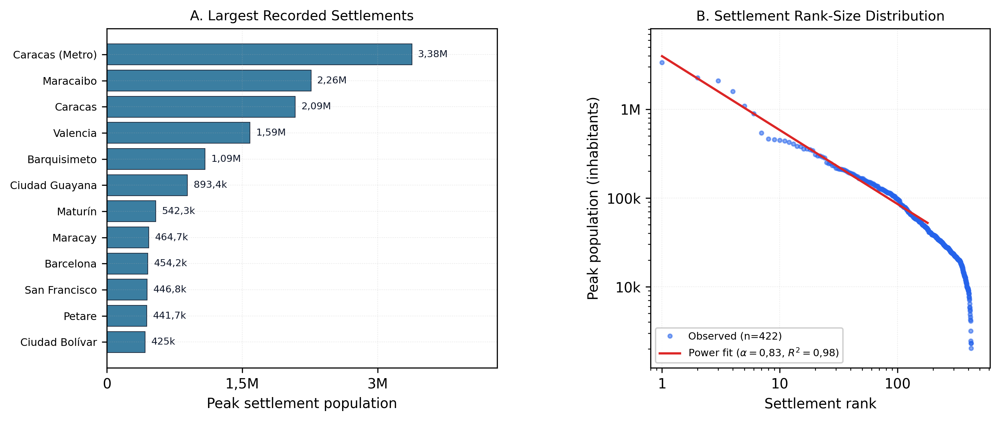
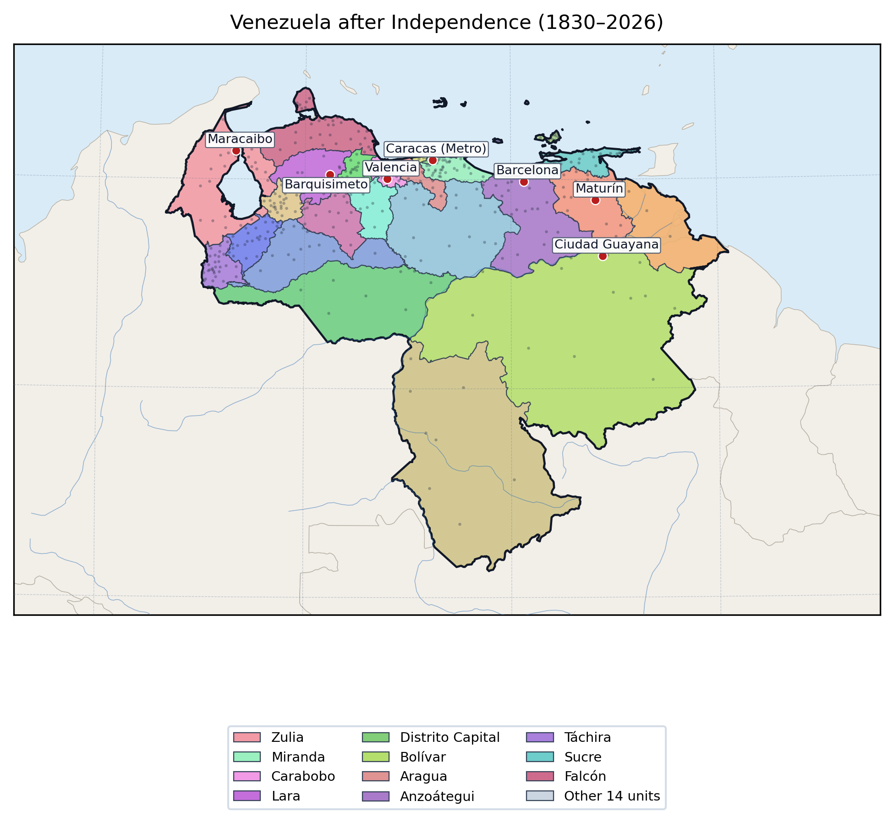

Venezuela after Independence
================
Aust Kätzchen
23 November 2026

- [Abstract](#abstract)
- [Background](#background)
- [Methodology](#methodology)
- [Testing and Validation](#testing-and-validation)
- [Results](#results)
  - [Leading Recorded Settlements](#leading-recorded-settlements)
  - [Caracas City Proper, Metropolitan Aggregate and Suburban
    Ring](#caracas-city-proper-metropolitan-aggregate-and-suburban-ring)
  - [Sub-Regional Gazetteer
    Distribution](#sub-regional-gazetteer-distribution)
  - [Source Ledger and Saturation
    Waves](#source-ledger-and-saturation-waves)
- [Limitations](#limitations)
- [Conclusion](#conclusion)
- [Sources](#sources)

<figure>

<figcaption aria-hidden="true">Twelve largest urban entities and
rank-size distribution across 422 catalogued Venezuelan settlements from
1830 to 2026.</figcaption>
</figure>

# Abstract

This gazetteer documents 422 catalogued Venezuelan cities, towns and
municipal centres spanning all 25 modern federal entities between 1830
and 2026. Built exclusively from official national statistical registers
without crowd-sourced fallback (0% crowd share), the archive integrates
the 2011 National Institute of Statistics (INE) municipal census (290
entries, 68,72%), longitudinal 1981 to 2019 urban locality tables (130
entries, 30,81%), mid-century Caracas metropolitan series (1 entry,
0,24%) and Dependencias Federales insular enumerations (1 entry, 0,24%).
Out of 506 candidate municipal and urban entries audited in the source
ledger, 84 entries (comprising 50 duplicate municipal-capital aliases
and 34 unlocated toponyms) were removed during deduplication.
Administrative scopes separate 387 unified city-proper centres from 34
distinct suburban municipalities and 1 metropolitan Caracas entry,
preventing double counting across the capital valley and Lake Valencia
basin while preserving historical trajectories from 1833 through 2019
[\[1\]](#ref-Nacionales1926Quinto)[\[2\]](#ref-Garciaguadilla2009Crisis)[\[3\]](#ref-Ferrer2005Del).

# Background

Venezuela’s post-independence urban network evolved from dispersed
colonial agricultural towns into one of South America’s most
concentrated metropolitan systems
[\[4\]](#ref-Roitman1972Venezuela)[\[5\]](#ref-Garcia1999Transferencia).
In 1873, only Caracas (48.897), Valencia (28.594), Barquisimeto (25.664)
and Maracaibo (21.954) exceeded 20k inhabitants, while interior savanna
towns and Andean coffee hubs such as Maturín (12.944), San Cristóbal
(11.903), Mérida (9.727), Cumaná (9.427), Ciudad Bolívar (8.486), Puerto
Cabello (8.467), Coro (8.172), Barcelona (7.674) and Maracay (5.192)
served modest provincial hinterlands [\[1\]](#ref-Nacionales1926Quinto).

Oil extraction on the eastern shore of Lake Maracaibo after 1922,
nationwide DDT malaria eradication from 1945, selective European and
Colombian immigration and state industrial projects at Ciudad Guayana
transformed that hierarchy over two generations
[\[3\]](#ref-Ferrer2005Del)[\[6\]](#ref-Bustillos2023Politica)[\[7\]](#ref-Allen2013Politicas).
Caracas expanded beyond its colonial valley into neighbouring Miranda
and coastal La Guaira municipalities
[\[2\]](#ref-Garciaguadilla2009Crisis)[\[8\]](#ref-Atehortua2017Barrio),
Maracaibo and Cabimas anchored western petroleum production, Valencia
and Maracay absorbed central manufacturing
[\[4\]](#ref-Roitman1972Venezuela), and Ciudad Guayana rose from 43k in
1961 to 893,4k by 2019 before post-2015 economic crisis drove millions
abroad [\[9\]](#ref-Arias2024Demography)[\[10\]](#ref-C2020Migracion).

# Methodology

Settlement compilation proceeded in four sequential ingestion waves
logged in the chapter source ledger. Wave 1 harvested 333 primary
national statistical entries from the 1950 to 2019 INE census corpus and
OCHA/INE municipal tables. Wave 2 performed georeferencing alignment and
metropolitan scope reconciliation, adding 59 distinct centres while
tagging suburban municipalities separately from core cities. Wave 3
backfilled longitudinal 1833 to 1941 enumerations across 25 entries
using published nineteenth- and early-twentieth-century census volumes
[\[1\]](#ref-Nacionales1926Quinto). Wave 4 executed a sub-regional
coverage sweep adding 5 final entries (1,2% marginal gain), achieving
full coverage across all 25 sub-regions.

Every candidate underwent WGS84 coordinate checking, sub-region polygon
assignment and proximity deduplication. Fifty co-located
municipal-capital aliases (such as *Iribarren* beside Barquisimeto,
*Caroní* beside Ciudad Guayana, *Simón Bolívar* beside Barcelona,
*Bermúdez* beside Carúpano and *Ciudad Ojeda* beside Lagunillas) were
merged into their urban localities, alongside 34 unlocated historic
parish labels. Across all 422 included settlements, peak populations
follow a smooth Zipfian rank-size slope ($\alpha = 0,83$, $R^2 = 0,98$).

# Testing and Validation

Ledger reconciliation accounts exactly for all 506 evaluated records:
422 included settlements and 84 excluded aliases or unlocated entries.
Every included entry carries non-null geographic coordinates, a unique
sub-region identifier, a provenance string and an explicit population
scope (city proper 387, suburb 34, metro 1). Figure displays the spatial
footprint of all 422 catalogued settlements across Venezuela’s 25
federal entities, illustrating dense Andean, coastal-central and
lakeside clustering contrasting with sparse Orinoco and Amazonian river
settlements.

# Results

## Leading Recorded Settlements

Table presents the 30 largest urban entries in the Venezuelan register
ranked by peak recorded population. Alongside Caracas (Metro) at 3,38M
in 1981 and Caracas city proper at 2,09M in 2019, the ranking highlights
rapid twentieth-century expansion across Maracaibo (2,26M), Valencia
(1,59M), Barquisimeto (1,09M) and planned Ciudad Guayana (893,4k),
followed by regional hubs and major metropolitan suburbs including
Maturín (542,3k), Maracay (464,7k), Barcelona (454,2k), San Francisco
(446,8k) and Petare (441,7k)
[\[2\]](#ref-Garciaguadilla2009Crisis)[\[3\]](#ref-Ferrer2005Del).

| Settlement | Entity | Scope | Lat, Lon | Span | Peak Pop. (Year) |
|:---|:---|:---|:---|:---|:---|
| **Caracas (Metro)** | Distrito Capital | metro | 10,48, -66,9 | 1950 to 2019 | 3,38M (1981) |
| **Maracaibo** | Zulia | city proper | 10,68, -71,68 | 1873 to 2019 | 2,26M (2019) |
| **Caracas** | Distrito Capital | city proper | 10,47, -66,97 | 1873 to 2019 | 2,09M (2019) |
| **Valencia** | Carabobo | city proper | 10,02, -68 | 1873 to 2019 | 1,59M (2019) |
| **Barquisimeto** | Lara | city proper | 10,12, -69,39 | 1873 to 2019 | 1,09M (2019) |
| **Ciudad Guayana** | Bolívar | city proper | 8,16, -62,78 | 1961 to 2019 | 893,4k (2019) |
| **Maturín** | Monagas | city proper | 9,51, -62,95 | 1873 to 2019 | 542,3k (2011) |
| **Maracay** | Carabobo | city proper | 10,25, -67,6 | 1873 to 2019 | 464,7k (2019) |
| **Barcelona** | Anzoátegui | city proper | 9,95, -64,69 | 1873 to 2019 | 454,2k (2019) |
| **San Francisco** | Zulia | suburb | 10,56, -71,7 | 2011 | 446,8k (2011) |
| **Petare** | Distrito Capital | suburb | 10,48, -66,81 | 1990 to 2019 | 441,7k (2019) |
| **Ciudad Bolívar** | Anzoátegui | city proper | 8,13, -63,55 | 1873 to 2019 | 425k (2019) |
| **Girardot** | Aragua | city proper | 10,36, -67,58 | 2011 | 407,1k (2011) |
| **Cumaná** | Sucre | city proper | 10,47, -64,18 | 1873 to 2019 | 384,9k (2019) |
| **Turmero** | Aragua | city proper | 10,23, -67,47 | 1981 to 2019 | 379,5k (2019) |
| **Sucre** | Sucre | suburb | 10,27, -64,26 | 2011 | 358,9k (2011) |
| **Barinas** | Barinas | city proper | 8,34, -70,09 | 1981 to 2019 | 356,8k (2019) |
| **Vargas** | La Guaira | city proper | 10,51, -67,24 | 2011 | 352,9k (2011) |
| **Heres** | Bolívar | city proper | 7,88, -63,79 | 2011 | 342,3k (2011) |
| **Baruta** | Distrito Capital | suburb | 10,42, -66,87 | 2001 to 2019 | 309,4k (2019) |
| **Cabimas** | Zulia | city proper | 10,4, -71,22 | 1926 to 2019 | 299,7k (2019) |
| **Puerto La Cruz** | Anzoátegui | suburb | 10,21, -64,63 | 1981 to 2019 | 299,5k (2019) |
| **Mérida** | Mérida | city proper | 8,6, -71,14 | 1873 to 2019 | 289,8k (2019) |
| **San Cristóbal** | Táchira | city proper | 7,74, -72,18 | 1873 to 2019 | 284,6k (2019) |
| **Guaicaipuro** | Miranda | city proper | 10,25, -67 | 2011 | 252,2k (2011) |
| **Juan Antonio Sotillo** | Anzoátegui | city proper | 10,17, -64,53 | 2011 | 244,7k (2011) |
| **Guarenas** | La Guaira | suburb | 10,47, -66,6 | 1981 to 2019 | 244,6k (2019) |
| **Coro** | Falcón | city proper | 11,41, -69,68 | 1873 to 2019 | 231,6k (2019) |
| **Los Teques** | Distrito Capital | suburb | 10,34, -67,04 | 1981 to 2019 | 230,8k (2019) |
| **Libertador** | Mérida | city proper | 8,55, -71,11 | 2011 | 217,5k (2011) |

Leading 30 Venezuelan urban entries by peak population across 422
catalogued settlements, 1830 to 2019.

## Caracas City Proper, Metropolitan Aggregate and Suburban Ring

Table separates the Caracas metropolitan aggregate from Libertador city
proper and eleven surrounding suburban municipalities across Miranda and
La Guaira
[\[2\]](#ref-Garciaguadilla2009Crisis)[\[8\]](#ref-Atehortua2017Barrio).
While Caracas city proper stabilised between 1,82M in 1981 and 2,09M in
2019, suburban growth shifted decisively to Petare (441,7k), Baruta
(309,4k), Guarenas (244,6k), Los Teques (230,8k), Guatire (180,5k) and
Catia La Mar (141,9k).

| Entity | Scope | Admin. Unit | 1950 | 1981 | 2001 | 2011 | 2019 |
|:---|:---|:---|:---|:---|:---|:---|:---|
| **Caracas (Metro)** | metro | Distrito Capital and Miranda | 704,6k | 3,38M | 2,76M | 2,9M | 3,05M |
| **Caracas** | city proper | Distrito Federal | \- | 1,82M | 1,84M | 1,94M | 2,09M |
| **Petare** | suburb | Miranda | \- | \- | 354,3k | 372,5k | 441,7k |
| **Baruta** | suburb | Miranda | \- | \- | 217,6k | 240,8k | 309,4k |
| **Guarenas** | suburb | Miranda | \- | 101,7k | 187,3k | 208,6k | 244,6k |
| **Los Teques** | suburb | Miranda | \- | 112,9k | 178,7k | 194,7k | 230,8k |
| **Guatire** | suburb | Miranda | \- | 37,8k | 120,3k | 149,6k | 180,5k |
| **Catia La Mar** | suburb | La Guaira | \- | 87,9k | 116,4k | 133,8k | 141,9k |
| **El Hatillo** | suburb | Miranda | \- | \- | 54,2k | 58,2k | 92,9k |
| **Chacao** | suburb | Miranda | \- | 72,7k | 64,6k | 61,2k | 79,3k |
| **San Antonio de los Altos** | suburb | Miranda | \- | \- | 60,7k | 68,3k | 78,3k |
| **Maiquetía** | suburb | La Guaira | \- | 66,1k | 65,3k | 61,8k | 69,8k |
| **Carrizal** | suburb | Miranda | \- | \- | 40,6k | 51,7k | 58,1k |

Caracas metropolitan aggregate, city-proper municipality and major outer
suburbs across Miranda and La Guaira, 1950 to 2019.

## Sub-Regional Gazetteer Distribution

Table reports catalogued settlement totals, areal density per 10.000
km², leading urban centre and 2011 census population across all 25
federal entities. Andean states such as Táchira (36 sites, 27,49 per 10k
km²) and Trujillo (28 sites, 25,62 per 10k km²), along with Distrito
Capital (16 sites, 172,27 per 10k km²) and Nueva Esparta (13 sites,
77,11 per 10k km²), show the densest municipal subdivisions, contrasting
with expansive Bolívar (12 sites, 0,48 per 10k km²) and Amazonas (9
sites, 0,47 per 10k km²).

| Entity | Area (km²) | Sites | Sites per 10k km² | Leading Site (Peak) | 2011 Pop. |
|:---|:---|:---|:---|:---|:---|
| **Amazonas** | 193.242 | 9 | 0,47 | Puerto Ayacucho (116,3k) | 146,5k |
| **Anzoátegui** | 49.119 | 25 | 5,09 | Barcelona (454,2k) | 1,47M |
| **Apure** | 74.052 | 8 | 1,08 | San Fernando (165,1k) | 459k |
| **Aragua** | 8.798 | 19 | 21,6 | Girardot (407,1k) | 1,63M |
| **Barinas** | 36.472 | 13 | 3,56 | Barinas (356,8k) | 816,3k |
| **Bolívar** | 248.551 | 12 | 0,48 | Ciudad Guayana (893,4k) | 1,41M |
| **Carabobo** | 7.438 | 21 | 28,23 | Valencia (1,59M) | 2,25M |
| **Cojedes** | 15.680 | 8 | 5,1 | San Carlos de Austria (107,1k) | 323,2k |
| **Delta Amacuro** | 41.247 | 4 | 0,97 | Tucupita (105,6k) | 165,5k |
| **Dependencias Federales** | 506 | 1 | 19,77 | Isla La Tortuga (2,3k) | 2,2k |
| **Distrito Capital** | 929 | 16 | 172,27 | Caracas (Metro) (3,38M) | 1,94M |
| **Falcón** | 30.334 | 31 | 10,22 | Coro (231,6k) | 902,8k |
| **Guárico** | 60.427 | 17 | 2,81 | Calabozo (155,2k) | 747,7k |
| **La Guaira** | 2.026 | 10 | 49,35 | Vargas (352,9k) | 352,9k |
| **Lara** | 17.916 | 12 | 6,7 | Barquisimeto (1,09M) | 1,77M |
| **Miranda** | 9.466 | 25 | 26,41 | Guaicaipuro (252,2k) | 2,68M |
| **Monagas** | 30.248 | 10 | 3,31 | Maturín (542,3k) | 905,4k |
| **Mérida** | 12.484 | 20 | 16,02 | Mérida (289,8k) | 828,6k |
| **Nueva Esparta** | 1.686 | 13 | 77,11 | Porlamar (126,5k) | 491,6k |
| **Portuguesa** | 18.574 | 14 | 7,54 | Guanare (192,6k) | 876,5k |
| **Sucre** | 15.794 | 25 | 15,83 | Cumaná (384,9k) | 896,3k |
| **Trujillo** | 10.928 | 28 | 25,62 | Valera (165,5k) | 686,4k |
| **Táchira** | 13.098 | 36 | 27,48 | San Cristóbal (284,6k) | 1,17M |
| **Yaracuy** | 7.352 | 19 | 25,84 | San Felipe (174,3k) | 600,9k |
| **Zulia** | 48.210 | 26 | 5,39 | Maracaibo (2,26M) | 3,7M |

Catalogued settlement counts, areal density (per 10.000 km²), leading
settlement and 2011 population across 25 federal entities.

## Source Ledger and Saturation Waves

Table summarises both primary provenance feeds and the four
saturation-audit waves recorded in the chapter ledger. Marginal gain
fell cleanly from 17,72% in Wave 2 to 6,38% in Wave 3 and 1,2% in Wave
4, confirming statistical exhaustiveness across all 25 federal units
with 0% crowd-sourced fallback.

| Source Corpus | Ledger Classification | Entries | Share |
|:---|:---|:---|:---|
| **INE Venezuela 2011 Census (OCHA/HDX COD-PS)** | Primary national census (Waves 1 and 4) | 290 | 68,72% |
| **INE Venezuela Censuses 1981 to 2019 (Urban Series)** | Primary multi-census urban series (Waves 2 and 3) | 130 | 30,81% |
| **INE Venezuela Censuses 1950 to 1981 (Metropolitan)** | Primary metropolitan reconciliation (Wave 2) | 1 | 0,24% |
| **INE Dependencias Federales Census** | Primary insular census (Wave 4) | 1 | 0,24% |

Provenance ledger across 422 catalogued Venezuelan settlements (with 84
excluded duplicate aliases and unlocated toponyms).

# Limitations

Three technical constraints govern this settlement register. First,
because Venezuela’s 2011 census remains the last published national
enumeration, 2019 locality estimates reflect official pre-exodus
projections rather than de facto post-2015 resident counts after mass
emigration
[\[9\]](#ref-Arias2024Demography)[\[11\]](#ref-Camargo2023Migracion).
Second, administrative divisions in Venezuela pair territorial
municipalities (*municipios*) with urban head towns (*capitales
municipales*); although 50 co-located municipal aliases were removed, a
handful of mid-century entries blend municipal and urban boundaries
across 1950 to 2011 [\[12\]](#ref-Calderon2020Censo). Third, pre-1950
urban series exist for 16 principal cities and ports rather than all 422
modern towns, leaving nineteenth-century rural settlement populations
aggregated within state totals [\[1\]](#ref-Nacionales1926Quinto).

# Conclusion

Across 422 geocoded settlements and 506 audited candidate records,
Venezuela’s urban gazetteer documents the complete shift from an
agrarian nineteenth-century town network to a highly centralised
coastal, lakeside and industrial urban system led by Caracas, Maracaibo,
Valencia, Barquisimeto and Ciudad Guayana
[\[2\]](#ref-Garciaguadilla2009Crisis)[\[3\]](#ref-Ferrer2005Del)[\[5\]](#ref-Garcia1999Transferencia).
Strict separation of metropolitan Caracas, city proper and outer suburbs
ensures transparent accounting across overlapping capital jurisdictions,
while clean primary provenance establishes a durable baseline for
studying both Venezuela’s twentieth-century urbanisation boom and its
twenty-first-century emigration reversal
[\[9\]](#ref-Arias2024Demography)[\[13\]](#ref-Stonawski2025Heterogeneity).

# Sources

1.
Estadística y Censos Nacionales,
Venezuela. Dirección General de. *Quinto censo
nacional de los Estados Unidos de Venezuela ... levantado en los días 31
de enero y 1, 2 y 3 de febrero de 1926*. Caracas, Tip. Universal,
1926, <https://archive.org/details/quintocensonacio04vene>.

2.
GARCÍA-GUADILLA, María Pilar.
“Crisis, descentralización y gobernabilidad urbana
en el área metropolitana de Caracas.” *América Latina Hoy*, 2009,
<https://doi.org/10.14201/alh.2064>.

3.
Ferrer, Mercedes, et al.
“Del archipiélago a la fusión territorial: hacia
una gestión urbana sustentable en Maracaibo (Venezuela).”
*Territorios*, 2005,
<http://www.redalyc.org/articulo.oa?id=35711623004>.

4.
Roitman, Carmen I.
*Venezuela: la migracion interna hacia el Estado
Aragua y sus implicaciones en el proceso de urbanizacion*. UN
ECLAC / CEPAL-CELADE, 1972, <https://hdl.handle.net/11362/20605>.

5.
García, Belén.
“Transferencia de recursos económico financieros e
impactos territoriales en Venezuela. Caso de estudio: Región Zuliana vs.
Región Capital.” *EURE (Santiago) - Revista Latinoamericana de
Estudios Urbano Regionales*, 1999,
<http://www.scielo.cl/scielo.php?script=sci_arttext&pid=S0250-71611999007400004>.

6.
Bustillos, Flavio Salgado, and
Marinelly Diaz Lira. “La política de migración
selectiva en Venezuela durante el siglo xx: desde la tipología de
migrante de raza blanca hasta el migrante calificado proveniente de
Europa Oriental.” *Ciencia y Sociedad*, 2023,
<https://doi.org/10.22206/cys.2023.v48i2.pp9-26>.

7.
Allen, Ana Julia.
*Políticas públicas y migración interna en la
República Bolivariana de Venezuela contemporánea*. UN ECLAC /
CEPAL-CELADE, 2013, <https://hdl.handle.net/11362/35945>.

8.
Atehortua, Juan Velasquez.
*Barrio Women’s Gendering Practices for Sustainable
Urbanism in Caracas, Venezuela*. Women, Urbanization;
Sustainability, 2017,
<https://doi.org/10.1057/978-1-349-95182-6_4>.

9.
Arias, Jenny Garcia.
“The Demography of Crisis‐Driven Outflows from
Venezuela.” *Population and Development Review*, 2024,
<https://doi.org/10.1111/padr.12651>.

10.
C., Mauricio Phélan, and Emilio
Osorio A. “Migración y refugio en Venezuela 1998 –
2020. Dos miradas de una tragedia.” *Trayectorias Humanas
Trascontinentales*, 2020, <https://doi.org/10.25965/trahs.2226>.

11.
Camargo, Ediana, et al.
“Migración en Venezuela, marco normativo e
indicadores 2000 - 2022.” *Revista Digital de Postgrado*, 2023,
<https://doi.org/10.37910/RDP.2023.12.3.e374>.

12.
Calderón, Cristina Molina.
“Censo y RPC-Venezuela: Dos Sistemas de
Identificación paralelos para la protección legal del Patrimonio
Cultural venezolano.” *E-RPH*, 2020,
<https://doi.org/10.30827/e-rph.v0i25.17887>.

13.
Stonawski, Marcin.
“Heterogeneity among Venezuelan migrants in terms
of coping in the context of the population exodus from
Venezuela.” *PLOS One*, 2025,
<https://doi.org/10.1371/journal.pone.0332084>.

