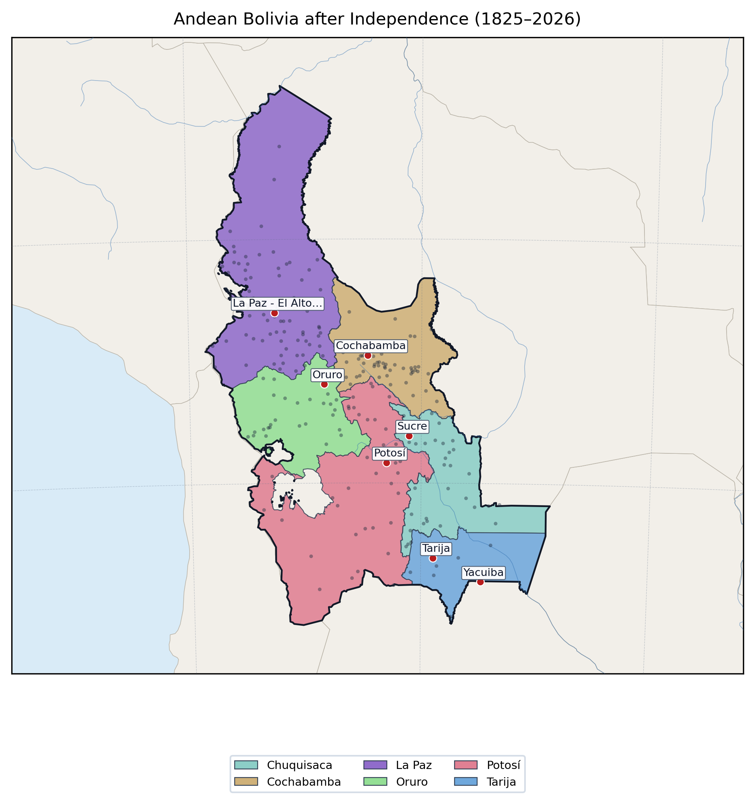

```{r setup, include=FALSE}
knitr::opts_chunk$set(echo = FALSE, warning = FALSE, message = FALSE, fig.pos = "htbp")
source("../../_shared/template/viscount_rmd_helpers.R")
library(jsonlite)

summary_data <- fromJSON("andean_bolivia_independence_summary.json", simplifyVector = FALSE)
sett_data <- fromJSON("andean_bolivia_independence_settlements.json", simplifyVector = FALSE)

clean_label <- function(x) {
  s <- as.character(x)
  s <- gsub("&", "and", s, fixed = TRUE)
  s <- gsub("\\\\", "", s)
  s
}

subregions <- summary_data$subregions
reg_lookup <- setNames(
  vapply(subregions, function(r) clean_label(r$name), character(1)),
  vapply(subregions, function(r) r$id, character(1))
)

tot_area <- as.numeric(summary_data$total_area_km2)
n_sites <- as.integer(summary_data$settlement_count)
```

```{r hero-md-fallback, results='asis'}
if (!knitr::is_latex_output()) {
  cat("\n\n")
}
```

# Abstract

Between independence from Spain in 1825 and 2026, the six Andean departments of Bolivia - La Paz, Oruro, Potosí, Cochabamba, Chuquisaca and Tarija - expanded nearly eightfold from 998k (998.000) to 7,7M (7.700.000) inhabitants across 459.929,7 km² of high *altiplano* plateau, cordillera basins and inter-Andean valleys. Strictly coordinated with PRETA, which models the three lowland Amazonian and Chaco-Chiquitano departments of Santa Cruz, El Beni and Pando, this study traces two centuries of highland and valley demographic redistribution across eleven benchmark horizons anchored on José María Dalence's 1846 enumeration (1,25M), the 1900 general census (1,49M) and the national censuses of 1950 (2,59M), 1976 (3,7M), 1992 (4,74M), 2001 (5,83M), 2012 (6,87M) and 2024 (7,59M) [@Boliviaoficinanacionaldeimmigracion1902Censo; @Rojasalvarez1993Crecimiento; @Benito2026Pueblos]. Nineteenth-century population stagnated between 1846 and 1882 (falling slightly to 1,23M) amid highland subsistence crises and the loss of the Pacific littoral during the War of the Pacific (1879 to 1884), before silver and tin railways revived Oruro and Potosí and lifted La Paz into national primacy after 1900 [@Galazmandakovic2016Industrializac; @Leonard1948Paz]. Following the 1952 National Revolution and the 1953 Agrarian Reform, freed rural mobility accelerated both urban concentration and out-migration toward Santa Cruz and Argentina [@Meridapedraza1982Efecto; @Kirshner2011Migration; @Fantagarrido2019Migracion]. After the 1985 tin market collapse emptied state mining camps in Potosí and Oruro, explosive settlement on the plateau rim transformed El Alto into an independent metropolis above La Paz while Cochabamba became the densest Andean department at 34,49 inhabitants per km² by 2026 [@Nunezvillalba2015Crecimiento; @Garcia2022Efecto; @Gaviriapuerta2024Problematicas].

# Background

## Republican Foundations, Dalence and Loss of the Littoral

When the Republic of Bolivia emerged from the colonial *Audiencia de Charcas* in August 1825, its demographic centre of gravity remained firmly rooted in the high valleys and *altiplano* basins that had sustained dense indigenous communities since Inca and early colonial *reducción* times [@Fabrega1988Efectos; @Selaez2020Iglesias]. Across the six highland and valley departments, aggregate population stood near 998k at independence, led by La Paz (320k), Cochabamba (225k) and Potosí (215k), with smaller agricultural and administrative cores in Chuquisaca (118k), Oruro (76k) and Tarija (44k). Silver extraction at Cerro Rico had already receded from its seventeenth-century apogee, leaving most Bolivians in Aymara and Quechua peasant *ayllus* or debt-bound *hacienda* estates concentrated around Lake Titicaca, the Cochabamba valley floor and Chuquisaca [@Fabrega1988Efectos; @Leonard1948Paz].

José María Dalence's *Bosquejo Estadístico de Bolivia* and the 1846 fiscal-administrative enumeration recorded 1,25M (1.250.343) inhabitants across these same six departments, registering steady post-independence recovery in La Paz (412,9k), Cochabamba (279k), Potosí (243,3k), Chuquisaca (156k), Oruro (95,3k) and Tarija (63,8k) [@Boliviaoficinanacionaldeimmigracion1902Censo; @Galazmandakovic2016Industrializac]. Over the following four decades, however, highland demographic expansion stalled. Recurrent drought, typhus and smallpox epidemics during 1877 and 1878 combined with the War of the Pacific (1879 to 1884) to leave the six-department total at 1,23M (1.234.000) in 1882, slightly below 1846. Only silver-mining Potosí (255k) and frontier Tarija (72k) grew appreciably over that interval, whereas La Paz (395k), Cochabamba (275k), Chuquisaca (145k) and Oruro (92k) contracted [@Galazmandakovic2016Industrializac]. Under the 1884 Truce of Valparaíso and the subsequent 1904 boundary treaty, Bolivia lost its sparsely populated coastal *Litoral* department on the Atacama Desert (roughly 173.094 km² holding some 30k residents in 1870), becoming permanently landlocked and redirecting highland commerce through Chilean and Peruvian rail ports at Antofagasta, Arica and Mollendo [@Galazmandakovic2016Industrializac; @Ferrari2014Ferrocarril].

## The 1900 Census, Federal War and Tin Boom

By the national census of 1 September 1900, recovery was unmistakable. Enumerators counted 1,49M (1.492.796) residents across the six Andean departments, and the published census volumes documented a country still overwhelmingly rural yet increasingly reoriented along railway corridors [@Boliviaoficinanacionaldeimmigracion1902Censo]. The Federal War of 1898 to 1899 shifted the effective executive and legislative seat of government from Sucre in Chuquisaca to La Paz, cementing La Paz's lead at 445,6k inhabitants (29,85% of the Andean total) ahead of Cochabamba (328,2k) and Potosí (325,6k) [@Boliviaoficinanacionaldeimmigracion1902Censo; @Selaez2020Iglesias]. Chuquisaca stood at 204,4k and Tarija reached 102,9k, while Oruro still numbered just 86,1k on the eve of its industrial transformation.

Between 1900 and 1950, tin replaced silver as the engine of highland capital accumulation and railway construction [@Galazmandakovic2016Industrializac; @Ferrari2014Ferrocarril]. As British and Chilean-financed lines linked Uyuni, Oruro, Viacha and La Paz to the Pacific and joined Villazón to the Argentine railway through Jujuy, Oruro more than doubled from 86,1k in 1900 to 210,3k in 1950 (+144,26%) and Potosí climbed 64,12% to 534,4k [@Ferrari2014Ferrocarril; @Galazmandakovic2016Industrializac]. Major mining camps at Llallagua, Catavi, Siglo XX, Huanuni, Uncía and Pulacayo concentrated tens of thousands of wage miners above 3.800 metres, even as rural indigenous communities in Pacajes, Omasuyos and Carangas continued to supply labour and pastoral produce [@Fabrega1988Efectos; @Perreault2025Adaptive]. Meanwhile, La Paz grew 112,84% between 1900 and 1950 to reach 948,4k inhabitants, absorbing commercial houses, textile mills and migrant families from across the northern *altiplano* [@Leonard1948Paz].

## The 1952 Revolution, Agrarian Reform and Mobility

The National Revolution of April 1952 and the Agrarian Reform decree of August 1953 broke the political and spatial immobility of rural Andean Bolivia. Abolition of unpaid estate labour (*pongueaje*), distribution of *hacienda* lands to peasant unions in Cochabamba, La Paz and Chuquisaca, and nationalisation of the Patiño, Hochschild and Aramayo tin mines under the state mining corporation COMIBOL triggered a sustained demographic acceleration [@Meridapedraza1982Efecto; @Rojasalvarez1993Crecimiento]. Between the 1950 and 1976 national censuses, the six Andean departments grew 42,67% from 2,59M to 3,7M inhabitants, even as declining infant mortality collided with still-high highland fertility rates [@Argotecusi2009Comparacion; @Meridapedraza1982Efecto].

Crucially, post-1952 mobility ran along two diverging channels. Internally, rural Aymara and Quechua families streamed into La Paz and Cochabamba, expanding hillside barrios in La Paz and colonising subtropical piedmont frontiers in Caranavi, Alto Beni and the Chapare lowlands of northern Cochabamba around Villa Tunari, Chimoré and Puerto Villarroel [@Piniella2025Historia; @Daza2023Migracion; @Rojasalvarez1993Crecimiento]. Externally, state road construction from Cochabamba to Santa Cruz de la Sierra launched a massive highland-to-lowland migration stream into Bolivia's eastern plains, while southern villagers from Potosí, Chuquisaca and Tarija crossed into sugar, tobacco and construction markets in northern Argentina and Greater Buenos Aires [@Kirshner2011Migration; @Ferrari2014Ferrocarril; @Fantagarrido2019Migracion].

## The 1985 Tin Collapse, El Alto and the Cochabamba Conurbation

The collapse of the International Tin Council price floor in October 1985 and Supreme Decree 21060 shuttered most state COMIBOL mines, dismissing more than 20k miners and severing the century-old economic anchor of the central *altiplano* [@Galazmandakovic2016Industrializac; @Beijaard1995Rental]. Between 1976 and 1992, Potosí suffered an absolute demographic contraction from 657,7k to 645,9k (-1,8%), while Oruro virtually stalled (310,4k to 340,1k, +9,57% over sixteen years). Relocated mining families and drought-stricken *altiplano* pastoralists settled in massive numbers on the flat plateau rim 500 metres above La Paz's steep canyon, turning El Alto from a peripheral working-class fringe into an autonomous municipality in 1985 and an independent city in 1988 [@Nunezvillalba2015Crecimiento; @Garcia2022Efecto; @Beijaard1995Rental]. Within two decades, El Alto surpassed the older La Paz basin core in population while forming a single contiguous metropolitan agglomeration extending westward toward Viacha and southward into Achocalla [@Nunezvillalba2015Crecimiento; @Garcia2022Efecto].

Simultaneously, the Cochabamba central valley transformed into Bolivia's third metropolitan axis. Between 1976 and 2024, Cochabamba department nearly tripled from 721k to 2,01M (2.005.373) inhabitants as Sacaba, Quillacollo, Tiquipaya, Vinto and Colcapirhua coalesced around the municipal core, driving acute competition over peri-urban land and water networks [@Quispe2018Fragmentacion; @Gaviriapuerta2024Problematicas; @Rivero2026Entre]. By the 2024 census, although Santa Cruz had eclipsed La Paz as Bolivia's single most populous department inside the lowland PRETA domain, the six Andean departments still held 7,59M residents - projected to 7,7M in 2026 - with increasingly differentiated trajectories between metropolitan corridors and depopulating rural *ayllus* [@Benito2026Pueblos; @Miranda2021Censo; @Garvia2024Analisis].

## Demographic Transition, Language Shifts and Cross-Border Flows

Underlying these spatial realignments was a delayed yet sweeping fertility and mortality transition across the highlands and valleys [@Argotecusi2009Comparacion; @Meridapedraza1982Efecto]. Through the 1950s and 1960s, total fertility across rural La Paz, Potosí and Chuquisaca remained above six children per woman even as declining infant mortality lifted natural increase to roughly 2% annually. By the 1990s and 2000s, urban schooling, female labour-force participation and delayed marriage in La Paz, El Alto and Cochabamba compressed urban fertility below replacement-adjacent thresholds, leaving natural growth concentrated in younger migrant neighbourhoods and tropical colonisation zones [@Argotecusi2009Comparacion; @Callaortega2007Mujer; @Daza2023Migracion].

At the same time, rapid urbanisation reshaped linguistic and ethnic patterns recorded in successive INE enumerations [@Callaortega2007Mujer; @Benito2026Pueblos]. Whereas early twentieth-century censuses treated indigenous *ayllu* populations as geographically stationary rural majorities, post-1985 urban expansion made El Alto the largest predominantly Aymara-heritage city in South America while bilingual Quechua-Spanish corridors linked Cochabamba, northern Potosí and Chuquisaca to Santa Cruz de la Sierra [@Garcia2022Efecto; @Kirshner2011Migration; @Piniella2025Historia]. Across the southern border, seasonal and permanent labour flows through Villazón, Tupiza, Tarija, Yacuiba and Bermejo sustained deep transnational networks linking Bolivian Andean valleys to Jujuy, Salta, Mendoza and Buenos Aires [@Ferrari2014Ferrocarril; @Fantagarrido2019Migracion].

# Methodology

## Coordination with Lowland Bolivia and Regional Partitioning

To prevent boundary overlap or double-counting across the Bolivian state, QUIPU and PRETA divide the country cleanly along its canonical ecological and departmental seam. The six departments lying wholly or predominantly across the *altiplano*, Cordillera Oriental and inter-Andean valleys - La Paz (135.692,7 km²), Potosí (111.124,5 km²), Cochabamba (59.205,0 km²), Chuquisaca (56.070,1 km²), Oruro (54.584,3 km²) and Tarija (43.253,2 km²) - comprise the 459.929,7 km² chapter domain. Meanwhile, the three lowland tropical and Chaco departments of Santa Cruz, El Beni and Pando remain assigned exclusively to PRETA [@Kirshner2011Migration; @Garvia2024Analisis; @Marca2025Insercion]. Because our polygon boundaries follow modern departmental geometry across the full 1825 to 2026 period, the former coastal *Litoral* lost to Chile in 1879 to 1884 is excluded from the Andean department totals after 1882 and instead documented in the pre-1883 historical administrative layer (covering 173.094 km² and roughly 30k residents in 1870) and in the post-independence Chile chapter [@Galazmandakovic2016Industrializac].

## Census Benchmarks and Inter-Censal Reconstruction

Regional population trajectories are anchored on eleven benchmark years: 1825, 1846, 1882, 1900, 1950, 1976, 1992, 2001, 2012, 2024 and 2026. The 1825 independence baseline reconciles late Bourbon intendancy fiscal counts and early republican parish rolls across Upper Peru [@Fabrega1988Efectos; @Selaez2020Iglesias]. The 1846 benchmark incorporates Dalence's *Bosquejo Estadístico* departmental figures, while 1882 reflects partial municipal enumerations adjusted for the 1877 to 1878 highland famine and wartime mobilisation [@Boliviaoficinanacionaldeimmigracion1902Censo; @Galazmandakovic2016Industrializac]. From 1900 onward, departmental benchmarks track official census returns compiled by the *Oficina Nacional de Inmigración, Estadística y Propaganda Geográfica* (1900) and the *Instituto Nacional de Estadística* (INE) across 1950, 1976, 1992, 2001, 2012 and 2024, with 2026 extrapolated along post-2012 inter-censal departmental growth slopes [@Boliviaoficinanacionaldeimmigracion1902Censo; @Callaortega2007Mujer; @Benito2026Pueblos].

In evaluating modern census counts, two methodological distortions documented in Bolivian demography require explicit attention. First, seasonal multilocality and double residence mean that many rural highland households maintain dwellings in both ancestral *ayllu* communities and urban districts of El Alto, La Paz or Cochabamba, shifting enumerated totals depending on census timing and residency rules [@Miranda2021Censo; @Perreault2025Adaptive]. Second, pre-1950 enumerations understated dispersed indigenous hamlets in tropical *yungas* and southern Chaco fringes, warranting wider confidence intervals before 1950 [@Boliviaoficinanacionaldeimmigracion1902Censo; @Argotecusi2009Comparacion].

## Settlement Gazetteer and Metropolitan Accounting

Alongside the departmental time-series, a gazetteer of 247 settlements across the six departments (La Paz 85, Cochabamba 51, Potosí 38, Chuquisaca 33, Oruro 30 and Tarija 10) was extracted from INE municipal census tables (1900 to 2024) and reconciled PRETA settlement histories. Of 299 initial candidates, 52 synthetic flat-tier placeholders lacking municipal census grounding were excluded, leaving 247 entries with zero crowd-sourced fallback records. Within the La Paz and Cochabamba metropolitan systems, four outer La Paz municipalities (Viacha, Achocalla, Palca and Mecapaca) and five Cochabamba valley municipalities (Sacaba, Quillacollo, Tiquipaya, Vinto and Colcapirhua) are retained as distinct extra-municipal suburban records, while a dedicated metropolitan aggregate reconciles the La Paz - El Alto urban core with its four outer suburbs [@Nunezvillalba2015Crecimiento; @Garcia2022Efecto; @Quispe2018Fragmentacion].

# Testing and Validation

Internal consistency checks confirm tight agreement between vector departmental polygons, gridded surfaces and historical administrative layers. Across the 4.320 by 2.160 global grid, the chapter mask occupies 5.652 cells covering 461.061 km², matching the 459.929,7 km² vector departmental total within 0,25%. All six departmental populations sum exactly to the chapter totals at every benchmark from 1825 (998k) to 2026 (7,7M), including the raw 2024 INE census sum of 7.589.032. Uncertainty intervals tighten as statistical coverage improves: plus or minus 14% for 1825 and 1846 (7,74M upper/lower symmetry yielding 858,3k to 1,14M in 1825 and 1,08M to 1,43M in 1846), plus or minus 6% for 1882 and 1900 (1,4M to 1,58M in 1900), and plus or minus 2,5% for all INE enumerations from 1950 through 2026 (7,51M to 7,89M at 2026) [@Boliviaoficinanacionaldeimmigracion1902Censo; @Argotecusi2009Comparacion; @Benito2026Pueblos].

Cross-checking the settlement gazetteer against the regional totals confirms zero empty departments and balanced urban-rural coverage. The 247 catalogued centres span from small valley hamlets near 300 residents (Azul Kjocha at 298, Chimpa Chaupiloma Bajo at 301) through medium provincial capitals (Tupiza 46,6k, Llallagua 44,9k, Villazón 49,3k) to the major departmental cities, with a median peak population of 12,48k at Colchani. In the La Paz metropolitan system, arithmetic reconciliation holds exactly: adding the urban core (2.228.182 in 2024; 2.259.463 in 2026) and its four outer suburbs (Viacha, Achocalla, Palca and Mecapaca, summing to 201.917 in 2024 and 114.325 in 2026) reproduces the reconciled metropolitan aggregate of 2.430.099 in 2024 and 2.373.788 in 2026 without double-counting [@Nunezvillalba2015Crecimiento; @Garcia2022Efecto].

# Results

## Two Centuries of Highland and Valley Growth, 1825 to 2026

Between 1825 and 2026, the six Andean departments grew by a factor of 7,72, though growth unfolded across three sharply distinct phases: nineteenth-century stasis (1825 to 1882), mining-led divergence (1882 to 1950) and post-revolutionary metropolitan polarisation (1950 to 2026). Tables \ref{tab:dept-pop-early} and \ref{tab:dept-pop-modern} report the full departmental census and benchmark series, while Figure \ref{fig:pop-trajectory} plots regional growth trajectories alongside 2026 population densities.

```{r tab-dept-pop-early, results='asis'}
early_rows <- lapply(subregions, function(r) {
  area_v <- as.numeric(r$area_km2)
  data.frame(
    Dept = clean_label(r$name),
    Area = viscount_fmt_number(round(area_v), 0L),
    P1825 = viscount_fmt_pop(r$population_raw[["1825"]]),
    P1846 = viscount_fmt_pop(r$population_raw[["1846"]]),
    P1882 = viscount_fmt_pop(r$population_raw[["1882"]]),
    P1900 = viscount_fmt_pop(r$population_raw[["1900"]]),
    P1950 = viscount_fmt_pop(r$population_raw[["1950"]]),
    stringsAsFactors = FALSE
  )
})
df_early <- do.call(rbind, early_rows)
df_early <- rbind(
  df_early,
  data.frame(
    Dept = "Andean Bolivia Total",
    Area = viscount_fmt_number(round(tot_area), 0L),
    P1825 = viscount_fmt_pop(summary_data$domain_totals[["1825"]]),
    P1846 = viscount_fmt_pop(summary_data$domain_totals[["1846"]]),
    P1882 = viscount_fmt_pop(summary_data$domain_totals[["1882"]]),
    P1900 = viscount_fmt_pop(summary_data$domain_totals[["1900"]]),
    P1950 = viscount_fmt_pop(summary_data$domain_totals[["1950"]]),
    stringsAsFactors = FALSE
  )
)
rownames(df_early) <- NULL

viscount_table(
  df_early,
  "Departmental surface area and population across Andean Bolivia at five early benchmarks, 1825 to 1950.",
  c("Department", "Area (km²)", "1825", "1846", "1882", "1900", "1950"),
  list(label = "tab:dept-pop-early", font_size = "scriptsize")
)
```

```{r tab-dept-pop-modern, results='asis'}
tot_2024 <- sum(vapply(subregions, function(r) as.numeric(r$population_raw[["2024"]]), numeric(1)))
tot_2026 <- as.numeric(summary_data$domain_totals[["2026"]])
mod_rows <- lapply(subregions, function(r) {
  area_v <- as.numeric(r$area_km2)
  p2026 <- as.numeric(r$population_raw[["2026"]])
  data.frame(
    Dept = clean_label(r$name),
    P1976 = viscount_fmt_pop(r$population_raw[["1976"]]),
    P1992 = viscount_fmt_pop(r$population_raw[["1992"]]),
    P2001 = viscount_fmt_pop(r$population_raw[["2001"]]),
    P2012 = viscount_fmt_pop(r$population_raw[["2012"]]),
    P2024 = viscount_fmt_pop(r$population_raw[["2024"]]),
    P2026 = viscount_fmt_pop(p2026),
    D2026 = viscount_fmt_number(p2026 / area_v, 2L),
    stringsAsFactors = FALSE
  )
})
df_mod <- do.call(rbind, mod_rows)
df_mod <- rbind(
  df_mod,
  data.frame(
    Dept = "Andean Bolivia Total",
    P1976 = viscount_fmt_pop(summary_data$domain_totals[["1976"]]),
    P1992 = viscount_fmt_pop(summary_data$domain_totals[["1992"]]),
    P2001 = viscount_fmt_pop(summary_data$domain_totals[["2001"]]),
    P2012 = viscount_fmt_pop(summary_data$domain_totals[["2012"]]),
    P2024 = viscount_fmt_pop(tot_2024),
    P2026 = viscount_fmt_pop(tot_2026),
    D2026 = viscount_fmt_number(tot_2026 / tot_area, 2L),
    stringsAsFactors = FALSE
  )
)
rownames(df_mod) <- NULL

viscount_table(
  df_mod,
  "Departmental census populations from 1976 to 2024, 2026 terminal estimates and 2026 densities (inhabitants per km²).",
  c("Department", "1976", "1992", "2001", "2012", "2024", "2026", "2026 Dens."),
  list(label = "tab:dept-pop-modern", font_size = "scriptsize")
)
```

```{r fig-pop-trajectory, results='asis'}
viscount_figure(
  "figures/andean_bolivia_independence_population_trajectory.png",
  "Aggregate and departmental population trajectories from 1825 to 2026 (Panel A) alongside 2026 sub-regional densities in inhabitants per km² (Panel B).",
  "fig:pop-trajectory"
)
```

Three structural shifts emerge clearly from Tables \ref{tab:dept-pop-early} and \ref{tab:dept-pop-modern}. First, **La Paz** steadily widened its demographic share over the twentieth century before plateauing in relative weight after 2001. Holding 32,06% of Andean Bolivia in 1825 (320k) and 29,85% in 1900 (445,6k), La Paz surged to 36,57% by 1950 (948,4k) and 40,34% by 2001 (2,35M), sustained by state bureaucracy, rail convergence and the rapid urban rise of El Alto on the rim above Chuquiabo [@Leonard1948Paz; @Meridapedraza1982Efecto; @Nunezvillalba2015Crecimiento]. Between 2012 and 2024, however, departmental growth slowed to 11,15% (2,72M to 3,02M), nudging its Andean share down slightly to 39,81% at 2026 (3,07M) as out-migration to Santa Cruz and declining urban fertility tempered highland expansion [@Argotecusi2009Comparacion; @Garcia2022Efecto; @Benito2026Pueblos].

Second, **Cochabamba** recorded the fastest sustained post-1950 expansion among the major Andean departments, climbing more than fourfold from 490,5k in 1950 to 2,01M in 2024 and 2,04M in 2026. Its share of the Andean total rose from 18,91% in 1950 to 26,52% in 2026, making Cochabamba by far the most densely settled department at 34,49 inhabitants per km² (compared with 22,59 in La Paz and 16,74 across Andean Bolivia as a whole). While the valley core around Sacaba, Quillacollo, Tiquipaya, Vinto and Colcapirhua absorbed thousands of ex-miners and rural peasants after 1985, northern Chapare municipalities such as Villa Tunari (93,7k in 2024), Chimoré and Puerto Villarroel (64,6k in 2024) simultaneously opened a tropical agricultural frontier [@Gaviriapuerta2024Problematicas; @Quispe2018Fragmentacion; @Rivero2026Entre].

Third, the traditional silver-and-tin mining heartland of **Potosí** and **Oruro** alongside southern **Chuquisaca** lagged sharply behind the La Paz - Cochabamba axis. Potosí declined in relative share from 21,54% in 1825 (215k) and 21,81% in 1900 (325,6k) to just 11,19% in 2026 (862k), enduring absolute population loss between 1976 (657,7k) and 1992 (645,9k) and crawling forward by only 3,42% between 2012 and 2024 [@Galazmandakovic2016Industrializac; @Rojasalvarez1993Crecimiento]. Oruro peaked early during the tin boom, jumping from 5,77% of Andean Bolivia in 1900 to 8,39% in 1976 (310,4k), then dipped to 6,72% in 2001 before modest mining and border-trade recovery lifted it to 570,2k in 2024 and 582k in 2026 (7,56%). Chuquisaca similarly slid from 13,70% in 1900 (204,4k) to 7,86% in 2026 (605k), held down by chronic rural out-migration from northern valleys despite steady growth in the constitutional capital Sucre [@Callaortega2007Mujer; @Rezzonico2023Lorena]. **Tarija**, aided by hydrocarbons development and Argentine cross-border trade at Yacuiba and Bermejo, rose steadily from 4,41% in 1825 (44k) to 7,06% in 2026 (544k), ranking third in departmental density at 12,58 inhabitants per km² [@Ferrari2014Ferrocarril; @Fantagarrido2019Migracion].

## Urban Concentration, El Alto and Out-Migration Corridors

Urbanisation transformed Andean Bolivia from a dispersed agrarian society at 1900 into a dual-pole metropolitan system by 2024, illustrated in Figure \ref{fig:urban-hierarchy} and quantified in Table \ref{tab:dept-shares}. Log-log rank-size regression across all 247 catalogued centres yields a Zipf exponent of $\alpha = 1,0$ ($R^2 = 0,96$), reflecting a balanced upper-middle tier of departmental capitals beneath the dominant La Paz - El Alto and Cochabamba agglomerations [@Nunezvillalba2015Crecimiento; @Garcia2022Efecto].

```{r fig-urban-hierarchy, results='asis'}
viscount_figure(
  "figures/andean_bolivia_independence_urban_hierarchy.png",
  "Twelve largest catalogued settlements by peak population (Panel A) and log-log rank-size distribution across 247 Andean Bolivian centres (Panel B).",
  "fig:urban-hierarchy"
)
```

```{r tab-dept-shares, results='asis'}
tot_1825 <- as.numeric(summary_data$domain_totals[["1825"]])
tot_1900 <- as.numeric(summary_data$domain_totals[["1900"]])
tot_1950 <- as.numeric(summary_data$domain_totals[["1950"]])
tot_2026 <- as.numeric(summary_data$domain_totals[["2026"]])

share_rows <- lapply(subregions, function(r) {
  rid <- r$id
  area_v <- as.numeric(r$area_km2)
  p1825 <- as.numeric(r$population_raw[["1825"]])
  p1900 <- as.numeric(r$population_raw[["1900"]])
  p1950 <- as.numeric(r$population_raw[["1950"]])
  p2026 <- as.numeric(r$population_raw[["2026"]])
  cnt <- as.integer(summary_data$settlements_by_region[[rid]])
  data.frame(
    Dept = clean_label(r$name),
    S1825 = paste0(viscount_fmt_number(100 * p1825 / tot_1825, 1L), "%"),
    S1900 = paste0(viscount_fmt_number(100 * p1900 / tot_1900, 1L), "%"),
    S1950 = paste0(viscount_fmt_number(100 * p1950 / tot_1950, 1L), "%"),
    S2026 = paste0(viscount_fmt_number(100 * p2026 / tot_2026, 1L), "%"),
    D1900 = viscount_fmt_number(p1900 / area_v, 2L),
    Sites = viscount_fmt_number(cnt, 0L),
    SiteDens = viscount_fmt_number(10000 * cnt / area_v, 2L),
    stringsAsFactors = FALSE
  )
})
df_shares <- do.call(rbind, share_rows)
rownames(df_shares) <- NULL

viscount_table(
  df_shares,
  "Departmental shares of Andean Bolivian population (1825 to 2026), 1900 density and catalogued settlement density per 10.000 km².",
  c("Department", "1825 Share", "1900 Share", "1950 Share", "2026 Share", "1900 Dens.", "Sites", "Sites per 10k km²"),
  list(label = "tab:dept-shares", font_size = "scriptsize")
)
```

At the summit of the hierarchy stands the La Paz - El Alto metropolitan agglomeration, which grew from 247,8k in 1825 and 345,1k in 1900 to 734,6k in 1950 and 2,43M in 2024 (2,37M in 2026), absorbing roughly 31% of the entire Andean Bolivian population [@Leonard1948Paz; @Nunezvillalba2015Crecimiento]. Internally, growth pivoted decisively from the steep central canyon to the high *altiplano* rim after 1985: El Alto gained municipal autonomy and outpaced La Paz proper through self-built brick neighbourhoods, informal markets and migrant reception along the roads to Oruro, Viacha and Lake Titicaca [@Beijaard1995Rental; @Piniella2025Historia; @Daza2023Migracion]. Cochabamba forms the second metropolitan cluster: the city core (665,5k in 2024; 974,5k in 2026) is flanked by Sacaba (219,1k in 2024), Quillacollo (166,7k in 2024; 199,7k in 2026), Tiquipaya (72,6k in 2026), Vinto (68k in 2026) and Colcapirhua (66,5k in 2024) [@Quispe2018Fragmentacion; @Rivero2026Entre].

Beneath the two million-plus conurbations sits a remarkably even tier of four regional capitals between 218k and 300k: Oruro (298,4k in 2024; 299,3k in 2026), Sucre (296,7k in 2024), Tarija (238,7k in 2024) and Potosí (218,7k in 2024), followed by Chaco and border hubs such as Yacuiba (116,1k in 2026) and Bermejo (46,3k in 2026) plus La Paz suburban satellite Viacha (113,6k in 2024) [@Boliviaoficinanacionaldeimmigracion1902Censo; @Ferrari2014Ferrocarril]. Out-migration from these highland departments supplied both the rapid urban expansion of Santa Cruz de la Sierra in lowland PRETA territory and transnational Bolivian communities in Buenos Aires, Mendoza and Jujuy [@Kirshner2011Migration; @Garvia2024Analisis; @Marca2025Insercion; @Fantagarrido2019Migracion].

By contrast, rural municipalities across the high *puna* and arid inter-Andean valleys experienced sustained demographic hollowing after 1976 [@Perreault2025Adaptive; @Rezzonico2023Lorena]. In western Oruro, pastoral districts surrounding Sajama and Carangas saw young adults depart for Oruro city, El Alto and northern Chile while older generations maintained camelid herds and *bofedal* peatlands through seasonal remittances [@Perreault2025Adaptive; @Miranda2021Censo]. Similarly, high-altitude provinces of northern Potosí and northern Chuquisaca fed continuous migration streams into Cochabamba's southern peripheral barrios and Santa Cruz's eastern periphery [@Gaviriapuerta2024Problematicas; @Kirshner2011Migration; @Daza2023Migracion].

Table \ref{tab:dept-top-urban} compares each department's leading urban settlement against its 2024 departmental population, highlighting the stark primacy contrast between La Paz and Cochabamba on the one hand and more rural Potosí and Chuquisaca on the other [@Garcia2022Efecto; @Benito2026Pueblos].

```{r tab-dept-top-urban, results='asis'}
urb_rows <- lapply(subregions, function(r) {
  rid <- r$id
  p2024_dept <- as.numeric(r$population_raw[["2024"]])
  sub_entries <- Filter(function(e) identical(e$region_id, rid) && !identical(e$population_scope, "metro"), sett_data)
  p2024_vals <- vapply(sub_entries, function(e) {
    v <- e$population[["2024"]]
    if (is.null(v)) 0 else as.numeric(v)
  }, numeric(1))
  idx_m <- which.max(p2024_vals)
  lead_nm <- clean_label(sub_entries[[idx_m]]$name)
  lead_val <- p2024_vals[idx_m]
  share_pct <- 100 * lead_val / p2024_dept
  data.frame(
    Dept = clean_label(r$name),
    DeptPop = viscount_fmt_pop(p2024_dept),
    LeadCity = lead_nm,
    CityPop = viscount_fmt_pop(lead_val),
    Primacy = paste0(viscount_fmt_number(share_pct, 1L), "%"),
    stringsAsFactors = FALSE
  )
})
df_urb <- do.call(rbind, urb_rows)
rownames(df_urb) <- NULL

viscount_table(
  df_urb,
  "Leading municipal settlement versus 2024 departmental census total across Andean Bolivia.",
  c("Department", "2024 Dept. Pop.", "Leading Centre", "2024 Centre Pop.", "Departmental Share"),
  list(label = "tab:dept-top-urban", font_size = "scriptsize")
)
```

# Limitations

Four empirical qualifications apply to the reconstruction presented here. First, nineteenth-century pre-census benchmarks (1825, 1846 and 1882) rely on fiscal rolls, Dalence's provincial compilations and uneven departmental estimates compiled prior to modern cartographic delimitation, justifying a plus or minus 14% error band [@Boliviaoficinanacionaldeimmigracion1902Censo; @Galazmandakovic2016Industrializac]. Even the 1900 census faced logistical obstacles across remote *yungas*, North La Paz and Chaco valleys where dispersed indigenous settlements were estimated rather than house-enumerated [@Boliviaoficinanacionaldeimmigracion1902Censo; @Callaortega2007Mujer].

Second, Bolivian *de facto* census enumerations are sensitive to seasonal circular mobility and double residence [@Miranda2021Censo]. Because agriculturalists and traders frequently maintain dual dwellings between highland *ayllus* and urban neighbourhoods in El Alto, Cochabamba or Santa Cruz, census-day movement campaigns and civic residence appeals alter municipal headcounts between the 2001, 2012 and 2024 rounds [@Miranda2021Censo; @Benito2026Pueblos].

Third, the upstream settlement series inherited from PRETA combines El Alto and the La Paz municipal core into a single central urban entity before separating the four outer suburbs of Viacha, Achocalla, Palca and Mecapaca, whereas Cochabamba's five valley satellites are tabulated individually. In addition, 2026 settlement values reflect pre-2024 PRETA trend extrapolations rather than re-indexed post-2024 municipal shares, producing minor divergences at fast-growing suburban municipalities such as Viacha (113,6k in 2024 versus 60,8k in the 2026 trend) and Sacaba (219,1k versus 164,3k) that will be harmonised in downstream municipal updates.

Fourth, departmental totals strictly enforce modern post-1904 Andean borders, meaning that the pre-1883 Pacific *Litoral* and Bolivia's eastern lowland departments (Santa Cruz, El Beni and Pando) must be read jointly with the Chile and PRETA studies to recover the full national Bolivian envelope [@Galazmandakovic2016Industrializac; @Kirshner2011Migration].

# Conclusion

Across two centuries of republican history, Andean Bolivia grew from 998k inhabitants in 1825 to 7,7M in 2026 while undergoing two profound spatial realignments. During the nineteenth century, post-colonial stagnation, highland crises and loss of the Pacific littoral kept aggregate numbers near 1,23M to 1,25M until railways and mineral exports revived Oruro and Potosí and lifted La Paz into primacy after 1900 [@Boliviaoficinanacionaldeimmigracion1902Censo; @Galazmandakovic2016Industrializac; @Leonard1948Paz]. After 1952, agrarian reform and highway integration unlocked massive internal and cross-border mobility, accelerating urban growth in La Paz, El Alto and the Cochabamba valley while sending waves of highland migrants eastward to Santa Cruz and southward into Argentina [@Meridapedraza1982Efecto; @Kirshner2011Migration; @Fantagarrido2019Migracion].

By 2026, two departments - La Paz (3,07M, 39,81%) and Cochabamba (2,04M, 26,52%) - account for two-thirds of Andean Bolivia's population and anchor its metropolitan spine, whereas Potosí (862k), Chuquisaca (605k), Oruro (582k) and Tarija (544k) hold smaller shares shaped by mining contraction, valley out-migration and border trade [@Nunezvillalba2015Crecimiento; @Garcia2022Efecto; @Perreault2025Adaptive]. Read alongside PRETA's lowland reconstruction of Santa Cruz, El Beni and Pando, these series provide a unified demographic balance sheet for modern Bolivia.

# Appendix

## Historical Administrative Regimes and Lost Littoral Accounting

Table \ref{tab:hgis-regimes} summarises the fourteen historical administrative snapshot layers assembled during spatial mask construction across 1870 to 2025, contrasting national polygon totals with the pre-1883 Pacific *Litoral* layer lost after the War of the Pacific [@Galazmandakovic2016Industrializac].

```{r tab-hgis-regimes, results='asis'}
hgis_list <- summary_data$hgis_regime_summary
src_labels <- c(
  OHM_Pre1883_Bolivian_Litoral = "OHM Pre-1883 Bolivian Litoral",
  geoBoundaries_ADM1_BOL_1870 = "Bolivian Departments (1870)",
  geoBoundaries_ADM1_BOL_1890 = "Bolivian Departments (1890)",
  geoBoundaries_ADM1_BOL_1920 = "Bolivian Departments (1920)",
  geoBoundaries_ADM1_BOL_1950 = "Bolivian Departments (1950)",
  geoBoundaries_ADM1_BOL_1970 = "Bolivian Departments (1970)",
  geoBoundaries_ADM1_BOL_Andean_2000 = "Andean Departments (2000)",
  geoBoundaries_ADM1_BOL_Andean_2010 = "Andean Departments (2010)",
  geoBoundaries_ADM1_BOL_Andean_2025 = "Andean Departments (2025)"
)
hgis_filtered <- Filter(function(h) !grepl("^CShapes", h$source), hgis_list)
h_rows <- lapply(hgis_filtered, function(h) {
  sc <- as.character(h$source)
  lbl <- if (sc %in% names(src_labels)) src_labels[[sc]] else clean_label(sc)
  data.frame(
    Regime = as.character(h$snapshot_regime),
    Layer = lbl,
    Units = viscount_fmt_number(as.integer(h$units), 0L),
    Area = viscount_fmt_number(round(as.numeric(h$area_km2_sum)), 0L),
    Pop = viscount_fmt_pop(as.numeric(h$population_sum)),
    stringsAsFactors = FALSE
  )
})
df_hgis <- do.call(rbind, h_rows)
rownames(df_hgis) <- NULL

viscount_table(
  df_hgis,
  "Historical administrative polygon layers used to calibrate departmental boundaries and pre-1883 littoral coverage, 1870 to 2025.",
  c("Snapshot", "Administrative Layer", "Units", "Area (km²)", "Layer Pop. Sum"),
  list(label = "tab:hgis-regimes", font_size = "scriptsize")
)
```

## Provenance Corpus Breakdown

Table \ref{tab:provenance-review} reports the provenance breakdown across all 247 catalogued settlements, confirming zero reliance on crowd-sourced compilations and strict reconciliation between PRETA municipal series and the La Paz - El Alto metropolitan entry [@Nunezvillalba2015Crecimiento; @Garcia2022Efecto].

```{r tab-provenance-review, results='asis'}
prov_counts <- unlist(summary_data$provenance_counts)
p_ord <- sort(prov_counts, decreasing = TRUE)
prov_labels <- c(
  PRETA = "PRETA Municipal and INE Census Series",
  QUIPU_Metro_Reconciliation = "QUIPU Metropolitan Reconciliation"
)
p_df <- data.frame(
  Corpus = vapply(names(p_ord), function(k) if (k %in% names(prov_labels)) prov_labels[[k]] else clean_label(k), character(1)),
  Count = vapply(as.integer(p_ord), function(v) viscount_fmt_number(v, 0L), character(1)),
  Share = vapply(100 * as.integer(p_ord) / n_sites, function(v) paste0(viscount_fmt_number(v, 2L), "%"), character(1)),
  stringsAsFactors = FALSE
)
rownames(p_df) <- NULL

viscount_table(
  p_df,
  "Primary provenance distribution across 247 catalogued Andean Bolivian settlements.",
  c("Provenance Corpus", "Entries", "Share"),
  list(label = "tab:provenance-review", font_size = "scriptsize")
)
```

# Sources

::: {#refs}
:::
