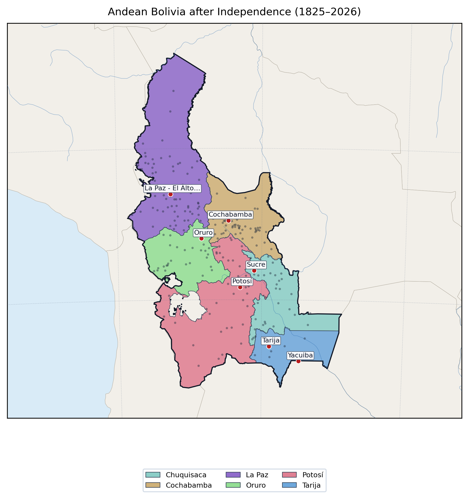
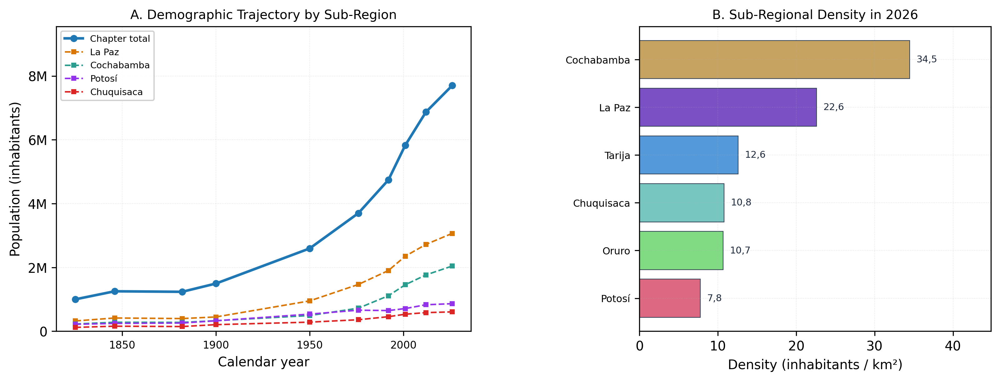
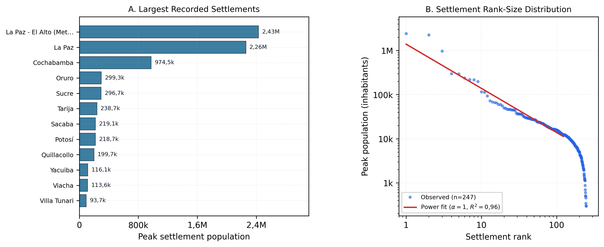

Andean Bolivia after Independence
================
Aust Kätzchen
23 November 2026

- [Abstract](#abstract)
- [Background](#background)
  - [Republican Foundations, Dalence and Loss of the
    Littoral](#republican-foundations-dalence-and-loss-of-the-littoral)
  - [The 1900 Census, Federal War and Tin
    Boom](#the-1900-census-federal-war-and-tin-boom)
  - [The 1952 Revolution, Agrarian Reform and
    Mobility](#the-1952-revolution-agrarian-reform-and-mobility)
  - [The 1985 Tin Collapse, El Alto and the Cochabamba
    Conurbation](#the-1985-tin-collapse-el-alto-and-the-cochabamba-conurbation)
  - [Demographic Transition, Language Shifts and Cross-Border
    Flows](#demographic-transition-language-shifts-and-cross-border-flows)
- [Methodology](#methodology)
  - [Coordination with Lowland Bolivia and Regional
    Partitioning](#coordination-with-lowland-bolivia-and-regional-partitioning)
  - [Census Benchmarks and Inter-Censal
    Reconstruction](#census-benchmarks-and-inter-censal-reconstruction)
  - [Settlement Gazetteer and Metropolitan
    Accounting](#settlement-gazetteer-and-metropolitan-accounting)
- [Testing and Validation](#testing-and-validation)
- [Results](#results)
  - [Two Centuries of Highland and Valley Growth, 1825 to
    2026](#two-centuries-of-highland-and-valley-growth-1825-to-2026)
  - [Urban Concentration, El Alto and Out-Migration
    Corridors](#urban-concentration-el-alto-and-out-migration-corridors)
- [Limitations](#limitations)
- [Conclusion](#conclusion)
- [Appendix](#appendix)
  - [Historical Administrative Regimes and Lost Littoral
    Accounting](#historical-administrative-regimes-and-lost-littoral-accounting)
  - [Provenance Corpus Breakdown](#provenance-corpus-breakdown)
- [Sources](#sources)

<figure>

<figcaption aria-hidden="true">Six Andean departments of Bolivia and 247
catalogued settlements across the altiplano, cordillera and inter-Andean
valleys, 1825 to 2026.</figcaption>
</figure>

# Abstract

Between independence from Spain in 1825 and 2026, the six Andean
departments of Bolivia - La Paz, Oruro, Potosí, Cochabamba, Chuquisaca
and Tarija - expanded nearly eightfold from 998k (998.000) to 7,7M
(7.700.000) inhabitants across 459.929,7 km² of high *altiplano*
plateau, cordillera basins and inter-Andean valleys. Strictly
coordinated with PRETA, which models the three lowland Amazonian and
Chaco-Chiquitano departments of Santa Cruz, El Beni and Pando, this
study traces two centuries of highland and valley demographic
redistribution across eleven benchmark horizons anchored on José María
Dalence’s 1846 enumeration (1,25M), the 1900 general census (1,49M) and
the national censuses of 1950 (2,59M), 1976 (3,7M), 1992 (4,74M), 2001
(5,83M), 2012 (6,87M) and 2024 (7,59M)
[\[1\]](#ref-Boliviaoficinanacionaldeimmigracion1902Censo)[\[2\]](#ref-Rojasalvarez1993Crecimiento)[\[3\]](#ref-Benito2026Pueblos).
Nineteenth-century population stagnated between 1846 and 1882 (falling
slightly to 1,23M) amid highland subsistence crises and the loss of the
Pacific littoral during the War of the Pacific (1879 to 1884), before
silver and tin railways revived Oruro and Potosí and lifted La Paz into
national primacy after 1900
[\[4\]](#ref-Galazmandakovic2016Industrializac)[\[5\]](#ref-Leonard1948Paz).
Following the 1952 National Revolution and the 1953 Agrarian Reform,
freed rural mobility accelerated both urban concentration and
out-migration toward Santa Cruz and Argentina
[\[6\]](#ref-Meridapedraza1982Efecto)[\[7\]](#ref-Kirshner2011Migration)[\[8\]](#ref-Fantagarrido2019Migracion).
After the 1985 tin market collapse emptied state mining camps in Potosí
and Oruro, explosive settlement on the plateau rim transformed El Alto
into an independent metropolis above La Paz while Cochabamba became the
densest Andean department at 34,49 inhabitants per km² by 2026
[\[9\]](#ref-Nunezvillalba2015Crecimiento)[\[10\]](#ref-Garcia2022Efecto)[\[11\]](#ref-Gaviriapuerta2024Problematicas).

# Background

## Republican Foundations, Dalence and Loss of the Littoral

When the Republic of Bolivia emerged from the colonial *Audiencia de
Charcas* in August 1825, its demographic centre of gravity remained
firmly rooted in the high valleys and *altiplano* basins that had
sustained dense indigenous communities since Inca and early colonial
*reducción* times
[\[12\]](#ref-Fabrega1988Efectos)[\[13\]](#ref-Selaez2020Iglesias).
Across the six highland and valley departments, aggregate population
stood near 998k at independence, led by La Paz (320k), Cochabamba (225k)
and Potosí (215k), with smaller agricultural and administrative cores in
Chuquisaca (118k), Oruro (76k) and Tarija (44k). Silver extraction at
Cerro Rico had already receded from its seventeenth-century apogee,
leaving most Bolivians in Aymara and Quechua peasant *ayllus* or
debt-bound *hacienda* estates concentrated around Lake Titicaca, the
Cochabamba valley floor and Chuquisaca
[\[5\]](#ref-Leonard1948Paz)[\[12\]](#ref-Fabrega1988Efectos).

José María Dalence’s *Bosquejo Estadístico de Bolivia* and the 1846
fiscal-administrative enumeration recorded 1,25M (1.250.343) inhabitants
across these same six departments, registering steady post-independence
recovery in La Paz (412,9k), Cochabamba (279k), Potosí (243,3k),
Chuquisaca (156k), Oruro (95,3k) and Tarija (63,8k)
[\[1\]](#ref-Boliviaoficinanacionaldeimmigracion1902Censo)[\[4\]](#ref-Galazmandakovic2016Industrializac).
Over the following four decades, however, highland demographic expansion
stalled. Recurrent drought, typhus and smallpox epidemics during 1877
and 1878 combined with the War of the Pacific (1879 to 1884) to leave
the six-department total at 1,23M (1.234.000) in 1882, slightly below
1846. Only silver-mining Potosí (255k) and frontier Tarija (72k) grew
appreciably over that interval, whereas La Paz (395k), Cochabamba
(275k), Chuquisaca (145k) and Oruro (92k) contracted
[\[4\]](#ref-Galazmandakovic2016Industrializac). Under the 1884 Truce of
Valparaíso and the subsequent 1904 boundary treaty, Bolivia lost its
sparsely populated coastal *Litoral* department on the Atacama Desert
(roughly 173.094 km² holding some 30k residents in 1870), becoming
permanently landlocked and redirecting highland commerce through Chilean
and Peruvian rail ports at Antofagasta, Arica and Mollendo
[\[4\]](#ref-Galazmandakovic2016Industrializac)[\[14\]](#ref-Ferrari2014Ferrocarril).

## The 1900 Census, Federal War and Tin Boom

By the national census of 1 September 1900, recovery was unmistakable.
Enumerators counted 1,49M (1.492.796) residents across the six Andean
departments, and the published census volumes documented a country still
overwhelmingly rural yet increasingly reoriented along railway corridors
[\[1\]](#ref-Boliviaoficinanacionaldeimmigracion1902Censo). The Federal
War of 1898 to 1899 shifted the effective executive and legislative seat
of government from Sucre in Chuquisaca to La Paz, cementing La Paz’s
lead at 445,6k inhabitants (29,85% of the Andean total) ahead of
Cochabamba (328,2k) and Potosí (325,6k)
[\[1\]](#ref-Boliviaoficinanacionaldeimmigracion1902Censo)[\[13\]](#ref-Selaez2020Iglesias).
Chuquisaca stood at 204,4k and Tarija reached 102,9k, while Oruro still
numbered just 86,1k on the eve of its industrial transformation.

Between 1900 and 1950, tin replaced silver as the engine of highland
capital accumulation and railway construction
[\[4\]](#ref-Galazmandakovic2016Industrializac)[\[14\]](#ref-Ferrari2014Ferrocarril).
As British and Chilean-financed lines linked Uyuni, Oruro, Viacha and La
Paz to the Pacific and joined Villazón to the Argentine railway through
Jujuy, Oruro more than doubled from 86,1k in 1900 to 210,3k in 1950
(+144,26%) and Potosí climbed 64,12% to 534,4k
[\[4\]](#ref-Galazmandakovic2016Industrializac)[\[14\]](#ref-Ferrari2014Ferrocarril).
Major mining camps at Llallagua, Catavi, Siglo XX, Huanuni, Uncía and
Pulacayo concentrated tens of thousands of wage miners above 3.800
metres, even as rural indigenous communities in Pacajes, Omasuyos and
Carangas continued to supply labour and pastoral produce
[\[12\]](#ref-Fabrega1988Efectos)[\[15\]](#ref-Perreault2025Adaptive).
Meanwhile, La Paz grew 112,84% between 1900 and 1950 to reach 948,4k
inhabitants, absorbing commercial houses, textile mills and migrant
families from across the northern *altiplano*
[\[5\]](#ref-Leonard1948Paz).

## The 1952 Revolution, Agrarian Reform and Mobility

The National Revolution of April 1952 and the Agrarian Reform decree of
August 1953 broke the political and spatial immobility of rural Andean
Bolivia. Abolition of unpaid estate labour (*pongueaje*), distribution
of *hacienda* lands to peasant unions in Cochabamba, La Paz and
Chuquisaca, and nationalisation of the Patiño, Hochschild and Aramayo
tin mines under the state mining corporation COMIBOL triggered a
sustained demographic acceleration
[\[2\]](#ref-Rojasalvarez1993Crecimiento)[\[6\]](#ref-Meridapedraza1982Efecto).
Between the 1950 and 1976 national censuses, the six Andean departments
grew 42,67% from 2,59M to 3,7M inhabitants, even as declining infant
mortality collided with still-high highland fertility rates
[\[6\]](#ref-Meridapedraza1982Efecto)[\[16\]](#ref-Argotecusi2009Comparacion).

Crucially, post-1952 mobility ran along two diverging channels.
Internally, rural Aymara and Quechua families streamed into La Paz and
Cochabamba, expanding hillside barrios in La Paz and colonising
subtropical piedmont frontiers in Caranavi, Alto Beni and the Chapare
lowlands of northern Cochabamba around Villa Tunari, Chimoré and Puerto
Villarroel
[\[2\]](#ref-Rojasalvarez1993Crecimiento)[\[17\]](#ref-Piniella2025Historia)[\[18\]](#ref-Daza2023Migracion).
Externally, state road construction from Cochabamba to Santa Cruz de la
Sierra launched a massive highland-to-lowland migration stream into
Bolivia’s eastern plains, while southern villagers from Potosí,
Chuquisaca and Tarija crossed into sugar, tobacco and construction
markets in northern Argentina and Greater Buenos Aires
[\[7\]](#ref-Kirshner2011Migration)[\[8\]](#ref-Fantagarrido2019Migracion)[\[14\]](#ref-Ferrari2014Ferrocarril).

## The 1985 Tin Collapse, El Alto and the Cochabamba Conurbation

The collapse of the International Tin Council price floor in October
1985 and Supreme Decree 21060 shuttered most state COMIBOL mines,
dismissing more than 20k miners and severing the century-old economic
anchor of the central *altiplano*
[\[4\]](#ref-Galazmandakovic2016Industrializac)[\[19\]](#ref-Beijaard1995Rental).
Between 1976 and 1992, Potosí suffered an absolute demographic
contraction from 657,7k to 645,9k (-1,8%), while Oruro virtually stalled
(310,4k to 340,1k, +9,57% over sixteen years). Relocated mining families
and drought-stricken *altiplano* pastoralists settled in massive numbers
on the flat plateau rim 500 metres above La Paz’s steep canyon, turning
El Alto from a peripheral working-class fringe into an autonomous
municipality in 1985 and an independent city in 1988
[\[9\]](#ref-Nunezvillalba2015Crecimiento)[\[10\]](#ref-Garcia2022Efecto)[\[19\]](#ref-Beijaard1995Rental).
Within two decades, El Alto surpassed the older La Paz basin core in
population while forming a single contiguous metropolitan agglomeration
extending westward toward Viacha and southward into Achocalla
[\[9\]](#ref-Nunezvillalba2015Crecimiento)[\[10\]](#ref-Garcia2022Efecto).

Simultaneously, the Cochabamba central valley transformed into Bolivia’s
third metropolitan axis. Between 1976 and 2024, Cochabamba department
nearly tripled from 721k to 2,01M (2.005.373) inhabitants as Sacaba,
Quillacollo, Tiquipaya, Vinto and Colcapirhua coalesced around the
municipal core, driving acute competition over peri-urban land and water
networks
[\[11\]](#ref-Gaviriapuerta2024Problematicas)[\[20\]](#ref-Quispe2018Fragmentacion)[\[21\]](#ref-Rivero2026Entre).
By the 2024 census, although Santa Cruz had eclipsed La Paz as Bolivia’s
single most populous department inside the lowland PRETA domain, the six
Andean departments still held 7,59M residents - projected to 7,7M in
2026 - with increasingly differentiated trajectories between
metropolitan corridors and depopulating rural *ayllus*
[\[3\]](#ref-Benito2026Pueblos)[\[22\]](#ref-Miranda2021Censo)[\[23\]](#ref-Garvia2024Analisis).

## Demographic Transition, Language Shifts and Cross-Border Flows

Underlying these spatial realignments was a delayed yet sweeping
fertility and mortality transition across the highlands and valleys
[\[6\]](#ref-Meridapedraza1982Efecto)[\[16\]](#ref-Argotecusi2009Comparacion).
Through the 1950s and 1960s, total fertility across rural La Paz, Potosí
and Chuquisaca remained above six children per woman even as declining
infant mortality lifted natural increase to roughly 2% annually. By the
1990s and 2000s, urban schooling, female labour-force participation and
delayed marriage in La Paz, El Alto and Cochabamba compressed urban
fertility below replacement-adjacent thresholds, leaving natural growth
concentrated in younger migrant neighbourhoods and tropical colonisation
zones
[\[16\]](#ref-Argotecusi2009Comparacion)[\[18\]](#ref-Daza2023Migracion)[\[24\]](#ref-Callaortega2007Mujer).

At the same time, rapid urbanisation reshaped linguistic and ethnic
patterns recorded in successive INE enumerations
[\[3\]](#ref-Benito2026Pueblos)[\[24\]](#ref-Callaortega2007Mujer).
Whereas early twentieth-century censuses treated indigenous *ayllu*
populations as geographically stationary rural majorities, post-1985
urban expansion made El Alto the largest predominantly Aymara-heritage
city in South America while bilingual Quechua-Spanish corridors linked
Cochabamba, northern Potosí and Chuquisaca to Santa Cruz de la Sierra
[\[7\]](#ref-Kirshner2011Migration)[\[10\]](#ref-Garcia2022Efecto)[\[17\]](#ref-Piniella2025Historia).
Across the southern border, seasonal and permanent labour flows through
Villazón, Tupiza, Tarija, Yacuiba and Bermejo sustained deep
transnational networks linking Bolivian Andean valleys to Jujuy, Salta,
Mendoza and Buenos Aires
[\[8\]](#ref-Fantagarrido2019Migracion)[\[14\]](#ref-Ferrari2014Ferrocarril).

# Methodology

## Coordination with Lowland Bolivia and Regional Partitioning

To prevent boundary overlap or double-counting across the Bolivian
state, QUIPU and PRETA divide the country cleanly along its canonical
ecological and departmental seam. The six departments lying wholly or
predominantly across the *altiplano*, Cordillera Oriental and
inter-Andean valleys - La Paz (135.692,7 km²), Potosí (111.124,5 km²),
Cochabamba (59.205,0 km²), Chuquisaca (56.070,1 km²), Oruro (54.584,3
km²) and Tarija (43.253,2 km²) - comprise the 459.929,7 km² chapter
domain. Meanwhile, the three lowland tropical and Chaco departments of
Santa Cruz, El Beni and Pando remain assigned exclusively to PRETA
[\[7\]](#ref-Kirshner2011Migration)[\[23\]](#ref-Garvia2024Analisis)[\[25\]](#ref-Marca2025Insercion).
Because our polygon boundaries follow modern departmental geometry
across the full 1825 to 2026 period, the former coastal *Litoral* lost
to Chile in 1879 to 1884 is excluded from the Andean department totals
after 1882 and instead documented in the pre-1883 historical
administrative layer (covering 173.094 km² and roughly 30k residents in
1870) and in the post-independence Chile chapter
[\[4\]](#ref-Galazmandakovic2016Industrializac).

## Census Benchmarks and Inter-Censal Reconstruction

Regional population trajectories are anchored on eleven benchmark years:
1825, 1846, 1882, 1900, 1950, 1976, 1992, 2001, 2012, 2024 and 2026. The
1825 independence baseline reconciles late Bourbon intendancy fiscal
counts and early republican parish rolls across Upper Peru
[\[12\]](#ref-Fabrega1988Efectos)[\[13\]](#ref-Selaez2020Iglesias). The
1846 benchmark incorporates Dalence’s *Bosquejo Estadístico*
departmental figures, while 1882 reflects partial municipal enumerations
adjusted for the 1877 to 1878 highland famine and wartime mobilisation
[\[1\]](#ref-Boliviaoficinanacionaldeimmigracion1902Censo)[\[4\]](#ref-Galazmandakovic2016Industrializac).
From 1900 onward, departmental benchmarks track official census returns
compiled by the *Oficina Nacional de Inmigración, Estadística y
Propaganda Geográfica* (1900) and the *Instituto Nacional de
Estadística* (INE) across 1950, 1976, 1992, 2001, 2012 and 2024, with
2026 extrapolated along post-2012 inter-censal departmental growth
slopes
[\[1\]](#ref-Boliviaoficinanacionaldeimmigracion1902Censo)[\[3\]](#ref-Benito2026Pueblos)[\[24\]](#ref-Callaortega2007Mujer).

In evaluating modern census counts, two methodological distortions
documented in Bolivian demography require explicit attention. First,
seasonal multilocality and double residence mean that many rural
highland households maintain dwellings in both ancestral *ayllu*
communities and urban districts of El Alto, La Paz or Cochabamba,
shifting enumerated totals depending on census timing and residency
rules
[\[15\]](#ref-Perreault2025Adaptive)[\[22\]](#ref-Miranda2021Censo).
Second, pre-1950 enumerations understated dispersed indigenous hamlets
in tropical *yungas* and southern Chaco fringes, warranting wider
confidence intervals before 1950
[\[1\]](#ref-Boliviaoficinanacionaldeimmigracion1902Censo)[\[16\]](#ref-Argotecusi2009Comparacion).

## Settlement Gazetteer and Metropolitan Accounting

Alongside the departmental time-series, a gazetteer of 247 settlements
across the six departments (La Paz 85, Cochabamba 51, Potosí 38,
Chuquisaca 33, Oruro 30 and Tarija 10) was extracted from INE municipal
census tables (1900 to 2024) and reconciled PRETA settlement histories.
Of 299 initial candidates, 52 synthetic flat-tier placeholders lacking
municipal census grounding were excluded, leaving 247 entries with zero
crowd-sourced fallback records. Within the La Paz and Cochabamba
metropolitan systems, four outer La Paz municipalities (Viacha,
Achocalla, Palca and Mecapaca) and five Cochabamba valley municipalities
(Sacaba, Quillacollo, Tiquipaya, Vinto and Colcapirhua) are retained as
distinct extra-municipal suburban records, while a dedicated
metropolitan aggregate reconciles the La Paz - El Alto urban core with
its four outer suburbs
[\[9\]](#ref-Nunezvillalba2015Crecimiento)[\[10\]](#ref-Garcia2022Efecto)[\[20\]](#ref-Quispe2018Fragmentacion).

# Testing and Validation

Internal consistency checks confirm tight agreement between vector
departmental polygons, gridded surfaces and historical administrative
layers. Across the 4.320 by 2.160 global grid, the chapter mask occupies
5.652 cells covering 461.061 km², matching the 459.929,7 km² vector
departmental total within 0,25%. All six departmental populations sum
exactly to the chapter totals at every benchmark from 1825 (998k) to
2026 (7,7M), including the raw 2024 INE census sum of 7.589.032.
Uncertainty intervals tighten as statistical coverage improves: plus or
minus 14% for 1825 and 1846 (7,74M upper/lower symmetry yielding 858,3k
to 1,14M in 1825 and 1,08M to 1,43M in 1846), plus or minus 6% for 1882
and 1900 (1,4M to 1,58M in 1900), and plus or minus 2,5% for all INE
enumerations from 1950 through 2026 (7,51M to 7,89M at 2026)
[\[1\]](#ref-Boliviaoficinanacionaldeimmigracion1902Censo)[\[3\]](#ref-Benito2026Pueblos)[\[16\]](#ref-Argotecusi2009Comparacion).

Cross-checking the settlement gazetteer against the regional totals
confirms zero empty departments and balanced urban-rural coverage. The
247 catalogued centres span from small valley hamlets near 300 residents
(Azul Kjocha at 298, Chimpa Chaupiloma Bajo at 301) through medium
provincial capitals (Tupiza 46,6k, Llallagua 44,9k, Villazón 49,3k) to
the major departmental cities, with a median peak population of 12,48k
at Colchani. In the La Paz metropolitan system, arithmetic
reconciliation holds exactly: adding the urban core (2.228.182 in 2024;
2.259.463 in 2026) and its four outer suburbs (Viacha, Achocalla, Palca
and Mecapaca, summing to 201.917 in 2024 and 114.325 in 2026) reproduces
the reconciled metropolitan aggregate of 2.430.099 in 2024 and 2.373.788
in 2026 without double-counting
[\[9\]](#ref-Nunezvillalba2015Crecimiento)[\[10\]](#ref-Garcia2022Efecto).

# Results

## Two Centuries of Highland and Valley Growth, 1825 to 2026

Between 1825 and 2026, the six Andean departments grew by a factor of
7,72, though growth unfolded across three sharply distinct phases:
nineteenth-century stasis (1825 to 1882), mining-led divergence (1882 to
1950) and post-revolutionary metropolitan polarisation (1950 to 2026).
Tables and report the full departmental census and benchmark series,
while Figure plots regional growth trajectories alongside 2026
population densities.

| Department               | Area (km²) | 1825 | 1846   | 1882  | 1900   | 1950   |
|:-------------------------|:-----------|:-----|:-------|:------|:-------|:-------|
| **Chuquisaca**           | 56.070     | 118k | 156k   | 145k  | 204,4k | 283k   |
| **Cochabamba**           | 59.205     | 225k | 279k   | 275k  | 328,2k | 490,5k |
| **La Paz**               | 135.693    | 320k | 412,9k | 395k  | 445,6k | 948,4k |
| **Oruro**                | 54.584     | 76k  | 95,3k  | 92k   | 86,1k  | 210,3k |
| **Potosí**               | 111.124    | 215k | 243,3k | 255k  | 325,6k | 534,4k |
| **Tarija**               | 43.253     | 44k  | 63,8k  | 72k   | 102,9k | 126,8k |
| **Andean Bolivia Total** | 459.930    | 998k | 1,25M  | 1,23M | 1,49M  | 2,59M  |

Departmental surface area and population across Andean Bolivia at five
early benchmarks, 1825 to 1950.

| Department               | 1976   | 1992   | 2001   | 2012   | 2024   | 2026  | 2026 Dens. |
|:-------------------------|:-------|:-------|:-------|:-------|:-------|:------|:-----------|
| **Chuquisaca**           | 358,5k | 453,8k | 531,5k | 581,3k | 600,1k | 605k  | 10,79      |
| **Cochabamba**           | 721k   | 1,11M  | 1,46M  | 1,76M  | 2,01M  | 2,04M | 34,49      |
| **La Paz**               | 1,47M  | 1,9M   | 2,35M  | 2,72M  | 3,02M  | 3,06M | 22,59      |
| **Oruro**                | 310,4k | 340,1k | 391,9k | 494,6k | 570,2k | 582k  | 10,66      |
| **Potosí**               | 657,7k | 645,9k | 709k   | 828,1k | 856,4k | 862k  | 7,76       |
| **Tarija**               | 187,2k | 291,4k | 391,2k | 483,5k | 534,3k | 544k  | 12,58      |
| **Andean Bolivia Total** | 3,7M   | 4,74M  | 5,83M  | 6,87M  | 7,59M  | 7,7M  | 16,74      |

Departmental census populations from 1976 to 2024, 2026 terminal
estimates and 2026 densities (inhabitants per km²).

Three structural shifts emerge clearly from Tables and . First, **La
Paz** steadily widened its demographic share over the twentieth century
before plateauing in relative weight after 2001. Holding 32,06% of
Andean Bolivia in 1825 (320k) and 29,85% in 1900 (445,6k), La Paz surged
to 36,57% by 1950 (948,4k) and 40,34% by 2001 (2,35M), sustained by
state bureaucracy, rail convergence and the rapid urban rise of El Alto
on the rim above Chuquiabo
[\[5\]](#ref-Leonard1948Paz)[\[6\]](#ref-Meridapedraza1982Efecto)[\[9\]](#ref-Nunezvillalba2015Crecimiento).
Between 2012 and 2024, however, departmental growth slowed to 11,15%
(2,72M to 3,02M), nudging its Andean share down slightly to 39,81% at
2026 (3,07M) as out-migration to Santa Cruz and declining urban
fertility tempered highland expansion
[\[3\]](#ref-Benito2026Pueblos)[\[10\]](#ref-Garcia2022Efecto)[\[16\]](#ref-Argotecusi2009Comparacion).

Second, **Cochabamba** recorded the fastest sustained post-1950
expansion among the major Andean departments, climbing more than
fourfold from 490,5k in 1950 to 2,01M in 2024 and 2,04M in 2026. Its
share of the Andean total rose from 18,91% in 1950 to 26,52% in 2026,
making Cochabamba by far the most densely settled department at 34,49
inhabitants per km² (compared with 22,59 in La Paz and 16,74 across
Andean Bolivia as a whole). While the valley core around Sacaba,
Quillacollo, Tiquipaya, Vinto and Colcapirhua absorbed thousands of
ex-miners and rural peasants after 1985, northern Chapare municipalities
such as Villa Tunari (93,7k in 2024), Chimoré and Puerto Villarroel
(64,6k in 2024) simultaneously opened a tropical agricultural frontier
[\[11\]](#ref-Gaviriapuerta2024Problematicas)[\[20\]](#ref-Quispe2018Fragmentacion)[\[21\]](#ref-Rivero2026Entre).

Third, the traditional silver-and-tin mining heartland of **Potosí** and
**Oruro** alongside southern **Chuquisaca** lagged sharply behind the La
Paz - Cochabamba axis. Potosí declined in relative share from 21,54% in
1825 (215k) and 21,81% in 1900 (325,6k) to just 11,19% in 2026 (862k),
enduring absolute population loss between 1976 (657,7k) and 1992
(645,9k) and crawling forward by only 3,42% between 2012 and 2024
[\[2\]](#ref-Rojasalvarez1993Crecimiento)[\[4\]](#ref-Galazmandakovic2016Industrializac).
Oruro peaked early during the tin boom, jumping from 5,77% of Andean
Bolivia in 1900 to 8,39% in 1976 (310,4k), then dipped to 6,72% in 2001
before modest mining and border-trade recovery lifted it to 570,2k in
2024 and 582k in 2026 (7,56%). Chuquisaca similarly slid from 13,70% in
1900 (204,4k) to 7,86% in 2026 (605k), held down by chronic rural
out-migration from northern valleys despite steady growth in the
constitutional capital Sucre
[\[24\]](#ref-Callaortega2007Mujer)[\[26\]](#ref-Rezzonico2023Lorena).
**Tarija**, aided by hydrocarbons development and Argentine cross-border
trade at Yacuiba and Bermejo, rose steadily from 4,41% in 1825 (44k) to
7,06% in 2026 (544k), ranking third in departmental density at 12,58
inhabitants per km²
[\[8\]](#ref-Fantagarrido2019Migracion)[\[14\]](#ref-Ferrari2014Ferrocarril).

## Urban Concentration, El Alto and Out-Migration Corridors

Urbanisation transformed Andean Bolivia from a dispersed agrarian
society at 1900 into a dual-pole metropolitan system by 2024,
illustrated in Figure and quantified in Table . Log-log rank-size
regression across all 247 catalogued centres yields a Zipf exponent of
$\alpha = 1,0$ ($R^2 = 0,96$), reflecting a balanced upper-middle tier
of departmental capitals beneath the dominant La Paz - El Alto and
Cochabamba agglomerations
[\[9\]](#ref-Nunezvillalba2015Crecimiento)[\[10\]](#ref-Garcia2022Efecto).

| Department | 1825 Share | 1900 Share | 1950 Share | 2026 Share | 1900 Dens. | Sites | Sites per 10k km² |
|:---|:---|:---|:---|:---|:---|:---|:---|
| **Chuquisaca** | 11,8% | 13,7% | 10,9% | 7,9% | 3,65 | 33 | 5,89 |
| **Cochabamba** | 22,5% | 22% | 18,9% | 26,5% | 5,54 | 51 | 8,61 |
| **La Paz** | 32,1% | 29,9% | 36,6% | 39,8% | 3,28 | 85 | 6,26 |
| **Oruro** | 7,6% | 5,8% | 8,1% | 7,6% | 1,58 | 30 | 5,5 |
| **Potosí** | 21,5% | 21,8% | 20,6% | 11,2% | 2,93 | 38 | 3,42 |
| **Tarija** | 4,4% | 6,9% | 4,9% | 7,1% | 2,38 | 10 | 2,31 |

Departmental shares of Andean Bolivian population (1825 to 2026), 1900
density and catalogued settlement density per 10.000 km².

At the summit of the hierarchy stands the La Paz - El Alto metropolitan
agglomeration, which grew from 247,8k in 1825 and 345,1k in 1900 to
734,6k in 1950 and 2,43M in 2024 (2,37M in 2026), absorbing roughly 31%
of the entire Andean Bolivian population
[\[5\]](#ref-Leonard1948Paz)[\[9\]](#ref-Nunezvillalba2015Crecimiento).
Internally, growth pivoted decisively from the steep central canyon to
the high *altiplano* rim after 1985: El Alto gained municipal autonomy
and outpaced La Paz proper through self-built brick neighbourhoods,
informal markets and migrant reception along the roads to Oruro, Viacha
and Lake Titicaca
[\[17\]](#ref-Piniella2025Historia)[\[18\]](#ref-Daza2023Migracion)[\[19\]](#ref-Beijaard1995Rental).
Cochabamba forms the second metropolitan cluster: the city core (665,5k
in 2024; 974,5k in 2026) is flanked by Sacaba (219,1k in 2024),
Quillacollo (166,7k in 2024; 199,7k in 2026), Tiquipaya (72,6k in 2026),
Vinto (68k in 2026) and Colcapirhua (66,5k in 2024)
[\[20\]](#ref-Quispe2018Fragmentacion)[\[21\]](#ref-Rivero2026Entre).

Beneath the two million-plus conurbations sits a remarkably even tier of
four regional capitals between 218k and 300k: Oruro (298,4k in 2024;
299,3k in 2026), Sucre (296,7k in 2024), Tarija (238,7k in 2024) and
Potosí (218,7k in 2024), followed by Chaco and border hubs such as
Yacuiba (116,1k in 2026) and Bermejo (46,3k in 2026) plus La Paz
suburban satellite Viacha (113,6k in 2024)
[\[1\]](#ref-Boliviaoficinanacionaldeimmigracion1902Censo)[\[14\]](#ref-Ferrari2014Ferrocarril).
Out-migration from these highland departments supplied both the rapid
urban expansion of Santa Cruz de la Sierra in lowland PRETA territory
and transnational Bolivian communities in Buenos Aires, Mendoza and
Jujuy
[\[7\]](#ref-Kirshner2011Migration)[\[8\]](#ref-Fantagarrido2019Migracion)[\[23\]](#ref-Garvia2024Analisis)[\[25\]](#ref-Marca2025Insercion).

By contrast, rural municipalities across the high *puna* and arid
inter-Andean valleys experienced sustained demographic hollowing after
1976
[\[15\]](#ref-Perreault2025Adaptive)[\[26\]](#ref-Rezzonico2023Lorena).
In western Oruro, pastoral districts surrounding Sajama and Carangas saw
young adults depart for Oruro city, El Alto and northern Chile while
older generations maintained camelid herds and *bofedal* peatlands
through seasonal remittances
[\[15\]](#ref-Perreault2025Adaptive)[\[22\]](#ref-Miranda2021Censo).
Similarly, high-altitude provinces of northern Potosí and northern
Chuquisaca fed continuous migration streams into Cochabamba’s southern
peripheral barrios and Santa Cruz’s eastern periphery
[\[7\]](#ref-Kirshner2011Migration)[\[11\]](#ref-Gaviriapuerta2024Problematicas)[\[18\]](#ref-Daza2023Migracion).

Table compares each department’s leading urban settlement against its
2024 departmental population, highlighting the stark primacy contrast
between La Paz and Cochabamba on the one hand and more rural Potosí and
Chuquisaca on the other
[\[3\]](#ref-Benito2026Pueblos)[\[10\]](#ref-Garcia2022Efecto).

| Department | 2024 Dept. Pop. | Leading Centre | 2024 Centre Pop. | Departmental Share |
|:---|:---|:---|:---|:---|
| **Chuquisaca** | 600,1k | Sucre | 296,7k | 49,4% |
| **Cochabamba** | 2,01M | Cochabamba | 665,5k | 33,2% |
| **La Paz** | 3,02M | La Paz | 2,23M | 73,7% |
| **Oruro** | 570,2k | Oruro | 298,4k | 52,3% |
| **Potosí** | 856,4k | Potosí | 218,7k | 25,5% |
| **Tarija** | 534,3k | Tarija | 238,7k | 44,7% |

Leading municipal settlement versus 2024 departmental census total
across Andean Bolivia.

# Limitations

Four empirical qualifications apply to the reconstruction presented
here. First, nineteenth-century pre-census benchmarks (1825, 1846 and
1882) rely on fiscal rolls, Dalence’s provincial compilations and uneven
departmental estimates compiled prior to modern cartographic
delimitation, justifying a plus or minus 14% error band
[\[1\]](#ref-Boliviaoficinanacionaldeimmigracion1902Censo)[\[4\]](#ref-Galazmandakovic2016Industrializac).
Even the 1900 census faced logistical obstacles across remote *yungas*,
North La Paz and Chaco valleys where dispersed indigenous settlements
were estimated rather than house-enumerated
[\[1\]](#ref-Boliviaoficinanacionaldeimmigracion1902Censo)[\[24\]](#ref-Callaortega2007Mujer).

Second, Bolivian *de facto* census enumerations are sensitive to
seasonal circular mobility and double residence
[\[22\]](#ref-Miranda2021Censo). Because agriculturalists and traders
frequently maintain dual dwellings between highland *ayllus* and urban
neighbourhoods in El Alto, Cochabamba or Santa Cruz, census-day movement
campaigns and civic residence appeals alter municipal headcounts between
the 2001, 2012 and 2024 rounds
[\[3\]](#ref-Benito2026Pueblos)[\[22\]](#ref-Miranda2021Censo).

Third, the upstream settlement series inherited from PRETA combines El
Alto and the La Paz municipal core into a single central urban entity
before separating the four outer suburbs of Viacha, Achocalla, Palca and
Mecapaca, whereas Cochabamba’s five valley satellites are tabulated
individually. In addition, 2026 settlement values reflect pre-2024 PRETA
trend extrapolations rather than re-indexed post-2024 municipal shares,
producing minor divergences at fast-growing suburban municipalities such
as Viacha (113,6k in 2024 versus 60,8k in the 2026 trend) and Sacaba
(219,1k versus 164,3k) that will be harmonised in downstream municipal
updates.

Fourth, departmental totals strictly enforce modern post-1904 Andean
borders, meaning that the pre-1883 Pacific *Litoral* and Bolivia’s
eastern lowland departments (Santa Cruz, El Beni and Pando) must be read
jointly with the Chile and PRETA studies to recover the full national
Bolivian envelope
[\[4\]](#ref-Galazmandakovic2016Industrializac)[\[7\]](#ref-Kirshner2011Migration).

# Conclusion

Across two centuries of republican history, Andean Bolivia grew from
998k inhabitants in 1825 to 7,7M in 2026 while undergoing two profound
spatial realignments. During the nineteenth century, post-colonial
stagnation, highland crises and loss of the Pacific littoral kept
aggregate numbers near 1,23M to 1,25M until railways and mineral exports
revived Oruro and Potosí and lifted La Paz into primacy after 1900
[\[1\]](#ref-Boliviaoficinanacionaldeimmigracion1902Censo)[\[4\]](#ref-Galazmandakovic2016Industrializac)[\[5\]](#ref-Leonard1948Paz).
After 1952, agrarian reform and highway integration unlocked massive
internal and cross-border mobility, accelerating urban growth in La Paz,
El Alto and the Cochabamba valley while sending waves of highland
migrants eastward to Santa Cruz and southward into Argentina
[\[6\]](#ref-Meridapedraza1982Efecto)[\[7\]](#ref-Kirshner2011Migration)[\[8\]](#ref-Fantagarrido2019Migracion).

By 2026, two departments - La Paz (3,07M, 39,81%) and Cochabamba (2,04M,
26,52%) - account for two-thirds of Andean Bolivia’s population and
anchor its metropolitan spine, whereas Potosí (862k), Chuquisaca (605k),
Oruro (582k) and Tarija (544k) hold smaller shares shaped by mining
contraction, valley out-migration and border trade
[\[9\]](#ref-Nunezvillalba2015Crecimiento)[\[10\]](#ref-Garcia2022Efecto)[\[15\]](#ref-Perreault2025Adaptive).
Read alongside PRETA’s lowland reconstruction of Santa Cruz, El Beni and
Pando, these series provide a unified demographic balance sheet for
modern Bolivia.

# Appendix

## Historical Administrative Regimes and Lost Littoral Accounting

Table summarises the fourteen historical administrative snapshot layers
assembled during spatial mask construction across 1870 to 2025,
contrasting national polygon totals with the pre-1883 Pacific *Litoral*
layer lost after the War of the Pacific
[\[4\]](#ref-Galazmandakovic2016Industrializac).

| Snapshot | Administrative Layer          | Units | Area (km²) | Layer Pop. Sum |
|:---------|:------------------------------|:------|:-----------|:---------------|
| **1870** | OHM Pre-1883 Bolivian Litoral | 2     | 173.094    | 30k            |
| **1870** | Bolivian Departments (1870)   | 12    | 865.550    | 2,49M          |
| **1890** | Bolivian Departments (1890)   | 12    | 862.622    | 2,83M          |
| **1920** | Bolivian Departments (1920)   | 6     | 431.311    | 1,85M          |
| **1950** | Bolivian Departments (1950)   | 12    | 862.622    | 4,91M          |
| **1970** | Bolivian Departments (1970)   | 12    | 862.622    | 6,38M          |
| **2000** | Andean Departments (2000)     | 18    | 1.325.262  | 14,22M         |
| **2010** | Andean Departments (2010)     | 6     | 439.805    | 6,67M          |
| **2025** | Andean Departments (2025)     | 12    | 879.610    | 14,98M         |

Historical administrative polygon layers used to calibrate departmental
boundaries and pre-1883 littoral coverage, 1870 to 2025.

## Provenance Corpus Breakdown

Table reports the provenance breakdown across all 247 catalogued
settlements, confirming zero reliance on crowd-sourced compilations and
strict reconciliation between PRETA municipal series and the La Paz - El
Alto metropolitan entry
[\[9\]](#ref-Nunezvillalba2015Crecimiento)[\[10\]](#ref-Garcia2022Efecto).

| Provenance Corpus                         | Entries | Share |
|:------------------------------------------|:--------|:------|
| **PRETA Municipal and INE Census Series** | 246     | 99,6% |
| **QUIPU Metropolitan Reconciliation**     | 1       | 0,4%  |

Primary provenance distribution across 247 catalogued Andean Bolivian
settlements.

# Sources

1.
Bolivia. Oficina nacional de
immigración, estadística y propaganda geográfica. \[from old catalog\].
*Censo general de la población de la República de
Bolivia según el empadronamiento de 1e de septiembre de 1900 ..*
La Paz, J. M. Gamarra, 1902,
<https://archive.org/details/bub_gb_biVYAAAAYAAJ>.

2.
Rojas Alvarez, Fidel.
*Crecimiento urbano en el eje de concentración de
la población boliviana; trabajo final*. UN ECLAC / CEPAL-CELADE,
1993, <https://hdl.handle.net/11362/21289>.

3.
Benito, Guido Machaca, et al.
“Pueblos indígenas y educación en Bolivia Situación
y retos a partir de los resultados del censo del 2024.” *Revista
Identidades. Aportes Para La Educación En El Siglo XXI*, 2026,
<https://doi.org/10.47993/idce271824>.

4.
Galaz-Mandakovic, Damir.
“Industrialización minera, urbanización e
innovación en las relaciones sociales en el sudoeste del altiplano
boliviano: el caso de la Compañía Huanchaca de Bolivia
(1834-1930).” *Estudios Atacameños*, 2016,
<https://revistas.ucn.cl/index.php/estudios-atacamenos/article/view/640>.

5.
Leonard, Olen E.
“La Paz, Bolivia: Its Population and
Growth.” *American Sociological Review*, 1948,
<https://doi.org/10.2307/2087239>.

6.
Mérida Pedraza, Amelia.
*Efecto de la migracion en las estimaciones de
fecundidad por el metodo de hijos propios. La Paz (Bolivia 1976) y
Bogota D.E. (Colombia 1973); trabajo final de investigacion*. UN
ECLAC / CEPAL-CELADE, 1982, <https://hdl.handle.net/11362/20701>.

7.
Kirshner, Joshua.
“Migration, Informalization and Public Space in
Santa Cruz, Bolivia.” *Bolivian Studies Journal*, 2011,
<https://doi.org/10.5195/bsj.2010.10>.

8.
Fanta Garrido, Javiera.
*Migración internacional y fecundidad: el caso de
la migración boliviana, paraguaya y peruana en la Ciudad de Buenos Aires
en el período reciente*. CONICET Digital, 2019,
<http://hdl.handle.net/11336/161869>.

9.
Nuñez-Villalba, Javier.
“Crecimiento urbano y el monitoreo espacial de
desastres en una ciudad andina: el caso de la aglomeración urbana de La
Paz – El Alto, Bolivia.” *GEOUSP: Espaço e Tempo*, 2015,
<https://doi.org/10.11606/issn.2179-0892.geousp.2015.102809>.

10.
Carmen Ledo García, María del.
“Efecto de las migraciones en las concentraciones
urbanas de Santa Cruz, Cochabamba, La Paz y El Alto, Bolivia.”
*Hábitat y Sociedad*, 2022,
<https://doi.org/10.12795/habitatysociedad.2022.i15.02>.

11.
Gaviria-Puerta, Nino, and Wolker
Velasco-Canelas. “Problemáticas territoriales
derivadas de procesos de ocupación en la periferia urbana. Estudio de
caso comparativo de las ciudades de Medellín, Colombia, y Cochabamba,
Bolivia.” *Revista de Arquitectura (Bogotá)*, 2024,
<https://doi.org/10.14718/RevArq.2025.27.4840>.

12.
Fábrega, Teresa Cañedo-Argüelles.
“Efectos de Potosí sobre la población indígena del
Alto Perú. Pacajes a mediados del siglo XVII.” *Revista de
Indias*, 1988,
<https://doi.org/10.3989/revindias.1988.i182-183.237>.

13.
Selaez, Geraldine Fernández, and
Salvador Arano Romero. “De iglesias y wak’as. La
sacralidad y la agencia del espacio en la trama urbana del valle de La
Paz (Bolivia) durante la colonia.” *Bulletin de l’Institut
Français d’Études Andines*, 2020,
<https://doi.org/10.4000/bifea.12804>.

14.
Ferrari, Mónica.
“El ferrocarril a Bolivia. El proceso de
poblamiento en las regiones de Puna, Quebrada de Humahuaca y Valles de
la provincia de Jujuy.” *Labor & Engenho*, 2014,
<https://doi.org/10.20396/lobore.v8i1.224>.

15.
Perreault, Tom.
“Adaptive Livelihoods in Andean Pastoralism:
Community-Based Institutions, Peatland Management, and Migration in
Sajama National Park, Bolivia.” *Mountain Research and
Development*, 2025, <https://doi.org/10.1659/mrd.2024.00030>.

16.
ARGOTE-CUSI, Milenka Linneth.
“Comparación y evaluación de la distribución del
estimador de la tasa global de fecundidad de Bolivia.” *Papeles
de Población*, 2009,
<http://www.redalyc.org/articulo.oa?id=11212354007>.

17.
Piniella, Elena Apilánez.
“Mi historia de la Comunidad Awicha de Pampajasi
(La Paz, Bolivia).” *Población y Desarrollo - Argonautas y
Caminantes*, 2025, <https://doi.org/10.5377/pdac.v21i1.21027>.

18.
Daza, Weimar Giovanni Iño.
“Migración interna y educación: narrativas y voces
de jóvenes rurales de un Programa Académico Desconcentrado de la
Universidad Mayor de San Andrés (La Paz-Bolivia).” *Voces y
Silencios: Revista Latinoamericana de Educación*, 2023,
<https://doi.org/10.18175/VyS12.2.2021.5>.

19.
Beijaard, Frans.
“Rental and rent-free housing as coping mechanisms
in La Paz, Bolivia.” *Environment and Urbanization*, 1995,
<https://doi.org/10.1177/095624789500700201>.

20.
Quispe, Juan Edson Cabrera.
“Fragmentación urbana por medio de redes de agua:
el caso de Cochabamba, Bolivia.” *Territorios*, 2018,
<https://doi.org/10.12804/revistas.urosario.edu.co/territorios/a.6313>.

21.
Rivero, Mónica Patzi, and Juan
Edson Cabrera Quispe. “Entre el discurso verde y la
práctica urbana: arquitectura residencial sustentable en altura en
Cochabamba.” *Investigación & Desarrollo*, 2026,
<https://doi.org/10.23881/idupbo.025.2-10e>.

22.
Miranda, Víctor Hugo Perales, et
al. “Censo en Bolivia: apuntes para la construcción
de un indicador de multilocalidad.” *Temas Sociales. Revista de
La Carrera de Sociología*, 2021,
<https://doi.org/10.53287/ksgu9047xj87r>.

23.
Garvia, Ricardo Ruiz.
“Análisis geoespacial de la forma metropolitana de
Santa Cruz, Bolivia.” *Aportes*, 2024,
<https://doi.org/10.56992/a.v1i36.468>.

24.
Calla Ortega, Ricardo.
*La mujer indígena en Bolivia, Brasil, Ecuador,
Guatemala y Panamá: un panorama de base a partir de la ronda de censos
de 2000*. UN ECLAC / CEPAL-CELADE, 2007,
<https://hdl.handle.net/11362/5812>.

25.
Marca, Juan Pablo Marca, and Marco
Suarez Vidaure. “La inserción laboral de los
sociólogos en Santa Cruz de la Sierra, Bolivia.” *Revista
Biumar*, 2025, <https://doi.org/10.31948/rb.v9i1.5075>.

26.
Rezzónico, Sabrina.
“Lorena Cuya Gavilano. Fictions of migration.
Narratives of displacement in Peru and Bolivia.” *Bolivian
Studies Journal*, 2023, <https://doi.org/10.5195/bsj.2023.311>.

