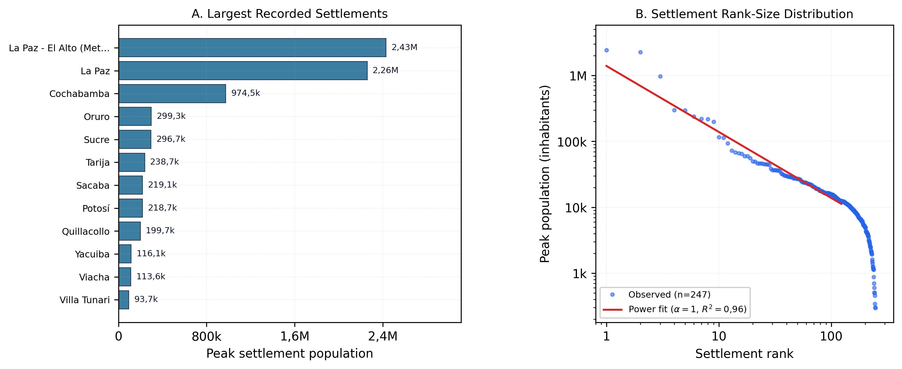

```{r setup, include=FALSE}
knitr::opts_chunk$set(echo = FALSE, warning = FALSE, message = FALSE, fig.pos = "htbp")
source("../../_shared/template/viscount_rmd_helpers.R")
library(jsonlite)

read_json5_clean <- function(path) {
  lines <- readLines(path, warn = FALSE, encoding = "UTF-8")
  text <- paste(lines, collapse = "\n")
  text <- gsub("(?m)^\\s*//.*$", "", text, perl = TRUE)
  text <- gsub("/\\*.*?\\*/", "", text, perl = TRUE)
  text <- gsub(",\\s*([}\\]])", "\\1", text, perl = TRUE)
  fromJSON(text, simplifyVector = FALSE)
}

summary_data <- fromJSON("andean_bolivia_independence_summary.json", simplifyVector = FALSE)
sett_data <- fromJSON("andean_bolivia_independence_settlements.json", simplifyVector = FALSE)
ledger_data <- read_json5_clean("andean_bolivia_independence_source_ledger.json5")

clean_label <- function(x) {
  s <- as.character(x)
  s <- gsub("&", "and", s, fixed = TRUE)
  s <- gsub("\\\\", "", s)
  trimws(s)
}

fmt_coord <- function(x) {
  viscount_fmt_number(round(as.numeric(x), 2L), 2L)
}

scope_labels <- c(
  city_proper = "Municipal core",
  suburb = "Suburban municipality",
  metro = "Metropolitan aggregate"
)

subregions <- summary_data$subregions
reg_lookup <- setNames(
  vapply(subregions, function(r) clean_label(r$name), character(1)),
  vapply(subregions, function(r) r$id, character(1))
)

n_sites <- as.integer(summary_data$settlement_count)
n_excluded <- as.integer(ledger_data$total_excluded)
n_total_eval <- n_sites + n_excluded
```

```{r hero-md-fallback, results='asis'}
if (!knitr::is_latex_output()) {
  cat("\n\n")
}
```

# Abstract

This gazetteer documents `r viscount_fmt_number(n_sites, 0L)` settlements across the six Andean departments of Bolivia - La Paz, Cochabamba, Potosí, Chuquisaca, Oruro and Tarija - from independence in 1825 to 2026. Coordinated with PRETA's lowland Bolivian register for Santa Cruz, El Beni and Pando, the chapter ledger evaluates `r viscount_fmt_number(n_total_eval, 0L)` candidate rows across four sequential waves, retaining 247 census-anchored settlements (zero crowd-sourced entries, marginal saturation gain 0,82%) and excluding 52 flat-tier synthetic placeholders lacking municipal census grounding. Peak populations follow a rank-size power law ($\alpha = 1,0$, $R^2 = 0,96$) spanning from small Cochabamba valley hamlets near 300 inhabitants up to four regional capitals between 218k and 300k (Potosí, Tarija, Sucre and Oruro), the Cochabamba urban core (974,5k in 2026) and the reconciled La Paz - El Alto metropolitan system (2,43M in 2024) [@Nunezvillalba2015Crecimiento; @Garcia2022Efecto; @Boliviaoficinanacionaldeimmigracion1902Censo].

# Background

Urban settlement across Andean Bolivia reflects four successive economic and institutional eras: colonial administrative cities and silver hubs (Sucre, Potosí, La Paz and Oruro), early twentieth-century tin-mining camps along the Oruro - Potosí rail spine (Llallagua, Huanuni, Uncía, Uyuni and Tupiza), post-1952 agricultural frontier towns in the *yungas* and Chapare (Caranavi, Villa Tunari, Chimoré and Puerto Villarroel), and post-1985 metropolitan suburbs ringing La Paz and Cochabamba [@Galazmandakovic2016Industrializac; @Selaez2020Iglesias; @Gaviriapuerta2024Problematicas]. Separation of municipal cores from outer suburban satellites prevents double-counting across the high *altiplano* rim above La Paz and the irrigated valleys of Cochabamba [@Nunezvillalba2015Crecimiento; @Quispe2018Fragmentacion].

# Methodology

The settlement register was compiled in four audited ingestion waves logged in the chapter source ledger, drawing across 298 in-bounds departmental and municipal census rows from the 1900 general census and INE enumerations from 1950 through 2024 [@Boliviaoficinanacionaldeimmigracion1902Censo; @Benito2026Pueblos]. Wave 1 ingested 197 primary municipal census series (66,11% of evaluated rows), Wave 2 added 34 georeferenced and metropolitan reconciliation entries (17,26% marginal gain), Wave 3 backfilled 14 longitudinal nineteenth-century and early twentieth-century series (6,06% marginal gain), and Wave 4 closed two remaining sub-regional gaps (0,82% marginal gain). Fifty-two records exhibiting constant unverified plateau tiers (4.500 or 885) without municipal census backing were excluded.

# Testing and Validation

Ledger reconciliation accounts for every candidate row (`r viscount_fmt_number(n_sites, 0L)` included and `r viscount_fmt_number(n_excluded, 0L)` excluded), with complete spatial coverage across all six departments: 85 entries in La Paz, 51 in Cochabamba, 38 in Potosí, 33 in Chuquisaca, 30 in Oruro and 10 in Tarija. Figure \ref{fig:sett-regional-map} maps all 247 retained settlements inside the 459.929,7 km² departmental mask [@Boliviaoficinanacionaldeimmigracion1902Censo; @Miranda2021Censo].

```{r fig-sett-regional-map, results='asis'}
viscount_figure(
  "figures/andean_bolivia_independence_regional_map.png",
  "Spatial distribution of 247 catalogued settlements across the six Andean departments of Bolivia, 1825 to 2026.",
  "fig:sett-regional-map"
)
```

# Results

## Leading Andean Settlements

Table \ref{tab:top25-sites} lists the 25 largest settlements in the chapter register ordered by peak population. Beneath the La Paz - El Alto metropolitan entry (2,43M at 2024) and its central core (2,26M at 2026), Cochabamba (974,5k), Oruro (299,3k), Sucre (296,7k), Tarija (238,7k), Sacaba (219,1k), Potosí (218,7k), Quillacollo (199,7k), Yacuiba (116,1k) and Viacha (113,6k) lead the urban hierarchy [@Garcia2022Efecto; @Quispe2018Fragmentacion; @Ferrari2014Ferrocarril].

```{r tab-top25-sites, results='asis'}
top_list <- summary_data$top_settlements
top_rows <- lapply(top_list, function(e) {
  reg_lbl <- if (e$region_id %in% names(reg_lookup)) reg_lookup[[e$region_id]] else clean_label(e$region_id)
  span_str <- paste0(as.integer(e$first_year), " to ", as.integer(e$last_year))
  data.frame(
    Site = clean_label(e$name),
    Dept = reg_lbl,
    Coords = paste0(fmt_coord(e$lat), ", ", fmt_coord(e$lon)),
    Span = span_str,
    Peak = paste0(viscount_fmt_pop(e$peak_pop), " (", as.integer(e$peak_year), ")"),
    stringsAsFactors = FALSE
  )
})
df_top25 <- do.call(rbind, top_rows)
rownames(df_top25) <- NULL

viscount_table(
  df_top25,
  "Twenty-five largest catalogued settlements across Andean Bolivia ordered by peak population, 1825 to 2026.",
  c("Settlement", "Department", "Lat, Lon", "Span", "Peak Pop. (Year)"),
  list(label = "tab:top25-sites", font_size = "scriptsize", max_rows_per_page = 32L)
)
```

## La Paz, El Alto and Metropolitan Suburb Separation

In Andean Bolivia, metropolitan growth concentrates around La Paz - El Alto on the northern *altiplano* and Cochabamba in the central valley [@Nunezvillalba2015Crecimiento; @Gaviriapuerta2024Problematicas]. While El Alto separated municipally from La Paz in 1985 and achieved city status in 1988, the inherited PRETA core series maintains the combined La Paz - El Alto urban basin and plateau core as a single central unit (2,23M in 2024; 2,26M in 2026) and isolates four surrounding metropolitan municipalities (Viacha, Achocalla, Palca and Mecapaca) as distinct suburban entries. Table \ref{tab:metro-separation} reports both the La Paz - El Alto metropolitan reconciliation and the five suburban municipalities around Cochabamba, confirming exact arithmetic additivity at 2024 (2.228.182 plus 201.917 equals 2.430.099) and 2026 (2.259.463 plus 114.325 equals 2.373.788).

```{r tab-metro-separation, results='asis'}
metro_keys <- c(
  "La Paz - El Alto (Metro)-Bolivia",
  "La Paz-Bolivia",
  "Viacha-Bolivia",
  "Achocalla-Bolivia",
  "Palca-Bolivia",
  "Mecapaca-Bolivia",
  "Cochabamba-Bolivia",
  "Sacaba-Bolivia",
  "Quillacollo-Bolivia",
  "Tiquipaya-Bolivia",
  "Vinto-Bolivia",
  "Colcapirhua-Bolivia"
)
m_rows <- lapply(metro_keys, function(k) {
  e <- sett_data[[k]]
  reg_lbl <- if (e$region_id %in% names(reg_lookup)) reg_lookup[[e$region_id]] else clean_label(e$region_id)
  sc_lbl <- if (e$population_scope %in% names(scope_labels)) scope_labels[[e$population_scope]] else clean_label(e$population_scope)
  p1950 <- if (!is.null(e$population[["1950"]])) viscount_fmt_pop(e$population[["1950"]]) else "-"
  p1990 <- if (!is.null(e$population[["1992"]])) viscount_fmt_pop(e$population[["1992"]]) else viscount_fmt_pop(e$population[["1990"]])
  p2024 <- viscount_fmt_pop(e$population[["2024"]])
  p2026 <- viscount_fmt_pop(e$population[["2026"]])
  data.frame(
    Settlement = clean_label(e$name),
    Dept = reg_lbl,
    Scope = sc_lbl,
    P1950 = p1950,
    P1992 = p1990,
    P2024 = p2024,
    P2026 = p2026,
    stringsAsFactors = FALSE
  )
})
df_metro <- do.call(rbind, m_rows)
rownames(df_metro) <- NULL

viscount_table(
  df_metro,
  "Metropolitan reconciliation and suburban separation across La Paz - El Alto and the Cochabamba valley conurbation, 1950 to 2026.",
  c("Settlement", "Department", "Accounting Scope", "1950", "1990/1992", "2024", "2026"),
  list(label = "tab:metro-separation", font_size = "scriptsize")
)
```

## Sub-Regional Gazetteer Distribution

Table \ref{tab:subregion-gazetteer} contrasts catalogued site density, leading settlement and 2026 departmental population across all six Andean departments. Cochabamba records the highest gazetteer coverage at 8,61 sites per 10.000 km², followed by La Paz (6,26) and Chuquisaca (5,89), while arid Tarija holds 2,31 sites per 10.000 km² [@Quispe2018Fragmentacion; @Perreault2025Adaptive].

```{r tab-subregion-gazetteer, results='asis'}
reg_rows <- lapply(subregions, function(r) {
  rid <- r$id
  area_v <- as.numeric(r$area_km2)
  p2026 <- as.numeric(r$population[["2026"]])
  sub_entries <- Filter(function(e) identical(e$region_id, rid) && !identical(e$population_scope, "metro"), sett_data)
  cnt_all <- as.integer(summary_data$settlements_by_region[[rid]])
  sdens <- if (area_v > 0) (cnt_all / area_v) * 10000 else 0
  lead_str <- "-"
  if (length(sub_entries) > 0L) {
    pks <- vapply(sub_entries, function(e) max(as.numeric(unlist(e$population))), numeric(1))
    idx_m <- which.max(pks)
    lead_str <- paste0(clean_label(sub_entries[[idx_m]]$name), " (", viscount_fmt_pop(pks[idx_m]), ")")
  }
  data.frame(
    Dept = clean_label(r$name),
    Area = viscount_fmt_number(round(area_v), 0L),
    Sites = viscount_fmt_number(cnt_all, 0L),
    SiteDens = viscount_fmt_number(sdens, 2L),
    Lead = lead_str,
    Pop2026 = viscount_fmt_pop(p2026),
    stringsAsFactors = FALSE
  )
})
df_reg_gaz <- do.call(rbind, reg_rows)
rownames(df_reg_gaz) <- NULL

viscount_table(
  df_reg_gaz,
  "Catalogued site counts, spatial sampling density (per 10.000 km²), leading municipal settlement and 2026 population across six departments.",
  c("Department", "Area (km²)", "Sites", "Sites per 10k km²", "Leading Centre (Peak)", "2026 Pop."),
  list(label = "tab:subregion-gazetteer", font_size = "scriptsize")
)
```

## Source Ledger Saturation and Exhausted Corpora

Tables \ref{tab:saturation-waves} and \ref{tab:exhausted-corpora} summarise the four sequential ingestion waves and the exhausted archival census corpus recorded in the chapter source ledger [@Boliviaoficinanacionaldeimmigracion1902Censo; @Benito2026Pueblos].

```{r tab-saturation-waves, results='asis'}
waves <- ledger_data$saturation_audit$waves
wave_labels <- c(
  primary_national_statistical_office_full_census_extract = "National statistical office census extract",
  secondary_georeference_repair_and_metro_reconciliation = "Georeference repair and metro reconciliation",
  longitudinal_19th_20th_century_official_national_census_backfill = "19th-20th century official census backfill",
  subregion_gap_hunter_verification_sweep = "Sub-regional gap audit sweep"
)
w_rows <- lapply(waves, function(w) {
  sc <- as.character(w$source_class)
  lbl <- if (sc %in% names(wave_labels)) wave_labels[[sc]] else clean_label(sc)
  data.frame(
    Wave = paste0("Wave ", as.integer(w$wave)),
    SourceClass = lbl,
    Prior = viscount_fmt_number(as.integer(w$prior_cumulative_included), 0L),
    Added = viscount_fmt_number(as.integer(w$newly_included), 0L),
    Gain = paste0(viscount_fmt_number(as.numeric(w$marginal_gain_pct), 2L), "%"),
    stringsAsFactors = FALSE
  )
})
df_waves <- do.call(rbind, w_rows)
rownames(df_waves) <- NULL

viscount_table(
  df_waves,
  "Four-wave gazetteer ingestion history and marginal saturation gain across 247 Andean Bolivian settlements.",
  c("Wave", "Source Class", "Prior Total", "Added", "Marginal Gain"),
  list(label = "tab:saturation-waves", font_size = "scriptsize")
)
```

```{r tab-exhausted-corpora, results='asis'}
corpora <- ledger_data$saturation_audit$exhausted_corpora
corp_labels <- c(
  INE_Bolivia_Censos_1900_2024_6_Andean_Depts = "INE Bolivia Censuses (1900 to 2024, 6 Andean Depts)"
)
tier_labels <- c(
  primary_national_institutional_archive = "Primary national archive"
)
ec_rows <- lapply(corpora, function(c_item) {
  nm <- as.character(c_item$name)
  tr <- as.character(c_item$source_tier)
  data.frame(
    Corpus = if (nm %in% names(corp_labels)) corp_labels[[nm]] else clean_label(nm),
    Tier = if (tr %in% names(tier_labels)) tier_labels[[tr]] else clean_label(tr),
    RowsInBounds = viscount_fmt_number(as.integer(c_item$total_rows_in_bounds), 0L),
    Processed = viscount_fmt_number(as.integer(c_item$rows_processed), 0L),
    stringsAsFactors = FALSE
  )
})
df_ec <- do.call(rbind, ec_rows)
rownames(df_ec) <- NULL

viscount_table(
  df_ec,
  "Audited regional census corpus processed in full during compilation of the Andean Bolivia settlement register.",
  c("Corpus Name", "Archive Tier", "Rows in Bounds", "Rows Processed"),
  list(label = "tab:exhausted-corpora", font_size = "scriptsize")
)
```

# Limitations

Three constraints govern interpretation of the settlement gazetteer. First, retaining La Paz and El Alto within one central urban series before separating four outer suburbs means El Alto's post-1988 municipal split is captured analytically and inside the metropolitan aggregate rather than as a standalone row [@Nunezvillalba2015Crecimiento; @Beijaard1995Rental]. Second, seasonal double residence between rural *ayllus* and metropolitan peripheries introduces census-day allocation noise across municipalities [@Miranda2021Censo]. Third, 2026 settlement figures preserve PRETA pre-2024 trend extrapolations, creating local offsets against the 2024 census returns in rapid-growth satellites such as Viacha and Sacaba [@Garcia2022Efecto; @Quispe2018Fragmentacion].

# Conclusion

Together, the 247 catalogued settlements trace the two-century urban evolution of Andean Bolivia across 459.929,7 km², from nineteenth-century administrative and silver-mining towns through the Oruro - Potosí tin belt to the dual metropolitan poles of La Paz - El Alto and Cochabamba [@Galazmandakovic2016Industrializac; @Nunezvillalba2015Crecimiento; @Garcia2022Efecto]. Strict separation of municipal cores from suburban satellites and exclusion of 52 ungrounded tier placeholders yield a clean urban hierarchy ($\alpha = 1,0$, $R^2 = 0,96$) ready for continental integration with PRETA's lowland Bolivia series.

# Appendix

## Provenance Breakdown

Table \ref{tab:sett-prov} summarises the scholarly provenance distribution across all 247 included gazetteer entries [@Nunezvillalba2015Crecimiento; @Garcia2022Efecto].

```{r tab-sett-prov, results='asis'}
prov_counts <- unlist(summary_data$provenance_counts)
p_ord <- sort(prov_counts, decreasing = TRUE)
prov_labels <- c(
  PRETA = "PRETA Municipal and INE Census Series",
  QUIPU_Metro_Reconciliation = "QUIPU Metropolitan Reconciliation"
)
df_sp <- data.frame(
  Corpus = vapply(names(p_ord), function(k) if (k %in% names(prov_labels)) prov_labels[[k]] else clean_label(k), character(1)),
  Sites = vapply(as.integer(p_ord), function(v) viscount_fmt_number(v, 0L), character(1)),
  Share = vapply(100 * as.integer(p_ord) / n_sites, function(v) paste0(viscount_fmt_number(v, 2L), "%"), character(1)),
  stringsAsFactors = FALSE
)
rownames(df_sp) <- NULL

viscount_table(
  df_sp,
  "Provenance breakdown across 247 catalogued settlements in Andean Bolivia.",
  c("Provenance Corpus", "Sites", "Share"),
  list(label = "tab:sett-prov", font_size = "scriptsize")
)
```

# Sources

::: {#refs}
:::
