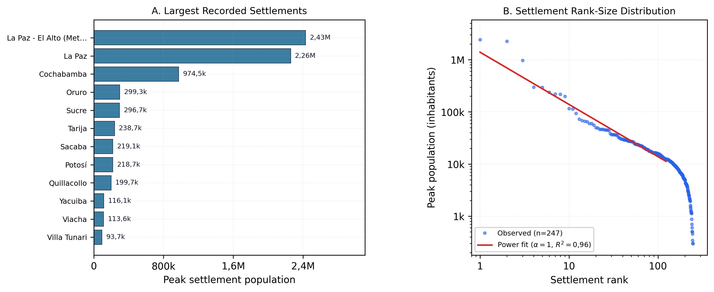
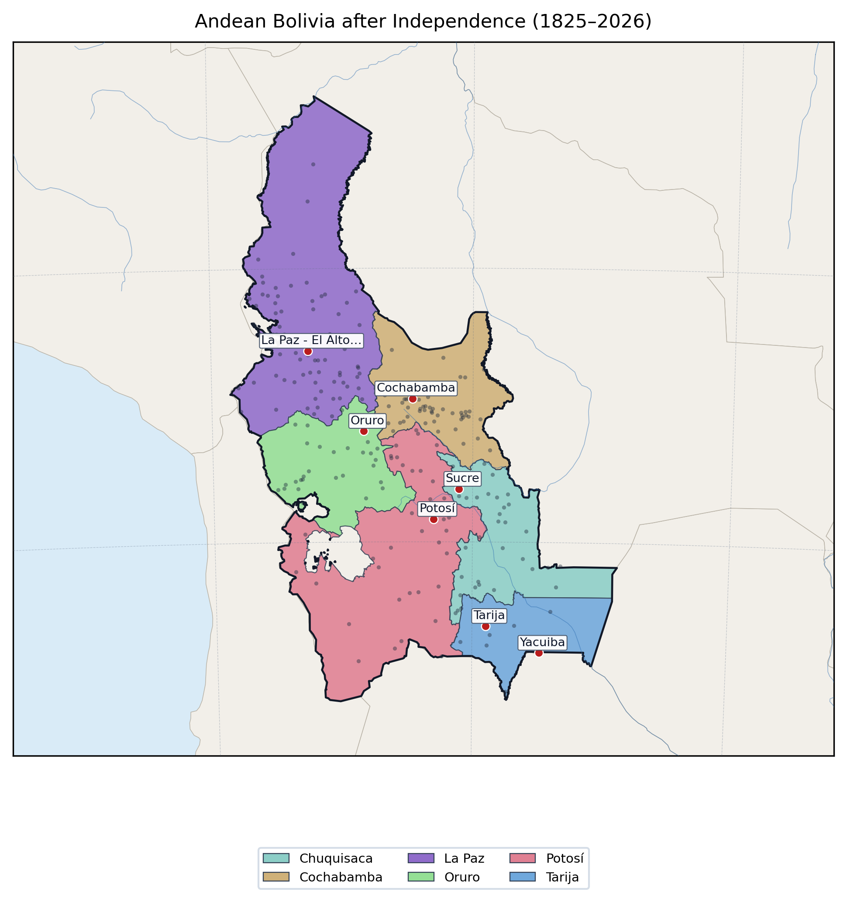

Andean Bolivia after Independence
================
Aust Kätzchen
23 November 2026

- [Abstract](#abstract)
- [Background](#background)
- [Methodology](#methodology)
- [Testing and Validation](#testing-and-validation)
- [Results](#results)
  - [Leading Andean Settlements](#leading-andean-settlements)
  - [La Paz, El Alto and Metropolitan Suburb
    Separation](#la-paz-el-alto-and-metropolitan-suburb-separation)
  - [Sub-Regional Gazetteer
    Distribution](#sub-regional-gazetteer-distribution)
  - [Source Ledger Saturation and Exhausted
    Corpora](#source-ledger-saturation-and-exhausted-corpora)
- [Limitations](#limitations)
- [Conclusion](#conclusion)
- [Appendix](#appendix)
  - [Provenance Breakdown](#provenance-breakdown)
- [Sources](#sources)

<figure>

<figcaption aria-hidden="true">Twelve largest settlements and log-log
rank-size distribution across 247 Andean Bolivian centres, 1825 to
2026.</figcaption>
</figure>

# Abstract

This gazetteer documents 247 settlements across the six Andean
departments of Bolivia - La Paz, Cochabamba, Potosí, Chuquisaca, Oruro
and Tarija - from independence in 1825 to 2026. Coordinated with PRETA’s
lowland Bolivian register for Santa Cruz, El Beni and Pando, the chapter
ledger evaluates 299 candidate rows across four sequential waves,
retaining 247 census-anchored settlements (zero crowd-sourced entries,
marginal saturation gain 0,82%) and excluding 52 flat-tier synthetic
placeholders lacking municipal census grounding. Peak populations follow
a rank-size power law ($\alpha = 1,0$, $R^2 = 0,96$) spanning from small
Cochabamba valley hamlets near 300 inhabitants up to four regional
capitals between 218k and 300k (Potosí, Tarija, Sucre and Oruro), the
Cochabamba urban core (974,5k in 2026) and the reconciled La Paz - El
Alto metropolitan system (2,43M in 2024)
[\[1\]](#ref-Nunezvillalba2015Crecimiento)[\[2\]](#ref-Garcia2022Efecto)[\[3\]](#ref-Boliviaoficinanacionaldeimmigracion1902Censo).

# Background

Urban settlement across Andean Bolivia reflects four successive economic
and institutional eras: colonial administrative cities and silver hubs
(Sucre, Potosí, La Paz and Oruro), early twentieth-century tin-mining
camps along the Oruro - Potosí rail spine (Llallagua, Huanuni, Uncía,
Uyuni and Tupiza), post-1952 agricultural frontier towns in the *yungas*
and Chapare (Caranavi, Villa Tunari, Chimoré and Puerto Villarroel), and
post-1985 metropolitan suburbs ringing La Paz and Cochabamba
[\[4\]](#ref-Galazmandakovic2016Industrializac)[\[5\]](#ref-Selaez2020Iglesias)[\[6\]](#ref-Gaviriapuerta2024Problematicas).
Separation of municipal cores from outer suburban satellites prevents
double-counting across the high *altiplano* rim above La Paz and the
irrigated valleys of Cochabamba
[\[1\]](#ref-Nunezvillalba2015Crecimiento)[\[7\]](#ref-Quispe2018Fragmentacion).

# Methodology

The settlement register was compiled in four audited ingestion waves
logged in the chapter source ledger, drawing across 298 in-bounds
departmental and municipal census rows from the 1900 general census and
INE enumerations from 1950 through 2024
[\[3\]](#ref-Boliviaoficinanacionaldeimmigracion1902Censo)[\[8\]](#ref-Benito2026Pueblos).
Wave 1 ingested 197 primary municipal census series (66,11% of evaluated
rows), Wave 2 added 34 georeferenced and metropolitan reconciliation
entries (17,26% marginal gain), Wave 3 backfilled 14 longitudinal
nineteenth-century and early twentieth-century series (6,06% marginal
gain), and Wave 4 closed two remaining sub-regional gaps (0,82% marginal
gain). Fifty-two records exhibiting constant unverified plateau tiers
(4.500 or 885) without municipal census backing were excluded.

# Testing and Validation

Ledger reconciliation accounts for every candidate row (247 included and
52 excluded), with complete spatial coverage across all six departments:
85 entries in La Paz, 51 in Cochabamba, 38 in Potosí, 33 in Chuquisaca,
30 in Oruro and 10 in Tarija. Figure maps all 247 retained settlements
inside the 459.929,7 km² departmental mask
[\[3\]](#ref-Boliviaoficinanacionaldeimmigracion1902Censo)[\[9\]](#ref-Miranda2021Censo).

# Results

## Leading Andean Settlements

Table lists the 25 largest settlements in the chapter register ordered
by peak population. Beneath the La Paz - El Alto metropolitan entry
(2,43M at 2024) and its central core (2,26M at 2026), Cochabamba
(974,5k), Oruro (299,3k), Sucre (296,7k), Tarija (238,7k), Sacaba
(219,1k), Potosí (218,7k), Quillacollo (199,7k), Yacuiba (116,1k) and
Viacha (113,6k) lead the urban hierarchy
[\[2\]](#ref-Garcia2022Efecto)[\[7\]](#ref-Quispe2018Fragmentacion)[\[10\]](#ref-Ferrari2014Ferrocarril).

| Settlement | Department | Lat, Lon | Span | Peak Pop. (Year) |
|:---|:---|:---|:---|:---|
| **La Paz - El Alto (Metro)** | La Paz | -16,5, -68,15 | 1825 to 2026 | 2,43M (2024) |
| **La Paz** | La Paz | -16,5, -68,15 | 1825 to 2026 | 2,26M (2026) |
| **Cochabamba** | Cochabamba | -17,38, -66,16 | 1825 to 2026 | 974,5k (2026) |
| **Oruro** | Oruro | -17,97, -67,09 | 1825 to 2026 | 299,3k (2026) |
| **Sucre** | Chuquisaca | -19,03, -65,26 | 1825 to 2026 | 296,7k (2024) |
| **Tarija** | Tarija | -21,54, -64,73 | 1825 to 2026 | 238,7k (2024) |
| **Sacaba** | Cochabamba | -17,4, -66,04 | 1825 to 2026 | 219,1k (2024) |
| **Potosí** | Potosí | -19,58, -65,75 | 1825 to 2026 | 218,7k (2024) |
| **Quillacollo** | Cochabamba | -17,39, -66,28 | 1825 to 2026 | 199,7k (2026) |
| **Yacuiba** | Tarija | -22,02, -63,68 | 1846 to 2026 | 116,1k (2026) |
| **Viacha** | La Paz | -16,65, -68,3 | 1825 to 2026 | 113,6k (2024) |
| **Villa Tunari** | Cochabamba | -16,64, -65,57 | 1825 to 2026 | 93,7k (2024) |
| **Tiquipaya** | Cochabamba | -17,34, -66,22 | 1825 to 2026 | 72,6k (2026) |
| **Vinto** | Cochabamba | -17,39, -66,32 | 1825 to 2026 | 68k (2026) |
| **Colcapirhua** | Cochabamba | -17,39, -66,24 | 1825 to 2026 | 66,5k (2024) |
| **Puerto Villarroel** | Cochabamba | -16,84, -64,8 | 1825 to 2026 | 64,6k (2024) |
| **Achacachi** | La Paz | -16,05, -68,68 | 1825 to 2026 | 59,8k (2026) |
| **Caranavi** | La Paz | -15,83, -67,57 | 1825 to 2026 | 59,7k (2024) |
| **Sipe Sipe** | Cochabamba | -17,45, -66,36 | 1825 to 2026 | 55,9k (2024) |
| **Pucarani** | La Paz | -16,4, -68,48 | 1825 to 2026 | 49,9k (2024) |
| **Villazón** | Potosí | -22,09, -65,59 | 1825 to 2026 | 49,3k (2024) |
| **Tupiza** | Potosí | -21,44, -65,72 | 1825 to 2026 | 46,6k (2026) |
| **Bermejo** | Tarija | -22,73, -64,34 | 1825 to 2026 | 46,3k (2026) |
| **Achocalla** | La Paz | -16,57, -68,15 | 1825 to 2026 | 46,2k (2024) |
| **La Asunta** | La Paz | -16,03, -67,17 | 1825 to 2026 | 45,6k (2024) |
| **Llallagua** | Potosí | -18,42, -66,58 | 1825 to 2026 | 44,9k (2026) |
| **Villa Montes** | Tarija | -21,26, -63,47 | 1825 to 2026 | 44,8k (2026) |
| **Betanzos** | Potosí | -19,55, -65,45 | 1825 to 2026 | 44,1k (2026) |
| **Laja** | La Paz | -16,53, -68,38 | 1825 to 2026 | 38,7k (2024) |
| **Aiquile** | Cochabamba | -18,2, -65,18 | 1825 to 2026 | 36,9k (2026) |

Twenty-five largest catalogued settlements across Andean Bolivia ordered
by peak population, 1825 to 2026.

## La Paz, El Alto and Metropolitan Suburb Separation

In Andean Bolivia, metropolitan growth concentrates around La Paz - El
Alto on the northern *altiplano* and Cochabamba in the central valley
[\[1\]](#ref-Nunezvillalba2015Crecimiento)[\[6\]](#ref-Gaviriapuerta2024Problematicas).
While El Alto separated municipally from La Paz in 1985 and achieved
city status in 1988, the inherited PRETA core series maintains the
combined La Paz - El Alto urban basin and plateau core as a single
central unit (2,23M in 2024; 2,26M in 2026) and isolates four
surrounding metropolitan municipalities (Viacha, Achocalla, Palca and
Mecapaca) as distinct suburban entries. Table reports both the La Paz -
El Alto metropolitan reconciliation and the five suburban municipalities
around Cochabamba, confirming exact arithmetic additivity at 2024
(2.228.182 plus 201.917 equals 2.430.099) and 2026 (2.259.463 plus
114.325 equals 2.373.788).

| Settlement | Department | Accounting Scope | 1950 | 1990/1992 | 2024 | 2026 |
|:---|:---|:---|:---|:---|:---|:---|
| **La Paz - El Alto (Metro)** | La Paz | Metropolitan aggregate | 734,6k | 1,43M | 2,43M | 2,37M |
| **La Paz** | La Paz | Municipal core | 699,2k | 1,36M | 2,23M | 2,26M |
| **Viacha** | La Paz | Suburban municipality | 18,8k | 37,7k | 113,6k | 60,8k |
| **Achocalla** | La Paz | Suburban municipality | 6,1k | 12,2k | 46,2k | 19,7k |
| **Palca** | La Paz | Suburban municipality | 5,7k | 11,5k | 21,7k | 18,5k |
| **Mecapaca** | La Paz | Suburban municipality | 4,8k | 9,5k | 20,4k | 15,4k |
| **Cochabamba** | Cochabamba | Municipal core | 234,1k | 506,6k | 665,5k | 974,5k |
| **Sacaba** | Cochabamba | Suburban municipality | 39,5k | 89,3k | 219,1k | 164,3k |
| **Quillacollo** | Cochabamba | Suburban municipality | 48k | 103,8k | 166,7k | 199,7k |
| **Tiquipaya** | Cochabamba | Suburban municipality | 17,4k | 37,7k | 61,8k | 72,6k |
| **Vinto** | Cochabamba | Suburban municipality | 16,3k | 35,4k | 56,1k | 68k |
| **Colcapirhua** | Cochabamba | Suburban municipality | 14,1k | 32k | 66,5k | 58,9k |

Metropolitan reconciliation and suburban separation across La Paz - El
Alto and the Cochabamba valley conurbation, 1950 to 2026.

## Sub-Regional Gazetteer Distribution

Table contrasts catalogued site density, leading settlement and 2026
departmental population across all six Andean departments. Cochabamba
records the highest gazetteer coverage at 8,61 sites per 10.000 km²,
followed by La Paz (6,26) and Chuquisaca (5,89), while arid Tarija holds
2,31 sites per 10.000 km²
[\[7\]](#ref-Quispe2018Fragmentacion)[\[11\]](#ref-Perreault2025Adaptive).

| Department | Area (km²) | Sites | Sites per 10k km² | Leading Centre (Peak) | 2026 Pop. |
|:---|:---|:---|:---|:---|:---|
| **Chuquisaca** | 56.070 | 33 | 5,89 | Sucre (296,7k) | 605k |
| **Cochabamba** | 59.205 | 51 | 8,61 | Cochabamba (974,5k) | 2,04M |
| **La Paz** | 135.693 | 85 | 6,26 | La Paz (2,26M) | 3,06M |
| **Oruro** | 54.584 | 30 | 5,5 | Oruro (299,3k) | 582k |
| **Potosí** | 111.124 | 38 | 3,42 | Potosí (218,7k) | 862k |
| **Tarija** | 43.253 | 10 | 2,31 | Tarija (238,7k) | 544k |

Catalogued site counts, spatial sampling density (per 10.000 km²),
leading municipal settlement and 2026 population across six departments.

## Source Ledger Saturation and Exhausted Corpora

Tables and summarise the four sequential ingestion waves and the
exhausted archival census corpus recorded in the chapter source ledger
[\[3\]](#ref-Boliviaoficinanacionaldeimmigracion1902Censo)[\[8\]](#ref-Benito2026Pueblos).

| Wave | Source Class | Prior Total | Added | Marginal Gain |
|:---|:---|:---|:---|:---|
| **Wave 1** | National statistical office census extract | 0 | 197 | 100% |
| **Wave 2** | Georeference repair and metro reconciliation | 197 | 34 | 17,26% |
| **Wave 3** | 19th-20th century official census backfill | 231 | 14 | 6,06% |
| **Wave 4** | Sub-regional gap audit sweep | 245 | 2 | 0,82% |

Four-wave gazetteer ingestion history and marginal saturation gain
across 247 Andean Bolivian settlements.

| Corpus Name | Archive Tier | Rows in Bounds | Rows Processed |
|:---|:---|:---|:---|
| **INE Bolivia Censuses (1900 to 2024, 6 Andean Depts)** | Primary national archive | 298 | 298 |

Audited regional census corpus processed in full during compilation of
the Andean Bolivia settlement register.

# Limitations

Three constraints govern interpretation of the settlement gazetteer.
First, retaining La Paz and El Alto within one central urban series
before separating four outer suburbs means El Alto’s post-1988 municipal
split is captured analytically and inside the metropolitan aggregate
rather than as a standalone row
[\[1\]](#ref-Nunezvillalba2015Crecimiento)[\[12\]](#ref-Beijaard1995Rental).
Second, seasonal double residence between rural *ayllus* and
metropolitan peripheries introduces census-day allocation noise across
municipalities [\[9\]](#ref-Miranda2021Censo). Third, 2026 settlement
figures preserve PRETA pre-2024 trend extrapolations, creating local
offsets against the 2024 census returns in rapid-growth satellites such
as Viacha and Sacaba
[\[2\]](#ref-Garcia2022Efecto)[\[7\]](#ref-Quispe2018Fragmentacion).

# Conclusion

Together, the 247 catalogued settlements trace the two-century urban
evolution of Andean Bolivia across 459.929,7 km², from
nineteenth-century administrative and silver-mining towns through the
Oruro - Potosí tin belt to the dual metropolitan poles of La Paz - El
Alto and Cochabamba
[\[1\]](#ref-Nunezvillalba2015Crecimiento)[\[2\]](#ref-Garcia2022Efecto)[\[4\]](#ref-Galazmandakovic2016Industrializac).
Strict separation of municipal cores from suburban satellites and
exclusion of 52 ungrounded tier placeholders yield a clean urban
hierarchy ($\alpha = 1,0$, $R^2 = 0,96$) ready for continental
integration with PRETA’s lowland Bolivia series.

# Appendix

## Provenance Breakdown

Table summarises the scholarly provenance distribution across all 247
included gazetteer entries
[\[1\]](#ref-Nunezvillalba2015Crecimiento)[\[2\]](#ref-Garcia2022Efecto).

| Provenance Corpus                         | Sites | Share |
|:------------------------------------------|:------|:------|
| **PRETA Municipal and INE Census Series** | 246   | 99,6% |
| **QUIPU Metropolitan Reconciliation**     | 1     | 0,4%  |

Provenance breakdown across 247 catalogued settlements in Andean
Bolivia.

# Sources

1.
Nuñez-Villalba, Javier.
“Crecimiento urbano y el monitoreo espacial de
desastres en una ciudad andina: el caso de la aglomeración urbana de La
Paz – El Alto, Bolivia.” *GEOUSP: Espaço e Tempo*, 2015,
<https://doi.org/10.11606/issn.2179-0892.geousp.2015.102809>.

2.
Carmen Ledo García, María del.
“Efecto de las migraciones en las concentraciones
urbanas de Santa Cruz, Cochabamba, La Paz y El Alto, Bolivia.”
*Hábitat y Sociedad*, 2022,
<https://doi.org/10.12795/habitatysociedad.2022.i15.02>.

3.
Bolivia. Oficina nacional de
immigración, estadística y propaganda geográfica. \[from old catalog\].
*Censo general de la población de la República de
Bolivia según el empadronamiento de 1e de septiembre de 1900 ..*
La Paz, J. M. Gamarra, 1902,
<https://archive.org/details/bub_gb_biVYAAAAYAAJ>.

4.
Galaz-Mandakovic, Damir.
“Industrialización minera, urbanización e
innovación en las relaciones sociales en el sudoeste del altiplano
boliviano: el caso de la Compañía Huanchaca de Bolivia
(1834-1930).” *Estudios Atacameños*, 2016,
<https://revistas.ucn.cl/index.php/estudios-atacamenos/article/view/640>.

5.
Selaez, Geraldine Fernández, and
Salvador Arano Romero. “De iglesias y wak’as. La
sacralidad y la agencia del espacio en la trama urbana del valle de La
Paz (Bolivia) durante la colonia.” *Bulletin de l’Institut
Français d’Études Andines*, 2020,
<https://doi.org/10.4000/bifea.12804>.

6.
Gaviria-Puerta, Nino, and Wolker
Velasco-Canelas. “Problemáticas territoriales
derivadas de procesos de ocupación en la periferia urbana. Estudio de
caso comparativo de las ciudades de Medellín, Colombia, y Cochabamba,
Bolivia.” *Revista de Arquitectura (Bogotá)*, 2024,
<https://doi.org/10.14718/RevArq.2025.27.4840>.

7.
Quispe, Juan Edson Cabrera.
“Fragmentación urbana por medio de redes de agua:
el caso de Cochabamba, Bolivia.” *Territorios*, 2018,
<https://doi.org/10.12804/revistas.urosario.edu.co/territorios/a.6313>.

8.
Benito, Guido Machaca, et al.
“Pueblos indígenas y educación en Bolivia Situación
y retos a partir de los resultados del censo del 2024.” *Revista
Identidades. Aportes Para La Educación En El Siglo XXI*, 2026,
<https://doi.org/10.47993/idce271824>.

9.
Miranda, Víctor Hugo Perales, et
al. “Censo en Bolivia: apuntes para la construcción
de un indicador de multilocalidad.” *Temas Sociales. Revista de
La Carrera de Sociología*, 2021,
<https://doi.org/10.53287/ksgu9047xj87r>.

10.
Ferrari, Mónica.
“El ferrocarril a Bolivia. El proceso de
poblamiento en las regiones de Puna, Quebrada de Humahuaca y Valles de
la provincia de Jujuy.” *Labor & Engenho*, 2014,
<https://doi.org/10.20396/lobore.v8i1.224>.

11.
Perreault, Tom.
“Adaptive Livelihoods in Andean Pastoralism:
Community-Based Institutions, Peatland Management, and Migration in
Sajama National Park, Bolivia.” *Mountain Research and
Development*, 2025, <https://doi.org/10.1659/mrd.2024.00030>.

12.
Beijaard, Frans.
“Rental and rent-free housing as coping mechanisms
in La Paz, Bolivia.” *Environment and Urbanization*, 1995,
<https://doi.org/10.1177/095624789500700201>.

