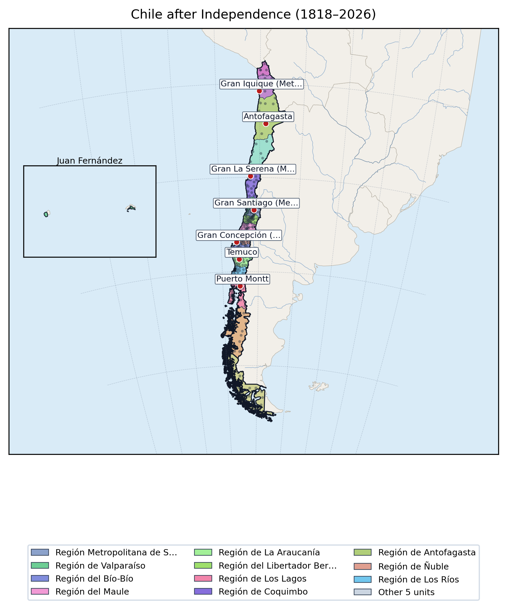

```{r setup, include=FALSE}
knitr::opts_chunk$set(echo = FALSE, warning = FALSE, message = FALSE, fig.pos = "htbp")
source("../../_shared/template/viscount_rmd_helpers.R")
library(jsonlite)

summary_data <- fromJSON("chile_after_independence_summary.json", simplifyVector = FALSE)
sett_data <- fromJSON("chile_after_independence_settlements.json", simplifyVector = FALSE)

clean_label <- function(x) {
  s <- as.character(x)
  s <- gsub("&", "and", s, fixed = TRUE)
  s <- gsub("Gral.Ibañez", "Gral. Ibáñez", s, fixed = TRUE)
  s <- gsub("\\\\", "", s)
  trimws(s)
}

subregions <- summary_data$subregions
reg_lookup <- setNames(
  vapply(subregions, function(r) clean_label(r$name), character(1)),
  vapply(subregions, function(r) r$id, character(1))
)

tot_area <- as.numeric(summary_data$total_area_km2)
n_sites <- as.integer(summary_data$settlement_count)
tot_1835 <- as.numeric(summary_data$domain_totals[["1835"]])
tot_1875 <- as.numeric(summary_data$domain_totals[["1875"]])
tot_1895 <- as.numeric(summary_data$domain_totals[["1895"]])
tot_1907 <- as.numeric(summary_data$domain_totals[["1907"]])
tot_1930 <- as.numeric(summary_data$domain_totals[["1930"]])
tot_1952 <- as.numeric(summary_data$domain_totals[["1952"]])
tot_1970 <- as.numeric(summary_data$domain_totals[["1970"]])
tot_1982 <- as.numeric(summary_data$domain_totals[["1982"]])
tot_1992 <- as.numeric(summary_data$domain_totals[["1992"]])
tot_2002 <- as.numeric(summary_data$domain_totals[["2002"]])
tot_2017 <- as.numeric(summary_data$domain_totals[["2017"]])
tot_2024 <- as.numeric(summary_data$domain_totals[["2024"]])
```

```{r hero-md-fallback, results='asis'}
if (!knitr::is_latex_output()) {
  cat("\n\n")
}
```

# Abstract

Between the consolidation of independence in 1818 and the 2024 national census, the population of continental Chile (excluding Rapa Nui) multiplied more than eighteenfold across 822.942,2 km² of Andean cordillera, Atacama desert, central Mediterranean valleys and Magellanic fjordland. Harmonised to the 16 modern administrative regions, national totals climbed from 1,01M (1.010.333) at the first republican census of 1835 to 2,08M in 1875, 3,25M in 1907, 4,29M in 1930 and 5,93M in 1952 before accelerating during mid-century urbanisation to 8,88M in 1970, 13,27M in 1992, 17,57M in 2017 and 18,48M (18.480.432) in 2024 [@Chile2010Censos; @Chile2018Sintesis; @Mardones2025Demographic]. Three territorial transformations reshaped this trajectory: the 1879-1883 War of the Pacific annexation of Tarapacá, Arica and Antofagasta and its nitrate (*salitrera*) mining boom; the late nineteenth-century state occupation of La Araucanía alongside state-sponsored European colonisation in Valdivia, Llanquihue and Magallanes; and twentieth-century industrial centralisation that concentrated 40,05% of the republic (7,4M inhabitants) inside the Región Metropolitana de Santiago by 2024 [@Gamboa1929Poblacion; @Ollino2006Redistribucion; @Acuna2008Santiago]. Since 1990, Chile has completed one of the steepest fertility declines in Latin America alongside rapid demographic ageing, moderated after 2010 by a historic wave of South-South immigration concentrated in Santiago's inner communes and the northern mining ports [@Mardones2025Demographic; @Huaringa2023Exercising; @Harnecker2023Measuring]. This study reconciles 18 national census benchmarks from 1835 to 2024 across all 16 regions and 354 catalogued communes and metropolitan agglomerations.

# Background

## From Post-Colonial Core to Early Republican Censuses, 1818-1875

At independence in 1818, the effective demographic core of the Chilean republic remained confined to a narrow Mediterranean band stretching from Copiapó and Coquimbo in the Norte Chico across the Aconcagua, Maipo, Cachapoal and Maule basins to the Biobío river frontier, plus the isolated Spanish garrison and island archipelago of Chiloé annexed in 1826 [@Chile2010Censos; @Gamboa1929Poblacion]. South of the Biobío lay independent Mapuche territory (*Wallmapu*) across La Araucanía, punctuated only by the coastal enclaves of Valdivia and Osorno, while the Patagonian steppe, Aysén fjords and Strait of Magellan remained virtually unenumerated outside indigenous canoe and hunter-gatherer bands [@Iturriagagutierrez2020Permeabilidad; @Ojeda2019Voces]. Within those compact borders, an early partial tally in 1813 and the first systematic republican census of 1835 recorded a settled population of roughly 1,01M (1.010.333) across the Central Valley and Norte Chico [@Chile2010Censos].

Institutional enumeration strengthened rapidly under conservative state consolidation. In 1843, the government founded the *Oficina de Estadística*, and the Censuses Act of 1853 instituted regular decennial enumerations beginning with the census of 19 April 1854, which counted 1,44M (1.439.120) inhabitants [@Chile2010Censos]. Subsequent enumerations in 1865 (1,82M) and 1875 (2,08M) documented steady natural increase driven by high rural fertility (above 40 births per thousand) and expanding wheat exports from the Central Valley to California and Australia [@Mardones2025Demographic; @Chile2010Censos].

Even at 1875, Chile remained overwhelmingly agrarian and regionally polycentric. Santiago proper held 129,8k residents and Valparaíso 97,7k as the republic's dominant Pacific entrepôt, while Concepción (18,3k), Chillán (19k), Talca (17,5k), La Serena (12,3k) and Copiapó (11,4k) served as modest provincial market or mining towns [@Chile2010Censos; @Acuna2008Santiago]. Outside those urban nuclei, rural *inquilinaje* tenancy anchored dense agrarian labour along the Central Valley river basins, keeping national population growth tied to agricultural harvests and periodic typhus or cholera outbreaks [@Mardones2025Demographic].

## War of the Pacific and the Nitrate Frontier, 1879-1929

Victory over Peru and Bolivia in the War of the Pacific (1879-1883) transformed both the territorial outline and the internal migration map of the Chilean state. Under the Treaty of Ancón (1883) and the 1884 truce with Bolivia, Chile annexed the Peruvian littoral provinces of Tarapacá and Arica-Tacna (with Tacna retroceded in 1929) together with Bolivia's Antofagasta littoral, adding nearly 200.000 km² of hyper-arid desert rich in sodium nitrate (*salitre*) and copper [@Alvarezmaldonado2024Dinamica; @Chile2010Censos]. Within two decades, British-financed and Chilean-operated *oficinas salitreras* across the Pampa del Tamarugal and the Antofagasta pampa drew tens of thousands of *peones* from the Norte Chico, the Central Valley and neighbouring Andean highlands [@Gamboa1929Poblacion; @Alvarezmaldonado2024Dinamica].

Between 1875 and 1907, the harmonised northern regions of Antofagasta, Tarapacá and Arica y Parinacota surged from a combined 103k residents to 223,4k, led by the ports of Iquique (reaching 40,2k in 1907) and Antofagasta (expanding more than sixfold from 5,38k in 1875 to 32,5k in 1907) [@Chile2010Censos; @Huaringa2023Exercising]. Copper mining at Chuquicamata and El Teniente (near Rancagua) complemented nitrate exports after 1900, establishing the Norte Grande as a high-wage extractive magnet whose demographic fortunes rose and fell directly with global commodity cycles [@Gamboa1929Poblacion; @Ollino2006Redistribucion]. Meanwhile, the Central Valley and Norte Chico fed this northern exodus without collapsing, because rural birth rates remained high across Maule, Ñuble, O'Higgins and Coquimbo [@Mardones2025Demographic].

## Araucanía, German Colonisation and the Austral Frontier, 1850-1930

Simultaneous with northern expansion, the state pressed southward across three distinct colonisation corridors. Beginning in 1850 under colonisation agent Vicente Pérez Rosales, the government settled several thousand German immigrants around Valdivia, Lake Llanquihue and Osorno, transforming Puerto Montt (founded 1853, 2,02k by 1865) and Valdivia (growing from 3,87k in 1875 to 15,2k in 1907 and 34,3k in 1930) into industrial timber, brewing and dairy hubs [@Gamboa1929Poblacion; @Miranda2024Trayectoria]. Between 1861 and 1883, Chilean military forces completed the Occupation of La Araucanía, displacing Mapuche communities onto reduced *títulos de merced* reservations and opening the Malleco and Cautín plains to railway construction, European settlers and landless Chilean peasants from the central provinces [@Iturriagagutierrez2020Permeabilidad; @Miranda2024Trayectoria]. Temuco, founded as a military fort in 1881, reached 7,08k in 1895, 16k in 1907 and 35,7k by 1930, anchoring a region (La Araucanía) whose population jumped from 176,3k in 1895 to 451,3k in 1930 [@Iturriagagutierrez2020Permeabilidad; @Chile2010Censos].

Farther south, state-subsidised pastoralism turned the wind-swept steppe of Magallanes into a wool and mutton export enclave after the 1870s. Under concessions granted to the *Sociedad Explotadora de Tierra del Fuego*, Punta Arenas grew from a penal outpost of 915 residents in 1875 to 24,3k in 1930, drawing Croatian, British, Spanish and Chiloé migrants to its freezing works and sheep *estancias* [@Ojeda2019Voces; @Gamboa1929Poblacion]. Settlement of the intermediate Aysén fjords came last, accelerating only in the late 1920s and 1930s as Coyhaique (founded 1929) and Puerto Aysén absorbed cattle ranchers crossing from Argentine Patagonia and settlers from Chiloé [@Miranda2024Trayectoria].

## Nitrate Crash, Industrial Urbanisation and Metropolitan Primacy, 1930-1973

The Great Depression shattered Chile's nitrate economy overnight. Synthetic ammonia production in Europe and North America had already eroded *salitre* market share after 1918, and the 1930 collapse in world trade threw tens of thousands of pampa miners out of work, forcing emergency trainloads of unemployed families southward to Santiago and Valparaíso [@Gamboa1929Poblacion; @Acuna2008Santiago]. Tarapacá and Arica y Parinacota saw their combined population fall from 110k in 1907 to 88,8k in 1930, stagnating until post-war port and copper investment revived northern growth in the 1950s [@Chile2010Censos].

In response to the 1930 crisis, successive governments pivoted toward state-led import-substitution industrialisation under CORFO (founded 1939), erecting steel mills at Huachipato (Talcahuano), textile factories in Santiago and Concepción and hydroelectric infrastructure across the central-south [@Palacios2024Sobre; @Mardones2001Zonificacion]. Combined with falling infant mortality after 1940, rural-to-urban migration triggered an urban explosion between 1940 and 1970 [@Mardones2025Demographic; @Guisaoalvarez2025Calvo].

Across those three decades, national population rose from 5,02M in 1940 to 5,93M in 1952, 7,37M in 1960 and 8,88M in 1970, while the Región Metropolitana de Santiago more than doubled from 1,27M in 1940 to 3,23M in 1970 [@Acuna2008Santiago; @Ollino2006Redistribucion]. Overflowing the colonial grid of Santiago proper, working-class *poblaciones*, informal *callampas* and organised land seizures (*tomas*) spread southward and westward into San Bernardo, Puente Alto, La Florida, Maipú and Pudahuel [@Guisaoalvarez2025Calvo; @Palacios2024Sobre; @Sanhueza2013Implicancias].

Parallel industrial growth knit Valparaíso together with Viña del Mar, Quilpué and Villa Alemana along the Aconcagua coastal-rail axis, while Huachipato steelworks and Lota-Coronel coal mining fused Concepción, Talcahuano and Coronel into the nation's second industrial conurbation [@Rubio2023Distribucion; @Mardones2001Zonificacion; @Meneses2020Polis]. Urbanisation simultaneously transformed social organisation and municipal politics across working-class neighbourhoods in both port conurbations prior to the institutional rupture of September 1973 [@Meneses2020Polis; @Sanhueza2013Implicancias].

## CONARA Regionalisation, Demographic Transition and Recent Migration, 1974-2026

Following the 1973 coup, the military government implemented the CONARA administrative reform in 1974, abolishing the 25 historic provinces and reorganising national territory into 13 regions (Regions I through XII plus the Región Metropolitana de Santiago) [@Chile2010Censos; @Meneses2020Polis]. Subsequent democratic legislation split Tarapacá in 2007 to create Arica y Parinacota (Region XV), divided Los Lagos to restore Los Ríos (Region XIV) around Valdivia in 2007, and separated Ñuble (Region XVI) from Biobío in 2018, yielding the 16 canonical regions analysed in this study [@Chile2018Sintesis]. Under neoliberal restructuring after 1975, traditional manufacturing in Valparaíso and Greater Concepción yielded ground to agro-export orchards in O'Higgins and Maule, salmon aquaculture in Los Lagos and Aysén, forestry in Biobío and Araucanía and expanded copper mining in Antofagasta and Tarapacá [@Miranda2024Trayectoria; @Rubio2023Distribucion; @Bravo2021Encontrando].

Demographically, the past half-century has been defined by two countervailing forces: rapid fertility collapse and unprecedented international immigration. Total fertility fell from roughly 5,4 children per woman in the early 1960s to near replacement around 2000 and deeply below replacement (around 1,2 to 1,3) by the early 2020s, slowing natural growth and accelerating population ageing [@Mardones2025Demographic; @Chile2018Sintesis].

Simultaneously, between 2010 and 2024, Chile shifted from a modest net emigrant country to a major regional destination for Peruvian, Bolivian, Colombian, Haitian and Venezuelan migrants [@Letelier2016Racismo; @Schrupp2021Affect; @Carreno2026Migracion]. Concentrated heavily in inner Santiago communes (Santiago Centro, Estación Central, Independencia, Recoleta) and northern border and mining cities (Arica, Iquique, Alto Hospicio, Antofagasta, Calama), this migration offset incipient natural stagnation in the 2017 (17,57M) and 2024 (18,48M) censuses while reshaping urban density, school enrolment and housing dynamics [@Apolinariofaria2024Esteticas; @Huaringa2023Exercising; @Chavez2026Educacion].

These demographic shifts also altered public administration and social stratification inside Chile's largest cities. High-rise infill around central transport corridors concentrated lower-income and migrant tenants in hyper-dense apartment blocks, whereas eastern Santiago communes preserved stark socio-economic segregation measurable across surname and neighbourhood networks [@Bro2021Surname; @Dockemdorff2000Santiago; @Apolinariofaria2024Esteticas]. Meanwhile, border governance, visa backlogs and healthcare registration gaps in northern Chile turned demographic enumeration into a central policy challenge [@Schrupp2021Affect; @Sahr2026Migration; @Carreno2026Migracion].

# Methodology

## Territorial Scope and Exclusion of Rapa Nui

This chapter covers continental Chile and its Pacific and Austral coastal archipelagos - including the Juan Fernández Islands and Chiloé - across a continuous 1818-2026 chronological domain, while excluding Rapa Nui (Easter Island), which belongs to the Polynesian oceanic domain. Across the 16 harmonised regions, the vector polygon union spans 822.942,2 km², reconciling with the 762.945 km² gridded areal mask (12.429 occupied grid cells on a 4.320 by 2.160 global grid) once high-latitude Patagonian fjord channels and unpopulated icefield margins are accounted for.

## Harmonising Historical Censuses Across Sixteen Canonical Regions

Tracking Chilean regional population from 1835 to 2024 requires bridging four incompatible administrative cartographies: nineteenth-century provincial boundaries before the War of the Pacific (1835-1875), post-1883 departmental and provincial boundaries prior to the 1974 CONARA reform (1885-1970), the 13-region CONARA geometry (1982-2002) and the 15-region (2017) and 16-region (2024) maps [@Chile2010Censos; @Chile2018Sintesis]. To prevent artificial jumps caused by border creation, all 18 national census benchmarks (1835, 1854, 1865, 1875, 1885, 1895, 1907, 1920, 1930, 1940, 1952, 1960, 1970, 1982, 1992, 2002, 2017 and 2024) were harmonised onto the 16 current regional footprints using historical GIS boundary intersections, IPUMS pre-1974 provincial polygons and communal back-projections [@Chile2018Sintesis; @Ollino2006Redistribucion].

Where nineteenth-century territories had not yet entered the Chilean statistical system - notably Tarapacá, Arica y Parinacota and Antofagasta prior to 1885, plus parts of Araucanía and Aysén prior to 1907 - regional series carry pre-incorporation demographic reconstructions anchored to late colonial intendancy records and early Peruvian or Bolivian departmental counts so that the national spatial footprint remains constant across time [@Alvarezmaldonado2024Dinamica; @Chile2010Censos]. For the modern era (1952-2024), all 344 mainland and coastal *comunas* follow reconciled INE census and communal projection series, supplemented by the 2017 census results and the 2024 census preliminary-to-final provincial totals [@Chile2018Sintesis; @Harnecker2023Measuring]. Notice that the aborted 2012 census, whose de facto enumeration suffered substantial omission, is omitted as a benchmark in favour of the fully audited 2002, 2017 and 2024 enumerations [@Chile2018Sintesis].

## Settlement Gazetteer and Metropolitan Accounting

To capture sub-regional urbanisation alongside regional totals, we compiled a settlement gazetteer of `r viscount_fmt_number(n_sites, 0L)` entries spanning 296 standalone municipalities (*city proper*), 48 suburban *comunas* inside major conurbations and 10 metropolitan agglomerations defined by the 2017 INE census [@Chile2018Sintesis; @Dockemdorff2000Santiago]. All 18 largest pre-1952 historic cities - including Santiago and Valparaíso back to 1835, plus Concepción, Chillán, Copiapó, La Serena and Talca back to 1854 - carry continuous longitudinal municipal series back into the nineteenth century, while all 344 *comunas* carry complete multi-decade records from 1952 or municipal incorporation to 2024 [@Chile2010Censos; @Acuna2008Santiago]. Metropolitan records such as Gran Santiago (6,16M in 2017), Gran Valparaíso (901,5k) and Gran Concepción (722,9k) are stored as distinct agglomeration entities with explicit member lists so urban hierarchy analyses avoid double-counting suburban *comunas* alongside metropolitan totals [@Rubio2023Distribucion; @Mardones2001Zonificacion].

# Testing and Validation

Validation of the Chilean demographic reconstruction rests on three quantitative checks: spatial reconciliation across administrative boundary regimes, uncertainty band calibration across historical census eras and rank-size consistency across the urban hierarchy.

First, summing all 16 harmonised regions recovers exact national census benchmarks to the last inhabitant across all 18 horizons: 1.010.333 in 1835, 2.075.972 in 1875, 3.249.279 in 1907, 4.287.445 in 1930, 5.932.908 in 1952, 8.884.768 in 1970, 15.051.136 in 2002, 17.574.003 in 2017 and 18.480.432 in 2024 [@Chile2010Censos; @Chile2018Sintesis]. Cross-checking the 822.942,2 km² vector regional geometry against the 762.945 km² gridded areal mask (12.429 grid pixels) confirms 92,71% spatial overlap, with the 7,29% discrepancy concentrated strictly along the fragmented southern fjord coastline of Aysén (118.830,1 km² vector versus 98.616 km² gridded) and Magallanes (146.423,5 km² vector versus 115.250 km² gridded), where sub-pixel islands and glacial inlets fall below the 5-arcminute raster cell threshold.

Second, asymmetric uncertainty bounds scale transparently with historical enumeration quality: plus or minus 18% for the inaugural 1835 census (yielding 828,5k to 1,19M nationally), narrowing to plus or minus 6% across the consolidated republican and early INE censuses of 1854-1940 (for example 3,05M to 3,44M in 1907) and plus or minus 2,5% across modern post-1952 enumerations (17,13M to 18,01M in 2017 and 18,02M to 18,94M in 2024) [@Chile2010Censos; @Chile2018Sintesis; @Harnecker2023Measuring]. Those modern margins comfortably bracket documented census omission adjustments and irregular-migration linkage corrections [@Harnecker2023Measuring; @Sahr2026Migration].

Third, log-log rank-size testing across all 354 catalogued urban and communal units yields a power-law slope of $\alpha = 1,01$ ($R^2 = 0,92$), sitting squarely at Zipf's theoretical unitary benchmark ($\alpha = 1$) while revealing the steep primacy gap separating Gran Santiago (6,16M) from Gran Valparaíso (901,5k) and Gran Concepción (722,9k) [@Acuna2008Santiago; @Ollino2006Redistribucion].

# Results

## National Growth and Regional Census Series, 1835-2024

Over 189 years of census observation, Chile's population expanded by a factor of 18,29, rising from 1,01M in 1835 to 18,48M in 2024 [@Chile2010Censos; @Chile2018Sintesis; @Mardones2025Demographic]. Growth was far from uniform across time or space. Tables \ref{tab:regional-pop-early} and \ref{tab:regional-pop-modern} report the full 16-region population series across twelve core census benchmarks from 1835 to 2024, while Figure \ref{fig:pop-trajectory} plots the national curve alongside the leading regions and 2024 population densities.

```{r tab-regional-pop-early, results='asis'}
rows_early <- lapply(subregions, function(r) {
  data.frame(
    Region = clean_label(r$name),
    Area = viscount_fmt_number(round(as.numeric(r$area_km2)), 0L),
    P1835 = viscount_fmt_pop(r$population[["1835"]]),
    P1875 = viscount_fmt_pop(r$population[["1875"]]),
    P1895 = viscount_fmt_pop(r$population[["1895"]]),
    P1907 = viscount_fmt_pop(r$population[["1907"]]),
    P1930 = viscount_fmt_pop(r$population[["1930"]]),
    P1952 = viscount_fmt_pop(r$population[["1952"]]),
    stringsAsFactors = FALSE
  )
})
df_early <- do.call(rbind, rows_early)
df_early <- rbind(
  df_early,
  data.frame(
    Region = "Chile Total",
    Area = viscount_fmt_number(round(tot_area), 0L),
    P1835 = viscount_fmt_pop(tot_1835),
    P1875 = viscount_fmt_pop(tot_1875),
    P1895 = viscount_fmt_pop(tot_1895),
    P1907 = viscount_fmt_pop(tot_1907),
    P1930 = viscount_fmt_pop(tot_1930),
    P1952 = viscount_fmt_pop(tot_1952),
    stringsAsFactors = FALSE
  )
)
rownames(df_early) <- NULL

viscount_table(
  df_early,
  "Harmonised regional population of continental Chile across early republican and mid-century censuses, 1835-1952.",
  c("Region", "Area (km²)", "1835", "1875", "1895", "1907", "1930", "1952"),
  list(label = "tab:regional-pop-early", font_size = "scriptsize")
)
```

```{r tab-regional-pop-modern, results='asis'}
rows_modern <- lapply(subregions, function(r) {
  area_v <- as.numeric(r$area_km2)
  p24 <- as.numeric(r$population[["2024"]])
  data.frame(
    Region = clean_label(r$name),
    P1970 = viscount_fmt_pop(r$population[["1970"]]),
    P1982 = viscount_fmt_pop(r$population[["1982"]]),
    P1992 = viscount_fmt_pop(r$population[["1992"]]),
    P2002 = viscount_fmt_pop(r$population[["2002"]]),
    P2017 = viscount_fmt_pop(r$population[["2017"]]),
    P2024 = viscount_fmt_pop(p24),
    D2024 = viscount_fmt_number(p24 / area_v, 2L),
    stringsAsFactors = FALSE
  )
})
df_modern <- do.call(rbind, rows_modern)
df_modern <- rbind(
  df_modern,
  data.frame(
    Region = "Chile Total",
    P1970 = viscount_fmt_pop(tot_1970),
    P1982 = viscount_fmt_pop(tot_1982),
    P1992 = viscount_fmt_pop(tot_1992),
    P2002 = viscount_fmt_pop(tot_2002),
    P2017 = viscount_fmt_pop(tot_2017),
    P2024 = viscount_fmt_pop(tot_2024),
    D2024 = viscount_fmt_number(tot_2024 / tot_area, 2L),
    stringsAsFactors = FALSE
  )
)
rownames(df_modern) <- NULL

viscount_table(
  df_modern,
  "Harmonised regional population and 2024 density (inhabitants per km²) across modern INE censuses, 1970-2024.",
  c("Region", "1970", "1982", "1992", "2002", "2017", "2024", "2024 Dens."),
  list(label = "tab:regional-pop-modern", font_size = "scriptsize")
)
```

```{r fig-pop-trajectory, results='asis'}
viscount_figure(
  "figures/chile_after_independence_population_trajectory.png",
  "Chilean national and leading regional demographic trajectories from 1835 to 2024 (Panel A) and 2024 sub-regional densities in inhabitants per km² (Panel B).",
  "fig:pop-trajectory"
)
```

Four distinct demographic regimes emerge from the regional trajectories. First, the **Región Metropolitana de Santiago** acted as the single greatest demographic vortex in the Southern Cone outside Buenos Aires. Holding roughly a quarter of the republic in the nineteenth century (255,1k in 1835; 524,2k in 1875; 516,9k in 1907 under pre-1928 provincial borders), Santiago's share surged past 29,58% in 1952 (1,75M), 36,36% in 1970 (3,23M), 39,36% in 1992 (5,22M) and 40,47% in 2017 (7,11M), standing at 7,4M (40,05%) in 2024 [@Acuna2008Santiago; @Dockemdorff2000Santiago; @Chile2018Sintesis]. Its 2024 density of 386,4 inhabitants per km² is more than three and a half times that of second-ranking Valparaíso (107,58) and nearly seventeen times the national mean of 22,46 inhabitants per km² [@Bro2021Surname; @Acuna2008Santiago].

Second, the **Central Coastal and Industrial Axis** of Valparaíso (1,9M in 2024) and Biobío (1,61M in 2024) consolidated as enduring secondary poles, albeit at sharply slower growth rates after 1990 [@Rubio2023Distribucion; @Mardones2001Zonificacion]. Valparaíso expanded steadily from 109,2k in 1835 to 409,9k in 1907 as Chile's premier port, then transitioned into a coastal resort, university and residential conurbation reaching 1,82M in 2017 and 1,9M in 2024 [@Bravo2021Encontrando; @Meneses2020Polis; @Rubio2023Distribucion]. Biobío similarly rose from 100,9k in 1835 to 622,1k in 1952 and 1,31M in 1992 on the back of coal, steel and forestry, before moderating to 1,61M (58,69 inhabitants per km²) by 2024 [@Mardones2001Zonificacion; @Miranda2024Trayectoria].

Third, the **Agrarian Central-South and Araucanía** displayed high nineteenth-century growth followed by prolonged mid-century out-migration and recent post-2000 stabilisation. Maule (1,12M in 2024), La Araucanía (1,01M), O'Higgins (987,2k), Los Lagos (890,3k), Ñuble (512,3k) and Los Ríos (398,2k) together held 4,92M inhabitants (26,63% of Chile) in 2024 [@Miranda2024Trayectoria; @Ollino2006Redistribucion]. While O'Higgins and Maule gained from modernised fruit and wine export agriculture, Ñuble and La Araucanía lagged behind the national average for decades, with Ñuble expanding by just 19,5k inhabitants between 1992 and 2002 before rebounding to 512,3k in 2024 [@Iturriagagutierrez2020Permeabilidad; @Miranda2024Trayectoria].

Fourth, the **Norte Grande and Austral Extremes** combined vast territory with volatile extractive and frontier expansion. Antofagasta (635,4k in 2024 at 4,9 inhabitants per km²), Tarapacá (369,8k at 8,11) and Arica y Parinacota (244,6k at 12,16) grew rapidly after 1970 on copper mega-mining, duty-free port trade in Iquique and cross-border migration [@Alvarezmaldonado2024Dinamica; @Huaringa2023Exercising]. By contrast, Aysén (100,7k across 118.830,1 km², or 0,85 inhabitants per km²) and Magallanes (166,5k across 146.423,5 km², or 1,14 inhabitants per km²) remain among the most sparsely populated regions in South America, together occupying 32,23% of continental Chile's surface while housing only 1,45% of its residents [@Ojeda2019Voces; @Miranda2024Trayectoria].

## Urban Hierarchy and Metropolitan Redistribution, 1952-2024

Chile's post-1952 demographic transformation is inseparable from metropolitan suburbanisation and, after 2010, inner-city vertical densification. Figure \ref{fig:urban-hierarchy} displays the twelve largest settlement entities in the gazetteer alongside the rank-size curve across all 354 catalogued communes and metropolitan areas.

```{r fig-urban-hierarchy, results='asis'}
viscount_figure(
  "figures/chile_after_independence_urban_hierarchy.png",
  "Twelve largest settlement entities in Chile by peak recorded population (Panel A) and log-log rank-size distribution across 354 catalogued entries (Panel B).",
  "fig:urban-hierarchy"
)
```

In the municipal series, the historical *comuna* of Santiago presents a striking U-shaped trajectory that illustrates how administrative fragmentation reshaped the capital [@Acuna2008Santiago; @Dockemdorff2000Santiago]. Growing continuously from 65,7k in 1835 to 332,7k in 1907, 696,2k in 1930 and a municipal peak of 976k in 1960, Santiago proper shrank sharply to 289,9k in 1970 and 225k in 2002 as suburban *comunas* were carved off and middle-class households relocated eastward toward Providencia (164k in 2024), Las Condes (343,6k), Vitacura (97k) and La Reina (99,2k) while working-class populations expanded southward into Puente Alto, La Florida and San Bernardo [@Bro2021Surname; @Guisaoalvarez2025Calvo; @Acuna2008Santiago].

By 2024, Puente Alto stood at 667,9k and Maipú at 586,8k - both outnumbering the central Santiago *comuna* - while Santiago proper reversed four decades of decline after 2005, rebounding from 225k in 2002 to 446,5k in 2017 and 544,4k in 2024 through high-rise apartment construction and heavy settlement by Venezuelan, Peruvian, Colombian and Haitian migrants [@Apolinariofaria2024Esteticas; @Chavez2026Educacion; @Letelier2016Racismo]. Adjacent inner-ring communes experienced parallel surges between 2017 and 2024: Estación Central jumped 49,2% from 148,7k to 221,9k and Independencia rose 45,7% from 105,4k to 153,6k [@Apolinariofaria2024Esteticas; @Carreno2026Migracion].

Outside the capital, suburban growth likewise eclipsed historic port cores. In Gran Valparaíso (901,5k agglomeration in 2017), Viña del Mar rose from 49,5k in 1930 to 371,5k in 2024, overtaking Valparaíso proper (320,8k in 2024) in the 1980s, while inland bedrooms Quilpué (173,6k) and Villa Alemana (147,4k) expanded rapidly along the Metro Valparaíso rail corridor [@Rubio2023Distribucion; @Bravo2021Encontrando].

In the Norte Grande, Alto Hospicio - elevated from an informal desert settlement above Iquique to a separate *comuna* in 2004 - grew from 53,6k in 2002 to 113,1k in 2017 and 143,3k in 2024, while Antofagasta reached 444,3k and Calama 196,2k [@Huaringa2023Exercising; @Alvarezmaldonado2024Dinamica]. In the Coquimbo conurbation, Coquimbo (275,6k) and La Serena (267,4k) attained rough parity by 2024, and in the south Puerto Montt climbed from 49,5k in 1952 to 281k in 2024 alongside Temuco (309,7k) [@Miranda2024Trayectoria; @Iturriagagutierrez2020Permeabilidad].

## Demographic Transition, Ageing and the 2010-2024 Migration Wave

Between 1952 and 2024, Chile moved rapidly through all four stages of the classic demographic transition [@Mardones2025Demographic]. Intercensal annual growth peaked during 1952-1960 as infant and infectious-disease mortality plummeted while birth rates remained high, lifting the national total by 1,44M in eight years [@Mardones2025Demographic; @Sanhueza2013Implicancias].

From the mid-1960s onward, expanding female schooling, urbanisation and family planning drove a steep, sustained drop in fertility, reducing average annual growth from roughly 1,6% in 1982-1992 to 1,26% in 1992-2002, 1,04% in 2002-2017 and just 0,72% between 2017 and 2024 [@Chile2018Sintesis; @Mardones2025Demographic]. Without the arrival of roughly 1,5M to 1,6M foreign residents after 2010, Chile's working-age population would already be contracting, and rural regions such as Ñuble, Maule and Los Ríos would have experienced even sharper demographic ageing [@Harnecker2023Measuring; @Carreno2026Migracion; @Sahr2026Migration].

Spatially, the 2010-2024 migration inflow reinforced Chile's existing northern and metropolitan poles rather than dispersing evenly across the territory. Tarapacá (expanding 11,87% from 330,6k in 2017 to 369,8k in 2024) and Arica y Parinacota (+8,18%, from 226,1k to 244,6k) recorded the fastest regional growth rates in the republic over the latest intercensal interval, while Aysén contracted slightly (-2,34%, from 103,2k to 100,7k) and Magallanes held virtually flat at 166,5k [@Alvarezmaldonado2024Dinamica; @Huaringa2023Exercising; @Miranda2024Trayectoria]. Inside Santiago, inner communes with high-rise rental stock absorbed the largest absolute inflows, reversing decades of core depopulation [@Apolinariofaria2024Esteticas; @Chavez2026Educacion; @Letelier2016Racismo].

# Limitations

Four methodological caveats constrain the interpretation of this reconstructed regional series. First, pre-1974 provincial borders do not nest neatly inside modern regional boundaries [@Chile2010Censos; @Ollino2006Redistribucion]. Harmonising historical provincial counts onto the 16-region map introduces visible boundary-reallocation artefacts in isolated historical cells - most notably the 1895 dip in the Región Metropolitana de Santiago (415,6k against 633k in 1885 and 947,9k in 1920), the concurrent 1895-1907 bulge in Maule (453,9k to 458,7k before dropping to 331,6k in 1920), the 1960 IPUMS province allocation spike in Aysén (145k against 26,3k in 1952 and 48,9k in 1970) and the 1982 Ñuble spike (497,5k against 317k in 1970 and 416,9k in 1992). These discontinuities reflect historical provincial polygon transfers in the IPUMS and OCE archival tables rather than sudden demographic collapses or booms, whereas post-1992 regional totals are strictly boundary-consistent [@Chile2018Sintesis].

Second, pre-1885 estimates for Tarapacá, Arica y Parinacota and Antofagasta carry wider uncertainty because they precede Chilean administration and rely on reconstructed late colonial and early Peruvian-Bolivian provincial ratios [@Alvarezmaldonado2024Dinamica; @Chile2010Censos]. Similarly, nineteenth-century enumerations in La Araucanía prior to 1885 undercounted autonomous Mapuche populations living outside garrison towns [@Iturriagagutierrez2020Permeabilidad; @Chile2010Censos].

Third, the 2017 census represented a shortened de facto single-day recovery after the failed 2012 census, and rapid irregular entry between 2019 and 2024 created enumeration challenges across northern border crossings and informal *campamentos* in Antofagasta, Tarapacá and Santiago [@Chile2018Sintesis; @Harnecker2023Measuring; @Sahr2026Migration; @Schrupp2021Affect]. Administrative data linkage indicates that unrecorded arrivals modestly raise effective resident totals above strict household-register minimums [@Harnecker2023Measuring; @Sahr2026Migration].

Fourth, municipal *comuna* totals from the 1952-2024 harmonised series include rural districts within each *comuna* boundary, whereas the ten 2017 metropolitan agglomeration totals measure contiguous built-up urban *entidades*, explaining why summed *comuna* figures slightly exceed agglomeration headcounts [@Chile2018Sintesis; @Acuna2008Santiago].

# Conclusion

Across the two centuries separating 1818 from 2026, Chile underwent a total spatial and demographic transformation. Starting from a compact Central Valley and Norte Chico core of 1,01M inhabitants in 1835, territorial expansion after 1879 and sustained natural increase carried the republic to 3,25M in 1907, 5,93M in 1952, 13,27M in 1992 and 18,48M in 2024 [@Chile2010Censos; @Chile2018Sintesis; @Mardones2025Demographic]. Over that span, the demographic centre of gravity shifted decisively from dispersed rural estates and nineteenth-century mining camps to an extraordinarily centralised metropolitan corridor: by 2024, Santiago (7,4M), Valparaíso (1,9M) and Biobío (1,61M) alone housed 59,04% of the national population on just 7,81% of continental Chilean territory [@Ollino2006Redistribucion; @Acuna2008Santiago; @Rubio2023Distribucion].

Entering the second quarter of the twenty-first century, Chile faces a demographic profile closer to Southern Europe or East Asia than to nineteenth-century South America. With fertility deeply below replacement and rapid ageing reshaping labour markets from Arica to Punta Arenas, future population change across its 16 regions will hinge on internal metropolitan spillover, regional service-sector resilience and the scale and permanence of international migration [@Mardones2025Demographic; @Miranda2024Trayectoria; @Carreno2026Migracion].

# Appendix

## Historical Boundary Regimes in the Regional Archive

Table \ref{tab:hgis-regimes} documents the eight historical boundary regimes and spatial corpora integrated across the 1818-2025 harmonisation pipeline, showing how nineteenth-century intendancy and pre-CONARA provincial counts map onto modern 13-region, 15-region and 16-region geometries [@Chile2010Censos; @Chile2018Sintesis].

```{r tab-hgis-regimes, results='asis'}
hgis_list <- summary_data$hgis_regime_summary
src_labels <- c(
  HGIS_Indias_Independence_1820 = "Indias Independence Intendancies (1820)",
  IPUMS_Chile_Pre1883_Clipped = "IPUMS Pre-1883 Clipped Provinces",
  IPUMS_Chile_Pre1974_1960 = "IPUMS Pre-1974 Provinces (1960 Base)",
  IPUMS_Chile_Pre1974_1970 = "IPUMS Pre-1974 Provinces (1970 Base)",
  CShapes_2_0_2000 = "CShapes 2.0 National Borders (2000)",
  geoBoundaries_ADM1_CHL_13reg_2000 = "CONARA 13-Region Geometry (2000)",
  CShapes_2_0_2010 = "CShapes 2.0 National Borders (2010)",
  geoBoundaries_ADM1_CHL_15reg_2010 = "Post-2007 15-Region Geometry (2010)",
  CShapes_2_0_2019 = "CShapes 2.0 National Borders (2019)",
  geoBoundaries_ADM1_CHL_16reg_2025 = "Current 16-Region Geometry (2025)"
)
h_rows <- lapply(hgis_list, function(h) {
  src <- as.character(h$source)
  lbl <- if (src %in% names(src_labels)) src_labels[[src]] else clean_label(src)
  pop_v <- as.numeric(h$population_sum)
  pop_str <- if (pop_v > 0) viscount_fmt_pop(pop_v) else "Boundary only"
  data.frame(
    Regime = as.character(h$snapshot_regime),
    Source = lbl,
    Units = viscount_fmt_number(as.integer(h$units), 0L),
    PopSum = pop_str,
    AreaSum = viscount_fmt_number(round(as.numeric(h$area_km2_sum)), 0L),
    stringsAsFactors = FALSE
  )
})
df_hgis <- do.call(rbind, h_rows)
rownames(df_hgis) <- NULL

viscount_table(
  df_hgis,
  "Historical boundary regimes and polygon series harmonised across the 1820-2025 Chilean regional database.",
  c("Regime", "Spatial Corpus", "Units", "Summed Pop.", "Summed Area (km²)"),
  list(label = "tab:hgis-regimes", font_size = "scriptsize")
)
```

## Eighteen Longitudinal Pre-1952 Municipal Series

While all 344 *comunas* carry continuous enumeration back to 1952 or incorporation, 18 major historic cities preserve continuous nineteenth- and early twentieth-century municipal series back to 1835-1895 [@Chile2010Censos; @Acuna2008Santiago]. Table \ref{tab:longitudinal-cities} traces eight benchmark cities illustrating the long-run urban shift from northern nitrate ports and southern frontier garrisons to modern metropolitan hubs [@Gamboa1929Poblacion; @Ojeda2019Voces; @Miranda2024Trayectoria].

```{r tab-longitudinal-cities, results='asis'}
key_cities <- c("Santiago", "Valparaíso", "Concepción", "Antofagasta", "Iquique", "Temuco", "Puerto Montt", "Punta Arenas")
city_rows <- lapply(key_cities, function(nm) {
  matches <- Filter(function(e) identical(e$name, nm), sett_data)
  if (length(matches) == 0L) return(NULL)
  e <- matches[[1]]
  get_p <- function(y) {
    v <- e$population[[y]]
    if (is.null(v)) "-" else viscount_fmt_pop(as.numeric(v))
  }
  data.frame(
    City = nm,
    Region = clean_label(e$admin1),
    P1875 = get_p("1875"),
    P1907 = get_p("1907"),
    P1930 = get_p("1930"),
    P1952 = get_p("1952"),
    P1992 = get_p("1992"),
    P2024 = get_p("2024"),
    stringsAsFactors = FALSE
  )
})
df_cities <- do.call(rbind, Filter(Negate(is.null), city_rows))
rownames(df_cities) <- NULL

viscount_table(
  df_cities,
  "Longitudinal municipal population across eight historic Chilean cities, 1875-2024.",
  c("City", "Region", "1875", "1907", "1930", "1952", "1992", "2024"),
  list(label = "tab:longitudinal-cities", font_size = "scriptsize")
)
```

# Sources

::: {#refs}
:::
