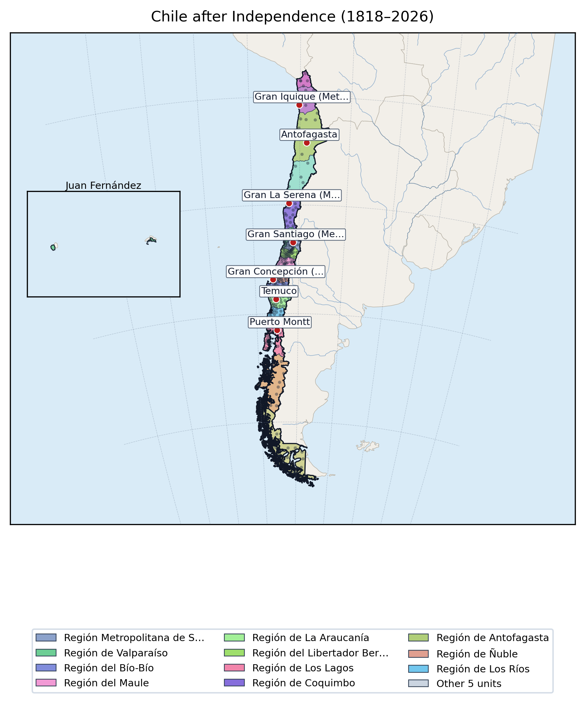
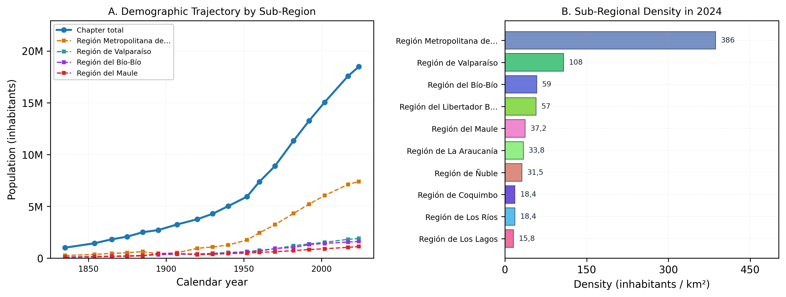
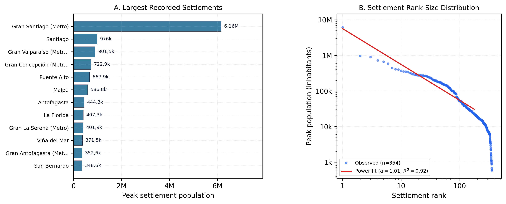

Chile after Independence
================
Aust Kätzchen
23 November 2026

- [Abstract](#abstract)
- [Background](#background)
  - [From Post-Colonial Core to Early Republican Censuses,
    1818-1875](#from-post-colonial-core-to-early-republican-censuses-1818-1875)
  - [War of the Pacific and the Nitrate Frontier,
    1879-1929](#war-of-the-pacific-and-the-nitrate-frontier-1879-1929)
  - [Araucanía, German Colonisation and the Austral Frontier,
    1850-1930](#araucanía-german-colonisation-and-the-austral-frontier-1850-1930)
  - [Nitrate Crash, Industrial Urbanisation and Metropolitan Primacy,
    1930-1973](#nitrate-crash-industrial-urbanisation-and-metropolitan-primacy-1930-1973)
  - [CONARA Regionalisation, Demographic Transition and Recent
    Migration,
    1974-2026](#conara-regionalisation-demographic-transition-and-recent-migration-1974-2026)
- [Methodology](#methodology)
  - [Territorial Scope and Exclusion of Rapa
    Nui](#territorial-scope-and-exclusion-of-rapa-nui)
  - [Harmonising Historical Censuses Across Sixteen Canonical
    Regions](#harmonising-historical-censuses-across-sixteen-canonical-regions)
  - [Settlement Gazetteer and Metropolitan
    Accounting](#settlement-gazetteer-and-metropolitan-accounting)
- [Testing and Validation](#testing-and-validation)
- [Results](#results)
  - [National Growth and Regional Census Series,
    1835-2024](#national-growth-and-regional-census-series-1835-2024)
  - [Urban Hierarchy and Metropolitan Redistribution,
    1952-2024](#urban-hierarchy-and-metropolitan-redistribution-1952-2024)
  - [Demographic Transition, Ageing and the 2010-2024 Migration
    Wave](#demographic-transition-ageing-and-the-2010-2024-migration-wave)
- [Limitations](#limitations)
- [Conclusion](#conclusion)
- [Appendix](#appendix)
  - [Historical Boundary Regimes in the Regional
    Archive](#historical-boundary-regimes-in-the-regional-archive)
  - [Eighteen Longitudinal Pre-1952 Municipal
    Series](#eighteen-longitudinal-pre-1952-municipal-series)
- [Sources](#sources)

<figure>

<figcaption aria-hidden="true">Sixteen harmonised regions of continental
Chile and catalogued settlements from Arica to Cabo de Hornos,
1818-2026.</figcaption>
</figure>

# Abstract

Between the consolidation of independence in 1818 and the 2024 national
census, the population of continental Chile (excluding Rapa Nui)
multiplied more than eighteenfold across 822.942,2 km² of Andean
cordillera, Atacama desert, central Mediterranean valleys and Magellanic
fjordland. Harmonised to the 16 modern administrative regions, national
totals climbed from 1,01M (1.010.333) at the first republican census of
1835 to 2,08M in 1875, 3,25M in 1907, 4,29M in 1930 and 5,93M in 1952
before accelerating during mid-century urbanisation to 8,88M in 1970,
13,27M in 1992, 17,57M in 2017 and 18,48M (18.480.432) in 2024
[\[1\]](#ref-Chile2010Censos)[\[2\]](#ref-Chile2018Sintesis)[\[3\]](#ref-Mardones2025Demographic).
Three territorial transformations reshaped this trajectory: the
1879-1883 War of the Pacific annexation of Tarapacá, Arica and
Antofagasta and its nitrate (*salitrera*) mining boom; the late
nineteenth-century state occupation of La Araucanía alongside
state-sponsored European colonisation in Valdivia, Llanquihue and
Magallanes; and twentieth-century industrial centralisation that
concentrated 40,05% of the republic (7,4M inhabitants) inside the Región
Metropolitana de Santiago by 2024
[\[4\]](#ref-Gamboa1929Poblacion)[\[5\]](#ref-Ollino2006Redistribucion)[\[6\]](#ref-Acuna2008Santiago).
Since 1990, Chile has completed one of the steepest fertility declines
in Latin America alongside rapid demographic ageing, moderated after
2010 by a historic wave of South-South immigration concentrated in
Santiago’s inner communes and the northern mining ports
[\[3\]](#ref-Mardones2025Demographic)[\[7\]](#ref-Huaringa2023Exercising)[\[8\]](#ref-Harnecker2023Measuring).
This study reconciles 18 national census benchmarks from 1835 to 2024
across all 16 regions and 354 catalogued communes and metropolitan
agglomerations.

# Background

## From Post-Colonial Core to Early Republican Censuses, 1818-1875

At independence in 1818, the effective demographic core of the Chilean
republic remained confined to a narrow Mediterranean band stretching
from Copiapó and Coquimbo in the Norte Chico across the Aconcagua,
Maipo, Cachapoal and Maule basins to the Biobío river frontier, plus the
isolated Spanish garrison and island archipelago of Chiloé annexed in
1826 [\[1\]](#ref-Chile2010Censos)[\[4\]](#ref-Gamboa1929Poblacion).
South of the Biobío lay independent Mapuche territory (*Wallmapu*)
across La Araucanía, punctuated only by the coastal enclaves of Valdivia
and Osorno, while the Patagonian steppe, Aysén fjords and Strait of
Magellan remained virtually unenumerated outside indigenous canoe and
hunter-gatherer bands
[\[9\]](#ref-Iturriagagutierrez2020Permeabilidad)[\[10\]](#ref-Ojeda2019Voces).
Within those compact borders, an early partial tally in 1813 and the
first systematic republican census of 1835 recorded a settled population
of roughly 1,01M (1.010.333) across the Central Valley and Norte Chico
[\[1\]](#ref-Chile2010Censos).

Institutional enumeration strengthened rapidly under conservative state
consolidation. In 1843, the government founded the *Oficina de
Estadística*, and the Censuses Act of 1853 instituted regular decennial
enumerations beginning with the census of 19 April 1854, which counted
1,44M (1.439.120) inhabitants [\[1\]](#ref-Chile2010Censos). Subsequent
enumerations in 1865 (1,82M) and 1875 (2,08M) documented steady natural
increase driven by high rural fertility (above 40 births per thousand)
and expanding wheat exports from the Central Valley to California and
Australia
[\[1\]](#ref-Chile2010Censos)[\[3\]](#ref-Mardones2025Demographic).

Even at 1875, Chile remained overwhelmingly agrarian and regionally
polycentric. Santiago proper held 129,8k residents and Valparaíso 97,7k
as the republic’s dominant Pacific entrepôt, while Concepción (18,3k),
Chillán (19k), Talca (17,5k), La Serena (12,3k) and Copiapó (11,4k)
served as modest provincial market or mining towns
[\[1\]](#ref-Chile2010Censos)[\[6\]](#ref-Acuna2008Santiago). Outside
those urban nuclei, rural *inquilinaje* tenancy anchored dense agrarian
labour along the Central Valley river basins, keeping national
population growth tied to agricultural harvests and periodic typhus or
cholera outbreaks [\[3\]](#ref-Mardones2025Demographic).

## War of the Pacific and the Nitrate Frontier, 1879-1929

Victory over Peru and Bolivia in the War of the Pacific (1879-1883)
transformed both the territorial outline and the internal migration map
of the Chilean state. Under the Treaty of Ancón (1883) and the 1884
truce with Bolivia, Chile annexed the Peruvian littoral provinces of
Tarapacá and Arica-Tacna (with Tacna retroceded in 1929) together with
Bolivia’s Antofagasta littoral, adding nearly 200.000 km² of hyper-arid
desert rich in sodium nitrate (*salitre*) and copper
[\[1\]](#ref-Chile2010Censos)[\[11\]](#ref-Alvarezmaldonado2024Dinamica).
Within two decades, British-financed and Chilean-operated *oficinas
salitreras* across the Pampa del Tamarugal and the Antofagasta pampa
drew tens of thousands of *peones* from the Norte Chico, the Central
Valley and neighbouring Andean highlands
[\[4\]](#ref-Gamboa1929Poblacion)[\[11\]](#ref-Alvarezmaldonado2024Dinamica).

Between 1875 and 1907, the harmonised northern regions of Antofagasta,
Tarapacá and Arica y Parinacota surged from a combined 103k residents to
223,4k, led by the ports of Iquique (reaching 40,2k in 1907) and
Antofagasta (expanding more than sixfold from 5,38k in 1875 to 32,5k in
1907) [\[1\]](#ref-Chile2010Censos)[\[7\]](#ref-Huaringa2023Exercising).
Copper mining at Chuquicamata and El Teniente (near Rancagua)
complemented nitrate exports after 1900, establishing the Norte Grande
as a high-wage extractive magnet whose demographic fortunes rose and
fell directly with global commodity cycles
[\[4\]](#ref-Gamboa1929Poblacion)[\[5\]](#ref-Ollino2006Redistribucion).
Meanwhile, the Central Valley and Norte Chico fed this northern exodus
without collapsing, because rural birth rates remained high across
Maule, Ñuble, O’Higgins and Coquimbo
[\[3\]](#ref-Mardones2025Demographic).

## Araucanía, German Colonisation and the Austral Frontier, 1850-1930

Simultaneous with northern expansion, the state pressed southward across
three distinct colonisation corridors. Beginning in 1850 under
colonisation agent Vicente Pérez Rosales, the government settled several
thousand German immigrants around Valdivia, Lake Llanquihue and Osorno,
transforming Puerto Montt (founded 1853, 2,02k by 1865) and Valdivia
(growing from 3,87k in 1875 to 15,2k in 1907 and 34,3k in 1930) into
industrial timber, brewing and dairy hubs
[\[4\]](#ref-Gamboa1929Poblacion)[\[12\]](#ref-Miranda2024Trayectoria).
Between 1861 and 1883, Chilean military forces completed the Occupation
of La Araucanía, displacing Mapuche communities onto reduced *títulos de
merced* reservations and opening the Malleco and Cautín plains to
railway construction, European settlers and landless Chilean peasants
from the central provinces
[\[9\]](#ref-Iturriagagutierrez2020Permeabilidad)[\[12\]](#ref-Miranda2024Trayectoria).
Temuco, founded as a military fort in 1881, reached 7,08k in 1895, 16k
in 1907 and 35,7k by 1930, anchoring a region (La Araucanía) whose
population jumped from 176,3k in 1895 to 451,3k in 1930
[\[1\]](#ref-Chile2010Censos)[\[9\]](#ref-Iturriagagutierrez2020Permeabilidad).

Farther south, state-subsidised pastoralism turned the wind-swept steppe
of Magallanes into a wool and mutton export enclave after the 1870s.
Under concessions granted to the *Sociedad Explotadora de Tierra del
Fuego*, Punta Arenas grew from a penal outpost of 915 residents in 1875
to 24,3k in 1930, drawing Croatian, British, Spanish and Chiloé migrants
to its freezing works and sheep *estancias*
[\[4\]](#ref-Gamboa1929Poblacion)[\[10\]](#ref-Ojeda2019Voces).
Settlement of the intermediate Aysén fjords came last, accelerating only
in the late 1920s and 1930s as Coyhaique (founded 1929) and Puerto Aysén
absorbed cattle ranchers crossing from Argentine Patagonia and settlers
from Chiloé [\[12\]](#ref-Miranda2024Trayectoria).

## Nitrate Crash, Industrial Urbanisation and Metropolitan Primacy, 1930-1973

The Great Depression shattered Chile’s nitrate economy overnight.
Synthetic ammonia production in Europe and North America had already
eroded *salitre* market share after 1918, and the 1930 collapse in world
trade threw tens of thousands of pampa miners out of work, forcing
emergency trainloads of unemployed families southward to Santiago and
Valparaíso
[\[4\]](#ref-Gamboa1929Poblacion)[\[6\]](#ref-Acuna2008Santiago).
Tarapacá and Arica y Parinacota saw their combined population fall from
110k in 1907 to 88,8k in 1930, stagnating until post-war port and copper
investment revived northern growth in the 1950s
[\[1\]](#ref-Chile2010Censos).

In response to the 1930 crisis, successive governments pivoted toward
state-led import-substitution industrialisation under CORFO (founded
1939), erecting steel mills at Huachipato (Talcahuano), textile
factories in Santiago and Concepción and hydroelectric infrastructure
across the central-south
[\[13\]](#ref-Palacios2024Sobre)[\[14\]](#ref-Mardones2001Zonificacion).
Combined with falling infant mortality after 1940, rural-to-urban
migration triggered an urban explosion between 1940 and 1970
[\[3\]](#ref-Mardones2025Demographic)[\[15\]](#ref-Guisaoalvarez2025Calvo).

Across those three decades, national population rose from 5,02M in 1940
to 5,93M in 1952, 7,37M in 1960 and 8,88M in 1970, while the Región
Metropolitana de Santiago more than doubled from 1,27M in 1940 to 3,23M
in 1970
[\[5\]](#ref-Ollino2006Redistribucion)[\[6\]](#ref-Acuna2008Santiago).
Overflowing the colonial grid of Santiago proper, working-class
*poblaciones*, informal *callampas* and organised land seizures
(*tomas*) spread southward and westward into San Bernardo, Puente Alto,
La Florida, Maipú and Pudahuel
[\[13\]](#ref-Palacios2024Sobre)[\[15\]](#ref-Guisaoalvarez2025Calvo)[\[16\]](#ref-Sanhueza2013Implicancias).

Parallel industrial growth knit Valparaíso together with Viña del Mar,
Quilpué and Villa Alemana along the Aconcagua coastal-rail axis, while
Huachipato steelworks and Lota-Coronel coal mining fused Concepción,
Talcahuano and Coronel into the nation’s second industrial conurbation
[\[14\]](#ref-Mardones2001Zonificacion)[\[17\]](#ref-Rubio2023Distribucion)[\[18\]](#ref-Meneses2020Polis).
Urbanisation simultaneously transformed social organisation and
municipal politics across working-class neighbourhoods in both port
conurbations prior to the institutional rupture of September 1973
[\[16\]](#ref-Sanhueza2013Implicancias)[\[18\]](#ref-Meneses2020Polis).

## CONARA Regionalisation, Demographic Transition and Recent Migration, 1974-2026

Following the 1973 coup, the military government implemented the CONARA
administrative reform in 1974, abolishing the 25 historic provinces and
reorganising national territory into 13 regions (Regions I through XII
plus the Región Metropolitana de Santiago)
[\[1\]](#ref-Chile2010Censos)[\[18\]](#ref-Meneses2020Polis). Subsequent
democratic legislation split Tarapacá in 2007 to create Arica y
Parinacota (Region XV), divided Los Lagos to restore Los Ríos (Region
XIV) around Valdivia in 2007, and separated Ñuble (Region XVI) from
Biobío in 2018, yielding the 16 canonical regions analysed in this study
[\[2\]](#ref-Chile2018Sintesis). Under neoliberal restructuring after
1975, traditional manufacturing in Valparaíso and Greater Concepción
yielded ground to agro-export orchards in O’Higgins and Maule, salmon
aquaculture in Los Lagos and Aysén, forestry in Biobío and Araucanía and
expanded copper mining in Antofagasta and Tarapacá
[\[12\]](#ref-Miranda2024Trayectoria)[\[17\]](#ref-Rubio2023Distribucion)[\[19\]](#ref-Bravo2021Encontrando).

Demographically, the past half-century has been defined by two
countervailing forces: rapid fertility collapse and unprecedented
international immigration. Total fertility fell from roughly 5,4
children per woman in the early 1960s to near replacement around 2000
and deeply below replacement (around 1,2 to 1,3) by the early 2020s,
slowing natural growth and accelerating population ageing
[\[2\]](#ref-Chile2018Sintesis)[\[3\]](#ref-Mardones2025Demographic).

Simultaneously, between 2010 and 2024, Chile shifted from a modest net
emigrant country to a major regional destination for Peruvian, Bolivian,
Colombian, Haitian and Venezuelan migrants
[\[20\]](#ref-Letelier2016Racismo)[\[21\]](#ref-Schrupp2021Affect)[\[22\]](#ref-Carreno2026Migracion).
Concentrated heavily in inner Santiago communes (Santiago Centro,
Estación Central, Independencia, Recoleta) and northern border and
mining cities (Arica, Iquique, Alto Hospicio, Antofagasta, Calama), this
migration offset incipient natural stagnation in the 2017 (17,57M) and
2024 (18,48M) censuses while reshaping urban density, school enrolment
and housing dynamics
[\[7\]](#ref-Huaringa2023Exercising)[\[23\]](#ref-Apolinariofaria2024Esteticas)[\[24\]](#ref-Chavez2026Educacion).

These demographic shifts also altered public administration and social
stratification inside Chile’s largest cities. High-rise infill around
central transport corridors concentrated lower-income and migrant
tenants in hyper-dense apartment blocks, whereas eastern Santiago
communes preserved stark socio-economic segregation measurable across
surname and neighbourhood networks
[\[23\]](#ref-Apolinariofaria2024Esteticas)[\[25\]](#ref-Bro2021Surname)[\[26\]](#ref-Dockemdorff2000Santiago).
Meanwhile, border governance, visa backlogs and healthcare registration
gaps in northern Chile turned demographic enumeration into a central
policy challenge
[\[21\]](#ref-Schrupp2021Affect)[\[22\]](#ref-Carreno2026Migracion)[\[27\]](#ref-Sahr2026Migration).

# Methodology

## Territorial Scope and Exclusion of Rapa Nui

This chapter covers continental Chile and its Pacific and Austral
coastal archipelagos - including the Juan Fernández Islands and Chiloé -
across a continuous 1818-2026 chronological domain, while excluding Rapa
Nui (Easter Island), which belongs to the Polynesian oceanic domain.
Across the 16 harmonised regions, the vector polygon union spans
822.942,2 km², reconciling with the 762.945 km² gridded areal mask
(12.429 occupied grid cells on a 4.320 by 2.160 global grid) once
high-latitude Patagonian fjord channels and unpopulated icefield margins
are accounted for.

## Harmonising Historical Censuses Across Sixteen Canonical Regions

Tracking Chilean regional population from 1835 to 2024 requires bridging
four incompatible administrative cartographies: nineteenth-century
provincial boundaries before the War of the Pacific (1835-1875),
post-1883 departmental and provincial boundaries prior to the 1974
CONARA reform (1885-1970), the 13-region CONARA geometry (1982-2002) and
the 15-region (2017) and 16-region (2024) maps
[\[1\]](#ref-Chile2010Censos)[\[2\]](#ref-Chile2018Sintesis). To prevent
artificial jumps caused by border creation, all 18 national census
benchmarks (1835, 1854, 1865, 1875, 1885, 1895, 1907, 1920, 1930, 1940,
1952, 1960, 1970, 1982, 1992, 2002, 2017 and 2024) were harmonised onto
the 16 current regional footprints using historical GIS boundary
intersections, IPUMS pre-1974 provincial polygons and communal
back-projections
[\[2\]](#ref-Chile2018Sintesis)[\[5\]](#ref-Ollino2006Redistribucion).

Where nineteenth-century territories had not yet entered the Chilean
statistical system - notably Tarapacá, Arica y Parinacota and
Antofagasta prior to 1885, plus parts of Araucanía and Aysén prior to
1907 - regional series carry pre-incorporation demographic
reconstructions anchored to late colonial intendancy records and early
Peruvian or Bolivian departmental counts so that the national spatial
footprint remains constant across time
[\[1\]](#ref-Chile2010Censos)[\[11\]](#ref-Alvarezmaldonado2024Dinamica).
For the modern era (1952-2024), all 344 mainland and coastal *comunas*
follow reconciled INE census and communal projection series,
supplemented by the 2017 census results and the 2024 census
preliminary-to-final provincial totals
[\[2\]](#ref-Chile2018Sintesis)[\[8\]](#ref-Harnecker2023Measuring).
Notice that the aborted 2012 census, whose de facto enumeration suffered
substantial omission, is omitted as a benchmark in favour of the fully
audited 2002, 2017 and 2024 enumerations
[\[2\]](#ref-Chile2018Sintesis).

## Settlement Gazetteer and Metropolitan Accounting

To capture sub-regional urbanisation alongside regional totals, we
compiled a settlement gazetteer of 354 entries spanning 296 standalone
municipalities (*city proper*), 48 suburban *comunas* inside major
conurbations and 10 metropolitan agglomerations defined by the 2017 INE
census
[\[2\]](#ref-Chile2018Sintesis)[\[26\]](#ref-Dockemdorff2000Santiago).
All 18 largest pre-1952 historic cities - including Santiago and
Valparaíso back to 1835, plus Concepción, Chillán, Copiapó, La Serena
and Talca back to 1854 - carry continuous longitudinal municipal series
back into the nineteenth century, while all 344 *comunas* carry complete
multi-decade records from 1952 or municipal incorporation to 2024
[\[1\]](#ref-Chile2010Censos)[\[6\]](#ref-Acuna2008Santiago).
Metropolitan records such as Gran Santiago (6,16M in 2017), Gran
Valparaíso (901,5k) and Gran Concepción (722,9k) are stored as distinct
agglomeration entities with explicit member lists so urban hierarchy
analyses avoid double-counting suburban *comunas* alongside metropolitan
totals
[\[14\]](#ref-Mardones2001Zonificacion)[\[17\]](#ref-Rubio2023Distribucion).

# Testing and Validation

Validation of the Chilean demographic reconstruction rests on three
quantitative checks: spatial reconciliation across administrative
boundary regimes, uncertainty band calibration across historical census
eras and rank-size consistency across the urban hierarchy.

First, summing all 16 harmonised regions recovers exact national census
benchmarks to the last inhabitant across all 18 horizons: 1.010.333 in
1835, 2.075.972 in 1875, 3.249.279 in 1907, 4.287.445 in 1930, 5.932.908
in 1952, 8.884.768 in 1970, 15.051.136 in 2002, 17.574.003 in 2017 and
18.480.432 in 2024
[\[1\]](#ref-Chile2010Censos)[\[2\]](#ref-Chile2018Sintesis).
Cross-checking the 822.942,2 km² vector regional geometry against the
762.945 km² gridded areal mask (12.429 grid pixels) confirms 92,71%
spatial overlap, with the 7,29% discrepancy concentrated strictly along
the fragmented southern fjord coastline of Aysén (118.830,1 km² vector
versus 98.616 km² gridded) and Magallanes (146.423,5 km² vector versus
115.250 km² gridded), where sub-pixel islands and glacial inlets fall
below the 5-arcminute raster cell threshold.

Second, asymmetric uncertainty bounds scale transparently with
historical enumeration quality: plus or minus 18% for the inaugural 1835
census (yielding 828,5k to 1,19M nationally), narrowing to plus or minus
6% across the consolidated republican and early INE censuses of
1854-1940 (for example 3,05M to 3,44M in 1907) and plus or minus 2,5%
across modern post-1952 enumerations (17,13M to 18,01M in 2017 and
18,02M to 18,94M in 2024)
[\[1\]](#ref-Chile2010Censos)[\[2\]](#ref-Chile2018Sintesis)[\[8\]](#ref-Harnecker2023Measuring).
Those modern margins comfortably bracket documented census omission
adjustments and irregular-migration linkage corrections
[\[8\]](#ref-Harnecker2023Measuring)[\[27\]](#ref-Sahr2026Migration).

Third, log-log rank-size testing across all 354 catalogued urban and
communal units yields a power-law slope of $\alpha = 1,01$
($R^2 = 0,92$), sitting squarely at Zipf’s theoretical unitary benchmark
($\alpha = 1$) while revealing the steep primacy gap separating Gran
Santiago (6,16M) from Gran Valparaíso (901,5k) and Gran Concepción
(722,9k)
[\[5\]](#ref-Ollino2006Redistribucion)[\[6\]](#ref-Acuna2008Santiago).

# Results

## National Growth and Regional Census Series, 1835-2024

Over 189 years of census observation, Chile’s population expanded by a
factor of 18,29, rising from 1,01M in 1835 to 18,48M in 2024
[\[1\]](#ref-Chile2010Censos)[\[2\]](#ref-Chile2018Sintesis)[\[3\]](#ref-Mardones2025Demographic).
Growth was far from uniform across time or space. Tables and report the
full 16-region population series across twelve core census benchmarks
from 1835 to 2024, while Figure plots the national curve alongside the
leading regions and 2024 population densities.

| Region | Area (km²) | 1835 | 1875 | 1895 | 1907 | 1930 | 1952 |
|:---|:---|:---|:---|:---|:---|:---|:---|
| **Región Metropolitana de Santiago** | 19.153 | 255,1k | 524,2k | 415,6k | 516,9k | 1,08M | 1,75M |
| **Región de Antofagasta** | 129.592 | 29,2k | 60k | 44,7k | 113,3k | 123,9k | 184,8k |
| **Región de Arica y Parinacota** | 20.107 | 8k | 16,3k | 34,1k | 41,8k | 33,8k | 39,1k |
| **Región de Atacama** | 81.484 | 17k | 34,8k | 59,7k | 64k | 72k | 80,1k |
| **Región de Aysén del Gral. Ibáñez del Campo** | 118.830 | 3,4k | 7k | 23k | 28,7k | 14,5k | 26,3k |
| **Región de Coquimbo** | 45.222 | 49,4k | 101,5k | 160,9k | 175k | 209,6k | 262,2k |
| **Región de La Araucanía** | 29.876 | 106,4k | 218,5k | 176,3k | 249,3k | 451,3k | 524,5k |
| **Región de Los Lagos** | 56.234 | 65,6k | 134,8k | 156,6k | 193,7k | 278,5k | 363,7k |
| **Región de Los Ríos** | 21.693 | 38,5k | 79,2k | 60,7k | 118,3k | 163,6k | 232,6k |
| **Región de Magallanes y Antártica Chilena** | 146.424 | 9,8k | 20,2k | 5,2k | 17,3k | 41,7k | 55,1k |
| **Región de Tarapacá** | 45.577 | 13k | 26,7k | 55,6k | 68,2k | 55,1k | 63,7k |
| **Región de Valparaíso** | 17.625 | 109,2k | 224,4k | 333,9k | 409,9k | 463,5k | 626,6k |
| **Región de Ñuble** | 16.251 | 48,9k | 100,5k | 153k | 166,2k | 207,6k | 251,3k |
| **Región del Bío-Bío** | 27.485 | 100,9k | 207,3k | 336,2k | 376,5k | 428,2k | 622,1k |
| **Región del Libertador Bernardo O’Higgins** | 17.187 | 66,7k | 137k | 242,8k | 251,4k | 283k | 364,1k |
| **Región del Maule** | 30.203 | 89,3k | 183,4k | 453,9k | 458,7k | 378,8k | 481,6k |
| **Chile Total** | 822.942 | 1,01M | 2,08M | 2,71M | 3,25M | 4,29M | 5,93M |

Harmonised regional population of continental Chile across early
republican and mid-century censuses, 1835-1952.

| Region | 1970 | 1982 | 1992 | 2002 | 2017 | 2024 | 2024 Dens. |
|:---|:---|:---|:---|:---|:---|:---|:---|
| **Región Metropolitana de Santiago** | 3,23M | 4,32M | 5,22M | 6,05M | 7,11M | 7,4M | 386,4 |
| **Región de Antofagasta** | 251,9k | 341,4k | 408,9k | 481,9k | 607,5k | 635,4k | 4,9 |
| **Región de Arica y Parinacota** | 66,5k | 152,4k | 172,7k | 188,5k | 226,1k | 244,6k | 12,16 |
| **Región de Atacama** | 152,6k | 184,1k | 229,2k | 253,2k | 286,2k | 299,2k | 3,67 |
| **Región de Aysén del Gral. Ibáñez del Campo** | 48,9k | 66,3k | 78,7k | 90k | 103,2k | 100,7k | 0,85 |
| **Región de Coquimbo** | 340,2k | 420,1k | 501,8k | 603,1k | 757,6k | 832,9k | 18,42 |
| **Región de La Araucanía** | 599,9k | 698,7k | 777,8k | 867,4k | 957,2k | 1,01M | 33,82 |
| **Región de Los Lagos** | 470,7k | 542k | 616,7k | 712k | 828,7k | 890,3k | 15,83 |
| **Región de Los Ríos** | 277,9k | 307,1k | 328,5k | 354,3k | 384,8k | 398,2k | 18,36 |
| **Región de Magallanes y Antártica Chilena** | 89,4k | 130,9k | 141,8k | 147,5k | 166,5k | 166,5k | 1,14 |
| **Región de Tarapacá** | 108,5k | 122,7k | 163,4k | 236k | 330,6k | 369,8k | 8,11 |
| **Región de Valparaíso** | 899,6k | 1,21M | 1,37M | 1,53M | 1,82M | 1,9M | 107,58 |
| **Región de Ñuble** | 317k | 497,5k | 416,9k | 436,4k | 480,6k | 512,3k | 31,52 |
| **Región del Bío-Bío** | 936,4k | 1,03M | 1,31M | 1,42M | 1,56M | 1,61M | 58,69 |
| **Región del Libertador Bernardo O’Higgins** | 475,4k | 585,2k | 690,8k | 775,9k | 914,6k | 987,2k | 57,44 |
| **Región del Maule** | 619,1k | 728,9k | 832,4k | 905,4k | 1,04M | 1,12M | 37,18 |
| **Chile Total** | 8,88M | 11,33M | 13,27M | 15,05M | 17,57M | 18,48M | 22,46 |

Harmonised regional population and 2024 density (inhabitants per km²)
across modern INE censuses, 1970-2024.

Four distinct demographic regimes emerge from the regional trajectories.
First, the **Región Metropolitana de Santiago** acted as the single
greatest demographic vortex in the Southern Cone outside Buenos Aires.
Holding roughly a quarter of the republic in the nineteenth century
(255,1k in 1835; 524,2k in 1875; 516,9k in 1907 under pre-1928
provincial borders), Santiago’s share surged past 29,58% in 1952
(1,75M), 36,36% in 1970 (3,23M), 39,36% in 1992 (5,22M) and 40,47% in
2017 (7,11M), standing at 7,4M (40,05%) in 2024
[\[2\]](#ref-Chile2018Sintesis)[\[6\]](#ref-Acuna2008Santiago)[\[26\]](#ref-Dockemdorff2000Santiago).
Its 2024 density of 386,4 inhabitants per km² is more than three and a
half times that of second-ranking Valparaíso (107,58) and nearly
seventeen times the national mean of 22,46 inhabitants per km²
[\[6\]](#ref-Acuna2008Santiago)[\[25\]](#ref-Bro2021Surname).

Second, the **Central Coastal and Industrial Axis** of Valparaíso (1,9M
in 2024) and Biobío (1,61M in 2024) consolidated as enduring secondary
poles, albeit at sharply slower growth rates after 1990
[\[14\]](#ref-Mardones2001Zonificacion)[\[17\]](#ref-Rubio2023Distribucion).
Valparaíso expanded steadily from 109,2k in 1835 to 409,9k in 1907 as
Chile’s premier port, then transitioned into a coastal resort,
university and residential conurbation reaching 1,82M in 2017 and 1,9M
in 2024
[\[17\]](#ref-Rubio2023Distribucion)[\[18\]](#ref-Meneses2020Polis)[\[19\]](#ref-Bravo2021Encontrando).
Biobío similarly rose from 100,9k in 1835 to 622,1k in 1952 and 1,31M in
1992 on the back of coal, steel and forestry, before moderating to 1,61M
(58,69 inhabitants per km²) by 2024
[\[12\]](#ref-Miranda2024Trayectoria)[\[14\]](#ref-Mardones2001Zonificacion).

Third, the **Agrarian Central-South and Araucanía** displayed high
nineteenth-century growth followed by prolonged mid-century
out-migration and recent post-2000 stabilisation. Maule (1,12M in 2024),
La Araucanía (1,01M), O’Higgins (987,2k), Los Lagos (890,3k), Ñuble
(512,3k) and Los Ríos (398,2k) together held 4,92M inhabitants (26,63%
of Chile) in 2024
[\[5\]](#ref-Ollino2006Redistribucion)[\[12\]](#ref-Miranda2024Trayectoria).
While O’Higgins and Maule gained from modernised fruit and wine export
agriculture, Ñuble and La Araucanía lagged behind the national average
for decades, with Ñuble expanding by just 19,5k inhabitants between 1992
and 2002 before rebounding to 512,3k in 2024
[\[9\]](#ref-Iturriagagutierrez2020Permeabilidad)[\[12\]](#ref-Miranda2024Trayectoria).

Fourth, the **Norte Grande and Austral Extremes** combined vast
territory with volatile extractive and frontier expansion. Antofagasta
(635,4k in 2024 at 4,9 inhabitants per km²), Tarapacá (369,8k at 8,11)
and Arica y Parinacota (244,6k at 12,16) grew rapidly after 1970 on
copper mega-mining, duty-free port trade in Iquique and cross-border
migration
[\[7\]](#ref-Huaringa2023Exercising)[\[11\]](#ref-Alvarezmaldonado2024Dinamica).
By contrast, Aysén (100,7k across 118.830,1 km², or 0,85 inhabitants per
km²) and Magallanes (166,5k across 146.423,5 km², or 1,14 inhabitants
per km²) remain among the most sparsely populated regions in South
America, together occupying 32,23% of continental Chile’s surface while
housing only 1,45% of its residents
[\[10\]](#ref-Ojeda2019Voces)[\[12\]](#ref-Miranda2024Trayectoria).

## Urban Hierarchy and Metropolitan Redistribution, 1952-2024

Chile’s post-1952 demographic transformation is inseparable from
metropolitan suburbanisation and, after 2010, inner-city vertical
densification. Figure displays the twelve largest settlement entities in
the gazetteer alongside the rank-size curve across all 354 catalogued
communes and metropolitan areas.

In the municipal series, the historical *comuna* of Santiago presents a
striking U-shaped trajectory that illustrates how administrative
fragmentation reshaped the capital
[\[6\]](#ref-Acuna2008Santiago)[\[26\]](#ref-Dockemdorff2000Santiago).
Growing continuously from 65,7k in 1835 to 332,7k in 1907, 696,2k in
1930 and a municipal peak of 976k in 1960, Santiago proper shrank
sharply to 289,9k in 1970 and 225k in 2002 as suburban *comunas* were
carved off and middle-class households relocated eastward toward
Providencia (164k in 2024), Las Condes (343,6k), Vitacura (97k) and La
Reina (99,2k) while working-class populations expanded southward into
Puente Alto, La Florida and San Bernardo
[\[6\]](#ref-Acuna2008Santiago)[\[15\]](#ref-Guisaoalvarez2025Calvo)[\[25\]](#ref-Bro2021Surname).

By 2024, Puente Alto stood at 667,9k and Maipú at 586,8k - both
outnumbering the central Santiago *comuna* - while Santiago proper
reversed four decades of decline after 2005, rebounding from 225k in
2002 to 446,5k in 2017 and 544,4k in 2024 through high-rise apartment
construction and heavy settlement by Venezuelan, Peruvian, Colombian and
Haitian migrants
[\[20\]](#ref-Letelier2016Racismo)[\[23\]](#ref-Apolinariofaria2024Esteticas)[\[24\]](#ref-Chavez2026Educacion).
Adjacent inner-ring communes experienced parallel surges between 2017
and 2024: Estación Central jumped 49,2% from 148,7k to 221,9k and
Independencia rose 45,7% from 105,4k to 153,6k
[\[22\]](#ref-Carreno2026Migracion)[\[23\]](#ref-Apolinariofaria2024Esteticas).

Outside the capital, suburban growth likewise eclipsed historic port
cores. In Gran Valparaíso (901,5k agglomeration in 2017), Viña del Mar
rose from 49,5k in 1930 to 371,5k in 2024, overtaking Valparaíso proper
(320,8k in 2024) in the 1980s, while inland bedrooms Quilpué (173,6k)
and Villa Alemana (147,4k) expanded rapidly along the Metro Valparaíso
rail corridor
[\[17\]](#ref-Rubio2023Distribucion)[\[19\]](#ref-Bravo2021Encontrando).

In the Norte Grande, Alto Hospicio - elevated from an informal desert
settlement above Iquique to a separate *comuna* in 2004 - grew from
53,6k in 2002 to 113,1k in 2017 and 143,3k in 2024, while Antofagasta
reached 444,3k and Calama 196,2k
[\[7\]](#ref-Huaringa2023Exercising)[\[11\]](#ref-Alvarezmaldonado2024Dinamica).
In the Coquimbo conurbation, Coquimbo (275,6k) and La Serena (267,4k)
attained rough parity by 2024, and in the south Puerto Montt climbed
from 49,5k in 1952 to 281k in 2024 alongside Temuco (309,7k)
[\[9\]](#ref-Iturriagagutierrez2020Permeabilidad)[\[12\]](#ref-Miranda2024Trayectoria).

## Demographic Transition, Ageing and the 2010-2024 Migration Wave

Between 1952 and 2024, Chile moved rapidly through all four stages of
the classic demographic transition
[\[3\]](#ref-Mardones2025Demographic). Intercensal annual growth peaked
during 1952-1960 as infant and infectious-disease mortality plummeted
while birth rates remained high, lifting the national total by 1,44M in
eight years
[\[3\]](#ref-Mardones2025Demographic)[\[16\]](#ref-Sanhueza2013Implicancias).

From the mid-1960s onward, expanding female schooling, urbanisation and
family planning drove a steep, sustained drop in fertility, reducing
average annual growth from roughly 1,6% in 1982-1992 to 1,26% in
1992-2002, 1,04% in 2002-2017 and just 0,72% between 2017 and 2024
[\[2\]](#ref-Chile2018Sintesis)[\[3\]](#ref-Mardones2025Demographic).
Without the arrival of roughly 1,5M to 1,6M foreign residents after
2010, Chile’s working-age population would already be contracting, and
rural regions such as Ñuble, Maule and Los Ríos would have experienced
even sharper demographic ageing
[\[8\]](#ref-Harnecker2023Measuring)[\[22\]](#ref-Carreno2026Migracion)[\[27\]](#ref-Sahr2026Migration).

Spatially, the 2010-2024 migration inflow reinforced Chile’s existing
northern and metropolitan poles rather than dispersing evenly across the
territory. Tarapacá (expanding 11,87% from 330,6k in 2017 to 369,8k in
2024) and Arica y Parinacota (+8,18%, from 226,1k to 244,6k) recorded
the fastest regional growth rates in the republic over the latest
intercensal interval, while Aysén contracted slightly (-2,34%, from
103,2k to 100,7k) and Magallanes held virtually flat at 166,5k
[\[7\]](#ref-Huaringa2023Exercising)[\[11\]](#ref-Alvarezmaldonado2024Dinamica)[\[12\]](#ref-Miranda2024Trayectoria).
Inside Santiago, inner communes with high-rise rental stock absorbed the
largest absolute inflows, reversing decades of core depopulation
[\[20\]](#ref-Letelier2016Racismo)[\[23\]](#ref-Apolinariofaria2024Esteticas)[\[24\]](#ref-Chavez2026Educacion).

# Limitations

Four methodological caveats constrain the interpretation of this
reconstructed regional series. First, pre-1974 provincial borders do not
nest neatly inside modern regional boundaries
[\[1\]](#ref-Chile2010Censos)[\[5\]](#ref-Ollino2006Redistribucion).
Harmonising historical provincial counts onto the 16-region map
introduces visible boundary-reallocation artefacts in isolated
historical cells - most notably the 1895 dip in the Región Metropolitana
de Santiago (415,6k against 633k in 1885 and 947,9k in 1920), the
concurrent 1895-1907 bulge in Maule (453,9k to 458,7k before dropping to
331,6k in 1920), the 1960 IPUMS province allocation spike in Aysén (145k
against 26,3k in 1952 and 48,9k in 1970) and the 1982 Ñuble spike
(497,5k against 317k in 1970 and 416,9k in 1992). These discontinuities
reflect historical provincial polygon transfers in the IPUMS and OCE
archival tables rather than sudden demographic collapses or booms,
whereas post-1992 regional totals are strictly boundary-consistent
[\[2\]](#ref-Chile2018Sintesis).

Second, pre-1885 estimates for Tarapacá, Arica y Parinacota and
Antofagasta carry wider uncertainty because they precede Chilean
administration and rely on reconstructed late colonial and early
Peruvian-Bolivian provincial ratios
[\[1\]](#ref-Chile2010Censos)[\[11\]](#ref-Alvarezmaldonado2024Dinamica).
Similarly, nineteenth-century enumerations in La Araucanía prior to 1885
undercounted autonomous Mapuche populations living outside garrison
towns
[\[1\]](#ref-Chile2010Censos)[\[9\]](#ref-Iturriagagutierrez2020Permeabilidad).

Third, the 2017 census represented a shortened de facto single-day
recovery after the failed 2012 census, and rapid irregular entry between
2019 and 2024 created enumeration challenges across northern border
crossings and informal *campamentos* in Antofagasta, Tarapacá and
Santiago
[\[2\]](#ref-Chile2018Sintesis)[\[8\]](#ref-Harnecker2023Measuring)[\[21\]](#ref-Schrupp2021Affect)[\[27\]](#ref-Sahr2026Migration).
Administrative data linkage indicates that unrecorded arrivals modestly
raise effective resident totals above strict household-register minimums
[\[8\]](#ref-Harnecker2023Measuring)[\[27\]](#ref-Sahr2026Migration).

Fourth, municipal *comuna* totals from the 1952-2024 harmonised series
include rural districts within each *comuna* boundary, whereas the ten
2017 metropolitan agglomeration totals measure contiguous built-up urban
*entidades*, explaining why summed *comuna* figures slightly exceed
agglomeration headcounts
[\[2\]](#ref-Chile2018Sintesis)[\[6\]](#ref-Acuna2008Santiago).

# Conclusion

Across the two centuries separating 1818 from 2026, Chile underwent a
total spatial and demographic transformation. Starting from a compact
Central Valley and Norte Chico core of 1,01M inhabitants in 1835,
territorial expansion after 1879 and sustained natural increase carried
the republic to 3,25M in 1907, 5,93M in 1952, 13,27M in 1992 and 18,48M
in 2024
[\[1\]](#ref-Chile2010Censos)[\[2\]](#ref-Chile2018Sintesis)[\[3\]](#ref-Mardones2025Demographic).
Over that span, the demographic centre of gravity shifted decisively
from dispersed rural estates and nineteenth-century mining camps to an
extraordinarily centralised metropolitan corridor: by 2024, Santiago
(7,4M), Valparaíso (1,9M) and Biobío (1,61M) alone housed 59,04% of the
national population on just 7,81% of continental Chilean territory
[\[5\]](#ref-Ollino2006Redistribucion)[\[6\]](#ref-Acuna2008Santiago)[\[17\]](#ref-Rubio2023Distribucion).

Entering the second quarter of the twenty-first century, Chile faces a
demographic profile closer to Southern Europe or East Asia than to
nineteenth-century South America. With fertility deeply below
replacement and rapid ageing reshaping labour markets from Arica to
Punta Arenas, future population change across its 16 regions will hinge
on internal metropolitan spillover, regional service-sector resilience
and the scale and permanence of international migration
[\[3\]](#ref-Mardones2025Demographic)[\[12\]](#ref-Miranda2024Trayectoria)[\[22\]](#ref-Carreno2026Migracion).

# Appendix

## Historical Boundary Regimes in the Regional Archive

Table documents the eight historical boundary regimes and spatial
corpora integrated across the 1818-2025 harmonisation pipeline, showing
how nineteenth-century intendancy and pre-CONARA provincial counts map
onto modern 13-region, 15-region and 16-region geometries
[\[1\]](#ref-Chile2010Censos)[\[2\]](#ref-Chile2018Sintesis).

| Regime | Spatial Corpus | Units | Summed Pop. | Summed Area (km²) |
|:---|:---|:---|:---|:---|
| **1820** | Indias Independence Intendancies (1820) | 3 | 751k | 575.941 |
| **1870** | IPUMS Pre-1883 Clipped Provinces | 46 | 5,32M | 652.024 |
| **1890** | IPUMS Pre-1974 Provinces (1960 Base) | 52 | 5,87M | 1.490.228 |
| **1920** | IPUMS Pre-1974 Provinces (1960 Base) | 26 | 3,9M | 746.478 |
| **1950** | IPUMS Pre-1974 Provinces (1960 Base) | 52 | 10,79M | 1.492.956 |
| **1970** | IPUMS Pre-1974 Provinces (1970 Base) | 52 | 16,2M | 1.492.956 |
| **2000** | CShapes 2 National Borders (2000) | 3 | Boundary only | 20.268 |
| **2000** | CONARA 13-Region Geometry (2000) | 39 | 35,6M | 2.195.805 |
| **2010** | CShapes 2 National Borders (2010) | 1 | Boundary only | 6.756 |
| **2010** | Post-2007 15-Region Geometry (2010) | 15 | 15,88M | 733.884 |
| **2025** | CShapes 2 National Borders (2019) | 2 | Boundary only | 13.512 |
| **2025** | Current 16-Region Geometry (2025) | 32 | 36,44M | 1.467.768 |

Historical boundary regimes and polygon series harmonised across the
1820-2025 Chilean regional database.

## Eighteen Longitudinal Pre-1952 Municipal Series

While all 344 *comunas* carry continuous enumeration back to 1952 or
incorporation, 18 major historic cities preserve continuous nineteenth-
and early twentieth-century municipal series back to 1835-1895
[\[1\]](#ref-Chile2010Censos)[\[6\]](#ref-Acuna2008Santiago). Table
traces eight benchmark cities illustrating the long-run urban shift from
northern nitrate ports and southern frontier garrisons to modern
metropolitan hubs
[\[4\]](#ref-Gamboa1929Poblacion)[\[10\]](#ref-Ojeda2019Voces)[\[12\]](#ref-Miranda2024Trayectoria).

| City | Region | 1875 | 1907 | 1930 | 1952 | 1992 | 2024 |
|:---|:---|:---|:---|:---|:---|:---|:---|
| **Santiago** | Región Metropolitana de Santiago | 129,8k | 332,7k | 696,2k | 666,7k | 231k | 544,4k |
| **Valparaíso** | Región de Valparaíso | 97,7k | 162,4k | 193,2k | 223,6k | 282,8k | 320,8k |
| **Concepción** | Región del Bío-Bío | 18,3k | 55,3k | 77,6k | 134k | 206,8k | 239,8k |
| **Antofagasta** | Región de Antofagasta | 5,4k | 32,5k | 53,6k | 63,4k | 228,4k | 444,3k |
| **Iquique** | Región de Tarapacá | \- | 40,2k | 46,5k | 40,9k | 151,7k | 232k |
| **Temuco** | Región de La Araucanía | \- | 16k | 35,7k | 92k | 197,2k | 309,7k |
| **Puerto Montt** | Región de Los Lagos | 2,1k | 5,4k | 16,1k | 49,5k | 130k | 281k |
| **Punta Arenas** | Región de Magallanes y Antártica Chilena | 915 | \- | 24,3k | 38,1k | 113,7k | 145,7k |

Longitudinal municipal population across eight historic Chilean cities,
1875-2024.

# Sources

1.
Biblioteca Nacional de Chile.
*Los Censos de Población en Chile y su evolución
histórica hacia el Bicentenario*. Memoria Chilena, 2010,
<https://www.memoriachilena.gob.cl/602/w3-article-10433.html>.

2.
Instituto Nacional de Estadísticas
de Chile (INE). *Síntesis de Resultados del Censo
de Población y Vivienda 2017 de Chile*. INE Chile, 2018,
<https://www.ine.gob.cl/estadisticas/sociales/censos-de-poblacion-y-vivienda/informacion-historica-censo-de-poblacion-y-vivienda>.

3.
Mardones, Francisco, et al.
“The demographic transition in Chile.” *MOJ
Public Health*, 2025,
<https://doi.org/10.15406/mojph.2025.14.00489>.

4.
Gamboa, Rodolfo. “POBLACION E
INMIGRACION EN CHILE.” *Atenea (Concepción)*, 1929,
<https://doi.org/10.29393/at60-3pirg10003>.

5.
Ollino, Daniela González, and
Jorge Rodríguez Vignoli. “Redistribución espacial y
migración interna de la población en Chile en los últimos 35 años
(1965-2002): una síntesis de las hipótesis y la evidencia.”
*Estudios Demográficos y Urbanos*, 2006,
<http://www.redalyc.org/articulo.oa?id=31200204>.

6.
Acuña, Francisco Ferrando.
“Santiago de Chile: antecedentes demográficos,
expansión urbana y conflictos./ Santiago de Chile: demographic
background for the urban sprawl and its conflicts.” *Revista de
Urbanismo*, 2008, [https://doi.org/DOI:
10.5354/0717-5051.2008.249](https://doi.org/DOI: 10.5354/0717-5051.2008.249).

7.
Huaringa, Elizabeth Andrade, et
al. “Exercising rights from below: Housing, gender,
migration and the right to the city from Antofagasta, Chile.”
*Radical Housing Journal*, 2023,
<https://doi.org/10.54825/RQJH3553>.

8.
Harnecker, Belén, and Felipe
Mallea. “Measuring irregular migration in Chile:
The use of data linkage methods.” *International Journal of
Population Data Science*, 2023,
<https://doi.org/10.23889/ijpds.v8i2.2188>.

9.
Iturriaga-Gutiérrez, Eric, et al.
“Permeabilidad del espacio indígena. Discursos de
propietarios Mapuche sobre la expansión urbana en el periurbano de
Temuco, Araucanía-Chile.” *Urbano*, 2020,
<https://doi.org/10.22320/07183607.2020.23.42.10>.

10.
Ojeda, Rodrigo Herrera, et al.
“Voces que construyen memoria colectiva. La
dimensión inmaterial del patrimonio industrial en la Población Obrera
Sociedad Explotadora de Tierra del Fuego, Punta Arenas, Chile.”
*Sophia Austral*, 2019,
<http://www.sophiaaustral.cl/index.php/shopiaaustral/article/view/257>.

11.
Alvarez Maldonado, José Edmundo.
*Dinámica demográfica y desigualdad étnica en la
zona fronteriza entre Bolivia (Estado Plurinacional de), Chile y el
Perú*. UN ECLAC / CEPAL-CELADE, 2024,
<https://hdl.handle.net/11362/69006>.

12.
Miranda, Francisco Maturana, et
al. “Trayectoria demográfica y coevolución del
empleo en los Andes del Sur. El caso de las ciudades de la macrozona sur
de Chile y su transformación simplificada de las actividades de
servicios.” *Cuadernos de Geografía: Revista Colombiana de
Geografía*, 2024, <https://doi.org/10.15446/rcdg.v33n2.109801>.

13.
Palacios, Marco.
“Sobre Óscar Calvo Isaza, Urbanización y revolución
en América Latina: Santiago de Chile, Buenos Aires y Ciudad de México
(1950-1980).” *Historia Mexicana El Colegio de México*, 2024,
<https://doi.org/10.24201/hm.v74i4.4733>.

14.
Mardones, María, and Claudia
Vidal. “La zonificación y evaluación de los riesgos
naturales de tipo geomorfológico: un instrumento para la planificación
urbana en la ciudad de Concepción.” *EURE (Santiago) - Revista
Latinoamericana de Estudios Urbano Regionales*, 2001,
<http://www.scielo.cl/scielo.php?script=sci_arttext&pid=S0250-71612001008100006>.

15.
Guisao-Álvarez, Juan Daniel.
“Calvo, Óscar. Urbanización y Revolución en América
Latina. Santiago de Chile, Buenos Aires y Ciudad de México (1950- 1980).
Ciudad de México y Bogotá: El Colegio de México – Universidad Nacional
de Colombia, 2023, 398 pp.” *Historia y Memoria*, 2025,
<https://revistas.uptc.edu.co/index.php/historia_memoria/article/view/18267>.

16.
Sanhueza, Alejandro Roberto Cerda.
“Implicancias del proceso de urbanización en la
reflexión (discernimiento) de la Doctrina y Acción Social Eclesial; el
caso de la Pastoral Social – Caritas de la Conferencia Episcopal de
Chile.” *Cuadernos de Teología - Universidad Católica Del Norte*,
2013, <https://doi.org/10.22199/S07198175.2013.0001.00006>.

17.
Rubio, Ignacio Froilan Rojas, et
al. “Distribución de la población y cambios
metropolitanos: migración intrarregional en el área conurbada de la
Región de Valparaíso, Chile (1982 y 2017).” *Revista Eídos*,
2023, <https://doi.org/10.29019/eidos.v15i21.1128>.

18.
Meneses, Patricia Castañeda, et
al. “Polis en conflicto: memoria urbana del Golpe
de Estado de septiembre de 1973 en Valparaíso, Chile.” *Estudios
Socioterritoriales: Revista de Geografía*, 2020,
<https://doi.org/10.37838/unicen/est.27-047>.

19.
Bravo, Gonzalo Arturo, and Maite
Jiménez-Peralta. “ENCONTRANDO A DIOS EN LO COTIDIANO COMO CAMINO DE LA
PASTORAL URBANA EN EL BARRIO LA MATRIZ DE VALPARAÍSO.” *Perspectiva
Teológica*, 2021,
<http://faje.edu.br/periodicos/index.php/perspectiva/article/view/4732>.

20.
Letelier, Gonzalo Díaz.
“Racismo en Chile. La piel como marca de la
inmigración (María Emilia Tijoux).” *Chasqui*, 2016,
<https://doi.org/10.16921/chasqui.v0i132.2934>.

21.
Schrupp, Maria.
“The Affect of the State: Affective Responses to
the Bureaucratic State Structures of Migration to Chile.” *The
Journal for Undergraduate Ethnography*, 2021,
<https://doi.org/10.15273/jue.v11i3.11243>.

22.
Carreño, Cristian Céspedes, et al.
“De la migración a la securitización: percepciones
de amenaza, gobernanza y actitudes hacia la inmigración en Chile y
Colombia.” *Revista de Relaciones Internacionales, Estrategia y
Seguridad*, 2026, <https://doi.org/10.18359/ries.8571>.

23.
Apolinario-Faria, Bianca, and Luis
Campos-Medina. “Estéticas de la resistencia en el
hábitat migrante. El caso de la población Los Nogales, Estación Central,
Santiago, Chile.” *Urbano*, 2024,
<https://doi.org/10.22320/07183607.2024.27.50.03>.

24.
Chávez, Nicole.
“Educación en disputa: migración, racialización y
género en Santiago de Chile / Education in Dispute: Migration,
Racialization, and Gender in Santiago, Chile.” *Revista
Electrónica de Investigación Educativa*, 2026,
<https://doi.org/10.24320/redie.2026.28.especial.e06.7891>.

25.
Bro, Naim, and Marcelo Mendoza.
“Surname affinity in Santiago, Chile: A
network-based approach that uncovers urban segregation.” *PLOS
ONE*, 2021, <https://doi.org/10.1371/journal.pone.0244372>.

26.
Dockemdorff, Eduardo, et al.
“Santiago de Chile: metropolization, globalization
and inequity.” *Environment and Urbanization*, 2000,
<https://doi.org/10.1177/095624780001200112>.

27.
Sahr, Josefina Núñez, et al.
“Migration in health data systems in Chile through
a qualitative lens.” *Discover Public Health*, 2026,
<https://doi.org/10.1186/s12982-026-02506-9>.

