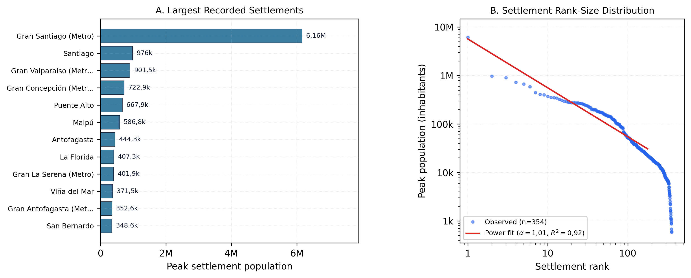

```{r setup, include=FALSE}
knitr::opts_chunk$set(echo = FALSE, warning = FALSE, message = FALSE, fig.pos = "htbp")
source("../../_shared/template/viscount_rmd_helpers.R")
library(jsonlite)

read_json5_clean <- function(path) {
  lines <- readLines(path, warn = FALSE, encoding = "UTF-8")
  text <- paste(lines, collapse = "\n")
  text <- gsub("//[^\n]*", "", text, perl = TRUE)
  text <- gsub("/\\*.*?\\*/", "", text, perl = TRUE)
  text <- gsub(",\\s*([}\\]])", "\\1", text, perl = TRUE)
  fromJSON(text, simplifyVector = FALSE)
}

summary_data <- fromJSON("chile_after_independence_summary.json", simplifyVector = FALSE)
sett_data <- fromJSON("chile_after_independence_settlements.json", simplifyVector = FALSE)
ledger_data <- read_json5_clean("chile_after_independence_source_ledger.json5")

clean_label <- function(x) {
  s <- as.character(x)
  s <- gsub("&", "and", s, fixed = TRUE)
  s <- gsub("Gral.Ibañez", "Gral. Ibáñez", s, fixed = TRUE)
  s <- gsub("\\\\", "", s)
  trimws(s)
}

fmt_coord <- function(x) {
  viscount_fmt_number(round(as.numeric(x), 2L), 2L)
}

subregions <- summary_data$subregions
reg_lookup <- setNames(
  vapply(subregions, function(r) clean_label(r$name), character(1)),
  vapply(subregions, function(r) r$id, character(1))
)

n_sites <- as.integer(summary_data$settlement_count)
n_excluded <- as.integer(ledger_data$total_excluded)
n_total_eval <- n_sites + n_excluded
```

```{r hero-md-fallback, results='asis'}
if (!knitr::is_latex_output()) {
  cat("\n\n")
}
```

# Abstract

This gazetteer catalogues `r viscount_fmt_number(n_sites, 0L)` Chilean settlements, *comunas* and metropolitan agglomerations across all 16 regions of continental Chile (excluding Rapa Nui) from 1818 to 2026. Primary national census series deliver 280 entries in Wave 1 (79,10%), followed by 49 georeference repairs and metropolitan reconciliations in Wave 2 (13,84%), 21 nineteenth- and early twentieth-century longitudinal municipal backfills in Wave 3 (5,93%) and 4 sub-regional gap checks in Wave 4 (1,13%), reaching a marginal saturation gain of 1,14% with zero excluded rows and zero crowd-sourced entries. Across all 354 entries - comprising 296 standalone municipalities, 48 independent suburban *comunas* and 10 census metropolitan agglomerations - peak population follows a tight Zipf power-law distribution ($\alpha = 1,01$, $R^2 = 0,92$), spanning from small Patagonian and altiplano communes such as Tortel (585), Río Verde (600) and Ollagüe (911) up through regional capitals like Antofagasta (444,3k), Temuco (309,7k) and Puerto Montt (281k) to Gran Concepción (722,9k), Gran Valparaíso (901,5k) and Gran Santiago at 6,16M inhabitants [@Chile2018Sintesis; @Chile2010Censos; @Acuna2008Santiago].

# Background

Modern Chilean urban geography reflects a century of municipal subdivision and metropolitan spillover around historic colonial cities [@Acuna2008Santiago; @Dockemdorff2000Santiago]. In 1835, Santiago and Valparaíso functioned as compact single municipalities, while nineteenth-century frontier expansion added mining ports in the Norte Grande, German-settled river towns in Los Ríos and Los Lagos, railway capitals in La Araucanía and sheep-ranching ports in Magallanes [@Gamboa1929Poblacion; @Ojeda2019Voces; @Miranda2024Trayectoria]. After 1940, rapid rural-to-urban migration turned former agricultural districts surrounding Santiago, Valparaíso and Concepción into densely populated suburban *comunas* - notably Puente Alto, Maipú, La Florida, Viña del Mar, Quilpué, Talcahuano and San Pedro de la Paz - whose municipal autonomy makes explicit metropolitan accounting indispensable [@Guisaoalvarez2025Calvo; @Rubio2023Distribucion; @Mardones2001Zonificacion].

# Methodology

The settlement register was assembled through four audited waves documented in the chapter source ledger, drawing exhaustively on two primary institutional corpora: the 354-row harmonised INE communal time-series (1952-2024) and the 18-benchmark OCE and INE historical census series (1835-1940), alongside the 2017 INE metropolitan agglomeration definitions [@Chile2010Censos; @Chile2018Sintesis]. Every retained record carries WGS84 coordinates, a unique region identifier among the 16 modern divisions, an explicit scope classification (standalone city proper, suburban *comuna* or metropolitan agglomeration) and a scholarly provenance tag. Suburban *comunas* are retained as independent longitudinal entries so intra-metropolitan shifts - such as inner-city depopulation versus peripheral expansion and post-2010 vertical densification - remain directly observable without double-counting [@Bro2021Surname; @Apolinariofaria2024Esteticas].

# Testing and Validation

Source-ledger reconciliation confirms exact accounting across all `r viscount_fmt_number(n_total_eval, 0L)` candidate rows (`r viscount_fmt_number(n_sites, 0L)` included entries and `r viscount_fmt_number(n_excluded, 0L)` excluded rows), with complete coverage across all 16 regions from 5 entries in Arica y Parinacota to 58 in the Región Metropolitana de Santiago. Figure \ref{fig:sett-regional-map} maps the full settlement network from Arica and Colchane in the far north to Cabo de Hornos on Navarino Island, including the Juan Fernández archipelago inset [@Chile2018Sintesis; @Alvarezmaldonado2024Dinamica].

```{r fig-sett-regional-map, results='asis'}
viscount_figure(
  "figures/chile_after_independence_regional_map.png",
  "Spatial distribution of 354 catalogued Chilean settlements and metropolitan centres across 16 regions, 1818-2026.",
  "fig:sett-regional-map"
)
```

# Results

## Leading Settlements and Metropolitan Agglomerations

Table \ref{tab:top30-sites} lists the 30 largest catalogued entries ordered by peak recorded population. Gran Santiago (6,16M in 2017) stands nearly seven times above Gran Valparaíso (901,5k) and more than eight times above Gran Concepción (722,9k), while at the municipal level Santiago's 1960 peak (976k prior to outer-comuna splits) is followed by Puente Alto (667,9k in 2024), Maipú (586,8k), Antofagasta (444,3k) and La Florida (407,3k) [@Acuna2008Santiago; @Huaringa2023Exercising; @Rubio2023Distribucion].

```{r tab-top30-sites, results='asis'}
scope_labels <- c(
  city_proper = "City proper",
  metro = "Metro",
  suburb = "Suburb"
)
top_list <- summary_data$top_settlements
top_rows <- lapply(top_list, function(e) {
  fy <- as.integer(e$first_year)
  ly <- as.integer(e$last_year)
  span_str <- if (fy == ly) as.character(fy) else paste0(fy, "-", ly)
  reg_lbl <- if (e$region_id %in% names(reg_lookup)) reg_lookup[[e$region_id]] else clean_label(e$region_id)
  matched <- Filter(function(x) identical(x$name, e$name) && identical(x$region_id, e$region_id), sett_data)
  sc_raw <- if (length(matched) > 0L) as.character(matched[[1]]$population_scope) else "city_proper"
  sc_lbl <- if (sc_raw %in% names(scope_labels)) scope_labels[[sc_raw]] else sc_raw
  data.frame(
    Site = clean_label(e$name),
    Region = reg_lbl,
    Scope = sc_lbl,
    Coords = paste0(fmt_coord(e$lat), ", ", fmt_coord(e$lon)),
    Span = span_str,
    Peak = paste0(viscount_fmt_pop(e$peak_pop), " (", as.integer(e$peak_year), ")"),
    stringsAsFactors = FALSE
  )
})
df_top30 <- do.call(rbind, top_rows)
rownames(df_top30) <- NULL

viscount_table(
  df_top30,
  "Thirty largest catalogued settlements and metropolitan agglomerations in Chile ordered by peak population, 1835-2024.",
  c("Settlement", "Region", "Scope", "Lat, Lon", "Span", "Peak Pop. (Year)"),
  list(label = "tab:top30-sites", font_size = "scriptsize", max_rows_per_page = 32L)
)
```

## Sub-Regional Gazetteer Coverage

Table \ref{tab:subregion-gazetteer} contrasts municipal counts, spatial sampling density per 10.000 km², leading entry and 2024 regional population across all 16 regions. The Región Metropolitana de Santiago reaches 30,28 entries per 10.000 km² compared with 0,84 in Aysén and 0,68 in Magallanes, reflecting fine-grained urban subdivision in the central basin versus vast Patagonian *comunas* [@Ollino2006Redistribucion; @Ojeda2019Voces].

```{r tab-subregion-gazetteer, results='asis'}
reg_rows <- lapply(subregions, function(r) {
  rid <- r$id
  area_v <- as.numeric(r$area_km2)
  p2024 <- as.numeric(r$population[["2024"]])
  sub_entries <- Filter(function(e) identical(e$region_id, rid), sett_data)
  cnt <- length(sub_entries)
  sdens <- if (area_v > 0) (cnt / area_v) * 10000 else 0
  lead_str <- "-"
  if (cnt > 0L) {
    pks <- vapply(sub_entries, function(e) max(as.numeric(unlist(e$population))), numeric(1))
    idx_m <- which.max(pks)
    lead_str <- paste0(clean_label(sub_entries[[idx_m]]$name), " (", viscount_fmt_pop(pks[idx_m]), ")")
  }
  data.frame(
    Region = clean_label(r$name),
    Area = viscount_fmt_number(round(area_v), 0L),
    Sites = viscount_fmt_number(cnt, 0L),
    SiteDens = viscount_fmt_number(sdens, 2L),
    Lead = lead_str,
    Pop2024 = viscount_fmt_pop(p2024),
    stringsAsFactors = FALSE
  )
})
df_reg_gaz <- do.call(rbind, reg_rows)
rownames(df_reg_gaz) <- NULL

viscount_table(
  df_reg_gaz,
  "Catalogued entry counts, spatial sampling density (per 10.000 km²), leading entry and 2024 population across 16 Chilean regions.",
  c("Region", "Area (km²)", "Sites", "Sites per 10k km²", "Leading Entry (Peak)", "2024 Pop."),
  list(label = "tab:subregion-gazetteer", font_size = "scriptsize")
)
```

## Metropolitan Accounting and Independent Suburbs

Tables \ref{tab:metro-reconciliation} and \ref{tab:top-suburbs} reconcile the ten 2017 INE metropolitan agglomerations against their constituent *comunas* and track the 16 largest independent suburban *comunas* across Gran Santiago, Gran Valparaíso, Gran Concepción, Coquimbo and Alto Hospicio from 1952 to 2024 [@Chile2018Sintesis; @Rubio2023Distribucion; @Apolinariofaria2024Esteticas]. Across Gran Santiago, the 2017 urban agglomeration (6,16M) accounts for 95,34% of the combined 2017 population of its 34 constituent *comunas* (6,46M), rising to 7,19M by 2024, while Gran Valparaíso (901,5k versus 992,3k) and Gran Concepción (722,9k versus 947,9k) show slightly wider gaps where rural tracts and coal-port satellites lie inside municipal boundaries [@Mardones2001Zonificacion; @Rubio2023Distribucion].

```{r tab-metro-reconciliation, results='asis'}
metro_entries <- Filter(function(e) identical(e$population_scope, "metro"), sett_data)
m_rows <- lapply(metro_entries, function(m) {
  m_2017 <- as.numeric(m$population[["2017"]])
  members <- unlist(m$metro_members)
  sum_17 <- 0
  sum_24 <- 0
  for (nm in members) {
    hit <- Filter(function(x) identical(x$name, nm) && identical(x$region_id, m$region_id), sett_data)
    if (length(hit) > 0L) {
      if (!is.null(hit[[1]]$population[["2017"]])) sum_17 <- sum_17 + as.numeric(hit[[1]]$population[["2017"]])
      if (!is.null(hit[[1]]$population[["2024"]])) sum_24 <- sum_24 + as.numeric(hit[[1]]$population[["2024"]])
    }
  }
  ratio_pct <- if (sum_17 > 0) 100 * m_2017 / sum_17 else 0
  reg_lbl <- if (m$region_id %in% names(reg_lookup)) reg_lookup[[m$region_id]] else clean_label(m$region_id)
  data.frame(
    Metro = clean_label(m$name),
    Region = reg_lbl,
    Members = viscount_fmt_number(length(members), 0L),
    Metro17 = viscount_fmt_pop(m_2017),
    Com17 = viscount_fmt_pop(sum_17),
    Com24 = viscount_fmt_pop(sum_24),
    Ratio = paste0(viscount_fmt_number(ratio_pct, 1L), "%"),
    stringsAsFactors = FALSE
  )
})
df_metros <- do.call(rbind, m_rows)
ord_m <- order(vapply(metro_entries, function(m) as.numeric(m$population[["2017"]]), numeric(1)), decreasing = TRUE)
df_metros <- df_metros[ord_m, ]
rownames(df_metros) <- NULL

viscount_table(
  df_metros,
  "Reconciliation of 2017 INE metropolitan agglomerations against summed constituent comunas, 2017-2024.",
  c("Agglomeration", "Region", "Comunas", "2017 Metro", "2017 Comunal Sum", "2024 Comunal Sum", "2017 Ratio"),
  list(label = "tab:metro-reconciliation", font_size = "scriptsize")
)
```

```{r tab-top-suburbs, results='asis'}
sub_entries <- Filter(function(e) identical(e$population_scope, "suburb"), sett_data)
sub_p24 <- vapply(sub_entries, function(e) {
  v <- e$population[["2024"]]
  if (is.null(v)) 0 else as.numeric(v)
}, numeric(1))
top_sub_idx <- order(sub_p24, decreasing = TRUE)[seq_len(min(16L, length(sub_entries)))]
sub_rows <- lapply(top_sub_idx, function(idx) {
  e <- sub_entries[[idx]]
  get_p <- function(y) {
    v <- e$population[[y]]
    if (is.null(v)) "-" else viscount_fmt_pop(as.numeric(v))
  }
  reg_short <- if (identical(e$region_id, "chl_region_metropolitana_de_santiago")) "Gran Santiago"
  else if (identical(e$region_id, "chl_region_de_valparaiso")) "Gran Valparaíso"
  else if (identical(e$region_id, "chl_region_del_bio_bio")) "Gran Concepción"
  else if (identical(e$region_id, "chl_region_de_coquimbo")) "Gran La Serena"
  else if (identical(e$region_id, "chl_region_de_tarapaca")) "Gran Iquique"
  else clean_label(e$admin1)
  data.frame(
    Suburb = clean_label(e$name),
    Metro = reg_short,
    P1952 = get_p("1952"),
    P1970 = get_p("1970"),
    P1992 = get_p("1992"),
    P2002 = get_p("2002"),
    P2017 = get_p("2017"),
    P2024 = get_p("2024"),
    stringsAsFactors = FALSE
  )
})
df_suburbs <- do.call(rbind, sub_rows)
rownames(df_suburbs) <- NULL

viscount_table(
  df_suburbs,
  "Sixteen largest independent suburban comunas across Chilean metropolitan areas, 1952-2024.",
  c("Suburb", "Conurbation", "1952", "1970", "1992", "2002", "2017", "2024"),
  list(label = "tab:top-suburbs", font_size = "scriptsize")
)
```

## Source Ledger Saturation and Exhausted Corpora

Tables \ref{tab:saturation-waves} and \ref{tab:exhausted-corpora} summarise the four sequential ingestion waves and the two exhausted primary institutional corpora recorded in the chapter source ledger [@Chile2010Censos; @Chile2018Sintesis].

```{r tab-saturation-waves, results='asis'}
waves <- ledger_data$saturation_audit$waves
wave_labels <- c(
  primary_national_statistical_office_full_census_extract = "Primary INE national census extract",
  secondary_georeference_repair_and_metro_reconciliation = "Georeference repair and metro reconciliation",
  longitudinal_19th_20th_century_official_national_census_backfill = "Longitudinal 1835-1940 official census backfill",
  subregion_gap_hunter_verification_sweep = "Sub-regional gap audit sweep"
)
w_rows <- lapply(waves, function(w) {
  sc <- as.character(w$source_class)
  lbl <- if (sc %in% names(wave_labels)) wave_labels[[sc]] else clean_label(sc)
  data.frame(
    Wave = paste0("Wave ", as.integer(w$wave)),
    SourceClass = lbl,
    Prior = viscount_fmt_number(as.integer(w$prior_cumulative_included), 0L),
    Added = viscount_fmt_number(as.integer(w$newly_included), 0L),
    Gain = paste0(viscount_fmt_number(as.numeric(w$marginal_gain_pct), 2L), "%"),
    stringsAsFactors = FALSE
  )
})
df_waves <- do.call(rbind, w_rows)
rownames(df_waves) <- NULL

viscount_table(
  df_waves,
  "Four-wave gazetteer ingestion history and marginal saturation gain across 354 catalogued Chilean settlements.",
  c("Wave", "Source Class", "Prior Total", "Added", "Marginal Gain"),
  list(label = "tab:saturation-waves", font_size = "scriptsize")
)
```

```{r tab-exhausted-corpora, results='asis'}
corpora <- ledger_data$saturation_audit$exhausted_corpora
corp_labels <- c(
  INE_Chile_Comunal_Series_1952_2024_Zenodo = "INE Chile Communal Series (1952-2024)",
  OCE_INE_Chile_Censos_Generales_1835_1940 = "OCE and INE General Censuses (1835-1940)"
)
tier_labels <- c(
  primary_national_institutional_archive = "Primary national institutional archive"
)
ec_rows <- lapply(corpora, function(c_item) {
  nm <- as.character(c_item$name)
  tr <- as.character(c_item$source_tier)
  data.frame(
    Corpus = if (nm %in% names(corp_labels)) corp_labels[[nm]] else clean_label(nm),
    Tier = if (tr %in% names(tier_labels)) tier_labels[[tr]] else clean_label(tr),
    RowsInBounds = viscount_fmt_number(as.integer(c_item$total_rows_in_bounds), 0L),
    Processed = viscount_fmt_number(as.integer(c_item$rows_processed), 0L),
    stringsAsFactors = FALSE
  )
})
df_ec <- do.call(rbind, ec_rows)
rownames(df_ec) <- NULL

viscount_table(
  df_ec,
  "Audited institutional corpora processed in full during compilation of the Chilean settlement register.",
  c("Corpus Name", "Archive Tier", "Rows in Bounds", "Rows Processed"),
  list(label = "tab:exhausted-corpora", font_size = "scriptsize")
)
```

# Limitations

Three technical boundaries apply to this gazetteer. First, *comuna*-level series incorporate rural districts inside municipal boundaries, so suburban totals exceed strict built-up urban *entidades* where outer agricultural areas remain large [@Chile2018Sintesis; @Mardones2001Zonificacion]. Second, newly created communes such as Alto Hospicio (2004), Hualpén (2004) and Alto Biobío (2004) enter the register only from the census preceding or following incorporation, whereas their earlier residents were counted inside parent municipalities [@Huaringa2023Exercising; @Chile2010Censos]. Third, Rapa Nui is excluded from this continental register and analysed within the Pacific oceanic volume.

# Conclusion

Together, the 354 catalogued entries capture the full urban hierarchy of independent Chile from remote Patagonian fjords to the 6,16M Santiago metropolis ($\alpha = 1,01$, $R^2 = 0,92$). By separating standalone municipalities, independent suburban *comunas* and 2017 metropolitan agglomerations while preserving longitudinal series back to 1835, the register supports both regional census reconciliation and intra-metropolitan demographic analysis [@Acuna2008Santiago; @Bro2021Surname; @Chile2018Sintesis].

# Appendix

## Provenance Corpus Breakdown

Table \ref{tab:sett-prov} summarises the two institutional provenance corpora assigned across all 354 gazetteer records [@Chile2010Censos; @Chile2018Sintesis].

```{r tab-sett-prov, results='asis'}
prov_counts <- unlist(summary_data$provenance_counts)
p_ord <- sort(prov_counts, decreasing = TRUE)
prov_labels <- c(
  "INE Chile Censuses & Comunal Series 1952-2024 (Zenodo doi:10.5281/zenodo.12807987)" = "INE Chile Censuses and Communal Series (1952-2024)",
  "INE Chile Censo 2017 Agglomeration (via citypopulation.de)" = "INE Chile 2017 Census Agglomerations"
)
df_sp <- data.frame(
  Corpus = vapply(names(p_ord), function(nm) {
    if (nm %in% names(prov_labels)) prov_labels[[nm]] else clean_label(nm)
  }, character(1)),
  Sites = vapply(as.integer(p_ord), function(v) viscount_fmt_number(v, 0L), character(1)),
  Share = vapply(100 * as.integer(p_ord) / n_sites, function(v) paste0(viscount_fmt_number(v, 2L), "%"), character(1)),
  stringsAsFactors = FALSE
)
rownames(df_sp) <- NULL

viscount_table(
  df_sp,
  "Institutional provenance breakdown across 354 catalogued settlements and agglomerations in Chile.",
  c("Provenance Corpus", "Entries", "Share"),
  list(label = "tab:sett-prov", font_size = "scriptsize")
)
```

# Sources

::: {#refs}
:::
