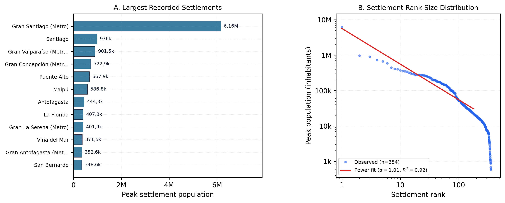
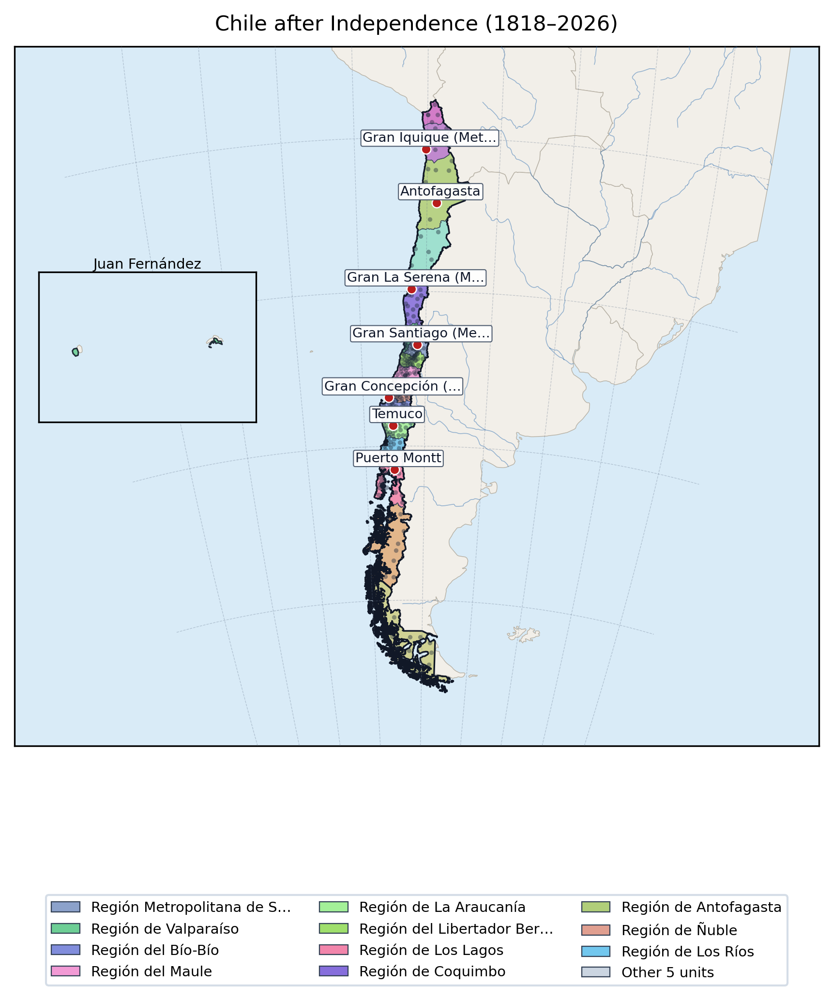

Chile after Independence
================
Aust Kätzchen
23 November 2026

- [Abstract](#abstract)
- [Background](#background)
- [Methodology](#methodology)
- [Testing and Validation](#testing-and-validation)
- [Results](#results)
  - [Leading Settlements and Metropolitan
    Agglomerations](#leading-settlements-and-metropolitan-agglomerations)
  - [Sub-Regional Gazetteer Coverage](#sub-regional-gazetteer-coverage)
  - [Metropolitan Accounting and Independent
    Suburbs](#metropolitan-accounting-and-independent-suburbs)
  - [Source Ledger Saturation and Exhausted
    Corpora](#source-ledger-saturation-and-exhausted-corpora)
- [Limitations](#limitations)
- [Conclusion](#conclusion)
- [Appendix](#appendix)
  - [Provenance Corpus Breakdown](#provenance-corpus-breakdown)
- [Sources](#sources)

<figure>

<figcaption aria-hidden="true">Twelve largest Chilean settlements and
log-log rank-size distribution across 354 catalogued entries,
1818-2026.</figcaption>
</figure>

# Abstract

This gazetteer catalogues 354 Chilean settlements, *comunas* and
metropolitan agglomerations across all 16 regions of continental Chile
(excluding Rapa Nui) from 1818 to 2026. Primary national census series
deliver 280 entries in Wave 1 (79,10%), followed by 49 georeference
repairs and metropolitan reconciliations in Wave 2 (13,84%), 21
nineteenth- and early twentieth-century longitudinal municipal backfills
in Wave 3 (5,93%) and 4 sub-regional gap checks in Wave 4 (1,13%),
reaching a marginal saturation gain of 1,14% with zero excluded rows and
zero crowd-sourced entries. Across all 354 entries - comprising 296
standalone municipalities, 48 independent suburban *comunas* and 10
census metropolitan agglomerations - peak population follows a tight
Zipf power-law distribution ($\alpha = 1,01$, $R^2 = 0,92$), spanning
from small Patagonian and altiplano communes such as Tortel (585), Río
Verde (600) and Ollagüe (911) up through regional capitals like
Antofagasta (444,3k), Temuco (309,7k) and Puerto Montt (281k) to Gran
Concepción (722,9k), Gran Valparaíso (901,5k) and Gran Santiago at 6,16M
inhabitants
[\[1\]](#ref-Chile2018Sintesis)[\[2\]](#ref-Chile2010Censos)[\[3\]](#ref-Acuna2008Santiago).

# Background

Modern Chilean urban geography reflects a century of municipal
subdivision and metropolitan spillover around historic colonial cities
[\[3\]](#ref-Acuna2008Santiago)[\[4\]](#ref-Dockemdorff2000Santiago). In
1835, Santiago and Valparaíso functioned as compact single
municipalities, while nineteenth-century frontier expansion added mining
ports in the Norte Grande, German-settled river towns in Los Ríos and
Los Lagos, railway capitals in La Araucanía and sheep-ranching ports in
Magallanes
[\[5\]](#ref-Gamboa1929Poblacion)[\[6\]](#ref-Ojeda2019Voces)[\[7\]](#ref-Miranda2024Trayectoria).
After 1940, rapid rural-to-urban migration turned former agricultural
districts surrounding Santiago, Valparaíso and Concepción into densely
populated suburban *comunas* - notably Puente Alto, Maipú, La Florida,
Viña del Mar, Quilpué, Talcahuano and San Pedro de la Paz - whose
municipal autonomy makes explicit metropolitan accounting indispensable
[\[8\]](#ref-Guisaoalvarez2025Calvo)[\[9\]](#ref-Rubio2023Distribucion)[\[10\]](#ref-Mardones2001Zonificacion).

# Methodology

The settlement register was assembled through four audited waves
documented in the chapter source ledger, drawing exhaustively on two
primary institutional corpora: the 354-row harmonised INE communal
time-series (1952-2024) and the 18-benchmark OCE and INE historical
census series (1835-1940), alongside the 2017 INE metropolitan
agglomeration definitions
[\[1\]](#ref-Chile2018Sintesis)[\[2\]](#ref-Chile2010Censos). Every
retained record carries WGS84 coordinates, a unique region identifier
among the 16 modern divisions, an explicit scope classification
(standalone city proper, suburban *comuna* or metropolitan
agglomeration) and a scholarly provenance tag. Suburban *comunas* are
retained as independent longitudinal entries so intra-metropolitan
shifts - such as inner-city depopulation versus peripheral expansion and
post-2010 vertical densification - remain directly observable without
double-counting
[\[11\]](#ref-Bro2021Surname)[\[12\]](#ref-Apolinariofaria2024Esteticas).

# Testing and Validation

Source-ledger reconciliation confirms exact accounting across all 354
candidate rows (354 included entries and 0 excluded rows), with complete
coverage across all 16 regions from 5 entries in Arica y Parinacota to
58 in the Región Metropolitana de Santiago. Figure maps the full
settlement network from Arica and Colchane in the far north to Cabo de
Hornos on Navarino Island, including the Juan Fernández archipelago
inset
[\[1\]](#ref-Chile2018Sintesis)[\[13\]](#ref-Alvarezmaldonado2024Dinamica).

# Results

## Leading Settlements and Metropolitan Agglomerations

Table lists the 30 largest catalogued entries ordered by peak recorded
population. Gran Santiago (6,16M in 2017) stands nearly seven times
above Gran Valparaíso (901,5k) and more than eight times above Gran
Concepción (722,9k), while at the municipal level Santiago’s 1960 peak
(976k prior to outer-comuna splits) is followed by Puente Alto (667,9k
in 2024), Maipú (586,8k), Antofagasta (444,3k) and La Florida (407,3k)
[\[3\]](#ref-Acuna2008Santiago)[\[9\]](#ref-Rubio2023Distribucion)[\[14\]](#ref-Huaringa2023Exercising).

| Settlement | Region | Scope | Lat, Lon | Span | Peak Pop. (Year) |
|:---|:---|:---|:---|:---|:---|
| **Gran Santiago (Metro)** | Región Metropolitana de Santiago | Metro | -33,45, -70,65 | 2017 | 6,16M (2017) |
| **Santiago** | Región Metropolitana de Santiago | City proper | -33,45, -70,65 | 1835-2024 | 976k (1960) |
| **Gran Valparaíso (Metro)** | Región de Valparaíso | Metro | -33,12, -71,61 | 2017 | 901,5k (2017) |
| **Gran Concepción (Metro)** | Región del Bío-Bío | Metro | -36,84, -72,96 | 2017 | 722,9k (2017) |
| **Puente Alto** | Región Metropolitana de Santiago | Suburb | -33,59, -70,55 | 1952-2024 | 667,9k (2024) |
| **Maipú** | Región Metropolitana de Santiago | Suburb | -33,52, -70,81 | 1952-2024 | 586,8k (2024) |
| **Antofagasta** | Región de Antofagasta | City proper | -24,23, -69,32 | 1875-2024 | 444,3k (2024) |
| **La Florida** | Región Metropolitana de Santiago | Suburb | -33,53, -70,54 | 1952-2024 | 407,3k (2024) |
| **Gran La Serena (Metro)** | Región de Coquimbo | Metro | -29,84, -71,09 | 2017 | 401,9k (2017) |
| **Viña del Mar** | Región de Valparaíso | Suburb | -33,02, -71,52 | 1885-2024 | 371,5k (2024) |
| **Gran Antofagasta (Metro)** | Región de Antofagasta | Metro | -24,23, -69,32 | 2017 | 352,6k (2017) |
| **San Bernardo** | Región Metropolitana de Santiago | Suburb | -33,64, -70,69 | 1952-2024 | 348,6k (2024) |
| **Las Condes** | Región Metropolitana de Santiago | Suburb | -33,42, -70,52 | 1952-2024 | 343,6k (2024) |
| **Valparaíso** | Región de Valparaíso | City proper | -33,12, -71,61 | 1835-2024 | 320,8k (2024) |
| **Temuco** | Región de La Araucanía | City proper | -38,67, -72,63 | 1895-2024 | 309,7k (2024) |
| **Gran Iquique (Metro)** | Región de Tarapacá | Metro | -20,75, -70,11 | 2017 | 294,9k (2017) |
| **Gran Rancagua (Metro)** | Región del Libertador Bernardo O’Higgins | Metro | -34,12, -70,82 | 2017 | 290,9k (2017) |
| **Puerto Montt** | Región de Los Lagos | City proper | -41,51, -72,58 | 1865-2024 | 281k (2024) |
| **Gran Temuco (Metro)** | Región de La Araucanía | Metro | -38,67, -72,63 | 2017 | 278,5k (2017) |
| **Quilicura** | Región Metropolitana de Santiago | Suburb | -33,36, -70,74 | 1952-2024 | 275,7k (2024) |
| **Coquimbo** | Región de Coquimbo | Suburb | -30,23, -71,33 | 1952-2024 | 275,6k (2024) |
| **Rancagua** | Región del Libertador Bernardo O’Higgins | City proper | -34,12, -70,82 | 1865-2024 | 274,4k (2024) |
| **Peñalolén** | Región Metropolitana de Santiago | Suburb | -33,49, -70,51 | 1970-2024 | 272,9k (2024) |
| **Concepción** | Región del Bío-Bío | City proper | -36,84, -72,96 | 1854-2024 | 272,7k (1982) |
| **La Serena** | Región de Coquimbo | City proper | -29,84, -71,09 | 1854-2024 | 267,4k (2024) |
| **Ñuñoa** | Región Metropolitana de Santiago | Suburb | -33,45, -70,6 | 1952-2024 | 266,9k (2024) |
| **Pudahuel** | Región Metropolitana de Santiago | Suburb | -33,42, -70,86 | 1952-2024 | 261,6k (2024) |
| **Arica** | Región de Arica y Parinacota | City proper | -18,48, -69,99 | 1885-2024 | 257,2k (2024) |
| **Talcahuano** | Región del Bío-Bío | Suburb | -36,7, -73,13 | 1875-2024 | 248,5k (1992) |
| **Talca** | Región del Maule | City proper | -35,42, -71,6 | 1854-2024 | 242,3k (2024) |

Thirty largest catalogued settlements and metropolitan agglomerations in
Chile ordered by peak population, 1835-2024.

## Sub-Regional Gazetteer Coverage

Table contrasts municipal counts, spatial sampling density per 10.000
km², leading entry and 2024 regional population across all 16 regions.
The Región Metropolitana de Santiago reaches 30,28 entries per 10.000
km² compared with 0,84 in Aysén and 0,68 in Magallanes, reflecting
fine-grained urban subdivision in the central basin versus vast
Patagonian *comunas*
[\[6\]](#ref-Ojeda2019Voces)[\[15\]](#ref-Ollino2006Redistribucion).

| Region | Area (km²) | Sites | Sites per 10k km² | Leading Entry (Peak) | 2024 Pop. |
|:---|:---|:---|:---|:---|:---|
| **Región Metropolitana de Santiago** | 19.153 | 58 | 30,28 | Gran Santiago (Metro) (6,16M) | 7,4M |
| **Región de Antofagasta** | 129.592 | 10 | 0,77 | Antofagasta (444,3k) | 635,4k |
| **Región de Arica y Parinacota** | 20.107 | 5 | 2,49 | Arica (257,2k) | 244,6k |
| **Región de Atacama** | 81.484 | 9 | 1,1 | Copiapó (176,1k) | 299,2k |
| **Región de Aysén del Gral. Ibáñez del Campo** | 118.830 | 10 | 0,84 | Coyhaique (62k) | 100,7k |
| **Región de Coquimbo** | 45.222 | 16 | 3,54 | Gran La Serena (Metro) (401,9k) | 832,9k |
| **Región de La Araucanía** | 29.876 | 30 | 10,04 | Temuco (309,7k) | 1,01M |
| **Región de Los Lagos** | 56.234 | 29 | 5,16 | Puerto Montt (281k) | 890,3k |
| **Región de Los Ríos** | 21.693 | 13 | 5,99 | Valdivia (182,1k) | 398,2k |
| **Región de Magallanes y Antártica Chilena** | 146.424 | 10 | 0,68 | Punta Arenas (145,7k) | 166,5k |
| **Región de Tarapacá** | 45.577 | 8 | 1,76 | Gran Iquique (Metro) (294,9k) | 369,8k |
| **Región de Valparaíso** | 17.625 | 37 | 20,99 | Gran Valparaíso (Metro) (901,5k) | 1,9M |
| **Región de Ñuble** | 16.251 | 22 | 13,54 | Chillán (204,1k) | 512,3k |
| **Región del Bío-Bío** | 27.485 | 36 | 13,1 | Gran Concepción (Metro) (722,9k) | 1,61M |
| **Región del Libertador Bernardo O’Higgins** | 17.187 | 33 | 19,2 | Gran Rancagua (Metro) (290,9k) | 987,2k |
| **Región del Maule** | 30.203 | 28 | 9,27 | Talca (242,3k) | 1,12M |

Catalogued entry counts, spatial sampling density (per 10.000 km²),
leading entry and 2024 population across 16 Chilean regions.

## Metropolitan Accounting and Independent Suburbs

Tables and reconcile the ten 2017 INE metropolitan agglomerations
against their constituent *comunas* and track the 16 largest independent
suburban *comunas* across Gran Santiago, Gran Valparaíso, Gran
Concepción, Coquimbo and Alto Hospicio from 1952 to 2024
[\[1\]](#ref-Chile2018Sintesis)[\[9\]](#ref-Rubio2023Distribucion)[\[12\]](#ref-Apolinariofaria2024Esteticas).
Across Gran Santiago, the 2017 urban agglomeration (6,16M) accounts for
95,34% of the combined 2017 population of its 34 constituent *comunas*
(6,46M), rising to 7,19M by 2024, while Gran Valparaíso (901,5k versus
992,3k) and Gran Concepción (722,9k versus 947,9k) show slightly wider
gaps where rural tracts and coal-port satellites lie inside municipal
boundaries
[\[9\]](#ref-Rubio2023Distribucion)[\[10\]](#ref-Mardones2001Zonificacion).

| Agglomeration | Region | Comunas | 2017 Metro | 2017 Comunal Sum | 2024 Comunal Sum | 2017 Ratio |
|:---|:---|:---|:---|:---|:---|:---|
| **Gran Santiago (Metro)** | Región Metropolitana de Santiago | 34 | 6,16M | 6,46M | 7,19M | 95,3% |
| **Gran Valparaíso (Metro)** | Región de Valparaíso | 5 | 901,5k | 992,3k | 1,06M | 90,8% |
| **Gran Concepción (Metro)** | Región del Bío-Bío | 8 | 722,9k | 947,9k | 979,8k | 76,3% |
| **Gran La Serena (Metro)** | Región de Coquimbo | 2 | 401,9k | 472,7k | 543k | 85% |
| **Gran Antofagasta (Metro)** | Región de Antofagasta | 1 | 352,6k | 381,6k | 444,3k | 92,4% |
| **Gran Iquique (Metro)** | Región de Tarapacá | 2 | 294,9k | 316k | 375,3k | 93,3% |
| **Gran Rancagua (Metro)** | Región del Libertador Bernardo O’Higgins | 2 | 290,9k | 310,8k | 339,2k | 93,6% |
| **Gran Temuco (Metro)** | Región de La Araucanía | 2 | 278,5k | 374,9k | 395,1k | 74,3% |
| **Gran Talca (Metro)** | Región del Maule | 2 | 237,3k | 282,9k | 311,3k | 83,9% |
| **Gran Arica (Metro)** | Región de Arica y Parinacota | 1 | 204,1k | 232,6k | 257,2k | 87,7% |

Reconciliation of 2017 INE metropolitan agglomerations against summed
constituent comunas, 2017-2024.

| Suburb               | Conurbation     | 1952  | 1970   | 1992   | 2002   | 2017   | 2024   |
|:---------------------|:----------------|:------|:-------|:-------|:-------|:-------|:-------|
| **Puente Alto**      | Gran Santiago   | 32,6k | 76,7k  | 254,7k | 509,5k | 604,7k | 667,9k |
| **Maipú**            | Gran Santiago   | 20k   | 44,7k  | 256,6k | 484k   | 549,3k | 586,8k |
| **La Florida**       | Gran Santiago   | 9,9k  | 58,7k  | 328,9k | 376,9k | 386,3k | 407,3k |
| **Viña del Mar**     | Gran Valparaíso | 91,9k | 188,4k | 285,5k | 301,5k | 348,9k | 371,5k |
| **San Bernardo**     | Gran Santiago   | 51k   | 79,2k  | 190,9k | 255,6k | 318,1k | 348,6k |
| **Las Condes**       | Gran Santiago   | 38,9k | 112,6k | 208,1k | 255,7k | 307,7k | 343,6k |
| **Quilicura**        | Gran Santiago   | 4,7k  | 11,4k  | 41,1k  | 131,4k | 222k   | 275,7k |
| **Coquimbo**         | Gran La Serena  | 32,1k | 61,4k  | 122,8k | 170,9k | 239,5k | 275,6k |
| **Peñalolén**        | Gran Santiago   | \-    | 51k    | 179,8k | 223,4k | 253,6k | 272,9k |
| **Ñuñoa**            | Gran Santiago   | 126k  | 149k   | 172,6k | 168,5k | 222,1k | 266,9k |
| **Pudahuel**         | Gran Santiago   | 31,7k | 51k    | 137,9k | 201,8k | 241k   | 261,6k |
| **Estación Central** | Gran Santiago   | \-    | 131,2k | 140,9k | 131,7k | 148,7k | 221,9k |
| **Recoleta**         | Gran Santiago   | \-    | 141,7k | 164,8k | 161,3k | 165,7k | 196,9k |
| **La Pintana**       | Gran Santiago   | \-    | 38k    | 169,6k | 195,3k | 188k   | 189k   |
| **Quilpué**          | Gran Valparaíso | 26,1k | 57k    | 104,2k | 133,2k | 160,2k | 173,6k |
| **El Bosque**        | Gran Santiago   | \-    | 89k    | 172,9k | 180,6k | 170,8k | 169,9k |

Sixteen largest independent suburban comunas across Chilean metropolitan
areas, 1952-2024.

## Source Ledger Saturation and Exhausted Corpora

Tables and summarise the four sequential ingestion waves and the two
exhausted primary institutional corpora recorded in the chapter source
ledger [\[1\]](#ref-Chile2018Sintesis)[\[2\]](#ref-Chile2010Censos).

| Wave | Source Class | Prior Total | Added | Marginal Gain |
|:---|:---|:---|:---|:---|
| **Wave 1** | Primary INE national census extract | 0 | 280 | 100% |
| **Wave 2** | Georeference repair and metro reconciliation | 280 | 49 | 17,5% |
| **Wave 3** | Longitudinal 1835-1940 official census backfill | 329 | 21 | 6,38% |
| **Wave 4** | Sub-regional gap audit sweep | 350 | 4 | 1,14% |

Four-wave gazetteer ingestion history and marginal saturation gain
across 354 catalogued Chilean settlements.

| Corpus Name | Archive Tier | Rows in Bounds | Rows Processed |
|:---|:---|:---|:---|
| **INE Chile Communal Series (1952-2024)** | Primary national institutional archive | 354 | 354 |
| **OCE and INE General Censuses (1835-1940)** | Primary national institutional archive | 18 | 18 |

Audited institutional corpora processed in full during compilation of
the Chilean settlement register.

# Limitations

Three technical boundaries apply to this gazetteer. First,
*comuna*-level series incorporate rural districts inside municipal
boundaries, so suburban totals exceed strict built-up urban *entidades*
where outer agricultural areas remain large
[\[1\]](#ref-Chile2018Sintesis)[\[10\]](#ref-Mardones2001Zonificacion).
Second, newly created communes such as Alto Hospicio (2004), Hualpén
(2004) and Alto Biobío (2004) enter the register only from the census
preceding or following incorporation, whereas their earlier residents
were counted inside parent municipalities
[\[2\]](#ref-Chile2010Censos)[\[14\]](#ref-Huaringa2023Exercising).
Third, Rapa Nui is excluded from this continental register and analysed
within the Pacific oceanic volume.

# Conclusion

Together, the 354 catalogued entries capture the full urban hierarchy of
independent Chile from remote Patagonian fjords to the 6,16M Santiago
metropolis ($\alpha = 1,01$, $R^2 = 0,92$). By separating standalone
municipalities, independent suburban *comunas* and 2017 metropolitan
agglomerations while preserving longitudinal series back to 1835, the
register supports both regional census reconciliation and
intra-metropolitan demographic analysis
[\[1\]](#ref-Chile2018Sintesis)[\[3\]](#ref-Acuna2008Santiago)[\[11\]](#ref-Bro2021Surname).

# Appendix

## Provenance Corpus Breakdown

Table summarises the two institutional provenance corpora assigned
across all 354 gazetteer records
[\[1\]](#ref-Chile2018Sintesis)[\[2\]](#ref-Chile2010Censos).

| Provenance Corpus                                      | Entries | Share  |
|:-------------------------------------------------------|:--------|:-------|
| **INE Chile Censuses and Communal Series (1952-2024)** | 344     | 97,18% |
| **INE Chile 2017 Census Agglomerations**               | 10      | 2,82%  |

Institutional provenance breakdown across 354 catalogued settlements and
agglomerations in Chile.

# Sources

1.
Instituto Nacional de Estadísticas
de Chile (INE). *Síntesis de Resultados del Censo
de Población y Vivienda 2017 de Chile*. INE Chile, 2018,
<https://www.ine.gob.cl/estadisticas/sociales/censos-de-poblacion-y-vivienda/informacion-historica-censo-de-poblacion-y-vivienda>.

2.
Biblioteca Nacional de Chile.
*Los Censos de Población en Chile y su evolución
histórica hacia el Bicentenario*. Memoria Chilena, 2010,
<https://www.memoriachilena.gob.cl/602/w3-article-10433.html>.

3.
Acuña, Francisco Ferrando.
“Santiago de Chile: antecedentes demográficos,
expansión urbana y conflictos./ Santiago de Chile: demographic
background for the urban sprawl and its conflicts.” *Revista de
Urbanismo*, 2008, [https://doi.org/DOI:
10.5354/0717-5051.2008.249](https://doi.org/DOI: 10.5354/0717-5051.2008.249).

4.
Dockemdorff, Eduardo, et al.
“Santiago de Chile: metropolization, globalization
and inequity.” *Environment and Urbanization*, 2000,
<https://doi.org/10.1177/095624780001200112>.

5.
Gamboa, Rodolfo. “POBLACION E
INMIGRACION EN CHILE.” *Atenea (Concepción)*, 1929,
<https://doi.org/10.29393/at60-3pirg10003>.

6.
Ojeda, Rodrigo Herrera, et al.
“Voces que construyen memoria colectiva. La
dimensión inmaterial del patrimonio industrial en la Población Obrera
Sociedad Explotadora de Tierra del Fuego, Punta Arenas, Chile.”
*Sophia Austral*, 2019,
<http://www.sophiaaustral.cl/index.php/shopiaaustral/article/view/257>.

7.
Miranda, Francisco Maturana, et
al. “Trayectoria demográfica y coevolución del
empleo en los Andes del Sur. El caso de las ciudades de la macrozona sur
de Chile y su transformación simplificada de las actividades de
servicios.” *Cuadernos de Geografía: Revista Colombiana de
Geografía*, 2024, <https://doi.org/10.15446/rcdg.v33n2.109801>.

8.
Guisao-Álvarez, Juan Daniel.
“Calvo, Óscar. Urbanización y Revolución en América
Latina. Santiago de Chile, Buenos Aires y Ciudad de México (1950- 1980).
Ciudad de México y Bogotá: El Colegio de México – Universidad Nacional
de Colombia, 2023, 398 pp.” *Historia y Memoria*, 2025,
<https://revistas.uptc.edu.co/index.php/historia_memoria/article/view/18267>.

9.
Rubio, Ignacio Froilan Rojas, et
al. “Distribución de la población y cambios
metropolitanos: migración intrarregional en el área conurbada de la
Región de Valparaíso, Chile (1982 y 2017).” *Revista Eídos*,
2023, <https://doi.org/10.29019/eidos.v15i21.1128>.

10.
Mardones, María, and Claudia
Vidal. “La zonificación y evaluación de los riesgos
naturales de tipo geomorfológico: un instrumento para la planificación
urbana en la ciudad de Concepción.” *EURE (Santiago) - Revista
Latinoamericana de Estudios Urbano Regionales*, 2001,
<http://www.scielo.cl/scielo.php?script=sci_arttext&pid=S0250-71612001008100006>.

11.
Bro, Naim, and Marcelo Mendoza.
“Surname affinity in Santiago, Chile: A
network-based approach that uncovers urban segregation.” *PLOS
ONE*, 2021, <https://doi.org/10.1371/journal.pone.0244372>.

12.
Apolinario-Faria, Bianca, and Luis
Campos-Medina. “Estéticas de la resistencia en el
hábitat migrante. El caso de la población Los Nogales, Estación Central,
Santiago, Chile.” *Urbano*, 2024,
<https://doi.org/10.22320/07183607.2024.27.50.03>.

13.
Alvarez Maldonado, José Edmundo.
*Dinámica demográfica y desigualdad étnica en la
zona fronteriza entre Bolivia (Estado Plurinacional de), Chile y el
Perú*. UN ECLAC / CEPAL-CELADE, 2024,
<https://hdl.handle.net/11362/69006>.

14.
Huaringa, Elizabeth Andrade, et
al. “Exercising rights from below: Housing, gender,
migration and the right to the city from Antofagasta, Chile.”
*Radical Housing Journal*, 2023,
<https://doi.org/10.54825/RQJH3553>.

15.
Ollino, Daniela González, and
Jorge Rodríguez Vignoli. “Redistribución espacial y
migración interna de la población en Chile en los últimos 35 años
(1965-2002): una síntesis de las hipótesis y la evidencia.”
*Estudios Demográficos y Urbanos*, 2006,
<http://www.redalyc.org/articulo.oa?id=31200204>.

