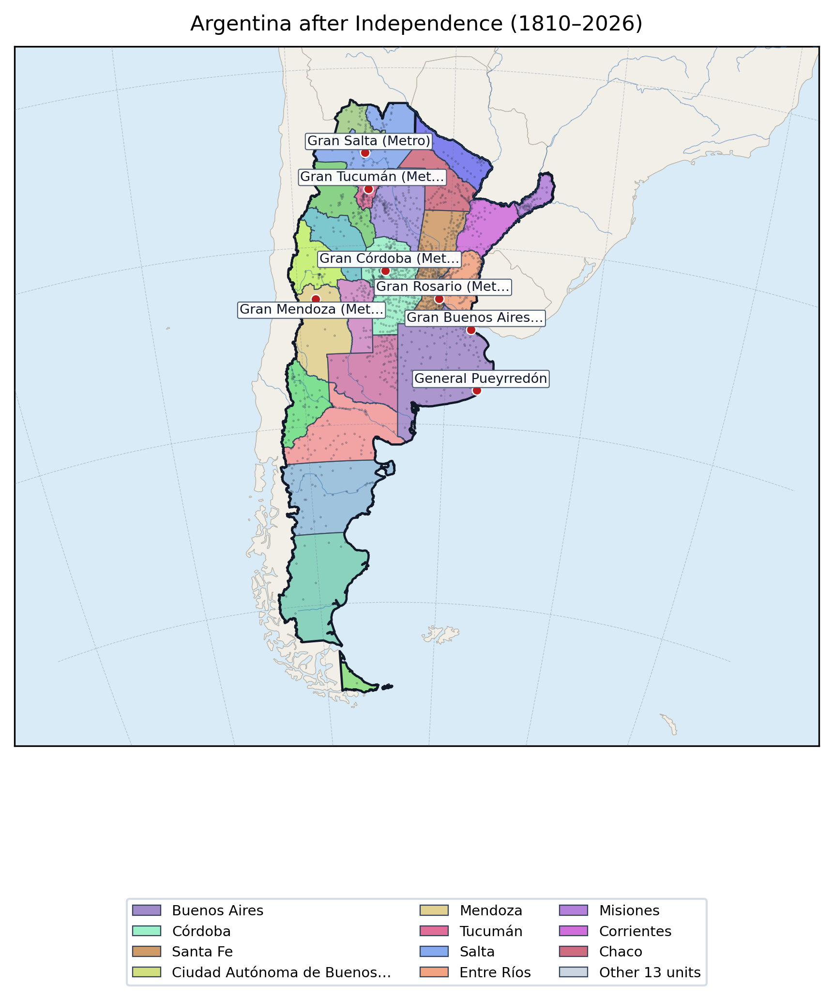

```{r setup, include=FALSE}
knitr::opts_chunk$set(echo = FALSE, warning = FALSE, message = FALSE, fig.pos = "htbp")
source("../../_shared/template/viscount_rmd_helpers.R")
library(jsonlite)

summary_data <- fromJSON("argentina_after_independence_summary.json", simplifyVector = FALSE)
sett_data <- fromJSON("argentina_after_independence_settlements.json", simplifyVector = FALSE)

clean_label <- function(x) {
  s <- as.character(x)
  s <- gsub("&", "and", s, fixed = TRUE)
  s <- gsub("\\\\", "", s)
  s
}

short_prov <- function(x) {
  s <- clean_label(x)
  s <- sub("^Ciudad Autónoma de Buenos Aires$", "CABA (Buenos Aires)", s)
  s <- sub("^Santiago del Estero$", "Sgo. del Estero", s)
  s
}

subregions <- summary_data$subregions
tot_area <- as.numeric(summary_data$total_area_km2)
n_sites <- as.integer(summary_data$settlement_count)
dom_tots <- summary_data$domain_totals

fmt_pct <- function(val, digits = 1L) {
  paste0(viscount_fmt_number(val, digits), "%")
}
```

```{r hero-md-fallback, results='asis'}
if (!knitr::is_latex_output()) {
  cat("\n\n")
}
```

# Abstract

Between the May Revolution of 1810 and the twenty-first century, the Argentine Republic underwent one of the sharpest demographic transformations of the post-colonial world, growing from a sparsely peopled pastoral periphery of roughly 450k to 550k inhabitants at independence to 1,88M (1.877.491) in Domingo Faustino Sarmiento's landmark 1869 first national census and 45,89M (45.892.285) in the 2022 census [@Collection1929Estadistica; @Zobec2010Knjizna; @Gonzalez2015Proyecciones]. Across 24 modern jurisdictions covering 2.816.800,5 km², national population multiplied nearly twenty-five-fold between 1869 and 2022, propelled first by transatlantic mass immigration between 1880 and 1930, when more than 6M predominantly Italian and Spanish arrivals raised the foreign-born share to roughly 30% in 1914, and subsequently by rural-urban internal migration from the northern provinces into the *Conurbano Bonaerense* [@Zobec2010Knjizna; @Bjerg2018Emotions; @Montero2019Spain; @Rotger2025Urbanizacion]. Demographic weight shifted decisively toward the Pampean littoral: while the Ciudad Autónoma de Buenos Aires (CABA) plateaued near 3M after 1947 (standing at 3,12M in 2022 at 6.312,86 inhabitants per km²), Buenos Aires Province expanded nearly fifty-seven-fold from 307,8k in 1869 to 17,52M in 2022, anchoring a Gran Buenos Aires agglomeration of 16,22M alongside Córdoba (3,84M) and Santa Fe (3,54M) [@Ramos2021Envejecimiento; @Rodriguez2025Area; @Molinatti2020Segregacion]. Following the Conquest of the Desert (1879-1884), the 1912 territorial enumeration and the 1951-1955 provincialisation of the *Territorios Nacionales*, southern and northeastern frontiers recorded sustained twentieth-century growth alongside an early Southern Cone fertility transition that lowered annual growth to around 1,1% by 2010-2022 [@Nacionales1914Censo; @Gallero2010Proceso; @Gonzalez2015Proyecciones]. This chapter synthesises all 11 official national censuses from 1869 to 2022 across 24 provinces and reconciles them against a 2.057-settlement gazetteer [@Roldan2013Inventarios; @Pellegrini2014Patron].

# Background

## Independence, Early Provincial Counts and the Littoral Divide (1810-1869)

At the outbreak of the May Revolution in 1810, the territories that would coalesce into the Argentine Republic held an unevenly distributed population anchored along the old colonial silver road from Alto Perú down through Salta, Tucumán, Santiago del Estero and Córdoba to the Río de la Plata estuary [@Ghirardi2013Saludes; @Kuffer2010Migracion]. The port of Buenos Aires held 41.642 residents in 1810, roughly one-tenth of the settled republican population, while traditional highland and oasis centres in the Northwest (NOA) and Cuyo still rivalled the littoral in demographic weight [@Collection1929Estadistica; @Ghirardi2013Saludes]. Provincial enumerations from the early republican decades reveal an interior economy structured by artisan craftwork, mule breeding and regional trade rather than transatlantic export agriculture. In Córdoba, the 1813 and 1832 municipal counts preserve detailed household registers of surname origins, occupational health and regional mobility between neighbouring provinces, confirming steady short-range circulation across the central sierra before the railway age [@Ghirardi2013Saludes; @Kuffer2010Migracion; @Colantonio2015Apellidos].

Civil wars between Unitarians and Federals delayed a unified national enumeration for nearly six decades after 1810. Only after the constitutional consolidation of 1853-1862 and the presidency of Domingo Faustino Sarmiento did the state execute its first modern headcount in September 1869 [@Collection1929Estadistica]. That census counted 1.877.491 inhabitants across the republic, already showing the early shift toward the littoral: Buenos Aires Province (307.761) and the city of Buenos Aires (187.346) together accounted for 26,37% of the national population, ahead of Córdoba (210.508), Entre Ríos (134.271), Santiago del Estero (132.898), Corrientes (129.023), Tucumán (108.953), Santa Fe (89.117) and Salta (88.933) [@Collection1929Estadistica; @Zobec2010Knjizna]. Beyond the settled agricultural provinces, vast tracts of the Pampa, Patagonia and the Gran Chaco remained outside effective state administration, inhabited by Mapuche, Tehuelche, Ranquel, Qom and Wichí societies whose numbers were estimated rather than enumerated [@Gomezotero2007Patagonia; @Cassiodoro2020Caracterizacio; @Nacionales1914Censo].

## The Conquest of the Desert and Territorios Nacionales (1879-1914)

Between 1879 and 1884, the military campaigns known as the Conquest of the Desert under General Julio Argentino Roca, followed by parallel expeditions into the northern Gran Chaco, extinguished indigenous territorial autonomy south of the Río Salado and across the Pilcomayo-Bermejo plain [@Gomezotero2007Patagonia; @Nacionales1914Censo]. Archaeologically, Patagonia and the central steppe had sustained mobile hunter-gatherer bands throughout the Holocene [@Gomezotero2007Patagonia; @Cassiodoro2020Caracterizacio], and nineteenth-century indigenous polities had traded livestock across the Andean passes into Araucanía. Military annexation opened more than a million square kilometres of grazing steppe and alluvial valleys to state land auctions, British-financed railways and sheep *estancias*, reorganised in 1884 under Law 1.532 into nine *Territorios Nacionales* (La Pampa, Neuquén, Río Negro, Chubut, Santa Cruz, Tierra del Fuego, Misiones, Formosa and Chaco, later joined by Los Andes in 1900) [@Nacionales1914Censo; @Gallero2010Proceso; @Daddona2023Primeras].

Settlement across these new national territories proceeded in sharply contrasting regional waves documented in the special 1912 territorial census [@Nacionales1914Censo]. La Pampa expanded from an estimated 21k in 1869 and 25,9k in 1895 to 101,3k by 1914 as wheat and cattle estates crossed the western frontier from Buenos Aires. Along the Chubut valley and Andean foothills, Welsh colonists from 1865 onward were joined by Chilean pastoralists, Italian merchants and Spanish settlers, raising Chubut from 3,7k in 1895 to 23,1k in 1914 and Río Negro from 9,2k to 42,2k [@Nacionales1914Censo; @Daddona2023Primeras]. In the subtropical northeast, Misiones grew from barely 3k in 1869 to 33,2k in 1895 and 53,6k in 1914 through state-directed agricultural colonies settled by Polish, Ukrainian, German and Brazilian-German pioneers cultivating *yerba mate* and timber [@Gallero2010Proceso; @Crolla2015Voces].

## The Great Transatlantic Immigration Wave (1880-1930)

The decisive demographic engine of modern Argentina was the transatlantic migration boom between 1880 and 1930. Driven by European agrarian crises, falling steamship fares, seasonal *golondrina* harvest circuits and deliberate Argentine constitutional encouragement, over 6M overseas passengers disembarked at Buenos Aires and secondary river ports during this half-century, leaving a net permanent gain exceeding 3M persons [@Zobec2010Knjizna; @Bjerg2018Emotions; @Collection1929Estadistica].

Italians formed the largest contingent, roughly 45% of total arrivals, followed closely by Spaniards at roughly one-third, alongside substantial Polish, Russian-Jewish, French, German, Swiss, Welsh, Syrian and Lebanese communities [@Zobec2010Knjizna; @Montero2019Spain; @Crolla2015Voces]. Unlike the United States, where immigration represented a modest addition to a large native-born population, European arrivals in Argentina entered a republic of scarcely 2M people, transforming national demography at unprecedented speed [@Zobec2010Knjizna; @Bjerg2018Emotions].

By the second national census of 1895, Argentina's population had more than doubled in twenty-six years to 4.044.911, and by the third census of 1914 it nearly doubled again to 7.882.750 [@Collection1929Estadistica]. Foreign-born residents accounted for 25,4% of the national total in 1895 and reached 29,9% (nearly 30%) in 1914, exceeding half the adult male workforce in Buenos Aires and Rosario [@Zobec2010Knjizna; @Roldan2013Inventarios; @Montero2019Spain]. Household reconstruction and epistolary studies illuminate the social mechanics behind these aggregate figures: chain migration linked specific Italian *paesi* and Spanish *comarcas* directly to Argentine neighbourhoods, *conventillo* tenements and Santa Fe colonias, while family separation, remittances and cross-oceanic marriage sustained dense transnational ties well into the interwar decades [@Bjerg2018Emotions; @Crolla2015Voces; @Hernando2019Inmigracion]. Municipal censuses in Rosario between 1889 and 1910 track a river port vaulting from 23k in 1869 to 91,7k in 1895 and 245,2k in 1914 as grain elevators and rail terminals turned southern Santa Fe into South America's premier wheat corridor [@Roldan2013Inventarios; @Pellegrini2014Patron].

## Pampean Hegemony, Internal Migration and the Conurbano (1930-1970)

The Great Depression of 1929-1930 abruptly curtailed mass European immigration, save for a brief post-1945 epilogue that brought displaced families and southern European labourers during the early Peronist years [@Simonetta2013Viaje; @Hernando2019Inmigracion]. Yet national urbanisation accelerated rather than slowed. From 1930 through the 1960s, import-substituting industrialisation concentrated textile mills, metalworking plants, food processors and public utilities inside a narrow metropolitan crescent extending from La Plata through Greater Buenos Aires up the Paraná axis to Rosario and inland to Córdoba [@Pellegrini2014Patron; @Rotger2025Urbanizacion; @Molinatti2020Segregacion]. As agricultural prices stagnated in the northern interior and mechanisation displaced rural labour on the Pampas, hundreds of thousands of internal migrants moved from Santiago del Estero, Tucumán, Catamarca, Corrientes and Chaco into the industrial ring surrounding the Federal Capital, known as the *Conurbano Bonaerense* [@Cuenya1990Land; @Rotger2025Urbanizacion; @Almansi2008Mobilizing].

This internal shift altered the internal geography of Greater Buenos Aires. Between 1947 and 1970, the Federal Capital itself ceased growing: CABA held 3M inhabitants in 1947, edged to 3,04M in 1960 (3,49M on the municipal peak series) and eased to 2,97M in 1970, constrained by its 200 km² administrative perimeter [@Isla2023Urbanization; @Rotger2025Urbanizacion]. Over those same twenty-three years, however, Buenos Aires Province nearly doubled from 4,41M (1947) to 8,78M (1970), absorbing almost the entire expansion of the metropolitan ring across *partidos* such as La Matanza, Lomas de Zamora, Quilmes, Lanús, Avellaneda, General San Martín and Morón [@Cuenya1990Land; @Rotger2025Urbanizacion; @Almansi2008Mobilizing]. Planned provincial capitals such as La Plata, founded in 1882 to serve as the new provincial seat after the federalisation of Buenos Aires, expanded steadily alongside coastal wetland corridors [@Isla2023Urbanization; @Ramos2021Envejecimiento].

## Provincialisation, Southern Frontiers and Demographic Transition (1951-2026)

Politically and spatially, the mid-twentieth century closed the era of territorial tutelage. Between 1951 and 1955, the Argentine Congress elevated eight of the nine *Territorios Nacionales* to full provincial status: Chaco and La Pampa in 1951, Misiones in 1953, and Formosa, Neuquén, Río Negro, Chubut and Santa Cruz in 1955, followed finally by Tierra del Fuego in 1990 [@Gallero2010Proceso; @Nacionales1914Censo].

State hydrocarbon exploration in Comodoro Rivadavia (Chubut), Plaza Huincul and Loma La Lata (Neuquén), and Pico Truncado (Santa Cruz), coupled with hydroelectric dams on the Limay and Neuquén rivers and the 1972 duty-free industrial regime (Law 19.640) in Tierra del Fuego, turned Patagonia from an empty pastoral fringe into Argentina's fastest-growing macro-region after 1960 [@Daddona2023Primeras; @Gomezotero2007Patagonia]. Neuquén expanded more than eightfold from 85,6k in 1947 to 710,8k in 2022, while Santa Cruz rose nearly fourteen-fold from 24,7k to 337,2k and Tierra del Fuego nearly thirty-eight-fold from 4,9k to 185,7k.

Over the same decades, Argentina completed one of the earliest demographic transitions in Latin America [@Gonzalez2015Proyecciones; @Ramos2021Envejecimiento]. Urbanised, literate and European-influenced Pampean households reduced fertility steadily from the early twentieth century onward, bringing national total fertility near replacement in the early 2000s and below replacement in the 2010s and 2020s [@Gonzalez2015Proyecciones]. As European immigration faded, regional South-South migration from Bolivia, Paraguay and Peru became the main external inflow, settling in both the *Conurbano Bonaerense* and major interior cities such as Córdoba and Mendoza [@Bologna2016Migracion; @Pablo2019Migracion; @Molinatti2020Segregacion]. At the same time, northern provinces such as Misiones, Salta and Jujuy retained younger age pyramids than CABA, Santa Fe and La Plata, creating persistent inter-regional contrasts in demographic ageing and urban vulnerability [@Ramos2021Envejecimiento; @Gaitan2013Migracion].

# Methodology

## Territorial Partition across Twenty-Four Jurisdictions

To evaluate Argentine population consistently from 1810 to 2026 without distorting historical comparisons through twentieth-century border changes, the national territory is partitioned into its 24 canonical modern jurisdictions: 23 provinces plus the Ciudad Autónoma de Buenos Aires (CABA). Vector boundaries in the chapter GIS cache enclose 2.816.800,5 km², spanning from subtropical Misiones (35.594,9 km²) and Tucumán (26.089,1 km²) to vast Patagonian Santa Cruz (245.406,6 km²), Chubut (225.051,1 km²) and Buenos Aires Province (299.870,9 km²), alongside compact CABA (494,5 km² in the rasterised metropolitan polygon). South Atlantic islands claimed under Tierra del Fuego administration are treated separately in the chapter devoted to the Falklands and South Atlantic Islands so that continental accounting remains free of double-counting.

Historical populations recorded prior to the 1951-1955 provincialisation acts are mapped onto the modern provincial polygons corresponding to each *Territorio Nacional* or nineteenth-century frontier zone. Where nineteenth-century national censuses omitted or only partially enumerated autonomous indigenous groups in Patagonia and the Gran Chaco, historical-geographical reconstructions harmonize territorial estimates into the respective modern provincial footprints (for example, Chaco, Formosa, La Pampa, Neuquén, Río Negro, Chubut, Santa Cruz and Tierra del Fuego) while preserving exact official provincial totals from 1869 onward [@Nacionales1914Censo; @Collection1929Estadistica].

## Eleven National Census Horizons (1869-2022)

Official demographic benchmarks follow all 11 national population censuses conducted by Argentina's national statistical offices (Dirección General de Estadística and, since 1968, INDEC): 1869, 1895, 1914, 1947, 1960, 1970, 1980, 1991, 2001, 2010 and 2022 [@Collection1929Estadistica; @Gonzalez2015Proyecciones]. Each benchmark preserves exact published provincial figures, yielding headline national totals of 1.877.491 (1869), 4.044.911 (1895), 7.882.750 (1914), 16.105.214 (1947), 20.902.000 (1960), 23.364.000 (1970), 27.862.771 (1980), 32.615.528 (1991), 36.260.130 (2001), 40.117.096 (2010) and 45.892.285 (2022). Decadal intervals between censuses vary from 9 to 33 years because political and fiscal disruptions prevented censuses between 1914 and 1947, and the 2020 round was postponed by pandemic restrictions to May 2022.

Between 1810 and 1869, provincial headcounts are sparse and uneven, confined to fragmentary municipal or provincial padrones such as Córdoba's 1813 and 1832 censuses [@Ghirardi2013Saludes; @Kuffer2010Migracion; @Colantonio2015Apellidos] and Buenos Aires city counts [@Collection1929Estadistica]. Rather than fabricating spurious annual provincial series for 1810-1868, pre-1869 demographic structure is anchored in the 1820 regional snapshot and documented city series, leaving 1869 as the first full-coverage benchmark across all 24 jurisdictions.

## Settlement Gazetteer and Metropolitan Accounting

Alongside the 24 provincial series, a georeferenced gazetteer of 2.057 settlements was compiled from four audited archival passes across 2.495 INDEC 2022 local government units, 4.037 IGN-INDEC georeferenced localities and the historical census tables of 1869-1960. Every retained entry is assigned to one of three explicit spatial scopes: 1.977 city-proper municipalities and rural localities, 70 suburban *partidos* or metropolitan ring communes, and 10 multi-jurisdictional metropolitan agglomerations (*Gran Buenos Aires*, *Gran Córdoba*, *Gran Rosario*, *Gran Mendoza*, *Gran Tucumán*, *Gran Salta*, *Gran Mar del Plata*, *Gran San Juan*, *Gran Santa Fe* and *Gran Neuquén*) [@Rodriguez2025Area; @Molinatti2020Segregacion; @Rotger2025Urbanizacion]. Separating city-proper from suburban and metropolitan entries prevents double-counting when summing urban shares while allowing direct comparison between historic municipal cores and sprawling suburban rings.

For Buenos Aires, the 15 *Comunas* of CABA are consolidated into a single unified Buenos Aires city-proper series spanning 1810 (41.642) through 1869 (177k municipal core), 1960 (3,49M peak) and 2022 (3.121.707), distinct from the 16.224.751 residents of Gran Buenos Aires (Metro) and from individual Conurbano *partidos* such as La Matanza (1.841.247), Lomas de Zamora (690.480) and Quilmes (633.391) [@Isla2023Urbanization; @Cuenya1990Land; @Almansi2008Mobilizing]. In the accompanying settlements report, this metropolitan accounting is laid out explicitly across both CABA and provincial Buenos Aires.

# Testing and Validation

Three cross-checks validate the internal consistency and empirical grounding of the demographic reconstruction. First, spatial reconciliation between the vector provincial polygons (2.816.800,5 km²) and the 4.320 by 2.160 gridded population mask (40.600 occupied pixels covering 2.810.457 km²) agrees within 0,23%, confirming negligible coastal or frontier rasterisation loss across all 24 provinces. Summation across all 24 jurisdictions reproduces every national census headline from 1869 (1.877.491) to 2022 (45.892.285) with zero unallocated residual. Calibration uncertainty bands widen systematically for earlier censuses: plus or minus 6% across 1869-1947 (reflecting incomplete frontier enumeration and 1914-1947 intercensal interpolation sensitivity, giving 1,76M to 1,99M in 1869 and 15,14M to 17,07M in 1947) and plus or minus 2,5% across 1960-2022 (reflecting standard post-enumeration coverage adjustments, giving 44,75M to 47,04M in 2022) [@Gonzalez2015Proyecciones].

Second, urban-system consistency is tested via log-log rank-size regression across the 2.057 catalogued settlements. As shown in Panel B of Figure \ref{fig:urban-hierarchy}, peak populations conform closely to a Zipf power law with slope $\alpha = 1,08$ and coefficient of determination $R^2 = 0,97$ across the upper urban hierarchy down to towns near 20k, before rolling off naturally across small rural communes down to 9 inhabitants at Colonia Anita in Córdoba. This tight fit confirms that the gazetteer captures the full Argentine urban pyramid without missing intermediate regional centres [@Rodriguez2025Area; @Pellegrini2014Patron].

Third, historical archival checks verify longitudinal continuity against primary municipal and territorial counts. Rosario's municipal census trajectory from 1889 to 1910 [@Roldan2013Inventarios] aligns cleanly with its 1895 (91.669) and 1914 (245.199) national benchmarks, while the 1912 *Territorios Nacionales* census [@Nacionales1914Censo] corroborates the rapid pre-1914 settlement of La Pampa, Misiones [@Gallero2010Proceso] and northern Patagonia [@Daddona2023Primeras]. The audit also flags one upstream tabular anomaly in the digitised historical table: the 1895 entry for Tierra del Fuego records 108.477 persons instead of the historical territorial count of roughly 477, an artefact of nineteenth-century coastal-territory aggregation discussed further under Limitations.

# Results

## National and Provincial Trajectory, 1869 to 2022

Argentina's demographic expansion across the 153 years separating the 1869 and 2022 censuses unfolded in three distinct growth regimes, tabulated across all 24 jurisdictions in Tables \ref{tab:prov-pop-early} and \ref{tab:prov-pop-late} and plotted in Figure \ref{fig:pop-trajectory}. Between 1869 and 1914, national population more than quadrupled from 1,88M to 7,88M (3,24% compound annual growth between 1869 and 1895, and 3,57% between 1895 and 1914), powered by transatlantic arrivals and the opening of Pampean arable land [@Zobec2010Knjizna; @Bjerg2018Emotions; @Collection1929Estadistica]. Growth moderated to 2,19% per year over the long 1914-1947 intercensal interval (reaching 16,11M) and to 2,03% in 1947-1960 (20,9M), before settling onto a steady post-transition trajectory of 1,78% in 1970-1980 (27,86M), 1,44% in 1980-1991 (32,62M), 1,07% in 1991-2001 (36,26M), 1,13% in 2001-2010 (40,12M) and 1,13% in 2010-2022 (45,89M) [@Gonzalez2015Proyecciones].

```{r tab-prov-pop-early, results='asis'}
rows_early <- lapply(subregions, function(r) {
  area_v <- as.numeric(r$area_km2)
  data.frame(
    Prov = short_prov(r$name),
    Area = viscount_fmt_number(round(area_v), 0L),
    P1869 = viscount_fmt_pop(as.numeric(r$population[["1869"]])),
    P1895 = viscount_fmt_pop(as.numeric(r$population[["1895"]])),
    P1914 = viscount_fmt_pop(as.numeric(r$population[["1914"]])),
    P1947 = viscount_fmt_pop(as.numeric(r$population[["1947"]])),
    P1960 = viscount_fmt_pop(as.numeric(r$population[["1960"]])),
    stringsAsFactors = FALSE
  )
})
df_early <- do.call(rbind, rows_early)
df_early <- rbind(
  df_early,
  data.frame(
    Prov = "Argentina Total",
    Area = viscount_fmt_number(round(tot_area), 0L),
    P1869 = viscount_fmt_pop(as.numeric(dom_tots[["1869"]])),
    P1895 = viscount_fmt_pop(as.numeric(dom_tots[["1895"]])),
    P1914 = viscount_fmt_pop(as.numeric(dom_tots[["1914"]])),
    P1947 = viscount_fmt_pop(as.numeric(dom_tots[["1947"]])),
    P1960 = viscount_fmt_pop(as.numeric(dom_tots[["1960"]])),
    stringsAsFactors = FALSE
  )
)
rownames(df_early) <- NULL

viscount_table(
  df_early,
  "Provincial and national census population totals across twenty-four Argentine jurisdictions, 1869 to 1960.",
  c("Jurisdiction", "Area (km²)", "1869", "1895", "1914", "1947", "1960"),
  list(label = "tab:prov-pop-early", font_size = "scriptsize", max_rows_per_page = 28L)
)
```

```{r tab-prov-pop-late, results='asis'}
rows_late <- lapply(subregions, function(r) {
  area_v <- as.numeric(r$area_km2)
  p22 <- as.numeric(r$population[["2022"]])
  data.frame(
    Prov = short_prov(r$name),
    P1970 = viscount_fmt_pop(as.numeric(r$population[["1970"]])),
    P1980 = viscount_fmt_pop(as.numeric(r$population[["1980"]])),
    P1991 = viscount_fmt_pop(as.numeric(r$population[["1991"]])),
    P2001 = viscount_fmt_pop(as.numeric(r$population[["2001"]])),
    P2010 = viscount_fmt_pop(as.numeric(r$population[["2010"]])),
    P2022 = viscount_fmt_pop(p22),
    D2022 = viscount_fmt_number(p22 / area_v, 2L),
    stringsAsFactors = FALSE
  )
})
df_late <- do.call(rbind, rows_late)
df_late <- rbind(
  df_late,
  data.frame(
    Prov = "Argentina Total",
    P1970 = viscount_fmt_pop(as.numeric(dom_tots[["1970"]])),
    P1980 = viscount_fmt_pop(as.numeric(dom_tots[["1980"]])),
    P1991 = viscount_fmt_pop(as.numeric(dom_tots[["1991"]])),
    P2001 = viscount_fmt_pop(as.numeric(dom_tots[["2001"]])),
    P2010 = viscount_fmt_pop(as.numeric(dom_tots[["2010"]])),
    P2022 = viscount_fmt_pop(as.numeric(dom_tots[["2022"]])),
    D2022 = viscount_fmt_number(as.numeric(dom_tots[["2022"]]) / tot_area, 2L),
    stringsAsFactors = FALSE
  )
)
rownames(df_late) <- NULL

viscount_table(
  df_late,
  "Provincial and national census population totals (1970 to 2022) and 2022 population density (inhabitants per km²).",
  c("Jurisdiction", "1970", "1980", "1991", "2001", "2010", "2022", "2022 Dens."),
  list(label = "tab:prov-pop-late", font_size = "scriptsize", max_rows_per_page = 28L)
)
```

```{r fig-pop-trajectory, results='asis'}
viscount_figure(
  "figures/argentina_after_independence_population_trajectory.png",
  "National and leading provincial population trajectories from 1869 to 2022 (Panel A) alongside 2022 densities in inhabitants per km² (Panel B).",
  "fig:pop-trajectory"
)
```

```{r tab-intercensal-growth, results='asis'}
c_years <- c(1869L, 1895L, 1914L, 1947L, 1960L, 1970L, 1980L, 1991L, 2001L, 2010L, 2022L)
c_pops <- vapply(as.character(c_years), function(y) as.numeric(dom_tots[[y]]), numeric(1))

ig_rows <- lapply(seq_along(c_years), function(i) {
  if (i == 1L) {
    span_str <- "-"
    gain_str <- "-"
    cagr_str <- "-"
  } else {
    dt <- c_years[i] - c_years[i - 1L]
    dp <- c_pops[i] - c_pops[i - 1L]
    cagr <- ((c_pops[i] / c_pops[i - 1L])^(1 / dt) - 1) * 100
    span_str <- viscount_fmt_number(dt, 0L)
    gain_str <- paste0("+", viscount_fmt_pop(dp))
    cagr_str <- fmt_pct(cagr, 2L)
  }
  data.frame(
    Year = as.character(c_years[i]),
    Pop = viscount_fmt_pop(c_pops[i]),
    Span = span_str,
    Gain = gain_str,
    CAGR = cagr_str,
    Dens = viscount_fmt_number(c_pops[i] / tot_area, 2L),
    stringsAsFactors = FALSE
  )
})
df_ig <- do.call(rbind, ig_rows)
rownames(df_ig) <- NULL

viscount_table(
  df_ig,
  "National census population, intercensal gain, compound annual growth rate and national density, 1869 to 2022.",
  c("Census Year", "Population", "Interval (yr)", "Net Gain", "Annual Growth", "Density (km²)"),
  list(label = "tab:intercensal-growth", font_size = "scriptsize")
)
```

Four enduring regional contrasts emerge from the provincial tables and the national growth summary in Table \ref{tab:intercensal-growth}. First, the Pampean heartland - Buenos Aires Province, CABA, Córdoba, Santa Fe and Entre Ríos - established overwhelming demographic dominance between 1869 and 1914 and never relinquished it. Together these five jurisdictions rose from 929k in 1869 (49,48% of the republic) to 5,7M in 1914 (72,35%) and 11,34M in 1947 (70,41%), holding 29,46M (64,19%) in 2022.

Within this core, however, internal momentum shifted decisively from the port city to the surrounding province after 1947. CABA climbed from 187,3k in 1869 to 1,58M in 1914 and 3M in 1947, then oscillated narrowly between 2,78M (2001) and 3,12M (2022), cutting its national share from 20% in 1914 to 6,8% in 2022 [@Ramos2021Envejecimiento; @Rotger2025Urbanizacion]. Over the same interval, Buenos Aires Province surged from 4,41M (1947) to 7,14M (1960), 10,8M (1980), 13,83M (2001) and 17,52M (2022), accounting alone for 38,19% of Argentina's inhabitants [@Isla2023Urbanization; @Cuenya1990Land].

Second, Córdoba and Santa Fe evolved from pastoral frontiers into mature agro-industrial corridors. Santa Fe multiplied more than tenfold between 1869 (89,1k) and 1914 (899,6k) under European agricultural colonisation and Rosario's port boom, before advancing steadily to 1,7M in 1947 and 3,54M in 2022 [@Roldan2013Inventarios; @Pellegrini2014Patron; @Rodriguez2025Area]. Córdoba grew more evenly across the nineteenth and twentieth centuries - from 210,5k in 1869 to 735,5k in 1914, 1,46M in 1947 and 3,84M in 2022 - overtaking Santa Fe after 1991 as automotive manufacturing, university expansion and regional service industries drew migrants from the Northwest and Andean republics [@Molinatti2020Segregacion; @Bologna2016Migracion; @Pablo2019Migracion]. Entre Ríos, by contrast, grew vigorously during the nineteenth century (134,3k in 1869 to 425,4k in 1914 and 776,3k in 1947) before shedding out-migrants to Greater Buenos Aires between 1947 and 1970 (812k), recovering thereafter to 1,43M in 2022 [@Almansi2008Mobilizing].

Third, the Northeastern (NEA) and Northwestern (NOA) provinces experienced starkly divergent trajectories. In the NEA, Chaco and Misiones exploded after 1914 through cotton colonisation, timber extraction and *yerba mate* agriculture [@Gallero2010Proceso]: Chaco jumped nearly tenfold between 1914 (46,3k) and 1947 (443,9k) and reached 1,13M in 2022, while Misiones rose twenty-four-fold from 53,6k in 1914 to 1,28M in 2022 at 35,93 inhabitants per km², making it Argentina's fourth densest jurisdiction after CABA (6.312,86), Tucumán (66,38) and Buenos Aires (58,44). Formosa followed a similar frontier arc from 19,3k (1914) to 607,4k (2022), whereas older Corrientes grew more modestly from 129k (1869) to 1,21M (2022).

In the NOA, sugar-producing Tucumán expanded steadily from 109k in 1869 to 1,73M in 2022, packing 66,38 persons per km² into Argentina's smallest continental province (26.089,1 km²) [@Gaitan2013Migracion], while Salta climbed from 88,9k to 1,44M and Jujuy from 49,4k to 811,6k. By contrast, arid Catamarca (80k in 1869 to 429,6k in 2022) and La Rioja (48,7k to 383,9k) lagged sharply, while Santiago del Estero suffered chronic mid-century out-migration, stalling near 500k between 1947 and 1970 before climbing to 1,06M by 2022.

Fourth, Cuyo and Patagonia trace the westward and southward expansion of irrigation and extractive industry. Mendoza, anchored by viticulture and Andean piedmont oases, grew thirty-one-fold from 65,4k in 1869 to 2,04M in 2022, outpacing neighbouring San Juan (60,3k to 822,9k) and San Luis (53,3k to 542,1k). South of the Río Colorado, the five Patagonian provinces remained almost empty until 1914 (barely 106,6k combined across more than 792k km²) and held only 380,9k in 1947. Post-war oil, gas, hydroelectric and electronics-assembly booms then pushed combined Patagonian population above 2,58M by 2022 - led by Río Negro (750,8k), Neuquén (710,8k), Chubut (592,6k), Santa Cruz (337,2k) and Tierra del Fuego (185,7k) - though vast arid plateaus keep regional densities between 1,37 inhabitants per km² in Santa Cruz and 8,81 in Tierra del Fuego [@Daddona2023Primeras; @Cassiodoro2020Caracterizacio].

## Urban Hierarchy and Metropolitan Primacy

Argentina's population is among the most urbanised in the world, exceeding 90% urban residence in the twenty-first century, and that concentration is mirrored in the 2.057-settlement hierarchy plotted in Figure \ref{fig:urban-hierarchy}. At the apex stands Gran Buenos Aires (Metro) at 16.224.751 inhabitants in 2022 - slightly over 35,35% of the entire republic concentrated around a single estuary [@Rotger2025Urbanizacion; @Isla2023Urbanization]. Beneath the capital metropolis sits a substantial gap before the interior regional metropolises: Gran Córdoba (1.705.741), Gran Rosario (1.429.292), Gran Mendoza (1.056.893) and Gran Tucumán (1.052.194), followed by a second tier of million-halving agglomerations at Gran Salta (671.015), Gran Mar del Plata (644.234), Gran San Juan (546.613), Gran Santa Fe (530.027) and Gran Neuquén (500.336) [@Molinatti2020Segregacion; @Rodriguez2025Area; @Bologna2016Migracion].

```{r fig-urban-hierarchy, results='asis'}
viscount_figure(
  "figures/argentina_after_independence_urban_hierarchy.png",
  "Twelve largest settlements and metropolitan agglomerations by peak population (Panel A) alongside the log-log rank-size distribution of 2.057 catalogued localities (Panel B).",
  "fig:urban-hierarchy"
)
```

Looking inside the city-proper and *partido* tier reveals how strongly suburban overflow reshaped the Argentine urban map after 1947. Buenos Aires city proper peaked at 3.487.948 in 1960 and stood at 3.121.707 in 2022, yet single suburban *partidos* of the *Conurbano Bonaerense* now rival major provincial capitals: La Matanza reached 1.841.247 inhabitants in 2022 (larger than the entire Córdoba or Rosario metropolitan areas), while Lomas de Zamora (690.480), Quilmes (633.391), Almirante Brown (584.827), Merlo (582.486), Moreno (576.632), Florencio Varela (496.433), Lanús (461.267) and General San Martín (450.518) each house populations comparable to medium-sized European cities [@Cuenya1990Land; @Almansi2008Mobilizing; @Rotger2025Urbanizacion].

Beyond the capital belt, planned provincial seat La Plata reached 768.547 inhabitants in 2022, Atlantic resort and port Mar del Plata (General Pueyrredón) reached 667.082, and Córdoba city proper reached 1.505.250 [@Ramos2021Envejecimiento; @Molinatti2020Segregacion]. Across the entire gazetteer of 2.057 settlements, median peak size sits at 2.764 inhabitants, demonstrating that beyond the ten major agglomerations, Argentine settlement remains anchored in hundreds of small Pampean railway towns and rural *comunas* across Córdoba (408 sites), Santa Fe (329), Entre Ríos (175), Buenos Aires (136) and Santiago del Estero (128).

In addition, long-run municipal demographic studies highlight how suburbanisation altered social geography inside secondary metropolises as well as Greater Buenos Aires. In Greater Córdoba, residential segregation indices across the 2001 and 2010 censuses trace outward expansion into peri-urban corridors alongside segmented labour-market settlement by Andean migrants [@Molinatti2020Segregacion; @Bologna2016Migracion; @Pablo2019Migracion]. Similarly, demographic component projections for Greater Rosario through 2070 show outer riverine municipalities absorbing metropolitan growth while the core municipality stabilises near 1,04M [@Rodriguez2025Area; @Pellegrini2014Patron].

# Limitations

Four empirical limitations qualify this demographic synthesis. First, pre-1869 population estimates across the Argentine Confederation and the State of Buenos Aires rely on fragmentary municipal counts, ecclesiastical padrones and provincial enumerations such as Córdoba's 1813 and 1832 surveys rather than a synchronised national census [@Ghirardi2013Saludes; @Kuffer2010Migracion; @Colantonio2015Apellidos]. While these early sources illuminate urban composition and surname geography, aggregate national figures prior to 1869 carry wider uncertainty than the post-1869 INDEC series.

Second, nineteenth-century censuses under-counted autonomous indigenous populations in Patagonia and the Gran Chaco before military subjugation, and digitised historical tables retain occasional transcription anomalies [@Nacionales1914Censo; @Gomezotero2007Patagonia]. Most notably, the upstream 1895 record for Tierra del Fuego enters the provincial table at 108.477 inhabitants (against 1.239 in 1869 and 2.504 in 1914), an obvious historical tabular distortion of the actual 1895 territorial headcount of roughly 477 residents that we preserve transparently rather than silently altering while noting its negligible impact (0,24% of the 4,04M national total in 1895) on continental totals.

Third, municipal versus metropolitan boundaries require care when interpreting city-level series. In the 2022 INDEC local-government compilation, several historic provincial capitals appear solely as central administrative departments (such as Mendoza at 127.160 or San Juan at 115.390) rather than full urban footprints (Gran Mendoza at 1,06M and Gran San Juan at 546,6k), while three southern Conurbano *partidos* (Quilmes, Lanús and Avellaneda) lie inside the rasterised CABA mask polygon despite belonging administratively to Buenos Aires Province [@Isla2023Urbanization; @Rotger2025Urbanizacion]. Both the provincial tables and the companion settlements gazetteer keep scopes separated to prevent double-counting.

Fourth, the 2022 census occurred two years later than the standard decennial schedule owing to pandemic disruptions, and its provisional-to-definitive local-government releases require minor post-censal reconciliation alongside twenty-first-century projection models [@Gonzalez2015Proyecciones; @Rodriguez2025Area]. Projection outlooks beyond 2022 remain sensitive to fertility deceleration below replacement and shifts in regional South-South migration [@Bologna2016Migracion; @Pablo2019Migracion].

# Conclusion

Across more than two centuries since 1810, Argentina traversed one of the most dramatic demographic arcs of the modern Americas. Rising from roughly 0,5M at independence to 1,88M in 1869, the republic doubled every quarter-century through 1914 (7,88M) and again through 1947 (16,11M) on the strength of over 6M transatlantic immigrants and Pampean agrarian expansion [@Zobec2010Knjizna; @Bjerg2018Emotions; @Collection1929Estadistica]. After 1930, internal migration from the northern interior and neighbours in Bolivia, Paraguay and Peru shifted growth into the *Conurbano Bonaerense*, Córdoba and Rosario, while post-1951 provincialisation and hydrocarbon development populated Patagonia and the northeastern frontier [@Gallero2010Proceso; @Cuenya1990Land; @Bologna2016Migracion]. By 2022, 45,89M inhabitants occupied 2.816.800,5 km² at an average density of 16,29 persons per km², yet more than a third lived inside Gran Buenos Aires (16,22M) and nearly two-thirds inside the five Pampean jurisdictions, cementing a metropolitan polarity that continues to shape Argentine demography as fertility settles below replacement [@Gonzalez2015Proyecciones; @Rodriguez2025Area].

# Appendix

## Macro-Regional Demographic Summary

Table \ref{tab:macro-regions} aggregates the 24 Argentine jurisdictions into five standard macro-regions: the Pampean Littoral (CABA, Buenos Aires, Córdoba, Santa Fe, Entre Ríos and La Pampa), Northwest Argentina or NOA (Tucumán, Salta, Santiago del Estero, Jujuy, Catamarca and La Rioja), Northeast Argentina or NEA (Misiones, Corrientes, Chaco and Formosa), Cuyo (Mendoza, San Juan and San Luis) and Patagonia (Río Negro, Neuquén, Chubut, Santa Cruz and Tierra del Fuego) [@Gallero2010Proceso; @Gaitan2013Migracion; @Daddona2023Primeras].

```{r tab-macro-regions, results='asis'}
macro_map <- list(
  "Pampean Littoral" = c("arg_ciudad_autonoma_de_buenos_aires", "arg_buenos_aires", "arg_cordoba", "arg_santa_fe", "arg_entre_rios", "arg_la_pampa"),
  "Northwest (NOA)" = c("arg_tucuman", "arg_salta", "arg_santiago_del_estero", "arg_jujuy", "arg_catamarca", "arg_la_rioja"),
  "Northeast (NEA)" = c("arg_misiones", "arg_corrientes", "arg_chaco", "arg_formosa"),
  "Cuyo" = c("arg_mendoza", "arg_san_juan", "arg_san_luis"),
  "Patagonia" = c("arg_rio_negro", "arg_neuquen", "arg_chubut", "arg_santa_cruz", "arg_tierra_del_fuego")
)

reg_by_id <- setNames(subregions, vapply(subregions, function(r) r$id, character(1)))
tot_2022 <- as.numeric(dom_tots[["2022"]])

macro_rows <- lapply(names(macro_map), function(m_name) {
  ids <- macro_map[[m_name]]
  m_area <- sum(vapply(ids, function(id) as.numeric(reg_by_id[[id]]$area_km2), numeric(1)))
  m_1869 <- sum(vapply(ids, function(id) as.numeric(reg_by_id[[id]]$population[["1869"]]), numeric(1)))
  m_1914 <- sum(vapply(ids, function(id) as.numeric(reg_by_id[[id]]$population[["1914"]]), numeric(1)))
  m_1947 <- sum(vapply(ids, function(id) as.numeric(reg_by_id[[id]]$population[["1947"]]), numeric(1)))
  m_2022 <- sum(vapply(ids, function(id) as.numeric(reg_by_id[[id]]$population[["2022"]]), numeric(1)))
  data.frame(
    Macro = m_name,
    Area = viscount_fmt_number(round(m_area), 0L),
    P1869 = viscount_fmt_pop(m_1869),
    P1914 = viscount_fmt_pop(m_1914),
    P1947 = viscount_fmt_pop(m_1947),
    P2022 = viscount_fmt_pop(m_2022),
    Share22 = fmt_pct(100 * m_2022 / tot_2022, 2L),
    stringsAsFactors = FALSE
  )
})
df_macro <- do.call(rbind, macro_rows)
rownames(df_macro) <- NULL

viscount_table(
  df_macro,
  "Macro-regional population totals (1869 to 2022), land area and 2022 national population shares across Argentina.",
  c("Macro-Region", "Area (km²)", "1869", "1914", "1947", "2022", "2022 Share"),
  list(label = "tab:macro-regions", font_size = "scriptsize")
)
```

## Provenance Corpus Breakdown

Table \ref{tab:provenance-summary} lists the four official statistical and secondary census corpora underpinning the 2.057-settlement register, confirming zero reliance on crowd-sourced databases [@Rodriguez2025Area; @Roldan2013Inventarios].

```{r tab-provenance-summary, results='asis'}
prov_counts <- unlist(summary_data$provenance_counts)
p_ord <- sort(prov_counts, decreasing = TRUE)
p_df <- data.frame(
  Corpus = clean_label(names(p_ord)),
  Count = vapply(as.integer(p_ord), function(v) viscount_fmt_number(v, 0L), character(1)),
  Share = vapply(100 * as.integer(p_ord) / n_sites, function(v) fmt_pct(v, 2L), character(1)),
  stringsAsFactors = FALSE
)
rownames(p_df) <- NULL

viscount_table(
  p_df,
  "Primary statistical provenance distribution across 2.057 catalogued Argentine settlements.",
  c("Provenance Source", "Entries", "Share"),
  list(label = "tab:provenance-summary", font_size = "scriptsize")
)
```

# Sources

::: {#refs}
:::
