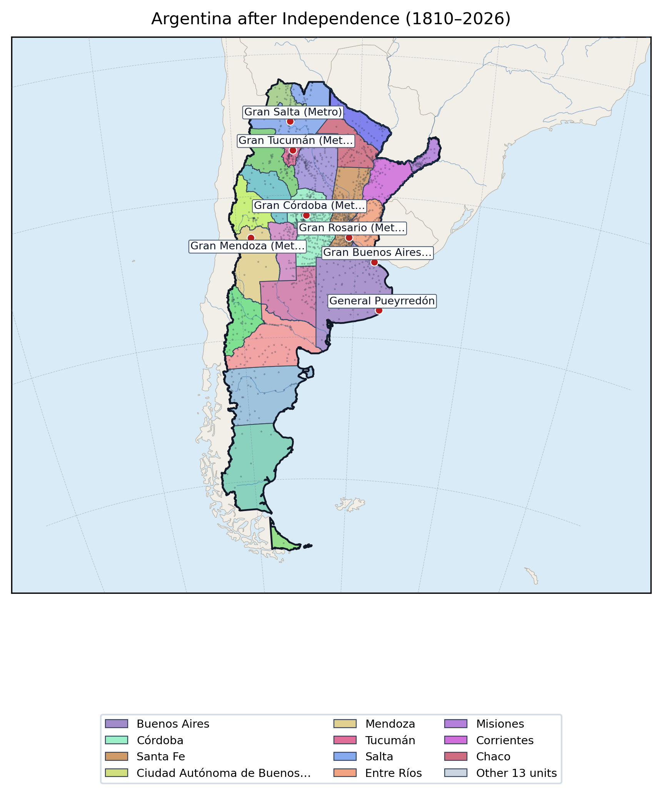
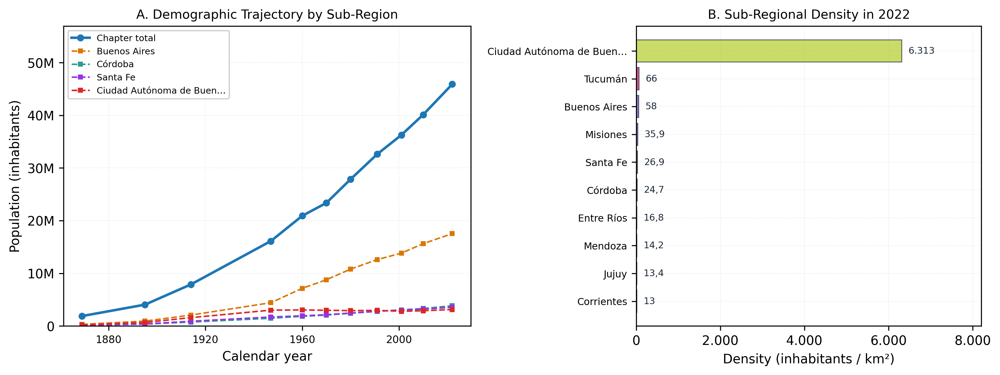
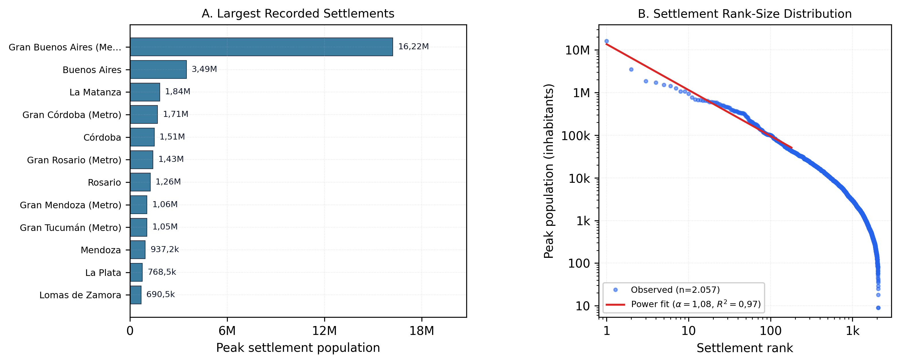

Argentina after Independence
================
Aust Kätzchen
23 November 2026

- [Abstract](#abstract)
- [Background](#background)
  - [Independence, Early Provincial Counts and the Littoral Divide
    (1810-1869)](#independence-early-provincial-counts-and-the-littoral-divide-1810-1869)
  - [The Conquest of the Desert and Territorios Nacionales
    (1879-1914)](#the-conquest-of-the-desert-and-territorios-nacionales-1879-1914)
  - [The Great Transatlantic Immigration Wave
    (1880-1930)](#the-great-transatlantic-immigration-wave-1880-1930)
  - [Pampean Hegemony, Internal Migration and the Conurbano
    (1930-1970)](#pampean-hegemony-internal-migration-and-the-conurbano-1930-1970)
  - [Provincialisation, Southern Frontiers and Demographic Transition
    (1951-2026)](#provincialisation-southern-frontiers-and-demographic-transition-1951-2026)
- [Methodology](#methodology)
  - [Territorial Partition across Twenty-Four
    Jurisdictions](#territorial-partition-across-twenty-four-jurisdictions)
  - [Eleven National Census Horizons
    (1869-2022)](#eleven-national-census-horizons-1869-2022)
  - [Settlement Gazetteer and Metropolitan
    Accounting](#settlement-gazetteer-and-metropolitan-accounting)
- [Testing and Validation](#testing-and-validation)
- [Results](#results)
  - [National and Provincial Trajectory, 1869 to
    2022](#national-and-provincial-trajectory-1869-to-2022)
  - [Urban Hierarchy and Metropolitan
    Primacy](#urban-hierarchy-and-metropolitan-primacy)
- [Limitations](#limitations)
- [Conclusion](#conclusion)
- [Appendix](#appendix)
  - [Macro-Regional Demographic
    Summary](#macro-regional-demographic-summary)
  - [Provenance Corpus Breakdown](#provenance-corpus-breakdown)
- [Sources](#sources)

<figure>

<figcaption aria-hidden="true">Twenty-four Argentine jurisdictions and
2.057 catalogued settlements from the Puna to Tierra del Fuego, 1810 to
2026.</figcaption>
</figure>

# Abstract

Between the May Revolution of 1810 and the twenty-first century, the
Argentine Republic underwent one of the sharpest demographic
transformations of the post-colonial world, growing from a sparsely
peopled pastoral periphery of roughly 450k to 550k inhabitants at
independence to 1,88M (1.877.491) in Domingo Faustino Sarmiento’s
landmark 1869 first national census and 45,89M (45.892.285) in the 2022
census
[\[1\]](#ref-Collection1929Estadistica)[\[2\]](#ref-Zobec2010Knjizna)[\[3\]](#ref-Gonzalez2015Proyecciones).
Across 24 modern jurisdictions covering 2.816.800,5 km², national
population multiplied nearly twenty-five-fold between 1869 and 2022,
propelled first by transatlantic mass immigration between 1880 and 1930,
when more than 6M predominantly Italian and Spanish arrivals raised the
foreign-born share to roughly 30% in 1914, and subsequently by
rural-urban internal migration from the northern provinces into the
*Conurbano Bonaerense*
[\[2\]](#ref-Zobec2010Knjizna)[\[4\]](#ref-Bjerg2018Emotions)[\[5\]](#ref-Montero2019Spain)[\[6\]](#ref-Rotger2025Urbanizacion).
Demographic weight shifted decisively toward the Pampean littoral: while
the Ciudad Autónoma de Buenos Aires (CABA) plateaued near 3M after 1947
(standing at 3,12M in 2022 at 6.312,86 inhabitants per km²), Buenos
Aires Province expanded nearly fifty-seven-fold from 307,8k in 1869 to
17,52M in 2022, anchoring a Gran Buenos Aires agglomeration of 16,22M
alongside Córdoba (3,84M) and Santa Fe (3,54M)
[\[7\]](#ref-Ramos2021Envejecimiento)[\[8\]](#ref-Rodriguez2025Area)[\[9\]](#ref-Molinatti2020Segregacion).
Following the Conquest of the Desert (1879-1884), the 1912 territorial
enumeration and the 1951-1955 provincialisation of the *Territorios
Nacionales*, southern and northeastern frontiers recorded sustained
twentieth-century growth alongside an early Southern Cone fertility
transition that lowered annual growth to around 1,1% by 2010-2022
[\[3\]](#ref-Gonzalez2015Proyecciones)[\[10\]](#ref-Nacionales1914Censo)[\[11\]](#ref-Gallero2010Proceso).
This chapter synthesises all 11 official national censuses from 1869 to
2022 across 24 provinces and reconciles them against a 2.057-settlement
gazetteer
[\[12\]](#ref-Roldan2013Inventarios)[\[13\]](#ref-Pellegrini2014Patron).

# Background

## Independence, Early Provincial Counts and the Littoral Divide (1810-1869)

At the outbreak of the May Revolution in 1810, the territories that
would coalesce into the Argentine Republic held an unevenly distributed
population anchored along the old colonial silver road from Alto Perú
down through Salta, Tucumán, Santiago del Estero and Córdoba to the Río
de la Plata estuary
[\[14\]](#ref-Ghirardi2013Saludes)[\[15\]](#ref-Kuffer2010Migracion).
The port of Buenos Aires held 41.642 residents in 1810, roughly
one-tenth of the settled republican population, while traditional
highland and oasis centres in the Northwest (NOA) and Cuyo still
rivalled the littoral in demographic weight
[\[1\]](#ref-Collection1929Estadistica)[\[14\]](#ref-Ghirardi2013Saludes).
Provincial enumerations from the early republican decades reveal an
interior economy structured by artisan craftwork, mule breeding and
regional trade rather than transatlantic export agriculture. In Córdoba,
the 1813 and 1832 municipal counts preserve detailed household registers
of surname origins, occupational health and regional mobility between
neighbouring provinces, confirming steady short-range circulation across
the central sierra before the railway age
[\[14\]](#ref-Ghirardi2013Saludes)[\[15\]](#ref-Kuffer2010Migracion)[\[16\]](#ref-Colantonio2015Apellidos).

Civil wars between Unitarians and Federals delayed a unified national
enumeration for nearly six decades after 1810. Only after the
constitutional consolidation of 1853-1862 and the presidency of Domingo
Faustino Sarmiento did the state execute its first modern headcount in
September 1869 [\[1\]](#ref-Collection1929Estadistica). That census
counted 1.877.491 inhabitants across the republic, already showing the
early shift toward the littoral: Buenos Aires Province (307.761) and the
city of Buenos Aires (187.346) together accounted for 26,37% of the
national population, ahead of Córdoba (210.508), Entre Ríos (134.271),
Santiago del Estero (132.898), Corrientes (129.023), Tucumán (108.953),
Santa Fe (89.117) and Salta (88.933)
[\[1\]](#ref-Collection1929Estadistica)[\[2\]](#ref-Zobec2010Knjizna).
Beyond the settled agricultural provinces, vast tracts of the Pampa,
Patagonia and the Gran Chaco remained outside effective state
administration, inhabited by Mapuche, Tehuelche, Ranquel, Qom and Wichí
societies whose numbers were estimated rather than enumerated
[\[10\]](#ref-Nacionales1914Censo)[\[17\]](#ref-Gomezotero2007Patagonia)[\[18\]](#ref-Cassiodoro2020Caracterizacio).

## The Conquest of the Desert and Territorios Nacionales (1879-1914)

Between 1879 and 1884, the military campaigns known as the Conquest of
the Desert under General Julio Argentino Roca, followed by parallel
expeditions into the northern Gran Chaco, extinguished indigenous
territorial autonomy south of the Río Salado and across the
Pilcomayo-Bermejo plain
[\[10\]](#ref-Nacionales1914Censo)[\[17\]](#ref-Gomezotero2007Patagonia).
Archaeologically, Patagonia and the central steppe had sustained mobile
hunter-gatherer bands throughout the Holocene
[\[17\]](#ref-Gomezotero2007Patagonia)[\[18\]](#ref-Cassiodoro2020Caracterizacio),
and nineteenth-century indigenous polities had traded livestock across
the Andean passes into Araucanía. Military annexation opened more than a
million square kilometres of grazing steppe and alluvial valleys to
state land auctions, British-financed railways and sheep *estancias*,
reorganised in 1884 under Law 1.532 into nine *Territorios Nacionales*
(La Pampa, Neuquén, Río Negro, Chubut, Santa Cruz, Tierra del Fuego,
Misiones, Formosa and Chaco, later joined by Los Andes in 1900)
[\[10\]](#ref-Nacionales1914Censo)[\[11\]](#ref-Gallero2010Proceso)[\[19\]](#ref-Daddona2023Primeras).

Settlement across these new national territories proceeded in sharply
contrasting regional waves documented in the special 1912 territorial
census [\[10\]](#ref-Nacionales1914Censo). La Pampa expanded from an
estimated 21k in 1869 and 25,9k in 1895 to 101,3k by 1914 as wheat and
cattle estates crossed the western frontier from Buenos Aires. Along the
Chubut valley and Andean foothills, Welsh colonists from 1865 onward
were joined by Chilean pastoralists, Italian merchants and Spanish
settlers, raising Chubut from 3,7k in 1895 to 23,1k in 1914 and Río
Negro from 9,2k to 42,2k
[\[10\]](#ref-Nacionales1914Censo)[\[19\]](#ref-Daddona2023Primeras). In
the subtropical northeast, Misiones grew from barely 3k in 1869 to 33,2k
in 1895 and 53,6k in 1914 through state-directed agricultural colonies
settled by Polish, Ukrainian, German and Brazilian-German pioneers
cultivating *yerba mate* and timber
[\[11\]](#ref-Gallero2010Proceso)[\[20\]](#ref-Crolla2015Voces).

## The Great Transatlantic Immigration Wave (1880-1930)

The decisive demographic engine of modern Argentina was the
transatlantic migration boom between 1880 and 1930. Driven by European
agrarian crises, falling steamship fares, seasonal *golondrina* harvest
circuits and deliberate Argentine constitutional encouragement, over 6M
overseas passengers disembarked at Buenos Aires and secondary river
ports during this half-century, leaving a net permanent gain exceeding
3M persons
[\[1\]](#ref-Collection1929Estadistica)[\[2\]](#ref-Zobec2010Knjizna)[\[4\]](#ref-Bjerg2018Emotions).

Italians formed the largest contingent, roughly 45% of total arrivals,
followed closely by Spaniards at roughly one-third, alongside
substantial Polish, Russian-Jewish, French, German, Swiss, Welsh, Syrian
and Lebanese communities
[\[2\]](#ref-Zobec2010Knjizna)[\[5\]](#ref-Montero2019Spain)[\[20\]](#ref-Crolla2015Voces).
Unlike the United States, where immigration represented a modest
addition to a large native-born population, European arrivals in
Argentina entered a republic of scarcely 2M people, transforming
national demography at unprecedented speed
[\[2\]](#ref-Zobec2010Knjizna)[\[4\]](#ref-Bjerg2018Emotions).

By the second national census of 1895, Argentina’s population had more
than doubled in twenty-six years to 4.044.911, and by the third census
of 1914 it nearly doubled again to 7.882.750
[\[1\]](#ref-Collection1929Estadistica). Foreign-born residents
accounted for 25,4% of the national total in 1895 and reached 29,9%
(nearly 30%) in 1914, exceeding half the adult male workforce in Buenos
Aires and Rosario
[\[2\]](#ref-Zobec2010Knjizna)[\[5\]](#ref-Montero2019Spain)[\[12\]](#ref-Roldan2013Inventarios).
Household reconstruction and epistolary studies illuminate the social
mechanics behind these aggregate figures: chain migration linked
specific Italian *paesi* and Spanish *comarcas* directly to Argentine
neighbourhoods, *conventillo* tenements and Santa Fe colonias, while
family separation, remittances and cross-oceanic marriage sustained
dense transnational ties well into the interwar decades
[\[4\]](#ref-Bjerg2018Emotions)[\[20\]](#ref-Crolla2015Voces)[\[21\]](#ref-Hernando2019Inmigracion).
Municipal censuses in Rosario between 1889 and 1910 track a river port
vaulting from 23k in 1869 to 91,7k in 1895 and 245,2k in 1914 as grain
elevators and rail terminals turned southern Santa Fe into South
America’s premier wheat corridor
[\[12\]](#ref-Roldan2013Inventarios)[\[13\]](#ref-Pellegrini2014Patron).

## Pampean Hegemony, Internal Migration and the Conurbano (1930-1970)

The Great Depression of 1929-1930 abruptly curtailed mass European
immigration, save for a brief post-1945 epilogue that brought displaced
families and southern European labourers during the early Peronist years
[\[21\]](#ref-Hernando2019Inmigracion)[\[22\]](#ref-Simonetta2013Viaje).
Yet national urbanisation accelerated rather than slowed. From 1930
through the 1960s, import-substituting industrialisation concentrated
textile mills, metalworking plants, food processors and public utilities
inside a narrow metropolitan crescent extending from La Plata through
Greater Buenos Aires up the Paraná axis to Rosario and inland to Córdoba
[\[6\]](#ref-Rotger2025Urbanizacion)[\[9\]](#ref-Molinatti2020Segregacion)[\[13\]](#ref-Pellegrini2014Patron).
As agricultural prices stagnated in the northern interior and
mechanisation displaced rural labour on the Pampas, hundreds of
thousands of internal migrants moved from Santiago del Estero, Tucumán,
Catamarca, Corrientes and Chaco into the industrial ring surrounding the
Federal Capital, known as the *Conurbano Bonaerense*
[\[6\]](#ref-Rotger2025Urbanizacion)[\[23\]](#ref-Cuenya1990Land)[\[24\]](#ref-Almansi2008Mobilizing).

This internal shift altered the internal geography of Greater Buenos
Aires. Between 1947 and 1970, the Federal Capital itself ceased growing:
CABA held 3M inhabitants in 1947, edged to 3,04M in 1960 (3,49M on the
municipal peak series) and eased to 2,97M in 1970, constrained by its
200 km² administrative perimeter
[\[6\]](#ref-Rotger2025Urbanizacion)[\[25\]](#ref-Isla2023Urbanization).
Over those same twenty-three years, however, Buenos Aires Province
nearly doubled from 4,41M (1947) to 8,78M (1970), absorbing almost the
entire expansion of the metropolitan ring across *partidos* such as La
Matanza, Lomas de Zamora, Quilmes, Lanús, Avellaneda, General San Martín
and Morón
[\[6\]](#ref-Rotger2025Urbanizacion)[\[23\]](#ref-Cuenya1990Land)[\[24\]](#ref-Almansi2008Mobilizing).
Planned provincial capitals such as La Plata, founded in 1882 to serve
as the new provincial seat after the federalisation of Buenos Aires,
expanded steadily alongside coastal wetland corridors
[\[7\]](#ref-Ramos2021Envejecimiento)[\[25\]](#ref-Isla2023Urbanization).

## Provincialisation, Southern Frontiers and Demographic Transition (1951-2026)

Politically and spatially, the mid-twentieth century closed the era of
territorial tutelage. Between 1951 and 1955, the Argentine Congress
elevated eight of the nine *Territorios Nacionales* to full provincial
status: Chaco and La Pampa in 1951, Misiones in 1953, and Formosa,
Neuquén, Río Negro, Chubut and Santa Cruz in 1955, followed finally by
Tierra del Fuego in 1990
[\[10\]](#ref-Nacionales1914Censo)[\[11\]](#ref-Gallero2010Proceso).

State hydrocarbon exploration in Comodoro Rivadavia (Chubut), Plaza
Huincul and Loma La Lata (Neuquén), and Pico Truncado (Santa Cruz),
coupled with hydroelectric dams on the Limay and Neuquén rivers and the
1972 duty-free industrial regime (Law 19.640) in Tierra del Fuego,
turned Patagonia from an empty pastoral fringe into Argentina’s
fastest-growing macro-region after 1960
[\[17\]](#ref-Gomezotero2007Patagonia)[\[19\]](#ref-Daddona2023Primeras).
Neuquén expanded more than eightfold from 85,6k in 1947 to 710,8k in
2022, while Santa Cruz rose nearly fourteen-fold from 24,7k to 337,2k
and Tierra del Fuego nearly thirty-eight-fold from 4,9k to 185,7k.

Over the same decades, Argentina completed one of the earliest
demographic transitions in Latin America
[\[3\]](#ref-Gonzalez2015Proyecciones)[\[7\]](#ref-Ramos2021Envejecimiento).
Urbanised, literate and European-influenced Pampean households reduced
fertility steadily from the early twentieth century onward, bringing
national total fertility near replacement in the early 2000s and below
replacement in the 2010s and 2020s
[\[3\]](#ref-Gonzalez2015Proyecciones). As European immigration faded,
regional South-South migration from Bolivia, Paraguay and Peru became
the main external inflow, settling in both the *Conurbano Bonaerense*
and major interior cities such as Córdoba and Mendoza
[\[9\]](#ref-Molinatti2020Segregacion)[\[26\]](#ref-Bologna2016Migracion)[\[27\]](#ref-Pablo2019Migracion).
At the same time, northern provinces such as Misiones, Salta and Jujuy
retained younger age pyramids than CABA, Santa Fe and La Plata, creating
persistent inter-regional contrasts in demographic ageing and urban
vulnerability
[\[7\]](#ref-Ramos2021Envejecimiento)[\[28\]](#ref-Gaitan2013Migracion).

# Methodology

## Territorial Partition across Twenty-Four Jurisdictions

To evaluate Argentine population consistently from 1810 to 2026 without
distorting historical comparisons through twentieth-century border
changes, the national territory is partitioned into its 24 canonical
modern jurisdictions: 23 provinces plus the Ciudad Autónoma de Buenos
Aires (CABA). Vector boundaries in the chapter GIS cache enclose
2.816.800,5 km², spanning from subtropical Misiones (35.594,9 km²) and
Tucumán (26.089,1 km²) to vast Patagonian Santa Cruz (245.406,6 km²),
Chubut (225.051,1 km²) and Buenos Aires Province (299.870,9 km²),
alongside compact CABA (494,5 km² in the rasterised metropolitan
polygon). South Atlantic islands claimed under Tierra del Fuego
administration are treated separately in the chapter devoted to the
Falklands and South Atlantic Islands so that continental accounting
remains free of double-counting.

Historical populations recorded prior to the 1951-1955 provincialisation
acts are mapped onto the modern provincial polygons corresponding to
each *Territorio Nacional* or nineteenth-century frontier zone. Where
nineteenth-century national censuses omitted or only partially
enumerated autonomous indigenous groups in Patagonia and the Gran Chaco,
historical-geographical reconstructions harmonize territorial estimates
into the respective modern provincial footprints (for example, Chaco,
Formosa, La Pampa, Neuquén, Río Negro, Chubut, Santa Cruz and Tierra del
Fuego) while preserving exact official provincial totals from 1869
onward
[\[1\]](#ref-Collection1929Estadistica)[\[10\]](#ref-Nacionales1914Censo).

## Eleven National Census Horizons (1869-2022)

Official demographic benchmarks follow all 11 national population
censuses conducted by Argentina’s national statistical offices
(Dirección General de Estadística and, since 1968, INDEC): 1869, 1895,
1914, 1947, 1960, 1970, 1980, 1991, 2001, 2010 and 2022
[\[1\]](#ref-Collection1929Estadistica)[\[3\]](#ref-Gonzalez2015Proyecciones).
Each benchmark preserves exact published provincial figures, yielding
headline national totals of 1.877.491 (1869), 4.044.911 (1895),
7.882.750 (1914), 16.105.214 (1947), 20.902.000 (1960), 23.364.000
(1970), 27.862.771 (1980), 32.615.528 (1991), 36.260.130 (2001),
40.117.096 (2010) and 45.892.285 (2022). Decadal intervals between
censuses vary from 9 to 33 years because political and fiscal
disruptions prevented censuses between 1914 and 1947, and the 2020 round
was postponed by pandemic restrictions to May 2022.

Between 1810 and 1869, provincial headcounts are sparse and uneven,
confined to fragmentary municipal or provincial padrones such as
Córdoba’s 1813 and 1832 censuses
[\[14\]](#ref-Ghirardi2013Saludes)[\[15\]](#ref-Kuffer2010Migracion)[\[16\]](#ref-Colantonio2015Apellidos)
and Buenos Aires city counts [\[1\]](#ref-Collection1929Estadistica).
Rather than fabricating spurious annual provincial series for 1810-1868,
pre-1869 demographic structure is anchored in the 1820 regional snapshot
and documented city series, leaving 1869 as the first full-coverage
benchmark across all 24 jurisdictions.

## Settlement Gazetteer and Metropolitan Accounting

Alongside the 24 provincial series, a georeferenced gazetteer of 2.057
settlements was compiled from four audited archival passes across 2.495
INDEC 2022 local government units, 4.037 IGN-INDEC georeferenced
localities and the historical census tables of 1869-1960. Every retained
entry is assigned to one of three explicit spatial scopes: 1.977
city-proper municipalities and rural localities, 70 suburban *partidos*
or metropolitan ring communes, and 10 multi-jurisdictional metropolitan
agglomerations (*Gran Buenos Aires*, *Gran Córdoba*, *Gran Rosario*,
*Gran Mendoza*, *Gran Tucumán*, *Gran Salta*, *Gran Mar del Plata*,
*Gran San Juan*, *Gran Santa Fe* and *Gran Neuquén*)
[\[6\]](#ref-Rotger2025Urbanizacion)[\[8\]](#ref-Rodriguez2025Area)[\[9\]](#ref-Molinatti2020Segregacion).
Separating city-proper from suburban and metropolitan entries prevents
double-counting when summing urban shares while allowing direct
comparison between historic municipal cores and sprawling suburban
rings.

For Buenos Aires, the 15 *Comunas* of CABA are consolidated into a
single unified Buenos Aires city-proper series spanning 1810 (41.642)
through 1869 (177k municipal core), 1960 (3,49M peak) and 2022
(3.121.707), distinct from the 16.224.751 residents of Gran Buenos Aires
(Metro) and from individual Conurbano *partidos* such as La Matanza
(1.841.247), Lomas de Zamora (690.480) and Quilmes (633.391)
[\[23\]](#ref-Cuenya1990Land)[\[24\]](#ref-Almansi2008Mobilizing)[\[25\]](#ref-Isla2023Urbanization).
In the accompanying settlements report, this metropolitan accounting is
laid out explicitly across both CABA and provincial Buenos Aires.

# Testing and Validation

Three cross-checks validate the internal consistency and empirical
grounding of the demographic reconstruction. First, spatial
reconciliation between the vector provincial polygons (2.816.800,5 km²)
and the 4.320 by 2.160 gridded population mask (40.600 occupied pixels
covering 2.810.457 km²) agrees within 0,23%, confirming negligible
coastal or frontier rasterisation loss across all 24 provinces.
Summation across all 24 jurisdictions reproduces every national census
headline from 1869 (1.877.491) to 2022 (45.892.285) with zero
unallocated residual. Calibration uncertainty bands widen systematically
for earlier censuses: plus or minus 6% across 1869-1947 (reflecting
incomplete frontier enumeration and 1914-1947 intercensal interpolation
sensitivity, giving 1,76M to 1,99M in 1869 and 15,14M to 17,07M in 1947)
and plus or minus 2,5% across 1960-2022 (reflecting standard
post-enumeration coverage adjustments, giving 44,75M to 47,04M in 2022)
[\[3\]](#ref-Gonzalez2015Proyecciones).

Second, urban-system consistency is tested via log-log rank-size
regression across the 2.057 catalogued settlements. As shown in Panel B
of Figure , peak populations conform closely to a Zipf power law with
slope $\alpha = 1,08$ and coefficient of determination $R^2 = 0,97$
across the upper urban hierarchy down to towns near 20k, before rolling
off naturally across small rural communes down to 9 inhabitants at
Colonia Anita in Córdoba. This tight fit confirms that the gazetteer
captures the full Argentine urban pyramid without missing intermediate
regional centres
[\[8\]](#ref-Rodriguez2025Area)[\[13\]](#ref-Pellegrini2014Patron).

Third, historical archival checks verify longitudinal continuity against
primary municipal and territorial counts. Rosario’s municipal census
trajectory from 1889 to 1910 [\[12\]](#ref-Roldan2013Inventarios) aligns
cleanly with its 1895 (91.669) and 1914 (245.199) national benchmarks,
while the 1912 *Territorios Nacionales* census
[\[10\]](#ref-Nacionales1914Censo) corroborates the rapid pre-1914
settlement of La Pampa, Misiones [\[11\]](#ref-Gallero2010Proceso) and
northern Patagonia [\[19\]](#ref-Daddona2023Primeras). The audit also
flags one upstream tabular anomaly in the digitised historical table:
the 1895 entry for Tierra del Fuego records 108.477 persons instead of
the historical territorial count of roughly 477, an artefact of
nineteenth-century coastal-territory aggregation discussed further under
Limitations.

# Results

## National and Provincial Trajectory, 1869 to 2022

Argentina’s demographic expansion across the 153 years separating the
1869 and 2022 censuses unfolded in three distinct growth regimes,
tabulated across all 24 jurisdictions in Tables and and plotted in
Figure . Between 1869 and 1914, national population more than quadrupled
from 1,88M to 7,88M (3,24% compound annual growth between 1869 and 1895,
and 3,57% between 1895 and 1914), powered by transatlantic arrivals and
the opening of Pampean arable land
[\[1\]](#ref-Collection1929Estadistica)[\[2\]](#ref-Zobec2010Knjizna)[\[4\]](#ref-Bjerg2018Emotions).
Growth moderated to 2,19% per year over the long 1914-1947 intercensal
interval (reaching 16,11M) and to 2,03% in 1947-1960 (20,9M), before
settling onto a steady post-transition trajectory of 1,78% in 1970-1980
(27,86M), 1,44% in 1980-1991 (32,62M), 1,07% in 1991-2001 (36,26M),
1,13% in 2001-2010 (40,12M) and 1,13% in 2010-2022 (45,89M)
[\[3\]](#ref-Gonzalez2015Proyecciones).

| Jurisdiction            | Area (km²) | 1869   | 1895   | 1914   | 1947   | 1960  |
|:------------------------|:-----------|:-------|:-------|:-------|:-------|:------|
| **Buenos Aires**        | 299.871    | 307,8k | 921,2k | 2,07M  | 4,41M  | 7,14M |
| **Catamarca**           | 102.964    | 80k    | 90,2k  | 100,4k | 145,2k | 179k  |
| **Chaco**               | 101.445    | 45,3k  | 10,4k  | 46,3k  | 443,9k | 559k  |
| **Chubut**              | 225.051    | 11,4k  | 3,7k   | 23,1k  | 105,5k | 151k  |
| **CABA (Buenos Aires)** | 494        | 187,3k | 663,9k | 1,58M  | 3M     | 3,04M |
| **Corrientes**          | 92.999     | 129k   | 239,6k | 347,1k | 571k   | 559k  |
| **Córdoba**             | 155.433    | 210,5k | 351,2k | 735,5k | 1,46M  | 1,83M |
| **Entre Ríos**          | 84.942     | 134,3k | 292k   | 425,4k | 776,3k | 825k  |
| **Formosa**             | 84.937     | 9,5k   | 4,8k   | 19,3k  | 112,1k | 189k  |
| **Jujuy**               | 60.451     | 49,4k  | 49,7k  | 76,6k  | 166,8k | 253k  |
| **La Pampa**            | 147.433    | 21k    | 25,9k  | 101,3k | 167,6k | 161k  |
| **La Rioja**            | 92.191     | 48,7k  | 69,5k  | 79,8k  | 109,4k | 133k  |
| **Mendoza**             | 144.179    | 65,4k  | 116,1k | 277,5k | 590,5k | 869k  |
| **Misiones**            | 35.595     | 3k     | 33,2k  | 53,6k  | 244,1k | 415k  |
| **Neuquén**             | 102.857    | 14,3k  | 14,5k  | 28,9k  | 85,6k  | 116k  |
| **Río Negro**           | 198.436    | 20,9k  | 9,2k   | 42,2k  | 132,4k | 203k  |
| **Salta**               | 148.989    | 88,9k  | 118k   | 140,9k | 290,1k | 435k  |
| **San Juan**            | 96.140     | 60,3k  | 84,3k  | 119,3k | 260,7k | 370k  |
| **San Luis**            | 82.451     | 53,3k  | 81,5k  | 116,3k | 167,6k | 180k  |
| **Santa Cruz**          | 245.407    | 4,9k   | 1,1k   | 9,9k   | 24,7k  | 55k   |
| **Santa Fe**            | 132.002    | 89,1k  | 379,2k | 899,6k | 1,7M   | 1,93M |
| **Sgo. del Estero**     | 135.369    | 132,9k | 161,5k | 261,7k | 538,4k | 489k  |
| **Tierra del Fuego**    | 21.076     | 1,2k   | 108,5k | 2,5k   | 4,9k   | 7k    |
| **Tucumán**             | 26.089     | 109k   | 215,7k | 332,9k | 604,5k | 818k  |
| **Argentina Total**     | 2.816.800  | 1,88M  | 4,04M  | 7,88M  | 16,11M | 20,9M |

Provincial and national census population totals across twenty-four
Argentine jurisdictions, 1869 to 1960.

| Jurisdiction            | 1970   | 1980   | 1991   | 2001   | 2010   | 2022   | 2022 Dens. |
|:------------------------|:-------|:-------|:-------|:-------|:-------|:-------|:-----------|
| **Buenos Aires**        | 8,78M  | 10,8M  | 12,59M | 13,83M | 15,63M | 17,52M | 58,44      |
| **Catamarca**           | 172k   | 206,2k | 264,2k | 334,6k | 367,8k | 429,6k | 4,17       |
| **Chaco**               | 567k   | 692,4k | 839,7k | 984,4k | 1,06M  | 1,13M  | 11,14      |
| **Chubut**              | 190k   | 262,2k | 357,2k | 413,2k | 509,1k | 592,6k | 2,63       |
| **CABA (Buenos Aires)** | 2,97M  | 2,91M  | 2,97M  | 2,78M  | 2,89M  | 3,12M  | 6.312,86   |
| **Corrientes**          | 564k   | 657,7k | 795,6k | 931k   | 992,6k | 1,21M  | 13,04      |
| **Córdoba**             | 2,06M  | 2,41M  | 2,77M  | 3,07M  | 3,31M  | 3,84M  | 24,71      |
| **Entre Ríos**          | 812k   | 902,2k | 1,02M  | 1,16M  | 1,24M  | 1,43M  | 16,78      |
| **Formosa**             | 234k   | 292,5k | 398,4k | 486,6k | 530,2k | 607,4k | 7,15       |
| **Jujuy**               | 302k   | 408,5k | 512,3k | 611,9k | 673,3k | 811,6k | 13,43      |
| **La Pampa**            | 172k   | 207,1k | 260k   | 299,3k | 319k   | 361,9k | 2,45       |
| **La Rioja**            | 136k   | 163,3k | 220,7k | 290k   | 333,6k | 383,9k | 4,16       |
| **Mendoza**             | 973k   | 1,19M  | 1,41M  | 1,58M  | 1,74M  | 2,04M  | 14,17      |
| **Misiones**            | 443k   | 579,6k | 788,9k | 965,5k | 1,1M   | 1,28M  | 35,93      |
| **Neuquén**             | 155k   | 241,9k | 388,8k | 474,2k | 551,3k | 710,8k | 6,91       |
| **Río Negro**           | 263k   | 383,9k | 506,8k | 552,8k | 638,6k | 750,8k | 3,78       |
| **Salta**               | 510k   | 662,4k | 866,2k | 1,08M  | 1,21M  | 1,44M  | 9,67       |
| **San Juan**            | 384k   | 470k   | 528,7k | 620k   | 681,1k | 822,9k | 8,56       |
| **San Luis**            | 183k   | 212,8k | 286,5k | 367,9k | 432,3k | 542,1k | 6,57       |
| **Santa Cruz**          | 84k    | 114,5k | 159,8k | 197k   | 274k   | 337,2k | 1,37       |
| **Santa Fe**            | 2,14M  | 2,46M  | 2,8M   | 3M     | 3,19M  | 3,54M  | 26,86      |
| **Sgo. del Estero**     | 495k   | 652,3k | 672k   | 804,5k | 874k   | 1,06M  | 7,84       |
| **Tierra del Fuego**    | 16k    | 29,5k  | 69,4k  | 101,1k | 127,2k | 185,7k | 8,81       |
| **Tucumán**             | 766k   | 968,1k | 1,14M  | 1,34M  | 1,45M  | 1,73M  | 66,38      |
| **Argentina Total**     | 23,36M | 27,86M | 32,62M | 36,26M | 40,12M | 45,89M | 16,29      |

Provincial and national census population totals (1970 to 2022) and 2022
population density (inhabitants per km²).

| Census Year | Population | Interval (yr) | Net Gain | Annual Growth | Density (km²) |
|:------------|:-----------|:--------------|:---------|:--------------|:--------------|
| **1869**    | 1,88M      | \-            | \-       | \-            | 0,67          |
| **1895**    | 4,04M      | 26            | +2,17M   | 3%            | 1,44          |
| **1914**    | 7,88M      | 19            | +3,84M   | 3,57%         | 2,8           |
| **1947**    | 16,11M     | 33            | +8,22M   | 2,19%         | 5,72          |
| **1960**    | 20,9M      | 13            | +4,8M    | 2,03%         | 7,42          |
| **1970**    | 23,36M     | 10            | +2,46M   | 1,12%         | 8,29          |
| **1980**    | 27,86M     | 10            | +4,5M    | 1,78%         | 9,89          |
| **1991**    | 32,62M     | 11            | +4,75M   | 1,44%         | 11,58         |
| **2001**    | 36,26M     | 10            | +3,64M   | 1,06%         | 12,87         |
| **2010**    | 40,12M     | 9             | +3,86M   | 1,13%         | 14,24         |
| **2022**    | 45,89M     | 12            | +5,78M   | 1,13%         | 16,29         |

National census population, intercensal gain, compound annual growth
rate and national density, 1869 to 2022.

Four enduring regional contrasts emerge from the provincial tables and
the national growth summary in Table . First, the Pampean heartland -
Buenos Aires Province, CABA, Córdoba, Santa Fe and Entre Ríos -
established overwhelming demographic dominance between 1869 and 1914 and
never relinquished it. Together these five jurisdictions rose from 929k
in 1869 (49,48% of the republic) to 5,7M in 1914 (72,35%) and 11,34M in
1947 (70,41%), holding 29,46M (64,19%) in 2022.

Within this core, however, internal momentum shifted decisively from the
port city to the surrounding province after 1947. CABA climbed from
187,3k in 1869 to 1,58M in 1914 and 3M in 1947, then oscillated narrowly
between 2,78M (2001) and 3,12M (2022), cutting its national share from
20% in 1914 to 6,8% in 2022
[\[6\]](#ref-Rotger2025Urbanizacion)[\[7\]](#ref-Ramos2021Envejecimiento).
Over the same interval, Buenos Aires Province surged from 4,41M (1947)
to 7,14M (1960), 10,8M (1980), 13,83M (2001) and 17,52M (2022),
accounting alone for 38,19% of Argentina’s inhabitants
[\[23\]](#ref-Cuenya1990Land)[\[25\]](#ref-Isla2023Urbanization).

Second, Córdoba and Santa Fe evolved from pastoral frontiers into mature
agro-industrial corridors. Santa Fe multiplied more than tenfold between
1869 (89,1k) and 1914 (899,6k) under European agricultural colonisation
and Rosario’s port boom, before advancing steadily to 1,7M in 1947 and
3,54M in 2022
[\[8\]](#ref-Rodriguez2025Area)[\[12\]](#ref-Roldan2013Inventarios)[\[13\]](#ref-Pellegrini2014Patron).
Córdoba grew more evenly across the nineteenth and twentieth centuries -
from 210,5k in 1869 to 735,5k in 1914, 1,46M in 1947 and 3,84M in 2022 -
overtaking Santa Fe after 1991 as automotive manufacturing, university
expansion and regional service industries drew migrants from the
Northwest and Andean republics
[\[9\]](#ref-Molinatti2020Segregacion)[\[26\]](#ref-Bologna2016Migracion)[\[27\]](#ref-Pablo2019Migracion).
Entre Ríos, by contrast, grew vigorously during the nineteenth century
(134,3k in 1869 to 425,4k in 1914 and 776,3k in 1947) before shedding
out-migrants to Greater Buenos Aires between 1947 and 1970 (812k),
recovering thereafter to 1,43M in 2022
[\[24\]](#ref-Almansi2008Mobilizing).

Third, the Northeastern (NEA) and Northwestern (NOA) provinces
experienced starkly divergent trajectories. In the NEA, Chaco and
Misiones exploded after 1914 through cotton colonisation, timber
extraction and *yerba mate* agriculture
[\[11\]](#ref-Gallero2010Proceso): Chaco jumped nearly tenfold between
1914 (46,3k) and 1947 (443,9k) and reached 1,13M in 2022, while Misiones
rose twenty-four-fold from 53,6k in 1914 to 1,28M in 2022 at 35,93
inhabitants per km², making it Argentina’s fourth densest jurisdiction
after CABA (6.312,86), Tucumán (66,38) and Buenos Aires (58,44). Formosa
followed a similar frontier arc from 19,3k (1914) to 607,4k (2022),
whereas older Corrientes grew more modestly from 129k (1869) to 1,21M
(2022).

In the NOA, sugar-producing Tucumán expanded steadily from 109k in 1869
to 1,73M in 2022, packing 66,38 persons per km² into Argentina’s
smallest continental province (26.089,1 km²)
[\[28\]](#ref-Gaitan2013Migracion), while Salta climbed from 88,9k to
1,44M and Jujuy from 49,4k to 811,6k. By contrast, arid Catamarca (80k
in 1869 to 429,6k in 2022) and La Rioja (48,7k to 383,9k) lagged
sharply, while Santiago del Estero suffered chronic mid-century
out-migration, stalling near 500k between 1947 and 1970 before climbing
to 1,06M by 2022.

Fourth, Cuyo and Patagonia trace the westward and southward expansion of
irrigation and extractive industry. Mendoza, anchored by viticulture and
Andean piedmont oases, grew thirty-one-fold from 65,4k in 1869 to 2,04M
in 2022, outpacing neighbouring San Juan (60,3k to 822,9k) and San Luis
(53,3k to 542,1k). South of the Río Colorado, the five Patagonian
provinces remained almost empty until 1914 (barely 106,6k combined
across more than 792k km²) and held only 380,9k in 1947. Post-war oil,
gas, hydroelectric and electronics-assembly booms then pushed combined
Patagonian population above 2,58M by 2022 - led by Río Negro (750,8k),
Neuquén (710,8k), Chubut (592,6k), Santa Cruz (337,2k) and Tierra del
Fuego (185,7k) - though vast arid plateaus keep regional densities
between 1,37 inhabitants per km² in Santa Cruz and 8,81 in Tierra del
Fuego
[\[18\]](#ref-Cassiodoro2020Caracterizacio)[\[19\]](#ref-Daddona2023Primeras).

## Urban Hierarchy and Metropolitan Primacy

Argentina’s population is among the most urbanised in the world,
exceeding 90% urban residence in the twenty-first century, and that
concentration is mirrored in the 2.057-settlement hierarchy plotted in
Figure . At the apex stands Gran Buenos Aires (Metro) at 16.224.751
inhabitants in 2022 - slightly over 35,35% of the entire republic
concentrated around a single estuary
[\[6\]](#ref-Rotger2025Urbanizacion)[\[25\]](#ref-Isla2023Urbanization).
Beneath the capital metropolis sits a substantial gap before the
interior regional metropolises: Gran Córdoba (1.705.741), Gran Rosario
(1.429.292), Gran Mendoza (1.056.893) and Gran Tucumán (1.052.194),
followed by a second tier of million-halving agglomerations at Gran
Salta (671.015), Gran Mar del Plata (644.234), Gran San Juan (546.613),
Gran Santa Fe (530.027) and Gran Neuquén (500.336)
[\[8\]](#ref-Rodriguez2025Area)[\[9\]](#ref-Molinatti2020Segregacion)[\[26\]](#ref-Bologna2016Migracion).

Looking inside the city-proper and *partido* tier reveals how strongly
suburban overflow reshaped the Argentine urban map after 1947. Buenos
Aires city proper peaked at 3.487.948 in 1960 and stood at 3.121.707 in
2022, yet single suburban *partidos* of the *Conurbano Bonaerense* now
rival major provincial capitals: La Matanza reached 1.841.247
inhabitants in 2022 (larger than the entire Córdoba or Rosario
metropolitan areas), while Lomas de Zamora (690.480), Quilmes (633.391),
Almirante Brown (584.827), Merlo (582.486), Moreno (576.632), Florencio
Varela (496.433), Lanús (461.267) and General San Martín (450.518) each
house populations comparable to medium-sized European cities
[\[6\]](#ref-Rotger2025Urbanizacion)[\[23\]](#ref-Cuenya1990Land)[\[24\]](#ref-Almansi2008Mobilizing).

Beyond the capital belt, planned provincial seat La Plata reached
768.547 inhabitants in 2022, Atlantic resort and port Mar del Plata
(General Pueyrredón) reached 667.082, and Córdoba city proper reached
1.505.250
[\[7\]](#ref-Ramos2021Envejecimiento)[\[9\]](#ref-Molinatti2020Segregacion).
Across the entire gazetteer of 2.057 settlements, median peak size sits
at 2.764 inhabitants, demonstrating that beyond the ten major
agglomerations, Argentine settlement remains anchored in hundreds of
small Pampean railway towns and rural *comunas* across Córdoba (408
sites), Santa Fe (329), Entre Ríos (175), Buenos Aires (136) and
Santiago del Estero (128).

In addition, long-run municipal demographic studies highlight how
suburbanisation altered social geography inside secondary metropolises
as well as Greater Buenos Aires. In Greater Córdoba, residential
segregation indices across the 2001 and 2010 censuses trace outward
expansion into peri-urban corridors alongside segmented labour-market
settlement by Andean migrants
[\[9\]](#ref-Molinatti2020Segregacion)[\[26\]](#ref-Bologna2016Migracion)[\[27\]](#ref-Pablo2019Migracion).
Similarly, demographic component projections for Greater Rosario through
2070 show outer riverine municipalities absorbing metropolitan growth
while the core municipality stabilises near 1,04M
[\[8\]](#ref-Rodriguez2025Area)[\[13\]](#ref-Pellegrini2014Patron).

# Limitations

Four empirical limitations qualify this demographic synthesis. First,
pre-1869 population estimates across the Argentine Confederation and the
State of Buenos Aires rely on fragmentary municipal counts,
ecclesiastical padrones and provincial enumerations such as Córdoba’s
1813 and 1832 surveys rather than a synchronised national census
[\[14\]](#ref-Ghirardi2013Saludes)[\[15\]](#ref-Kuffer2010Migracion)[\[16\]](#ref-Colantonio2015Apellidos).
While these early sources illuminate urban composition and surname
geography, aggregate national figures prior to 1869 carry wider
uncertainty than the post-1869 INDEC series.

Second, nineteenth-century censuses under-counted autonomous indigenous
populations in Patagonia and the Gran Chaco before military subjugation,
and digitised historical tables retain occasional transcription
anomalies
[\[10\]](#ref-Nacionales1914Censo)[\[17\]](#ref-Gomezotero2007Patagonia).
Most notably, the upstream 1895 record for Tierra del Fuego enters the
provincial table at 108.477 inhabitants (against 1.239 in 1869 and 2.504
in 1914), an obvious historical tabular distortion of the actual 1895
territorial headcount of roughly 477 residents that we preserve
transparently rather than silently altering while noting its negligible
impact (0,24% of the 4,04M national total in 1895) on continental
totals.

Third, municipal versus metropolitan boundaries require care when
interpreting city-level series. In the 2022 INDEC local-government
compilation, several historic provincial capitals appear solely as
central administrative departments (such as Mendoza at 127.160 or San
Juan at 115.390) rather than full urban footprints (Gran Mendoza at
1,06M and Gran San Juan at 546,6k), while three southern Conurbano
*partidos* (Quilmes, Lanús and Avellaneda) lie inside the rasterised
CABA mask polygon despite belonging administratively to Buenos Aires
Province
[\[6\]](#ref-Rotger2025Urbanizacion)[\[25\]](#ref-Isla2023Urbanization).
Both the provincial tables and the companion settlements gazetteer keep
scopes separated to prevent double-counting.

Fourth, the 2022 census occurred two years later than the standard
decennial schedule owing to pandemic disruptions, and its
provisional-to-definitive local-government releases require minor
post-censal reconciliation alongside twenty-first-century projection
models
[\[3\]](#ref-Gonzalez2015Proyecciones)[\[8\]](#ref-Rodriguez2025Area).
Projection outlooks beyond 2022 remain sensitive to fertility
deceleration below replacement and shifts in regional South-South
migration
[\[26\]](#ref-Bologna2016Migracion)[\[27\]](#ref-Pablo2019Migracion).

# Conclusion

Across more than two centuries since 1810, Argentina traversed one of
the most dramatic demographic arcs of the modern Americas. Rising from
roughly 0,5M at independence to 1,88M in 1869, the republic doubled
every quarter-century through 1914 (7,88M) and again through 1947
(16,11M) on the strength of over 6M transatlantic immigrants and Pampean
agrarian expansion
[\[1\]](#ref-Collection1929Estadistica)[\[2\]](#ref-Zobec2010Knjizna)[\[4\]](#ref-Bjerg2018Emotions).
After 1930, internal migration from the northern interior and neighbours
in Bolivia, Paraguay and Peru shifted growth into the *Conurbano
Bonaerense*, Córdoba and Rosario, while post-1951 provincialisation and
hydrocarbon development populated Patagonia and the northeastern
frontier
[\[11\]](#ref-Gallero2010Proceso)[\[23\]](#ref-Cuenya1990Land)[\[26\]](#ref-Bologna2016Migracion).
By 2022, 45,89M inhabitants occupied 2.816.800,5 km² at an average
density of 16,29 persons per km², yet more than a third lived inside
Gran Buenos Aires (16,22M) and nearly two-thirds inside the five Pampean
jurisdictions, cementing a metropolitan polarity that continues to shape
Argentine demography as fertility settles below replacement
[\[3\]](#ref-Gonzalez2015Proyecciones)[\[8\]](#ref-Rodriguez2025Area).

# Appendix

## Macro-Regional Demographic Summary

Table aggregates the 24 Argentine jurisdictions into five standard
macro-regions: the Pampean Littoral (CABA, Buenos Aires, Córdoba, Santa
Fe, Entre Ríos and La Pampa), Northwest Argentina or NOA (Tucumán,
Salta, Santiago del Estero, Jujuy, Catamarca and La Rioja), Northeast
Argentina or NEA (Misiones, Corrientes, Chaco and Formosa), Cuyo
(Mendoza, San Juan and San Luis) and Patagonia (Río Negro, Neuquén,
Chubut, Santa Cruz and Tierra del Fuego)
[\[11\]](#ref-Gallero2010Proceso)[\[19\]](#ref-Daddona2023Primeras)[\[28\]](#ref-Gaitan2013Migracion).

| Macro-Region         | Area (km²) | 1869   | 1914   | 1947   | 2022   | 2022 Share |
|:---------------------|:-----------|:-------|:-------|:-------|:-------|:-----------|
| **Pampean Littoral** | 820.174    | 950k   | 5,8M   | 11,51M | 29,82M | 64,98%     |
| **Northwest (NOA)**  | 566.053    | 508,9k | 992,3k | 1,85M  | 5,86M  | 12,77%     |
| **Northeast (NEA)**  | 314.976    | 186,9k | 466,2k | 1,37M  | 4,23M  | 9,21%      |
| **Cuyo**             | 322.771    | 179k   | 513,1k | 1,02M  | 3,41M  | 7,43%      |
| **Patagonia**        | 792.826    | 52,7k  | 106,6k | 353,1k | 2,58M  | 5,62%      |

Macro-regional population totals (1869 to 2022), land area and 2022
national population shares across Argentina.

## Provenance Corpus Breakdown

Table lists the four official statistical and secondary census corpora
underpinning the 2.057-settlement register, confirming zero reliance on
crowd-sourced databases
[\[8\]](#ref-Rodriguez2025Area)[\[12\]](#ref-Roldan2013Inventarios).

| Provenance Source | Entries | Share |
|:---|:---|:---|
| **INDEC Argentina Censo 2022 (Total del país por gobierno local)** | 2.035 | 98,93% |
| **INDEC Argentina Censuses 1991-2022 (via citypopulation.de)** | 11 | 0,53% |
| **INDEC Argentina Censo 2022 Agglomeration (via citypopulation.de)** | 10 | 0,49% |
| **INDEC Argentina Censo 2022 (15 CABA Comunas consolidated)** | 1 | 0,05% |

Primary statistical provenance distribution across 2.057 catalogued
Argentine settlements.

# Sources

1.
Internet Archive Historical
Collection. *Estadística argentina: población,
producción, industrias, comercio, comunicaciones*. Buenos Aires :
\[publisher not identified\], 1929,
<https://archive.org/details/estadsticaargent1192unse>.

2.
Zobec, Miha.
“Knjižna ocena: Fernando Devoto, Historia de la
inmigración en la Argentina, Sudamericana, Buenos Aires, 2003, 527
str.” *Dve Domovini*, 2010,
<https://ojs.zrc-sazu.si/twohomelands/article/view/11066>.

3.
González, Leandro M.
*Proyecciones de la población argentina a lo largo
del siglo XXI*. UN ECLAC / CEPAL-CELADE, 2015,
<https://hdl.handle.net/11362/39372>.

4.
Bjerg, María.
“Emotions, immigration, and family in Argentina at
the end of the 19th century’, ’es_ES’: ’Emociones, inmigración y familia
en la Argentina de fines del siglo XIX.” *Anuario IEHS*, 2018,
<https://ojs2.fch.unicen.edu.ar/ojs-3.1.0/index.php/anuario-ies/article/view/183>.

5.
Montero, Ángeles Castro.
“"Spain in Argentina". Luis Olariaga and his
Impressions about spanish Immigration.” *Estudios de Historia de
España*, 2019,
<https://erevistas.uca.edu.ar/index.php/EHE/article/view/2710>.

6.
Rotger, Daniela.
“Urbanización y cuencas hidrográficas en la Región
Metropolitana de Buenos Aires, Argentina. Aportes desde el paisaje
fluvial.” *Revista Kawsaypacha*, 2025,
<https://doi.org/10.18800/kawsaypacha.202502.D016>.

7.
Valle Ramos, Carolina del, and
María Eugenia Goicoechea. “Envejecimiento
demográfico y escenarios de vulnerabilidad urbana: ¿Hay siempre una
relación conexa? Estudio de casos en las ciudades de Sevilla (España) y
La Plata (Argentina).” *Geograficando*, 2021,
<https://doi.org/10.24215/2346898Xe089>.

8.
Rodríguez, Gonzalo Martín, et al.
*El Área Metropolitana de Rosario y sus municipios
a 2070: aplicación del método de componentes para la proyección de
población de áreas menores*. UN ECLAC / CEPAL-CELADE, 2025,
<https://hdl.handle.net/11362/81924>.

9.
Molinatti, Florencia.
“Segregación residencial en la Región Metropolitana
de Córdoba en el nuevo modelo de urbanización en Argentina: Censos 2001
y 2010.” *Revista Latinoamericana de Población*, 2020,
<http://servicioseditoriales.unam.mx:8090/index.php/relap/article/view/28>.

10.
Territorios Nacionales, Argentina.
Dirección General de. *Censo de población de los
territorios nacionales, República Argentina, 1912*. Buenos Aires
: Imp. G. Kraft, 1914,
<https://archive.org/details/censodepoblacion00arge>.

11.
Gallero, María Cecilia, and Elena
M. Krautstofl. “Proceso de poblamiento y
migraciones en la Provincia de Misiones, Argentina: (1881-1970).”
*Avá*, 2010,
<http://www.scielo.org.ar/scielo.php?script=sci_arttext&pid=S1851-16942010000100013>.

12.
Roldán, Diego P.
“Inventarios del deseo. Los censos municipales de
Rosario, Argentina (1889-1910): Municipal census of Rosario, Argentina
(1889-1910).” *História*, 2013,
<https://doi.org/10.1590/S0101-90742013000100018>.

13.
Pellegrini, José Luis, and Isabel
María Raposo. “Patrón de urbanización, desarrollo
agrario y tipos no tradicionales de empleo en la Microrregión Rosario,
Argentina.” *Economía, Sociedad y Territorio*, 2014,
<https://doi.org/10.22136/est002014381>.

14.
Ghirardi, Mónica, and Bruno
Ribotta. “Saludes quebrantadas, cuerpos inútiles.
Afecciones de la población de Córdoba, Argentina, según el censo de
1813.” *Anuario Colombiano de Historia Social y de La Cultura*,
2013,
<https://revistas.unal.edu.co/index.php/achsc/article/view/42354>.

15.
Küffer, Claudio F., and Sonia E.
Colantonio. “MIGRACIÓN EN LA CIUDAD DE CÓRDOBA EN EL PRIMER TERCIO DEL
SIGLO XIX A PARTIR DE LOS DATOS DEL CENSO DE 1832 (APELLIDOS Y ORIGEN
GEOGRÁFICO).” *Revista Argentina de Antropología Biológica*, 2010,
<https://revistas.unlp.edu.ar/raab/article/view/380>.

16.
Colantonio, Sonia, et al.
“Apellidos e isonimia en la población blanca de la
ciudad de Córdoba a fines del siglo XVIII y comienzos del XIX / Surnames
and isonimy in the White population of Córdoba city at the end of the
XVIIIth and the begining of the XIXth centuries.” *Revista
Argentina de Antropología Biológica*, 2015,
<https://revistas.unlp.edu.ar/raab/article/view/1717>.

17.
Gomez Otero, Julieta, and Cristina
Teresa Bellelli. *La Patagonia central:
Poblamientos y culturas en el área de Chubut*. CONICET Digital,
2007, <http://hdl.handle.net/11336/111979>.

18.
Cassiodoro, Gisela, et al.
“Caracterización de puntas de proyectil
apedunculadas. Un aporte al poblamiento del centro-oeste de la provincia
de Santa Cruz (Argentina).” *Revista Del Museo de La Plata*,
2020, <https://doi.org/10.24215/25456377e099>.

19.
D’addona, Lucas Andrés, et al.
*Primeras aproximaciones a los estudios históricos
de población en la localidad de Lago Puelo (Chubut, Argentina) a partir
del análisis de actas de defunción*. CONICET Digital, 2023,
<http://hdl.handle.net/11336/227380>.

20.
Crolla, Adriana.
“Voces silentes y contrapuntos heterotópicos sobre
el fenómeno inmigratorio: recuperaciones de los Beck Bernard y de Laura
Pariani desde la academia argentina = Silent voices and heterotopic
counterpoints about the immigration phenomenon: the Beck Bernard’s and
Laura Pariani’s recovery from the Argentine academy.” *Civitas -
Revista de Ciências Sociais*, 2015,
<https://revistaseletronicas.pucrs.br/ojs/index.php/civitas/article/view/19665/13971>.

21.
Hernando, Asunción Merino.
“La inmigración española en Argentina y sus
dinámicas transnacionales contemporáneas: el caso de los castellanos y
leoneses en Buenos Aires.” *Anuario de Estudios Americanos*,
2019, <https://doi.org/10.3989/aeamer.2019.1.05>.

22.
Simonetta, Leonardo C.
“El viaje de los niños. Inmigración, infancia y
memoria en la Argentina de la segunda posguerra. Buenos Aires. Edhasa.
152 pp. De Bjerg, María. 2012.” *Folia Histórica Del Nordeste*,
2013, <https://doi.org/10.30972/fhn.0213369>.

23.
Cuenya, Beatriz, et al.
“Land invasions and grassroots organization: the
Quilmes settlements in Greater Buenos Aires, Argentina.”
*Environment and Urbanization*, 1990,
<https://doi.org/10.1177/095624789000200108>.

24.
Almansi, Florencia, and Andrea
Tammarazio. “Mobilizing projects in community
organizations with a long-term perspective: neighbourhood credit funds
in Buenos Aires, Argentina.” *Environment and Urbanization*,
2008, <https://doi.org/10.1177/0956247808089289>.

25.
Isla, Federico Ignacio.
*The urbanization of coastal wetlands in Buenos
Aires, Argentina*. Springer Science; Business Media LLC, 2023,
<https://doi.org/10.21203/rs.3.rs-3539140/v1>.

26.
Bologna, Eduardo León, and María
del Carmen Falcón. “Migración sur-sur: factores
relacionales e inserción segmentada de la población boliviana y peruana
en la ciudad de Córdoba, Argentina.” *Estudios Demográficos y
Urbanos*, 2016,
<http://www.redalyc.org/articulo.oa?id=31247006005>.

27.
Pablo, and Eduardo.
“Migración sur-sur y desigualdad: alteraciones en
la incorporación laboral de migrantes peruanos en la Ciudad de Córdoba,
Argentina, 2001-2010.” *Población y Salud En Mesoamérica*, 2019,
<https://doi.org/10.15517/psm.v0i0.34027>.

28.
Gaitán, Samuel Bedrich Morales.
“Migración y Turismo: dinámicas globales en el
espacio rural. El caso de Tafí del Valle (Tucumán, Argentina).”
*PASOS Revista de Turismo y Patrimonio Cultural*, 2013,
<https://doi.org/10.25145/j.pasos.2013.11.051>.

