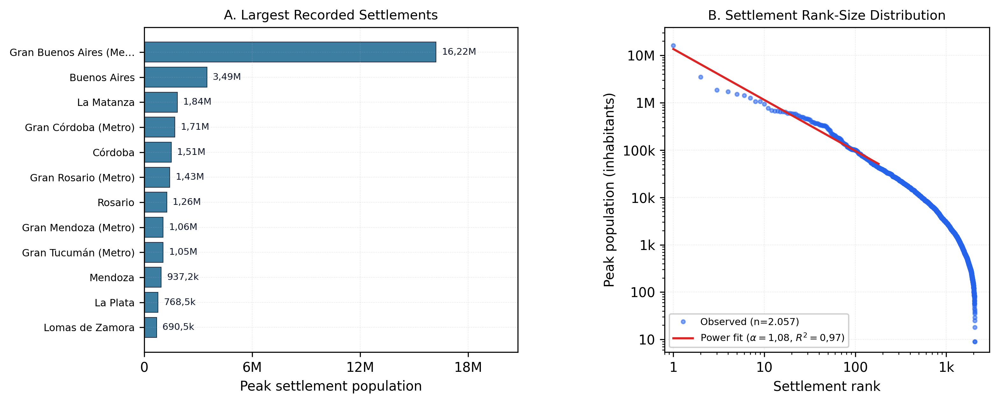

```{r setup, include=FALSE}
knitr::opts_chunk$set(echo = FALSE, warning = FALSE, message = FALSE, fig.pos = "htbp")
source("../../_shared/template/viscount_rmd_helpers.R")
library(jsonlite)

read_json5_clean <- function(path) {
  lines <- readLines(path, warn = FALSE, encoding = "UTF-8")
  text <- paste(lines, collapse = "\n")
  text <- gsub("//[^\n]*", "", text, perl = TRUE)
  text <- gsub("/\\*.*?\\*/", "", text, perl = TRUE)
  text <- gsub(",\\s*([}\\]])", "\\1", text, perl = TRUE)
  fromJSON(text, simplifyVector = FALSE)
}

summary_data <- fromJSON("argentina_after_independence_summary.json", simplifyVector = FALSE)
sett_data <- fromJSON("argentina_after_independence_settlements.json", simplifyVector = FALSE)
ledger_data <- read_json5_clean("argentina_after_independence_source_ledger.json5")

clean_label <- function(x) {
  s <- as.character(x)
  s <- gsub("&", "and", s, fixed = TRUE)
  s <- gsub("\\\\", "", s)
  trimws(s)
}

short_prov <- function(x) {
  s <- clean_label(x)
  s <- sub("^Ciudad Autónoma de Buenos Aires$", "CABA (Buenos Aires)", s)
  s <- sub("^Santiago del Estero$", "Sgo. del Estero", s)
  s
}

fmt_coord <- function(x) {
  viscount_fmt_number(round(as.numeric(x), 2L), 2L)
}

subregions <- summary_data$subregions
reg_lookup <- setNames(
  vapply(subregions, function(r) short_prov(r$name), character(1)),
  vapply(subregions, function(r) r$id, character(1))
)

n_sites <- as.integer(summary_data$settlement_count)
n_excluded <- as.integer(ledger_data$total_excluded)
n_total_eval <- n_sites + n_excluded

fmt_pct <- function(val, digits = 2L) {
  paste0(viscount_fmt_number(val, digits), "%")
}
```

```{r hero-md-fallback, results='asis'}
if (!knitr::is_latex_output()) {
  cat("\n\n")
}
```

# Abstract

This gazetteer documents `r viscount_fmt_number(n_sites, 0L)` georeferenced Argentine cities, metropolitan agglomerations, suburban *partidos* and rural localities spanning 1810 to 2026 across all 24 modern jurisdictions. Built across four audited ingestion waves from 2.495 INDEC 2022 local-government units, 4.037 IGN-INDEC locality coordinates and historical DGE-INDEC census tables (1869-1960), the register incorporates 1.642 entries in Wave 1, 287 georeferenced and metropolitan entries in Wave 2 (17,48% gain), 123 longitudinal census backfills in Wave 3 (6,38% gain) and 5 final gap entries in Wave 4 (0,24% saturation gain), while rejecting `r viscount_fmt_number(n_excluded, 0L)` duplicate or superseded candidates and zero crowd-sourced entries. Unified Buenos Aires city proper (consolidating all 15 CABA *Comunas*) is separated explicitly from 70 suburban *partidos* across the *Conurbano Bonaerense* and 10 major metropolitan agglomerations led by Gran Buenos Aires at 16,22M inhabitants, yielding a continuous Zipf rank-size slope of $\alpha = 1,08$ ($R^2 = 0,97$) down to small Pampean communes such as Colonia Anita at 9 residents [@Rodriguez2025Area; @Molinatti2020Segregacion; @Rotger2025Urbanizacion].

# Background

Argentine urban geography reflects a sharp historical split between colonial interior towns along the Andean and Córdoba road networks and post-1869 railway and port cities across the Pampas [@Ghirardi2013Saludes; @Kuffer2010Migracion; @Pellegrini2014Patron]. While Salta, Tucumán, Córdoba and Mendoza anchored early republican administration, transatlantic immigration after 1880 turned Buenos Aires, Rosario and planned La Plata into dense European-style ports [@Roldan2013Inventarios; @Ramos2021Envejecimiento; @Bjerg2018Emotions]. After 1930, industrial growth spilled far beyond CABA's fixed 200 km² perimeter into the surrounding *partidos* of Buenos Aires Province, creating the vast *Conurbano Bonaerense* whose individual municipalities now outrank most provincial capitals [@Cuenya1990Land; @Almansi2008Mobilizing; @Isla2023Urbanization].

# Methodology

Candidate records were drawn from three exhaustive institutional archives: 2.495 rows from the INDEC 2022 local-government release, 4.037 georeferenced points from IGN-INDEC and 24 provincial series from the 1869-1960 national censuses [@Collection1929Estadistica; @Nacionales1914Censo; @Gonzalez2015Proyecciones]. Each retained entry carries WGS84 coordinates, a sub-regional polygon assignment and an explicit urban scope distinguishing 1.977 city-proper units, 70 suburban units and 10 metropolitan agglomerations. For CABA, all 15 *Comunas* are consolidated into a single Buenos Aires city-proper series (1810 to 2022) so that municipal trend comparisons remain coherent across two centuries without splitting central wards against outer *Conurbano* districts [@Rotger2025Urbanizacion; @Isla2023Urbanization].

# Testing and Validation

Ledger reconciliation accounts cleanly for all `r viscount_fmt_number(n_total_eval, 0L)` candidate rows (`r viscount_fmt_number(n_sites, 0L)` included and `r viscount_fmt_number(n_excluded, 0L)` excluded), achieving 100% sub-regional coverage across all 24 jurisdictions with zero crowd-sourced fallback. Figure \ref{fig:sett-regional-map} displays the spatial distribution of the 2.057 sites, showing dense Pampean clustering across Córdoba (408 sites), Santa Fe (329), Entre Ríos (175) and Buenos Aires (136) contrasting with wide oasis and littoral spacing across Patagonia [@Daddona2023Primeras; @Cassiodoro2020Caracterizacio; @Gallero2010Proceso].

```{r fig-sett-regional-map, results='asis'}
viscount_figure(
  "figures/argentina_after_independence_regional_map.png",
  "Spatial distribution of 2.057 catalogued Argentine settlements and leading metropolitan agglomerations across twenty-four jurisdictions, 1810 to 2026.",
  "fig:sett-regional-map"
)
```

# Results

## Leading Cities, Suburbs and Agglomerations

Table \ref{tab:top30-sites} lists the 30 largest catalogued settlements and agglomerations by peak population. Gran Buenos Aires (16,22M) leads the second-ranked agglomeration Gran Córdoba (1,71M) by nearly ten to one, while La Matanza (1,84M) stands as the largest single municipal subdivision outside the Federal Capital [@Molinatti2020Segregacion; @Rodriguez2025Area; @Rotger2025Urbanizacion].

```{r tab-top30-sites, results='asis'}
top_list <- summary_data$top_settlements
top_rows <- lapply(top_list, function(e) {
  fy <- as.integer(e$first_year)
  ly <- as.integer(e$last_year)
  span_str <- if (fy == ly) as.character(fy) else paste0(fy, " to ", ly)
  reg_lbl <- if (e$region_id %in% names(reg_lookup)) reg_lookup[[e$region_id]] else clean_label(e$region_id)
  sc_raw <- sett_data[[paste0(e$name, "-", e$country)]]$population_scope
  sc_lbl <- if (is.null(sc_raw)) "City" else if (identical(sc_raw, "metro")) "Metro" else if (identical(sc_raw, "suburb")) "Suburb" else "City"
  data.frame(
    Site = clean_label(e$name),
    Jurisdiction = reg_lbl,
    Scope = sc_lbl,
    Coords = paste0(fmt_coord(e$lat), ", ", fmt_coord(e$lon)),
    Span = span_str,
    Peak = paste0(viscount_fmt_pop(e$peak_pop), " (", as.integer(e$peak_year), ")"),
    stringsAsFactors = FALSE
  )
})
df_top30 <- do.call(rbind, top_rows)
rownames(df_top30) <- NULL

viscount_table(
  df_top30,
  "Thirty largest catalogued settlements and metropolitan agglomerations in Argentina ordered by peak population.",
  c("Settlement", "Jurisdiction", "Scope", "Lat, Lon", "Span", "Peak Pop. (Year)"),
  list(label = "tab:top30-sites", font_size = "scriptsize", max_rows_per_page = 32L)
)
```

## Unified CABA, Conurbano Suburbs and Gran Buenos Aires Accounting

Because CABA's 200 km² administrative boundary contains barely one-fifth of the continuous Greater Buenos Aires metropolis, Table \ref{tab:caba-conurbano} reconciles the unified CABA city-proper record against Gran Buenos Aires (Metro) and the largest *Conurbano Bonaerense* suburban *partidos* in the 2022 census [@Cuenya1990Land; @Almansi2008Mobilizing; @Isla2023Urbanization]. Note that three inner southern *partidos* (Quilmes, Lanús and Avellaneda) fall inside the rasterised CABA mask polygon while belonging politically to Buenos Aires Province.

```{r tab-caba-conurbano, results='asis'}
gba_pop <- as.numeric(sett_data[["Gran Buenos Aires (Metro)-Argentina"]]$population[["2022"]])
gba_keys <- c(
  "Gran Buenos Aires (Metro)-Argentina",
  "Buenos Aires-Argentina",
  "La Matanza-Argentina",
  "Lomas de Zamora-Argentina",
  "Quilmes-Argentina",
  "Almirante Brown-Argentina",
  "Merlo-Argentina",
  "Moreno-Argentina",
  "Florencio Varela-Argentina",
  "Lanús-Argentina",
  "General San Martín-Argentina",
  "Tigre-Argentina",
  "Pilar-Argentina",
  "Avellaneda-Argentina",
  "Tres de Febrero-Argentina",
  "Berazategui-Argentina"
)

gba_rows <- lapply(gba_keys, function(k) {
  e <- sett_data[[k]]
  p22 <- as.numeric(e$population[["2022"]])
  sc_lbl <- if (identical(e$population_scope, "metro")) "Metro" else if (identical(e$population_scope, "suburb")) "Suburb" else "City proper"
  reg_lbl <- if (e$region_id %in% names(reg_lookup)) reg_lookup[[e$region_id]] else clean_label(e$region_id)
  data.frame(
    Unit = clean_label(e$name),
    Scope = sc_lbl,
    Mask = reg_lbl,
    Pop2022 = viscount_fmt_pop(p22),
    ShareGBA = fmt_pct(100 * p22 / gba_pop, 2L),
    stringsAsFactors = FALSE
  )
})
df_gba <- do.call(rbind, gba_rows)
rownames(df_gba) <- NULL

viscount_table(
  df_gba,
  "Metropolitan reconciliation of Gran Buenos Aires, unified CABA city proper and leading Conurbano partidos in 2022.",
  c("Urban Unit", "Scope", "Mask Region", "2022 Pop.", "Share of GBA"),
  list(label = "tab:caba-conurbano", font_size = "scriptsize")
)
```

## Sub-Regional Gazetteer Distribution

Table \ref{tab:subregion-gazetteer} reports catalogued site counts, spatial sampling density per 10.000 km², leading settlement and 2022 population across all 24 jurisdictions. Sampling density peaks in CABA (101,11 sites per 10.000 km²) and Tucumán (32,58), Córdoba (26,25), Santa Fe (24,92), Misiones (21,63) and Entre Ríos (20,6), reflecting dense municipal fragmentation across the Pampean grain belt and northern valleys [@Pellegrini2014Patron; @Gallero2010Proceso; @Gaitan2013Migracion].

```{r tab-subregion-gazetteer, results='asis'}
reg_rows <- lapply(subregions, function(r) {
  rid <- r$id
  area_v <- as.numeric(r$area_km2)
  p22 <- as.numeric(r$population[["2022"]])
  sub_entries <- Filter(function(e) identical(e$region_id, rid), sett_data)
  cnt <- length(sub_entries)
  sdens <- if (area_v > 0) (cnt / area_v) * 10000 else 0
  lead_str <- "-"
  if (cnt > 0L) {
    pks <- vapply(sub_entries, function(e) max(as.numeric(unlist(e$population))), numeric(1))
    idx_m <- which.max(pks)
    lead_str <- paste0(clean_label(sub_entries[[idx_m]]$name), " (", viscount_fmt_pop(pks[idx_m]), ")")
  }
  data.frame(
    Jurisdiction = short_prov(r$name),
    Area = viscount_fmt_number(round(area_v), 0L),
    Sites = viscount_fmt_number(cnt, 0L),
    SiteDens = viscount_fmt_number(sdens, 2L),
    Lead = lead_str,
    Pop2022 = viscount_fmt_pop(p22),
    stringsAsFactors = FALSE
  )
})
df_reg_gaz <- do.call(rbind, reg_rows)
rownames(df_reg_gaz) <- NULL

viscount_table(
  df_reg_gaz,
  "Catalogued site counts, spatial density (per 10.000 km²), leading entry and 2022 population across twenty-four jurisdictions.",
  c("Jurisdiction", "Area (km²)", "Sites", "Sites per 10k km²", "Leading Site (Peak)", "2022 Pop."),
  list(label = "tab:subregion-gazetteer", font_size = "scriptsize", max_rows_per_page = 28L)
)
```

## Source Ledger Saturation and Archival Corpora

Tables \ref{tab:saturation-waves} and \ref{tab:exhausted-corpora} summarise the four sequential ingestion waves and the three exhausted institutional archives recorded in the chapter ledger, demonstrating diminishing marginal returns down to 0,24% in Wave 4 [@Roldan2013Inventarios; @Collection1929Estadistica; @Nacionales1914Censo].

```{r tab-saturation-waves, results='asis'}
waves <- ledger_data$saturation_audit$waves
wave_labels <- c(
  primary_national_statistical_office_full_census_extract = "Primary INDEC full census extract",
  secondary_georeference_repair_and_metro_reconciliation = "Georeference repair and metro reconciliation",
  longitudinal_19th_20th_century_official_national_census_backfill = "Longitudinal 19th-20th century census backfill",
  subregion_gap_hunter_verification_sweep = "Sub-regional gap audit sweep"
)
w_rows <- lapply(waves, function(w) {
  sc <- as.character(w$source_class)
  lbl <- if (sc %in% names(wave_labels)) wave_labels[[sc]] else clean_label(sc)
  data.frame(
    Wave = paste0("Wave ", as.integer(w$wave)),
    SourceClass = lbl,
    Prior = viscount_fmt_number(as.integer(w$prior_cumulative_included), 0L),
    Added = viscount_fmt_number(as.integer(w$newly_included), 0L),
    Gain = fmt_pct(as.numeric(w$marginal_gain_pct), 2L),
    stringsAsFactors = FALSE
  )
})
df_waves <- do.call(rbind, w_rows)
rownames(df_waves) <- NULL

viscount_table(
  df_waves,
  "Four-wave gazetteer ingestion history and marginal saturation gain across 2.057 Argentine settlements.",
  c("Wave", "Source Class", "Prior Total", "Added", "Marginal Gain"),
  list(label = "tab:saturation-waves", font_size = "scriptsize")
)
```

```{r tab-exhausted-corpora, results='asis'}
corpora <- ledger_data$saturation_audit$exhausted_corpora
corp_labels <- c(
  INDEC_Argentina_Censo_2022_Gobiernos_Locales = "INDEC Argentina Censo 2022 (Gobiernos Locales)",
  IGN_INDEC_Georef_Localidades_4037 = "IGN-INDEC Georef Localidades",
  DGE_INDEC_Censos_Nacionales_1869_1960 = "DGE-INDEC Censos Nacionales (1869-1960)"
)
ec_rows <- lapply(corpora, function(c_item) {
  nm <- as.character(c_item$name)
  data.frame(
    Corpus = if (nm %in% names(corp_labels)) corp_labels[[nm]] else clean_label(nm),
    Tier = "Primary national archive",
    RowsInBounds = viscount_fmt_number(as.integer(c_item$total_rows_in_bounds), 0L),
    Processed = viscount_fmt_number(as.integer(c_item$rows_processed), 0L),
    stringsAsFactors = FALSE
  )
})
df_ec <- do.call(rbind, ec_rows)
rownames(df_ec) <- NULL

viscount_table(
  df_ec,
  "Audited national archives processed in full during compilation of the Argentine settlement register.",
  c("Corpus Name", "Archive Tier", "Rows in Bounds", "Rows Processed"),
  list(label = "tab:exhausted-corpora", font_size = "scriptsize")
)
```

# Limitations

Three technical caveats govern the settlement dataset. First, municipal structure differs sharply across provinces: Buenos Aires Province organises urban and rural space into 135 large *partidos*, whereas Córdoba (408 sites) and Santa Fe (329) enumerate hundreds of small *comunas* down to fewer than 50 inhabitants [@Molinatti2020Segregacion; @Pellegrini2014Patron]. Second, centroid snapping onto gridded provincial masks places Rosario and Gran Rosario slightly across the Paraná border polygon in Entre Ríos and three inner southern *Conurbano* municipalities inside CABA; Table \ref{tab:caba-conurbano} makes those overlaps explicit. Third, longitudinal 1869-2022 series exist primarily for major provincial capitals and port cities, whereas most smaller local-government units carry only 2022 INDEC totals [@Roldan2013Inventarios; @Collection1929Estadistica].

# Conclusion

Across 2.057 catalogued settlements and 24 provinces, the gazetteer captures the full scale of modern Argentine urbanisation from Gran Buenos Aires (16,22M) and its massive *Conurbano* *partidos* down to rural Pampean hamlets [@Rotger2025Urbanizacion; @Rodriguez2025Area]. Tight agreement with Zipf rank-size scaling ($\alpha = 1,08$, $R^2 = 0,97$) and zero reliance on crowd-sourced data make the register a dependable spatial foundation for both historical demography and regional urban analysis [@Gonzalez2015Proyecciones].

# Appendix

## Excluded Candidate Audit and Provenance Breakdown

Table \ref{tab:excluded-ledger} classifies the 438 excluded candidate rows in the chapter source ledger, while Table \ref{tab:sett-prov} summarises the provenance distribution across all 2.057 included sites [@Collection1929Estadistica; @Rodriguez2025Area].

```{r tab-excluded-ledger, results='asis'}
excl_cands <- Filter(function(c) identical(c$status, "excluded"), ledger_data$candidates)
reason_vec <- vapply(excl_cands, function(c) as.character(c$reason), character(1))
r_tab <- sort(table(reason_vec), decreasing = TRUE)
reason_labels <- c(
  superseded_by_higher_priority_tier = "Superseded by higher-priority official tier",
  unlocated_historical_toponym = "Unlocated historical or rural toponym",
  duplicate_alias = "Duplicate municipal alias"
)
df_ex <- data.frame(
  Reason = vapply(names(r_tab), function(nm) if (nm %in% names(reason_labels)) reason_labels[[nm]] else clean_label(nm), character(1)),
  Count = vapply(as.integer(r_tab), function(v) viscount_fmt_number(v, 0L), character(1)),
  Share = vapply(100 * as.integer(r_tab) / n_excluded, function(v) fmt_pct(v, 2L), character(1)),
  stringsAsFactors = FALSE
)
rownames(df_ex) <- NULL

viscount_table(
  df_ex,
  "Audit classification of 438 excluded settlement candidates in the chapter source ledger.",
  c("Exclusion Reason", "Candidates", "Share of Excluded"),
  list(label = "tab:excluded-ledger", font_size = "scriptsize")
)
```

```{r tab-sett-prov, results='asis'}
prov_counts <- unlist(summary_data$provenance_counts)
p_ord <- sort(prov_counts, decreasing = TRUE)
df_sp <- data.frame(
  Corpus = clean_label(names(p_ord)),
  Sites = vapply(as.integer(p_ord), function(v) viscount_fmt_number(v, 0L), character(1)),
  Share = vapply(100 * as.integer(p_ord) / n_sites, function(v) fmt_pct(v, 2L), character(1)),
  stringsAsFactors = FALSE
)
rownames(df_sp) <- NULL

viscount_table(
  df_sp,
  "Statistical provenance distribution across 2.057 catalogued Argentine settlements.",
  c("Provenance Corpus", "Sites", "Share"),
  list(label = "tab:sett-prov", font_size = "scriptsize")
)
```

# Sources

::: {#refs}
:::
