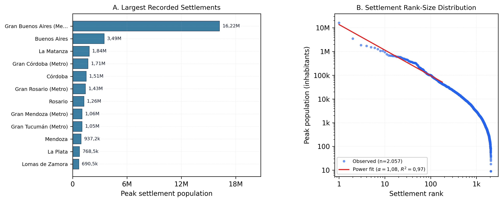
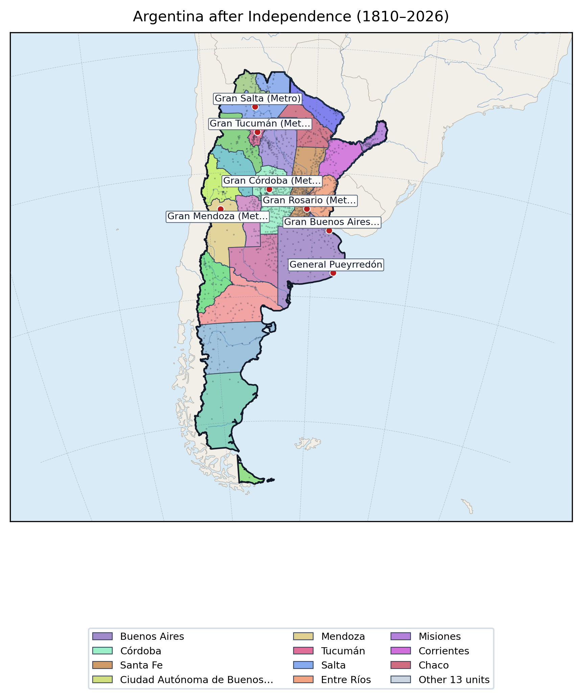

Argentina after Independence
================
Aust Kätzchen
23 November 2026

- [Abstract](#abstract)
- [Background](#background)
- [Methodology](#methodology)
- [Testing and Validation](#testing-and-validation)
- [Results](#results)
  - [Leading Cities, Suburbs and
    Agglomerations](#leading-cities-suburbs-and-agglomerations)
  - [Unified CABA, Conurbano Suburbs and Gran Buenos Aires
    Accounting](#unified-caba-conurbano-suburbs-and-gran-buenos-aires-accounting)
  - [Sub-Regional Gazetteer
    Distribution](#sub-regional-gazetteer-distribution)
  - [Source Ledger Saturation and Archival
    Corpora](#source-ledger-saturation-and-archival-corpora)
- [Limitations](#limitations)
- [Conclusion](#conclusion)
- [Appendix](#appendix)
  - [Excluded Candidate Audit and Provenance
    Breakdown](#excluded-candidate-audit-and-provenance-breakdown)
- [Sources](#sources)

<figure>

<figcaption aria-hidden="true">Twelve largest Argentine settlements and
agglomerations alongside the log-log rank-size distribution across 2.057
catalogued sites, 1810 to 2026.</figcaption>
</figure>

# Abstract

This gazetteer documents 2.057 georeferenced Argentine cities,
metropolitan agglomerations, suburban *partidos* and rural localities
spanning 1810 to 2026 across all 24 modern jurisdictions. Built across
four audited ingestion waves from 2.495 INDEC 2022 local-government
units, 4.037 IGN-INDEC locality coordinates and historical DGE-INDEC
census tables (1869-1960), the register incorporates 1.642 entries in
Wave 1, 287 georeferenced and metropolitan entries in Wave 2 (17,48%
gain), 123 longitudinal census backfills in Wave 3 (6,38% gain) and 5
final gap entries in Wave 4 (0,24% saturation gain), while rejecting 438
duplicate or superseded candidates and zero crowd-sourced entries.
Unified Buenos Aires city proper (consolidating all 15 CABA *Comunas*)
is separated explicitly from 70 suburban *partidos* across the
*Conurbano Bonaerense* and 10 major metropolitan agglomerations led by
Gran Buenos Aires at 16,22M inhabitants, yielding a continuous Zipf
rank-size slope of $\alpha = 1,08$ ($R^2 = 0,97$) down to small Pampean
communes such as Colonia Anita at 9 residents
[\[1\]](#ref-Rodriguez2025Area)[\[2\]](#ref-Molinatti2020Segregacion)[\[3\]](#ref-Rotger2025Urbanizacion).

# Background

Argentine urban geography reflects a sharp historical split between
colonial interior towns along the Andean and Córdoba road networks and
post-1869 railway and port cities across the Pampas
[\[4\]](#ref-Ghirardi2013Saludes)[\[5\]](#ref-Kuffer2010Migracion)[\[6\]](#ref-Pellegrini2014Patron).
While Salta, Tucumán, Córdoba and Mendoza anchored early republican
administration, transatlantic immigration after 1880 turned Buenos
Aires, Rosario and planned La Plata into dense European-style ports
[\[7\]](#ref-Roldan2013Inventarios)[\[8\]](#ref-Ramos2021Envejecimiento)[\[9\]](#ref-Bjerg2018Emotions).
After 1930, industrial growth spilled far beyond CABA’s fixed 200 km²
perimeter into the surrounding *partidos* of Buenos Aires Province,
creating the vast *Conurbano Bonaerense* whose individual municipalities
now outrank most provincial capitals
[\[10\]](#ref-Cuenya1990Land)[\[11\]](#ref-Almansi2008Mobilizing)[\[12\]](#ref-Isla2023Urbanization).

# Methodology

Candidate records were drawn from three exhaustive institutional
archives: 2.495 rows from the INDEC 2022 local-government release, 4.037
georeferenced points from IGN-INDEC and 24 provincial series from the
1869-1960 national censuses
[\[13\]](#ref-Collection1929Estadistica)[\[14\]](#ref-Nacionales1914Censo)[\[15\]](#ref-Gonzalez2015Proyecciones).
Each retained entry carries WGS84 coordinates, a sub-regional polygon
assignment and an explicit urban scope distinguishing 1.977 city-proper
units, 70 suburban units and 10 metropolitan agglomerations. For CABA,
all 15 *Comunas* are consolidated into a single Buenos Aires city-proper
series (1810 to 2022) so that municipal trend comparisons remain
coherent across two centuries without splitting central wards against
outer *Conurbano* districts
[\[3\]](#ref-Rotger2025Urbanizacion)[\[12\]](#ref-Isla2023Urbanization).

# Testing and Validation

Ledger reconciliation accounts cleanly for all 2.495 candidate rows
(2.057 included and 438 excluded), achieving 100% sub-regional coverage
across all 24 jurisdictions with zero crowd-sourced fallback. Figure
displays the spatial distribution of the 2.057 sites, showing dense
Pampean clustering across Córdoba (408 sites), Santa Fe (329), Entre
Ríos (175) and Buenos Aires (136) contrasting with wide oasis and
littoral spacing across Patagonia
[\[16\]](#ref-Daddona2023Primeras)[\[17\]](#ref-Cassiodoro2020Caracterizacio)[\[18\]](#ref-Gallero2010Proceso).

# Results

## Leading Cities, Suburbs and Agglomerations

Table lists the 30 largest catalogued settlements and agglomerations by
peak population. Gran Buenos Aires (16,22M) leads the second-ranked
agglomeration Gran Córdoba (1,71M) by nearly ten to one, while La
Matanza (1,84M) stands as the largest single municipal subdivision
outside the Federal Capital
[\[1\]](#ref-Rodriguez2025Area)[\[2\]](#ref-Molinatti2020Segregacion)[\[3\]](#ref-Rotger2025Urbanizacion).

| Settlement | Jurisdiction | Scope | Lat, Lon | Span | Peak Pop. (Year) |
|:---|:---|:---|:---|:---|:---|
| **Gran Buenos Aires (Metro)** | CABA (Buenos Aires) | Metro | -34,6, -58,38 | 2022 | 16,22M (2022) |
| **Buenos Aires** | CABA (Buenos Aires) | City | -34,6, -58,38 | 1810 to 2022 | 3,49M (1960) |
| **La Matanza** | Buenos Aires | Suburb | -34,68, -58,56 | 2022 | 1,84M (2022) |
| **Gran Córdoba (Metro)** | Córdoba | Metro | -31,42, -64,18 | 2022 | 1,71M (2022) |
| **Córdoba** | Córdoba | City | -31,42, -64,18 | 1869 to 2022 | 1,51M (2022) |
| **Gran Rosario (Metro)** | Entre Ríos | Metro | -32,95, -60,63 | 2022 | 1,43M (2022) |
| **Rosario** | Entre Ríos | City | -32,95, -60,63 | 1869 to 2022 | 1,26M (2010) |
| **Gran Mendoza (Metro)** | Mendoza | Metro | -32,9, -68,85 | 2022 | 1,06M (2022) |
| **Gran Tucumán (Metro)** | Tucumán | Metro | -26,81, -65,22 | 2022 | 1,05M (2022) |
| **Mendoza** | Mendoza | City | -32,9, -68,85 | 1869 to 2022 | 937,2k (2010) |
| **La Plata** | Buenos Aires | City | -34,92, -57,95 | 1895 to 2022 | 768,5k (2022) |
| **Lomas de Zamora** | Buenos Aires | Suburb | -34,76, -58,4 | 2022 | 690,5k (2022) |
| **Gran Salta (Metro)** | Salta | Metro | -24,78, -65,41 | 2022 | 671k (2022) |
| **General Pueyrredón** | Buenos Aires | City | -37,97, -57,74 | 2022 | 667,1k (2022) |
| **Gran Mar del Plata (Metro)** | Buenos Aires | Metro | -38,01, -57,54 | 2022 | 644,2k (2022) |
| **Mar del Plata** | Buenos Aires | City | -38, -57,55 | 1914 to 2022 | 644,2k (2022) |
| **Quilmes** | CABA (Buenos Aires) | Suburb | -34,73, -58,26 | 2022 | 633,4k (2022) |
| **San Miguel de Tucumán** | Tucumán | City | -26,83, -65,2 | 1869 to 2022 | 601,9k (2022) |
| **Salta** | Salta | City | -24,78, -65,41 | 1869 to 2022 | 594,8k (2022) |
| **Almirante Brown** | Buenos Aires | Suburb | -34,84, -58,37 | 2022 | 584,8k (2022) |
| **Merlo** | Buenos Aires | Suburb | -34,67, -58,73 | 2022 | 582,5k (2022) |
| **Moreno** | Buenos Aires | Suburb | -34,65, -58,79 | 2022 | 576,6k (2022) |
| **Gran San Juan (Metro)** | San Juan | Metro | -31,54, -68,53 | 2022 | 546,6k (2022) |
| **Gran Santa Fe (Metro)** | Santa Fe | Metro | -31,65, -60,71 | 2022 | 530k (2022) |
| **Gran Neuquén (Metro)** | Neuquén | Metro | -38,95, -68,06 | 2022 | 500,3k (2022) |
| **Florencio Varela** | Buenos Aires | Suburb | -34,8, -58,28 | 2022 | 496,4k (2022) |
| **Santa Fe** | Santa Fe | City | -31,65, -60,71 | 1869 to 2022 | 490,2k (2010) |
| **Lanús** | CABA (Buenos Aires) | Suburb | -34,71, -58,39 | 2022 | 461,3k (2022) |
| **San Juan** | San Juan | City | -31,54, -68,53 | 1869 to 2022 | 461,2k (2010) |
| **General San Martín** | Buenos Aires | Suburb | -34,57, -58,53 | 2022 | 450,5k (2022) |

Thirty largest catalogued settlements and metropolitan agglomerations in
Argentina ordered by peak population.

## Unified CABA, Conurbano Suburbs and Gran Buenos Aires Accounting

Because CABA’s 200 km² administrative boundary contains barely one-fifth
of the continuous Greater Buenos Aires metropolis, Table reconciles the
unified CABA city-proper record against Gran Buenos Aires (Metro) and
the largest *Conurbano Bonaerense* suburban *partidos* in the 2022
census
[\[10\]](#ref-Cuenya1990Land)[\[11\]](#ref-Almansi2008Mobilizing)[\[12\]](#ref-Isla2023Urbanization).
Note that three inner southern *partidos* (Quilmes, Lanús and
Avellaneda) fall inside the rasterised CABA mask polygon while belonging
politically to Buenos Aires Province.

| Urban Unit | Scope | Mask Region | 2022 Pop. | Share of GBA |
|:---|:---|:---|:---|:---|
| **Gran Buenos Aires (Metro)** | Metro | CABA (Buenos Aires) | 16,22M | 100% |
| **Buenos Aires** | City proper | CABA (Buenos Aires) | 3,12M | 19,24% |
| **La Matanza** | Suburb | Buenos Aires | 1,84M | 11,35% |
| **Lomas de Zamora** | Suburb | Buenos Aires | 690,5k | 4,26% |
| **Quilmes** | Suburb | CABA (Buenos Aires) | 633,4k | 3,9% |
| **Almirante Brown** | Suburb | Buenos Aires | 584,8k | 3,6% |
| **Merlo** | Suburb | Buenos Aires | 582,5k | 3,59% |
| **Moreno** | Suburb | Buenos Aires | 576,6k | 3,55% |
| **Florencio Varela** | Suburb | Buenos Aires | 496,4k | 3,06% |
| **Lanús** | Suburb | CABA (Buenos Aires) | 461,3k | 2,84% |
| **General San Martín** | Suburb | Buenos Aires | 450,5k | 2,78% |
| **Tigre** | Suburb | Buenos Aires | 446,9k | 2,75% |
| **Pilar** | Suburb | Buenos Aires | 394,8k | 2,43% |
| **Avellaneda** | Suburb | CABA (Buenos Aires) | 367,6k | 2,27% |
| **Tres de Febrero** | Suburb | Buenos Aires | 364,2k | 2,24% |
| **Berazategui** | Suburb | Buenos Aires | 358,7k | 2,21% |

Metropolitan reconciliation of Gran Buenos Aires, unified CABA city
proper and leading Conurbano partidos in 2022.

## Sub-Regional Gazetteer Distribution

Table reports catalogued site counts, spatial sampling density per
10.000 km², leading settlement and 2022 population across all 24
jurisdictions. Sampling density peaks in CABA (101,11 sites per 10.000
km²) and Tucumán (32,58), Córdoba (26,25), Santa Fe (24,92), Misiones
(21,63) and Entre Ríos (20,6), reflecting dense municipal fragmentation
across the Pampean grain belt and northern valleys
[\[6\]](#ref-Pellegrini2014Patron)[\[18\]](#ref-Gallero2010Proceso)[\[19\]](#ref-Gaitan2013Migracion).

| Jurisdiction | Area (km²) | Sites | Sites per 10k km² | Leading Site (Peak) | 2022 Pop. |
|:---|:---|:---|:---|:---|:---|
| **Buenos Aires** | 299.871 | 136 | 4,54 | La Matanza (1,84M) | 17,52M |
| **Catamarca** | 102.964 | 38 | 3,69 | San Fernando del Valle de Catamarca (186,9k) | 429,6k |
| **Chaco** | 101.445 | 71 | 7 | Corrientes (430,2k) | 1,13M |
| **Chubut** | 225.051 | 43 | 1,91 | Comodoro Rivadavia (201,9k) | 592,6k |
| **CABA (Buenos Aires)** | 494 | 5 | 101,11 | Gran Buenos Aires (Metro) (16,22M) | 3,12M |
| **Corrientes** | 92.999 | 63 | 6,77 | Goya (98,5k) | 1,21M |
| **Córdoba** | 155.433 | 408 | 26,25 | Gran Córdoba (Metro) (1,71M) | 3,84M |
| **Entre Ríos** | 84.942 | 175 | 20,6 | Gran Rosario (Metro) (1,43M) | 1,43M |
| **Formosa** | 84.937 | 33 | 3,89 | Formosa (264,5k) | 607,4k |
| **Jujuy** | 60.451 | 60 | 9,93 | San Salvador de Jujuy (312,4k) | 811,6k |
| **La Pampa** | 147.433 | 79 | 5,36 | Santa Rosa (117,2k) | 361,9k |
| **La Rioja** | 92.191 | 20 | 2,17 | La Rioja (211,7k) | 383,9k |
| **Mendoza** | 144.179 | 22 | 1,53 | Gran Mendoza (Metro) (1,06M) | 2,04M |
| **Misiones** | 35.595 | 77 | 21,63 | Posadas (328,9k) | 1,28M |
| **Neuquén** | 102.857 | 59 | 5,74 | Gran Neuquén (Metro) (500,3k) | 710,8k |
| **Río Negro** | 198.436 | 60 | 3,02 | General Roca (109,4k) | 750,8k |
| **Salta** | 148.989 | 57 | 3,83 | Gran Salta (Metro) (671k) | 1,44M |
| **San Juan** | 96.140 | 22 | 2,29 | Gran San Juan (Metro) (546,6k) | 822,9k |
| **San Luis** | 82.451 | 68 | 8,25 | San Luis (206,9k) | 542,1k |
| **Santa Cruz** | 245.407 | 16 | 0,65 | Río Gallegos (116k) | 337,2k |
| **Santa Fe** | 132.002 | 329 | 24,92 | Gran Santa Fe (Metro) (530k) | 3,54M |
| **Sgo. del Estero** | 135.369 | 128 | 9,46 | Santiago del Estero (363,3k) | 1,06M |
| **Tierra del Fuego** | 21.076 | 3 | 1,42 | Río Grande (98,8k) | 185,7k |
| **Tucumán** | 26.089 | 85 | 32,58 | Gran Tucumán (Metro) (1,05M) | 1,73M |

Catalogued site counts, spatial density (per 10.000 km²), leading entry
and 2022 population across twenty-four jurisdictions.

## Source Ledger Saturation and Archival Corpora

Tables and summarise the four sequential ingestion waves and the three
exhausted institutional archives recorded in the chapter ledger,
demonstrating diminishing marginal returns down to 0,24% in Wave 4
[\[7\]](#ref-Roldan2013Inventarios)[\[13\]](#ref-Collection1929Estadistica)[\[14\]](#ref-Nacionales1914Censo).

| Wave | Source Class | Prior Total | Added | Marginal Gain |
|:---|:---|:---|:---|:---|
| **Wave 1** | Primary INDEC full census extract | 0 | 1.642 | 100% |
| **Wave 2** | Georeference repair and metro reconciliation | 1.642 | 287 | 17,48% |
| **Wave 3** | Longitudinal 19th-20th century census backfill | 1.929 | 123 | 6,38% |
| **Wave 4** | Sub-regional gap audit sweep | 2.052 | 5 | 0,24% |

Four-wave gazetteer ingestion history and marginal saturation gain
across 2.057 Argentine settlements.

| Corpus Name | Archive Tier | Rows in Bounds | Rows Processed |
|:---|:---|:---|:---|
| **INDEC Argentina Censo 2022 (Gobiernos Locales)** | Primary national archive | 2.495 | 2.495 |
| **IGN-INDEC Georef Localidades** | Primary national archive | 4.037 | 4.037 |
| **DGE-INDEC Censos Nacionales (1869-1960)** | Primary national archive | 24 | 24 |

Audited national archives processed in full during compilation of the
Argentine settlement register.

# Limitations

Three technical caveats govern the settlement dataset. First, municipal
structure differs sharply across provinces: Buenos Aires Province
organises urban and rural space into 135 large *partidos*, whereas
Córdoba (408 sites) and Santa Fe (329) enumerate hundreds of small
*comunas* down to fewer than 50 inhabitants
[\[2\]](#ref-Molinatti2020Segregacion)[\[6\]](#ref-Pellegrini2014Patron).
Second, centroid snapping onto gridded provincial masks places Rosario
and Gran Rosario slightly across the Paraná border polygon in Entre Ríos
and three inner southern *Conurbano* municipalities inside CABA; Table
makes those overlaps explicit. Third, longitudinal 1869-2022 series
exist primarily for major provincial capitals and port cities, whereas
most smaller local-government units carry only 2022 INDEC totals
[\[7\]](#ref-Roldan2013Inventarios)[\[13\]](#ref-Collection1929Estadistica).

# Conclusion

Across 2.057 catalogued settlements and 24 provinces, the gazetteer
captures the full scale of modern Argentine urbanisation from Gran
Buenos Aires (16,22M) and its massive *Conurbano* *partidos* down to
rural Pampean hamlets
[\[1\]](#ref-Rodriguez2025Area)[\[3\]](#ref-Rotger2025Urbanizacion).
Tight agreement with Zipf rank-size scaling ($\alpha = 1,08$,
$R^2 = 0,97$) and zero reliance on crowd-sourced data make the register
a dependable spatial foundation for both historical demography and
regional urban analysis [\[15\]](#ref-Gonzalez2015Proyecciones).

# Appendix

## Excluded Candidate Audit and Provenance Breakdown

Table classifies the 438 excluded candidate rows in the chapter source
ledger, while Table summarises the provenance distribution across all
2.057 included sites
[\[1\]](#ref-Rodriguez2025Area)[\[13\]](#ref-Collection1929Estadistica).

| Exclusion Reason | Candidates | Share of Excluded |
|:---|:---|:---|
| **Superseded by higher-priority official tier** | 206 | 47,03% |
| **Unlocated historical or rural toponym** | 192 | 43,84% |
| **Duplicate municipal alias** | 40 | 9,13% |

Audit classification of 438 excluded settlement candidates in the
chapter source ledger.

| Provenance Corpus | Sites | Share |
|:---|:---|:---|
| **INDEC Argentina Censo 2022 (Total del país por gobierno local)** | 2.035 | 98,93% |
| **INDEC Argentina Censuses 1991-2022 (via citypopulation.de)** | 11 | 0,53% |
| **INDEC Argentina Censo 2022 Agglomeration (via citypopulation.de)** | 10 | 0,49% |
| **INDEC Argentina Censo 2022 (15 CABA Comunas consolidated)** | 1 | 0,05% |

Statistical provenance distribution across 2.057 catalogued Argentine
settlements.

# Sources

1.
Rodríguez, Gonzalo Martín, et al.
*El Área Metropolitana de Rosario y sus municipios
a 2070: aplicación del método de componentes para la proyección de
población de áreas menores*. UN ECLAC / CEPAL-CELADE, 2025,
<https://hdl.handle.net/11362/81924>.

2.
Molinatti, Florencia.
“Segregación residencial en la Región Metropolitana
de Córdoba en el nuevo modelo de urbanización en Argentina: Censos 2001
y 2010.” *Revista Latinoamericana de Población*, 2020,
<http://servicioseditoriales.unam.mx:8090/index.php/relap/article/view/28>.

3.
Rotger, Daniela.
“Urbanización y cuencas hidrográficas en la Región
Metropolitana de Buenos Aires, Argentina. Aportes desde el paisaje
fluvial.” *Revista Kawsaypacha*, 2025,
<https://doi.org/10.18800/kawsaypacha.202502.D016>.

4.
Ghirardi, Mónica, and Bruno
Ribotta. “Saludes quebrantadas, cuerpos inútiles.
Afecciones de la población de Córdoba, Argentina, según el censo de
1813.” *Anuario Colombiano de Historia Social y de La Cultura*,
2013,
<https://revistas.unal.edu.co/index.php/achsc/article/view/42354>.

5.
Küffer, Claudio F., and Sonia E.
Colantonio. “MIGRACIÓN EN LA CIUDAD DE CÓRDOBA EN EL PRIMER TERCIO DEL
SIGLO XIX A PARTIR DE LOS DATOS DEL CENSO DE 1832 (APELLIDOS Y ORIGEN
GEOGRÁFICO).” *Revista Argentina de Antropología Biológica*, 2010,
<https://revistas.unlp.edu.ar/raab/article/view/380>.

6.
Pellegrini, José Luis, and Isabel
María Raposo. “Patrón de urbanización, desarrollo
agrario y tipos no tradicionales de empleo en la Microrregión Rosario,
Argentina.” *Economía, Sociedad y Territorio*, 2014,
<https://doi.org/10.22136/est002014381>.

7.
Roldán, Diego P.
“Inventarios del deseo. Los censos municipales de
Rosario, Argentina (1889-1910): Municipal census of Rosario, Argentina
(1889-1910).” *História*, 2013,
<https://doi.org/10.1590/S0101-90742013000100018>.

8.
Valle Ramos, Carolina del, and
María Eugenia Goicoechea. “Envejecimiento
demográfico y escenarios de vulnerabilidad urbana: ¿Hay siempre una
relación conexa? Estudio de casos en las ciudades de Sevilla (España) y
La Plata (Argentina).” *Geograficando*, 2021,
<https://doi.org/10.24215/2346898Xe089>.

9.
Bjerg, María.
“Emotions, immigration, and family in Argentina at
the end of the 19th century’, ’es_ES’: ’Emociones, inmigración y familia
en la Argentina de fines del siglo XIX.” *Anuario IEHS*, 2018,
<https://ojs2.fch.unicen.edu.ar/ojs-3.1.0/index.php/anuario-ies/article/view/183>.

10.
Cuenya, Beatriz, et al.
“Land invasions and grassroots organization: the
Quilmes settlements in Greater Buenos Aires, Argentina.”
*Environment and Urbanization*, 1990,
<https://doi.org/10.1177/095624789000200108>.

11.
Almansi, Florencia, and Andrea
Tammarazio. “Mobilizing projects in community
organizations with a long-term perspective: neighbourhood credit funds
in Buenos Aires, Argentina.” *Environment and Urbanization*,
2008, <https://doi.org/10.1177/0956247808089289>.

12.
Isla, Federico Ignacio.
*The urbanization of coastal wetlands in Buenos
Aires, Argentina*. Springer Science; Business Media LLC, 2023,
<https://doi.org/10.21203/rs.3.rs-3539140/v1>.

13.
Internet Archive Historical
Collection. *Estadística argentina: población,
producción, industrias, comercio, comunicaciones*. Buenos Aires :
\[publisher not identified\], 1929,
<https://archive.org/details/estadsticaargent1192unse>.

14.
Territorios Nacionales, Argentina.
Dirección General de. *Censo de población de los
territorios nacionales, República Argentina, 1912*. Buenos Aires
: Imp. G. Kraft, 1914,
<https://archive.org/details/censodepoblacion00arge>.

15.
González, Leandro M.
*Proyecciones de la población argentina a lo largo
del siglo XXI*. UN ECLAC / CEPAL-CELADE, 2015,
<https://hdl.handle.net/11362/39372>.

16.
D’addona, Lucas Andrés, et al.
*Primeras aproximaciones a los estudios históricos
de población en la localidad de Lago Puelo (Chubut, Argentina) a partir
del análisis de actas de defunción*. CONICET Digital, 2023,
<http://hdl.handle.net/11336/227380>.

17.
Cassiodoro, Gisela, et al.
“Caracterización de puntas de proyectil
apedunculadas. Un aporte al poblamiento del centro-oeste de la provincia
de Santa Cruz (Argentina).” *Revista Del Museo de La Plata*,
2020, <https://doi.org/10.24215/25456377e099>.

18.
Gallero, María Cecilia, and Elena
M. Krautstofl. “Proceso de poblamiento y
migraciones en la Provincia de Misiones, Argentina: (1881-1970).”
*Avá*, 2010,
<http://www.scielo.org.ar/scielo.php?script=sci_arttext&pid=S1851-16942010000100013>.

19.
Gaitán, Samuel Bedrich Morales.
“Migración y Turismo: dinámicas globales en el
espacio rural. El caso de Tafí del Valle (Tucumán, Argentina).”
*PASOS Revista de Turismo y Patrimonio Cultural*, 2013,
<https://doi.org/10.25145/j.pasos.2013.11.051>.

