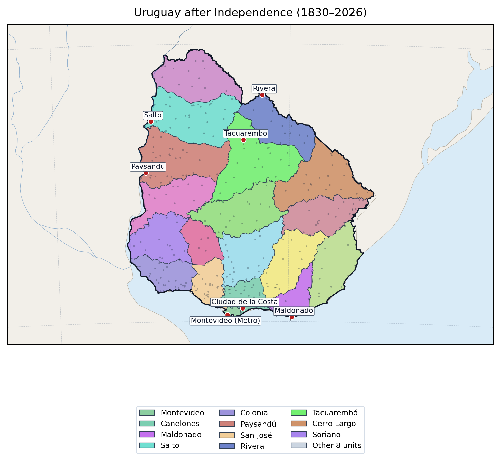
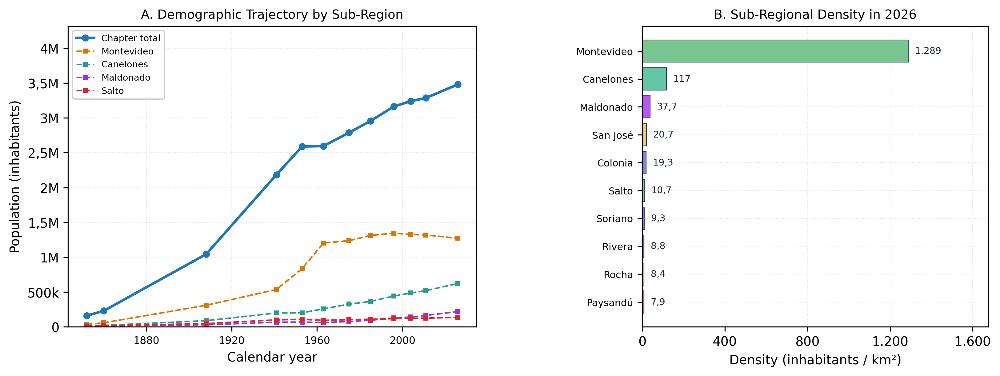
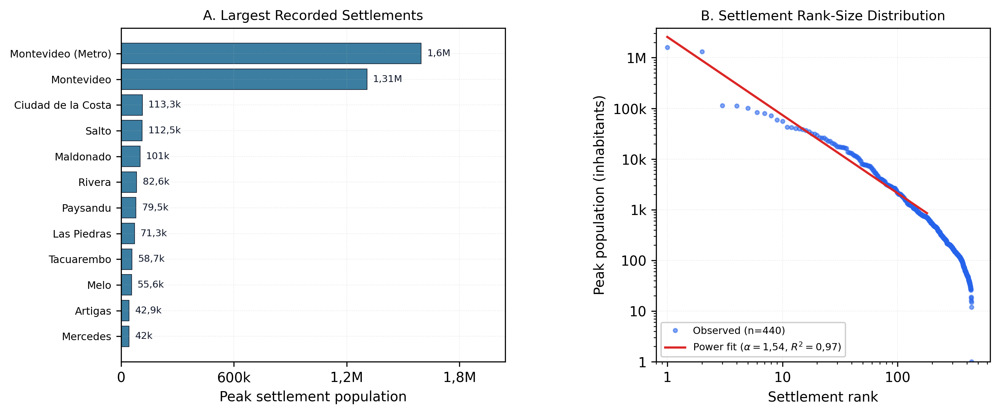

Uruguay after Independence
================
Aust Kätzchen
23 November 2026

- [Abstract](#abstract)
- [Background](#background)
  - [Independence, the Guerra Grande and the Early Censuses of 1852 and
    1860](#independence-the-guerra-grande-and-the-early-censuses-of-1852-and-1860)
  - [Transatlantic Immigration and the 1908 Census
    Milestone](#transatlantic-immigration-and-the-1908-census-milestone)
  - [Batllismo and Latin America’s Earliest Demographic
    Transition](#batllismo-and-latin-americas-earliest-demographic-transition)
  - [Rural Exodus and Mid-Century Urban
    Expansion](#rural-exodus-and-mid-century-urban-expansion)
  - [Dictatorship, Economic Crises and Post-2004 Migration
    Reversals](#dictatorship-economic-crises-and-post-2004-migration-reversals)
- [Methodology](#methodology)
  - [Departmental Partition and Historical Boundary
    Harmonisation](#departmental-partition-and-historical-boundary-harmonisation)
  - [Gazetteer Compilation and Metropolitan
    Reconciliation](#gazetteer-compilation-and-metropolitan-reconciliation)
- [Testing and Validation](#testing-and-validation)
- [Results](#results)
  - [National and Departmental Population Trajectory, 1852 to
    2026](#national-and-departmental-population-trajectory-1852-to-2026)
  - [Urban Primacy, Coastal Conurbation and Rank-Size
    Structure](#urban-primacy-coastal-conurbation-and-rank-size-structure)
  - [Fertility Polarisation, Ageing and Stationary
    Population](#fertility-polarisation-ageing-and-stationary-population)
- [Limitations](#limitations)
- [Conclusion](#conclusion)
- [Appendix](#appendix)
  - [Intercensal and Mid-Century Benchmarks, 1860 to
    2004](#intercensal-and-mid-century-benchmarks-1860-to-2004)
  - [Departmental Growth Multipliers and Coastal
    Shift](#departmental-growth-multipliers-and-coastal-shift)
- [Sources](#sources)

<figure>

<figcaption aria-hidden="true">Nineteen departments and 440 catalogued
settlements across Uruguay from 1830 to 2026.</figcaption>
</figure>

# Abstract

Between the end of the *Guerra Grande* in 1851 and the national census
of 2023, the population of the Oriental Republic of Uruguay expanded
twenty-twofold before stabilising on the edge of natural contraction.
Across 19 departments spanning 183.864,5 km² (179.474 km² in the gridded
terrestrial mask), aggregate headcounts rose from 159.333 inhabitants in
1852 and 229.481 in 1860 to 1.042.686 at the landmark 1908 census,
propelled by sustained Italian and Spanish immigration into Montevideo
and the Río de la Plata littoral
[\[1\]](#ref-Barrera2012Causa)[\[2\]](#ref-Censo1892Censo)[\[3\]](#ref-Duffau2024Conspiracion).
During the early twentieth century, urban social legislation, rising
literacy and secular family norms initiated a demographic transition
several decades ahead of tropical Latin America, moderating natural
increase even as metropolitan expansion carried the republic to
2.595.510 inhabitants in 1963 and 3.163.763 in 1996
[\[4\]](#ref-Aguerre2022Localidades)[\[5\]](#ref-Orellana1977Uruguay)[\[6\]](#ref-Nathan2016Diverging).
Slowed by prolonged economic stagnation, political emigration during the
1973 to 1985 military regime, the 2002 banking crisis exodus and
ultra-low fertility, national growth tapered to 3.286.314 in 2011,
3.499.451 in the finalised 2023 census (following a preliminary count of
3,44M) and 3.480.601 in 2026
[\[7\]](#ref-Bolana2026Pobreza)[\[8\]](#ref-Koolhaas2024Motivaciones)[\[9\]](#ref-Ferre2024Short)[\[10\]](#ref-Calleja2025Diagnostico).
Spatial concentration remained stark throughout: in 2026, Montevideo
(1,27M at 1.288,78 inhabitants per km²) and suburban Canelones (621,3k
at 117,13 inhabitants per km²) together hold 54,38% of all Uruguayans,
while Maldonado has surged to 218,4k and pastoral interior departments
such as Flores (25,9k) and Lavalleja (58,1k) have stagnated or declined
across a gazetteer of 440 catalogued settlements
[\[11\]](#ref-Queijo1989Aspects)[\[12\]](#ref-Macchio2026Momentos)[\[13\]](#ref-Riano2019Imputacion).

# Background

## Independence, the Guerra Grande and the Early Censuses of 1852 and 1860

When the Oriental State of Uruguay swore its first constitution in July
1830 after years of Luso-Brazilian occupation and Argentine-Brazilian
rivalry, it was little more than an empty pastoral frontier surrounding
a single fortified harbour. Barely 74k people lived within the new
republic, roughly a fifth inside Montevideo and the remainder scattered
across vast *estancias* between the Río Negro, the Uruguay river and the
Brazilian border
[\[1\]](#ref-Barrera2012Causa)[\[14\]](#ref-Etchechurybarrera2017Chinas).

No sooner had independence been secured than factional conflict between
*Blancos* and *Colorados* escalated into the *Guerra Grande* (1839 to
1851), drawing in Argentine *unitarios* and *federales*, Brazilian
armies and French and British naval squadrons. Throughout the nine-year
Great Siege of Montevideo (1843 to 1851), Manuel Oribe’s forces
controlled the countryside from the Cerrito while Fructuoso Rivera and
the besieged government held the port behind defensive trenches manned
largely by French, Basque and Italian legionnaires
[\[1\]](#ref-Barrera2012Causa)[\[14\]](#ref-Etchechurybarrera2017Chinas).

Warfare devastated rural herds, displaced thousands of pastoral families
and drove refugees, soldiers and captives into the capital or across the
frontiers into Entre Ríos and Rio Grande do Sul
[\[14\]](#ref-Etchechurybarrera2017Chinas). When peace returned, the
inaugural national census of 1852 recorded 159.333 inhabitants across
the republic (still reflecting heavy wartime dislocation and incomplete
enumeration in remote northern districts), with 33.994 residents in
Montevideo, 17.817 in Canelones and 13.114 in San José.

Within eight years, rapid herd recovery, land pacification and the first
wave of post-war European arrivals lifted the 1860 census to 229.481
inhabitants, an annualised gain exceeding 4,6%. Already by 1860,
Montevideo had expanded by 70,36% to 57.913 residents, while riverine
and agricultural departments such as Paysandú (14.201), Soriano
(14.138), Salto (15.821) and Colonia (13.349) were filling out along
navigable waterways
[\[1\]](#ref-Barrera2012Causa)[\[3\]](#ref-Duffau2024Conspiracion).

Territorial administration evolved alongside this post-war repopulation.
At independence Uruguay comprised nine large departments, expanding to
thirteen by 1856 and nineteen by 1885 through the subdivision of
frontier and pastoral districts: Artigas (from Salto, 1884), Rivera
(from Tacuarembó, 1884), Río Negro (from Paysandú, 1880), Rocha (from
Maldonado, 1880), Treinta y Tres (from Cerro Largo and Maldonado, 1884)
and Flores (from San José, 1885). These nineteen boundaries have
remained stable ever since, anchoring every subsequent demographic
count.

## Transatlantic Immigration and the 1908 Census Milestone

Between 1865 and 1914, Uruguay participated in the same transatlantic
migration circuit that remade Buenos Aires and southern Brazil, albeit
on a compact territorial scale. Italian immigrants from Liguria,
Piedmont, Lombardy and southern provinces formed dense mutual-aid
associations, political clubs and mercantile networks in Montevideo as
early as the late 1850s [\[3\]](#ref-Duffau2024Conspiracion), joined by
Spaniards from Galicia, Catalonia and the Basque Country alongside
Swiss, Piedmontese Waldensians and German-speaking colonists who founded
agricultural colonies in Colonia and Río Negro.

By the time Carlos María de Pena directed the exhaustive municipal
census of Montevideo in 1889 to 1890, the capital department already
held 215.061 residents, of whom foreign-born Europeans constituted
nearly half the adult male workforce across workshops, port docks,
construction yards and retail trades [\[2\]](#ref-Censo1892Censo).
Municipal tabulations recorded dense Italian and Spanish residential
clustering across the *Ciudad Vieja*, *Cordón* and *Aguada* while outer
*quintas* and suburban tracks along the Arroyo Miguelete absorbed market
gardeners and railway labourers
[\[2\]](#ref-Censo1892Censo)[\[11\]](#ref-Queijo1989Aspects).

Steam navigation, British-built railways radiating northward from
Montevideo harbour and the rise of beef-extract and refrigerated
meat-packing (*frigorífico*) plants at Fray Bentos, Montevideo and
Paysandú knitted the cattle interior to Atlantic markets. When the state
executed its third national census in 1908, Uruguay passed the
one-million mark at 1.042.686 inhabitants, multiplying more than sixfold
in 56 years.

Montevideo alone counted 309.231 people (29,66% of the nation), followed
by Canelones (87.874), Colonia (54.644), Lavalleja (51.222), Tacuarembó
(46.939), San José (46.324) and Salto (46.259). Crucially, net European
immigration began to taper after 1914 and virtually ended by the early
1930s under Great Depression restrictions, shifting subsequent growth
onto natural increase and internal rural-to-urban migration
[\[5\]](#ref-Orellana1977Uruguay)[\[11\]](#ref-Queijo1989Aspects).

## Batllismo and Latin America’s Earliest Demographic Transition

Uruguay’s twentieth-century demographic path diverged sharply from the
rest of Latin America because its fertility and mortality transitions
began unusually early. Under the reformist governments of José Batlle y
Ordóñez (1903 to 1907 and 1911 to 1915) and his Colorado successors,
export surpluses financed universal primary schooling, secular civil
marriage and divorce legislation, early urban labour protections, public
sanitation and state pension schemes
[\[15\]](#ref-Curiel2009Sociedad)[\[16\]](#ref-Gonzalez2012Condiciones).

Combined with a predominantly European-origin urban middle and working
class in Montevideo and high female literacy, these institutions
depressed both infant mortality and marital fertility long before
comparable shifts appeared in Mexico, Brazil or the Andean republics
[\[6\]](#ref-Nathan2016Diverging)[\[9\]](#ref-Ferre2024Short)[\[17\]](#ref-Pullum1999Multivariate).
Social homogamy by educational attainment deepened within Montevideo as
secondary schooling expanded and women entered clerical, teaching and
commercial employment
[\[17\]](#ref-Pullum1999Multivariate)[\[18\]](#ref-Pagano2010Fecundidad).

Total fertility fell steadily from roughly six children per woman around
1900 to under three by the late 1940s, settling near 2,7 to 3,0 during
the 1950s and 1960s
[\[5\]](#ref-Orellana1977Uruguay)[\[19\]](#ref-Cepalcelade1977Primeros).
Whereas most Latin American nations entered an explosive post-1945
population boom driven by falling mortality and stubbornly high birth
rates, Uruguay experienced only a modest post-war plateau followed by
steady deceleration
[\[5\]](#ref-Orellana1977Uruguay)[\[18\]](#ref-Pagano2010Fecundidad).

Between 1963 and 1975, national population grew by just 192.919
inhabitants (0,6% per year), from 2.595.510 to 2.788.429, making Uruguay
alongside Argentina a precocious demographic outlier characterised by
narrow-based age pyramids and early population ageing
[\[16\]](#ref-Gonzalez2012Condiciones)[\[19\]](#ref-Cepalcelade1977Primeros)[\[20\]](#ref-Batthyany2013Mirada).

## Rural Exodus and Mid-Century Urban Expansion

While natural increase moderated, internal migration emptied the
pastoral *campaña*. Wire fencing, sheep-station mechanisation and large
cattle *latifundios* sharply limited rural labour demand across Durazno,
Florida, Flores and Lavalleja, pushing landless *peones* first into
precarious ranching hamlets (*pueblos de ratas*) and then southward by
rail and bus to Montevideo
[\[4\]](#ref-Aguerre2022Localidades)[\[11\]](#ref-Queijo1989Aspects).

During the import-substituting boom of 1940 to 1955, textile mills,
meat-packing plants and construction along Montevideo’s bay absorbed
tens of thousands of interior migrants, lifting the capital’s population
from 536.533 in the 1941 administrative estimate to 1.202.757 in the
1963 census
[\[4\]](#ref-Aguerre2022Localidades)[\[21\]](#ref-Perrone2011Regularidad).
Rapid peripheral subdivision pushed working-class suburbs northward
along Avenida Garzón and Route 5 into Las Piedras and La Paz, laying
down the metropolitan arc visible in modern census rounds
[\[7\]](#ref-Bolana2026Pobreza)[\[11\]](#ref-Queijo1989Aspects).

## Dictatorship, Economic Crises and Post-2004 Migration Reversals

From the mid-1950s, declining wool and beef terms of trade ended the
import-substituting expansion that had drawn rural migrants into
Montevideo’s factories and *cantegriles* (informal settlements)
[\[4\]](#ref-Aguerre2022Localidades)[\[11\]](#ref-Queijo1989Aspects).
Political polarisation culminated in the 1973 military coup and twelve
years of authoritarian rule (1973 to 1985), during which real wages
collapsed, informal poverty widened around Montevideo’s periphery and
hundreds of thousands of Uruguayans emigrated to Argentina, Spain,
Australia, Venezuela and the United States
[\[7\]](#ref-Bolana2026Pobreza)[\[8\]](#ref-Koolhaas2024Motivaciones).

Between 1963 and 1985, aggregate growth slowed to 0,59% annually,
reaching 2.955.241 at the return of democracy
[\[15\]](#ref-Curiel2009Sociedad). Democratic restoration stabilised
living standards during the 1990s (lifting the 1996 census to
3.163.763), yet structural vulnerability returned abruptly during the
2002 banking and currency crisis, which triggered a fresh emigration
wave of roughly 100k mostly young adults toward Spain and the United
States
[\[8\]](#ref-Koolhaas2024Motivaciones)[\[22\]](#ref-Gandos2025Retornar).

Consequently, the 2004 census registered only 3.241.003 inhabitants and
the 2011 census 3.286.314, an annual gain of barely 0,2%
[\[13\]](#ref-Riano2019Imputacion)[\[23\]](#ref-Melendres2019Estructura).
Strong commodity exports and social transfers after 2005 encouraged
partial return migration from Spain following Europe’s 2008 recession,
alongside smaller inflows of Venezuelan, Cuban, Argentine and Brazilian
migrants, even as re-emigration persisted among dissatisfied returnees
[\[8\]](#ref-Koolhaas2024Motivaciones)[\[15\]](#ref-Curiel2009Sociedad)[\[22\]](#ref-Gandos2025Retornar)[\[24\]](#ref-Uriarte2024Mobility).

By 2023, total fertility had dropped well below replacement to roughly
1,3 to 1,4 births per woman
[\[6\]](#ref-Nathan2016Diverging)[\[9\]](#ref-Ferre2024Short), leaving
natural population balance negative and capping the finalised 2023
census at 3.499.451 inhabitants (up from a preliminary 3,44M figure)
before edging down to 3.480.601 in 2026
[\[10\]](#ref-Calleja2025Diagnostico).

# Methodology

## Departmental Partition and Historical Boundary Harmonisation

To reconstruct continuous sub-national population surfaces from 1830 to
2026, Uruguay’s terrestrial domain is partitioned into nineteen vector
polygons corresponding to the modern *departamentos* established by
1885: Artigas, Canelones, Cerro Largo, Colonia, Durazno, Flores,
Florida, Lavalleja, Maldonado, Montevideo, Paysandú, Rivera, Rocha, Río
Negro, Salto, San José, Soriano, Tacuarembó and Treinta y Tres. Across
the vector boundary cache, these nineteen units span 183.864,5 km²,
while rasterisation onto the global 4.320 by 2.160 grid yields 2.548
occupied land cells covering 179.474 km².

The modest 2,39% excess in the vector total reflects coastal estuarine
polygons along the Río de la Plata, the Atlantic littoral and Laguna
Merín that fall partly inside maritime cells. Departmental densities
throughout this study divide each benchmark headcount by its harmonised
vector area so that sub-regional comparisons remain strictly consistent
across every figure and table.

Twelve benchmark horizons anchor the departmental time-series: 1852,
1860, 1908, 1941, 1953, 1963, 1975, 1985, 1996, 2004, 2011 and 2026,
supplemented by the raw 2023 census returns inside each regional record.
Handling nineteenth-century boundary changes and mid-twentieth-century
census gaps requires explicit historical caution. For 1852, national
totals (159.333) are redistributed across all nineteen modern
departmental footprints using contemporary parish and *sección judicial*
proportions.

For 1860 (229.481), official returns reflect the thirteen departments
then in existence; consequently, the six departments created between
1880 and 1885 (Artigas, Flores, Rivera, Rocha, Río Negro and Treinta y
Tres) carry only small boundary-overlap residuals (624 to 1.385
persons), while their historical populations remain inside parent units
Salto, San José, Tacuarembó, Maldonado, Paysandú and Cerro Largo.
Between 1908 and 1963, Uruguay conducted no national population census
for 55 years; the 1941 (2.185.626) and 1953 (2.590.158) benchmarks
therefore transcribe official *Dirección General de Estadística*
intercensal estimates, which extrapolated pre-1914 rural birth surpluses
and consistently overestimated interior livestock departments relative
to the 1963 enumeration [\[4\]](#ref-Aguerre2022Localidades).

## Gazetteer Compilation and Metropolitan Reconciliation

Departmental totals are paired with a georeferenced gazetteer of 440
settlements compiled from the *Instituto Nacional de Estadística* (INE)
locality censuses of 2004, 2011 and 2023 (730 raw locality rows
evaluated), *Infraestructura de Datos Espaciales* (IDE) urbanised area
polygons (540 rows) and historical census backfills from 1852, 1860,
1889, 1908, 1963, 1975, 1985 and 1996
[\[2\]](#ref-Censo1892Censo)[\[4\]](#ref-Aguerre2022Localidades)[\[13\]](#ref-Riano2019Imputacion).
All 440 catalogued localities derive exclusively from official
statistical archives and primary historical sources, with zero reliance
on crowd-sourced web encyclopaedias.

Metropolitan accounting separates city-proper municipal boundaries from
surrounding suburbs and consolidated metropolitan aggregates.
Montevideo’s municipal core (1.281.323 in 2023, peaking at 1.307.562 in
1996) is tracked separately from extra-municipal dormitory and coastal
suburbs across Canelones and San José - led by Ciudad de la Costa
(113.252 in 2023), Las Piedras (61.292 in 2023, peaking at 71.258 in
2011), Ciudad del Plata (39.416), Pando (31.174), La Paz (19.574),
Parque del Plata (13.078), Salinas (11.284), Progreso (11.129) and
Toledo (6.540) - as well as the combined Montevideo Metro series
(1.593.422 in 2023, peaking at 1.596.673 in 2011).

During spatial aggregation, 291 raw candidate records were excluded from
the source ledger: 237 unlocated minor *fraccionamientos* or rural
hamlets lacking authoritative coordinates and 54 duplicate aliases or
co-located suburbs merged into neighbouring centres (such as Barros
Blancos into Ciudad de la Costa and Atlántida into Parque del Plata).

# Testing and Validation

Three cross-checks assess the internal coherence and statistical
reliability of the Uruguayan demographic reconstruction. First, spatial
and arithmetic reconciliation confirms that all nineteen departmental
series sum exactly to the national headline totals across every
benchmark from 1852 (159.333) to 2023 (3.499.451) and 2026 (3.480.601).
The discrepancy between the 183.864,5 km² vector summary and the 179.474
km² gridded raster mask remains bounded at 2,39%, confined to narrow
shoreline pixels along the Río de la Plata and Laguna Merín.

Second, benchmark uncertainty intervals reflect the institutional
evolution of Uruguayan statistics. Early post-war enumerations and
mid-century administrative extrapolations (1852, 1860, 1908 and 1941)
carry symmetric calibration bounds of plus or minus 6%, yielding a 1908
interval of 980.125 to 1.105.247 inhabitants. From 1953 through 2026,
national civil registration, multi-round INE censuses and
post-enumeration spatial imputation tighten uncertainty bounds to plus
or minus 2,5%, placing the 1963 census within 2.530.622 to 2.660.398 and
the 2026 benchmark within 3.393.586 to 3.567.616
[\[5\]](#ref-Orellana1977Uruguay)[\[13\]](#ref-Riano2019Imputacion)[\[19\]](#ref-Cepalcelade1977Primeros).

Even so, spatial imputation studies of the 2011 census reveal non-random
under-enumeration in peripheral informal settlements around Montevideo
and coastal Canelones, reinforcing the value of cross-checking locality
counts against household registries
[\[7\]](#ref-Bolana2026Pobreza)[\[13\]](#ref-Riano2019Imputacion)[\[23\]](#ref-Melendres2019Estructura).
In addition, cadastral property tax rolls and departmental housing
diagnostics provide independent municipal corroboration for Montevideo
and interior departments such as Treinta y Tres
[\[10\]](#ref-Calleja2025Diagnostico)[\[21\]](#ref-Perrone2011Regularidad).

Third, settlement-level data satisfy external historical and urban
checks. Carlos María de Pena’s 1889 Montevideo municipal return
(215.061) bridges smoothly between the 1860 department figure (57.913)
and the 1908 city count (291.465 within 309.231 departmental residents)
[\[2\]](#ref-Censo1892Censo). Across the full 440-settlement gazetteer,
log-log rank-size regression yields a steep Zipf slope of
$\alpha = 1{,}54$ ($R^2 = 0,97$), confirming extreme urban primacy
around Montevideo alongside a thin secondary tier of departmental
capitals
[\[4\]](#ref-Aguerre2022Localidades)[\[10\]](#ref-Calleja2025Diagnostico)[\[11\]](#ref-Queijo1989Aspects).

# Results

## National and Departmental Population Trajectory, 1852 to 2026

Uruguay’s demographic trajectory divides into two contrasting centuries:
rapid immigration-led expansion from 1852 to 1953, when national numbers
grew more than sixteenfold, followed by seven decades of decelerating
growth, interior stagnation and metropolitan spill-over from 1963 to
2026. Table reports departmental totals at seven core census benchmarks
alongside 2026 densities, while Figure plots the aggregate curve,
leading departments and 2026 sub-regional densities.

| Department | Area (km²) | 1852 | 1908 | 1963 | 1985 | 2011 | 2023 | 2026 Dens. |
|:---|:---|:---|:---|:---|:---|:---|:---|:---|
| **Artigas** | 15.142 | 3,3k | 26,3k | 52,8k | 69,1k | 73,4k | 77,5k | 5,1 |
| **Canelones** | 5.304 | 17,8k | 87,9k | 258,2k | 364,2k | 520,2k | 609k | 117,13 |
| **Cerro Largo** | 13.042 | 6,5k | 44,7k | 71k | 78,4k | 84,7k | 91k | 6,92 |
| **Colonia** | 7.035 | 8k | 54,6k | 105,3k | 112,7k | 123,2k | 135,8k | 19,32 |
| **Durazno** | 11.450 | 5,6k | 42,3k | 53,6k | 55,1k | 57,1k | 62k | 5,41 |
| **Flores** | 6.154 | 2k | 16,1k | 23,5k | 24,7k | 25,1k | 26,3k | 4,21 |
| **Florida** | 9.565 | 7k | 45,4k | 64k | 66,5k | 67k | 70,3k | 7,31 |
| **Lavalleja** | 9.474 | 8,1k | 51,2k | 65,8k | 61,5k | 58,8k | 59,2k | 6,13 |
| **Maldonado** | 5.798 | 9,7k | 28,8k | 61,3k | 94,3k | 164,3k | 213k | 37,68 |
| **Montevideo** | 987 | 34k | 309,2k | 1,2M | 1,31M | 1,32M | 1,3M | 1.288,78 |
| **Paysandú** | 15.427 | 6,2k | 38,4k | 88k | 103,8k | 113,1k | 121,8k | 7,87 |
| **Rivera** | 12.442 | 4,5k | 35,7k | 77,1k | 89,5k | 103,5k | 109,3k | 8,77 |
| **Rocha** | 9.611 | 4,3k | 34,1k | 55,1k | 66,6k | 68,1k | 80,7k | 8,44 |
| **Río Negro** | 10.756 | 2,5k | 19,9k | 46,9k | 48,6k | 54,8k | 57,3k | 5,3 |
| **Salto** | 12.758 | 7,4k | 46,3k | 92,2k | 108,5k | 124,9k | 136,2k | 10,67 |
| **San José** | 5.816 | 13,1k | 46,3k | 79,6k | 89,9k | 108,3k | 119,7k | 20,71 |
| **Soriano** | 8.879 | 9k | 39,6k | 77,9k | 79,4k | 82,6k | 83,7k | 9,3 |
| **Tacuarembó** | 12.575 | 6,6k | 46,9k | 77k | 83,5k | 90,1k | 96k | 7,6 |
| **Treinta y Tres** | 11.650 | 3,6k | 28,8k | 43,4k | 46,9k | 48,1k | 47,7k | 4 |
| **Uruguay Total** | 183.864 | 159,3k | 1,04M | 2,6M | 2,96M | 3,29M | 3,5M | 18,93 |

Departmental population across Uruguay at seven census benchmarks (1852
to 2023) and 2026 density in inhabitants per km².

Three territorial dynamics dominate this 174-year record. First,
Montevideo achieved extraordinary national primacy during the
mid-twentieth century before cresting and slowly hollowing out at the
core. Climbing from 33.994 in 1852 to 309.231 in 1908, the capital
department quadrupled again to 1.202.757 by the 1963 census, when it
captured 46,34% of the entire republic
[\[4\]](#ref-Aguerre2022Localidades)[\[11\]](#ref-Queijo1989Aspects).

Thereafter Montevideo grew sluggishly under dictatorship austerity and
emigration, peaking at 1.344.839 in 1996 before drifting downward to
1.325.968 (2004), 1.319.108 (2011), 1.302.954 (2023) and 1.271.513 in
2026
[\[7\]](#ref-Bolana2026Pobreza)[\[16\]](#ref-Gonzalez2012Condiciones)[\[21\]](#ref-Perrone2011Regularidad).
Yet even after three decades of gradual central decline, its 2026
density of 1.288,78 inhabitants per km² stands more than eleven times
higher than Canelones and over three hundred times higher than Flores.
Within the department, historic *barrios* near the port lost residents
to ageing and office conversion while irregular settlements expanded
across outer northern and western zones
[\[7\]](#ref-Bolana2026Pobreza)[\[11\]](#ref-Queijo1989Aspects).

Second, growth since 1963 shifted decisively eastward and westward along
the coastal highway corridor into Canelones, Maldonado and San José.
Canelones more than doubled from 258.195 in 1963 to 608.956 in 2023 and
621.285 in 2026 (117,13 inhabitants per km²), absorbing middle-class
suburbanites along the *Rambla* and low-income commuters along Routes 5
and 8
[\[11\]](#ref-Queijo1989Aspects)[\[23\]](#ref-Melendres2019Estructura).
San José likewise expanded from 79.563 in 1963 to 120.428 in 2026 (20,71
inhabitants per km²), propelled by industrial and residential spillover
west of the Santa Lucía river.

Farther east, Maldonado underwent Uruguay’s sharpest percentage
transformation: steady at 61.259 in 1963, it surged to 94.314 in 1985,
164.300 in 2011, 212.951 in 2023 and 218.438 in 2026 (37,68 inhabitants
per km²) as Punta del Este evolved from a seasonal Argentine resort into
a year-round real-estate, construction and service pole
[\[12\]](#ref-Macchio2026Momentos). Between 1974 and 1982 alone,
speculative high-rise construction along the Maldonado peninsula
reshaped the southeastern coastline, drawing construction labourers
permanently out of Rocha, Lavalleja and Treinta y Tres
[\[12\]](#ref-Macchio2026Momentos).

Third, the vast pastoral interior north and east of Montevideo stalled
or contracted in relative weight. Departments dominated by extensive
cattle and sheep grazing - Lavalleja (65.823 in 1963 down to 59.175 in
2023 and 58.120 in 2026), Flores (23.530 to 25.911), Treinta y Tres
(43.419 to 46.597), Durazno (53.635 to 61.922), Florida (63.987 to
69.951) and Soriano (77.906 to 82.602) - lost rural youth steadily to
the southern coast
[\[4\]](#ref-Aguerre2022Localidades)[\[10\]](#ref-Calleja2025Diagnostico).
Even rice-growing expansion in the Laguna Merín basin could not offset
rural depopulation across Treinta y Tres and Cerro Largo, where
population remained concentrated inside departmental capitals
[\[10\]](#ref-Calleja2025Diagnostico).

By contrast, two peripheral zones resisted interior stagnation. Along
the Uruguay river *Litoral*, Salto (92.183 in 1963 to 136.111 in 2026),
Paysandú (88.029 to 121.451) and Colonia (105.350 to 135.916) combined
citrus, dairy, pulp-mill and port commerce with the Salto Grande
hydroelectric works [\[25\]](#ref-Brites2017Represas). Along the
northeastern Brazilian frontier, Rivera (77.086 to 109.075), Artigas
(52.843 to 77.296) and coastal Rocha (55.097 to 81.095) sustained growth
through duty-free retail trade and binational labour mobility across
Rivera–Santana do Livramento and Chuy–Chuí
[\[24\]](#ref-Uriarte2024Mobility).

## Urban Primacy, Coastal Conurbation and Rank-Size Structure

Uruguay’s settlement network, mapped in Figure and detailed by
departmental share and site density in Table , exemplifies classic Latin
American macrocephaly moderated only recently by suburban dispersion.
Across 440 catalogued localities, Montevideo (Metro) reaches 1,59M in
2023 (peaking at 1,60M in 2011) and Montevideo city proper stands at
1,28M (peaking at 1,31M in 1996).

Every secondary city lags by more than an order of magnitude: Ciudad de
la Costa (113.252 in 2023), Salto (112.527) and Maldonado (100.985) are
the only other centres exceeding 100k, followed by Rivera (82.602),
Paysandú (79.457), Las Piedras (61.292 in 2023, down from 71.258 in
2011), Tacuarembó (58.707), Melo (55.633), Artigas (42.891), Mercedes
(41.519 in 2023, 42.032 peak) and Durazno (40.096). Beneath this narrow
upper crust, regional centres such as Minas (38.336), San José de Mayo
(36.206), Florida (34.893) and Colonia del Sacramento (31.720) function
chiefly as administrative, educational and retail hubs for surrounding
*estancias*.

| Department | 1852 Share | 1908 Share | 1963 Share | 2023 Share | 2026 Share | Sites | Sites per 10k km² |
|:---|:---|:---|:---|:---|:---|:---|:---|
| **Artigas** | 2,1% | 2,5% | 2% | 2,2% | 2,2% | 27 | 17,83 |
| **Canelones** | 11,2% | 8,4% | 9,9% | 17,4% | 17,8% | 58 | 109,35 |
| **Cerro Largo** | 4% | 4,3% | 2,7% | 2,6% | 2,6% | 23 | 17,64 |
| **Colonia** | 5% | 5,2% | 4,1% | 3,9% | 3,9% | 37 | 52,59 |
| **Durazno** | 3,5% | 4,1% | 2,1% | 1,8% | 1,8% | 13 | 11,35 |
| **Flores** | 1,3% | 1,5% | 0,9% | 0,8% | 0,7% | 7 | 11,37 |
| **Florida** | 4,4% | 4,4% | 2,5% | 2% | 2% | 21 | 21,96 |
| **Lavalleja** | 5,1% | 4,9% | 2,5% | 1,7% | 1,7% | 17 | 17,94 |
| **Maldonado** | 6,1% | 2,8% | 2,4% | 6,1% | 6,3% | 24 | 41,4 |
| **Montevideo** | 21,3% | 29,7% | 46,3% | 37,2% | 36,5% | 5 | 50,68 |
| **Paysandú** | 3,9% | 3,7% | 3,4% | 3,5% | 3,5% | 35 | 22,69 |
| **Rivera** | 2,8% | 3,4% | 3% | 3,1% | 3,1% | 19 | 15,27 |
| **Rocha** | 2,7% | 3,3% | 2,1% | 2,3% | 2,3% | 19 | 19,77 |
| **Río Negro** | 1,6% | 1,9% | 1,8% | 1,6% | 1,6% | 18 | 16,73 |
| **Salto** | 4,6% | 4,4% | 3,6% | 3,9% | 3,9% | 24 | 18,81 |
| **San José** | 8,2% | 4,4% | 3,1% | 3,4% | 3,5% | 28 | 48,14 |
| **Soriano** | 5,7% | 3,8% | 3% | 2,4% | 2,4% | 20 | 22,53 |
| **Tacuarembó** | 4,1% | 4,5% | 3% | 2,7% | 2,7% | 19 | 15,11 |
| **Treinta y Tres** | 2,3% | 2,8% | 1,7% | 1,4% | 1,3% | 26 | 22,32 |

Departmental shares of national population (1852 to 2026) and catalogued
settlement density per 10.000 km² across 440 localities.

Notice how settlement counts diverge from demographic weight in Table .
Because Montevideo constitutes a single consolidated metropolitan core
with only 5 mask-assigned locality entries, Canelones leads the
gazetteer with 58 catalogued towns and resorts (109,35 sites per 10k
km²), followed by Colonia (37 sites, reflecting its nineteenth-century
agricultural colonies), Paysandú (35), San José (28), Artigas (27),
Treinta y Tres (26), Maldonado (24) and Salto (24).

By contrast, pastoral Flores holds just 7 catalogued settlements (11,38
per 10k km²), while expansive Durazno contains 13 (11,35 per 10k km²).
Even outside Montevideo, the urban share of Uruguay’s population
exceeded 80% by 1963 and surpasses 95% today, leaving most interior
departments as single-city territories surrounded by lightly inhabited
*cuchilla* grasslands
[\[4\]](#ref-Aguerre2022Localidades)[\[10\]](#ref-Calleja2025Diagnostico).

Rank-size structure in Figure illustrates this urban hierarchy. With
$\alpha = 1{,}54$ ($R^2 = 0,97$), Montevideo stands more than eleven
times above Ciudad de la Costa and Salto, while the steep downward bend
below rank 100 captures dozens of tiny railway villages, *arroceras* and
coastal *balnearios* numbering fewer than 500 inhabitants
[\[10\]](#ref-Calleja2025Diagnostico)[\[13\]](#ref-Riano2019Imputacion).

## Fertility Polarisation, Ageing and Stationary Population

Beneath the aggregate plateau of 3,48M to 3,5M inhabitants lies a
profound internal shift in household age structure and reproductive
behaviour. From the 1990s onward, Uruguay’s fertility decline split
along socio-economic lines: university-educated women in Montevideo and
coastal Canelones postponed first births past age 30 and moved toward
one-child or childless households, whereas low-income urban peripheries
sustained early adolescent childbearing into the 2010s
[\[6\]](#ref-Nathan2016Diverging)[\[18\]](#ref-Pagano2010Fecundidad)[\[26\]](#ref-Bermudez2023Padres).

Female labour-force participation rose steadily alongside educational
attainment, reinforcing delayed marriage and smaller completed family
sizes across urban departments
[\[17\]](#ref-Pullum1999Multivariate)[\[18\]](#ref-Pagano2010Fecundidad).
Since 2016, however, rapid declines in adolescent births across poorer
neighbourhoods have converged with middle-class postponement, pushing
national total fertility to historic lows near 1,3 births per woman
[\[9\]](#ref-Ferre2024Short)[\[26\]](#ref-Bermudez2023Padres).

Simultaneously, mean household size fell across every department as
single-person and elderly couple households proliferated
[\[16\]](#ref-Gonzalez2012Condiciones)[\[23\]](#ref-Melendres2019Estructura).
By the 2010s, adults aged 65 and older exceeded 14% of the national
population and topped 17% in Montevideo and Lavalleja, turning elder
care, pension sustainability and chronic disease epidemiology into
central policy concerns
[\[16\]](#ref-Gonzalez2012Condiciones)[\[20\]](#ref-Batthyany2013Mirada)[\[27\]](#ref-Regueira2019Representacion)[\[28\]](#ref-Cabrera2019Argentina).

Care responsibilities within ageing urban households continue to rest
disproportionately on female relatives and social-work institutions,
sharpening demographic pressure on Montevideo’s central neighbourhoods
[\[20\]](#ref-Batthyany2013Mirada)[\[27\]](#ref-Regueira2019Representacion).
Without renewed immigration or a reversal in fertility postponement,
Uruguay’s population peaked around 2023 and entered a gentle, structural
contraction toward 3.480.601 in 2026
[\[9\]](#ref-Ferre2024Short)[\[15\]](#ref-Curiel2009Sociedad).

# Limitations

Four structural caveats qualify the Uruguayan time-series and spatial
tables. First, the 55-year census hiatus between 1908 and 1963 forces
reliance on *Dirección General de Estadística* administrative estimates
for 1941 (2,19M) and 1953 (2,59M).

As Table and the Appendix intercensal table reveal, mid-century
officials overestimated rural retention in Cerro Largo (110,3k estimated
in 1953 vs 71k counted in 1963), Durazno (99,1k vs 53,6k), Florida
(106,3k vs 64k), Lavalleja (115,9k vs 65,8k), Tacuarembó (119,7k vs 77k)
and Treinta y Tres (72,1k vs 43,4k), while underestimating Montevideo’s
wartime and post-war rural-urban surge (836,2k estimated in 1953 vs
1.202,8k counted in 1963) [\[4\]](#ref-Aguerre2022Localidades).

Second, retaining the thirteen pre-1880 departments at the 1860
benchmark produces artificial near-zero boundary residuals (624 to 1.385
inhabitants) in Artigas, Flores, Rivera, Rocha, Río Negro and Treinta y
Tres, whose real 1860 populations appear inside their parent departments
(Salto, San José, Tacuarembó, Maldonado, Paysandú and Cerro Largo).
Users comparing nineteenth-century growth rates by department should sum
each daughter unit with its parent at 1860.

Third, assigning 440 settlements strictly by spatial overlay against the
4.320 by 2.160 departmental raster mask shifts a handful of border towns
across administrative lines: Ciudad de la Costa and Fracc. Cno. Andaluz
y R.84 fall inside Montevideo’s eastern mask edge rather than Canelones,
Ciudad del Plata touches Canelones rather than San José, and Durazno
city lies on the Yi river border cell touching Flores.

Similarly, minor under-enumeration in informal peripheral districts
during the 2011 census required statistical spatial imputation in
national microdata
[\[13\]](#ref-Riano2019Imputacion)[\[23\]](#ref-Melendres2019Estructura).
Caution is therefore warranted when comparing fine-grained suburban
counts across raw enumeration tables without accounting for spatial mask
borders.

Fourth, late-twentieth- and twenty-first-century net migration estimates
remain sensitive to circular movement and unregistered border residence
across the Río de la Plata and the Brazilian frontier at Chuy–Chuí and
Rivera–Santana do Livramento
[\[8\]](#ref-Koolhaas2024Motivaciones)[\[22\]](#ref-Gandos2025Retornar)[\[24\]](#ref-Uriarte2024Mobility).
Differences between preliminary 2023 INE census releases (3,44M) and
final 2024 revisions (3.499.451) reflect late administrative linkage of
non-responding urban households [\[10\]](#ref-Calleja2025Diagnostico).

# Conclusion

Between 1830 and 2026, Uruguay traced one of the most distinctive
demographic trajectories in the Americas. Emerging from the *Guerra
Grande* with just 159.333 inhabitants in 1852, the republic drew heavy
Italian and Spanish immigration to reach 1.042.686 people by 1908,
before Batllista social reforms and urban literacy triggered Latin
America’s earliest sustained fertility decline
[\[1\]](#ref-Barrera2012Causa)[\[2\]](#ref-Censo1892Censo)[\[3\]](#ref-Duffau2024Conspiracion)[\[6\]](#ref-Nathan2016Diverging).

By 1963, Montevideo held nearly half the nation (1,2M out of 2,6M),
setting a pattern of metropolitan primacy that later spilled eastward
into Canelones (621,3k in 2026) and Maldonado (218,4k) while leaving the
pastoral interior static
[\[4\]](#ref-Aguerre2022Localidades)[\[11\]](#ref-Queijo1989Aspects)[\[12\]](#ref-Macchio2026Momentos).
Punctuated by dictatorship-era and 2002 crisis emigration waves and
subsequent return migration, Uruguay reached 3.499.451 inhabitants in
the finalised 2023 census and entered a stationary, ageing regime at
3.480.601 in 2026
[\[7\]](#ref-Bolana2026Pobreza)[\[8\]](#ref-Koolhaas2024Motivaciones)[\[9\]](#ref-Ferre2024Short)[\[16\]](#ref-Gonzalez2012Condiciones).

# Appendix

## Intercensal and Mid-Century Benchmarks, 1860 to 2004

To preserve readability in the main results table without exceeding nine
columns, Table reports the remaining six historical benchmarks (1860,
1941, 1953, 1975, 1996 and 2004) across all nineteen departments
alongside each department’s 2026-to-1908 growth ratio. Notice the sharp
divergence between coastal suburban growth in Maldonado (7,58 times
1908) and Canelones (7,07 times) against near-stagnation in Lavalleja
(1,13 times) and Florida (1,54 times)
[\[10\]](#ref-Calleja2025Diagnostico)[\[12\]](#ref-Macchio2026Momentos)[\[19\]](#ref-Cepalcelade1977Primeros).

## Departmental Growth Multipliers and Coastal Shift

Comparing 2026 against 1908 isolates Uruguay’s long-run territorial
redistribution more clearly than short intercensal intervals. While
national population multiplied 3,34 times over those 118 years, only
three departments exceeded the national multiplier: Maldonado (7,58
times), Canelones (7,07 times) and Montevideo (4,11 times), followed
closely by Paysandú (3,16 times), northern border Rivera (3,06 times)
and river port Salto (2,94 times).

All central pastoral departments multiplied by less than 1,7 times
across more than a century
[\[4\]](#ref-Aguerre2022Localidades)[\[24\]](#ref-Uriarte2024Mobility)[\[25\]](#ref-Brites2017Represas).
As a result, the demographic centre of gravity shifted decisively toward
the 200-kilometre southern littoral stretching from San José through
Montevideo and Canelones to Maldonado.

| Department         | 1860   | 1941   | 1953   | 1975   | 1996   | 2004   | 2026/1908 |
|:-------------------|:-------|:-------|:-------|:-------|:-------|:-------|:----------|
| **Artigas**        | 1k     | 55,7k  | 63,6k  | 57,9k  | 75,1k  | 78k    | 2,94x     |
| **Canelones**      | 20,5k  | 199,2k | 201,4k | 325,6k | 443,1k | 485,2k | 7,07x     |
| **Cerro Largo**    | 17,5k  | 96,5k  | 110,3k | 74k    | 82,5k  | 86,6k  | 2,02x     |
| **Colonia**        | 13,3k  | 129,3k | 135k   | 111,8k | 120,2k | 119,3k | 2,49x     |
| **Durazno**        | 9k     | 94,3k  | 99,1k  | 55,7k  | 55,7k  | 58,9k  | 1,46x     |
| **Flores**         | 624    | 35,8k  | 35,6k  | 25k    | 25k    | 25,1k  | 1,61x     |
| **Florida**        | 12,2k  | 105,9k | 106,3k | 67,1k  | 66,5k  | 68,2k  | 1,54x     |
| **Lavalleja**      | 12,9k  | 115,2k | 115,9k | 65,2k  | 61,1k  | 60,9k  | 1,13x     |
| **Maldonado**      | 13,8k  | 66,5k  | 67,9k  | 76,2k  | 127,5k | 140,2k | 7,58x     |
| **Montevideo**     | 57,9k  | 536,5k | 836,2k | 1,24M  | 1,34M  | 1,33M  | 4,11x     |
| **Paysandú**       | 14,2k  | 83,5k  | 92,4k  | 98,5k  | 111,5k | 113,2k | 3,16x     |
| **Rivera**         | 1,4k   | 74,7k  | 91,7k  | 82k    | 98,5k  | 104,9k | 3,06x     |
| **Rocha**          | 1,3k   | 82,2k  | 86,3k  | 60,3k  | 70,3k  | 69,9k  | 2,38x     |
| **Río Negro**      | 774    | 47,1k  | 52k    | 50,1k  | 51,7k  | 54k    | 2,86x     |
| **Salto**          | 15,8k  | 99,8k  | 108k   | 103,1k | 117,6k | 123,1k | 2,94x     |
| **San José**       | 12,5k  | 97,3k  | 96,8k  | 87,8k  | 96,7k  | 103,1k | 2,6x      |
| **Soriano**        | 14,1k  | 92,7k  | 99,9k  | 80,6k  | 81,6k  | 84,6k  | 2,09x     |
| **Tacuarembó**     | 9,6k   | 104,9k | 119,7k | 84,5k  | 84,9k  | 90,5k  | 2,04x     |
| **Treinta y Tres** | 1,1k   | 68,4k  | 72,1k  | 45,7k  | 49,5k  | 49,3k  | 1,62x     |
| **Uruguay Total**  | 229,5k | 2,19M  | 2,59M  | 2,79M  | 3,16M  | 3,24M  | 3,34x     |

Departmental population at six intermediate benchmarks (1860 to 2004)
and 2026-to-1908 growth ratios across Uruguay.

# Sources

1.
Barrera, Mario Etchechury.
“La ‘causa de Montevideo.’ Inmigración,
legionarismo y voluntariado militar en el Río de la Plata,
1848-1852.” *Nuevo Mundo - Mundos Nuevos*, 2012,
<https://doi.org/10.4000/nuevomundo.64670>.

2.
Comisión Directiva del Censo,
Montevideo (Uruguay)., and 1852-1918 Pena Carlos María de.
*Censo municipal del departamento y de la ciudad de
Montevideo, capital de la República Oriental del Uruguay. Edificación,
escuelas, población e industrias. Levantado por resolución de la Junta
Económico-Administrativa en los días 25 de setiembre, 5 de octubre, 18
de noviembre de 1889 y 25 de enero de 1890*. Montevideo, Estab.
tip.-lit. "Oriental,", 1892,
<https://archive.org/details/censomunicipalde00mont>.

3.
Duffau, Nicolás, and Mario Israel
Etchechury Barrera. *«La conspiración de los
lombardos»: La inmigración italiana y las redes políticas
transnacionales en el Río de la Plata (Montevideo, 1857-1858)*.
CONICET Digital, 2024, <http://hdl.handle.net/11336/300609>.

4.
Aguerre, Tabaré Fernández, et al.
“¿Localidades informales, excedentarias o
segregadas? La heterogeneidad urbana en Uruguay según el Censo de
1963.” *Territorios*, 2022,
<https://doi.org/10.12804/revistas.urosario.edu.co/territorios/a.10333>.

5.
Orellana, Hernán, and José Miguel
Pujol. *Uruguay: proyecciones de poblacion por sexo
y grupos de edades, 1950-2000*. UN ECLAC / CEPAL-CELADE, 1977,
<https://hdl.handle.net/11362/32140>.

6.
Nathan, Mathías, et al.
“Diverging patterns of fertility decline in
Uruguay.” *Demographic Research*, 2016,
<https://doi.org/10.4054/demres.2016.34.20>.

7.
Bolaña, María José.
“Pobreza urbana y ciudadanía incompleta en tiempos
de terrorismo de Estado y transición democrática: Montevideo,
1973-1989.” *Revista Mundos Do Trabalho*, 2026,
<https://doi.org/10.5007/1984-9222.2026.e111054>.

8.
Koolhaas, Martín.
“Motivaciones de la migración de retorno de España
a Uruguay.” *Revista Latinoamericana de Población*, 2024,
<https://doi.org/10.31406/relap2023.v17e202318>.

9.
Ferre, Zuleika, et al.
“The short- and long-term determinants of fertility
in Uruguay.” *Demographic Research*, 2024,
<https://doi.org/10.4054/demres.2024.51.10>.

10.
Calleja, Diego Duarte.
“Diagnóstico habitacional del departamento de
Treinta y Tres, Uruguay basado en datos del Censo 2023.”
*ARQUISUR Revista*, 2025,
<https://doi.org/10.14409/ar.v15i28.14743>.

11.
Carmen Queijo, María del, et al.
“Aspects of the growth of Montevideo, Uruguay and
its environmental implications.” *Environment and Urbanization*,
1989, <https://doi.org/10.1177/095624788900100109>.

12.
Macchio, Leonardo Altmann.
“Momentos de la urbanización turística en
Maldonado - Punta del Este (Uruguay) en un cambio de época
(1974-1982).” *Pensum*, 2026,
<https://doi.org/10.59047/2469.0724.v12.n16.50835>.

13.
Riaño, María Eugenia.
“Imputación de datos faltantes del Censo de
Población y Vivienda de Uruguay utilizando técnicas de estadística
espacial.” *SaberEs*, 2019,
<https://doi.org/10.35305/s.v11i2.202>.

14.
Etchechury Barrera, Mario Israel.
*“Chinas, guayaquises y jente que no es de armas”
algunas consideraciones sobre el impacto social de la guerra en
Montevideo y su Hinterland rural (1842-1845)*. CONICET Digital,
2017, <http://hdl.handle.net/11336/78689>.

15.
ARMAS CURIEL, Gustavo de.
“Sociedad y políticas sociales en Uruguay: desde la
transición democrática al gobierno del frente amplio.” *América
Latina Hoy*, 2009, <https://doi.org/10.14201/alh.2484>.

16.
GONZÁLEZ, Carolina A. GUIDOTTI,
and Tirza AIDAR. “Condiciones de vida del adulto
mayor en el ámbito doméstico: envejecimiento y transferencias en
Montevideo-Uruguay.” *Papeles de Población*, 2012,
<http://www.redalyc.org/articulo.oa?id=11225471009>.

17.
PULLUM, THOMAS W., and ANDRES
PERI. “A multivariate analysis of homogamy in
Montevideo, Uruguay.” *Population Studies*, 1999,
<https://doi.org/10.1080/00324720308086>.

18.
Pagano, Juan Pablo, et al.
“Fecundidad y Oferta Laboral femenina en el
Uruguay: Un Enfoque Económico.” *Población y Salud En
Mesoamérica*, 2010,
<http://www.redalyc.org/articulo.oa?id=44611946005>.

19.
UN ECLAC / CEPAL-CELADE.
*Primeros resultados del analisis de la informacion
censal del Uruguay*. UN ECLAC / CEPAL-CELADE, 1977,
<https://hdl.handle.net/11362/32139>.

20.
Batthyány, Karina, et al.
“Un mirada de género a las representaciones
sociales del cuidado de las personas mayores.” *Revista
Latinoamericana de Población*, 2013,
<http://132.248.204.82:8090/index.php/relap/article/view/165>.

21.
Perrone, María Jimena Fernández.
“Regularidad constitucional de la actual
contribución inmobiliaria urbana de Montevideo (Decreto Nº32.265 de la
Junta Departamental de Montevideo).” *Revista de Derecho*, 2011,
<http://revistas.um.edu.uy/index.php/revistaderecho/article/view/656>.

22.
Gandós, Martín Koolhaas.
“Retornar para volver a emigrar: reintegración a
Uruguay y reemigración de población uruguaya a España.”
*Migraciones*, 2025, <https://doi.org/10.14422/mig.22829.022>.

23.
Melendres, Lidia.
*Estructura y composición de los hogares uruguayos:
censos 2011*. UN ECLAC / CEPAL-CELADE, 2019,
<https://hdl.handle.net/11362/45742>.

24.
Uriarte, Pilar, and Enrique Coraza
de los Santos. “MOBILITY AND BORDER AT THE LIMIT OF URUGUAY-BRAZIL:
MIGRATION IN COVID TIMES IN THE BI-NATIONAL CITY CHUY-CHUÍ.” *Revista
Tempo Do Mundo*, 2024, <https://doi.org/10.38116/rtm35art7>.

25.
Brites, Walter, and Maria Rosa
Catullo. “Represas y transformación socio-urbana.
Un análisis comparativo de los proyectos hidroeléctricos de Salto Grande
y Yacyretá.” *Cidades, Comunidades e Território*, 2017,
<https://journals.openedition.org/cidades/352>.

26.
Bermúdez, Mónica De Martino.
“Padres en la adolescencia en la pobreza urbana de
Montevideo: una mirada desde el concepto de ética sexual.”
*Revista Latinoamericana de Estudios de Familia*, 2023,
<https://doi.org/10.17151/rlef.2023.15.1.5>.

27.
Regueira, Teresa Isabel Dornell.
“Representaciones sociales y estereotipos sobre
vejez y procesos de envejecimiento en el campo gerontológico del trabajo
social en Uruguay.” *Pensamiento y Acción Interdisciplinaria*,
2019, <https://doi.org/10.29035/pai.5.1.108>.

28.
Cabrera, Eleonora Soledad Rojas.
“Argentina y Uruguay: una comparación de la tasa de
mortalidad por enfermedades de transmisión sexual en personas de 50 años
y más durante los quinquenios 1997-2001 y 2010-2014.” *Población
y Salud En Mesoamérica*, 2019,
<https://doi.org/10.15517/psm.v17i1.35220>.

