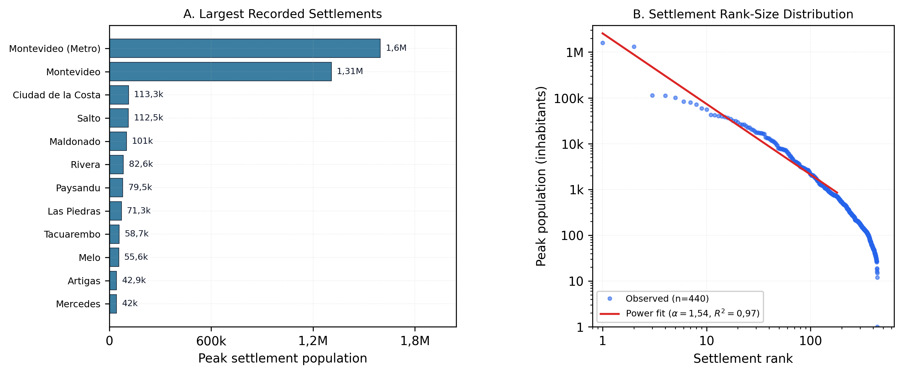

```{r setup, include=FALSE}
knitr::opts_chunk$set(echo = FALSE, warning = FALSE, message = FALSE, fig.pos = "htbp")
source("../../_shared/template/viscount_rmd_helpers.R")
library(jsonlite)

read_json5_clean <- function(path) {
  lines <- readLines(path, warn = FALSE, encoding = "UTF-8")
  lines <- gsub("(^|\\s)//.*$", "", lines)
  clean_str <- paste(lines, collapse = "\n")
  clean_str <- gsub("/\\*.*?\\*/", "", clean_str)
  clean_str <- gsub(",(\\s*[\\]\\}])", "\\1", clean_str)
  fromJSON(clean_str, simplifyVector = FALSE)
}

summary_data <- fromJSON("uruguay_after_independence_summary.json", simplifyVector = FALSE)
sett_data <- fromJSON("uruguay_after_independence_settlements.json", simplifyVector = FALSE)
ledger_data <- read_json5_clean("uruguay_after_independence_source_ledger.json5")

clean_label <- function(x) {
  s <- as.character(x)
  s <- gsub("&", "and", s, fixed = TRUE)
  s <- gsub("\\\\", "", s)
  s
}

norm_admin <- function(adm, reg_id, reg_lookup) {
  if (is.null(adm) || !nzchar(as.character(adm))) {
    if (reg_id %in% names(reg_lookup)) return(reg_lookup[[reg_id]])
    return(reg_id)
  }
  a <- as.character(adm)
  if (a == "Can") return("Canelones")
  if (a == "San Jose") return("San José")
  if (a == "Rio Negro") return("Río Negro")
  if (a == "Paysandu") return("Paysandú")
  if (a == "Tacuarembo") return("Tacuarembó")
  if (a == "Treinta Y Tres") return("Treinta y Tres")
  a
}

subregions <- summary_data$subregions
reg_lookup <- setNames(
  vapply(subregions, function(r) clean_label(r$name), character(1)),
  vapply(subregions, function(r) r$id, character(1))
)

n_sites <- length(sett_data)
n_obs <- sum(vapply(sett_data, function(e) length(e$population), integer(1)))
```

```{r hero-md-fallback, results='asis'}
if (!knitr::is_latex_output()) {
  cat("\n\n")
}
```

# Abstract

This settlement gazetteer catalogues 440 inhabited localities across all 19 departments of Uruguay between 1830 and 2026, assembling 1.385 settlement-year observations drawn exclusively from official *Instituto Nacional de Estadística* (INE) locality censuses (1852 to 2023), the 1889 to 1890 Montevideo municipal enumeration and *Infraestructura de Datos Espaciales* (IDE) urbanised area inventories [@Censo1892Censo; @Aguerre2022Localidades; @Riano2019Imputacion; @Calleja2025Diagnostico]. The register distinguishes Montevideo city proper (1.281.323 in 2023, peaking at 1.307.562 in 1996) and the wider Montevideo metropolitan aggregate (1.593.422 in 2023, peaking at 1.596.673 in 2011) from nine separately tracked suburban nodes across Canelones, San José and adjacent coastal corridors, led by Ciudad de la Costa (113.252), Las Piedras (61.292 in 2023, 71.258 peak), Ciudad del Plata (39.416) and Pando (31.174) [@Queijo1989Aspects; @Melendres2019Estructura]. Alongside the 440 catalogued localities, the regional source ledger documents 291 excluded candidate entries out of 731 evaluated records, separating 237 unlocated minor *fraccionamientos* from 54 duplicate aliases and co-located suburban twins such as Barros Blancos and Atlántida.

# Background

Uruguay's urban system took shape around a single colonial harbour on the Río de la Plata while the cattle-raising interior remained sparsely punctuated by river ports, railway junctions and frontier garrisons [@Etchechurybarrera2017Chinas; @Barrera2012Causa]. During the late nineteenth century, Italian and Spanish immigration swelled Montevideo from 33.994 residents in 1852 to 215.061 in 1889 and 291.465 inside the city core by 1908, creating an early metropolitan monopoly unmatched elsewhere in South America [@Duffau2024Conspiracion; @Censo1892Censo]. By the 1963 census, Montevideo's urban core reached 1.202.890 inhabitants, while secondary towns ranged only between 57.975 in Salto and 51.645 in Paysandú down to provincial capitals of 10k to 40k [@Aguerre2022Localidades; @Brites2017Represas; @Cepalcelade1977Primeros].

Since the 1970s, two spatial currents have reshaped the gazetteer. On the one hand, deindustrialisation, rising land values and highway paving pushed residential growth out of Montevideo department into coastal Canelones (*Ciudad de la Costa*, *Parque del Plata*, *Salinas*), northern commuters (*Las Piedras*, *Pando*, *18 de Mayo*) and western San José (*Ciudad del Plata*), alongside Punta del Este's year-round resort expansion in Maldonado [@Queijo1989Aspects; @Macchio2026Momentos; @Perrone2011Regularidad; @Bolana2026Pobreza]. On the other hand, prolonged rural out-migration, emigration waves and ultra-low fertility left scores of small pastoral towns and rice-growing settlements across Treinta y Tres, Lavalleja, Durazno and Flores stationary or shrinking between 1963 and 2023, while binational border towns such as Chuy and Rivera sustained active cross-border circulation [@Calleja2025Diagnostico; @Nathan2016Diverging; @Ferre2024Short; @Uriarte2024Mobility; @Koolhaas2024Motivaciones].

# Methodology

Settlement compilation proceeded across four sequential ingestion waves logged in the regional source ledger. Wave 1 extracted 348 georeferenced localities directly from the official INE 2004, 2011 and 2023 locality tables and IDE Uruguay urban polygons. Wave 2 repaired suburban coordinates and metropolitan reconciliation tags, adding 61 entries (17,53% marginal gain). Wave 3 backfilled nineteenth- and twentieth-century census series (1852, 1860, 1889, 1908, 1963, 1975, 1985 and 1996) for 26 major urban centres (6,36% marginal gain). Wave 4 conducted a gap-check across all 19 departmental masks, incorporating 5 final localities for an asymptotic marginal gain of 1,15% and zero reliance on crowd-sourced web compendia.

Metropolitan reconciliation assigns an explicit scope tag to each entry so city-proper, suburban and metropolitan totals remain transparent: 430 localities represent distinct cities, towns or villages, 9 represent extra-municipal suburbs in the Montevideo metropolitan orbit and 1 represents the consolidated Montevideo metropolitan aggregate. Candidate records lacking authoritative coordinates (237 minor localities) or duplicating adjacent centres within short distances (54 aliases and co-located suburban twins) were excluded and documented in the ledger.

# Testing and Validation

Ledger accounting reconciles 440 included settlements and 291 excluded candidates across 731 total evaluated records with zero unaccounted entries. Every catalogued entry carries WGS84 coordinates, departmental mask assignment and at least one census count between 1852 and 2023. Across the 440 included localities, 132 settlements reach or exceed 1.000 inhabitants at peak population and 24 exceed 20k, yielding a clean log-log Zipf exponent of $\alpha = 1{,}54$ ($R^2 = 0,97$) that confirms strong metropolitan primacy around Montevideo without artificial truncation in the mid-tier distribution [@Queijo1989Aspects; @Aguerre2022Localidades; @Riano2019Imputacion].

# Results

## Leading Settlements across Uruguay

Table \ref{tab:top30-uruguay} presents the top 30 catalogued settlements ordered by peak documented census population, spanning Montevideo Metro (1,60M) and Montevideo city proper (1,31M) down through departmental capitals and major suburban municipalities around 18k to 113k.

```{r tab-top30, results='asis'}
fmt_coord <- function(x) gsub("[.]", ",", format(round(as.numeric(x), 2), nsmall = 2, trim = TRUE))

get_pop_str <- function(e, y) {
  v <- e[["population"]][[y]]
  if (is.null(v)) return("-")
  viscount_fmt_pop(v)
}

peaks <- vapply(sett_data, function(e) max(as.numeric(unlist(e[["population"]]))), numeric(1))
ord <- order(peaks, decreasing = TRUE)
top_n <- min(30L, length(ord))

rows <- lapply(sett_data[ord[seq_len(top_n)]], function(e) {
  pks <- as.numeric(unlist(e[["population"]]))
  pk_y <- names(e[["population"]])[which.max(pks)]
  pk_v <- max(pks)
  dept_lbl <- norm_admin(e[["admin1"]], e[["region_id"]], reg_lookup)
  data.frame(
    Settlement = clean_label(e[["name"]]),
    Department = dept_lbl,
    Coords = paste0(fmt_coord(e[["coords"]][[1]]), ", ", fmt_coord(e[["coords"]][[2]])),
    P1908 = get_pop_str(e, "1908"),
    P1963 = get_pop_str(e, "1963"),
    P2011 = get_pop_str(e, "2011"),
    P2023 = get_pop_str(e, "2023"),
    Peak = paste0(viscount_fmt_pop(pk_v), " (", pk_y, ")"),
    stringsAsFactors = FALSE
  )
})
top_df <- do.call(rbind, rows)
rownames(top_df) <- NULL

viscount_table(
  top_df,
  "Top 30 settlements in Uruguay ordered by peak documented census population (440 catalogued localities).",
  c("Settlement", "Department", "Lat, Lon", "1908", "1963", "2011", "2023", "Peak (Year)"),
  list(label = "tab:top30-uruguay", font_size = "scriptsize")
)
```

## Montevideo Metropolitan Arc and Canelones Suburbs

Table \ref{tab:metro-uruguay} isolates Montevideo Metro, Montevideo city proper and the primary suburban and peripheral nodes tracked across Canelones, Montevideo and San José from 1975 to 2023. While Montevideo's municipal core rose only from 1,18M in 1975 to 1,31M in 1996 before easing to 1,28M in 2023, Ciudad de la Costa expanded nearly sixfold from 19,5k in 1975 to 113,3k in 2023, and Ciudad del Plata multiplied more than threefold from 11,1k to 39,4k over the same period [@Queijo1989Aspects; @Melendres2019Estructura; @Bolana2026Pobreza].

```{r tab-metro, results='asis'}
metro_names <- c(
  "Montevideo (Metro)", "Montevideo", "Ciudad de la Costa", "Las Piedras",
  "Ciudad Del Plata", "Pando", "18 De Mayo", "La Paz", "Paso Carrasco",
  "Parque Del Plata", "Salinas", "Progreso", "Fracc. Cno. Andaluz Y R.84", "Toledo"
)
metro_entries <- Filter(function(e) e[["name"]] %in% metro_names, sett_data)
m_peaks <- vapply(metro_entries, function(e) max(as.numeric(unlist(e[["population"]]))), numeric(1))
metro_entries <- metro_entries[order(m_peaks, decreasing = TRUE)]

m_rows <- lapply(metro_entries, function(e) {
  sc <- as.character(e[["population_scope"]])
  sc_lbl <- if (sc == "metro") "Metro" else if (sc == "suburb") "Suburb" else "City proper"
  data.frame(
    Settlement = clean_label(e[["name"]]),
    Scope = sc_lbl,
    P1975 = get_pop_str(e, "1975"),
    P1985 = get_pop_str(e, "1985"),
    P1996 = get_pop_str(e, "1996"),
    P2004 = get_pop_str(e, "2004"),
    P2011 = get_pop_str(e, "2011"),
    P2023 = get_pop_str(e, "2023"),
    stringsAsFactors = FALSE
  )
})
metro_df <- do.call(rbind, m_rows)
rownames(metro_df) <- NULL

viscount_table(
  metro_df,
  "Montevideo metropolitan aggregate, municipal core and major Canelones and San José suburban nodes, 1975 to 2023.",
  c("Settlement", "Scope", "1975", "1985", "1996", "2004", "2011", "2023"),
  list(label = "tab:metro-uruguay", font_size = "scriptsize")
)
```

## Departmental Coverage and Source Ledger Summary

Table \ref{tab:dept-gazetteer} summarises spatial mask site counts and leading centres across all 19 departments, while Table \ref{tab:ledger-waves} reports the four-wave saturation progression and exclusion breakdown from the source ledger. Canelones holds the highest count at 58 catalogued localities, followed by Colonia (37), Paysandú (35), San José (28) and Artigas (27).

```{r tab-dept-gazetteer, results='asis'}
sum_rows <- lapply(subregions, function(r) {
  rid <- r$id
  sub_e <- Filter(function(e) identical(e[["region_id"]], rid), sett_data)
  lead_lbl <- "-"
  if (length(sub_e) > 0) {
    pks <- vapply(sub_e, function(e) max(as.numeric(unlist(e[["population"]]))), numeric(1))
    idx_m <- which.max(pks)
    lead_lbl <- paste0(clean_label(sub_e[[idx_m]][["name"]]), " (", viscount_fmt_pop(pks[idx_m]), ")")
  }
  data.frame(
    Department = clean_label(r$name),
    Sites = viscount_fmt_number(length(sub_e), 0L),
    Share = paste0(viscount_fmt_number(100 * length(sub_e) / n_sites, 1L), "%"),
    Lead = lead_lbl,
    Pop2023 = viscount_fmt_pop(as.numeric(r$population_raw[["2023"]])),
    stringsAsFactors = FALSE
  )
})
sum_df <- do.call(rbind, sum_rows)
rownames(sum_df) <- NULL

viscount_table(
  sum_df,
  "Spatial mask settlement counts, leading localities and 2023 census population across 19 Uruguayan departments.",
  c("Department", "Sites", "Share", "Leading Mask Entry (Peak)", "2023 Dept. Pop."),
  list(label = "tab:dept-gazetteer", font_size = "scriptsize")
)
```

```{r tab-ledger-waves, results='asis'}
waves <- ledger_data$saturation_audit$waves
wave_labels <- c(
  "Wave 1: INE 2004-2023 and IDE polygons",
  "Wave 2: Georeference and metro reconciliation",
  "Wave 3: 1852-1996 historical census backfill",
  "Wave 4: Departmental gap-check sweep"
)
w_rows <- lapply(seq_along(waves), function(i) {
  w <- waves[[i]]
  cum <- as.integer(w$prior_cumulative_included) + as.integer(w$newly_included)
  data.frame(
    Stage = wave_labels[i],
    Prior = viscount_fmt_number(as.integer(w$prior_cumulative_included), 0L),
    Added = viscount_fmt_number(as.integer(w$newly_included), 0L),
    Cumulative = viscount_fmt_number(cum, 0L),
    Gain = paste0(viscount_fmt_number(as.numeric(w$marginal_gain_pct), 2L), "%"),
    stringsAsFactors = FALSE
  )
})
w_df <- do.call(rbind, w_rows)
rownames(w_df) <- NULL

viscount_table(
  w_df,
  "Four-wave gazetteer saturation sequence across 440 included Uruguayan settlements (plus 291 excluded ledger candidates).",
  c("Ingestion Wave", "Prior Total", "Added", "Cumulative", "Marginal Gain"),
  list(label = "tab:ledger-waves", font_size = "scriptsize")
)
```

# Limitations

Two technical caveats apply to the settlement register. First, spatial assignment to departmental raster masks shifts several border or conurbation localities away from their formal administrative department: Ciudad de la Costa and Fracc. Cno. Andaluz y R.84 fall inside Montevideo's eastern mask edge rather than Canelones, Ciudad del Plata falls on Canelones's western edge rather than San José, and Durazno city lies on a boundary cell touching Flores. In addition, La Paz carries Canelones suburban census figures (19.574 in 2023) paired with coordinates corresponding to the homonymous Colonia La Paz settlement, and Toledo reflects a Cerro Largo boundary homonym rather than Canelones's suburban Toledo. Second, pre-1963 locality series are recorded primarily for Montevideo and major departmental capitals; smaller rural towns enter the gazetteer only from 2004 or 2011 onward when INE standardised locality-level digital tables [@Riano2019Imputacion; @Melendres2019Estructura].

# Conclusion

The 440-settlement Uruguayan gazetteer captures both the extreme primacy of Montevideo (1,59M metropolitan and 1,28M city proper in 2023) and the modern dispersion of growth into suburban Canelones, San José and coastal Maldonado [@Queijo1989Aspects; @Macchio2026Momentos]. Coupled with full source-ledger accounting across 731 evaluated candidates and four saturation waves, the register provides a transparent urban foundation for Uruguay's post-independence regional demographic history.

# Appendix

## Excluded Candidate Categories in the Source Ledger

Out of 731 evaluated candidate records in the Uruguayan source ledger, 440 were included and 291 were excluded without leaving any unaccounted records. Table \ref{tab:ledger-exclusions} summarises the exclusion categories and illustrates representative duplicate consolidations, including co-located suburban twins such as Barros Blancos (1,35 km from Ciudad de la Costa) and Atlántida (0,46 km from Parque del Plata).

```{r tab-ledger-exclusions, results='asis'}
cands <- ledger_data$candidates
n_inc <- sum(vapply(cands, function(c) identical(c$status, "included"), logical(1)))
n_unloc <- sum(vapply(cands, function(c) identical(c$reason, "unlocated_historical_toponym"), logical(1)))
n_dup <- sum(vapply(cands, function(c) identical(c$reason, "duplicate_alias"), logical(1)))
n_tot <- length(cands)

ex_df <- data.frame(
  Category = c(
    "Catalogued settlements",
    "Unlocated minor localities or hamlets",
    "Duplicate aliases and merged suburban twins",
    "Total evaluated ledger candidates"
  ),
  Status = c("Included", "Excluded", "Excluded", "All candidates"),
  Count = c(
    viscount_fmt_number(n_inc, 0L),
    viscount_fmt_number(n_unloc, 0L),
    viscount_fmt_number(n_dup, 0L),
    viscount_fmt_number(n_tot, 0L)
  ),
  Share = c(
    paste0(viscount_fmt_number(100 * n_inc / n_tot, 1L), "%"),
    paste0(viscount_fmt_number(100 * n_unloc / n_tot, 1L), "%"),
    paste0(viscount_fmt_number(100 * n_dup / n_tot, 1L), "%"),
    "100%"
  ),
  Examples = c(
    "Montevideo, Ciudad de la Costa, Salto, Maldonado",
    "Franquia, Cumbres de Carrasco, Haras del Lago",
    "Barros Blancos, Atlántida, Estación Porvenir",
    "Four-wave INE and IDE reconciliation"
  ),
  stringsAsFactors = FALSE
)
rownames(ex_df) <- NULL

viscount_table(
  ex_df,
  "Source ledger classification across all 731 evaluated Uruguayan settlement candidates.",
  c("Ledger Category", "Status", "Count", "Share", "Representative Examples"),
  list(label = "tab:ledger-exclusions", font_size = "scriptsize")
)
```

# Sources

::: {#refs}
:::
