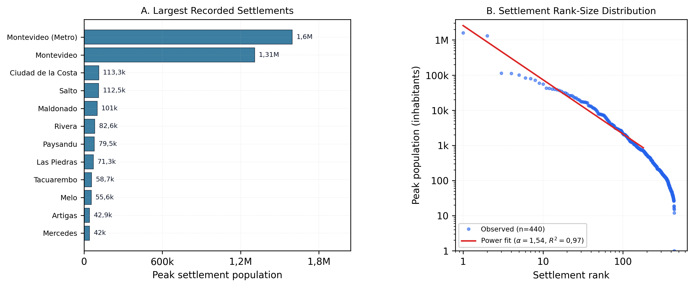

Uruguay after Independence
================
Aust Kätzchen
23 November 2026

- [Abstract](#abstract)
- [Background](#background)
- [Methodology](#methodology)
- [Testing and Validation](#testing-and-validation)
- [Results](#results)
  - [Leading Settlements across
    Uruguay](#leading-settlements-across-uruguay)
  - [Montevideo Metropolitan Arc and Canelones
    Suburbs](#montevideo-metropolitan-arc-and-canelones-suburbs)
  - [Departmental Coverage and Source Ledger
    Summary](#departmental-coverage-and-source-ledger-summary)
- [Limitations](#limitations)
- [Conclusion](#conclusion)
- [Appendix](#appendix)
  - [Excluded Candidate Categories in the Source
    Ledger](#excluded-candidate-categories-in-the-source-ledger)
- [Sources](#sources)

<figure>

<figcaption aria-hidden="true">Top twelve catalogued Uruguayan
settlements by peak population and log-log rank-size fit across 440
localities.</figcaption>
</figure>

# Abstract

This settlement gazetteer catalogues 440 inhabited localities across all
19 departments of Uruguay between 1830 and 2026, assembling 1.385
settlement-year observations drawn exclusively from official *Instituto
Nacional de Estadística* (INE) locality censuses (1852 to 2023), the
1889 to 1890 Montevideo municipal enumeration and *Infraestructura de
Datos Espaciales* (IDE) urbanised area inventories
[\[1\]](#ref-Censo1892Censo)[\[2\]](#ref-Aguerre2022Localidades)[\[3\]](#ref-Riano2019Imputacion)[\[4\]](#ref-Calleja2025Diagnostico).
The register distinguishes Montevideo city proper (1.281.323 in 2023,
peaking at 1.307.562 in 1996) and the wider Montevideo metropolitan
aggregate (1.593.422 in 2023, peaking at 1.596.673 in 2011) from nine
separately tracked suburban nodes across Canelones, San José and
adjacent coastal corridors, led by Ciudad de la Costa (113.252), Las
Piedras (61.292 in 2023, 71.258 peak), Ciudad del Plata (39.416) and
Pando (31.174)
[\[5\]](#ref-Queijo1989Aspects)[\[6\]](#ref-Melendres2019Estructura).
Alongside the 440 catalogued localities, the regional source ledger
documents 291 excluded candidate entries out of 731 evaluated records,
separating 237 unlocated minor *fraccionamientos* from 54 duplicate
aliases and co-located suburban twins such as Barros Blancos and
Atlántida.

# Background

Uruguay’s urban system took shape around a single colonial harbour on
the Río de la Plata while the cattle-raising interior remained sparsely
punctuated by river ports, railway junctions and frontier garrisons
[\[7\]](#ref-Etchechurybarrera2017Chinas)[\[8\]](#ref-Barrera2012Causa).
During the late nineteenth century, Italian and Spanish immigration
swelled Montevideo from 33.994 residents in 1852 to 215.061 in 1889 and
291.465 inside the city core by 1908, creating an early metropolitan
monopoly unmatched elsewhere in South America
[\[1\]](#ref-Censo1892Censo)[\[9\]](#ref-Duffau2024Conspiracion). By the
1963 census, Montevideo’s urban core reached 1.202.890 inhabitants,
while secondary towns ranged only between 57.975 in Salto and 51.645 in
Paysandú down to provincial capitals of 10k to 40k
[\[2\]](#ref-Aguerre2022Localidades)[\[10\]](#ref-Brites2017Represas)[\[11\]](#ref-Cepalcelade1977Primeros).

Since the 1970s, two spatial currents have reshaped the gazetteer. On
the one hand, deindustrialisation, rising land values and highway paving
pushed residential growth out of Montevideo department into coastal
Canelones (*Ciudad de la Costa*, *Parque del Plata*, *Salinas*),
northern commuters (*Las Piedras*, *Pando*, *18 de Mayo*) and western
San José (*Ciudad del Plata*), alongside Punta del Este’s year-round
resort expansion in Maldonado
[\[5\]](#ref-Queijo1989Aspects)[\[12\]](#ref-Macchio2026Momentos)[\[13\]](#ref-Perrone2011Regularidad)[\[14\]](#ref-Bolana2026Pobreza).
On the other hand, prolonged rural out-migration, emigration waves and
ultra-low fertility left scores of small pastoral towns and rice-growing
settlements across Treinta y Tres, Lavalleja, Durazno and Flores
stationary or shrinking between 1963 and 2023, while binational border
towns such as Chuy and Rivera sustained active cross-border circulation
[\[4\]](#ref-Calleja2025Diagnostico)[\[15\]](#ref-Nathan2016Diverging)[\[16\]](#ref-Ferre2024Short)[\[17\]](#ref-Uriarte2024Mobility)[\[18\]](#ref-Koolhaas2024Motivaciones).

# Methodology

Settlement compilation proceeded across four sequential ingestion waves
logged in the regional source ledger. Wave 1 extracted 348 georeferenced
localities directly from the official INE 2004, 2011 and 2023 locality
tables and IDE Uruguay urban polygons. Wave 2 repaired suburban
coordinates and metropolitan reconciliation tags, adding 61 entries
(17,53% marginal gain). Wave 3 backfilled nineteenth- and
twentieth-century census series (1852, 1860, 1889, 1908, 1963, 1975,
1985 and 1996) for 26 major urban centres (6,36% marginal gain). Wave 4
conducted a gap-check across all 19 departmental masks, incorporating 5
final localities for an asymptotic marginal gain of 1,15% and zero
reliance on crowd-sourced web compendia.

Metropolitan reconciliation assigns an explicit scope tag to each entry
so city-proper, suburban and metropolitan totals remain transparent: 430
localities represent distinct cities, towns or villages, 9 represent
extra-municipal suburbs in the Montevideo metropolitan orbit and 1
represents the consolidated Montevideo metropolitan aggregate. Candidate
records lacking authoritative coordinates (237 minor localities) or
duplicating adjacent centres within short distances (54 aliases and
co-located suburban twins) were excluded and documented in the ledger.

# Testing and Validation

Ledger accounting reconciles 440 included settlements and 291 excluded
candidates across 731 total evaluated records with zero unaccounted
entries. Every catalogued entry carries WGS84 coordinates, departmental
mask assignment and at least one census count between 1852 and 2023.
Across the 440 included localities, 132 settlements reach or exceed
1.000 inhabitants at peak population and 24 exceed 20k, yielding a clean
log-log Zipf exponent of $\alpha = 1{,}54$ ($R^2 = 0,97$) that confirms
strong metropolitan primacy around Montevideo without artificial
truncation in the mid-tier distribution
[\[2\]](#ref-Aguerre2022Localidades)[\[3\]](#ref-Riano2019Imputacion)[\[5\]](#ref-Queijo1989Aspects).

# Results

## Leading Settlements across Uruguay

Table presents the top 30 catalogued settlements ordered by peak
documented census population, spanning Montevideo Metro (1,60M) and
Montevideo city proper (1,31M) down through departmental capitals and
major suburban municipalities around 18k to 113k.

| Settlement | Department | Lat, Lon | 1908 | 1963 | 2011 | 2023 | Peak (Year) |
|:---|:---|:---|:---|:---|:---|:---|:---|
| **Montevideo (Metro)** | Montevideo | -34,89, -56,33 | \- | \- | 1,6M | 1,59M | 1,6M (2011) |
| **Montevideo** | Montevideo | -34,89, -56,33 | 291,5k | 1,2M | 1,3M | 1,28M | 1,31M (1996) |
| **Ciudad de la Costa** | Canelones | -34,76, -56 | \- | \- | 95,2k | 113,3k | 113,3k (2023) |
| **Salto** | Salto | -31,38, -57,93 | 19,7k | 58k | 104k | 112,5k | 112,5k (2023) |
| **Maldonado** | Maldonado | -34,92, -54,92 | 4,4k | 15k | 62,6k | 101k | 101k (2023) |
| **Rivera** | Rivera | -30,92, -55,58 | 9k | 40,1k | 64,5k | 82,6k | 82,6k (2023) |
| **Paysandu** | Paysandú | -32,3, -58,06 | 21k | 51,6k | 76,4k | 79,5k | 79,5k (2023) |
| **Las Piedras** | Canelones | -34,72, -56,19 | 8,1k | 40,7k | 71,3k | 61,3k | 71,3k (2011) |
| **Tacuarembo** | Tacuarembó | -31,73, -55,98 | 7,5k | 28,2k | 54,8k | 58,7k | 58,7k (2023) |
| **Melo** | Cerro Largo | -32,37, -54,16 | 12,4k | 33,7k | 51,8k | 55,6k | 55,6k (2023) |
| **Artigas** | Artigas | -30,42, -56,47 | 8,9k | 23,4k | 40,7k | 42,9k | 42,9k (2023) |
| **Mercedes** | Soriano | -33,26, -58,02 | 15,7k | 31,3k | 42k | 41,5k | 42k (2004) |
| **Durazno** | Durazno | -33,39, -56,52 | 10,6k | 22,2k | 34,4k | 40,1k | 40,1k (2023) |
| **Ciudad Del Plata** | San José | -34,75, -56,44 | \- | \- | 31,1k | 39,4k | 39,4k (2023) |
| **Minas** | Lavalleja | -34,39, -55,28 | 13,3k | 31,3k | 38,4k | 38,3k | 38,4k (2011) |
| **San Jose De Mayo** | San José | -34,34, -56,71 | 12,3k | 27,5k | 36,7k | 36,2k | 36,7k (2011) |
| **Florida** | Florida | -34,11, -56,19 | 10,6k | 20,9k | 33,6k | 34,9k | 34,9k (2023) |
| **Colonia Del Sacramento** | Colonia | -34,45, -57,8 | 8k | 12,8k | 26,2k | 31,7k | 31,7k (2023) |
| **Pando** | Canelones | -34,7, -55,98 | \- | \- | 25,9k | 31,2k | 31,2k (2023) |
| **San Carlos** | Maldonado | -34,79, -54,89 | \- | \- | 27,5k | 29,3k | 29,3k (2023) |
| **Treinta Y Tres** | Treinta y Tres | -33,23, -54,38 | 7,7k | 22,6k | 25,5k | 24,6k | 26,4k (1996) |
| **Fray Bentos** | Río Negro | -33,13, -58,3 | 7,4k | 17,1k | 24,4k | 26,2k | 26,2k (2023) |
| **Rocha** | Rocha | -34,48, -54,33 | 12,2k | 19,5k | 25,4k | 26,1k | 26,1k (2023) |
| **Canelones** | Canelones | -34,57, -56,4 | 8,5k | 14k | 19,9k | 24,2k | 24,2k (2023) |
| **18 De Mayo** | Canelones | -34,7, -56,22 | \- | \- | 22,5k | 22,6k | 22,6k (2023) |
| **Trinidad** | Flores | -33,52, -56,9 | 8,3k | 15,5k | 21,4k | 22,4k | 22,4k (2023) |
| **La Paz** | Canelones | -34,35, -57,31 | \- | \- | 20,5k | 19,6k | 20,5k (2011) |
| **Carmelo** | Colonia | -33,99, -58,28 | \- | \- | 18k | 20k | 20k (2023) |
| **Dolores** | Soriano | -33,55, -58,2 | \- | \- | 17,2k | 18,8k | 18,8k (2023) |
| **Punta Del Este** | Maldonado | -34,94, -54,93 | \- | \- | 9,3k | 17,4k | 17,4k (2023) |

Top 30 settlements in Uruguay ordered by peak documented census
population (440 catalogued localities).

## Montevideo Metropolitan Arc and Canelones Suburbs

Table isolates Montevideo Metro, Montevideo city proper and the primary
suburban and peripheral nodes tracked across Canelones, Montevideo and
San José from 1975 to 2023. While Montevideo’s municipal core rose only
from 1,18M in 1975 to 1,31M in 1996 before easing to 1,28M in 2023,
Ciudad de la Costa expanded nearly sixfold from 19,5k in 1975 to 113,3k
in 2023, and Ciudad del Plata multiplied more than threefold from 11,1k
to 39,4k over the same period
[\[5\]](#ref-Queijo1989Aspects)[\[6\]](#ref-Melendres2019Estructura)[\[14\]](#ref-Bolana2026Pobreza).

| Settlement                     | Scope       | 1975  | 1985  | 1996  | 2004  | 2011  | 2023   |
|:-------------------------------|:------------|:------|:------|:------|:------|:------|:-------|
| **Montevideo (Metro)**         | Metro       | 1,32M | 1,43M | 1,55M | 1,54M | 1,6M  | 1,59M  |
| **Montevideo**                 | City proper | 1,18M | 1,25M | 1,31M | 1,27M | 1,3M  | 1,28M  |
| **Ciudad de la Costa**         | Suburb      | 19,5k | 34,5k | 66,4k | 83,4k | 95,2k | 113,3k |
| **Las Piedras**                | Suburb      | 53,3k | 58,3k | 66,6k | 69,2k | 71,3k | 61,3k  |
| **Ciudad Del Plata**           | Suburb      | 11,1k | 13,5k | 20,7k | 26,6k | 31,1k | 39,4k  |
| **Pando**                      | Suburb      | 16,4k | 19,8k | 23,4k | 24k   | 25,9k | 31,2k  |
| **18 De Mayo**                 | City proper | \-    | \-    | \-    | \-    | 22,5k | 22,6k  |
| **La Paz**                     | Suburb      | 14,7k | 16,2k | 19,5k | 19,8k | 20,5k | 19,6k  |
| **Paso Carrasco**              | City proper | \-    | \-    | \-    | 15k   | 15,9k | 17,2k  |
| **Progreso**                   | Suburb      | 9,6k  | 11,2k | 14,5k | 15,8k | 16,2k | 11,1k  |
| **Parque Del Plata**           | Suburb      | 2,4k  | 3,2k  | 5k    | 5,9k  | 7,9k  | 13,1k  |
| **Salinas**                    | Suburb      | 1,9k  | 2,5k  | 5,3k  | 6,6k  | 8,6k  | 11,3k  |
| **Fracc. Cno. Andaluz Y R.84** | City proper | \-    | \-    | \-    | \-    | 9,3k  | 9,6k   |
| **Toledo**                     | Suburb      | \-    | \-    | \-    | 4k    | 4,4k  | 6,5k   |

Montevideo metropolitan aggregate, municipal core and major Canelones
and San José suburban nodes, 1975 to 2023.

## Departmental Coverage and Source Ledger Summary

Table summarises spatial mask site counts and leading centres across all
19 departments, while Table reports the four-wave saturation progression
and exclusion breakdown from the source ledger. Canelones holds the
highest count at 58 catalogued localities, followed by Colonia (37),
Paysandú (35), San José (28) and Artigas (27).

| Department | Sites | Share | Leading Mask Entry (Peak) | 2023 Dept. Pop. |
|:---|:---|:---|:---|:---|
| **Artigas** | 27 | 6,1% | Artigas (42,9k) | 77,5k |
| **Canelones** | 58 | 13,2% | Las Piedras (71,3k) | 609k |
| **Cerro Largo** | 23 | 5,2% | Melo (55,6k) | 91k |
| **Colonia** | 37 | 8,4% | Colonia Del Sacramento (31,7k) | 135,8k |
| **Durazno** | 13 | 3% | San Gregorio De Polanco (3,8k) | 62k |
| **Flores** | 7 | 1,6% | Durazno (40,1k) | 26,3k |
| **Florida** | 21 | 4,8% | Florida (34,9k) | 70,3k |
| **Lavalleja** | 17 | 3,9% | Minas (38,4k) | 59,2k |
| **Maldonado** | 24 | 5,5% | Maldonado (101k) | 213k |
| **Montevideo** | 5 | 1,1% | Montevideo (Metro) (1,6M) | 1,3M |
| **Paysandú** | 35 | 8% | Paysandu (79,5k) | 121,8k |
| **Rivera** | 19 | 4,3% | Rivera (82,6k) | 109,3k |
| **Rocha** | 19 | 4,3% | Rocha (26,1k) | 80,7k |
| **Río Negro** | 18 | 4,1% | Fray Bentos (26,2k) | 57,3k |
| **Salto** | 24 | 5,5% | Salto (112,5k) | 136,2k |
| **San José** | 28 | 6,4% | San Jose De Mayo (36,7k) | 119,7k |
| **Soriano** | 20 | 4,5% | Mercedes (42k) | 83,7k |
| **Tacuarembó** | 19 | 4,3% | Tacuarembo (58,7k) | 96k |
| **Treinta y Tres** | 26 | 5,9% | Treinta Y Tres (26,4k) | 47,7k |

Spatial mask settlement counts, leading localities and 2023 census
population across 19 Uruguayan departments.

| Ingestion Wave | Prior Total | Added | Cumulative | Marginal Gain |
|:---|:---|:---|:---|:---|
| **Wave 1: INE 2004-2023 and IDE polygons** | 0 | 348 | 348 | 100% |
| **Wave 2: Georeference and metro reconciliation** | 348 | 61 | 409 | 17,53% |
| **Wave 3: 1852-1996 historical census backfill** | 409 | 26 | 435 | 6,36% |
| **Wave 4: Departmental gap-check sweep** | 435 | 5 | 440 | 1,15% |

Four-wave gazetteer saturation sequence across 440 included Uruguayan
settlements (plus 291 excluded ledger candidates).

# Limitations

Two technical caveats apply to the settlement register. First, spatial
assignment to departmental raster masks shifts several border or
conurbation localities away from their formal administrative department:
Ciudad de la Costa and Fracc. Cno. Andaluz y R.84 fall inside
Montevideo’s eastern mask edge rather than Canelones, Ciudad del Plata
falls on Canelones’s western edge rather than San José, and Durazno city
lies on a boundary cell touching Flores. In addition, La Paz carries
Canelones suburban census figures (19.574 in 2023) paired with
coordinates corresponding to the homonymous Colonia La Paz settlement,
and Toledo reflects a Cerro Largo boundary homonym rather than
Canelones’s suburban Toledo. Second, pre-1963 locality series are
recorded primarily for Montevideo and major departmental capitals;
smaller rural towns enter the gazetteer only from 2004 or 2011 onward
when INE standardised locality-level digital tables
[\[3\]](#ref-Riano2019Imputacion)[\[6\]](#ref-Melendres2019Estructura).

# Conclusion

The 440-settlement Uruguayan gazetteer captures both the extreme primacy
of Montevideo (1,59M metropolitan and 1,28M city proper in 2023) and the
modern dispersion of growth into suburban Canelones, San José and
coastal Maldonado
[\[5\]](#ref-Queijo1989Aspects)[\[12\]](#ref-Macchio2026Momentos).
Coupled with full source-ledger accounting across 731 evaluated
candidates and four saturation waves, the register provides a
transparent urban foundation for Uruguay’s post-independence regional
demographic history.

# Appendix

## Excluded Candidate Categories in the Source Ledger

Out of 731 evaluated candidate records in the Uruguayan source ledger,
440 were included and 291 were excluded without leaving any unaccounted
records. Table summarises the exclusion categories and illustrates
representative duplicate consolidations, including co-located suburban
twins such as Barros Blancos (1,35 km from Ciudad de la Costa) and
Atlántida (0,46 km from Parque del Plata).

| Ledger Category | Status | Count | Share | Representative Examples |
|:---|:---|:---|:---|:---|
| **Catalogued settlements** | Included | 440 | 60,2% | Montevideo, Ciudad de la Costa, Salto, Maldonado |
| **Unlocated minor localities or hamlets** | Excluded | 237 | 32,4% | Franquia, Cumbres de Carrasco, Haras del Lago |
| **Duplicate aliases and merged suburban twins** | Excluded | 54 | 7,4% | Barros Blancos, Atlántida, Estación Porvenir |
| **Total evaluated ledger candidates** | All candidates | 731 | 100% | Four-wave INE and IDE reconciliation |

Source ledger classification across all 731 evaluated Uruguayan
settlement candidates.

# Sources

1.
Comisión Directiva del Censo,
Montevideo (Uruguay)., and 1852-1918 Pena Carlos María de.
*Censo municipal del departamento y de la ciudad de
Montevideo, capital de la República Oriental del Uruguay. Edificación,
escuelas, población e industrias. Levantado por resolución de la Junta
Económico-Administrativa en los días 25 de setiembre, 5 de octubre, 18
de noviembre de 1889 y 25 de enero de 1890*. Montevideo, Estab.
tip.-lit. "Oriental,", 1892,
<https://archive.org/details/censomunicipalde00mont>.

2.
Aguerre, Tabaré Fernández, et al.
“¿Localidades informales, excedentarias o
segregadas? La heterogeneidad urbana en Uruguay según el Censo de
1963.” *Territorios*, 2022,
<https://doi.org/10.12804/revistas.urosario.edu.co/territorios/a.10333>.

3.
Riaño, María Eugenia.
“Imputación de datos faltantes del Censo de
Población y Vivienda de Uruguay utilizando técnicas de estadística
espacial.” *SaberEs*, 2019,
<https://doi.org/10.35305/s.v11i2.202>.

4.
Calleja, Diego Duarte.
“Diagnóstico habitacional del departamento de
Treinta y Tres, Uruguay basado en datos del Censo 2023.”
*ARQUISUR Revista*, 2025,
<https://doi.org/10.14409/ar.v15i28.14743>.

5.
Carmen Queijo, María del, et al.
“Aspects of the growth of Montevideo, Uruguay and
its environmental implications.” *Environment and Urbanization*,
1989, <https://doi.org/10.1177/095624788900100109>.

6.
Melendres, Lidia.
*Estructura y composición de los hogares uruguayos:
censos 2011*. UN ECLAC / CEPAL-CELADE, 2019,
<https://hdl.handle.net/11362/45742>.

7.
Etchechury Barrera, Mario Israel.
*“Chinas, guayaquises y jente que no es de armas”
algunas consideraciones sobre el impacto social de la guerra en
Montevideo y su Hinterland rural (1842-1845)*. CONICET Digital,
2017, <http://hdl.handle.net/11336/78689>.

8.
Barrera, Mario Etchechury.
“La ‘causa de Montevideo.’ Inmigración,
legionarismo y voluntariado militar en el Río de la Plata,
1848-1852.” *Nuevo Mundo - Mundos Nuevos*, 2012,
<https://doi.org/10.4000/nuevomundo.64670>.

9.
Duffau, Nicolás, and Mario Israel
Etchechury Barrera. *«La conspiración de los
lombardos»: La inmigración italiana y las redes políticas
transnacionales en el Río de la Plata (Montevideo, 1857-1858)*.
CONICET Digital, 2024, <http://hdl.handle.net/11336/300609>.

10.
Brites, Walter, and Maria Rosa
Catullo. “Represas y transformación socio-urbana.
Un análisis comparativo de los proyectos hidroeléctricos de Salto Grande
y Yacyretá.” *Cidades, Comunidades e Território*, 2017,
<https://journals.openedition.org/cidades/352>.

11.
UN ECLAC / CEPAL-CELADE.
*Primeros resultados del analisis de la informacion
censal del Uruguay*. UN ECLAC / CEPAL-CELADE, 1977,
<https://hdl.handle.net/11362/32139>.

12.
Macchio, Leonardo Altmann.
“Momentos de la urbanización turística en
Maldonado - Punta del Este (Uruguay) en un cambio de época
(1974-1982).” *Pensum*, 2026,
<https://doi.org/10.59047/2469.0724.v12.n16.50835>.

13.
Perrone, María Jimena Fernández.
“Regularidad constitucional de la actual
contribución inmobiliaria urbana de Montevideo (Decreto Nº32.265 de la
Junta Departamental de Montevideo).” *Revista de Derecho*, 2011,
<http://revistas.um.edu.uy/index.php/revistaderecho/article/view/656>.

14.
Bolaña, María José.
“Pobreza urbana y ciudadanía incompleta en tiempos
de terrorismo de Estado y transición democrática: Montevideo,
1973-1989.” *Revista Mundos Do Trabalho*, 2026,
<https://doi.org/10.5007/1984-9222.2026.e111054>.

15.
Nathan, Mathías, et al.
“Diverging patterns of fertility decline in
Uruguay.” *Demographic Research*, 2016,
<https://doi.org/10.4054/demres.2016.34.20>.

16.
Ferre, Zuleika, et al.
“The short- and long-term determinants of fertility
in Uruguay.” *Demographic Research*, 2024,
<https://doi.org/10.4054/demres.2024.51.10>.

17.
Uriarte, Pilar, and Enrique Coraza
de los Santos. “MOBILITY AND BORDER AT THE LIMIT OF URUGUAY-BRAZIL:
MIGRATION IN COVID TIMES IN THE BI-NATIONAL CITY CHUY-CHUÍ.” *Revista
Tempo Do Mundo*, 2024, <https://doi.org/10.38116/rtm35art7>.

18.
Koolhaas, Martín.
“Motivaciones de la migración de retorno de España
a Uruguay.” *Revista Latinoamericana de Población*, 2024,
<https://doi.org/10.31406/relap2023.v17e202318>.

