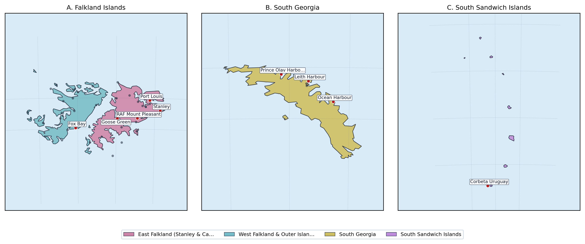

```{r setup, include=FALSE}
knitr::opts_chunk$set(echo = FALSE, warning = FALSE, message = FALSE, fig.pos = "htbp")
source("../../_shared/template/viscount_rmd_helpers.R")
library(jsonlite)

summary_data <- fromJSON("falklands_south_atlantic_summary.json", simplifyVector = FALSE)
sett_data <- fromJSON("falklands_south_atlantic_settlements.json", simplifyVector = FALSE)

clean_label <- function(x) {
  s <- as.character(x)
  s <- gsub("&", "and", s, fixed = TRUE)
  s <- gsub("\\\\", "", s)
  trimws(s)
}

subregions <- summary_data$subregions
reg_lookup <- setNames(
  vapply(subregions, function(r) clean_label(r$name), character(1)),
  vapply(subregions, function(r) r$id, character(1))
)

tot_area <- as.numeric(summary_data$total_area_km2)
n_sites <- as.integer(summary_data$settlement_count)
```

```{r hero-md-fallback, results='asis'}
if (!knitr::is_latex_output()) {
  cat("\n\n")
}
```

# Abstract

Between the French landing at Port Louis in April 1764 and the 2021 Falkland Islands census, total human numbers across the Falkland Islands, South Georgia and the South Sandwich Islands rose from 49 pioneers and itinerant sealers to 3.682 inhabitants, tracing two distinct demographic regimes across 27.743,3 km² of maritime domain [@Pernety2013History; @Directorate2022Falkland; @Islands2020South]. Although isolated prehistoric charcoal, lithic points and canid remains suggest ephemeral pre-European Fuegian or Yaghan visits, every early navigator documented an uninhabited archipelago prior to the rival establishments of Port Louis (1764), Port Egmont (1765) and Spanish Puerto Soledad (1767) [@Aguado2014Francisco; @Taquini1982History; @Engel1990Falkland]. After Britain reasserted control in January 1833 and relocated the administrative seat from Port Louis to Stanley in 1845, sheep ranching under the Falkland Islands Company drove expansion across East and West Falkland through 22 decennial and quinquennial censuses, lifting the islands from 287 inhabitants in 1851 to an interwar agrarian peak of 2.392 in 1931 [@Rodriguez2026Poblacion; @Berardi2023Negociaciones; @Unit2013Falkland]. Simultaneously, shore-based Norwegian and British industrial whaling turned South Georgia from an empty glacial coast into a seasonal company archipelago of 650 to 850 benchmark residents and up to 2.000 summer workers across Grytviken, Leith Harbour, Husvik, Stromness, Ocean Harbour, Prince Olav Harbour and Godthul before collapsing between 1962 and 1965 into a 20-person British Antarctic Survey scientific community at King Edward Point and Bird Island [@Agnew2004Fishing; @Vogel1983Invertebrates; @Blair2019South]. In the Falkland Islands themselves, post-war wool mechanisation eroded the rural Camp from more than 1.100 residents in 1931 to a modern trough of 1.813 islanders in 1980, until the 1982 Falklands War, the construction of RAF Mount Pleasant and the 1986 offshore fisheries-licensing regime doubled territorial revenues and spurred multinational immigration from the United Kingdom, Saint Helena, Chile and the Philippines [@Bellot2021Keeping; @Fraga2017Oil; @Ruzza2011Falkland]. By 2021, the Falkland Islands reached 3.662 usually resident persons (3.142 present on census night), concentrating 81,21% of residents in Stanley and leaving Camp with 354 inhabitants, while South Georgia held 20 rotating scientists and administrators and the South Sandwich Islands remained uninhabited [@Directorate2022Falkland; @Islands2020South].

# Background

## Pre-Settlement Baseline and Colonial Foundations, 1764 to 1833

The South Atlantic archipelagos lie near the edge of the Patagonian continental shelf and the Scotia Arc, separated from South America by roughly 480 km of cold sub-Antarctic water [@Petrovic2022Argentinas; @Engel1990Falkland]. Unlike Tierra del Fuego or the Patagonian channels, neither the Falkland Islands nor South Georgia nor the South Sandwich Islands sustained an indigenous population when European mariners charted them between the late sixteenth and eighteenth centuries [@Aguado2014Francisco; @Arruda2015Colonial].

Palaeobotanical records of elevated fire frequency, occasional stone projectile points and the biogeographical puzzle of the endemic Falkland Islands wolf (*Dusicyon australis*) point to brief pre-Columbian maritime crossings by Fuegian or Yaghan canoeists [@Engel1990Falkland; @Parish1833Account]. Yet no permanent village, shell-midden sequence or agricultural clearing existed at European contact, a fact explicitly noted by eighteenth-century navigators and contemporary commentators [@Aguado2014Francisco; @Pernety2013History].

Continuous demographic history began with European strategic competition after the Seven Years' War [@Taquini1982History; @Arruda2015Colonial]. On 5 April 1764, Louis-Antoine de Bougainville disembarked 29 colonists from Saint-Malo at Port Louis on Berkeley Sound, naming the archipelago the *Îles Malouines* [@Pernety2013History].

Less than a year later, in January 1765, Commodore John Byron claimed Saunders Island in West Falkland and founded the British naval outpost of Port Egmont, which soon housed around 110 sailors and marines [@Taquini1982History; @Barriera2023Malvinas]. Following Spanish diplomatic protests over French infringement of South Atlantic treaty claims, Bougainville transferred Port Louis to Spain on 2 April 1767 against an indemnity of 603.000 *livres tournois*, installing Felipe Ruiz Puente as governor of the renamed Puerto Soledad [@Aguado2014Francisco; @Pernety2013History].

Tensions over overlapping settlements flared in June 1770 when a Spanish squadron from Buenos Aires expelled the Port Egmont garrison, nearly precipitating war before Britain resumed possession in 1771 and then voluntarily evacuated the West Falkland post in May 1774 for reasons of naval economy [@Taquini1982History; @Arruda2015Colonial]. When Francisco Gil y Lemos governed Puerto Soledad in 1774, an administrative inspection recorded 115 inhabitants, a total that fell to 84 by 1777 and hovered around 75 to 142 soldiers, convicts, officials and priests across the remainder of Spanish rule [@Aguado2014Francisco; @Rodriguez2026Poblacion].

Spain withdrew its garrison in February 1811 during the Peninsular War and the Plate revolutionary crisis [@Barriera2023Malvinas; @Taquini1982History]. For the next decade East and West Falkland were frequented mainly by British and North American sealers whose camps rarely exceeded five to fifteen seasonal hands at any single benchmark [@Rodriguez2026Poblacion; @Parish1833Account].

## Vernet's Colony, British Annexation and the Foundation of Stanley, 1820 to 1851

In November 1820, privateer captain David Jewett raised the flag of the United Provinces of the Rio de la Plata at Port Louis, and between 1823 and 1831 Hamburg-born merchant Luis Vernet attempted to build a self-sustaining pastoral and sealing colony on East Falkland [@Rodriguez2026Poblacion; @Barriera2023Malvinas]. Vernet imported *gaucho* herdsmen, British and German artisans and enslaved and freed workers to manage feral cattle, growing the settlement back above 100 residents before disputes over American sealing schooners triggered the retaliatory raid of the USS *Lexington* in December 1831 [@Parish1833Account; @Taquini1982History].

An interim Argentine garrison under Esteban Mestivier arrived in October 1832 only to suffer a mutiny within weeks [@Barriera2023Malvinas; @Pezzano2022Una]. On 3 January 1833, Captain John James Onslow aboard HMS *Clio* reasserted British sovereignty at Port Louis [@Petrovic2022Argentinas; @Claude2021Efforts].

Detailed nominal rolls reconstructed from parish and naval archives show 75 persons at Port Louis on the eve of the handover, of whom 53 (17 soldiers, 10 military family members, 17 civilian labourers and 9 others) departed aboard the *Sarandí*, leaving 22 residents behind [@Rodriguez2026Poblacion]. After the August 1833 *gaucho* uprising led by Antonio Rivero briefly disrupted the settlement, British naval lieutenants stabilised a tiny station of 36 inhabitants between 1837 and 1840 [@Rodriguez2026Poblacion; @Parish1833Account].

During those transitional years, the tiny garrison relied on wild cattle hunting, salted provisions and occasional calls from South Atlantic whalers and sealing brigs [@Parish1833Account; @Arruda2015Colonial]. Formal Crown Colony status in 1841 initiated regular enumerations and civilian land grants [@Barriera2023Malvinas; @Berardi2023Negociaciones].

Port Louis held 50 residents in January 1842 and 112 in March 1843 before Governor Richard Moody transferred the colonial seat in 1845 to the deeper, sheltered anchorage of Stanley [@Rodriguez2026Poblacion; @Unit2013Falkland]. That administrative relocation anchored East Falkland's urban growth, raising the colony's enumerated total to 287 residents by 1851 [@Directorate2022Falkland; @Berardi2023Negociaciones].

## The Pastoral Camp Era and the Falkland Islands Company, 1851 to 1980

Demographic growth over the following eighty years rested on wool, mutton and Cape Horn maritime ship-repair rather than arable farming [@Berardi2023Negociaciones; @Massolo1990Teenage]. Incorporated by Royal Charter on 10 January 1852, the Falkland Islands Company acquired the Lafonia peninsula on East Falkland [@Berardi2023Negociaciones].

Within three decades the corporation held roughly 46% of colonial land while supplying around 80% of non-government employment down to 1982 [@Berardi2023Negociaciones; @Fraga2017Oil]. Sheep displaced feral cattle across the treeless maritime tundra known locally as Camp, creating a dispersed archipelago of company-owned and independent station settlements connected by coastal schooners and bridle tracks [@Massolo1990Teenage; @Engel1990Falkland].

Darwin, founded in 1859, reached a peak of 164 residents by 1901 [@Unit2017Falkland]. Neighbouring Goose Green, established in 1875 as the principal shearing and tallow hub of Lafonia, peaked at 174 inhabitants in 1931 [@Unit2017Falkland; @Massolo1990Teenage].

Across Falkland Sound on West Falkland, permanent pastoral stations expanded from the late 1860s onward [@Engel1990Falkland; @Unit2013Falkland]. Fox Bay (peaking at 112 residents in 1931) and Port Howard (peaking at 96 in 1931) anchored the southern and northern coasts [@Massolo1990Teenage; @Unit2017Falkland].

Around them, smaller stations including Chartres, Hill Cove and Roy Cove sustained self-contained communities complete with bunkhouses, cookhouses, smithies and wool sheds [@Massolo1990Teenage; @Engel1990Falkland].

Because Stanley served simultaneously as administrative capital, coaling depot and Cape Horn repair harbour, the islands' total population expanded steadily through eight consecutive censuses from 287 in 1851 to 1.510 in 1881, 2.272 in 1911 and an interwar plateau of 2.392 in 1931 [@Directorate2022Falkland; @Unit2013Falkland]. During the peak sailing-ship era from the 1860s to 1914, distressed vessels rounding Cape Horn routinely put into Stanley for timber, ironwork and provisions, generating a brisk waterfront trade in salvage, victualling and maritime carpentry [@Berardi2023Negociaciones; @Engel1990Falkland].

Opening of the Panama Canal in 1914 curtailed Cape Horn repair traffic, gradually shifting Stanley's economic reliance back toward wool export and South Atlantic government services [@Berardi2023Negociaciones; @Blair2019South]. In Camp, meanwhile, isolation was bridged by coastal steamers, travelling schoolteachers and family networks linking small settlements on Pebble Island, Weddell Island, Carcass Island and Keppel Island to East and West Falkland [@Massolo1990Teenage; @Engel1990Falkland].

After 1931, agricultural modernisation and declining global wool prices reversed rural growth [@Massolo1990Teenage; @Unit2017Falkland]. Larger paddocks, mechanised shearing and the 1960s and 1970s subdivision of large corporate estates under the Shackleton recommendations reduced seasonal labour requirements across Camp [@Berardi2023Negociaciones; @Laufer2022Malvinas].

While Stanley stayed roughly stationary around 1.050 to 1.150 residents, rural settlements drained steadily through out-migration to the capital, Britain and New Zealand [@Massolo1990Teenage; @Bellot2021Keeping]. Total archipelago population consequently declined at every post-war census from 2.239 in 1946 to 2.172 in 1962, 1.957 in 1972 and a twentieth-century low of 1.813 in 1980 [@Directorate2022Falkland; @Unit2013Falkland].

Throughout this pastoral century, household structure remained sharply skewed toward working-age males on outlying farms, whereas Stanley sustained a more balanced family demography centred on government offices, shops and harbour trades [@Massolo1990Teenage; @Unit2013Falkland]. Even during the darkest years of wool contraction, small outer islands such as Bleaker Island, Sea Lion Island and Saunders Island maintained permanent ranching families whose registers preserve continuous generational links back to nineteenth-century Scottish, English and Scandinavian settlers [@Massolo1990Teenage; @Unit2017Falkland].

## South Georgia's Whaling Boom and the South Sandwich Islands, 1882 to 2026

Eight hundred nautical miles southeast of Stanley, South Georgia experienced an altogether sharper demographic cycle driven first by polar science and then by industrial pelagic extraction [@Ludecke2022140; @Islands2020South]. Following James Cook's 1775 charting, nineteenth-century sealers periodically stripped elephant seal and fur seal beaches, leaving temporary try-works along exposed bays [@Agnew2004Fishing; @Arruda2015Colonial].

The first documented shore station with fixed buildings was the German First International Polar Year expedition at Moltke Harbour on Royal Bay [@Ludecke2022140]. There 11 scientists and technicians wintered from August 1882 to September 1883 to observe the December 1882 transit of Venus, erecting observatories later visited by Otto Nordenskjöld in 1902 and Wilhelm Filchner in 1911 [@Ludecke2022140].

Modern industrial settlement erupted in December 1904 when Norwegian whaler Carl Anton Larsen opened Grytviken under the *Compañía Argentina de Pesca* with British colonial leases [@Islands2020South; @Vogel1983Invertebrates]. Within eight years, British and Norwegian companies built six more coastal factories along the sheltered northeast fjords: Husvik and Stromness in 1907, Godthul in 1908, Leith Harbour and Ocean Harbour in 1909 and Prince Olav Harbour in 1911 [@Agnew2004Fishing; @Islands2020South].

Each austral summer, factory ships and catchers brought 1.000 to 2.000 Norwegian, British and South American flensers, boiler hands and riggers to the shore stations [@Vogel1983Invertebrates; @Islands2020South]. Meanwhile 200 to 400 maintenance caretakers and British magistrates at King Edward Point (established 1909, 0,91 km from Grytviken) remained through the austral winter [@Blair2019South; @Islands2020South].

At individual peaks between the 1910s and 1930s, Leith Harbour alone accommodated 510 workers, Husvik 365, Stromness 295, Ocean Harbour 240, Prince Olav Harbour 225 and Godthul 145 [@Islands2020South; @Agnew2004Fishing]. Each harbour formed a self-contained industrial village equipped with slipways, steam cookers, workshops, cinema halls, hospitals and small cemeteries adapted to sub-Antarctic gales [@Vogel1983Invertebrates; @Islands2020South].

Whale stock depletion and the shift to pelagic factory fleets ended shore processing abruptly in the early 1960s [@Agnew2004Fishing; @Vogel1983Invertebrates]. Grytviken and Leith Harbour closed their last flensing plans between 1964 and 1965, leaving South Georgia virtually empty save for the British Antarctic Survey station at Bird Island (established 1957, up to 10 biologists) [@Islands2020South; @Vogel1983Invertebrates].

Following the brief 1982 military confrontation, King Edward Point reopened under a civil-scientific model managed jointly with the Government of South Georgia and the South Sandwich Islands [@Blair2019South; @Tato2023Falklands]. Under this regime, South Georgia's population stabilised at roughly 20 summer and 8 to 12 winter personnel focused on fisheries monitoring, seabird research and invasive-rodent eradication [@Islands2020South; @Agnew2004Fishing].

Farther east across the volcanic Scotia Arc, the South Sandwich Islands remained wholly uninhabited throughout recorded history because of extreme glaciation, active volcanism and lack of safe anchorages [@Petrovic2022Argentinas; @Islands2020South]. The sole human occupation occurred between November 1976 and June 1982, when Argentina maintained the Corbeta Uruguay scientific and naval base on Thule Island with up to 50 personnel prior to British removal at the close of the 1982 conflict [@Tato2023Falklands; @Palermo2010Causa].

## Conflict, Fisheries Governance and Multinational Renewal, 1982 to 2026

The 74-day Falklands War between 2 April and 14 June 1982 claimed 649 or 650 Argentine, 255 British and 3 Falkland Islander civilian lives and permanently altered South Atlantic demography [@Bellot2021Keeping; @Tato2023Falklands; @Guber2012Nacionalismo]. During the hostilities, rural residents at Goose Green and Fox Bay East experienced temporary confinement while Stanley absorbed civilian evacuees from exposed Camp farms, leaving enduring social memories recorded in oral histories [@Bellot2021Keeping; @Massolo1990Teenage].

Post-war Argentine historiography and political debate framed the conflict around national sovereignty and veteran memory, whereas British policy pivoted toward permanent strategic deterrence and economic diversification [@Palermo2010Causa; @Guber2012Nacionalismo; @Laufer2022Malvinas]. Diplomatic stances hardened across bilateral channels even as maritime scientific and fisheries governance grew increasingly institutionalised [@Claude2021Efforts; @Pezzano2022Una].

Immediately after the war, Britain replaced the vulnerable Stanley airstrip with the tri-service complex at RAF Mount Pleasant, opened in 1985 [@Blair2019South; @Palermo2010Causa]. Its civilian contractor workforce alone numbered 540 in 1986 and was formally integrated into the Falkland Islands census from 1996 onwards alongside 324 to 483 civilian staff [@Directorate2022Falkland; @Unit2017Falkland].

At the same time, the declaration of the Falkland Islands Interim Conservation and Management Zone in October 1986 (operational February 1987) allowed Stanley to sell pelagic *Illex* and *Loligo* squid and finfish licences [@Ruzza2011Falkland; @Agnew2004Fishing]. Licensing proceeds tripled government revenues within a decade and financed paved roads, broadband telecommunications, a modern hospital and a secondary school [@Fraga2017Oil; @Ruzza2011Falkland].

Economic expansion transformed a stagnant pastoral colony into a high-employment maritime service economy with an 89% labour-force participation rate and under 1% unemployment [@Directorate2022Falkland; @Fraga2017Oil]. Because natural increase in the islands was negligible - yielding 110 births against 111 deaths between 2017 and 2021 - net inward migration accounted for roughly three-quarters of post-1986 growth [@Directorate2022Falkland; @Unit2017Falkland].

Between 1986 and 2021, the Falkland Islands' usually resident population climbed from 1.916 to 3.662 (3.142 present on census night), drawing contract workers and permanent settlers from 71 countries and territories [@Directorate2022Falkland; @Unit2013Falkland]. Unresolved sovereignty diplomacy in the United Nations Committee of 24 and intermittent offshore hydrocarbon exploration around the North Falkland Basin continued to shape strategic planning in Stanley into the 2020s [@Claude2021Efforts; @Pezzano2022Una; @Fraga2017Oil].

# Methodology

Demographic reconstruction for the Falkland Islands, South Georgia and the South Sandwich Islands pairs continuous statutory census enumerations with historical station rosters across four canonical territorial domains [@Directorate2022Falkland; @Islands2020South]. First, the vector spatial hierarchy partitions the study region into East Falkland (9.768,1 km²), West Falkland and Outer Islands (10.097,5 km²), South Georgia (6.149,0 km²) and the South Sandwich Islands (1.728,7 km²), summing to 27.743,3 km² across polygons that envelope deeply indented sea lochs, coastal islands and littoral fishing grounds [@Unit2017Falkland; @Islands2020South].

Terrestrial land surface is substantially smaller than the coastal polygon footprint: roughly 12.200 km² across the Falkland Islands (6.610 km² on East Falkland and 4.530 km² on West Falkland) plus roughly 3.903 km² on South Georgia and 310 km² on the South Sandwich chain [@Petrovic2022Argentinas; @Engel1990Falkland]. Gridded and vector polygon densities are therefore reported explicitly against the 27.743,3 km² vector total and the 25.286 km² gridded mask of 535 five-arcminute pixels [@Unit2017Falkland; @Islands2020South].

Second, historical population counts are harmonised across two distinct enumeration conventions used by colonial and modern statisticians [@Directorate2022Falkland; @Unit2013Falkland]. The historical statutory series tracks usually resident population present on census night (*de jure* present across 22 official censuses from 1851 to 2021), whereas recent censuses also publish total usually resident population including temporarily absent islanders and RAF Mount Pleasant civilian personnel [@Directorate2022Falkland; @Unit2017Falkland].

Before 1851, demographic anchors derive from archival colonial musters at Port Louis, Port Egmont and Puerto Soledad [@Pernety2013History; @Aguado2014Francisco]. Key primary benchmarks include Bougainville's 1764 landing roll of 29 settlers, Gil y Lemos's 1774 inspection of 115 residents, Vernet's 1826 to 1831 estate accounts and the January 1833 *HMS Clio* expulsion lists that reduced Port Louis from 75 to 22 inhabitants [@Aguado2014Francisco; @Rodriguez2026Poblacion; @Parish1833Account].

Third, South Georgia's demographic curve bridges annual summer-winter seasonality by tracking the resident overwintering and weighted seasonal benchmark across seven whaling stations (1904 to 1965) [@Agnew2004Fishing; @Vogel1983Invertebrates]. For the post-1965 period, benchmark totals join that whaling curve to the British Antarctic Survey scientific complement at King Edward Point and Bird Island, explicitly separating the 1911 to 1953 industrial era (650 to 850 residents) from the modern scientific baseline (20 to 22 residents) [@Islands2020South; @Blair2019South; @Ludecke2022140].

Fourth, spatial allocation distributes benchmark totals across a 53-site historical settlement gazetteer assembled through four ingestion waves and two exhausted source corpora [@Unit2017Falkland; @Islands2020South]. Where an early maritime domain holds zero permanent towns but hosts transient sealing crews (West Falkland in 1764 to 1833 and South Georgia in 1764 to 1881), the regional summary applies conservative minimal continuity floors of 5 to 15 persons while retaining the unadjusted settlement sum alongside it [@Parish1833Account; @Aguado2014Francisco].

Fifth, rank-size calibration fits an ordinary-least-squares log-linear slope across all 53 peak settlement populations ordered from Stanley down to Bird Island [@Directorate2022Falkland; @Islands2020South]. Measuring settlement primacy across both pastoral Camp homesteads and seasonal whaling harbours clarifies how two vastly different South Atlantic resource regimes nonetheless generated an integrated hierarchical gradient [@Massolo1990Teenage; @Agnew2004Fishing].

# Testing and Validation

Internal consistency checks cross-examine the regional model against independent archival rolls, census tables and gazetteer saturation logs [@Rodriguez2026Poblacion; @Directorate2022Falkland]. For the pre-census century (1764 to 1851), uncertainty intervals in the regional series span roughly 17% to 18% around each benchmark to reflect unrecorded sealing gangs and transient garrison rotations, tightening to 6% from 1851 to 1931 and 2,5% from 1953 to 2021 once statutory enumerations and Mount Pleasant civilian manifests stabilised [@Rodriguez2026Poblacion; @Unit2013Falkland].

Across the Falkland Islands themselves, the 1851 benchmark (287 inhabitants across East and West Falkland in the spatial domain) matches the official 1851 census figure precisely [@Directorate2022Falkland]. Likewise, the 1891 (1.789), 1911 (2.272), 1931 (2.392) and 1953 (2.230) sub-regional sums of East plus West Falkland match the statutory censuses to the exact person [@Unit2013Falkland; @Unit2017Falkland].

Small definitional divergences after 1972 are transparent and quantifiable [@Directorate2022Falkland; @Unit2017Falkland]. In 1972, the Falkland Islands regional sum (1.957) equals the official census; in 1986, the spatial domain sum (1.885) mirrors the *de jure* census table excluding transient military personnel; in 1996 (2.564), 2006 (2.955) and 2016 (3.398), the spatial sums track either the census-night usually resident series or the full usually resident series including temporarily absent islanders [@Unit2017Falkland; @Directorate2022Falkland].

At the 2021 benchmark, the spatial model sums East Falkland (3.531) and West Falkland (131) to 3.662 - matching the 2021 census report's headline usually resident population including 520 temporarily absent persons - plus 20 personnel on South Georgia for a grand regional total of 3.682 [@Directorate2022Falkland; @Islands2020South].

Gazetteer completeness was tested across 55 candidate sites drawn from the 1851 to 2021 Falkland Islands Government census series (45 candidate sites) and South Georgia Heritage Trust and British Antarctic Survey station logs (10 candidate sites) [@Unit2017Falkland; @Islands2020South]. Two duplicate proximity aliases - Grytviken (0,91 km from King Edward Point) and Port San Carlos (1,16 km from San Carlos) - were merged into their primary stations, yielding `r n_sites` retained settlements across four subregions with zero crowd-sourced additions and a fourth-wave marginal saturation gain of 1,92% [@Islands2020South; @Rodriguez2026Poblacion].

In the historical benchmark series below, early nineteenth-century gaps between official counts and regional totals stem from transient sealing camps on outer islands [@Parish1833Account; @Rodriguez2026Poblacion]. By contrast, every post-1851 census benchmark ties directly to statutory Falkland Islands returns paired with South Georgia station rosters [@Directorate2022Falkland; @Islands2020South].

```{r table-historical-benchmarks, results='asis'}
bench_df <- data.frame(
  Year = c("1764", "1774", "1800", "1833", "1851", "1861", "1871", "1881", "1891", "1901",
           "1911", "1921", "1931", "1946", "1953", "1962", "1972", "1980", "1986", "1991",
           "1996", "2001", "2006", "2012", "2016", "2021"),
  East_Falkland = c("29", "115", "75", "45", "244", "-", "689", "-", "1.521", "-",
                    "1.863", "-", "1.961", "-", "1.829", "-", "1.605", "-", "1.620", "-",
                    "2.352", "-", "2.786", "-", "3.207", "3.531"),
  West_Falkland = c("5", "-", "5", "5", "43", "-", "122", "-", "268", "-",
                    "409", "-", "431", "-", "401", "-", "352", "-", "265", "-",
                    "212", "-", "169", "-", "191", "131"),
  South_Georgia = c("15", "-", "15", "10", "15", "-", "15", "-", "15", "-",
                    "650", "-", "850", "-", "700", "-", "22", "-", "20", "-",
                    "20", "-", "20", "-", "20", "20"),
  Regional_Total = c("49", "-", "95", "60", "302", "-", "826", "-", "1.804", "-",
                     "2.922", "-", "3.242", "-", "2.930", "-", "1.979", "-", "1.905", "-",
                     "2.584", "-", "2.975", "-", "3.418", "3.682"),
  Official_Census = c("-", "-", "-", "22", "287", "541", "811", "1.510", "1.789", "2.043",
                      "2.272", "2.094", "2.392", "2.239", "2.230", "2.172", "1.957", "1.813", "1.885", "2.050",
                      "2.564", "2.913", "2.955", "2.840", "3.200", "3.142"),
  stringsAsFactors = FALSE
)

viscount_table(
  bench_df,
  "Historical regional population benchmarks and official Falkland Islands censuses, 1764 to 2021 (official census column shows de jure present residents; 2021 total usually resident including absent equals 3.662).",
  c("Year", "East Falkland", "West Falkland", "South Georgia", "Regional Total", "Official FI Census"),
  list(font_size = "scriptsize", max_rows_per_page = 30L)
)
```

# Results

## Long-Run Demographic Trajectory, 1764 to 2026

Across the 262-year span from Bougainville's landing to 2026, total population in the study region moved through four sharp structural phases visible in the regional trajectory [@Pernety2013History; @Directorate2022Falkland; @Islands2020South]. First, the strategic colonial phase (1764 to 1840) never lifted permanent numbers much above 142 inhabitants at Port Louis or Puerto Soledad, fluctuating between 49 and 95 persons across the benchmark table as naval garrisons arrived and departed [@Aguado2014Francisco; @Taquini1982History].

Second, pastoral settlement and sheep farming (1851 to 1931) generated rapid geometric expansion [@Berardi2023Negociaciones; @Massolo1990Teenage]. Regional numbers multiplied nearly tenfold from 302 in 1851 to 2.922 in 1911 and reached a first peak of 3.242 in 1931, propelled jointly by Camp homesteads in the Falklands and industrial shore whaling on South Georgia [@Unit2013Falkland; @Agnew2004Fishing].

Third, mid-century contraction (1931 to 1986) cut total population across both archipelagos by 41,24% to 1.905 [@Directorate2022Falkland; @Agnew2004Fishing]. On South Georgia, the 1962 to 1965 termination of shore whaling erased more than 800 seasonal and winter jobs at a stroke, collapsing the island's benchmark from 850 in 1931 and 700 in 1953 to 22 in 1972 [@Islands2020South; @Vogel1983Invertebrates].

Simultaneously, wool-estate consolidation in the Falkland Islands reduced Camp residents and lowered East plus West Falkland from 2.392 in 1931 to 1.813 in 1980 [@Massolo1990Teenage; @Unit2013Falkland]. Fourth, post-conflict reconstruction and fisheries licensing (1986 to 2021) reversed five decades of stagnation, lifting the regional total by 93,28% from 1.905 in 1986 to 3.682 in 2021 [@Fraga2017Oil; @Ruzza2011Falkland; @Directorate2022Falkland].

```{r fig-pop-trajectory, results='asis'}
viscount_figure(
  "figures/falklands_south_atlantic_population_trajectory.png",
  "Sub-regional population trajectory (1764 to 2021) and spatial population density across East Falkland, West Falkland, South Georgia and the South Sandwich Islands.",
  "fig:falklands-trajectory"
)
```

## Urban Concentration, Camp Depopulation and Rank-Size Structure

Spatial redistribution after 1980 proved even more dramatic than aggregate population growth [@Directorate2022Falkland; @Unit2017Falkland]. Stanley expanded from roughly 1.050 inhabitants in 1980 to 2.460 in 2016 and 2.974 usually resident persons (2.538 present on census night) by 2021, raising its share of total Falkland Islands residents to 81,21% [@Unit2017Falkland; @Directorate2022Falkland].

Together with the 334 civilian contractors and family members enumerated at RAF Mount Pleasant (324 present on census night), East Falkland's urban-military corridor held 3.308 of the archipelago's 3.662 usually resident inhabitants [@Directorate2022Falkland; @Blair2019South]. That concentration left West Falkland with just 131 residents (95 present on census night) and East Falkland Camp with 181 (149 present), accelerating the divergence between urban service growth and outer-island pastoral contraction [@Massolo1990Teenage; @Unit2017Falkland].

Demographic ageing now separates town and countryside starkly [@Directorate2022Falkland; @Massolo1990Teenage]. In the 2021 census, East Falkland Camp recorded a mean age of 49,4 years and West Falkland 45,7 years, compared with 39,1 years in Stanley and 35,3 years at Mount Pleasant, while the overall island sex ratio stood at 110 males per 100 females (1.645 males to 1.497 females present) [@Directorate2022Falkland].

Meanwhile, immigration transformed Stanley into a cosmopolitan South Atlantic port [@Unit2017Falkland; @Fraga2017Oil]. Among residents stating a birthplace in 2021, 1.530 (44,6%) were born in the Falkland Islands and 1.898 overseas across 71 territories, including 749 from the United Kingdom (21,8%), 369 from Saint Helena (10,8%), 178 from the Philippines (up sharply from 22 in 2012 and 63 in 2016) and 168 from Chile [@Directorate2022Falkland; @Unit2013Falkland].

Employment reflected the same structural shift away from sheep [@Unit2017Falkland; @Ruzza2011Falkland]. Public Service accounted for 665 workers (32,8%), Construction 217 (10,7%) and Wholesale and Retail 193 (9,5%), pushing Agriculture down to 204 workers (10,1%) alongside Fishing (82 workers, 4,0%) and Tourism (69 workers, 3,4%) [@Directorate2022Falkland; @Fraga2017Oil].

```{r fig-urban-hierarchy, results='asis'}
viscount_figure(
  "figures/falklands_south_atlantic_urban_hierarchy.png",
  "Historical peak populations of the leading Falklands and South Georgia settlements and log-log rank-size distribution across 53 catalogued sites (alpha = 1,1, R-squared = 0,98).",
  "fig:falklands-hierarchy"
)
```

Across all `r n_sites` catalogued settlements, peak historical headcounts obey a steep power-law rank-size curve ($\alpha = 1,1$, $R^2 = 0,98$), governed by extreme maritime primacy [@Unit2017Falkland; @Islands2020South]. Stanley leads at a 2021 peak of 2.964 (or 2.974 including all Camp fringes in the census location table), more than five times larger than second-ranked RAF Mount Pleasant (peaking at 540 civilian contractors in 1986) and third-ranked Leith Harbour on South Georgia (peaking at 510 whalers in 1937) [@Directorate2022Falkland; @Islands2020South].

Beneath these three nodes sit South Georgia's former whaling stations: Husvik (365), Stromness (295), Ocean Harbour (240), Prince Olav Harbour (225) and Godthul (145) [@Agnew2004Fishing; @Vogel1983Invertebrates]. Together, those abandoned fjord settlements demonstrate how twentieth-century industrial resource extraction erected temporary towns larger than any Falkland Camp estate [@Islands2020South; @Blair2019South].

Below them follow the historic East and West Falkland ranching centres of Goose Green (174), Darwin (164), Port Louis (142), Fox Bay (112), Port Egmont (110) and Port Howard (96) [@Rodriguez2026Poblacion; @Unit2017Falkland]. From these secondary hubs the hierarchy tapers smoothly down through mid-sized farms such as Hill Cove, Chartres, San Carlos and Port Stephens to a median settlement peak of 49 at Teal Inlet and 10 biologists at Bird Island [@Massolo1990Teenage; @Islands2020South].

Sub-regional arithmetic densities in 2021 highlight the extreme geographic concentration of South Atlantic habitation [@Directorate2022Falkland; @Petrovic2022Argentinas]. East Falkland registers 0,36 inhabitants per km² across its 9.768,1 km² spatial domain, whereas West Falkland and Outer Islands fall to 0,01 inhabitants per km² across 10.097,5 km² and both South Georgia and the South Sandwich Islands round to zero at regional scale despite continuous research staffing at King Edward Point and Bird Island [@Islands2020South; @Unit2017Falkland].

```{r table-subregional-summary, results='asis'}
get_yr_num <- function(p, y) {
  v <- p[[y]]
  if (is.null(v)) 0 else as.numeric(v)
}
sub_rows <- lapply(subregions, function(r) {
  pops <- r$population
  area_km2 <- as.numeric(r$area_km2)
  p2021 <- get_yr_num(pops, "2021")
  dens2021 <- if (area_km2 > 0) p2021 / area_km2 else 0
  data.frame(
    Subregion = clean_label(r$name),
    Area_km2 = viscount_fmt_number(area_km2, 1L),
    Y1764 = viscount_fmt_number(get_yr_num(pops, "1764"), 0L),
    Y1851 = viscount_fmt_number(get_yr_num(pops, "1851"), 0L),
    Y1931 = viscount_fmt_number(get_yr_num(pops, "1931"), 0L),
    Y1986 = viscount_fmt_number(get_yr_num(pops, "1986"), 0L),
    Y2021 = viscount_fmt_number(p2021, 0L),
    Density_2021 = viscount_fmt_number(dens2021, 2L),
    stringsAsFactors = FALSE
  )
})
sub_df <- do.call(rbind, sub_rows)
tot_pops <- summary_data$domain_totals
sub_df <- rbind(
  sub_df,
  data.frame(
    Subregion = "Regional Total",
    Area_km2 = viscount_fmt_number(tot_area, 1L),
    Y1764 = viscount_fmt_number(get_yr_num(tot_pops, "1764"), 0L),
    Y1851 = viscount_fmt_number(get_yr_num(tot_pops, "1851"), 0L),
    Y1931 = viscount_fmt_number(get_yr_num(tot_pops, "1931"), 0L),
    Y1986 = viscount_fmt_number(get_yr_num(tot_pops, "1986"), 0L),
    Y2021 = viscount_fmt_number(get_yr_num(tot_pops, "2021"), 0L),
    Density_2021 = viscount_fmt_number(get_yr_num(tot_pops, "2021") / tot_area, 2L),
    stringsAsFactors = FALSE
  )
)

viscount_table(
  sub_df,
  "Sub-regional spatial domain areas, benchmark populations and 2021 density (inhabitants per km²).",
  c("Subregion", "Area (km²)", "1764", "1851", "1931", "1986", "2021", "2021 inh./km²"),
  list(font_size = "scriptsize")
)
```

# Limitations

Five methodological constraints govern interpretation of this dataset [@Directorate2022Falkland; @Islands2020South]. First, official Falkland Islands censuses since 1986 exclude serving British military personnel stationed at RAF Mount Pleasant and Mare Harbour, enumerating only civilian contractors and military dependants residing off base or in civilian quarters [@Unit2017Falkland; @Blair2019South].

Including the rotating garrison would add roughly 1.000 to 1.500 uniformed personnel to East Falkland's functional population after 1985, as well as several hundred aboard visiting naval patrol vessels [@Bellot2021Keeping; @Tato2023Falklands]. Second, the 2021 census took place on 10 October 2021 during COVID-19 travel restrictions, producing a sharp gap between persons physically present (3.142 usually resident present; 3.541 *de facto* including contractors and visitors) and the 3.662 total usually resident population that counted 520 temporarily absent residents [@Directorate2022Falkland].

Third, South Georgia's historical whaling population fluctuated wildly between austral summer and winter [@Agnew2004Fishing; @Islands2020South]. Annual benchmark figures of 650 (1911), 850 (1931) and 700 (1953) represent weighted year-round station equivalents rather than peak January complements of 1.500 to 2.000 shore and floating-factory workers or mid-winter troughs of 200 to 300 caretakers [@Vogel1983Invertebrates; @Islands2020South].

Fourth, spatial polygons enveloping coastal inlets yield a domain surface of 27.743,3 km² (25.286 km² in the gridded pixel mask) rather than the strict terrestrial land area of roughly 16.400 km² across both archipelagos, slightly depressing computed arithmetic densities [@Petrovic2022Argentinas; @Engel1990Falkland]. Fifth, pre-1833 headcounts rest on asymmetric Spanish, French, American and British logbooks that omit uncounted sealing landings on outer tussock islands [@Rodriguez2026Poblacion; @Aguado2014Francisco; @Parish1833Account].

Finally, archival toponymy across East and West Falkland reflects bilingual Spanish, French and British settlement histories in which stations changed names or shifted sites by a kilometre or two across adjacent coves [@Barriera2023Malvinas; @Taquini1982History]. Gazetteer reconciliation resolves those proximity overlaps consistently so long-run regional time series avoid double-counting [@Unit2017Falkland; @Rodriguez2026Poblacion].

# Conclusion

Two and a half centuries of demographic change in the Falkland Islands, South Georgia and the South Sandwich Islands demonstrate how small maritime populations respond rapidly to transport technology, resource extraction and geopolitical investment [@Berardi2023Negociaciones; @Fraga2017Oil; @Blair2019South]. Across 27.743,3 km² of sub-Antarctic coastline, human settlement evolved from ephemeral pre-European traces and tiny eighteenth-century colonial outposts into two contrasting twentieth-century models: an enduring pastoral-turned-service settler society in the Falkland Islands and a boom-and-bust industrial whaling enclave on South Georgia [@Aguado2014Francisco; @Massolo1990Teenage; @Agnew2004Fishing].

Whereas South Georgia's seven whaling stations collapsed entirely after 1965 into a 20-person scientific presence, Stanley leveraged post-1982 infrastructure and the 1986 fisheries-licensing regime to absorb international labour from Britain, Saint Helena, Chile and Southeast Asia [@Ruzza2011Falkland; @Islands2020South; @Unit2017Falkland]. Regional population accordingly reached an all-time high of 3.682 inhabitants by 2021 even as rural Camp aged and emptied [@Directorate2022Falkland; @Unit2013Falkland].

Future demographic trajectories across both archipelagos depend on offshore hydrocarbon development, marine conservation agreements and bilateral South Atlantic diplomacy [@Claude2021Efforts; @Pezzano2022Una; @Fraga2017Oil]. Together, the 22 Falklands censuses and 53 catalogued settlements establish an unbroken documentary arc from Bougainville's 29 pioneers in 1764 to the 3.682 inhabitants of the modern South Atlantic territories [@Pernety2013History; @Directorate2022Falkland].

# Appendix

The three supplementary tables below document the contemporary origin diversity of Falkland Islands residents from 2012 to 2021, the industrial employment profile recorded in 2021 and the chronological lifespan of major expeditions, shore whaling stations and scientific outposts across South Georgia and the South Sandwich Islands [@Directorate2022Falkland; @Unit2017Falkland; @Islands2020South].

```{r table-appendix-birthplace, results='asis'}
birth_df <- data.frame(
  Birthplace = c("Falkland Islands", "United Kingdom", "Saint Helena", "Philippines", "Chile", "Other countries", "Total stated"),
  Y2012 = c("1.339", "796", "285", "22", "163", "235", "2.840"),
  Y2016 = c("1.418", "782", "332", "63", "199", "406", "3.200"),
  Y2021 = c("1.530", "749", "369", "178", "168", "434", "3.428"),
  Share_2021 = c("44,6%", "21,8%", "10,8%", "5,2%", "4,9%", "12,7%", "100,0%"),
  stringsAsFactors = FALSE
)

viscount_table(
  birth_df,
  "Falkland Islands population by country or territory of birth across the 2012, 2016 and 2021 censuses (2021 excludes 234 persons with birthplace not stated).",
  c("Birthplace", "2012", "2016", "2021", "2021 Share"),
  list(font_size = "scriptsize")
)
```

```{r table-appendix-employment, results='asis'}
emp_df <- data.frame(
  Sector = c("Public Service", "Construction", "Agriculture", "Wholesale and Retail", "Fishing", "Tourism", "Other Sectors"),
  Workers_2021 = c("665", "217", "204", "193", "82", "69", "596"),
  Share_2021 = c("32,8%", "10,7%", "10,1%", "9,5%", "4,0%", "3,4%", "29,4%"),
  stringsAsFactors = FALSE
)

viscount_table(
  emp_df,
  "Falkland Islands primary employment structure in the 2021 census (2.026 employed residents).",
  c("Economic Sector", "Workers (2021)", "Share"),
  list(font_size = "scriptsize")
)
```

```{r table-appendix-south-georgia, results='asis'}
sg_df <- data.frame(
  Station = c("Moltke Harbour (IPY)", "Grytviken and King Edward Point", "Husvik", "Stromness", "Godthul",
              "Leith Harbour", "Ocean Harbour", "Prince Olav Harbour", "Bird Island", "Corbeta Uruguay (SSI)"),
  Founded = c("1882", "1904", "1907", "1907", "1908", "1909", "1909", "1911", "1957", "1976"),
  Closed_Status = c("1883 (IPY)", "1964; Active BAS", "1960", "1931; Repair 1961", "1929",
                    "1965", "1920", "1931", "Active BAS", "1982 (Removed)"),
  Peak_Pop = c("11", "30 (KEP)", "365", "295", "145", "510", "240", "225", "10", "50"),
  Peak_Year = c("1883", "1930", "1937", "1930", "1917", "1937", "1914", "1920", "2010", "1982"),
  stringsAsFactors = FALSE
)

viscount_table(
  sg_df,
  "Principal historical expeditions, whaling stations and scientific bases on South Georgia and the South Sandwich Islands, 1882 to 2026.",
  c("Station", "Founded", "Closure or Status", "Peak Pop.", "Peak Year"),
  list(font_size = "scriptsize")
)
```

# Sources

::: {#refs}
:::
