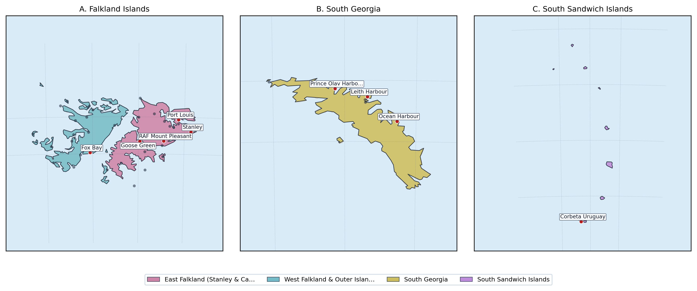
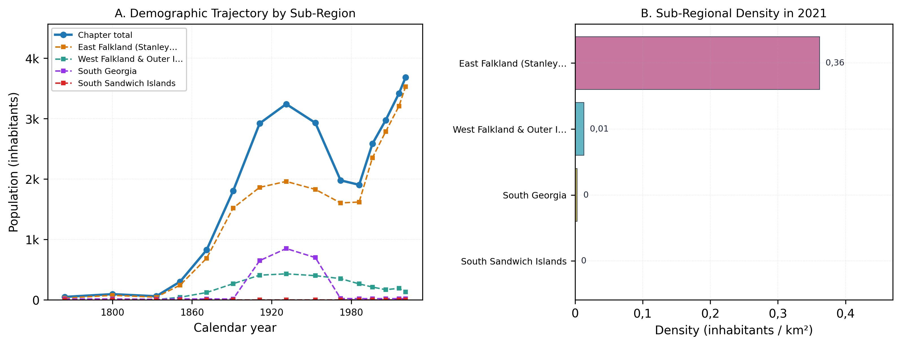
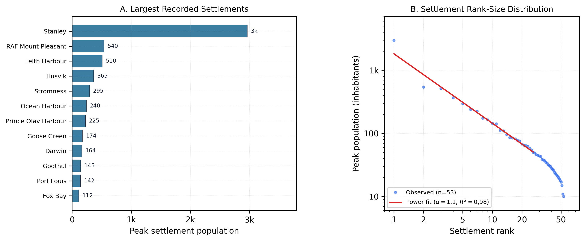

The Falklands and South Atlantic Islands
================
Aust Kätzchen
23 November 2026

- [Abstract](#abstract)
- [Background](#background)
  - [Pre-Settlement Baseline and Colonial Foundations, 1764 to
    1833](#pre-settlement-baseline-and-colonial-foundations-1764-to-1833)
  - [Vernet’s Colony, British Annexation and the Foundation of Stanley,
    1820 to
    1851](#vernets-colony-british-annexation-and-the-foundation-of-stanley-1820-to-1851)
  - [The Pastoral Camp Era and the Falkland Islands Company, 1851 to
    1980](#the-pastoral-camp-era-and-the-falkland-islands-company-1851-to-1980)
  - [South Georgia’s Whaling Boom and the South Sandwich Islands, 1882
    to
    2026](#south-georgias-whaling-boom-and-the-south-sandwich-islands-1882-to-2026)
  - [Conflict, Fisheries Governance and Multinational Renewal, 1982 to
    2026](#conflict-fisheries-governance-and-multinational-renewal-1982-to-2026)
- [Methodology](#methodology)
- [Testing and Validation](#testing-and-validation)
- [Results](#results)
  - [Long-Run Demographic Trajectory, 1764 to
    2026](#long-run-demographic-trajectory-1764-to-2026)
  - [Urban Concentration, Camp Depopulation and Rank-Size
    Structure](#urban-concentration-camp-depopulation-and-rank-size-structure)
- [Limitations](#limitations)
- [Conclusion](#conclusion)
- [Appendix](#appendix)
- [Sources](#sources)

<figure>

<figcaption aria-hidden="true">Geographical extent, sub-regional
boundaries and 53 catalogued settlements across the Falkland Islands,
South Georgia and the South Sandwich Islands, 1764 to 2026.</figcaption>
</figure>

# Abstract

Between the French landing at Port Louis in April 1764 and the 2021
Falkland Islands census, total human numbers across the Falkland
Islands, South Georgia and the South Sandwich Islands rose from 49
pioneers and itinerant sealers to 3.682 inhabitants, tracing two
distinct demographic regimes across 27.743,3 km² of maritime domain
[\[1\]](#ref-Pernety2013History)[\[2\]](#ref-Directorate2022Falkland)[\[3\]](#ref-Islands2020South).
Although isolated prehistoric charcoal, lithic points and canid remains
suggest ephemeral pre-European Fuegian or Yaghan visits, every early
navigator documented an uninhabited archipelago prior to the rival
establishments of Port Louis (1764), Port Egmont (1765) and Spanish
Puerto Soledad (1767)
[\[4\]](#ref-Aguado2014Francisco)[\[5\]](#ref-Taquini1982History)[\[6\]](#ref-Engel1990Falkland).
After Britain reasserted control in January 1833 and relocated the
administrative seat from Port Louis to Stanley in 1845, sheep ranching
under the Falkland Islands Company drove expansion across East and West
Falkland through 22 decennial and quinquennial censuses, lifting the
islands from 287 inhabitants in 1851 to an interwar agrarian peak of
2.392 in 1931
[\[7\]](#ref-Rodriguez2026Poblacion)[\[8\]](#ref-Berardi2023Negociaciones)[\[9\]](#ref-Unit2013Falkland).
Simultaneously, shore-based Norwegian and British industrial whaling
turned South Georgia from an empty glacial coast into a seasonal company
archipelago of 650 to 850 benchmark residents and up to 2.000 summer
workers across Grytviken, Leith Harbour, Husvik, Stromness, Ocean
Harbour, Prince Olav Harbour and Godthul before collapsing between 1962
and 1965 into a 20-person British Antarctic Survey scientific community
at King Edward Point and Bird Island
[\[10\]](#ref-Agnew2004Fishing)[\[11\]](#ref-Vogel1983Invertebrates)[\[12\]](#ref-Blair2019South).
In the Falkland Islands themselves, post-war wool mechanisation eroded
the rural Camp from more than 1.100 residents in 1931 to a modern trough
of 1.813 islanders in 1980, until the 1982 Falklands War, the
construction of RAF Mount Pleasant and the 1986 offshore
fisheries-licensing regime doubled territorial revenues and spurred
multinational immigration from the United Kingdom, Saint Helena, Chile
and the Philippines
[\[13\]](#ref-Bellot2021Keeping)[\[14\]](#ref-Fraga2017Oil)[\[15\]](#ref-Ruzza2011Falkland).
By 2021, the Falkland Islands reached 3.662 usually resident persons
(3.142 present on census night), concentrating 81,21% of residents in
Stanley and leaving Camp with 354 inhabitants, while South Georgia held
20 rotating scientists and administrators and the South Sandwich Islands
remained uninhabited
[\[2\]](#ref-Directorate2022Falkland)[\[3\]](#ref-Islands2020South).

# Background

## Pre-Settlement Baseline and Colonial Foundations, 1764 to 1833

The South Atlantic archipelagos lie near the edge of the Patagonian
continental shelf and the Scotia Arc, separated from South America by
roughly 480 km of cold sub-Antarctic water
[\[6\]](#ref-Engel1990Falkland)[\[16\]](#ref-Petrovic2022Argentinas).
Unlike Tierra del Fuego or the Patagonian channels, neither the Falkland
Islands nor South Georgia nor the South Sandwich Islands sustained an
indigenous population when European mariners charted them between the
late sixteenth and eighteenth centuries
[\[4\]](#ref-Aguado2014Francisco)[\[17\]](#ref-Arruda2015Colonial).

Palaeobotanical records of elevated fire frequency, occasional stone
projectile points and the biogeographical puzzle of the endemic Falkland
Islands wolf (*Dusicyon australis*) point to brief pre-Columbian
maritime crossings by Fuegian or Yaghan canoeists
[\[6\]](#ref-Engel1990Falkland)[\[18\]](#ref-Parish1833Account). Yet no
permanent village, shell-midden sequence or agricultural clearing
existed at European contact, a fact explicitly noted by
eighteenth-century navigators and contemporary commentators
[\[1\]](#ref-Pernety2013History)[\[4\]](#ref-Aguado2014Francisco).

Continuous demographic history began with European strategic competition
after the Seven Years’ War
[\[5\]](#ref-Taquini1982History)[\[17\]](#ref-Arruda2015Colonial). On 5
April 1764, Louis-Antoine de Bougainville disembarked 29 colonists from
Saint-Malo at Port Louis on Berkeley Sound, naming the archipelago the
*Îles Malouines* [\[1\]](#ref-Pernety2013History).

Less than a year later, in January 1765, Commodore John Byron claimed
Saunders Island in West Falkland and founded the British naval outpost
of Port Egmont, which soon housed around 110 sailors and marines
[\[5\]](#ref-Taquini1982History)[\[19\]](#ref-Barriera2023Malvinas).
Following Spanish diplomatic protests over French infringement of South
Atlantic treaty claims, Bougainville transferred Port Louis to Spain on
2 April 1767 against an indemnity of 603.000 *livres tournois*,
installing Felipe Ruiz Puente as governor of the renamed Puerto Soledad
[\[1\]](#ref-Pernety2013History)[\[4\]](#ref-Aguado2014Francisco).

Tensions over overlapping settlements flared in June 1770 when a Spanish
squadron from Buenos Aires expelled the Port Egmont garrison, nearly
precipitating war before Britain resumed possession in 1771 and then
voluntarily evacuated the West Falkland post in May 1774 for reasons of
naval economy
[\[5\]](#ref-Taquini1982History)[\[17\]](#ref-Arruda2015Colonial). When
Francisco Gil y Lemos governed Puerto Soledad in 1774, an administrative
inspection recorded 115 inhabitants, a total that fell to 84 by 1777 and
hovered around 75 to 142 soldiers, convicts, officials and priests
across the remainder of Spanish rule
[\[4\]](#ref-Aguado2014Francisco)[\[7\]](#ref-Rodriguez2026Poblacion).

Spain withdrew its garrison in February 1811 during the Peninsular War
and the Plate revolutionary crisis
[\[5\]](#ref-Taquini1982History)[\[19\]](#ref-Barriera2023Malvinas). For
the next decade East and West Falkland were frequented mainly by British
and North American sealers whose camps rarely exceeded five to fifteen
seasonal hands at any single benchmark
[\[7\]](#ref-Rodriguez2026Poblacion)[\[18\]](#ref-Parish1833Account).

## Vernet’s Colony, British Annexation and the Foundation of Stanley, 1820 to 1851

In November 1820, privateer captain David Jewett raised the flag of the
United Provinces of the Rio de la Plata at Port Louis, and between 1823
and 1831 Hamburg-born merchant Luis Vernet attempted to build a
self-sustaining pastoral and sealing colony on East Falkland
[\[7\]](#ref-Rodriguez2026Poblacion)[\[19\]](#ref-Barriera2023Malvinas).
Vernet imported *gaucho* herdsmen, British and German artisans and
enslaved and freed workers to manage feral cattle, growing the
settlement back above 100 residents before disputes over American
sealing schooners triggered the retaliatory raid of the USS *Lexington*
in December 1831
[\[5\]](#ref-Taquini1982History)[\[18\]](#ref-Parish1833Account).

An interim Argentine garrison under Esteban Mestivier arrived in October
1832 only to suffer a mutiny within weeks
[\[19\]](#ref-Barriera2023Malvinas)[\[20\]](#ref-Pezzano2022Una). On 3
January 1833, Captain John James Onslow aboard HMS *Clio* reasserted
British sovereignty at Port Louis
[\[16\]](#ref-Petrovic2022Argentinas)[\[21\]](#ref-Claude2021Efforts).

Detailed nominal rolls reconstructed from parish and naval archives show
75 persons at Port Louis on the eve of the handover, of whom 53 (17
soldiers, 10 military family members, 17 civilian labourers and 9
others) departed aboard the *Sarandí*, leaving 22 residents behind
[\[7\]](#ref-Rodriguez2026Poblacion). After the August 1833 *gaucho*
uprising led by Antonio Rivero briefly disrupted the settlement, British
naval lieutenants stabilised a tiny station of 36 inhabitants between
1837 and 1840
[\[7\]](#ref-Rodriguez2026Poblacion)[\[18\]](#ref-Parish1833Account).

During those transitional years, the tiny garrison relied on wild cattle
hunting, salted provisions and occasional calls from South Atlantic
whalers and sealing brigs
[\[17\]](#ref-Arruda2015Colonial)[\[18\]](#ref-Parish1833Account).
Formal Crown Colony status in 1841 initiated regular enumerations and
civilian land grants
[\[8\]](#ref-Berardi2023Negociaciones)[\[19\]](#ref-Barriera2023Malvinas).

Port Louis held 50 residents in January 1842 and 112 in March 1843
before Governor Richard Moody transferred the colonial seat in 1845 to
the deeper, sheltered anchorage of Stanley
[\[7\]](#ref-Rodriguez2026Poblacion)[\[9\]](#ref-Unit2013Falkland). That
administrative relocation anchored East Falkland’s urban growth, raising
the colony’s enumerated total to 287 residents by 1851
[\[2\]](#ref-Directorate2022Falkland)[\[8\]](#ref-Berardi2023Negociaciones).

## The Pastoral Camp Era and the Falkland Islands Company, 1851 to 1980

Demographic growth over the following eighty years rested on wool,
mutton and Cape Horn maritime ship-repair rather than arable farming
[\[8\]](#ref-Berardi2023Negociaciones)[\[22\]](#ref-Massolo1990Teenage).
Incorporated by Royal Charter on 10 January 1852, the Falkland Islands
Company acquired the Lafonia peninsula on East Falkland
[\[8\]](#ref-Berardi2023Negociaciones).

Within three decades the corporation held roughly 46% of colonial land
while supplying around 80% of non-government employment down to 1982
[\[8\]](#ref-Berardi2023Negociaciones)[\[14\]](#ref-Fraga2017Oil). Sheep
displaced feral cattle across the treeless maritime tundra known locally
as Camp, creating a dispersed archipelago of company-owned and
independent station settlements connected by coastal schooners and
bridle tracks
[\[6\]](#ref-Engel1990Falkland)[\[22\]](#ref-Massolo1990Teenage).

Darwin, founded in 1859, reached a peak of 164 residents by 1901
[\[23\]](#ref-Unit2017Falkland). Neighbouring Goose Green, established
in 1875 as the principal shearing and tallow hub of Lafonia, peaked at
174 inhabitants in 1931
[\[22\]](#ref-Massolo1990Teenage)[\[23\]](#ref-Unit2017Falkland).

Across Falkland Sound on West Falkland, permanent pastoral stations
expanded from the late 1860s onward
[\[6\]](#ref-Engel1990Falkland)[\[9\]](#ref-Unit2013Falkland). Fox Bay
(peaking at 112 residents in 1931) and Port Howard (peaking at 96 in
1931) anchored the southern and northern coasts
[\[22\]](#ref-Massolo1990Teenage)[\[23\]](#ref-Unit2017Falkland).

Around them, smaller stations including Chartres, Hill Cove and Roy Cove
sustained self-contained communities complete with bunkhouses,
cookhouses, smithies and wool sheds
[\[6\]](#ref-Engel1990Falkland)[\[22\]](#ref-Massolo1990Teenage).

Because Stanley served simultaneously as administrative capital, coaling
depot and Cape Horn repair harbour, the islands’ total population
expanded steadily through eight consecutive censuses from 287 in 1851 to
1.510 in 1881, 2.272 in 1911 and an interwar plateau of 2.392 in 1931
[\[2\]](#ref-Directorate2022Falkland)[\[9\]](#ref-Unit2013Falkland).
During the peak sailing-ship era from the 1860s to 1914, distressed
vessels rounding Cape Horn routinely put into Stanley for timber,
ironwork and provisions, generating a brisk waterfront trade in salvage,
victualling and maritime carpentry
[\[6\]](#ref-Engel1990Falkland)[\[8\]](#ref-Berardi2023Negociaciones).

Opening of the Panama Canal in 1914 curtailed Cape Horn repair traffic,
gradually shifting Stanley’s economic reliance back toward wool export
and South Atlantic government services
[\[8\]](#ref-Berardi2023Negociaciones)[\[12\]](#ref-Blair2019South). In
Camp, meanwhile, isolation was bridged by coastal steamers, travelling
schoolteachers and family networks linking small settlements on Pebble
Island, Weddell Island, Carcass Island and Keppel Island to East and
West Falkland
[\[6\]](#ref-Engel1990Falkland)[\[22\]](#ref-Massolo1990Teenage).

After 1931, agricultural modernisation and declining global wool prices
reversed rural growth
[\[22\]](#ref-Massolo1990Teenage)[\[23\]](#ref-Unit2017Falkland). Larger
paddocks, mechanised shearing and the 1960s and 1970s subdivision of
large corporate estates under the Shackleton recommendations reduced
seasonal labour requirements across Camp
[\[8\]](#ref-Berardi2023Negociaciones)[\[24\]](#ref-Laufer2022Malvinas).

While Stanley stayed roughly stationary around 1.050 to 1.150 residents,
rural settlements drained steadily through out-migration to the capital,
Britain and New Zealand
[\[13\]](#ref-Bellot2021Keeping)[\[22\]](#ref-Massolo1990Teenage). Total
archipelago population consequently declined at every post-war census
from 2.239 in 1946 to 2.172 in 1962, 1.957 in 1972 and a
twentieth-century low of 1.813 in 1980
[\[2\]](#ref-Directorate2022Falkland)[\[9\]](#ref-Unit2013Falkland).

Throughout this pastoral century, household structure remained sharply
skewed toward working-age males on outlying farms, whereas Stanley
sustained a more balanced family demography centred on government
offices, shops and harbour trades
[\[9\]](#ref-Unit2013Falkland)[\[22\]](#ref-Massolo1990Teenage). Even
during the darkest years of wool contraction, small outer islands such
as Bleaker Island, Sea Lion Island and Saunders Island maintained
permanent ranching families whose registers preserve continuous
generational links back to nineteenth-century Scottish, English and
Scandinavian settlers
[\[22\]](#ref-Massolo1990Teenage)[\[23\]](#ref-Unit2017Falkland).

## South Georgia’s Whaling Boom and the South Sandwich Islands, 1882 to 2026

Eight hundred nautical miles southeast of Stanley, South Georgia
experienced an altogether sharper demographic cycle driven first by
polar science and then by industrial pelagic extraction
[\[3\]](#ref-Islands2020South)[\[25\]](#ref-Ludecke2022140). Following
James Cook’s 1775 charting, nineteenth-century sealers periodically
stripped elephant seal and fur seal beaches, leaving temporary try-works
along exposed bays
[\[10\]](#ref-Agnew2004Fishing)[\[17\]](#ref-Arruda2015Colonial).

The first documented shore station with fixed buildings was the German
First International Polar Year expedition at Moltke Harbour on Royal Bay
[\[25\]](#ref-Ludecke2022140). There 11 scientists and technicians
wintered from August 1882 to September 1883 to observe the December 1882
transit of Venus, erecting observatories later visited by Otto
Nordenskjöld in 1902 and Wilhelm Filchner in 1911
[\[25\]](#ref-Ludecke2022140).

Modern industrial settlement erupted in December 1904 when Norwegian
whaler Carl Anton Larsen opened Grytviken under the *Compañía Argentina
de Pesca* with British colonial leases
[\[3\]](#ref-Islands2020South)[\[11\]](#ref-Vogel1983Invertebrates).
Within eight years, British and Norwegian companies built six more
coastal factories along the sheltered northeast fjords: Husvik and
Stromness in 1907, Godthul in 1908, Leith Harbour and Ocean Harbour in
1909 and Prince Olav Harbour in 1911
[\[3\]](#ref-Islands2020South)[\[10\]](#ref-Agnew2004Fishing).

Each austral summer, factory ships and catchers brought 1.000 to 2.000
Norwegian, British and South American flensers, boiler hands and riggers
to the shore stations
[\[3\]](#ref-Islands2020South)[\[11\]](#ref-Vogel1983Invertebrates).
Meanwhile 200 to 400 maintenance caretakers and British magistrates at
King Edward Point (established 1909, 0,91 km from Grytviken) remained
through the austral winter
[\[3\]](#ref-Islands2020South)[\[12\]](#ref-Blair2019South).

At individual peaks between the 1910s and 1930s, Leith Harbour alone
accommodated 510 workers, Husvik 365, Stromness 295, Ocean Harbour 240,
Prince Olav Harbour 225 and Godthul 145
[\[3\]](#ref-Islands2020South)[\[10\]](#ref-Agnew2004Fishing). Each
harbour formed a self-contained industrial village equipped with
slipways, steam cookers, workshops, cinema halls, hospitals and small
cemeteries adapted to sub-Antarctic gales
[\[3\]](#ref-Islands2020South)[\[11\]](#ref-Vogel1983Invertebrates).

Whale stock depletion and the shift to pelagic factory fleets ended
shore processing abruptly in the early 1960s
[\[10\]](#ref-Agnew2004Fishing)[\[11\]](#ref-Vogel1983Invertebrates).
Grytviken and Leith Harbour closed their last flensing plans between
1964 and 1965, leaving South Georgia virtually empty save for the
British Antarctic Survey station at Bird Island (established 1957, up to
10 biologists)
[\[3\]](#ref-Islands2020South)[\[11\]](#ref-Vogel1983Invertebrates).

Following the brief 1982 military confrontation, King Edward Point
reopened under a civil-scientific model managed jointly with the
Government of South Georgia and the South Sandwich Islands
[\[12\]](#ref-Blair2019South)[\[26\]](#ref-Tato2023Falklands). Under
this regime, South Georgia’s population stabilised at roughly 20 summer
and 8 to 12 winter personnel focused on fisheries monitoring, seabird
research and invasive-rodent eradication
[\[3\]](#ref-Islands2020South)[\[10\]](#ref-Agnew2004Fishing).

Farther east across the volcanic Scotia Arc, the South Sandwich Islands
remained wholly uninhabited throughout recorded history because of
extreme glaciation, active volcanism and lack of safe anchorages
[\[3\]](#ref-Islands2020South)[\[16\]](#ref-Petrovic2022Argentinas). The
sole human occupation occurred between November 1976 and June 1982, when
Argentina maintained the Corbeta Uruguay scientific and naval base on
Thule Island with up to 50 personnel prior to British removal at the
close of the 1982 conflict
[\[26\]](#ref-Tato2023Falklands)[\[27\]](#ref-Palermo2010Causa).

## Conflict, Fisheries Governance and Multinational Renewal, 1982 to 2026

The 74-day Falklands War between 2 April and 14 June 1982 claimed 649 or
650 Argentine, 255 British and 3 Falkland Islander civilian lives and
permanently altered South Atlantic demography
[\[13\]](#ref-Bellot2021Keeping)[\[26\]](#ref-Tato2023Falklands)[\[28\]](#ref-Guber2012Nacionalismo).
During the hostilities, rural residents at Goose Green and Fox Bay East
experienced temporary confinement while Stanley absorbed civilian
evacuees from exposed Camp farms, leaving enduring social memories
recorded in oral histories
[\[13\]](#ref-Bellot2021Keeping)[\[22\]](#ref-Massolo1990Teenage).

Post-war Argentine historiography and political debate framed the
conflict around national sovereignty and veteran memory, whereas British
policy pivoted toward permanent strategic deterrence and economic
diversification
[\[24\]](#ref-Laufer2022Malvinas)[\[27\]](#ref-Palermo2010Causa)[\[28\]](#ref-Guber2012Nacionalismo).
Diplomatic stances hardened across bilateral channels even as maritime
scientific and fisheries governance grew increasingly institutionalised
[\[20\]](#ref-Pezzano2022Una)[\[21\]](#ref-Claude2021Efforts).

Immediately after the war, Britain replaced the vulnerable Stanley
airstrip with the tri-service complex at RAF Mount Pleasant, opened in
1985 [\[12\]](#ref-Blair2019South)[\[27\]](#ref-Palermo2010Causa). Its
civilian contractor workforce alone numbered 540 in 1986 and was
formally integrated into the Falkland Islands census from 1996 onwards
alongside 324 to 483 civilian staff
[\[2\]](#ref-Directorate2022Falkland)[\[23\]](#ref-Unit2017Falkland).

At the same time, the declaration of the Falkland Islands Interim
Conservation and Management Zone in October 1986 (operational February
1987) allowed Stanley to sell pelagic *Illex* and *Loligo* squid and
finfish licences
[\[10\]](#ref-Agnew2004Fishing)[\[15\]](#ref-Ruzza2011Falkland).
Licensing proceeds tripled government revenues within a decade and
financed paved roads, broadband telecommunications, a modern hospital
and a secondary school
[\[14\]](#ref-Fraga2017Oil)[\[15\]](#ref-Ruzza2011Falkland).

Economic expansion transformed a stagnant pastoral colony into a
high-employment maritime service economy with an 89% labour-force
participation rate and under 1% unemployment
[\[2\]](#ref-Directorate2022Falkland)[\[14\]](#ref-Fraga2017Oil).
Because natural increase in the islands was negligible - yielding 110
births against 111 deaths between 2017 and 2021 - net inward migration
accounted for roughly three-quarters of post-1986 growth
[\[2\]](#ref-Directorate2022Falkland)[\[23\]](#ref-Unit2017Falkland).

Between 1986 and 2021, the Falkland Islands’ usually resident population
climbed from 1.916 to 3.662 (3.142 present on census night), drawing
contract workers and permanent settlers from 71 countries and
territories
[\[2\]](#ref-Directorate2022Falkland)[\[9\]](#ref-Unit2013Falkland).
Unresolved sovereignty diplomacy in the United Nations Committee of 24
and intermittent offshore hydrocarbon exploration around the North
Falkland Basin continued to shape strategic planning in Stanley into the
2020s
[\[14\]](#ref-Fraga2017Oil)[\[20\]](#ref-Pezzano2022Una)[\[21\]](#ref-Claude2021Efforts).

# Methodology

Demographic reconstruction for the Falkland Islands, South Georgia and
the South Sandwich Islands pairs continuous statutory census
enumerations with historical station rosters across four canonical
territorial domains
[\[2\]](#ref-Directorate2022Falkland)[\[3\]](#ref-Islands2020South).
First, the vector spatial hierarchy partitions the study region into
East Falkland (9.768,1 km²), West Falkland and Outer Islands (10.097,5
km²), South Georgia (6.149,0 km²) and the South Sandwich Islands
(1.728,7 km²), summing to 27.743,3 km² across polygons that envelope
deeply indented sea lochs, coastal islands and littoral fishing grounds
[\[3\]](#ref-Islands2020South)[\[23\]](#ref-Unit2017Falkland).

Terrestrial land surface is substantially smaller than the coastal
polygon footprint: roughly 12.200 km² across the Falkland Islands (6.610
km² on East Falkland and 4.530 km² on West Falkland) plus roughly 3.903
km² on South Georgia and 310 km² on the South Sandwich chain
[\[6\]](#ref-Engel1990Falkland)[\[16\]](#ref-Petrovic2022Argentinas).
Gridded and vector polygon densities are therefore reported explicitly
against the 27.743,3 km² vector total and the 25.286 km² gridded mask of
535 five-arcminute pixels
[\[3\]](#ref-Islands2020South)[\[23\]](#ref-Unit2017Falkland).

Second, historical population counts are harmonised across two distinct
enumeration conventions used by colonial and modern statisticians
[\[2\]](#ref-Directorate2022Falkland)[\[9\]](#ref-Unit2013Falkland). The
historical statutory series tracks usually resident population present
on census night (*de jure* present across 22 official censuses from 1851
to 2021), whereas recent censuses also publish total usually resident
population including temporarily absent islanders and RAF Mount Pleasant
civilian personnel
[\[2\]](#ref-Directorate2022Falkland)[\[23\]](#ref-Unit2017Falkland).

Before 1851, demographic anchors derive from archival colonial musters
at Port Louis, Port Egmont and Puerto Soledad
[\[1\]](#ref-Pernety2013History)[\[4\]](#ref-Aguado2014Francisco). Key
primary benchmarks include Bougainville’s 1764 landing roll of 29
settlers, Gil y Lemos’s 1774 inspection of 115 residents, Vernet’s 1826
to 1831 estate accounts and the January 1833 *HMS Clio* expulsion lists
that reduced Port Louis from 75 to 22 inhabitants
[\[4\]](#ref-Aguado2014Francisco)[\[7\]](#ref-Rodriguez2026Poblacion)[\[18\]](#ref-Parish1833Account).

Third, South Georgia’s demographic curve bridges annual summer-winter
seasonality by tracking the resident overwintering and weighted seasonal
benchmark across seven whaling stations (1904 to 1965)
[\[10\]](#ref-Agnew2004Fishing)[\[11\]](#ref-Vogel1983Invertebrates).
For the post-1965 period, benchmark totals join that whaling curve to
the British Antarctic Survey scientific complement at King Edward Point
and Bird Island, explicitly separating the 1911 to 1953 industrial era
(650 to 850 residents) from the modern scientific baseline (20 to 22
residents)
[\[3\]](#ref-Islands2020South)[\[12\]](#ref-Blair2019South)[\[25\]](#ref-Ludecke2022140).

Fourth, spatial allocation distributes benchmark totals across a 53-site
historical settlement gazetteer assembled through four ingestion waves
and two exhausted source corpora
[\[3\]](#ref-Islands2020South)[\[23\]](#ref-Unit2017Falkland). Where an
early maritime domain holds zero permanent towns but hosts transient
sealing crews (West Falkland in 1764 to 1833 and South Georgia in 1764
to 1881), the regional summary applies conservative minimal continuity
floors of 5 to 15 persons while retaining the unadjusted settlement sum
alongside it
[\[4\]](#ref-Aguado2014Francisco)[\[18\]](#ref-Parish1833Account).

Fifth, rank-size calibration fits an ordinary-least-squares log-linear
slope across all 53 peak settlement populations ordered from Stanley
down to Bird Island
[\[2\]](#ref-Directorate2022Falkland)[\[3\]](#ref-Islands2020South).
Measuring settlement primacy across both pastoral Camp homesteads and
seasonal whaling harbours clarifies how two vastly different South
Atlantic resource regimes nonetheless generated an integrated
hierarchical gradient
[\[10\]](#ref-Agnew2004Fishing)[\[22\]](#ref-Massolo1990Teenage).

# Testing and Validation

Internal consistency checks cross-examine the regional model against
independent archival rolls, census tables and gazetteer saturation logs
[\[2\]](#ref-Directorate2022Falkland)[\[7\]](#ref-Rodriguez2026Poblacion).
For the pre-census century (1764 to 1851), uncertainty intervals in the
regional series span roughly 17% to 18% around each benchmark to reflect
unrecorded sealing gangs and transient garrison rotations, tightening to
6% from 1851 to 1931 and 2,5% from 1953 to 2021 once statutory
enumerations and Mount Pleasant civilian manifests stabilised
[\[7\]](#ref-Rodriguez2026Poblacion)[\[9\]](#ref-Unit2013Falkland).

Across the Falkland Islands themselves, the 1851 benchmark (287
inhabitants across East and West Falkland in the spatial domain) matches
the official 1851 census figure precisely
[\[2\]](#ref-Directorate2022Falkland). Likewise, the 1891 (1.789), 1911
(2.272), 1931 (2.392) and 1953 (2.230) sub-regional sums of East plus
West Falkland match the statutory censuses to the exact person
[\[9\]](#ref-Unit2013Falkland)[\[23\]](#ref-Unit2017Falkland).

Small definitional divergences after 1972 are transparent and
quantifiable
[\[2\]](#ref-Directorate2022Falkland)[\[23\]](#ref-Unit2017Falkland). In
1972, the Falkland Islands regional sum (1.957) equals the official
census; in 1986, the spatial domain sum (1.885) mirrors the *de jure*
census table excluding transient military personnel; in 1996 (2.564),
2006 (2.955) and 2016 (3.398), the spatial sums track either the
census-night usually resident series or the full usually resident series
including temporarily absent islanders
[\[2\]](#ref-Directorate2022Falkland)[\[23\]](#ref-Unit2017Falkland).

At the 2021 benchmark, the spatial model sums East Falkland (3.531) and
West Falkland (131) to 3.662 - matching the 2021 census report’s
headline usually resident population including 520 temporarily absent
persons - plus 20 personnel on South Georgia for a grand regional total
of 3.682
[\[2\]](#ref-Directorate2022Falkland)[\[3\]](#ref-Islands2020South).

Gazetteer completeness was tested across 55 candidate sites drawn from
the 1851 to 2021 Falkland Islands Government census series (45 candidate
sites) and South Georgia Heritage Trust and British Antarctic Survey
station logs (10 candidate sites)
[\[3\]](#ref-Islands2020South)[\[23\]](#ref-Unit2017Falkland). Two
duplicate proximity aliases - Grytviken (0,91 km from King Edward Point)
and Port San Carlos (1,16 km from San Carlos) - were merged into their
primary stations, yielding 53 retained settlements across four
subregions with zero crowd-sourced additions and a fourth-wave marginal
saturation gain of 1,92%
[\[3\]](#ref-Islands2020South)[\[7\]](#ref-Rodriguez2026Poblacion).

In the historical benchmark series below, early nineteenth-century gaps
between official counts and regional totals stem from transient sealing
camps on outer islands
[\[7\]](#ref-Rodriguez2026Poblacion)[\[18\]](#ref-Parish1833Account). By
contrast, every post-1851 census benchmark ties directly to statutory
Falkland Islands returns paired with South Georgia station rosters
[\[2\]](#ref-Directorate2022Falkland)[\[3\]](#ref-Islands2020South).

| Year | East Falkland | West Falkland | South Georgia | Regional Total | Official FI Census |
|:---|:---|:---|:---|:---|:---|
| **1764** | 29 | 5 | 15 | 49 | \- |
| **1774** | 115 | \- | \- | \- | \- |
| **1800** | 75 | 5 | 15 | 95 | \- |
| **1833** | 45 | 5 | 10 | 60 | 22 |
| **1851** | 244 | 43 | 15 | 302 | 287 |
| **1861** | \- | \- | \- | \- | 541 |
| **1871** | 689 | 122 | 15 | 826 | 811 |
| **1881** | \- | \- | \- | \- | 1.510 |
| **1891** | 1.521 | 268 | 15 | 1.804 | 1.789 |
| **1901** | \- | \- | \- | \- | 2.043 |
| **1911** | 1.863 | 409 | 650 | 2.922 | 2.272 |
| **1921** | \- | \- | \- | \- | 2.094 |
| **1931** | 1.961 | 431 | 850 | 3.242 | 2.392 |
| **1946** | \- | \- | \- | \- | 2.239 |
| **1953** | 1.829 | 401 | 700 | 2.930 | 2.230 |
| **1962** | \- | \- | \- | \- | 2.172 |
| **1972** | 1.605 | 352 | 22 | 1.979 | 1.957 |
| **1980** | \- | \- | \- | \- | 1.813 |
| **1986** | 1.620 | 265 | 20 | 1.905 | 1.885 |
| **1991** | \- | \- | \- | \- | 2.050 |
| **1996** | 2.352 | 212 | 20 | 2.584 | 2.564 |
| **2001** | \- | \- | \- | \- | 2.913 |
| **2006** | 2.786 | 169 | 20 | 2.975 | 2.955 |
| **2012** | \- | \- | \- | \- | 2.840 |
| **2016** | 3.207 | 191 | 20 | 3.418 | 3.200 |
| **2021** | 3.531 | 131 | 20 | 3.682 | 3.142 |

Historical regional population benchmarks and official Falkland Islands
censuses, 1764 to 2021 (official census column shows de jure present
residents; 2021 total usually resident including absent equals 3.662).

# Results

## Long-Run Demographic Trajectory, 1764 to 2026

Across the 262-year span from Bougainville’s landing to 2026, total
population in the study region moved through four sharp structural
phases visible in the regional trajectory
[\[1\]](#ref-Pernety2013History)[\[2\]](#ref-Directorate2022Falkland)[\[3\]](#ref-Islands2020South).
First, the strategic colonial phase (1764 to 1840) never lifted
permanent numbers much above 142 inhabitants at Port Louis or Puerto
Soledad, fluctuating between 49 and 95 persons across the benchmark
table as naval garrisons arrived and departed
[\[4\]](#ref-Aguado2014Francisco)[\[5\]](#ref-Taquini1982History).

Second, pastoral settlement and sheep farming (1851 to 1931) generated
rapid geometric expansion
[\[8\]](#ref-Berardi2023Negociaciones)[\[22\]](#ref-Massolo1990Teenage).
Regional numbers multiplied nearly tenfold from 302 in 1851 to 2.922 in
1911 and reached a first peak of 3.242 in 1931, propelled jointly by
Camp homesteads in the Falklands and industrial shore whaling on South
Georgia [\[9\]](#ref-Unit2013Falkland)[\[10\]](#ref-Agnew2004Fishing).

Third, mid-century contraction (1931 to 1986) cut total population
across both archipelagos by 41,24% to 1.905
[\[2\]](#ref-Directorate2022Falkland)[\[10\]](#ref-Agnew2004Fishing). On
South Georgia, the 1962 to 1965 termination of shore whaling erased more
than 800 seasonal and winter jobs at a stroke, collapsing the island’s
benchmark from 850 in 1931 and 700 in 1953 to 22 in 1972
[\[3\]](#ref-Islands2020South)[\[11\]](#ref-Vogel1983Invertebrates).

Simultaneously, wool-estate consolidation in the Falkland Islands
reduced Camp residents and lowered East plus West Falkland from 2.392 in
1931 to 1.813 in 1980
[\[9\]](#ref-Unit2013Falkland)[\[22\]](#ref-Massolo1990Teenage). Fourth,
post-conflict reconstruction and fisheries licensing (1986 to 2021)
reversed five decades of stagnation, lifting the regional total by
93,28% from 1.905 in 1986 to 3.682 in 2021
[\[2\]](#ref-Directorate2022Falkland)[\[14\]](#ref-Fraga2017Oil)[\[15\]](#ref-Ruzza2011Falkland).

## Urban Concentration, Camp Depopulation and Rank-Size Structure

Spatial redistribution after 1980 proved even more dramatic than
aggregate population growth
[\[2\]](#ref-Directorate2022Falkland)[\[23\]](#ref-Unit2017Falkland).
Stanley expanded from roughly 1.050 inhabitants in 1980 to 2.460 in 2016
and 2.974 usually resident persons (2.538 present on census night) by
2021, raising its share of total Falkland Islands residents to 81,21%
[\[2\]](#ref-Directorate2022Falkland)[\[23\]](#ref-Unit2017Falkland).

Together with the 334 civilian contractors and family members enumerated
at RAF Mount Pleasant (324 present on census night), East Falkland’s
urban-military corridor held 3.308 of the archipelago’s 3.662 usually
resident inhabitants
[\[2\]](#ref-Directorate2022Falkland)[\[12\]](#ref-Blair2019South). That
concentration left West Falkland with just 131 residents (95 present on
census night) and East Falkland Camp with 181 (149 present),
accelerating the divergence between urban service growth and
outer-island pastoral contraction
[\[22\]](#ref-Massolo1990Teenage)[\[23\]](#ref-Unit2017Falkland).

Demographic ageing now separates town and countryside starkly
[\[2\]](#ref-Directorate2022Falkland)[\[22\]](#ref-Massolo1990Teenage).
In the 2021 census, East Falkland Camp recorded a mean age of 49,4 years
and West Falkland 45,7 years, compared with 39,1 years in Stanley and
35,3 years at Mount Pleasant, while the overall island sex ratio stood
at 110 males per 100 females (1.645 males to 1.497 females present)
[\[2\]](#ref-Directorate2022Falkland).

Meanwhile, immigration transformed Stanley into a cosmopolitan South
Atlantic port
[\[14\]](#ref-Fraga2017Oil)[\[23\]](#ref-Unit2017Falkland). Among
residents stating a birthplace in 2021, 1.530 (44,6%) were born in the
Falkland Islands and 1.898 overseas across 71 territories, including 749
from the United Kingdom (21,8%), 369 from Saint Helena (10,8%), 178 from
the Philippines (up sharply from 22 in 2012 and 63 in 2016) and 168 from
Chile
[\[2\]](#ref-Directorate2022Falkland)[\[9\]](#ref-Unit2013Falkland).

Employment reflected the same structural shift away from sheep
[\[15\]](#ref-Ruzza2011Falkland)[\[23\]](#ref-Unit2017Falkland). Public
Service accounted for 665 workers (32,8%), Construction 217 (10,7%) and
Wholesale and Retail 193 (9,5%), pushing Agriculture down to 204 workers
(10,1%) alongside Fishing (82 workers, 4,0%) and Tourism (69 workers,
3,4%) [\[2\]](#ref-Directorate2022Falkland)[\[14\]](#ref-Fraga2017Oil).

Across all 53 catalogued settlements, peak historical headcounts obey a
steep power-law rank-size curve ($\alpha = 1,1$, $R^2 = 0,98$), governed
by extreme maritime primacy
[\[3\]](#ref-Islands2020South)[\[23\]](#ref-Unit2017Falkland). Stanley
leads at a 2021 peak of 2.964 (or 2.974 including all Camp fringes in
the census location table), more than five times larger than
second-ranked RAF Mount Pleasant (peaking at 540 civilian contractors in
1986) and third-ranked Leith Harbour on South Georgia (peaking at 510
whalers in 1937)
[\[2\]](#ref-Directorate2022Falkland)[\[3\]](#ref-Islands2020South).

Beneath these three nodes sit South Georgia’s former whaling stations:
Husvik (365), Stromness (295), Ocean Harbour (240), Prince Olav Harbour
(225) and Godthul (145)
[\[10\]](#ref-Agnew2004Fishing)[\[11\]](#ref-Vogel1983Invertebrates).
Together, those abandoned fjord settlements demonstrate how
twentieth-century industrial resource extraction erected temporary towns
larger than any Falkland Camp estate
[\[3\]](#ref-Islands2020South)[\[12\]](#ref-Blair2019South).

Below them follow the historic East and West Falkland ranching centres
of Goose Green (174), Darwin (164), Port Louis (142), Fox Bay (112),
Port Egmont (110) and Port Howard (96)
[\[7\]](#ref-Rodriguez2026Poblacion)[\[23\]](#ref-Unit2017Falkland).
From these secondary hubs the hierarchy tapers smoothly down through
mid-sized farms such as Hill Cove, Chartres, San Carlos and Port
Stephens to a median settlement peak of 49 at Teal Inlet and 10
biologists at Bird Island
[\[3\]](#ref-Islands2020South)[\[22\]](#ref-Massolo1990Teenage).

Sub-regional arithmetic densities in 2021 highlight the extreme
geographic concentration of South Atlantic habitation
[\[2\]](#ref-Directorate2022Falkland)[\[16\]](#ref-Petrovic2022Argentinas).
East Falkland registers 0,36 inhabitants per km² across its 9.768,1 km²
spatial domain, whereas West Falkland and Outer Islands fall to 0,01
inhabitants per km² across 10.097,5 km² and both South Georgia and the
South Sandwich Islands round to zero at regional scale despite
continuous research staffing at King Edward Point and Bird Island
[\[3\]](#ref-Islands2020South)[\[23\]](#ref-Unit2017Falkland).

| Subregion | Area (km²) | 1764 | 1851 | 1931 | 1986 | 2021 | 2021 inh./km² |
|:---|:---|:---|:---|:---|:---|:---|:---|
| **East Falkland (Stanley and Camp)** | 9.768,1 | 29 | 244 | 1.961 | 1.620 | 3.531 | 0,36 |
| **West Falkland and Outer Islands** | 10.097,5 | 5 | 43 | 431 | 265 | 131 | 0,01 |
| **South Georgia** | 6.149 | 15 | 15 | 850 | 20 | 20 | 0 |
| **South Sandwich Islands** | 1.728,7 | 0 | 0 | 0 | 0 | 0 | 0 |
| **Regional Total** | 27.743,3 | 49 | 302 | 3.242 | 1.905 | 3.682 | 0,13 |

Sub-regional spatial domain areas, benchmark populations and 2021
density (inhabitants per km²).

# Limitations

Five methodological constraints govern interpretation of this dataset
[\[2\]](#ref-Directorate2022Falkland)[\[3\]](#ref-Islands2020South).
First, official Falkland Islands censuses since 1986 exclude serving
British military personnel stationed at RAF Mount Pleasant and Mare
Harbour, enumerating only civilian contractors and military dependants
residing off base or in civilian quarters
[\[12\]](#ref-Blair2019South)[\[23\]](#ref-Unit2017Falkland).

Including the rotating garrison would add roughly 1.000 to 1.500
uniformed personnel to East Falkland’s functional population after 1985,
as well as several hundred aboard visiting naval patrol vessels
[\[13\]](#ref-Bellot2021Keeping)[\[26\]](#ref-Tato2023Falklands).
Second, the 2021 census took place on 10 October 2021 during COVID-19
travel restrictions, producing a sharp gap between persons physically
present (3.142 usually resident present; 3.541 *de facto* including
contractors and visitors) and the 3.662 total usually resident
population that counted 520 temporarily absent residents
[\[2\]](#ref-Directorate2022Falkland).

Third, South Georgia’s historical whaling population fluctuated wildly
between austral summer and winter
[\[3\]](#ref-Islands2020South)[\[10\]](#ref-Agnew2004Fishing). Annual
benchmark figures of 650 (1911), 850 (1931) and 700 (1953) represent
weighted year-round station equivalents rather than peak January
complements of 1.500 to 2.000 shore and floating-factory workers or
mid-winter troughs of 200 to 300 caretakers
[\[3\]](#ref-Islands2020South)[\[11\]](#ref-Vogel1983Invertebrates).

Fourth, spatial polygons enveloping coastal inlets yield a domain
surface of 27.743,3 km² (25.286 km² in the gridded pixel mask) rather
than the strict terrestrial land area of roughly 16.400 km² across both
archipelagos, slightly depressing computed arithmetic densities
[\[6\]](#ref-Engel1990Falkland)[\[16\]](#ref-Petrovic2022Argentinas).
Fifth, pre-1833 headcounts rest on asymmetric Spanish, French, American
and British logbooks that omit uncounted sealing landings on outer
tussock islands
[\[4\]](#ref-Aguado2014Francisco)[\[7\]](#ref-Rodriguez2026Poblacion)[\[18\]](#ref-Parish1833Account).

Finally, archival toponymy across East and West Falkland reflects
bilingual Spanish, French and British settlement histories in which
stations changed names or shifted sites by a kilometre or two across
adjacent coves
[\[5\]](#ref-Taquini1982History)[\[19\]](#ref-Barriera2023Malvinas).
Gazetteer reconciliation resolves those proximity overlaps consistently
so long-run regional time series avoid double-counting
[\[7\]](#ref-Rodriguez2026Poblacion)[\[23\]](#ref-Unit2017Falkland).

# Conclusion

Two and a half centuries of demographic change in the Falkland Islands,
South Georgia and the South Sandwich Islands demonstrate how small
maritime populations respond rapidly to transport technology, resource
extraction and geopolitical investment
[\[8\]](#ref-Berardi2023Negociaciones)[\[12\]](#ref-Blair2019South)[\[14\]](#ref-Fraga2017Oil).
Across 27.743,3 km² of sub-Antarctic coastline, human settlement evolved
from ephemeral pre-European traces and tiny eighteenth-century colonial
outposts into two contrasting twentieth-century models: an enduring
pastoral-turned-service settler society in the Falkland Islands and a
boom-and-bust industrial whaling enclave on South Georgia
[\[4\]](#ref-Aguado2014Francisco)[\[10\]](#ref-Agnew2004Fishing)[\[22\]](#ref-Massolo1990Teenage).

Whereas South Georgia’s seven whaling stations collapsed entirely after
1965 into a 20-person scientific presence, Stanley leveraged post-1982
infrastructure and the 1986 fisheries-licensing regime to absorb
international labour from Britain, Saint Helena, Chile and Southeast
Asia
[\[3\]](#ref-Islands2020South)[\[15\]](#ref-Ruzza2011Falkland)[\[23\]](#ref-Unit2017Falkland).
Regional population accordingly reached an all-time high of 3.682
inhabitants by 2021 even as rural Camp aged and emptied
[\[2\]](#ref-Directorate2022Falkland)[\[9\]](#ref-Unit2013Falkland).

Future demographic trajectories across both archipelagos depend on
offshore hydrocarbon development, marine conservation agreements and
bilateral South Atlantic diplomacy
[\[14\]](#ref-Fraga2017Oil)[\[20\]](#ref-Pezzano2022Una)[\[21\]](#ref-Claude2021Efforts).
Together, the 22 Falklands censuses and 53 catalogued settlements
establish an unbroken documentary arc from Bougainville’s 29 pioneers in
1764 to the 3.682 inhabitants of the modern South Atlantic territories
[\[1\]](#ref-Pernety2013History)[\[2\]](#ref-Directorate2022Falkland).

# Appendix

The three supplementary tables below document the contemporary origin
diversity of Falkland Islands residents from 2012 to 2021, the
industrial employment profile recorded in 2021 and the chronological
lifespan of major expeditions, shore whaling stations and scientific
outposts across South Georgia and the South Sandwich Islands
[\[2\]](#ref-Directorate2022Falkland)[\[3\]](#ref-Islands2020South)[\[23\]](#ref-Unit2017Falkland).

| Birthplace           | 2012  | 2016  | 2021  | 2021 Share |
|:---------------------|:------|:------|:------|:-----------|
| **Falkland Islands** | 1.339 | 1.418 | 1.530 | 44,6%      |
| **United Kingdom**   | 796   | 782   | 749   | 21,8%      |
| **Saint Helena**     | 285   | 332   | 369   | 10,8%      |
| **Philippines**      | 22    | 63    | 178   | 5,2%       |
| **Chile**            | 163   | 199   | 168   | 4,9%       |
| **Other countries**  | 235   | 406   | 434   | 12,7%      |
| **Total stated**     | 2.840 | 3.200 | 3.428 | 100%       |

Falkland Islands population by country or territory of birth across the
2012, 2016 and 2021 censuses (2021 excludes 234 persons with birthplace
not stated).

| Economic Sector          | Workers (2021) | Share |
|:-------------------------|:---------------|:------|
| **Public Service**       | 665            | 32,8% |
| **Construction**         | 217            | 10,7% |
| **Agriculture**          | 204            | 10,1% |
| **Wholesale and Retail** | 193            | 9,5%  |
| **Fishing**              | 82             | 4%    |
| **Tourism**              | 69             | 3,4%  |
| **Other Sectors**        | 596            | 29,4% |

Falkland Islands primary employment structure in the 2021 census (2.026
employed residents).

| Station | Founded | Closure or Status | Peak Pop. | Peak Year |
|:---|:---|:---|:---|:---|
| **Moltke Harbour (IPY)** | 1882 | 1883 (IPY) | 11 | 1883 |
| **Grytviken and King Edward Point** | 1904 | 1964; Active BAS | 30 (KEP) | 1930 |
| **Husvik** | 1907 | 1960 | 365 | 1937 |
| **Stromness** | 1907 | 1931; Repair 1961 | 295 | 1930 |
| **Godthul** | 1908 | 1929 | 145 | 1917 |
| **Leith Harbour** | 1909 | 1965 | 510 | 1937 |
| **Ocean Harbour** | 1909 | 1920 | 240 | 1914 |
| **Prince Olav Harbour** | 1911 | 1931 | 225 | 1920 |
| **Bird Island** | 1957 | Active BAS | 10 | 2010 |
| **Corbeta Uruguay (SSI)** | 1976 | 1982 (Removed) | 50 | 1982 |

Principal historical expeditions, whaling stations and scientific bases
on South Georgia and the South Sandwich Islands, 1882 to 2026.

# Sources

1.
Pernety, Antoine-Joseph.
*The History of a Voyage to the Malouine (or
Falkland) Islands*. Cambridge University Press, 2013,
<https://doi.org/10.1017/cbo9781139896641>.

2.
Falkland Islands Policy and
Economic Development Directorate. *Falkland Islands Census Report 2021*.
Falkland Islands Government, 2022,
<https://www.gov.fk/policy/2021-census/>.

3.
Government of South Georgia and
the South Sandwich Islands (GSGSSI). *South Georgia
and the South Sandwich Islands Heritage Baseline Assessment*.
GSGSSI, 2020, <https://gov.gs/>.

4.
Aguado, Iago Gil.
“Francisco Gil y Lemos, gobernador de las islas
Malvinas (1774-1777).” *Espacio, Tiempo y Forma. Serie IV,
Historia Moderna*, 2014,
<https://doi.org/10.5944/etfiv.25.2012.11957>.

5.
TAQUINI, ALBERTO C.
“A history of the Falkland Islands.”
*Nature*, 1982, <https://doi.org/10.1038/297450a0>.

6.
Engel, John J.
*Falkland Islands (Islas Malvinas) Hepaticae and
Anthocerotophyta : a taxonomic and phytogeographic study*.
Chicago, Ill. : Field Museum of Natural History, 1990,
<https://archive.org/details/falklandislandsi25enge>.

7.
Rodríguez, Facundo Daniel, and
Julio Francisco Villarreal Garcia. “Población y
colonialismo: un estudio histórico de la transformación demográfica de
las Islas Malvinas tras la usurpación británica de 1833.”
*Secuencia*, 2026,
<https://doi.org/10.18234/secuencia.v0i126.2610>.

8.
Berardi, Lilián N.
“Las negociaciones por las Islas Malvinas: el lobby
isleño y los hidrocarburos.” *Anuario Del Instituto de Historia
Argentina*, 2023, <https://doi.org/10.24215/2314257Xe196>.

9.
Falkland Islands Policy Unit.
*Falkland Islands Census 2012: Headline Results and
Data Tables*. Falkland Islands Government, 2013,
<https://www.gov.fk/policy/downloads/>.

10.
Agnew, David J.
*Fishing south : the history and management of
South Georgia fisheries*. St. Albans \[England\] : Penna Press on
behalf of the Government of South Georgia; the South Sandwich Islands,
2004, <https://archive.org/details/fishingsouthhist0000agne>.

11.
Vogel, Michael, and Volker
Nicolai. “Invertebrates collected at the old
whaling station, Grytviken, South Georgia.” *Polar Record*, 1983,
<https://doi.org/10.1017/s0032247400022051>.

12.
Blair, James J. A.
“South Atlantic universals: science, sovereignty
and self-determination in the Falkland Islands (Malvinas).”
*Tapuya*, 2019, <https://doi.org/10.1080/25729861.2019.1633225>.

13.
Bellot, Andrea Roxana.
“Keeping the Memories of the Malvinas/Falklands War
Alive: Exploring Memorial Sites in the UK, Argentina and the Falkland
Islands.” *Metacritic Journal for Comparative Studies and
Theory*, 2021, <https://doi.org/10.24193/mjcst.2021.11.07>.

14.
Fraga, Jorge A.
“Oil in Falkland Islands: A matter of business or
soverignty?” *Revista Colección*, 2017,
<https://erevistas.uca.edu.ar/index.php/COLEC/article/view/556>.

15.
Ruzza, Alice.
“The Falkland Islands and the UK v. Argentina Oil
Dispute: Which Legal Regime?” *Göttingen Journal of International
Law*, 2011, <https://doi.org/10.3249/1868-1581-3-1-ruzza>.

16.
Petrović, Rajko.
“Argentina’s struggle to preserve sovereignty and
territorial integrity on the Malvinas islands.” *The Review of
International Affairs*, 2022,
<https://doi.org/10.18485/iipe_ria.2022.73.1185.4>.

17.
ANDRADE ARRUDA, José Jobson de.
“Colonial Empires in the South Atlantic and
Iberism.” *Revista de Estudios Brasileños*, 2015,
<https://doi.org/10.14201/reb2015221120>.

18.
Parish, Woodbine.
“Account of East Falkland Island.” *Journal
of the Royal Geographical Society of London*, 1833,
<https://doi.org/10.2307/1797599>.

19.
Barriera, Darío G.
“Malvinas ¿campo o línea de berma?” *Boletín
Del Instituto de Historia Argentina y Americana Dr. Emilio Ravignani*,
2023, <https://doi.org/10.34096/bol.rav.n59.12972>.

20.
Pezzano, Luciano.
“Una situación colonial que debe terminar. Las
Islas Malvinas y la obligación de descolonizar.” *OASIS*, 2022,
<https://doi.org/10.18601/16577558.n37.08>.

21.
Claude, Inis L.
*UN Efforts at Settlement of the Falkland Islands
Crisis*. The Falklands War, 2021,
<https://doi.org/10.4324/9781003147534-9>.

22.
Massolo, Maria Laura.
“Teenage Granny: Portrayals of Women in Falkland
Islands Nicknames.” *Names*, 1990,
<https://doi.org/10.1179/nam.1990.38.4.283>.

23.
Falkland Islands Policy Unit.
*Falkland Islands Census 2016: Full Report*. Falkland Islands
Government, 2017, <https://www.gov.fk/policy/downloads/>.

24.
Laufer, Rubén.
“Malvinas: un conflicto colonial en el mundo
bipolar.” *Ciclos En La Historia, La Economía y La Sociedad*,
2022, <https://doi.org/10.56503/ciclos/nro.58(2022)pp.49-70>.

25.
Lüdecke, C.
“140 years ago: the German station at South Georgia
(South Atlantic) of the First International Polar Year
(1882–1883).” *Polarforschung*, 2022,
<https://doi.org/10.5194/polf-90-39-2022>.

26.
Tato, María Inés, et al.
*Falklands/Malvinas 1982: A War of Two
Sides*. CONICET Digital, 2023,
<http://hdl.handle.net/11336/248547>.

27.
Palermo, Vicente.
“‘Causa Malvinas,’ diplomacia y guerra. Una mirada
de la historia a la luz de contribuciones reciente / The ‘Falklands
Cause,’ diplomacy and war. A view of history in the light of recent
contributions.” *Mural Internacional*, 2010,
<https://doi.org/10.12957/rmi.2010.5313>.

28.
Guber, Rosana.
“¿Nacionalismo y autoritarismo? algunas lecciones
de la experiencia de Malvinas / Nationalism and authoritarianism? Some
lessons about the Malvinas/Falkland Islands.” *Praxis Educativa*,
2012,
<https://cerac.unlpam.edu.ar/index.php/praxis/article/view/529>.

