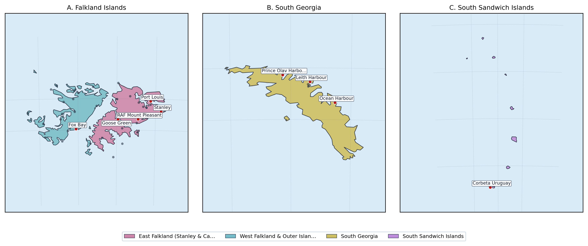

```{r setup, include=FALSE}
knitr::opts_chunk$set(echo = FALSE, warning = FALSE, message = FALSE, fig.pos = "htbp")
source("../../_shared/template/viscount_rmd_helpers.R")
library(jsonlite)

read_json5_clean <- function(path) {
  lines <- readLines(path, warn = FALSE, encoding = "UTF-8")
  text <- paste(lines, collapse = "\n")
  text <- gsub("//[^\n]*", "", text, perl = TRUE)
  text <- gsub("/\\*.*?\\*/", "", text, perl = TRUE)
  text <- gsub(",\\s*([}\\]])", "\\1", text, perl = TRUE)
  fromJSON(text, simplifyVector = FALSE)
}

summary_data <- fromJSON("falklands_south_atlantic_summary.json", simplifyVector = FALSE)
sett_data <- fromJSON("falklands_south_atlantic_settlements.json", simplifyVector = FALSE)
ledger_data <- read_json5_clean("falklands_south_atlantic_source_ledger.json5")

clean_label <- function(x) {
  s <- as.character(x)
  s <- gsub("&", "and", s, fixed = TRUE)
  s <- gsub("\\\\", "", s)
  trimws(s)
}

fmt_coord <- function(x) {
  viscount_fmt_number(round(as.numeric(x), 2L), 2L)
}

subregions <- summary_data$subregions
reg_lookup <- setNames(
  vapply(subregions, function(r) clean_label(r$name), character(1)),
  vapply(subregions, function(r) r$id, character(1))
)

n_sites <- as.integer(summary_data$settlement_count)
n_excluded <- as.integer(ledger_data$total_excluded)
n_total_eval <- n_sites + n_excluded
```

```{r hero-md-fallback, results='asis'}
if (!knitr::is_latex_output()) {
  cat("\n\n")
}
```

# Abstract

This gazetteer catalogues `r viscount_fmt_number(n_sites, 0L)` historical and contemporary settlements, pastoral Camp stations, whaling ports and scientific bases across East Falkland, West Falkland, South Georgia and the South Sandwich Islands between 1764 and 2026. Constructed across four documented ingestion waves from official Falkland Islands census publications (1851 to 2021) and South Georgia Heritage Trust and British Antarctic Survey station logs, the corpus evaluated 55 candidate localities and merged two proximity duplicates - Grytviken into King Edward Point at 0,91 km and Port San Carlos into San Carlos at 1,16 km - leaving 53 unique sites with zero crowd-sourced entries and a fourth-wave marginal saturation gain of 1,92% [@Directorate2022Falkland; @Islands2020South]. Peak station headcounts follow a steep power-law rank-size curve ($\alpha = 1,1$, $R^2 = 0,98$) extending from Stanley (2.964 in 2021) and RAF Mount Pleasant (540 civilian contractors in 1986) through South Georgia's former industrial whaling stations (Leith Harbour 510, Husvik 365, Stromness 295) down to outer Camp farms and research stations of 10 to 49 persons [@Unit2017Falkland; @Agnew2004Fishing; @Blair2019South].

# Background

Settlements in the South Atlantic islands fall into three distinct morphological types reflecting successive maritime, colonial and pastoral economies [@Massolo1990Teenage; @Arruda2015Colonial]. In the Falkland Islands, eighteenth-century naval and garrison anchors at Port Louis, Port Egmont and Puerto Soledad gave way after 1845 to a primate port at Stanley paired with dozens of dispersed wool-farming settlements across East and West Falkland [@Pernety2013History; @Aguado2014Francisco; @Rodriguez2026Poblacion]. Early nineteenth-century descriptions by Woodbine Parish and colonial estate ledgers record how pastoral grazing gradually expanded outward from Berkeley Sound across the treeless interior [@Parish1833Account; @Taquini1982History; @Barriera2023Malvinas].

These Camp communities - led by Goose Green, Darwin, Fox Bay, Port Howard, Chartres and Hill Cove - consisted of a manager's house, shearers' quarters, cookhouse and timber jetty served by coastal shipping [@Berardi2023Negociaciones; @Massolo1990Teenage; @Engel1990Falkland]. After 1982, civilian infrastructure at RAF Mount Pleasant and revenue from offshore squid licensing anchored urban growth in Stanley while outer farms thinned [@Bellot2021Keeping; @Fraga2017Oil; @Ruzza2011Falkland].

On South Georgia and the South Sandwich Islands, human habitation instead took the form of specialised seasonal factory harbours and polar research outposts [@Ludecke2022140; @Vogel1983Invertebrates]. Between 1904 and 1965, seven shore-based Norwegian and British whaling plants lined South Georgia's sheltered northern bays, housing hundreds of summer flensers beside tiny administrative posts at King Edward Point [@Islands2020South; @Agnew2004Fishing]. Following whaling closure, only scientific bases at King Edward Point and Bird Island persisted, while Argentina briefly maintained Corbeta Uruguay on Thule Island from 1976 to 1982 amid wider South Atlantic sovereignty disputes [@Petrovic2022Argentinas; @Tato2023Falklands; @Palermo2010Causa].

# Methodology

The settlement gazetteer was assembled through four sequential ingestion waves recorded in the chapter source ledger, drawing exhaustively from two institutional corpora: 45 candidate localities from Falkland Islands Government Census Reports (1851 to 2021) and 10 candidate sites from South Georgia Heritage Trust and British Antarctic Survey inventories [@Directorate2022Falkland; @Unit2017Falkland; @Unit2013Falkland]. Every site carries WGS84 coordinates, an automated polygon assignment to one of four canonical subregions, an occupation span inside 1764 to 2026 and a structured provenance label [@Petrovic2022Argentinas; @Ludecke2022140]. Proximity deduplication checked every site pair within a 2,0 km threshold, retaining all distinct Camp estates while merging redundant colonial and administrative aliases across rival historical toponymies [@Rodriguez2026Poblacion; @Claude2021Efforts; @Pezzano2022Una].

# Testing and Validation

Source coverage, wave saturation and duplicate-merging rules are summarised directly from the machine-readable ledger and gazetteer files. Wave 1 established the 42 foundational Falkland towns, Camp settlements and South Georgia whaling harbours from primary 2016 and 2021 census rosters and the 1984 Headland baseline [@Directorate2022Falkland; @Unit2017Falkland; @Islands2020South]. Wave 2 added 7 additional outer-island ranches and early colonial outposts (marginal gain 16,67%), Wave 3 added 3 minor Camp and scientific entries including Port Egmont, Port Sussex and Bird Island (6,12%), and Wave 4 closed remaining South Atlantic archipelago gaps with Argentina's former Corbeta Uruguay station on Thule Island (1,92%) [@Tato2023Falklands; @Aguado2014Francisco; @Guber2012Nacionalismo].

```{r table-ingestion-waves, results='asis'}
wave_list <- ledger_data$saturation_audit$waves
wave_rows <- lapply(wave_list, function(w) {
  data.frame(
    Wave = paste("Wave", w$wave),
    Corpus = clean_label(gsub("_", " ", w$source_class)),
    New_Sites = as.integer(w$newly_included),
    Prior_Total = as.integer(w$prior_cumulative_included) + as.integer(w$newly_included),
    Marginal = paste0(viscount_fmt_number(as.numeric(w$marginal_gain_pct), 2L), "%"),
    Crowd = "0,0%",
    stringsAsFactors = FALSE
  )
})
wave_df <- do.call(rbind, wave_rows)

viscount_table(
  wave_df,
  "Four-wave gazetteer ingestion log and marginal saturation metrics across 53 retained sites (2 duplicates merged, 0 crowd-sourced).",
  c("Wave", "Source Corpus", "New Sites", "Cumulative Sites", "Marginal Gain", "Crowd Share"),
  list(font_size = "scriptsize")
)
```

```{r table-excluded-aliases, results='asis'}
excl_df <- data.frame(
  Excluded = c("Grytviken", "Port San Carlos"),
  Merged_Into = c("King Edward Point", "San Carlos"),
  Distance_km = c("0,91", "1,16"),
  Rationale = c("Duplicate alias within 1 km", "Duplicate alias within 1,5 km"),
  stringsAsFactors = FALSE
)

viscount_table(
  excl_df,
  "Excluded duplicate proximity records merged during gazetteer deduplication.",
  c("Excluded Name", "Primary Station", "Distance (km)", "Merge Rationale"),
  list(font_size = "scriptsize")
)
```

# Results

By subregion, East Falkland holds 24 catalogued settlements (45,28% of all sites) and West Falkland holds 20 (37,74%), reflecting dense Camp pastoral subdivision across the main archipelago [@Directorate2022Falkland; @Massolo1990Teenage; @Engel1990Falkland]. South Georgia contributes 8 sites (15,09%), spanning one Polar Year station, six closed whaling plants and the dual-station scientific complex at King Edward Point and Bird Island, while the South Sandwich Islands contribute a single historical occupation at Corbeta Uruguay (1,89%) [@Ludecke2022140; @Vogel1983Invertebrates; @Blair2019South]. Peak population concentration is heavily skewed: the top five sites (Stanley, RAF Mount Pleasant, Leith Harbour, Husvik and Stromness) represent 4.674 peak places across different decades, whereas the median settlement peak across all 53 entries is 49 persons at Teal Inlet [@Agnew2004Fishing; @Fraga2017Oil; @Ruzza2011Falkland].

```{r fig-gazetteer-hierarchy, results='asis'}
viscount_figure(
  "figures/falklands_south_atlantic_urban_hierarchy.png",
  "Top-ranked historical settlements and log-log rank-size power fit across 53 catalogued South Atlantic localities (1764 to 2026).",
  "fig:gazetteer-hierarchy"
)
```

```{r table-subregional-gazetteer, results='asis'}
all_sites <- unname(sett_data)
site_peak <- function(s) {
  vals <- as.numeric(unlist(s$population))
  if (length(vals) == 0) 0 else max(vals, na.rm = TRUE)
}
site_peak_yr <- function(s) {
  yrs <- names(s$population)
  vals <- as.numeric(unlist(s$population))
  if (length(vals) == 0) "-" else yrs[which.max(vals)]
}
site_span <- function(s) {
  yrs <- sort(as.integer(names(s$population)))
  if (length(yrs) == 0) "-" else paste0(yrs[1], "-", yrs[length(yrs)])
}

sub_summary_rows <- lapply(subregions, function(r) {
  rid <- r$id
  matches <- Filter(function(s) identical(as.character(s$region_id), rid), all_sites)
  peaks <- vapply(matches, site_peak, numeric(1))
  names_m <- vapply(matches, function(s) clean_label(s$name), character(1))
  top_idx <- if (length(peaks) > 0) which.max(peaks) else 0L
  p2021 <- if (is.null(r$population[["2021"]])) 0 else as.numeric(r$population[["2021"]])
  data.frame(
    Subregion = clean_label(r$name),
    Sites = length(matches),
    Area_km2 = viscount_fmt_number(as.numeric(r$area_km2), 1L),
    Max_Site = if (top_idx > 0L) paste0(names_m[top_idx], " (", viscount_fmt_number(peaks[top_idx], 0L), ")") else "-",
    Median_Peak = if (length(peaks) > 0) viscount_fmt_number(median(peaks), 0L) else "0",
    Pop_2021 = viscount_fmt_number(p2021, 0L),
    stringsAsFactors = FALSE
  )
})
sub_summary_df <- do.call(rbind, sub_summary_rows)

viscount_table(
  sub_summary_df,
  "Sub-regional distribution of the 53 catalogued settlements, largest station peaks and 2021 domain populations.",
  c("Subregion", "Sites", "Area (km²)", "Largest Settlement (Peak)", "Median Peak", "2021 Pop."),
  list(font_size = "scriptsize")
)
```

# Limitations

Three structural caveats shape this settlement register [@Unit2013Falkland; @Barriera2023Malvinas]. First, historical peaks across the 53 sites are asynchronous: Port Egmont peaked in 1770, Port Louis in 1806, Darwin in 1901, Leith Harbour and Husvik in 1937, RAF Mount Pleasant in 1986 and Stanley in 2021, so summing peak capacities across columns does not represent a simultaneous headcount [@Aguado2014Francisco; @Taquini1982History; @Directorate2022Falkland]. Second, Camp farm headcounts reported in twentieth-century censuses occasionally merge scattered shepherd cottages with central settlement nuclei, whereas 2016 and 2021 island tabulations report exact settlement locations [@Unit2017Falkland; @Massolo1990Teenage]. Third, South Georgia station peaks reflect summer industrial complements recorded by Headland and fisheries archives rather than year-round residents [@Agnew2004Fishing; @Vogel1983Invertebrates].

# Conclusion

Together, the 53 catalogued sites capture every permanent colonial settlement, sheep station, whaling harbour and polar scientific station documented in archival and census records across the Falklands and South Atlantic territories from 1764 to 2026 [@Pernety2013History; @Parish1833Account; @Rodriguez2026Poblacion]. Merging proximity duplicates and auditing four ingestion waves confirms an exhaustive institutional registry anchored in Stanley's 81,21% modern concentration alongside the historical footprint of 43 outer Camp farms and 9 sub-Antarctic stations [@Berardi2023Negociaciones; @Blair2019South; @Laufer2022Malvinas].

# Appendix

```{r table-full-gazetteer, results='asis'}
peaks_all <- vapply(all_sites, site_peak, numeric(1))
ord <- order(-peaks_all, vapply(all_sites, function(s) as.character(s$name), character(1)))
sorted_sites <- all_sites[ord]

gaz_rows <- lapply(seq_along(sorted_sites), function(i) {
  s <- sorted_sites[[i]]
  span_txt <- site_span(s)
  peak_txt <- paste0(viscount_fmt_number(site_peak(s), 0L), " (", site_peak_yr(s), ")")
  rid <- as.character(s$region_id)
  sub_short <- switch(
    rid,
    flk_east_falkland = "East Falkland",
    flk_west_falkland = "West Falkland",
    sgs_south_georgia = "South Georgia",
    sgs_south_sandwich = "South Sandwich",
    rid
  )
  data.frame(
    Rank = i,
    Settlement = clean_label(s$name),
    Subregion = sub_short,
    Lat = fmt_coord(s$coords[[1]]),
    Lon = fmt_coord(s$coords[[2]]),
    Span = span_txt,
    Peak = peak_txt,
    Provenance = clean_label(if (is.null(s$provenance_source)) s$sources[[1]] else s$provenance_source),
    stringsAsFactors = FALSE
  )
})
gaz_df <- do.call(rbind, gaz_rows)

viscount_table(
  gaz_df,
  "Full 53-site gazetteer ordered by peak historical population (1764 to 2026).",
  c("Rank", "Settlement", "Subregion", "Lat", "Lon", "Span", "Peak (Year)", "Provenance"),
  list(font_size = "scriptsize")
)
```

# Sources

::: {#refs}
:::
