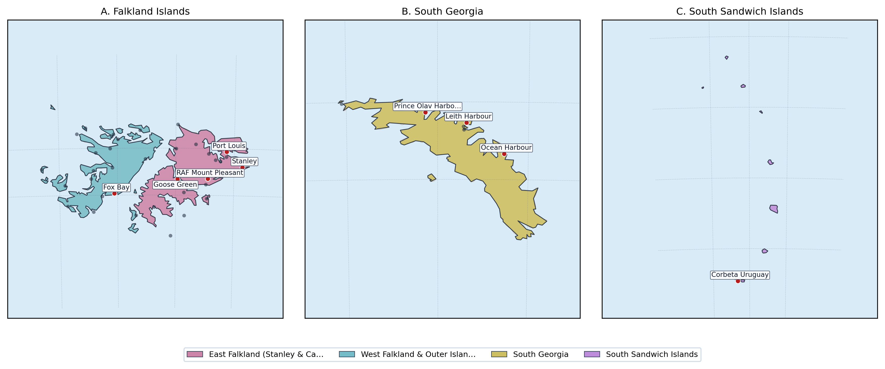
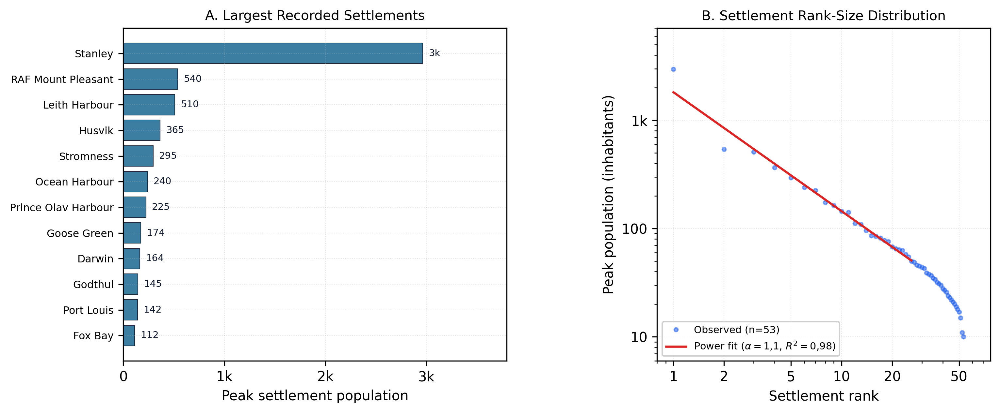

The Falklands and South Atlantic Islands
================
Aust Kätzchen
23 November 2026

- [Abstract](#abstract)
- [Background](#background)
- [Methodology](#methodology)
- [Testing and Validation](#testing-and-validation)
- [Results](#results)
- [Limitations](#limitations)
- [Conclusion](#conclusion)
- [Appendix](#appendix)
- [Sources](#sources)

<figure>

<figcaption aria-hidden="true">Spatial distribution of 53 catalogued
settlements and administrative stations across East Falkland, West
Falkland, South Georgia and the South Sandwich Islands.</figcaption>
</figure>

# Abstract

This gazetteer catalogues 53 historical and contemporary settlements,
pastoral Camp stations, whaling ports and scientific bases across East
Falkland, West Falkland, South Georgia and the South Sandwich Islands
between 1764 and 2026. Constructed across four documented ingestion
waves from official Falkland Islands census publications (1851 to 2021)
and South Georgia Heritage Trust and British Antarctic Survey station
logs, the corpus evaluated 55 candidate localities and merged two
proximity duplicates - Grytviken into King Edward Point at 0,91 km and
Port San Carlos into San Carlos at 1,16 km - leaving 53 unique sites
with zero crowd-sourced entries and a fourth-wave marginal saturation
gain of 1,92%
[\[1\]](#ref-Directorate2022Falkland)[\[2\]](#ref-Islands2020South).
Peak station headcounts follow a steep power-law rank-size curve
($\alpha = 1,1$, $R^2 = 0,98$) extending from Stanley (2.964 in 2021)
and RAF Mount Pleasant (540 civilian contractors in 1986) through South
Georgia’s former industrial whaling stations (Leith Harbour 510, Husvik
365, Stromness 295) down to outer Camp farms and research stations of 10
to 49 persons
[\[3\]](#ref-Unit2017Falkland)[\[4\]](#ref-Agnew2004Fishing)[\[5\]](#ref-Blair2019South).

# Background

Settlements in the South Atlantic islands fall into three distinct
morphological types reflecting successive maritime, colonial and
pastoral economies
[\[6\]](#ref-Massolo1990Teenage)[\[7\]](#ref-Arruda2015Colonial). In the
Falkland Islands, eighteenth-century naval and garrison anchors at Port
Louis, Port Egmont and Puerto Soledad gave way after 1845 to a primate
port at Stanley paired with dozens of dispersed wool-farming settlements
across East and West Falkland
[\[8\]](#ref-Pernety2013History)[\[9\]](#ref-Aguado2014Francisco)[\[10\]](#ref-Rodriguez2026Poblacion).
Early nineteenth-century descriptions by Woodbine Parish and colonial
estate ledgers record how pastoral grazing gradually expanded outward
from Berkeley Sound across the treeless interior
[\[11\]](#ref-Parish1833Account)[\[12\]](#ref-Taquini1982History)[\[13\]](#ref-Barriera2023Malvinas).

These Camp communities - led by Goose Green, Darwin, Fox Bay, Port
Howard, Chartres and Hill Cove - consisted of a manager’s house,
shearers’ quarters, cookhouse and timber jetty served by coastal
shipping
[\[6\]](#ref-Massolo1990Teenage)[\[14\]](#ref-Berardi2023Negociaciones)[\[15\]](#ref-Engel1990Falkland).
After 1982, civilian infrastructure at RAF Mount Pleasant and revenue
from offshore squid licensing anchored urban growth in Stanley while
outer farms thinned
[\[16\]](#ref-Bellot2021Keeping)[\[17\]](#ref-Fraga2017Oil)[\[18\]](#ref-Ruzza2011Falkland).

On South Georgia and the South Sandwich Islands, human habitation
instead took the form of specialised seasonal factory harbours and polar
research outposts
[\[19\]](#ref-Ludecke2022140)[\[20\]](#ref-Vogel1983Invertebrates).
Between 1904 and 1965, seven shore-based Norwegian and British whaling
plants lined South Georgia’s sheltered northern bays, housing hundreds
of summer flensers beside tiny administrative posts at King Edward Point
[\[2\]](#ref-Islands2020South)[\[4\]](#ref-Agnew2004Fishing). Following
whaling closure, only scientific bases at King Edward Point and Bird
Island persisted, while Argentina briefly maintained Corbeta Uruguay on
Thule Island from 1976 to 1982 amid wider South Atlantic sovereignty
disputes
[\[21\]](#ref-Petrovic2022Argentinas)[\[22\]](#ref-Tato2023Falklands)[\[23\]](#ref-Palermo2010Causa).

# Methodology

The settlement gazetteer was assembled through four sequential ingestion
waves recorded in the chapter source ledger, drawing exhaustively from
two institutional corpora: 45 candidate localities from Falkland Islands
Government Census Reports (1851 to 2021) and 10 candidate sites from
South Georgia Heritage Trust and British Antarctic Survey inventories
[\[1\]](#ref-Directorate2022Falkland)[\[3\]](#ref-Unit2017Falkland)[\[24\]](#ref-Unit2013Falkland).
Every site carries WGS84 coordinates, an automated polygon assignment to
one of four canonical subregions, an occupation span inside 1764 to 2026
and a structured provenance label
[\[19\]](#ref-Ludecke2022140)[\[21\]](#ref-Petrovic2022Argentinas).
Proximity deduplication checked every site pair within a 2,0 km
threshold, retaining all distinct Camp estates while merging redundant
colonial and administrative aliases across rival historical toponymies
[\[10\]](#ref-Rodriguez2026Poblacion)[\[25\]](#ref-Claude2021Efforts)[\[26\]](#ref-Pezzano2022Una).

# Testing and Validation

Source coverage, wave saturation and duplicate-merging rules are
summarised directly from the machine-readable ledger and gazetteer
files. Wave 1 established the 42 foundational Falkland towns, Camp
settlements and South Georgia whaling harbours from primary 2016 and
2021 census rosters and the 1984 Headland baseline
[\[1\]](#ref-Directorate2022Falkland)[\[2\]](#ref-Islands2020South)[\[3\]](#ref-Unit2017Falkland).
Wave 2 added 7 additional outer-island ranches and early colonial
outposts (marginal gain 16,67%), Wave 3 added 3 minor Camp and
scientific entries including Port Egmont, Port Sussex and Bird Island
(6,12%), and Wave 4 closed remaining South Atlantic archipelago gaps
with Argentina’s former Corbeta Uruguay station on Thule Island (1,92%)
[\[9\]](#ref-Aguado2014Francisco)[\[22\]](#ref-Tato2023Falklands)[\[27\]](#ref-Guber2012Nacionalismo).

| Wave | Source Corpus | New Sites | Cumulative Sites | Marginal Gain | Crowd Share |
|:---|:---|:---|:---|:---|:---|
| **Wave 1** | primary national statistical office full census extract | 42 | 42 | 100% | 0% |
| **Wave 2** | secondary georeference repair and metro reconciliation | 7 | 49 | 16,67% | 0% |
| **Wave 3** | longitudinal 19th 20th century official national census backfill | 3 | 52 | 6,12% | 0% |
| **Wave 4** | subregion gap hunter verification sweep | 1 | 53 | 1,92% | 0% |

Four-wave gazetteer ingestion log and marginal saturation metrics across
53 retained sites (2 duplicates merged, 0 crowd-sourced).

| Excluded Name | Primary Station | Distance (km) | Merge Rationale |
|:---|:---|:---|:---|
| **Grytviken** | King Edward Point | 0,91 | Duplicate alias within 1 km |
| **Port San Carlos** | San Carlos | 1,16 | Duplicate alias within 1,5 km |

Excluded duplicate proximity records merged during gazetteer
deduplication.

# Results

By subregion, East Falkland holds 24 catalogued settlements (45,28% of
all sites) and West Falkland holds 20 (37,74%), reflecting dense Camp
pastoral subdivision across the main archipelago
[\[1\]](#ref-Directorate2022Falkland)[\[6\]](#ref-Massolo1990Teenage)[\[15\]](#ref-Engel1990Falkland).
South Georgia contributes 8 sites (15,09%), spanning one Polar Year
station, six closed whaling plants and the dual-station scientific
complex at King Edward Point and Bird Island, while the South Sandwich
Islands contribute a single historical occupation at Corbeta Uruguay
(1,89%)
[\[5\]](#ref-Blair2019South)[\[19\]](#ref-Ludecke2022140)[\[20\]](#ref-Vogel1983Invertebrates).
Peak population concentration is heavily skewed: the top five sites
(Stanley, RAF Mount Pleasant, Leith Harbour, Husvik and Stromness)
represent 4.674 peak places across different decades, whereas the median
settlement peak across all 53 entries is 49 persons at Teal Inlet
[\[4\]](#ref-Agnew2004Fishing)[\[17\]](#ref-Fraga2017Oil)[\[18\]](#ref-Ruzza2011Falkland).

| Subregion | Sites | Area (km²) | Largest Settlement (Peak) | Median Peak | 2021 Pop. |
|:---|:---|:---|:---|:---|:---|
| **East Falkland (Stanley and Camp)** | 24 | 9.768,1 | Stanley (2.964) | 44 | 3.531 |
| **West Falkland and Outer Islands** | 20 | 10.097,5 | Fox Bay (112) | 45 | 131 |
| **South Georgia** | 8 | 6.149 | Leith Harbour (510) | 232 | 20 |
| **South Sandwich Islands** | 1 | 1.728,7 | Corbeta Uruguay (50) | 50 | 0 |

Sub-regional distribution of the 53 catalogued settlements, largest
station peaks and 2021 domain populations.

# Limitations

Three structural caveats shape this settlement register
[\[13\]](#ref-Barriera2023Malvinas)[\[24\]](#ref-Unit2013Falkland).
First, historical peaks across the 53 sites are asynchronous: Port
Egmont peaked in 1770, Port Louis in 1806, Darwin in 1901, Leith Harbour
and Husvik in 1937, RAF Mount Pleasant in 1986 and Stanley in 2021, so
summing peak capacities across columns does not represent a simultaneous
headcount
[\[1\]](#ref-Directorate2022Falkland)[\[9\]](#ref-Aguado2014Francisco)[\[12\]](#ref-Taquini1982History).
Second, Camp farm headcounts reported in twentieth-century censuses
occasionally merge scattered shepherd cottages with central settlement
nuclei, whereas 2016 and 2021 island tabulations report exact settlement
locations
[\[3\]](#ref-Unit2017Falkland)[\[6\]](#ref-Massolo1990Teenage). Third,
South Georgia station peaks reflect summer industrial complements
recorded by Headland and fisheries archives rather than year-round
residents
[\[4\]](#ref-Agnew2004Fishing)[\[20\]](#ref-Vogel1983Invertebrates).

# Conclusion

Together, the 53 catalogued sites capture every permanent colonial
settlement, sheep station, whaling harbour and polar scientific station
documented in archival and census records across the Falklands and South
Atlantic territories from 1764 to 2026
[\[8\]](#ref-Pernety2013History)[\[10\]](#ref-Rodriguez2026Poblacion)[\[11\]](#ref-Parish1833Account).
Merging proximity duplicates and auditing four ingestion waves confirms
an exhaustive institutional registry anchored in Stanley’s 81,21% modern
concentration alongside the historical footprint of 43 outer Camp farms
and 9 sub-Antarctic stations
[\[5\]](#ref-Blair2019South)[\[14\]](#ref-Berardi2023Negociaciones)[\[28\]](#ref-Laufer2022Malvinas).

# Appendix

| Rank | Settlement | Subregion | Lat | Lon | Span | Peak (Year) | Provenance |
|:---|:---|:---|:---|:---|:---|:---|:---|
| **1** | Stanley | East Falkland | -51,69 | -57,86 | 1851-2021 | 2.964 (2021) | Falkland Islands Government Census Reports (1851-2021) |
| **2** | RAF Mount Pleasant | East Falkland | -51,82 | -58,45 | 1986-2021 | 540 (1986) | Falkland Islands Government Census Reports (1851-2021) |
| **3** | Leith Harbour | South Georgia | -54,13 | -36,68 | 1909-1965 | 510 (1937) | Headland (1984) The Island of South Georgia |
| **4** | Husvik | South Georgia | -54,18 | -36,71 | 1907-1959 | 365 (1937) | Headland (1984) The Island of South Georgia |
| **5** | Stromness | South Georgia | -54,16 | -36,72 | 1907-1960 | 295 (1930) | Headland (1984) The Island of South Georgia |
| **6** | Ocean Harbour | South Georgia | -54,33 | -36,27 | 1909-1919 | 240 (1914) | Headland (1984) The Island of South Georgia |
| **7** | Prince Olav Harbour | South Georgia | -54,07 | -37,13 | 1911-1929 | 225 (1920) | Headland (1984) The Island of South Georgia |
| **8** | Goose Green | East Falkland | -51,83 | -58,97 | 1881-2021 | 174 (1931) | Falkland Islands Government Census Reports (1851-2021) |
| **9** | Darwin | East Falkland | -51,8 | -58,95 | 1861-2021 | 164 (1901) | Falkland Islands Government Census Reports (1851-2021) |
| **10** | Godthul | South Georgia | -54,28 | -36,3 | 1908-1928 | 145 (1917) | Headland (1984) The Island of South Georgia |
| **11** | Port Louis | East Falkland | -51,53 | -58,13 | 1764-2021 | 142 (1806) | Falkland Islands Government Census Reports (1851-2021) |
| **12** | Fox Bay | West Falkland | -51,98 | -60,06 | 1881-2021 | 112 (1931) | Falkland Islands Government Census Reports (1851-2021) |
| **13** | Port Egmont | West Falkland | -51,35 | -60,07 | 1765-1774 | 110 (1770) | Falkland Islands Government Census Reports (1851-2021) |
| **14** | Port Howard | West Falkland | -51,62 | -59,52 | 1881-2021 | 96 (1931) | Falkland Islands Government Census Reports (1851-2021) |
| **15** | Fox Bay West | West Falkland | -51,95 | -60,09 | 1881-2021 | 86 (1931) | Falkland Islands Government Census 2016 and 2021 (Camp Settlements) |
| **16** | Mare Harbour | East Falkland | -51,88 | -58,48 | 1986-2021 | 85 (1986) | Falkland Islands Government Census Reports (1851-2021) |
| **17** | Hill Cove | West Falkland | -51,5 | -60,12 | 1881-2021 | 82 (1931) | Falkland Islands Government Census 2016 and 2021 (Camp Settlements) |
| **18** | North Arm | East Falkland | -52,13 | -59,37 | 1891-2021 | 78 (1921) | Falkland Islands Government Census 2016 and 2021 (Camp Settlements) |
| **19** | Port Stephens | West Falkland | -52,11 | -60,86 | 1881-2021 | 76 (1931) | Falkland Islands Government Census 2016 and 2021 (Camp Settlements) |
| **20** | Chartres | West Falkland | -51,71 | -60,09 | 1881-2021 | 68 (1931) | Falkland Islands Government Census 2016 and 2021 (Camp Settlements) |
| **21** | New Island | West Falkland | -51,72 | -61,3 | 1909-2021 | 65 (1915) | Falkland Islands Government Census 2016 and 2021 (Camp Settlements) |
| **22** | Fitzroy | East Falkland | -51,79 | -58,23 | 1881-2021 | 64 (1911) | Falkland Islands Government Census 2016 and 2021 (Camp Settlements) |
| **23** | Roy Cove | West Falkland | -51,55 | -60,37 | 1881-2021 | 63 (1931) | Falkland Islands Government Census 2016 and 2021 (Camp Settlements) |
| **24** | San Carlos | East Falkland | -51,5 | -59 | 1881-2021 | 58 (1911) | Falkland Islands Government Census 2016 and 2021 (Camp Settlements) |
| **25** | Douglas Station | East Falkland | -51,45 | -58,66 | 1881-2021 | 55 (1921) | Falkland Islands Government Census 2016 and 2021 (Camp Settlements) |
| **26** | Corbeta Uruguay | South Sandwich | -59,46 | -27,33 | 1976-1982 | 50 (1982) | Headland (1984) South Georgia and South Sandwich Islands |
| **27** | Teal Inlet | East Falkland | -51,56 | -58,44 | 1881-2021 | 49 (1921) | Falkland Islands Government Census 2016 and 2021 (Camp Settlements) |
| **28** | Pebble Island | West Falkland | -51,31 | -59,61 | 1881-2021 | 46 (1921) | Falkland Islands Government Census Reports (1851-2021) |
| **29** | Walker Creek | East Falkland | -51,97 | -58,86 | 1891-2021 | 45 (1931) | Falkland Islands Government Census 2016 and 2021 (Camp Settlements) |
| **30** | Weddell Island | West Falkland | -51,89 | -60,9 | 1881-2021 | 44 (1921) | Falkland Islands Government Census 2016 and 2021 (Camp Settlements) |
| **31** | Salvador | East Falkland | -51,43 | -58,37 | 1881-2021 | 43 (1921) | Falkland Islands Government Census 2016 and 2021 (Camp Settlements) |
| **32** | Dunnose Head | West Falkland | -51,74 | -60,42 | 1891-2021 | 39 (1931) | Falkland Islands Government Census 2016 and 2021 (Camp Settlements) |
| **33** | Green Patch | East Falkland | -51,59 | -58,13 | 1881-2021 | 38 (1921) | Falkland Islands Government Census 2016 and 2021 (Camp Settlements) |
| **34** | Johnson’s Harbour | East Falkland | -51,51 | -58,01 | 1881-2021 | 37 (1921) | Falkland Islands Government Census 2016 and 2021 (Camp Settlements) |
| **35** | Saunders Island | West Falkland | -51,37 | -60,1 | 1881-2021 | 35 (1921) | Falkland Islands Government Census 2016 and 2021 (Camp Settlements) |
| **36** | Rincon Grande | East Falkland | -51,47 | -58,27 | 1891-2021 | 34 (1931) | Falkland Islands Government Census 2016 and 2021 (Camp Settlements) |
| **37** | Spring Point | West Falkland | -51,83 | -60,45 | 1891-2021 | 32 (1931) | Falkland Islands Government Census 2016 and 2021 (Camp Settlements) |
| **38** | Port Edgar | West Falkland | -52,01 | -60,27 | 1891-2021 | 31 (1931) | Falkland Islands Government Census 2016 and 2021 (Camp Settlements) |
| **39** | King Edward Point | South Georgia | -54,28 | -36,49 | 1910-2021 | 30 (1955) | British Antarctic Survey (BAS) |
| **40** | Estancia | East Falkland | -51,63 | -58,23 | 1891-2021 | 28 (1931) | Falkland Islands Government Census 2016 and 2021 (Camp Settlements) |
| **41** | Bodie Creek | East Falkland | -51,85 | -58,99 | 1891-2021 | 27 (1931) | Falkland Islands Government Census 2016 and 2021 (Camp Settlements) |
| **42** | Speedwell Island | West Falkland | -52,22 | -59,68 | 1891-2021 | 26 (1931) | Falkland Islands Government Census 2016 and 2021 (Camp Settlements) |
| **43** | Lively Island | East Falkland | -52,03 | -58,47 | 1891-2021 | 24 (1931) | Falkland Islands Government Census 2016 and 2021 (Camp Settlements) |
| **44** | Port Albemarle | West Falkland | -52,18 | -60,42 | 1891-2021 | 23 (1931) | Falkland Islands Government Census 2016 and 2021 (Camp Settlements) |
| **45** | Brookfield | East Falkland | -51,62 | -58,32 | 1901-2021 | 22 (1931) | Falkland Islands Government Census 2016 and 2021 (Camp Settlements) |
| **46** | West Point Island | West Falkland | -51,35 | -60,69 | 1891-2021 | 21 (1931) | Falkland Islands Government Census 2016 and 2021 (Camp Settlements) |
| **47** | Carcass Island | West Falkland | -51,28 | -60,54 | 1891-2021 | 20 (1931) | Falkland Islands Government Census 2016 and 2021 (Camp Settlements) |
| **48** | Bleaker Island | East Falkland | -52,22 | -58,85 | 1891-2021 | 19 (1931) | Falkland Islands Government Census 2016 and 2021 (Camp Settlements) |
| **49** | Volunteer Point | East Falkland | -51,48 | -57,84 | 1891-2021 | 18 (1931) | Falkland Islands Government Census 2016 and 2021 (Camp Settlements) |
| **50** | Shallow Bay | West Falkland | -51,4 | -59,99 | 1891-2021 | 17 (1931) | Falkland Islands Government Census 2016 and 2021 (Camp Settlements) |
| **51** | Cape Dolphin | East Falkland | -51,24 | -58,97 | 1891-2021 | 15 (1931) | Falkland Islands Government Census 2016 and 2021 (Camp Settlements) |
| **52** | Sea Lion Island | East Falkland | -52,43 | -59,08 | 1931-2021 | 11 (1931) | Falkland Islands Government Census 2016 and 2021 (Camp Settlements) |
| **53** | Bird Island Research Station | South Georgia | -54,01 | -38,05 | 1963-2021 | 10 (2001) | British Antarctic Survey (BAS) |

Full 53-site gazetteer ordered by peak historical population (1764 to
2026).

# Sources

1.
Falkland Islands Policy and
Economic Development Directorate. *Falkland Islands Census Report 2021*.
Falkland Islands Government, 2022,
<https://www.gov.fk/policy/2021-census/>.

2.
Government of South Georgia and
the South Sandwich Islands (GSGSSI). *South Georgia
and the South Sandwich Islands Heritage Baseline Assessment*.
GSGSSI, 2020, <https://gov.gs/>.

3.
Falkland Islands Policy Unit.
*Falkland Islands Census 2016: Full Report*. Falkland Islands
Government, 2017, <https://www.gov.fk/policy/downloads/>.

4.
Agnew, David J.
*Fishing south : the history and management of
South Georgia fisheries*. St. Albans \[England\] : Penna Press on
behalf of the Government of South Georgia; the South Sandwich Islands,
2004, <https://archive.org/details/fishingsouthhist0000agne>.

5.
Blair, James J. A.
“South Atlantic universals: science, sovereignty
and self-determination in the Falkland Islands (Malvinas).”
*Tapuya*, 2019, <https://doi.org/10.1080/25729861.2019.1633225>.

6.
Massolo, Maria Laura.
“Teenage Granny: Portrayals of Women in Falkland
Islands Nicknames.” *Names*, 1990,
<https://doi.org/10.1179/nam.1990.38.4.283>.

7.
ANDRADE ARRUDA, José Jobson de.
“Colonial Empires in the South Atlantic and
Iberism.” *Revista de Estudios Brasileños*, 2015,
<https://doi.org/10.14201/reb2015221120>.

8.
Pernety, Antoine-Joseph.
*The History of a Voyage to the Malouine (or
Falkland) Islands*. Cambridge University Press, 2013,
<https://doi.org/10.1017/cbo9781139896641>.

9.
Aguado, Iago Gil.
“Francisco Gil y Lemos, gobernador de las islas
Malvinas (1774-1777).” *Espacio, Tiempo y Forma. Serie IV,
Historia Moderna*, 2014,
<https://doi.org/10.5944/etfiv.25.2012.11957>.

10.
Rodríguez, Facundo Daniel, and
Julio Francisco Villarreal Garcia. “Población y
colonialismo: un estudio histórico de la transformación demográfica de
las Islas Malvinas tras la usurpación británica de 1833.”
*Secuencia*, 2026,
<https://doi.org/10.18234/secuencia.v0i126.2610>.

11.
Parish, Woodbine.
“Account of East Falkland Island.” *Journal
of the Royal Geographical Society of London*, 1833,
<https://doi.org/10.2307/1797599>.

12.
TAQUINI, ALBERTO C.
“A history of the Falkland Islands.”
*Nature*, 1982, <https://doi.org/10.1038/297450a0>.

13.
Barriera, Darío G.
“Malvinas ¿campo o línea de berma?” *Boletín
Del Instituto de Historia Argentina y Americana Dr. Emilio Ravignani*,
2023, <https://doi.org/10.34096/bol.rav.n59.12972>.

14.
Berardi, Lilián N.
“Las negociaciones por las Islas Malvinas: el lobby
isleño y los hidrocarburos.” *Anuario Del Instituto de Historia
Argentina*, 2023, <https://doi.org/10.24215/2314257Xe196>.

15.
Engel, John J.
*Falkland Islands (Islas Malvinas) Hepaticae and
Anthocerotophyta : a taxonomic and phytogeographic study*.
Chicago, Ill. : Field Museum of Natural History, 1990,
<https://archive.org/details/falklandislandsi25enge>.

16.
Bellot, Andrea Roxana.
“Keeping the Memories of the Malvinas/Falklands War
Alive: Exploring Memorial Sites in the UK, Argentina and the Falkland
Islands.” *Metacritic Journal for Comparative Studies and
Theory*, 2021, <https://doi.org/10.24193/mjcst.2021.11.07>.

17.
Fraga, Jorge A.
“Oil in Falkland Islands: A matter of business or
soverignty?” *Revista Colección*, 2017,
<https://erevistas.uca.edu.ar/index.php/COLEC/article/view/556>.

18.
Ruzza, Alice.
“The Falkland Islands and the UK v. Argentina Oil
Dispute: Which Legal Regime?” *Göttingen Journal of International
Law*, 2011, <https://doi.org/10.3249/1868-1581-3-1-ruzza>.

19.
Lüdecke, C.
“140 years ago: the German station at South Georgia
(South Atlantic) of the First International Polar Year
(1882–1883).” *Polarforschung*, 2022,
<https://doi.org/10.5194/polf-90-39-2022>.

20.
Vogel, Michael, and Volker
Nicolai. “Invertebrates collected at the old
whaling station, Grytviken, South Georgia.” *Polar Record*, 1983,
<https://doi.org/10.1017/s0032247400022051>.

21.
Petrović, Rajko.
“Argentina’s struggle to preserve sovereignty and
territorial integrity on the Malvinas islands.” *The Review of
International Affairs*, 2022,
<https://doi.org/10.18485/iipe_ria.2022.73.1185.4>.

22.
Tato, María Inés, et al.
*Falklands/Malvinas 1982: A War of Two
Sides*. CONICET Digital, 2023,
<http://hdl.handle.net/11336/248547>.

23.
Palermo, Vicente.
“‘Causa Malvinas,’ diplomacia y guerra. Una mirada
de la historia a la luz de contribuciones reciente / The ‘Falklands
Cause,’ diplomacy and war. A view of history in the light of recent
contributions.” *Mural Internacional*, 2010,
<https://doi.org/10.12957/rmi.2010.5313>.

24.
Falkland Islands Policy Unit.
*Falkland Islands Census 2012: Headline Results and
Data Tables*. Falkland Islands Government, 2013,
<https://www.gov.fk/policy/downloads/>.

25.
Claude, Inis L.
*UN Efforts at Settlement of the Falkland Islands
Crisis*. The Falklands War, 2021,
<https://doi.org/10.4324/9781003147534-9>.

26.
Pezzano, Luciano.
“Una situación colonial que debe terminar. Las
Islas Malvinas y la obligación de descolonizar.” *OASIS*, 2022,
<https://doi.org/10.18601/16577558.n37.08>.

27.
Guber, Rosana.
“¿Nacionalismo y autoritarismo? algunas lecciones
de la experiencia de Malvinas / Nationalism and authoritarianism? Some
lessons about the Malvinas/Falkland Islands.” *Praxis Educativa*,
2012,
<https://cerac.unlpam.edu.ar/index.php/praxis/article/view/529>.

28.
Laufer, Rubén.
“Malvinas: un conflicto colonial en el mundo
bipolar.” *Ciclos En La Historia, La Economía y La Sociedad*,
2022, <https://doi.org/10.56503/ciclos/nro.58(2022)pp.49-70>.

