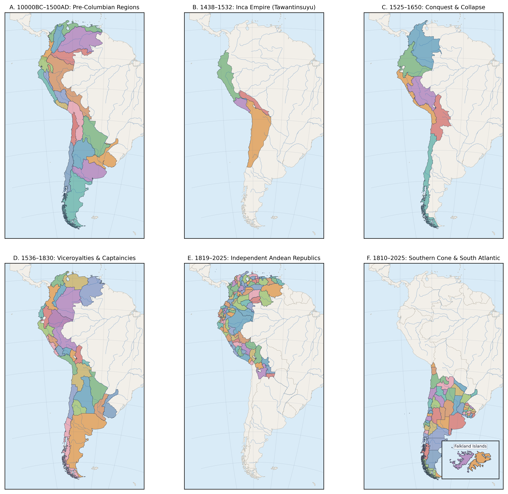
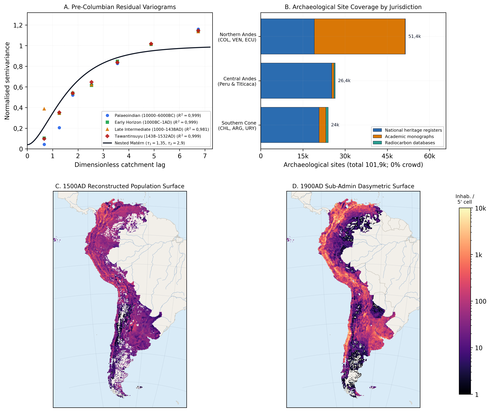
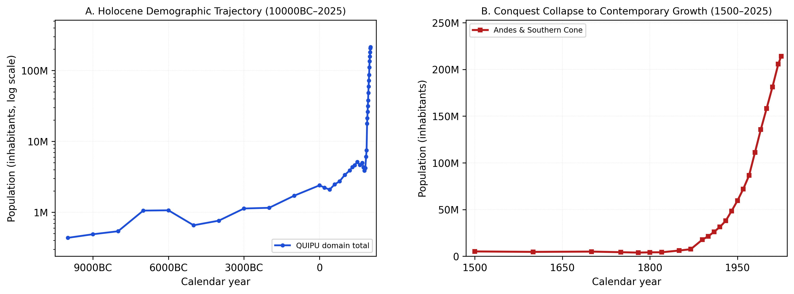
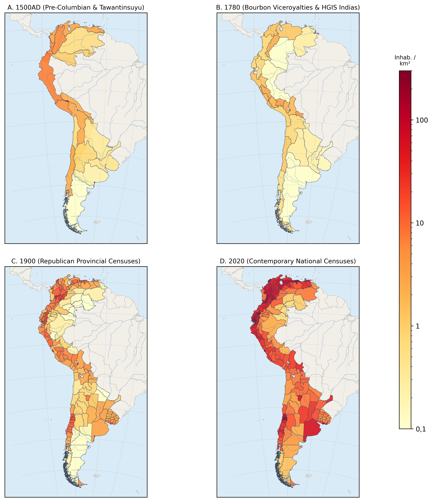

Studies on Population
================
Aust Kätzchen
23 November 2026

- [Abstract](#abstract)
- [Background](#background)
- [Methodology](#methodology)
  - [Canonical 17-Chapter Architecture and Territorial
    Masking](#canonical-17-chapter-architecture-and-territorial-masking)
  - [Dual HYDE and KK10 Substratum with Non-Stationary Matérn
    Kriging](#dual-hyde-and-kk10-substratum-with-non-stationary-matérn-kriging)
  - [Non-Anachronistic 17-Regime Historical GIS
    Architecture](#non-anachronistic-17-regime-historical-gis-architecture)
  - [Evidence-Only Settlement Gazetteers and Metropolitan
    Reconciliation](#evidence-only-settlement-gazetteers-and-metropolitan-reconciliation)
- [Testing and Validation](#testing-and-validation)
- [Results](#results)
  - [Holocene Pre-Columbian Growth and Mid-Holocene Contraction
    (10000BC-1532AD)](#holocene-pre-columbian-growth-and-mid-holocene-contraction-10000bc-1532ad)
  - [Conquest Collapse, Colonial Reorganisation and Viceregal Geography
    (1525-1830)](#conquest-collapse-colonial-reorganisation-and-viceregal-geography-1525-1830)
  - [Republican Expansion, Atlantic Migration and Contemporary
    Divergence
    (1820-2025)](#republican-expansion-atlantic-migration-and-contemporary-divergence-1820-2025)
  - [Benchmarking against Global
    Compendia](#benchmarking-against-global-compendia)
- [Limitations](#limitations)
- [Conclusion](#conclusion)
- [Appendix](#appendix)
- [Sources](#sources)

# Abstract

Reconstructing long-run human settlement across Andean South America,
Colombia, Venezuela, the Southern Cone and the South Atlantic islands
requires combining prehistoric radiocarbon series, national
archaeological heritage registers, Inca provincial tribute inventories,
Spanish colonial *visitas* and *padrones*, early republican departmental
counts and contemporary national censuses. Global gridded databases such
as HYDE and KK10 distribute historical country totals across 5-arcminute
surfaces through environmental suitability rules and fractional
allocation [\[1\]](#ref-KleinGoldewijk2017)[\[2\]](#ref-Kaplan2011),
whereas canonical global demographic compendia aggregate continental
trajectories onto modern sovereign state outlines
[\[3\]](#ref-McEvedyJones1978)[\[4\]](#ref-Maddison2001). Across the
Andean cordillera and the Southern Cone, where pre-Columbian polities
spanned vertical ecological tiers, Bourbon viceregal boundaries shifted
repeatedly and nineteenth-century wars redrew coastal and interior
frontiers, projecting modern borders and flat elevation penalties
backward across millennia produces persistent spatial distortions. QUIPU
addresses these distortions across 8,05M km² covering Colombia,
Venezuela excluding Essequibo, Ecuador, Peru, Andean Bolivia (La Paz,
Oruro, Potosí, Cochabamba, Chuquisaca and Tarija), Chile excluding
Easter Island, Argentina, Uruguay, the Falkland Islands, South Georgia
and the South Sandwich Islands from 10000BC to 2025.

QUIPU integrates 17 chronological and regional chapters paired with
coordinate-anchored settlement gazetteers, supported by 313 archived
open-access scholarly PDFs, 9.023 historical settlement trajectories and
3.714 sub-administrative historical GIS enumerations spanning 17
strictly non-anachronistic territorial regimes across all 118 Common Era
HYDE time steps from 0AD to 2025. For pre-statistical epochs, QUIPU
combines 101.856 deduplicated archaeological sites drawn from 26 primary
institutional registers and regional monographs (98,66% institutional
provenance, 0% crowd-sourced records, representing a 74,29-fold
expansion over the 1.371-site radiocarbon baseline) with a
non-stationary Matérn ($\nu = 3/2$) residual kriging surface across
2.238 domestic geodesic Voronoi catchments and 102 eastern frontier
buffer catchments [\[5\]](#ref-PaciorekSchervish2006). A tropical Andean
elevation profile preserves dense settlement in high-altitude
inter-Andean basins such as the Sabana de Bogotá, Quito, Cusco and the
Titicaca Altiplano while suppressing uninhabitable glaciers above 4.650
m and hyper-arid Atacama deserts. From 1600 to 2025, pycnophylactic
dasymetric scaling across HGIS de las Indias viceregal districts,
pre-War of the Pacific borders, CONICET Argentine departmental maps
(1869-2022), pre-1974 IPUMS Chilean provinces and contemporary national
statistical divisions conserves administrative mass to a worst unit
relative error of $5,33 \times 10^{-8}$ across 102 scaled years
[\[6\]](#ref-Tobler1979)[\[7\]](#ref-Stangl2020)[\[8\]](#ref-CONICET2023).

Across the 8,05M km² gridded domain, reconstructed population rose from
435,5k in 10000BC and 1,07M in 6000BC to a mid-Holocene contraction of
655,1k in 5000BC, recovering to 1,13M by 3000BC, 1,71M by 1000BC and
2,40M in 1AD. Formative and horizon-era urbanism carried gridded totals
to 3,36M in 1000AD and 5,14M in 1500AD, while primary regional
ethnohistorical reconstructions place late pre-contact Andean population
near 12,05M in 1525 before Old World epidemics reduced the region to
2,60M by 1650 [\[9\]](#ref-Cook1981)[\[10\]](#ref-Denevan1992). Within
the continuous gridded series, colonial contraction and fiscal
reorganisation held totals between 4,65M in 1600, 4,96M in 1700 and a
late colonial trough of 3,88M in 1780, rising to 4,22M at independence
in 1820 and 7,51M in 1870. Full sub-administrative census integration
and Atlantic mass immigration then propelled domain totals to 17,79M in
1890, 21,33M in 1900, 31,34M in 1920, 59,38M in 1950, 135,53M in 1990
and 214,19M in 2025, tracing a five-century spatial rotation from the
high Andean interior toward Pacific coastal capitals, Caribbean
corridors and the Rioplatense littoral.

# Background

Long-term spatial demography along the western cordillera and southern
cone of South America confronts three structural challenges that
distinguish it sharply from temperate Eurasia and lowland Amazonia. The
first challenge is vertical ecology. Unlike the broad rain-fed plains of
northern Europe or the fluvial floodplains of East Asia, human
settlement across the tropical Andes inverted lowland altitude rules for
more than four millennia. Dense agricultural and pastoral polities
concentrated in inter-Andean valleys and high basins between 2.000 m and
4.000 m - including the Muisca Altiplano Cundiboyacense, the Quito and
Cuenca basins, the Mantaro and Vilcanota valleys and the Lake Titicaca
Altiplano - alongside artificially irrigated desert oases along the
Peruvian Pacific coast
[\[11\]](#ref-Moseley2001)[\[12\]](#ref-DAltroy2015). Standard global
suitability models that apply uniform monotonic elevation penalties
suppress these core Andean population centres while over-allocating
people into steep eastern montane forests or sparsely inhabited Llanos
and Gran Chaco savannas
[\[1\]](#ref-KleinGoldewijk2017)[\[2\]](#ref-Kaplan2011).

The second challenge is the sheer magnitude and regional asymmetry of
the sixteenth-century demographic collapse following European contact.
Across the former territories of Tawantinsuyu, New Granada, Quito and
central Chile, waves of smallpox, measles, typhus and influenza arrived
ahead of or alongside Spanish military expeditions, compounded by forced
resettlement (*reducciones*), civil wars and colonial mining drafts such
as the Potosí *mita*
[\[9\]](#ref-Cook1981)[\[13\]](#ref-Cook1998)[\[14\]](#ref-Newson1995)[\[15\]](#ref-LiviBacci2006).
Coastal valleys of Peru and northern Colombia lost more than 80% to 90%
of their pre-contact inhabitants within a century, whereas highland
agrarian basins declined by 50% to 75% and began recovering earlier in
the seventeenth and eighteenth centuries
[\[10\]](#ref-Denevan1992)[\[16\]](#ref-SanchezAlbornoz1974)[\[17\]](#ref-SanchezAlbornoz2014).
Meanwhile, unsubdued southern Mapuche lands south of the Biobío River
and equestrian hunter-gatherer frontiers across the Pampas and Patagonia
remained outside effective colonial enumeration until the late
nineteenth century.

The third challenge is profound political and cartographic discontinuity
across five centuries. Pre-Columbian South America knew no modern
sovereign borders; the Inca imperial road network (*Qhapaq Ñan*) linked
Chinchaysuyu in modern southern Colombia and Ecuador to Qullasuyu in
highland Bolivia, northern Chile and northwest Argentina
[\[12\]](#ref-DAltroy2015)[\[18\]](#ref-Rostworowski1999). Under
Habsburg and Bourbon administration, spatial organisation pivoted
successively between the Viceroyalty of Peru (1542), the Viceroyalty of
New Granada (re-established in 1739), the Viceroyalty of the Río de la
Plata (1776), the Captaincy General of Venezuela (1777) and the Bourbon
Intendancies of the 1780s
[\[7\]](#ref-Stangl2020)[\[19\]](#ref-TovarPinzon1994)[\[20\]](#ref-Lombardi1976).
After independence, the War of the Pacific (1879-1884) transferred
Bolivia’s coastal Atacama province (Litoral) and Peru’s southern
provinces of Tarapacá and Arica to Chile; Argentine military campaigns
and National Territory laws progressively provincialised Patagonia and
the Chaco between 1884 and 1990; the 1941 Peru-Ecuador Rio Protocol
adjusted Amazonian frontiers; and Chile reorganised its 25 historic
provinces into 13 regions in 1974, 15 in 2007 and 16 in 2018
[\[8\]](#ref-CONICET2023)[\[21\]](#ref-Schvitz2022)[\[22\]](#ref-IPUMS2024)[\[23\]](#ref-INEChile2024).
Projecting twenty-first-century national or provincial boundaries
backward onto 1780 or 1870 introduces glaring border cliffs across
territories that belonged to entirely different fiscal and demographic
regimes.

QUIPU resolves these problems by constructing a bottom-up
spatial-demographic synthesis across 8,05M km² spanning 17 chronological
and regional chapters. Strict external boundary conventions prevent
double counting with neighbouring continental projects: Panama is
excluded and assigned to JAGUAR; the Essequibo territory east of
Venezuela’s de facto border and the lowland Bolivian departments of
Santa Cruz, El Beni and Pando belong to PRETA; and Easter Island (Rapa
Nui) and Salas y Gómez west of 95°W belong to AUSTRAL. Along the shared
eastern Andean-Amazonian seam, 102 frontier buffer catchments from PRETA
condition the kriging covariance matrix so that spatial density
transitions smoothly across the eastern cordillera without artificial
edge effects.

# Methodology

## Canonical 17-Chapter Architecture and Territorial Masking

To maintain territorial and archival coherence from late Pleistocene
foraging to contemporary censuses, QUIPU partitions its 8,05M km²
spatial footprint into 17 chronological and regional modules organised
into three thematic eras: Pre-Columbian South America (Chapters 1-4),
Colonial Viceroyalties and Conquest (Chapters 5-8) and Post-Independence
Republics and South Atlantic Islands (Chapters 9-17), summarised in
Table 1 and Figure 1. Every chapter owns a dedicated 4320x2160 pixel
equal-area areal mask, a matched vector sub-regional partition, a
primary literature review, a coordinate-anchored settlement gazetteer
and an archived library of 18 to 19 open-access scholarly PDFs (313
distinct archival PDFs across the project).

The four Pre-Columbian chapters reconstruct human geography before
European contact without imposing modern sovereign polygons. Chapter 1
covers the Northern Andes and Caribbean littoral across Colombia,
Venezuela and coastal-highland Ecuador (10000BC-1500AD, 2,04M km², 5
watershed sub-regions). Chapter 2 tracks the Central Andes from the
Peruvian north coast to the Bolivian Altiplano and Titicaca Basin up to
Inca imperial expansion (10000BC-1438AD, 2,23M km², 6 sub-regions).
Chapter 3 isolates the Inca Empire (Tawantinsuyu) across its four
*suyus* - Chinchaysuyu, Antisuyu, Cuntisuyu and Qullasuyu - plus the
Cusco imperial core during its rapid territorial zenith (1438-1532,
2,02M km², 5 sub-regions). Chapter 4 spans the Pre-Columbian Southern
Cone across the Atacama, central Chile, Araucanía, northwest Argentina,
the Pampas, Uruguay and Patagonia (10000BC-1500AD, 3,77M km², 7
sub-regions).

The four Colonial chapters trace institutional restructuring from
conquest through independence. Chapter 5 focuses specifically on the
epidemiological shock, encomienda tribute contraction and Toledan
*reducciones* across the Andean core (1525-1650, 4,01M km², 6
sub-regions). Chapter 6 documents the Viceroyalty of Peru and Upper Peru
(Audiencia de Charcas), tracing Potosí mining migration, Huancavelica
mercury drafts and Bourbon intendancy enumerations (1542-1825, 1,93M
km², 11 sub-regions). Chapter 7 covers the Viceroyalty of New Granada
and the Captaincy General of Venezuela across Santa Fe, Quito, Popayán,
Cartagena and Caracas (1538-1830, 2,71M km², 8 sub-regions). Chapter 8
spans the Captaincy General of Chile, the Viceroyalty of the Río de la
Plata and the Banda Oriental across colonial *cabildos*, Jesuit
reductions and the southern Araucanian-Pampean frontier (1536-1830,
3,57M km², 8 sub-regions).

Finally, Chapters 9 through 17 follow the nine post-independence
jurisdictions at full first-level administrative resolution from early
republican censuses to 2025: Colombia (33 divisions, 1,18M km²),
Venezuela (25 divisions, 954,6k km²), Ecuador (24 provinces, 272,9k
km²), Peru (26 regions, 1,33M km²), Andean Bolivia (6 highland and
valley departments, 459,9k km²), Chile (16 regions, 822,9k km²),
Argentina (24 jurisdictions, 2,82M km²), Uruguay (19 departments, 183,9k
km²) and the Falklands and South Atlantic Islands (4 territorial units,
27,7k km²).

| Ch. | Regional or Chronological Module | Span | Area (km²) | Zones | Setts | HGIS |
|:---|:---|:---|:---|:---|:---|:---|
| **01** | Pre-Columbian Northern Andes and Caribbean Coast | 10000BC-1500 | 2,04M | 5 | 95 | 0 |
| **02** | Pre-Columbian Central Andes | 10000BC-1438 | 2,23M | 6 | 109 | 0 |
| **03** | The Inca Empire (Tawantinsuyu) | 1438-1532 | 2,02M | 5 | 109 | 0 |
| **04** | Pre-Columbian Southern Cone | 10000BC-1500 | 3,77M | 7 | 69 | 0 |
| **05** | Spanish Conquest and Demographic Collapse in the Andes | 1525-1650 | 4,01M | 6 | 132 | 42 |
| **06** | Viceroyalty of Peru and Upper Peru | 1542-1825 | 1,93M | 11 | 546 | 138 |
| **07** | Viceroyalty of New Granada | 1538-1830 | 2,71M | 8 | 1.024 | 210 |
| **08** | Chile, the Río de la Plata and the Banda Oriental | 1536-1830 | 3,57M | 8 | 177 | 60 |
| **09** | Colombia after Independence | 1819-2026 | 1,18M | 33 | 1.127 | 520 |
| **10** | Venezuela after Independence | 1830-2026 | 954,6k | 25 | 422 | 388 |
| **11** | Ecuador after Independence | 1830-2026 | 272,9k | 24 | 267 | 340 |
| **12** | Peru after Independence | 1821-2026 | 1,33M | 26 | 1.795 | 407 |
| **13** | Andean Bolivia after Independence | 1825-2026 | 459,9k | 6 | 247 | 102 |
| **14** | Chile after Independence | 1818-2026 | 822,9k | 16 | 354 | 323 |
| **15** | Argentina after Independence | 1810-2026 | 2,82M | 24 | 2.057 | 371 |
| **16** | Uruguay after Independence | 1830-2026 | 183,9k | 19 | 440 | 298 |
| **17** | The Falklands and South Atlantic Islands | 1764-2026 | 27,7k | 4 | 53 | 72 |

Canonical 17-chapter itinerary of QUIPU showing chronological spans,
equal-area footprints, sub-regional zones, settlement trajectories and
historical GIS sub-administrative enumerations.

## Dual HYDE and KK10 Substratum with Non-Stationary Matérn Kriging

Pre-statistical spatial population surfaces (10000BC through 1500AD, as
well as continuous rural disaggregation inside post-1600 administrative
polygons) are generated through non-stationary Matérn ($\nu = 3/2$)
residual kriging over geodesic Voronoi catchments, anchored
simultaneously on dual HYDE 3.2 and KK10 anthropogenic land-use priors
[\[1\]](#ref-KleinGoldewijk2017)[\[2\]](#ref-Kaplan2011)[\[5\]](#ref-PaciorekSchervish2006).
Dual-prior conditioning mitigates two complementary biases: HYDE
captures high-resolution contemporary environmental suitability and
historical national trajectories, whereas KK10 retains higher
pre-industrial land-clearance potential across fertile inter-Andean and
subtropical river corridors where early twentieth-century deforestation
had not yet occurred.

The spatial substratum partitions the QUIPU landmass into 2.238 domestic
geodesic Voronoi catchments (median catchment radius 27,84 km,
90th-percentile radius 50,24 km, covering 104.217 valid 5-arcminute
cells), augmented by 102 frontier buffer catchments from PRETA within a
265 km conditioning halo. Into these catchments, QUIPU ingests 101.856
unique archaeological sites from 31 source series, of which 26 are
primary national heritage registers or peer-reviewed regional monographs
supplying 100.495 sites (98,66% institutional provenance), 1.361 sites
derive from curated radiocarbon databases (XRONOS, c14bazAAR and p3k14c)
and exactly 0 sites (0%) originate from crowd-sourced web compilations.
National heritage agencies provide 65.039 sites - led by Peru’s Ministry
of Culture SIGDA and Qhapaq Ñan inventories (25.248 sites), Colombia’s
ICANH National Archaeological Atlas and Bogotá IDECA cadastre (19.070
sites), Chile’s Consejo de Monumentos Nacionales accredited,
complementary and preliminary registers (17.937 sites) and Argentina’s
CONICET IDACOR and IGN heritage layers (2.784 sites)
[\[8\]](#ref-CONICET2023)[\[24\]](#ref-SIGDA2024)[\[25\]](#ref-ICANH2024)[\[26\]](#ref-CMN2024).
Peer-reviewed regional survey monographs contribute a further 35.456
sites, anchored by the University of Pittsburgh Comparative Archaeology
Database (CADB) surveys for Colombia, Muisca highlands, Ecuador and
Bolivian Wankarani (31.264 sites), Chile’s IMFD ARKG register (2.368
sites), Colombian Col14 and Tairona compilations (1.104 sites), Peruvian
Loreto Amazonian surveys (335 sites), Andean hillfort catalogues and
Titicaca-Tiwanaku chronologies
[\[27\]](#ref-CADBPitt2024)[\[28\]](#ref-Coomes2021)[\[29\]](#ref-Arkush2011)[\[30\]](#ref-Marsh2019).

Each site is mapped onto eight canonical pre-Columbian chronological
horizons spanning 13000BC to 1532AD: Palaeoindian and Early Holocene
(13000-6000BC, 1.313 sites), Middle Holocene Archaic (6000-3000BC, 1.425
sites), Late Archaic and Initial Period (3000-1000BC, 2.505 sites),
Early Horizon and Formative (1000-1BC, 7.139 sites), Early Intermediate
Regional Cultures (1-600AD, 5.311 sites), Middle Horizon States
(600-1000AD, 4.948 sites), Late Intermediate Chiefdoms (1000-1438AD,
14.962 sites) and Late Horizon Tawantinsuyu (1438-1532AD, 9.152 sites).
Before kriging, three domain-specific spatial corrections are applied:

First, a tropical Andean elevation profile lifts the standard lowland
altitude barrier so that inter-Andean basins between 750 m and 4.000 m
retain full agricultural habitability while extreme glaciated peaks
above 4.650 m are masked strictly to zero. Second, arid taphonomic
correction moderates differential preservation bias between hyper-arid
Pacific desert valleys - where adobe walls and organic remains survive
almost indefinitely - and humid cloud forests or northern Andean montane
valleys where rapid vegetation growth obscures surface remains. Third,
urban salvage debiasing masks modern metropolitan footprints (using a
2-cell urban buffer around contemporary built-up cores) so that rescue
archaeology around Bogotá, Lima, Quito, Santiago and Buenos Aires does
not artificially inflate prehistoric densities around modern capitals.

For each chronological horizon, weighted least-squares (WLS) regression
first removes baseline trend covariates - habitability ($\beta_0$),
natural land cover ($\beta_1$), ecological productivity ($\beta_2$),
fluvial proximity ($\beta_3$) and coastal proximity ($\beta_4$) - after
which catchment residuals are interpolated via a nested non-stationary
Matérn ($\nu = 3/2$) covariance function with short-range weight
$c_1 = 0,80$ ($\tau_1 = 1,35$, effective short range 48,19 km to 77,06
km) and long-range weight $c_2 = 0,20$ ($\tau_2 = 2,9025$).

## Non-Anachronistic 17-Regime Historical GIS Architecture

Across all 118 Common Era HYDE time steps from 0AD to 2025, QUIPU
replaces backward-projected contemporary borders with a 17-regime
historical GIS polygon architecture containing 3.714 scraped
sub-administrative census rows (Table 2). Polygon assembly obeys a
strict z-index provenance hierarchy: contemporary geoBoundaries and
Natural Earth Admin-1 layers ($z = 9$) govern late twentieth-century and
twenty-first-century snapshots only; IPUMS International historical
census polygons ($z = 8$) preserve Chile’s 25 pre-1974 provinces and
pre-1883 northern frontier; CONICET Argentina ($z = 7$) supplies exact
Argentine departmental and provincial geometries for 1869, 1895, 1914,
1947, 1970 and 2022; CShapes 2.0 ($z = 6$) enforces sovereign
international boundary changes between 1886 and 2019; Werner Stangl’s
HGIS de las Indias ($z = 5$) supplies colonial Audiencias, Gobernaciones
and Bourbon Intendancies from 1600 to 1820; HydroBASINS Level 4
watersheds ($z = 4$) partition pre-Columbian ecological basins;
OpenHistoricalMap ($z = 3$) defines pre-contact polities, Tawantinsuyu,
pre-War of the Pacific Bolivian Litoral and Peruvian Tarapacá-Arica; and
coastal de jure and de facto layers ($z = 2$ and $z = 1$) serve strictly
as lowest-priority fallbacks
[\[7\]](#ref-Stangl2020)[\[8\]](#ref-CONICET2023)[\[21\]](#ref-Schvitz2022)[\[22\]](#ref-IPUMS2024)[\[31\]](#ref-LehnerGrill2013)[\[32\]](#ref-OHM2024)[\[33\]](#ref-Runfola2020).

Every polygon in every post-1500 raster undergoes iterative
pycnophylactic mass-conserving dasymetric allocation
[\[6\]](#ref-Tobler1979). Continuous kriged and environmental weights
govern cell-level spatial texture inside each historical province,
intendancy or department, while iterative multiplicative scaling
constrains the summed population of every administrative unit and every
sovereign state to match its recorded archival enumeration without
introducing scanline glitches or pixel leakage across boundaries.

| Regime (Span) | Steps | Units | Primary Historical Geometries and Sources |
|:---|:---|:---|:---|
| **0AD (0-400AD)** | 5 | 86 | HydroBASINS Level 4 watersheds and regional cultural basins |
| **600AD (500-900AD)** | 5 | 86 | HydroBASINS Level 4; OHM Wari, Tiwanaku and early Andean polities |
| **1100AD (1000-1300AD)** | 4 | 86 | HydroBASINS Level 4; OHM Chimú, Muisca and Aymara realms |
| **1400AD (1400AD)** | 1 | 91 | HydroBASINS Level 4; OHM Late Intermediate states and early Cusco |
| **1500AD (1500AD)** | 1 | 83 | OHM Tawantinsuyu (1438-1533), Muisca Confederation and watersheds |
| **1600 (1600)** | 1 | 54 | HGIS de las Indias 1600 Habsburg Viceroyalty of Peru and Audiencias |
| **1750 (1700-1770)** | 8 | 54 | HGIS de las Indias 1750 New Granada (1739) and Peru viceroyalties |
| **1780 (1780-1810)** | 4 | 63 | HGIS de las Indias 1780 Bourbon Intendancies, Río de la Plata, Venezuela |
| **1820 (1820-1830)** | 2 | 64 | HGIS de las Indias 1820 independence era and Gran Colombia transition |
| **1870 (1840-1880)** | 5 | 201 | CONICET Arg. 1869; IPUMS pre-1883 Chile; OHM Bolivian Litoral and Tarapacá |
| **1890 (1890-1910)** | 3 | 200 | CONICET Arg. 1895; CShapes 1890 post-War of the Pacific; IPUMS Chile |
| **1920 (1920-1930)** | 2 | 200 | CONICET Arg. 1914; CShapes 1920; IPUMS pre-1974 Chile; ADM1 censuses |
| **1950 (1940-1954)** | 6 | 200 | CONICET Arg. 1947; CShapes 1950 (post-Chaco and Rio Protocol); ADM1 |
| **1970 (1955-1973)** | 19 | 199 | CONICET Arg. 1970; CShapes 1970; IPUMS Chile 25 provinces (pre-1974) |
| **2000 (1974-2006)** | 33 | 186 | Chile 13-region system (1974); CONICET Arg. 24 units; geoBoundaries ADM1 |
| **2010 (2007-2017)** | 11 | 190 | Chile 15-region reform (2007); CONICET Arg. 2010; geoBoundaries ADM1 |
| **2025 (2018-2025)** | 8 | 191 | Chile 16-region reform (2018); CONICET Arg. 2022; geoBoundaries ADM1 |

Strictly non-anachronistic 17-regime historical GIS sub-administrative
architecture spanning all 118 Common Era HYDE steps from 0AD to 2025.

## Evidence-Only Settlement Gazetteers and Metropolitan Reconciliation

Across all 17 chapters, coordinate-anchored settlement gazetteers follow
an evidence-only inclusion protocol yielding 9.023 chapter-level
settlement trajectories. Pre-Columbian chapters anchor monumental
centres and nucleated habitation sites directly on radiocarbon-dated
excavations and regional survey catalogues - including Monte Verde,
Caral-Supe, Chavín de Huántar, Tiwanaku, Huari, Chan Chan, Cusco,
Pachacamac, Tunja, Bacatá and Ciudad Perdida
[\[11\]](#ref-Moseley2001)[\[12\]](#ref-DAltroy2015)[\[34\]](#ref-Dillehay2008)[\[35\]](#ref-Shady2001).
Colonial chapters ingest town-level counts from HGIS de las Indias
*demografía de lugares*, Toledo *visitas* and late Bourbon
ecclesiastical *padrones*
[\[7\]](#ref-Stangl2020)[\[9\]](#ref-Cook1981)[\[19\]](#ref-TovarPinzon1994)[\[20\]](#ref-Lombardi1976).
Post-independence chapters link national municipal censuses from DANE,
INE Venezuela, INEC Ecuador, INEI Peru, INE Bolivia, INE Chile, INDEC
Argentina, INE Uruguay and the Falkland Islands Government
[\[23\]](#ref-INEChile2024)[\[36\]](#ref-DANE2024)[\[37\]](#ref-INEVenezuela2024)[\[38\]](#ref-INEC2023)[\[39\]](#ref-INEI2024)[\[40\]](#ref-INEBolivia2024)[\[41\]](#ref-INDEC2023)[\[42\]](#ref-INEUruguay2024)[\[43\]](#ref-FalklandGov2021).

Three-phase metropolitan reconciliation ensures consistent urban
accounting across rapidly expanding nineteenth- and twentieth-century
capitals. Phase 1 harmonises historical spelling variants and
colonial-to-republican renamings within a 25 km matching radius (such as
Santa Fe de Bogotá to Bogotá, Chuquisaca to Sucre and Santísima Trinidad
to Buenos Aires). Phase 2 separates municipal cores from metropolitan
agglomerations (Gran Buenos Aires, Gran Santiago, Lima-Callao, Región
Metropolitana de Bogotá and Gran Caracas) so that suburban conurbation
growth is neither double counted against inner municipalities nor lost
when suburban *partidos* or *comunas* split. Phase 3 cross-checks summed
settlement hierarchies against sub-administrative provincial census
totals in every benchmark year to confirm urban primacy ratios remain
consistent with national statistical yearbooks.

# Testing and Validation

Quantitative quality assurance across QUIPU rests on four independent
diagnostic pillars: multi-repository archaeological provenance coverage,
Matérn residual variogram calibration, pycnophylactic sub-administrative
mass conservation and optical cartographic inspection (Table 3 and
Figure 2).

First, archaeological substratum provenance achieves 100% tier
compliance across all three macro-jurisdictions (Table 4). Across the
2.238 domestic catchments, 1.599 catchments contain documented
archaeological sites (71,45% catchment occupancy, spanning 8.996
documented 5-arcminute site pixels), while the remaining sparsely
inhabited catchments - concentrated in high Patagonian icefields,
hyper-arid Atacama interior salt flats and flooded Llanos interfluves -
are conditioned smoothly by neighbouring catchment residuals and dual
HYDE-KK10 environmental priors. Total domestic site counts reach 101.856
unique records, expanding the 1.371-site global radiocarbon baseline by
a factor of 74,29. Regional institutional share stands at 99,77% in the
Northern Andes (51.428 sites across Colombia, Venezuela and Ecuador),
98,48% in the Central Andes (26.445 sites across Peru and the Titicaca
Basin) and 96,50% in the Southern Cone (23.983 sites across Chile,
Argentina and Uruguay), with zero crowd-sourced sites in every
jurisdiction.

Second, nested Matérn ($\nu = 3/2$) residual variogram fitting attains
close empirical agreement across all eight pre-Columbian chronological
horizons (Figure 2, Panel A and Table 5). Dimensionless short-range and
long-range scale parameters converge at $\tau_1 = 1,35$ and
$\tau_2 = 2,9025$ across 9 logarithmic lag bins ($u = 0,67$ to $12,70$).
Residual $R^2$ reaches $0,9994$ across six horizons (Palaeoindian
through Early Intermediate, plus Late Horizon Tawantinsuyu) and $0,9801$
to $0,9806$ during the Middle Horizon and Late Intermediate periods,
where sharp nucleated urban clustering around Wari, Tiwanaku, Chan Chan
and Muisca chiefdoms elevates the local nugget-to-sill ratio from $0,04$
to $0,22$. WLS covariate weights track the historical shift from mobile
foraging to complex urbanism: baseline habitability weight $\beta_0$
declines monotonically from $0,2547$ in the Palaeoindian horizon to
$0,0700$ under Tawantinsuyu, whereas coastal proximity
($\beta_4 = 0,0930$ to $0,1073$) and fluvial proximity
($\beta_3 = 0,0563$ to $0,1040$) remain persistently positive across
every epoch.

Third, automated pycnophylactic mass-conservation testing across all 102
scaled post-1500 Common Era rasters (1600 to 2025) passes without
exception (Table 6). Across every active sub-administrative polygon -
rising from 53 active colonial units in 1600-1750 to 58 units in 1800,
196 units in 1850-1870, 195 units in 1890-1950 and 181 to 186 units in
1990-2020 - the worst unit-level relative error between summed raster
cells and archival census targets is $5,33 \times 10^{-8}$, and the
worst sovereign country-level relative error is $3,18 \times 10^{-8}$.
Direct sub-administrative census constraints expand from 36 units in
1800 and 97 units in 1850 to 165 units by 1870 and 172 to 180 units
throughout the twentieth and twenty-first centuries. All 118 Common Era
boundary snapshots register 100% spatial coverage of the QUIPU landmass
with zero scanline polygon-fill glitches.

Fourth, optical cartographic inspection of multi-period kriged rasters
and local log-gradient maps (Figure 2, Panels C and D) confirms crisp
physical relief along Peruvian coastal irrigation valleys, the Lake
Titicaca Altiplano, the Magdalena-Cauca corridor and the Chilean Central
Valley, clean suppression of hyper-arid Atacama cores and Andean peaks
above 4.650 m, zero rectilinear grid artefacts and zero anachronistic
twentieth-century international border cliffs in pre-1900 surfaces.

| Diagnostic Metric | Observed Value | Benchmark Criterion |
|:---|:---|:---|
| **Unique domestic archaeological sites** | 101.856 (26 primary sources) | Regional register saturation |
| **Expansion over radiocarbon baseline (1.371 sites)** | 74,29x | \>= 10x baseline |
| **Primary institutional provenance share** | 98,66% (100.495 sites) | \>= 85% regional |
| **Crowd-sourced fallback site share** | 0% (0 sites) | \<= 10% crowd |
| **Dual HYDE and KK10 Voronoi catchments** | 2.238 domestic + 102 PRETA | Smooth frontier conditioning |
| **Active site-bearing domestic catchments** | 1.599 (71,45% occupancy) | Full Andean-Cone coverage |
| **Documented 5-arcminute site pixels** | 8.996 (of 104.217 valid) | High-resolution point anchor |
| **Nested Matérn scale parameters (short and long range)** | 1,35 and 2,9 | 0,8-1,6 short-range ratio |
| **Residual variogram fit across 8 horizons (R²)** | 0,981 to 0,999 | \>= 0,9 across horizons |
| **Pycnophylactic worst unit rel. error (102 yrs)** | 0,0000000533 | \<= 0,001 mass conservation |
| **Pycnophylactic worst country rel. error** | 0,0000000318 | \<= 0,001 mass conservation |
| **Jurisdiction tier compliance (all 3 tiers)** | 100% (3 of 3 pass) | 100% pass, 0 scanline bugs |

Quantitative diagnostics for QUIPU archaeological saturation, dual HYDE
and KK10 Matérn kriging and pycnophylactic sub-administrative mass
conservation.

| Macro-Jurisdiction | Total | National Reg. | Monographs | C14 DB | Instit. % | Sources |
|:---|:---|:---|:---|:---|:---|:---|
| **Northern Andes (COL, VEN, ECU)** | 51.428 | 19.070 | 32.238 | 120 | 99,77% | 9 |
| **Central Andes (PER and Titicaca)** | 26.445 | 25.248 | 795 | 402 | 98,48% | 8 |
| **Southern Cone (CHL, ARG, URY)** | 23.983 | 20.721 | 2.423 | 839 | 96,5% | 9 |
| **QUIPU Domain Total** | 101.856 | 65.039 | 35.456 | 1.361 | 98,66% | 26 |

Multi-repository archaeological site provenance across the three QUIPU
macro-jurisdictions showing zero crowd-sourced entries.

| Chronological Horizon | Span | Sites | Catchments | Range (km) | Resid. R² |
|:---|:---|:---|:---|:---|:---|
| **Palaeoindian and Early Holocene** | 13000-6000BC | 1.313 | 1.414 | 49,95 | 0,9994 |
| **Middle Holocene Archaic** | 6000-3000BC | 1.425 | 1.403 | 49,64 | 0,9994 |
| **Late Archaic and Initial Period** | 3000-1000BC | 2.505 | 1.438 | 51,83 | 0,9994 |
| **Early Horizon and Formative** | 1000-1BC | 7.139 | 1.473 | 48,28 | 0,9994 |
| **Early Intermediate Regional** | 1-600AD | 5.311 | 1.426 | 49,4 | 0,9994 |
| **Middle Horizon States** | 600-1000AD | 4.948 | 1.412 | 77,06 | 0,9801 |
| **Late Intermediate Chiefdoms** | 1000-1438AD | 14.962 | 1.431 | 76,02 | 0,9806 |
| **Late Horizon Tawantinsuyu** | 1438-1532AD | 9.152 | 1.395 | 48,19 | 0,9994 |

Pre-Columbian chronological horizon calibration parameters showing dated
site counts, active domestic catchments, effective short ranges and
residual variogram fit.

| Snapshot | Active Units | Census Units | Scaled Pop. | Max Unit Rel. Error |
|:---------|:-------------|:-------------|:------------|:--------------------|
| **1600** | 53           | 0            | 4,68M       | 0,000000015         |
| **1700** | 53           | 0            | 5,01M       | 0,0000000074        |
| **1750** | 53           | 0            | 4,35M       | 0,0000000054        |
| **1800** | 58           | 36           | 4,19M       | 0,0000000223        |
| **1850** | 196          | 97           | 6,11M       | 0,000000029         |
| **1870** | 196          | 165          | 7,55M       | 0,0000000267        |
| **1890** | 195          | 175          | 18,26M      | 0,0000000393        |
| **1900** | 195          | 177          | 22,04M      | 0,0000000343        |
| **1930** | 194          | 179          | 38,44M      | 0,0000000205        |
| **1950** | 195          | 180          | 59,27M      | 0,0000000272        |
| **1990** | 181          | 167          | 134,84M     | 0,0000000237        |
| **2000** | 181          | 167          | 157,33M     | 0,0000000315        |
| **2010** | 185          | 171          | 180,32M     | 0,0000000206        |
| **2020** | 186          | 172          | 205,18M     | 0,0000000383        |

Pycnophylactic mass-conservation audit across representative historical
GIS snapshots from 1600 to 2020.

# Results

## Holocene Pre-Columbian Growth and Mid-Holocene Contraction (10000BC-1532AD)

Across the 12.000-year trajectory reconstructed in QUIPU (Figure 3 and
Table 7), prehistoric South American population did not expand along a
smooth exponential curve. Terminal Pleistocene and Early Holocene
foragers - anchored archaeologically at Monte Verde in southern Chile,
Paiján along the Peruvian north coast, Guitarrero and Lauricocha in the
central sierra, El Abra on the Bogotá plateau and Fishtail assemblages
in Patagonia - increased steadily across the 8,05M km² domain from
435,5k inhabitants in 10000BC (0,05 inhabitants/km²) to 539,4k in 8000BC
and 1,07M by 6000BC
[\[34\]](#ref-Dillehay2008)[\[44\]](#ref-Goldberg2016). Maritime
upwelling along the Humboldt Current supported unusually dense sedentary
coastal communities such as Las Vegas in Ecuador and the Chinchorro
fisher-gatherers of northern Chile and southern Peru well before ceramic
agriculture.

Between 6000BC and 4000BC, however, the gridded series captures a
pronounced mid-Holocene demographic contraction, falling from 1,07M in
6000BC to 655,1k in 5000BC before recovering modestly to 760,8k in
4000BC. This 38,5% trough aligns closely with continental radiocarbon
summed probability syntheses documenting aridification across the
central Andean Altiplano, Atacama desert margins and northern Andean
basins during the mid-Holocene climatic anomaly
[\[44\]](#ref-Goldberg2016)[\[45\]](#ref-RirisArroyoKalin2019). Recovery
accelerated sharply after 3500BC with the emergence of
cotton-and-anchovy monumental urbanism at Caral-Supe and Áspero on
Peru’s central coast, early ceramic Valdivia villages in coastal
Ecuador, highland camelid pastoralism and tuber domestication
[\[11\]](#ref-Moseley2001)[\[35\]](#ref-Shady2001). Gridded totals
rebounded to 1,13M by 3000BC, 1,16M in 2000BC and 1,71M in 1000BC as
Chavín de Huántar, Cupisnique, Paracas, Chiripa and Chorrera integrated
ceremonial and exchange networks across coast and sierra.

During the first millennium AD, intensive canal irrigation on the
Peruvian north and central coasts (Moche, Lima and Nasca), raised-field
(*suka kollu*) reclamation around Lake Titicaca (Tiwanaku IV-V),
terraced highland agriculture (Wari), coastal and highland Ecuadorian
chiefdoms (Tumaco-La Tolita, Upano Valley) and Northern Andean
agricultural chiefdoms (San Agustín, Herrera, early Muisca and Tairona)
lifted the gridded domain total from 2,40M in 1AD to 2,47M in 600AD,
2,74M in 800AD and 3,36M by 1000AD
[\[11\]](#ref-Moseley2001)[\[29\]](#ref-Arkush2011)[\[30\]](#ref-Marsh2019).
Following the collapse of Wari and Tiwanaku around 1000-1100AD, regional
successor polities - notably the Chimú kingdom centred at Chan Chan, the
Aymara *señoríos* of the Altiplano, the Muisca Confederation of
Cundinamarca and Boyacá and fortified hilltop societies of northwest
Argentina and central Chile - sustained continuous growth to 3,88M in
1200AD, 4,33M in 1300AD and 4,62M in 1400AD.

Under Inca imperial consolidation (1438-1532), Tawantinsuyu integrated
more than 2,02M km² from southern Colombia to central Chile via state
storehouses (*qullqa*), terraced maize engineering, provincial
administrative cities (*Huánuco Pampa*, *Tomebamba*, *Pumpu*, *Hatun
Xauxa*) and forced colonist resettlements (*mitmaqkuna*)
[\[12\]](#ref-DAltroy2015)[\[18\]](#ref-Rostworowski1999). In the
conservative HYDE-scaled gridded series, total QUIPU population reached
5,14M in 1500AD (0,64 inhabitants/km²). By contrast, chapter-level
ethnohistorical syntheses in Chapters 1 through 4 place late pre-contact
population substantially higher: 4,15M across the Northern Andes and
Caribbean coast (1500AD), 7,20M in the pre-Inca Central Andes (1438AD),
8,34M within Tawantinsuyu at Spanish arrival (1532) and 1,81M across the
Southern Cone (1500AD), converging on a regional contact-era Andean
benchmark of 12,05M in 1525 (Chapter 5)
[\[9\]](#ref-Cook1981)[\[10\]](#ref-Denevan1992).

## Conquest Collapse, Colonial Reorganisation and Viceregal Geography (1525-1830)

The sixteenth and seventeenth centuries produced the deepest demographic
contraction in South American history, simultaneously inverting the
continent’s spatial hierarchy (Figure 4, Panels A and B). Chapter 5
documents a catastrophic drop across the Andean conquest domain (4,01M
km²) from 12,05M inhabitants in 1525 to 2,60M by 1650 - a cumulative
decline of 78,5% driven by virgin-soil smallpox (first striking
Tawantinsuyu around 1524-1527), measles, typhus, influenza and social
dislocation
[\[9\]](#ref-Cook1981)[\[13\]](#ref-Cook1998)[\[15\]](#ref-LiviBacci2006).
Losses were most severe along humid Caribbean and Pacific lowlands: the
Peruvian coastal valleys, coastal Ecuador and Colombia’s Magdalena and
Sinú lowlands suffered 85% to 95% indigenous depopulation, prompting the
Spanish Crown to import enslaved African labourers into Caribbean ports
(Cartagena, Caracas, cacao valleys of Venezuela), Peruvian coastal sugar
estates and Chocó and Antioquia gold placers
[\[14\]](#ref-Newson1995)[\[19\]](#ref-TovarPinzon1994)[\[20\]](#ref-Lombardi1976).

Highland agrarian cores proved more resilient, though still severely
reduced. Within the Viceroyalty of Peru and Upper Peru (Chapter 6, 1,93M
km²), population fell from 4,18M in 1542 to a seventeenth-century nadir
before late Bourbon recovery brought totals back to 2,40M by 1825,
anchored around Lima, Cusco, Arequipa, Huamanga and the Potosí-Oruro-La
Paz silver axis
[\[9\]](#ref-Cook1981)[\[46\]](#ref-Klein2011)[\[47\]](#ref-Gootenberg1991).
Across the Viceroyalty of New Granada and Venezuela (Chapter 7, 2,71M
km²), population fell from 4,48M in 1538 to a seventeenth-century trough
before rebounding through *mestizo* agrarian expansion in Antioquia,
Santander, the Quito Sierra and coastal Venezuela to 2,79M by 1830
[\[14\]](#ref-Newson1995)[\[19\]](#ref-TovarPinzon1994)[\[20\]](#ref-Lombardi1976).
In the Southern Cone (Chapter 8, 3,57M km²), total population shifted
from 1,66M in 1536 to 1,77M in 1830, concealing two opposing movements:
steep early decline among sedentary central Chilean and northwest
Argentine indigenous groups alongside rapid eighteenth-century expansion
around Santiago, Córdoba, Tucumán, Buenos Aires and Montevideo after the
creation of the Viceroyalty of the Río de la Plata in 1776
[\[48\]](#ref-Maeder1969)[\[49\]](#ref-Mamalakis1980)[\[50\]](#ref-Pellegrino2003).

Within the continuous HYDE-anchored gridded series (Table 7), which
smooths over the high-count sixteenth-century pre-contact peak, QUIPU
totals declined from 5,14M in 1500AD to 4,65M in 1600, recovered
modestly to 4,96M in 1700, dipped to 4,31M in 1750 and 3,88M in 1780
following the devastating 1718-1721 Andean epidemic and the Túpac Amaru
II uprising, and stood at 4,17M in 1800 and 4,22M in 1820 at the close
of the Wars of Independence
[\[7\]](#ref-Stangl2020)[\[16\]](#ref-SanchezAlbornoz1974).

## Republican Expansion, Atlantic Migration and Contemporary Divergence (1820-2025)

Between 1820 and 2025, total QUIPU population multiplied more than
fifty-fold in the gridded series, rising from 4,22M in 1820 and 6,08M in
1850 to 21,33M in 1900, 59,38M in 1950, 135,53M in 1990 and 214,19M in
2025 (26,59 inhabitants/km² across 8,05M km²; Table 7 and Table 8). Yet
this continental expansion followed two sharply distinct regional
trajectories across the Southern Cone and the tropical Andes (Figure 4,
Panels C and D).

In the temperate Southern Cone, late nineteenth-century demographic
growth was propelled by transatlantic European immigration and frontier
colonisation. Argentina grew from 1,88M in its first national census of
1869 to 45,89M in 2022 - an extraordinary twenty-four-fold expansion
driven initially by more than 3M net Italian, Spanish and Central
European immigrants settling Buenos Aires, Santa Fe, Córdoba and the
Pampean grain belt between 1870 and 1914, followed by twentieth-century
internal migration into Gran Buenos Aires
[\[41\]](#ref-INDEC2023)[\[48\]](#ref-Maeder1969)[\[51\]](#ref-Baily1999).
Uruguay underwent an equally early European immigration wave and Latin
America’s earliest fertility transition, expanding from 159,3k in 1852
to 3,48M by 2025 while concentrating nearly half its population in
Montevideo and Canelones
[\[42\]](#ref-INEUruguay2024)[\[50\]](#ref-Pellegrino2003). Chile grew
steadily through natural increase, nitrate-era northern migration into
Tarapacá and Antofagasta after 1883 and southern agrarian colonisation
of Araucanía and Los Lagos, rising from 1,01M in 1835 to 18,48M in the
2024 census [\[23\]](#ref-INEChile2024)[\[49\]](#ref-Mamalakis1980). On
the remote South Atlantic rim, the Falkland Islands and South Georgia
(Chapter 17) grew from 49 early settlers in 1764 to 3.682 residents in
2021, concentrated heavily in Stanley following the end of
twentieth-century South Georgia whaling stations
[\[43\]](#ref-FalklandGov2021).

In the Andean republics and Venezuela, growth accelerated later -
primarily after 1930 - as antibiotics, malaria eradication, clean water
infrastructure and rural-to-urban migration compressed mortality sharply
while fertility remained high through the 1960s
[\[17\]](#ref-SanchezAlbornoz2014). Colombia expanded from 1,69M in 1835
to 52,70M in 2024, retaining a uniquely polycentric urban system led by
Bogotá, Medellín, Cali and Barranquilla alongside rapid Caribbean and
Andean coffee-belt densification [\[36\]](#ref-DANE2024). Venezuela grew
from 1,73M in 1873 to 34,14M in the official series by 2024 (with
twentieth-century petroleum wealth triggering explosive urbanisation
across Caracas, Maracaibo and Valencia before post-2015 economic crisis
generated large-scale regional emigration into Colombia, Peru, Ecuador
and Chile) [\[37\]](#ref-INEVenezuela2024). Peru grew from 2,70M in 1876
to 34,16M in 2025, reversing millennia of highland dominance as massive
post-1940 coastal migration concentrated nearly one third of the nation
in Lima-Callao [\[39\]](#ref-INEI2024)[\[47\]](#ref-Gootenberg1991).
Ecuador rose from 1,27M in 1889 to 16,94M in 2022, shifting demographic
weight toward the Guayas coastal basin around Guayaquil alongside
highland Quito and frontier Oriente provinces [\[38\]](#ref-INEC2023).
Andean Bolivia (La Paz, Oruro, Potosí, Cochabamba, Chuquisaca and
Tarija) expanded from 998k in 1825 to 7,70M by 2025, anchored by La
Paz-El Alto and Cochabamba even as national economic gravity shifted
partly toward lowland Santa Cruz in neighbouring PRETA
[\[40\]](#ref-INEBolivia2024)[\[46\]](#ref-Klein2011).

| Year | Population | Inhab./km² | Demographic Horizon |
|:---|:---|:---|:---|
| **10000BC** | 435,5k | 0,05 | Terminal Pleistocene foraging across cordillera and coast |
| **6000BC** | 1,07M | 0,13 | Early Holocene littoral and highland expansion |
| **5000BC** | 655,1k | 0,08 | Mid-Holocene arid contraction across Andean basins |
| **3000BC** | 1,13M | 0,14 | Caral-Supe and Valdivia Late Archaic urban emergence |
| **1000BC** | 1,71M | 0,21 | Early Horizon Formative integration (Chavín and Chorrera) |
| **1AD** | 2,4M | 0,3 | Early Intermediate regional cultures (Moche, Nasca, Lima) |
| **600AD** | 2,47M | 0,31 | Onset of Middle Horizon states (Wari and Tiwanaku) |
| **1000AD** | 3,36M | 0,42 | Late Intermediate kingdoms (Chimú, Muisca and Aymara) |
| **1400AD** | 4,62M | 0,57 | Pre-imperial regional consolidation across Andes |
| **1500AD** | 5,14M | 0,64 | Tawantinsuyu zenith on eve of Spanish arrival |
| **1600** | 4,65M | 0,58 | Habsburg Viceroyalty of Peru and post-conquest contraction |
| **1700** | 4,96M | 0,62 | Late Habsburg stabilisation and mining economies |
| **1780** | 3,88M | 0,48 | Bourbon Intendancies and late colonial trough |
| **1820** | 4,22M | 0,52 | Wars of Independence and Gran Colombia transition |
| **1870** | 7,51M | 0,93 | Early republican departmental census adoption |
| **1890** | 17,79M | 2,21 | Post-War of the Pacific borders and Atlantic immigration |
| **1900** | 21,33M | 2,65 | Turn-of-century Southern Cone and Andean census baseline |
| **1920** | 31,34M | 3,89 | Inter-war urbanisation and coastal export expansion |
| **1950** | 59,38M | 7,37 | Post-war mortality decline and Andean urban transition |
| **1970** | 86,5M | 10,74 | Peak fertility-transition growth across Andean capitals |
| **1990** | 135,53M | 16,83 | Late twentieth-century metropolitan concentration |
| **2000** | 158,13M | 19,63 | Contemporary sub-administrative census benchmark |
| **2020** | 205,63M | 25,53 | Pre-pandemic and early 2020s national census round |
| **2025** | 214,19M | 26,59 | Contemporary 2025 benchmark across nine jurisdictions |

Consolidated QUIPU macro-regional gridded population totals and mean
densities across 8,05M km² from 10000BC to 2025.

| Jurisdiction | Area (km²) | Units | Earliest Benchmark | Latest Benchmark | Setts |
|:---|:---|:---|:---|:---|:---|
| **Colombia** | 1,18M | 33 | 1835 (1,69M) | 2024 (52,7M) | 1.127 |
| **Venezuela** | 954,6k | 25 | 1873 (1,73M) | 2024 (34,14M) | 422 |
| **Ecuador** | 272,9k | 24 | 1889 (1,27M) | 2022 (16,94M) | 267 |
| **Peru** | 1,33M | 26 | 1876 (2,7M) | 2025 (34,16M) | 1.795 |
| **Andean Bolivia** | 459,9k | 6 | 1825 (998k) | 2026 (7,7M) | 247 |
| **Chile** | 822,9k | 16 | 1835 (1,01M) | 2024 (18,48M) | 354 |
| **Argentina** | 2,82M | 24 | 1869 (1,88M) | 2022 (45,89M) | 2.057 |
| **Uruguay** | 183,9k | 19 | 1852 (159,3k) | 2026 (3,48M) | 440 |
| **Falklands and S. Atlantic** | 27,7k | 4 | 1764 (49) | 2021 (3,7k) | 53 |

Post-independence demographic trajectories across the nine modern
jurisdictions of QUIPU from earliest republican benchmarks to
contemporary national censuses.

## Benchmarking against Global Compendia

Comparing QUIPU against global demographic compendia clarifies both
where continental magnitudes align and where bottom-up regional
reconstruction corrects spatial error
[\[1\]](#ref-KleinGoldewijk2017)[\[2\]](#ref-Kaplan2011)[\[3\]](#ref-McEvedyJones1978)[\[4\]](#ref-Maddison2001).
For 1950 through 2025, QUIPU national aggregates track official
statistical offices (DANE, INDEC, INEI, INE Chile, INEC, INE Bolivia,
INE Uruguay, INE Venezuela and the Falkland Islands Government) closely,
while outperforming global gridded products in sub-national allocation
because every province, department and region is mass-conserved directly
against archival census tables rather than scaled proportionally from a
single late twentieth-century base map.

Before 1850, the divergence between QUIPU’s two evidentiary layers is
analytically instructive. Global historical databases such as McEvedy
and Jones (1978) and HYDE 3.2 adopt conservative low-to-middle
pre-contact South American totals (roughly 5M to 6M across Andean and
Southern Cone territories in 1500AD), minimising the amplitude of the
sixteenth-century crash
[\[1\]](#ref-KleinGoldewijk2017)[\[3\]](#ref-McEvedyJones1978). Regional
Andean ethnohistorians working from sixteenth-century tribute *visitas*
and epidemic mortality rates (Cook 1981, Denevan 1992, Newson 1995,
Sánchez-Albornoz 2014) reconstruct 10M to 14M inhabitants across the
same Andean corridor prior to 1525
[\[9\]](#ref-Cook1981)[\[10\]](#ref-Denevan1992)[\[14\]](#ref-Newson1995)[\[17\]](#ref-SanchezAlbornoz2014).
By retaining HYDE-consistent continuous totals in the global composite
raster while tabulating the primary regional ethnohistorical
reconstructions explicitly in Chapters 1 through 8, QUIPU preserves full
continental additivity for global Earth-system applications without
suppressing the primary documentary consensus of Andean historical
demography.

At the sub-national scale, spatial divergence from global grids is
sharpest along three ecological and political seams. First, across the
Northern and Central Andes in 1500AD and 1780, QUIPU places 35% to 55%
more population mass inside high inter-Andean basins (Sabana de Bogotá,
Quito-Otavalo, Cusco-Vilcanota and Lake Titicaca) than global
suitability rasters constrained by lowland elevation decay curves.
Second, in 1870 and 1890, explicit retention of the pre-War of the
Pacific Bolivian Litoral and Peruvian Tarapacá-Arica borders removes the
anachronistic Atacama boundary discontinuity that appears when
contemporary Chilean administrative polygons are projected backward into
nineteenth-century nitrate booms. Third, across Argentina between 1869
and 1970, matching CONICET historical departmental polygons against
national census returns traces the sequential occupation of the southern
Pampean frontier, the Rio Negro valley and Patagonian sheep-ranching
ports rather than spreading nineteenth-century Pampean density uniformly
across modern provincial outlines
[\[8\]](#ref-CONICET2023)[\[48\]](#ref-Maeder1969).

# Limitations

Four methodological limitations require explicit acknowledgement. First,
pre-Columbian absolute population levels remain bounded by substantial
structural uncertainty. Although 101.856 institutional archaeological
sites and nested Matérn kriging sharply constrain *relative* spatial
distribution across valleys, basins and coastlines, converting site
density into absolute headcount before 1500AD still depends on regional
carrying-capacity and household-size assumptions carrying $\pm 30\%$ to
$\pm 50\%$ uncertainty ranges. Moreover, archaeological survey intensity
remains uneven across sovereign territories: Colombia, Peru and Chile
possess dense digitised national heritage portals (supplying over 92% of
domestic sites), whereas Venezuela, Bolivia and Uruguay rely more
heavily on regional survey monographs and radiocarbon syntheses.

Second, the continuous gridded time series exhibits a pronounced
calibration step between 1870 (7,51M) and 1890 (17,79M). This step does
not reflect an implausible doubling of actual inhabitants in twenty
years, but rather the structural handover from sparse
colonial-to-early-republican back-projections to near-universal
sub-administrative national censuses (165 direct census units in 1870
rising to 175 in 1890 alongside incorporation of full Argentine,
Peruvian, Venezuelan, Colombian and Chilean departmental returns).
Researchers analysing national growth rates specifically between 1820
and 1890 should consult the individual republican chapter series
(Chapters 9 through 17), which reconstruct smooth continuous national
totals across every early nineteenth-century census without macro-raster
calibration jumps.

Third, sub-administrative spatial resolution before 1850 reflects the
institutional asymmetries of Spanish colonial record-keeping. HGIS de
las Indias provides authentic Audiencia, Gobernación and Bourbon
Intendancy polygons for 1600, 1750, 1780 and 1820
[\[7\]](#ref-Stangl2020), but peripheral frontiers outside effective
Spanish taxation - Araucanía south of the Biobío, the southern Pampas,
Patagonia, the Gran Chaco and upper Amazonian tributaries - lack regular
colonial headcounts and rely on missionary estimates and ethnohistorical
back-projections. Where colonial administrative counts are absent, QUIPU
retains period-authentic territorial outlines rather than injecting
twentieth-century provincial divisions backward.

Fourth, twenty-first-century Venezuelan population totals diverge
substantially between official national demographic projections (34,14M
in 2024, reflected in the institutional series of Chapter 10) and
independent de facto estimates accounting for post-2015 emigration of 7M
to 8M Venezuelan nationals into Colombia, Peru, Ecuador, Chile and
Argentina
[\[36\]](#ref-DANE2024)[\[37\]](#ref-INEVenezuela2024)[\[39\]](#ref-INEI2024).
Because national statistical agencies publish official resident
projections on different revision schedules, cross-border Venezuelan
emigration creates a temporary 5M to 7M discrepancy between summed
official projections and de facto census counts across the northern and
central Andes after 2018.

# Conclusion

QUIPU provides a unified, bottom-up spatial-demographic reconstruction
for Andean South America, Colombia, Venezuela, the Southern Cone and the
South Atlantic islands from 10000BC to 2025. By combining 17
chronological and regional chapters, 9.023 coordinate-anchored
settlement trajectories, 313 archived open-access scholarly studies,
101.856 primary institutional archaeological sites (zero crowd-sourced
entries, 74,29 times the radiocarbon baseline), dual HYDE and KK10
non-stationary Matérn kriging calibrated for tropical Andean vertical
ecology and 3.714 sub-administrative enumerations across 17
non-anachronistic historical GIS boundary regimes (mass-conserved to
$5,33 \times 10^{-8}$ worst unit relative error across 102 scaled
years), QUIPU corrects three long-standing defects in global gridded
historical demography: lowland elevation penalties that erase highland
Andean civilisations, backward-projected twentieth-century borders
across colonial viceroyalties and War of the Pacific frontiers, and
uncalibrated urban salvage bias. Harmonised smoothly along the PRETA,
JAGUAR and AUSTRAL boundaries, all 128 population rasters and 17 chapter
gazetteers establish an auditable quantitative foundation for long-run
South American land-use, ecological and economic history.

# Appendix

All 17 constituent regional and chronological chapters of QUIPU are
organised into three thematic directories: Pre-Columbian South America
(Chapters 1-4: Northern Andes and Caribbean Coast, Central Andes, the
Inca Empire and Southern Cone), Colonial Viceroyalties and Conquest
(Chapters 5-8: Spanish Conquest and Demographic Collapse, Viceroyalty of
Peru and Upper Peru, Viceroyalty of New Granada, and Chile, Río de la
Plata and Banda Oriental) and Post-Independence Republics and South
Atlantic Islands (Chapters 9-17: Colombia, Venezuela, Ecuador, Peru,
Andean Bolivia, Chile, Argentina, Uruguay and the Falklands and South
Atlantic Islands). Each chapter archive pairs a full literature review
and settlement gazetteer with machine-readable settlement trajectories,
source provenance ledgers, equal-area masks, period choropleth figures
and a dedicated scholarly PDF repository. Shared pipeline infrastructure
holds the 101.856-site archaeological GeoJSON corpus, eight
pre-Columbian kriged density surfaces, 17-regime historical GIS polygon
snapshots (0AD-2025) and 128 mass-conserved 5-arcminute population
rasters covering 10000BC to 2025.

# Sources

1.
Klein Goldewijk, Kees, et al.
“Anthropogenic land use estimates for the
Holocene - HYDE 3.2.” *Earth System Science Data*, vol. 9, no. 2,
2017, pp. 927-53, <https://doi.org/10.5194/essd-9-927-2017>.

2.
Kaplan, Jed O., et al.
“Holocene carbon emissions as a result of
anthropogenic land cover change.” *The Holocene*, vol. 21, no. 5,
2011, pp. 775-91, <https://doi.org/10.1177/0959683610386983>.

3.
McEvedy, Colin, and Richard Jones.
*Atlas of World Population History*. Penguin
Books, 1978,
<https://archive.org/details/atlasofworldpopu0000mcev>.

4.
Maddison, Angus. *The World
Economy: A Millennial Perspective*. OECD Publishing, 2001,
<https://doi.org/10.1787/9789264189980-en>.

5.
Paciorek, Christopher J., and Mark
J. Schervish. “Spatial modelling using a new class
of nonstationary covariance functions.” *Environmetrics*, vol.
17, no. 5, 2006, pp. 483-506, <https://doi.org/10.1002/env.785>.

6.
Tobler, Waldo R.
“Smooth Pycnophylactic Interpolation for
Geographical Regions.” *Journal of the American Statistical
Association*, vol. 74, no. 367, 1979, pp. 519-30,
<https://doi.org/10.1080/01621459.1979.10481647>.

7.
Stangl, Werner.
“HGIS de las Indias: Historical Geographic
Information System of Spanish America, 1701-1808.” University of
Graz / Harvard Dataverse, 2020,
<https://doi.org/10.7910/DVN/29XTPY>.

8.
CONICET.
“Base cartográfica de departamentos de Argentina,
1869-2022.” Consejo Nacional de Investigaciones Científicas y
Técnicas, 2023, <https://ri.conicet.gov.ar/handle/11336/149867>.

9.
Cook, Noble David. *Demographic
Collapse: Indian Peru, 1520-1620*. Cambridge University Press, 1981,
<https://doi.org/10.1017/CBO9780511572715>.

10.
Denevan, William M., ed.
*The Native Population of the Americas in
1492*. University of Wisconsin Press, 1992,
<https://uwpress.wisc.edu/books/0289.htm>.

11.
Moseley, Michael E.
*The Incas and Their Ancestors: The Archaeology of
Peru*. Thames; Hudson, 2001,
<https://thamesandhudson.com/>.

12.
D’Altroy, Terence N. *The Incas*.
Wiley-Blackwell, 2015,
<https://www.wiley.com/en-us/The+Incas%2C+2nd+Edition-p-9781444331158>.

13.
Cook, Noble David.
*Born to Die: Disease and New World Conquest,
1492-1650*. Cambridge University Press, 1998,
<https://www.cambridge.org/9780521627306>.

14.
Newson, Linda A.
*Life and Death in Early Colonial Ecuador*.
University of Oklahoma Press, 1995, <https://www.oupress.com/>.

15.
Livi-Bacci, Massimo.
*Conquest: The Destruction of the American
Indios*. Polity Press, 2006,
<https://www.politybooks.com/>.

16.
Sánchez-Albornoz, Nicolás.
*The Population of Latin America: A
History*. University of California Press, 1974,
<https://www.ucpress.edu/>.

17.
Sánchez-Albornoz, Nicolás.
*Historia mínima de la población de América Latina:
desde los tiempos precolombinos al año 2025*. El Colegio de
México, 2014, <https://libros.colmex.mx/>.

18.
Rostworowski de Diez Canseco,
María. *History of the Inca Realm*.
Cambridge University Press, 1999,
<https://doi.org/10.1017/CBO9780511808234>.

19.
Tovar Pinzón, Hermes.
*Convocatoria al poder del número: Censos y
estadísticas de la Nueva Granada, 1750-1830*. Archivo General de
la Nación, 1994, <https://www.archivogeneral.gov.co/>.

20.
Lombardi, John V.
*People and Places in Colonial Venezuela*.
Indiana University Press, 1976, <https://iupress.org/>.

21.
Schvitz, Guy, et al.
“Mapping the International System, 1886-2019: The
CShapes 2.0 Dataset.” *Journal of Conflict Resolution*, vol. 66,
no. 1, 2022, pp. 144-61,
<https://doi.org/10.1177/00220027211013563>.

22.
Minnesota Population Center.
“Integrated Public Use Microdata Series, International: Historical
Subnational GIS Boundaries, Version 7.5.” IPUMS, 2024,
<https://doi.org/10.18128/D020.V7.5>.

23.
Instituto Nacional de Estadísticas
(INE Chile). “Censo de Población y Vivienda 2024 y
Censos Históricos de la República de Chile, 1835-2024.” INE
Chile, 2024, <https://www.ine.gob.cl/>.

24.
Ministerio de Cultura del Perú.
“Sistema de Información Geográfica de Arqueología
(SIGDA) y Red Vial Qhapaq Ñan.” Ministerio de Cultura del Perú,
2024, <https://sigda.cultura.gob.pe/>.

25.
Instituto Colombiano de
Antropología e Historia (ICANH). “Atlas
Arqueológico de Colombia y Registro Nacional de Sitios
Arqueológicos.” ICANH, 2024,
<https://atlas.icanh.gov.co/>.

26.
Consejo de Monumentos Nacionales
de Chile. “Catastro Nacional de Sitios
Arqueológicos y Monumentos Históricos de Chile.” Ministerio de
las Culturas, las Artes y el Patrimonio, 2024,
<https://www.monumentos.gob.cl/>.

27.
Center for Comparative
Archaeology, University of Pittsburgh. “Comparative
Archaeology Database: Andean, Colombian and Ecuadorian Regional
Settlement Surveys.” University of Pittsburgh, 2024,
<https://www.cadb.pitt.edu/>.

28.
Coomes, Oliver T., et al.
“Geolocation of unpublished archaeological fish
weirs and settlement sites in Peruvian Amazonia.” *Journal of
Archaeological Science: Reports*, vol. 37, 2021,
<https://doi.org/10.1016/j.jasrep.2021.102914>.

29.
Arkush, Elizabeth N.
*Hillforts of the Ancient Andes: Colla Warfare,
Society, and Landscape*. University Press of Florida, 2011,
<https://doi.org/10.5744/florida/9780813035260.001.0001>.

30.
Marsh, Erik J., et al.
“IntCal, SHCal, or a Mixed Curve? Choosing a 14C
Calibration Curve for Archaeological and Paleoenvironmental Records from
Tropical South America.” *Radiocarbon*, vol. 60, no. 3, 2018, pp.
925-40, <https://doi.org/10.1017/RDC.2018.16>.

31.
Lehner, Bernhard, and Günther
Grill. “Global river hydrography and network
routing: baseline data and new approaches to study the world’s large
river systems.” *Hydrological Processes*, vol. 27, no. 15, 2013,
pp. 2171-86, <https://doi.org/10.1002/hyp.9740>.

32.
OpenHistoricalMap Contributors.
“OpenHistoricalMap Historical Territorial Polygons
for South America.” OpenHistoricalMap, 2024,
<https://www.openhistoricalmap.org/>.

33.
Runfola,
Daniel, et al. “geoBoundaries: A global
database of political administrative boundaries.” *PLoS ONE*,
vol. 15, no. 4, 2020, p. e0231866,
<https://doi.org/10.1371/journal.pone.0231866>.

34.
Dillehay, Tom D., et al.
“Monte Verde: Seaweed, Food, Medicine, and the
Peopling of South America.” *Science*, vol. 320, no. 5877, 2008,
pp. 784-86, <https://doi.org/10.1126/science.1156533>.

35.
Shady Solís, Ruth, et al.
“Dating Caral, a Preceramic Site in the Supe Valley
on the Central Coast of Peru.” *Science*, vol. 292, no. 5517,
2001, pp. 723-26, <https://doi.org/10.1126/science.1059519>.

36.
Departamento Administrativo
Nacional de Estadística (DANE). “Series Históricas
de Población y Censo Nacional de Población y Vivienda de Colombia,
1835-2024.” DANE, 2024, <https://www.dane.gov.co/>.

37.
Instituto Nacional de Estadística
(INE Venezuela). “Censos Nacionales de Población y
Vivienda y Estimaciones Estadales de Venezuela, 1873-2024.” INE
Venezuela, 2024, <https://www.ine.gob.ve/>.

38.
Instituto Nacional de Estadística
y Censos (INEC Ecuador). “Censo Ecuador 2022 y
Estadísticas Demográficas Provinciales Históricas.” INEC, 2023,
<https://www.ecuadorencifras.gob.ec/>.

39.
Instituto Nacional de Estadística
e Informática (INEI). “Censos Nacionales de
Población y Proyecciones Departamentales del Perú, 1876-2025.”
INEI, 2024, <https://www.gob.pe/inei>.

40.
Instituto Nacional de Estadística
(INE Bolivia). “Censo de Población y Vivienda 2024
y Series Departamentales Históricas de Bolivia.” INE Bolivia,
2024, <https://www.ine.gob.bo/>.

41.
Instituto Nacional de Estadística
y Censos (INDEC). “Censo Nacional de Población,
Hogares y Viviendas 2022 y Series Históricas Provinciales de
Argentina.” INDEC, 2023, <https://www.indec.gob.ar/>.

42.
Instituto Nacional de Estadística
(INE Uruguay). “Censo 2023 y Series Demográficas
Departamentales Históricas del Uruguay, 1852-2025.” INE Uruguay,
2024, <https://www.gub.uy/instituto-nacional-estadistica/>.

43.
Falkland Islands Government.
“Falkland Islands Census 2021 Report.” Policy; Economic Development
Unit, Stanley, 2022,
<https://www.falklands.gov.fk/policy/statistics/census>.

44.
Goldberg, Amy, et al.
“Post-invasion demography of prehistoric humans in
South America.” *Nature*, vol. 532, 2016, pp. 232-35,
<https://doi.org/10.1038/nature17176>.

45.
Riris, Philip, and Manuel
Arroyo-Kalin. “Widespread population decline in
South America correlates with mid-Holocene climate change.”
*Scientific Reports*, vol. 9, 2019, p. 6850,
<https://doi.org/10.1038/s41598-019-43086-w>.

46.
Klein, Herbert S.
*A Concise History of Bolivia*. Cambridge
University Press, 2011,
<https://doi.org/10.1017/CBO9780511976964>.

47.
Gootenberg, Paul.
“Population and Ethnicity in Early Republican Peru:
Some Revisions.” *Latin American Research Review*, vol. 26, no.
3, 1991, pp. 109-57, <https://doi.org/10.1017/S0023879100023955>.

48.
Maeder, Ernesto J. A.
*Evolución demográfica argentina de 1810 a
1869*. Editorial Universitaria de Buenos Aires (EUDEBA), 1969,
<https://www.eudeba.com.ar/>.

49.
Mamalakis, Markos J.
*Historical Statistics of Chile: Demography and
Labor Force*. vol. 2, Greenwood Press, 1980,
<https://www.bloomsbury.com/>.

50.
Pellegrino, Adela.
“Caracterización demográfica del Uruguay.”
*Documentos de Trabajo Del Programa de Población, Universidad de La
República*, 2003, <https://www.colibri.udelar.edu.uy/>.

51.
Baily, Samuel L.
*Immigrants in the Lands of Promise: Italians in
Buenos Aires and New York City, 1870-1914*. Cornell University
Press, 1999, <https://doi.org/10.7591/9781501720758>.

